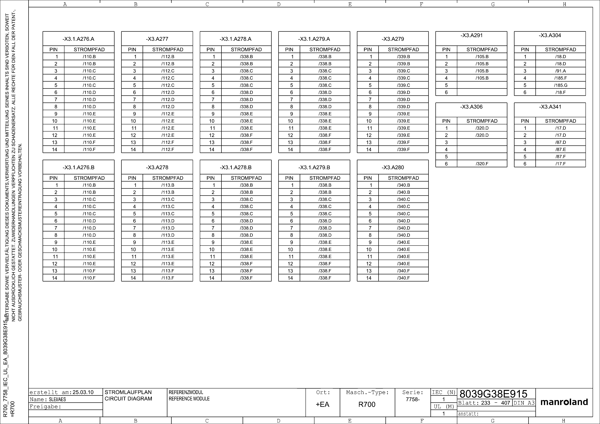

# +EA — Sheet 233 of 407 — REFERENZMODUL

**REFERENCE MODULE**

> Part of the manroland **R700** printing press IEC/UL circuit diagrams.
> Drawing class: **Stromlaufplan / Circuit diagram** (DIN A3).
> Document `+EA` covers the **Printing unit** machine section.

## At a glance

| Field | Value |
|---|---|
| Document | `+EA`  (8039G38E915) |
| Sheet | **233** of 407 |
| Section (DE) | REFERENZMODUL |
| Section (EN) | REFERENCE MODULE |
| Section type | REFERENCE_MODULE — Reference module |
| Machine type | `R700` |
| Series | `7758` |
| Created | 25.03.10 |
| Replaces | — |
| Columns used | A, B, C, D, E, F, G, H |
| Path numbers | — |
| Labels on sheet | 365 |
| Cross-refs out | 159 |
| Cross-refs in | 0 |

**Previous:** [+EA sheet 232](SHEET_0232.md) · **Next:** [+EA sheet 234](SHEET_0234.md) · **Document TOC:** [_TOC.md](_TOC.md)  (+EA) · **Master TOC:** [all sheets](../_MASTER_TOC.md)

## Sheet image (300 DPI, exact vector render)



_Rendered directly from the PDF vector layer at 300 DPI (1-bit), no OCR and no resampling. Use it to confirm anything ambiguous in the text below._

## Cross-references on this sheet

Each entry is a wire leaving this sheet. The printed token is `/sheet.column`; the link resolves to that sheet inside the same document.

| Ref | Target sheet | Col | Path | Destination on target | Target section | From col |
|---|---|---|---|---|---|---|
| `/110.B` | [+EA sheet 110](SHEET_0110.md) | B | — | — | BLAS/SAUGLUFT MIT MOTORVENTILEINSTELLUNG | A |
| `/112.B` | [+EA sheet 112](SHEET_0112.md) | B | — | — | BLAS/SAUGLUFT MIT MOTORVENTILEINSTELLUNG | B |
| `/338.B` | [+EA sheet 338](SHEET_0338.md) | B | — | — | OPTION: BOGENWEICHE | D |
| `/338.B` | [+EA sheet 338](SHEET_0338.md) | B | — | — | OPTION: BOGENWEICHE | E |
| `/339.B` | [+EA sheet 339](SHEET_0339.md) | B | — | — | OPTION: BOGENWEICHE | F |
| `/105.B` | [+EA sheet 105](SHEET_0105.md) | B | — | — | BOGENFÜHRUNGSELEMENT | G |
| `/18.D` | [+EA sheet 18](SHEET_0018.md) | D | — | — | SPANNUNGSVERSORGUNG: 400V, 24V | H |
| `/110.B` | [+EA sheet 110](SHEET_0110.md) | B | — | — | BLAS/SAUGLUFT MIT MOTORVENTILEINSTELLUNG | A |
| `/112.B` | [+EA sheet 112](SHEET_0112.md) | B | — | — | BLAS/SAUGLUFT MIT MOTORVENTILEINSTELLUNG | B |
| `/338.B` | [+EA sheet 338](SHEET_0338.md) | B | — | — | OPTION: BOGENWEICHE | D |
| `/338.B` | [+EA sheet 338](SHEET_0338.md) | B | — | — | OPTION: BOGENWEICHE | E |
| `/339.B` | [+EA sheet 339](SHEET_0339.md) | B | — | — | OPTION: BOGENWEICHE | F |
| `/105.B` | [+EA sheet 105](SHEET_0105.md) | B | — | — | BOGENFÜHRUNGSELEMENT | G |
| `/18.D` | [+EA sheet 18](SHEET_0018.md) | D | — | — | SPANNUNGSVERSORGUNG: 400V, 24V | H |
| `/91.A` | [+EA sheet 91](SHEET_0091.md) | A | — | — | BLASROHRE (BLASRAHMEN) | H |
| `/105.B` | [+EA sheet 105](SHEET_0105.md) | B | — | — | BOGENFÜHRUNGSELEMENT | G |
| `/110.C` | [+EA sheet 110](SHEET_0110.md) | C | — | — | BLAS/SAUGLUFT MIT MOTORVENTILEINSTELLUNG | A |
| `/112.C` | [+EA sheet 112](SHEET_0112.md) | C | — | — | BLAS/SAUGLUFT MIT MOTORVENTILEINSTELLUNG | B |
| `/338.C` | [+EA sheet 338](SHEET_0338.md) | C | — | — | OPTION: BOGENWEICHE | D |
| `/338.C` | [+EA sheet 338](SHEET_0338.md) | C | — | — | OPTION: BOGENWEICHE | E |
| `/339.C` | [+EA sheet 339](SHEET_0339.md) | C | — | — | OPTION: BOGENWEICHE | F |
| `/105.B` | [+EA sheet 105](SHEET_0105.md) | B | — | — | BOGENFÜHRUNGSELEMENT | G |
| `/185.F` | [+EA sheet 185](SHEET_0185.md) | F | — | — | RESERVE | H |
| `/110.C` | [+EA sheet 110](SHEET_0110.md) | C | — | — | BLAS/SAUGLUFT MIT MOTORVENTILEINSTELLUNG | A |
| `/112.C` | [+EA sheet 112](SHEET_0112.md) | C | — | — | BLAS/SAUGLUFT MIT MOTORVENTILEINSTELLUNG | B |
| `/338.C` | [+EA sheet 338](SHEET_0338.md) | C | — | — | OPTION: BOGENWEICHE | D |
| `/338.C` | [+EA sheet 338](SHEET_0338.md) | C | — | — | OPTION: BOGENWEICHE | E |
| `/339.C` | [+EA sheet 339](SHEET_0339.md) | C | — | — | OPTION: BOGENWEICHE | F |
| `/185.G` | [+EA sheet 185](SHEET_0185.md) | G | — | — | RESERVE | H |
| `/110.C` | [+EA sheet 110](SHEET_0110.md) | C | — | — | BLAS/SAUGLUFT MIT MOTORVENTILEINSTELLUNG | A |
| `/112.C` | [+EA sheet 112](SHEET_0112.md) | C | — | — | BLAS/SAUGLUFT MIT MOTORVENTILEINSTELLUNG | B |
| `/338.C` | [+EA sheet 338](SHEET_0338.md) | C | — | — | OPTION: BOGENWEICHE | D |
| `/338.C` | [+EA sheet 338](SHEET_0338.md) | C | — | — | OPTION: BOGENWEICHE | E |
| `/339.C` | [+EA sheet 339](SHEET_0339.md) | C | — | — | OPTION: BOGENWEICHE | F |
| `/18.F` | [+EA sheet 18](SHEET_0018.md) | F | — | — | SPANNUNGSVERSORGUNG: 400V, 24V | H |
| `/110.D` | [+EA sheet 110](SHEET_0110.md) | D | — | — | BLAS/SAUGLUFT MIT MOTORVENTILEINSTELLUNG | A |
| `/112.D` | [+EA sheet 112](SHEET_0112.md) | D | — | — | BLAS/SAUGLUFT MIT MOTORVENTILEINSTELLUNG | B |
| `/338.D` | [+EA sheet 338](SHEET_0338.md) | D | — | — | OPTION: BOGENWEICHE | D |
| `/338.D` | [+EA sheet 338](SHEET_0338.md) | D | — | — | OPTION: BOGENWEICHE | E |
| `/339.D` | [+EA sheet 339](SHEET_0339.md) | D | — | — | OPTION: BOGENWEICHE | F |
| `/110.D` | [+EA sheet 110](SHEET_0110.md) | D | — | — | BLAS/SAUGLUFT MIT MOTORVENTILEINSTELLUNG | A |
| `/112.D` | [+EA sheet 112](SHEET_0112.md) | D | — | — | BLAS/SAUGLUFT MIT MOTORVENTILEINSTELLUNG | B |
| `/338.D` | [+EA sheet 338](SHEET_0338.md) | D | — | — | OPTION: BOGENWEICHE | D |
| `/338.D` | [+EA sheet 338](SHEET_0338.md) | D | — | — | OPTION: BOGENWEICHE | E |
| `/339.D` | [+EA sheet 339](SHEET_0339.md) | D | — | — | OPTION: BOGENWEICHE | F |
| `/110.D` | [+EA sheet 110](SHEET_0110.md) | D | — | — | BLAS/SAUGLUFT MIT MOTORVENTILEINSTELLUNG | A |
| `/112.D` | [+EA sheet 112](SHEET_0112.md) | D | — | — | BLAS/SAUGLUFT MIT MOTORVENTILEINSTELLUNG | B |
| `/338.D` | [+EA sheet 338](SHEET_0338.md) | D | — | — | OPTION: BOGENWEICHE | D |
| `/338.D` | [+EA sheet 338](SHEET_0338.md) | D | — | — | OPTION: BOGENWEICHE | E |
| `/339.D` | [+EA sheet 339](SHEET_0339.md) | D | — | — | OPTION: BOGENWEICHE | F |
| `/110.E` | [+EA sheet 110](SHEET_0110.md) | E | — | — | BLAS/SAUGLUFT MIT MOTORVENTILEINSTELLUNG | A |
| `/112.E` | [+EA sheet 112](SHEET_0112.md) | E | — | — | BLAS/SAUGLUFT MIT MOTORVENTILEINSTELLUNG | B |
| `/338.E` | [+EA sheet 338](SHEET_0338.md) | E | — | — | OPTION: BOGENWEICHE | D |
| `/338.E` | [+EA sheet 338](SHEET_0338.md) | E | — | — | OPTION: BOGENWEICHE | E |
| `/339.E` | [+EA sheet 339](SHEET_0339.md) | E | — | — | OPTION: BOGENWEICHE | F |
| `/110.E` | [+EA sheet 110](SHEET_0110.md) | E | — | — | BLAS/SAUGLUFT MIT MOTORVENTILEINSTELLUNG | A |
| `/112.E` | [+EA sheet 112](SHEET_0112.md) | E | — | — | BLAS/SAUGLUFT MIT MOTORVENTILEINSTELLUNG | B |
| `/338.E` | [+EA sheet 338](SHEET_0338.md) | E | — | — | OPTION: BOGENWEICHE | D |
| `/338.E` | [+EA sheet 338](SHEET_0338.md) | E | — | — | OPTION: BOGENWEICHE | E |
| `/339.E` | [+EA sheet 339](SHEET_0339.md) | E | — | — | OPTION: BOGENWEICHE | F |
| `/110.E` | [+EA sheet 110](SHEET_0110.md) | E | — | — | BLAS/SAUGLUFT MIT MOTORVENTILEINSTELLUNG | A |
| `/112.E` | [+EA sheet 112](SHEET_0112.md) | E | — | — | BLAS/SAUGLUFT MIT MOTORVENTILEINSTELLUNG | B |
| `/338.E` | [+EA sheet 338](SHEET_0338.md) | E | — | — | OPTION: BOGENWEICHE | D |
| `/338.E` | [+EA sheet 338](SHEET_0338.md) | E | — | — | OPTION: BOGENWEICHE | E |
| `/339.E` | [+EA sheet 339](SHEET_0339.md) | E | — | — | OPTION: BOGENWEICHE | F |
| `/17.D` | [+EA sheet 17](SHEET_0017.md) | D | — | — | SPANNUNGSVERSORGUNG: 400V, 24V | H |
| `/320.D` | [+EA sheet 320](SHEET_0320.md) | D | — | — | OPTION: VERLÄNGERUNG 3656,8MM | G |
| `/110.E` | [+EA sheet 110](SHEET_0110.md) | E | — | — | BLAS/SAUGLUFT MIT MOTORVENTILEINSTELLUNG | A |
| `/112.E` | [+EA sheet 112](SHEET_0112.md) | E | — | — | BLAS/SAUGLUFT MIT MOTORVENTILEINSTELLUNG | B |
| `/339.E` | [+EA sheet 339](SHEET_0339.md) | E | — | — | OPTION: BOGENWEICHE | F |
| `/338.F` | [+EA sheet 338](SHEET_0338.md) | F | — | — | OPTION: BOGENWEICHE | D |
| `/338.F` | [+EA sheet 338](SHEET_0338.md) | F | — | — | OPTION: BOGENWEICHE | E |
| `/17.D` | [+EA sheet 17](SHEET_0017.md) | D | — | — | SPANNUNGSVERSORGUNG: 400V, 24V | H |
| `/320.D` | [+EA sheet 320](SHEET_0320.md) | D | — | — | OPTION: VERLÄNGERUNG 3656,8MM | G |
| `/110.F` | [+EA sheet 110](SHEET_0110.md) | F | — | — | BLAS/SAUGLUFT MIT MOTORVENTILEINSTELLUNG | A |
| `/112.F` | [+EA sheet 112](SHEET_0112.md) | F | — | — | BLAS/SAUGLUFT MIT MOTORVENTILEINSTELLUNG | B |
| `/338.F` | [+EA sheet 338](SHEET_0338.md) | F | — | — | OPTION: BOGENWEICHE | D |
| `/338.F` | [+EA sheet 338](SHEET_0338.md) | F | — | — | OPTION: BOGENWEICHE | E |
| `/339.F` | [+EA sheet 339](SHEET_0339.md) | F | — | — | OPTION: BOGENWEICHE | F |
| `/87.D` | [+EA sheet 87](SHEET_0087.md) | D | — | — | SAUGWALZE | H |
| `/87.E` | [+EA sheet 87](SHEET_0087.md) | E | — | — | SAUGWALZE | H |
| `/110.F` | [+EA sheet 110](SHEET_0110.md) | F | — | — | BLAS/SAUGLUFT MIT MOTORVENTILEINSTELLUNG | A |
| `/112.F` | [+EA sheet 112](SHEET_0112.md) | F | — | — | BLAS/SAUGLUFT MIT MOTORVENTILEINSTELLUNG | B |
| `/338.F` | [+EA sheet 338](SHEET_0338.md) | F | — | — | OPTION: BOGENWEICHE | D |
| `/338.F` | [+EA sheet 338](SHEET_0338.md) | F | — | — | OPTION: BOGENWEICHE | E |
| `/339.F` | [+EA sheet 339](SHEET_0339.md) | F | — | — | OPTION: BOGENWEICHE | F |
| `/87.F` | [+EA sheet 87](SHEET_0087.md) | F | — | — | SAUGWALZE | H |
| `/17.F` | [+EA sheet 17](SHEET_0017.md) | F | — | — | SPANNUNGSVERSORGUNG: 400V, 24V | H |
| `/320.F` | [+EA sheet 320](SHEET_0320.md) | F | — | — | OPTION: VERLÄNGERUNG 3656,8MM | G |
| `/110.B` | [+EA sheet 110](SHEET_0110.md) | B | — | — | BLAS/SAUGLUFT MIT MOTORVENTILEINSTELLUNG | A |
| `/113.B` | [+EA sheet 113](SHEET_0113.md) | B | — | — | BLAS/SAUGLUFT MIT MOTORVENTILEINSTELLUNG | B |
| `/338.B` | [+EA sheet 338](SHEET_0338.md) | B | — | — | OPTION: BOGENWEICHE | D |
| `/338.B` | [+EA sheet 338](SHEET_0338.md) | B | — | — | OPTION: BOGENWEICHE | E |
| `/340.B` | [+EA sheet 340](SHEET_0340.md) | B | — | — | OPTION: BOGENWEICHE | F |
| `/110.B` | [+EA sheet 110](SHEET_0110.md) | B | — | — | BLAS/SAUGLUFT MIT MOTORVENTILEINSTELLUNG | A |
| `/113.B` | [+EA sheet 113](SHEET_0113.md) | B | — | — | BLAS/SAUGLUFT MIT MOTORVENTILEINSTELLUNG | B |
| `/338.B` | [+EA sheet 338](SHEET_0338.md) | B | — | — | OPTION: BOGENWEICHE | D |
| `/338.B` | [+EA sheet 338](SHEET_0338.md) | B | — | — | OPTION: BOGENWEICHE | E |
| `/340.B` | [+EA sheet 340](SHEET_0340.md) | B | — | — | OPTION: BOGENWEICHE | F |
| `/110.C` | [+EA sheet 110](SHEET_0110.md) | C | — | — | BLAS/SAUGLUFT MIT MOTORVENTILEINSTELLUNG | A |
| `/113.C` | [+EA sheet 113](SHEET_0113.md) | C | — | — | BLAS/SAUGLUFT MIT MOTORVENTILEINSTELLUNG | B |
| `/338.C` | [+EA sheet 338](SHEET_0338.md) | C | — | — | OPTION: BOGENWEICHE | D |
| `/338.C` | [+EA sheet 338](SHEET_0338.md) | C | — | — | OPTION: BOGENWEICHE | E |
| `/340.C` | [+EA sheet 340](SHEET_0340.md) | C | — | — | OPTION: BOGENWEICHE | F |
| `/110.C` | [+EA sheet 110](SHEET_0110.md) | C | — | — | BLAS/SAUGLUFT MIT MOTORVENTILEINSTELLUNG | A |
| `/113.C` | [+EA sheet 113](SHEET_0113.md) | C | — | — | BLAS/SAUGLUFT MIT MOTORVENTILEINSTELLUNG | B |
| `/338.C` | [+EA sheet 338](SHEET_0338.md) | C | — | — | OPTION: BOGENWEICHE | D |
| `/338.C` | [+EA sheet 338](SHEET_0338.md) | C | — | — | OPTION: BOGENWEICHE | E |
| `/340.C` | [+EA sheet 340](SHEET_0340.md) | C | — | — | OPTION: BOGENWEICHE | F |
| `/110.C` | [+EA sheet 110](SHEET_0110.md) | C | — | — | BLAS/SAUGLUFT MIT MOTORVENTILEINSTELLUNG | A |
| `/113.C` | [+EA sheet 113](SHEET_0113.md) | C | — | — | BLAS/SAUGLUFT MIT MOTORVENTILEINSTELLUNG | B |
| `/338.C` | [+EA sheet 338](SHEET_0338.md) | C | — | — | OPTION: BOGENWEICHE | D |
| `/338.C` | [+EA sheet 338](SHEET_0338.md) | C | — | — | OPTION: BOGENWEICHE | E |
| `/340.C` | [+EA sheet 340](SHEET_0340.md) | C | — | — | OPTION: BOGENWEICHE | F |
| `/110.D` | [+EA sheet 110](SHEET_0110.md) | D | — | — | BLAS/SAUGLUFT MIT MOTORVENTILEINSTELLUNG | A |
| `/113.D` | [+EA sheet 113](SHEET_0113.md) | D | — | — | BLAS/SAUGLUFT MIT MOTORVENTILEINSTELLUNG | B |
| `/338.D` | [+EA sheet 338](SHEET_0338.md) | D | — | — | OPTION: BOGENWEICHE | D |
| `/338.D` | [+EA sheet 338](SHEET_0338.md) | D | — | — | OPTION: BOGENWEICHE | E |
| `/340.D` | [+EA sheet 340](SHEET_0340.md) | D | — | — | OPTION: BOGENWEICHE | F |
| `/110.D` | [+EA sheet 110](SHEET_0110.md) | D | — | — | BLAS/SAUGLUFT MIT MOTORVENTILEINSTELLUNG | A |
| `/113.D` | [+EA sheet 113](SHEET_0113.md) | D | — | — | BLAS/SAUGLUFT MIT MOTORVENTILEINSTELLUNG | B |
| `/338.D` | [+EA sheet 338](SHEET_0338.md) | D | — | — | OPTION: BOGENWEICHE | D |
| `/338.D` | [+EA sheet 338](SHEET_0338.md) | D | — | — | OPTION: BOGENWEICHE | E |
| `/340.D` | [+EA sheet 340](SHEET_0340.md) | D | — | — | OPTION: BOGENWEICHE | F |
| `/110.D` | [+EA sheet 110](SHEET_0110.md) | D | — | — | BLAS/SAUGLUFT MIT MOTORVENTILEINSTELLUNG | A |
| `/113.D` | [+EA sheet 113](SHEET_0113.md) | D | — | — | BLAS/SAUGLUFT MIT MOTORVENTILEINSTELLUNG | B |
| `/338.D` | [+EA sheet 338](SHEET_0338.md) | D | — | — | OPTION: BOGENWEICHE | D |
| `/338.D` | [+EA sheet 338](SHEET_0338.md) | D | — | — | OPTION: BOGENWEICHE | E |
| `/340.D` | [+EA sheet 340](SHEET_0340.md) | D | — | — | OPTION: BOGENWEICHE | F |
| `/110.E` | [+EA sheet 110](SHEET_0110.md) | E | — | — | BLAS/SAUGLUFT MIT MOTORVENTILEINSTELLUNG | A |
| `/113.E` | [+EA sheet 113](SHEET_0113.md) | E | — | — | BLAS/SAUGLUFT MIT MOTORVENTILEINSTELLUNG | B |
| `/338.E` | [+EA sheet 338](SHEET_0338.md) | E | — | — | OPTION: BOGENWEICHE | D |
| `/338.E` | [+EA sheet 338](SHEET_0338.md) | E | — | — | OPTION: BOGENWEICHE | E |
| `/340.E` | [+EA sheet 340](SHEET_0340.md) | E | — | — | OPTION: BOGENWEICHE | F |
| `/110.E` | [+EA sheet 110](SHEET_0110.md) | E | — | — | BLAS/SAUGLUFT MIT MOTORVENTILEINSTELLUNG | A |
| `/113.E` | [+EA sheet 113](SHEET_0113.md) | E | — | — | BLAS/SAUGLUFT MIT MOTORVENTILEINSTELLUNG | B |
| `/338.E` | [+EA sheet 338](SHEET_0338.md) | E | — | — | OPTION: BOGENWEICHE | D |
| `/338.E` | [+EA sheet 338](SHEET_0338.md) | E | — | — | OPTION: BOGENWEICHE | E |
| `/340.E` | [+EA sheet 340](SHEET_0340.md) | E | — | — | OPTION: BOGENWEICHE | F |
| `/110.E` | [+EA sheet 110](SHEET_0110.md) | E | — | — | BLAS/SAUGLUFT MIT MOTORVENTILEINSTELLUNG | A |
| `/113.E` | [+EA sheet 113](SHEET_0113.md) | E | — | — | BLAS/SAUGLUFT MIT MOTORVENTILEINSTELLUNG | B |
| `/338.E` | [+EA sheet 338](SHEET_0338.md) | E | — | — | OPTION: BOGENWEICHE | D |
| `/338.E` | [+EA sheet 338](SHEET_0338.md) | E | — | — | OPTION: BOGENWEICHE | E |
| `/340.E` | [+EA sheet 340](SHEET_0340.md) | E | — | — | OPTION: BOGENWEICHE | F |
| `/110.E` | [+EA sheet 110](SHEET_0110.md) | E | — | — | BLAS/SAUGLUFT MIT MOTORVENTILEINSTELLUNG | A |
| `/113.E` | [+EA sheet 113](SHEET_0113.md) | E | — | — | BLAS/SAUGLUFT MIT MOTORVENTILEINSTELLUNG | B |
| `/340.E` | [+EA sheet 340](SHEET_0340.md) | E | — | — | OPTION: BOGENWEICHE | F |
| `/338.F` | [+EA sheet 338](SHEET_0338.md) | F | — | — | OPTION: BOGENWEICHE | D |
| `/338.F` | [+EA sheet 338](SHEET_0338.md) | F | — | — | OPTION: BOGENWEICHE | E |
| `/110.F` | [+EA sheet 110](SHEET_0110.md) | F | — | — | BLAS/SAUGLUFT MIT MOTORVENTILEINSTELLUNG | A |
| `/113.F` | [+EA sheet 113](SHEET_0113.md) | F | — | — | BLAS/SAUGLUFT MIT MOTORVENTILEINSTELLUNG | B |
| `/338.F` | [+EA sheet 338](SHEET_0338.md) | F | — | — | OPTION: BOGENWEICHE | D |
| `/338.F` | [+EA sheet 338](SHEET_0338.md) | F | — | — | OPTION: BOGENWEICHE | E |
| `/340.F` | [+EA sheet 340](SHEET_0340.md) | F | — | — | OPTION: BOGENWEICHE | F |
| `/110.F` | [+EA sheet 110](SHEET_0110.md) | F | — | — | BLAS/SAUGLUFT MIT MOTORVENTILEINSTELLUNG | A |
| `/113.F` | [+EA sheet 113](SHEET_0113.md) | F | — | — | BLAS/SAUGLUFT MIT MOTORVENTILEINSTELLUNG | B |
| `/338.F` | [+EA sheet 338](SHEET_0338.md) | F | — | — | OPTION: BOGENWEICHE | D |
| `/338.F` | [+EA sheet 338](SHEET_0338.md) | F | — | — | OPTION: BOGENWEICHE | E |
| `/340.F` | [+EA sheet 340](SHEET_0340.md) | F | — | — | OPTION: BOGENWEICHE | F |

## Devices on this sheet

| Tag | Class | Class meaning (IEC) | Col | Sub | Terminal | Sign |
|---|---|---|---|---|---|---|
| `X3.1.A276.A` | — | cross-device reference | A | — | — | — |
| `X3.1.A276.B` | — | cross-device reference | A | — | — | — |
| `X3.A277` | — | cross-device reference | B | — | — | — |
| `X3.A278` | — | cross-device reference | B | — | — | — |
| `X3.1.A278.A` | — | cross-device reference | C | — | — | — |
| `X3.1.A278.B` | — | cross-device reference | C | — | — | — |
| `X3.1.A279.A` | — | cross-device reference | D | — | — | — |
| `X3.1.A279.B` | — | cross-device reference | E | — | — | — |
| `X3.A279` | — | cross-device reference | F | — | — | — |
| `X3.A280` | — | cross-device reference | F | — | — | — |
| `X3.A291` | — | cross-device reference | G | — | — | — |
| `X3.A306` | — | cross-device reference | G | — | — | — |
| `X3.A304` | — | cross-device reference | H | — | — | — |
| `X3.A341` | — | cross-device reference | H | — | — | — |

## Potentials / nets

_No named potentials on this sheet._

## Wire-end annotations (grouped as printed)

A wire that continues elsewhere is annotated with a small cluster: the destination description, the path/line number `#NN`, and the `/sheet.column` cross reference. Each row below is one such cluster exactly as it is grouped on the drawing.

| Col | Y | Path | Cross-ref | Text on the wire |
|---|---|---|---|---|
| G | 65.5 | — | — | `X3.A291` |
| H | 65.5 | — | — | `X3.A304` |
| A | 72.6 | — | — | `X3.1.A276.A` |
| B | 72.6 | — | — | `X3.A277` |
| C | 72.6 | — | — | `X3.1.A278.A` |
| D | 72.6 | — | — | `X3.1.A279.A` |
| F | 72.6 | — | — | `X3.A279` |
| A | 94.2 | — | — | `PIN STROMPFAD` |
| B | 94.2 | — | — | `PIN STROMPFAD` |
| C | 94.2 | — | — | `PIN STROMPFAD` |
| D | 94.2 | — | — | `PIN STROMPFAD` |
| F | 94.2 | — | — | `PIN STROMPFAD` |
| G | 94.2 | — | — | `PIN 2 3 4 5 6 1 STROMPFAD` |
| H | 94.2 | — | — | `PIN 2 3 4 5 6 1 STROMPFAD` |
| A | 108.4 | — | — | `2 3 4 5 6 7 8 9 1` |
| B | 108.4 | — | — | `2 3 4 5 6 7 8 9 1` |
| C | 108.4 | — | — | `2 3 4 5 6 7 8 9 1` |
| D | 108.4 | — | — | `2 3 4 5 6 7 8 9 1` |
| E | 108.4 | — | — | `2 3 4 5 6 7 8 9 1` |
| A | 108.7 | — | `/110.B` | — |
| B | 108.7 | — | `/112.B` | — |
| D | 108.7 | — | `/338.B` | — |
| E | 108.7 | — | `/338.B` | — |
| F | 108.7 | — | `/339.B` | — |
| G | 108.7 | — | `/105.B` | — |
| H | 108.7 | — | `/18.D` | — |
| A | 122.9 | — | `/110.B` | — |
| B | 122.9 | — | `/112.B` | — |
| D | 122.9 | — | `/338.B` | — |
| E | 122.9 | — | `/338.B` | — |
| F | 122.9 | — | `/339.B` | — |
| G | 122.9 | — | `/105.B` | — |
| H | 122.9 | — | `/18.D` | — |
| G | 137.0 | — | `/105.B` | — |
| H | 137.0 | — | `/91.A` | — |
| A | 137.1 | — | `/110.C` | — |
| B | 137.1 | — | `/112.C` | — |
| D | 137.1 | — | `/338.C` | — |
| E | 137.1 | — | `/338.C` | — |
| F | 137.1 | — | `/339.C` | — |
| A | 151.2 | — | `/110.C` | — |
| B | 151.2 | — | `/112.C` | — |
| D | 151.2 | — | `/338.C` | — |
| E | 151.2 | — | `/338.C` | — |
| F | 151.2 | — | `/339.C` | — |
| G | 151.2 | — | `/105.B` | — |
| H | 151.2 | — | `/185.F` | — |
| A | 165.4 | — | `/110.C` | — |
| B | 165.4 | — | `/112.C` | — |
| D | 165.4 | — | `/338.C` | — |
| E | 165.4 | — | `/338.C` | — |
| F | 165.4 | — | `/339.C` | — |
| H | 165.4 | — | `/185.G` | — |
| A | 179.6 | — | `/110.D` | — |
| B | 179.6 | — | `/112.D` | — |
| D | 179.6 | — | `/338.D` | — |
| E | 179.6 | — | `/338.D` | — |
| F | 179.6 | — | `/339.D` | — |
| H | 179.6 | — | `/18.F` | — |
| A | 193.8 | — | `/110.D` | — |
| B | 193.8 | — | `/112.D` | — |
| D | 193.8 | — | `/338.D` | — |
| E | 193.8 | — | `/338.D` | — |
| F | 193.8 | — | `/339.D` | — |
| G | 207.2 | — | — | `X3.A306` |
| H | 207.2 | — | — | `X3.A341` |
| A | 207.9 | — | `/110.D` | — |
| B | 207.9 | — | `/112.D` | — |
| D | 207.9 | — | `/338.D` | — |
| E | 207.9 | — | `/338.D` | — |
| F | 207.9 | — | `/339.D` | — |
| A | 222.1 | — | `/110.E` | — |
| B | 222.1 | — | `/112.E` | — |
| D | 222.1 | — | `/338.E` | — |
| E | 222.1 | — | `/338.E` | — |
| F | 222.1 | — | `/339.E` | — |
| A | 235.9 | — | — | `10 12 13 14 11` |
| B | 235.9 | — | — | `10 12 13 14 11` |
| C | 235.9 | — | — | `10 12 13 14 11` |
| D | 235.9 | — | — | `10 12 13 14 11` |
| E | 235.9 | — | — | `10 12 13 14 11` |
| G | 235.9 | — | — | `PIN 2 3 4 5 6 1 STROMPFAD` |
| H | 235.9 | — | — | `PIN 2 3 4 5 6 1 STROMPFAD` |
| A | 236.2 | — | `/110.E` | — |
| B | 236.2 | — | `/112.E` | — |
| D | 236.2 | — | `/338.E` | — |
| E | 236.2 | — | `/338.E` | — |
| F | 236.2 | — | `/339.E` | — |
| A | 250.4 | — | `/110.E` | — |
| B | 250.4 | — | `/112.E` | — |
| D | 250.4 | — | `/338.E` | — |
| E | 250.4 | — | `/338.E` | — |
| F | 250.4 | — | `/339.E` | — |
| G | 250.4 | — | `/320.D` | — |
| H | 250.4 | — | `/17.D` | — |
| A | 264.6 | — | `/110.E` | — |
| B | 264.6 | — | `/112.E` | — |
| D | 264.6 | — | `/338.F` | — |
| E | 264.6 | — | `/338.F` | — |
| F | 264.6 | — | `/339.E` | — |
| G | 264.6 | — | `/320.D` | — |
| H | 264.6 | — | `/17.D` | — |
| A | 278.8 | — | `/110.F` | — |
| B | 278.8 | — | `/112.F` | — |
| D | 278.8 | — | `/338.F` | — |
| E | 278.8 | — | `/338.F` | — |
| F | 278.8 | — | `/339.F` | — |
| H | 278.8 | — | `/87.D` | — |
| A | 292.9 | — | `/110.F` | — |
| B | 292.9 | — | `/112.F` | — |
| D | 292.9 | — | `/338.F` | — |
| E | 292.9 | — | `/338.F` | — |
| F | 292.9 | — | `/339.F` | — |
| H | 292.9 | — | `/87.E` | — |
| H | 307.1 | — | `/87.F` | — |
| G | 321.3 | — | `/320.F` | — |
| H | 321.3 | — | `/17.F` | — |
| A | 327.7 | — | — | `X3.1.A276.B` |
| B | 327.7 | — | — | `X3.A278` |
| C | 327.7 | — | — | `X3.1.A278.B` |
| E | 327.7 | — | — | `X3.1.A279.B` |
| F | 327.7 | — | — | `X3.A280` |
| A | 349.3 | — | — | `PIN STROMPFAD` |
| B | 349.3 | — | — | `PIN STROMPFAD` |
| C | 349.3 | — | — | `PIN STROMPFAD` |
| D | 349.3 | — | — | `PIN STROMPFAD` |
| F | 349.3 | — | — | `PIN STROMPFAD` |
| A | 363.5 | — | — | `2 3 4 5 6 7 8 9 1` |
| B | 363.5 | — | — | `2 3 4 5 6 7 8 9 1` |
| C | 363.5 | — | — | `2 3 4 5 6 7 8 9 1` |
| D | 363.5 | — | — | `2 3 4 5 6 7 8 9 1` |
| E | 363.5 | — | — | `2 3 4 5 6 7 8 9 1` |
| A | 363.8 | — | `/110.B` | — |
| B | 363.8 | — | `/113.B` | — |
| D | 363.8 | — | `/338.B` | — |
| E | 363.8 | — | `/338.B` | — |
| F | 363.8 | — | `/340.B` | — |
| A | 378.0 | — | `/110.B` | — |
| B | 378.0 | — | `/113.B` | — |
| D | 378.0 | — | `/338.B` | — |
| E | 378.0 | — | `/338.B` | — |
| F | 378.0 | — | `/340.B` | — |
| A | 392.2 | — | `/110.C` | — |
| B | 392.2 | — | `/113.C` | — |
| D | 392.2 | — | `/338.C` | — |
| E | 392.2 | — | `/338.C` | — |
| F | 392.2 | — | `/340.C` | — |
| A | 406.4 | — | `/110.C` | — |
| B | 406.4 | — | `/113.C` | — |
| D | 406.4 | — | `/338.C` | — |
| E | 406.4 | — | `/338.C` | — |
| F | 406.4 | — | `/340.C` | — |
| A | 420.5 | — | `/110.C` | — |
| B | 420.5 | — | `/113.C` | — |
| D | 420.5 | — | `/338.C` | — |
| E | 420.5 | — | `/338.C` | — |
| F | 420.5 | — | `/340.C` | — |
| A | 434.7 | — | `/110.D` | — |
| B | 434.7 | — | `/113.D` | — |
| D | 434.7 | — | `/338.D` | — |
| E | 434.7 | — | `/338.D` | — |
| F | 434.7 | — | `/340.D` | — |
| A | 448.9 | — | `/110.D` | — |
| B | 448.9 | — | `/113.D` | — |
| D | 448.9 | — | `/338.D` | — |
| E | 448.9 | — | `/338.D` | — |
| F | 448.9 | — | `/340.D` | — |
| A | 463.1 | — | `/110.D` | — |
| B | 463.1 | — | `/113.D` | — |
| D | 463.1 | — | `/338.D` | — |
| E | 463.1 | — | `/338.D` | — |
| F | 463.1 | — | `/340.D` | — |
| A | 477.2 | — | `/110.E` | — |
| B | 477.2 | — | `/113.E` | — |
| D | 477.2 | — | `/338.E` | — |
| E | 477.2 | — | `/338.E` | — |
| F | 477.2 | — | `/340.E` | — |
| A | 491.1 | — | — | `10 12 13 14 11` |
| B | 491.1 | — | — | `10 12 13 14 11` |
| C | 491.1 | — | — | `10 12 13 14 11` |
| D | 491.1 | — | — | `10 12 13 14 11` |
| E | 491.1 | — | — | `10 12 13 14 11` |
| A | 491.4 | — | `/110.E` | — |
| B | 491.4 | — | `/113.E` | — |
| D | 491.4 | — | `/338.E` | — |
| E | 491.4 | — | `/338.E` | — |
| F | 491.4 | — | `/340.E` | — |
| A | 505.5 | — | `/110.E` | — |
| B | 505.5 | — | `/113.E` | — |
| D | 505.5 | — | `/338.E` | — |
| E | 505.5 | — | `/338.E` | — |
| F | 505.5 | — | `/340.E` | — |
| A | 519.7 | — | `/110.E` | — |
| B | 519.7 | — | `/113.E` | — |
| D | 519.7 | — | `/338.F` | — |
| E | 519.7 | — | `/338.F` | — |
| F | 519.7 | — | `/340.E` | — |
| A | 533.9 | — | `/110.F` | — |
| B | 533.9 | — | `/113.F` | — |
| D | 533.9 | — | `/338.F` | — |
| E | 533.9 | — | `/338.F` | — |
| F | 533.9 | — | `/340.F` | — |
| A | 548.1 | — | `/110.F` | — |
| B | 548.1 | — | `/113.F` | — |
| D | 548.1 | — | `/338.F` | — |
| E | 548.1 | — | `/338.F` | — |
| F | 548.1 | — | `/340.F` | — |


## Reconstructed tables

This sheet carries tabular content (pin map / terminal assignment / index). The grid below was rebuilt from the drawing's own rule lines, so each row is exactly one physical row of the table.

### Table 1 — 30 data rows × 2 columns (at x=85.0, y=62.4) — **X3.1.A276.A**

| PIN | STROMPFAD |
|---|---|
| `1` | `/110.B` |
| `2` | `/110.B` |
| `3` | `/110.C` |
| `4` | `/110.C` |
| `5` | `/110.C` |
| `6` | `/110.D` |
| `7` | `/110.D` |
| `8` | `/110.D` |
| `9` | `/110.E` |
| `10` | `/110.E` |
| `11` | `/110.E` |
| `12` | `/110.E` |
| `13` | `/110.F` |
| `14` | `/110.F` |
|  | `X3.1.A276.B` |
| `PIN` | `STROMPFAD` |
| `1` | `/110.B` |
| `2` | `/110.B` |
| `3` | `/110.C` |
| `4` | `/110.C` |
| `5` | `/110.C` |
| `6` | `/110.D` |
| `7` | `/110.D` |
| `8` | `/110.D` |
| `9` | `/110.E` |
| `10` | `/110.E` |
| `11` | `/110.E` |
| `12` | `/110.E` |
| `13` | `/110.F` |
| `14` | `/110.F` |


### Table 2 — 30 data rows × 2 columns (at x=240.9, y=62.4) — **X3.A277**

| PIN | STROMPFAD |
|---|---|
| `1` | `/112.B` |
| `2` | `/112.B` |
| `3` | `/112.C` |
| `4` | `/112.C` |
| `5` | `/112.C` |
| `6` | `/112.D` |
| `7` | `/112.D` |
| `8` | `/112.D` |
| `9` | `/112.E` |
| `10` | `/112.E` |
| `11` | `/112.E` |
| `12` | `/112.E` |
| `13` | `/112.F` |
| `14` | `/112.F` |
|  | `X3.A278` |
| `PIN` | `STROMPFAD` |
| `1` | `/113.B` |
| `2` | `/113.B` |
| `3` | `/113.C` |
| `4` | `/113.C` |
| `5` | `/113.C` |
| `6` | `/113.D` |
| `7` | `/113.D` |
| `8` | `/113.D` |
| `9` | `/113.E` |
| `10` | `/113.E` |
| `11` | `/113.E` |
| `12` | `/113.E` |
| `13` | `/113.F` |
| `14` | `/113.F` |


### Table 3 — 30 data rows × 2 columns (at x=396.9, y=62.4) — **X3.1.A278.A**

| PIN | STROMPFAD |
|---|---|
| `1` | `/338.B` |
| `2` | `/338.B` |
| `3` | `/338.C` |
| `4` | `/338.C` |
| `5` | `/338.C` |
| `6` | `/338.D` |
| `7` | `/338.D` |
| `8` | `/338.D` |
| `9` | `/338.E` |
| `10` | `/338.E` |
| `11` | `/338.E` |
| `12` | `/338.F` |
| `13` | `/338.F` |
| `14` | `/338.F` |
|  | `X3.1.A278.B` |
| `PIN` | `STROMPFAD` |
| `1` | `/338.B` |
| `2` | `/338.B` |
| `3` | `/338.C` |
| `4` | `/338.C` |
| `5` | `/338.C` |
| `6` | `/338.D` |
| `7` | `/338.D` |
| `8` | `/338.D` |
| `9` | `/338.E` |
| `10` | `/338.E` |
| `11` | `/338.E` |
| `12` | `/338.F` |
| `13` | `/338.F` |
| `14` | `/338.F` |


### Table 4 — 30 data rows × 2 columns (at x=552.8, y=62.4) — **X3.1.A279.A**

| PIN | STROMPFAD |
|---|---|
| `1` | `/338.B` |
| `2` | `/338.B` |
| `3` | `/338.C` |
| `4` | `/338.C` |
| `5` | `/338.C` |
| `6` | `/338.D` |
| `7` | `/338.D` |
| `8` | `/338.D` |
| `9` | `/338.E` |
| `10` | `/338.E` |
| `11` | `/338.E` |
| `12` | `/338.F` |
| `13` | `/338.F` |
| `14` | `/338.F` |
|  | `X3.1.A279.B` |
| `PIN` | `STROMPFAD` |
| `1` | `/338.B` |
| `2` | `/338.B` |
| `3` | `/338.C` |
| `4` | `/338.C` |
| `5` | `/338.C` |
| `6` | `/338.D` |
| `7` | `/338.D` |
| `8` | `/338.D` |
| `9` | `/338.E` |
| `10` | `/338.E` |
| `11` | `/338.E` |
| `12` | `/338.F` |
| `13` | `/338.F` |
| `14` | `/338.F` |


### Table 5 — 30 data rows × 2 columns (at x=708.7, y=62.4) — **X3.A279**

| PIN | STROMPFAD |
|---|---|
| `1` | `/339.B` |
| `2` | `/339.B` |
| `3` | `/339.C` |
| `4` | `/339.C` |
| `5` | `/339.C` |
| `6` | `/339.D` |
| `7` | `/339.D` |
| `8` | `/339.D` |
| `9` | `/339.E` |
| `10` | `/339.E` |
| `11` | `/339.E` |
| `12` | `/339.E` |
| `13` | `/339.F` |
| `14` | `/339.F` |
|  | `X3.A280` |
| `PIN` | `STROMPFAD` |
| `1` | `/340.B` |
| `2` | `/340.B` |
| `3` | `/340.C` |
| `4` | `/340.C` |
| `5` | `/340.C` |
| `6` | `/340.D` |
| `7` | `/340.D` |
| `8` | `/340.D` |
| `9` | `/340.E` |
| `10` | `/340.E` |
| `11` | `/340.E` |
| `12` | `/340.E` |
| `13` | `/340.F` |
| `14` | `/340.F` |


### Table 6 — 14 data rows × 2 columns (at x=864.6, y=62.4) — **X3.A291**

| PIN | STROMPFAD |
|---|---|
| `1` | `/105.B` |
| `2` | `/105.B` |
| `3` | `/105.B` |
| `4` | `/105.B` |
| `5` |  |
| `6` |  |
|  | `X3.A306` |
| `PIN` | `STROMPFAD` |
| `1` | `/320.D` |
| `2` | `/320.D` |
| `3` |  |
| `4` |  |
| `5` |  |
| `6` | `/320.F` |


### Table 7 — 14 data rows × 2 columns (at x=1020.5, y=62.4) — **X3.A304**

| PIN | STROMPFAD |
|---|---|
| `1` | `/18.D` |
| `2` | `/18.D` |
| `3` | `/91.A` |
| `4` | `/185.F` |
| `5` | `/185.G` |
| `6` | `/18.F` |
|  | `X3.A341` |
| `PIN` | `STROMPFAD` |
| `1` | `/17.D` |
| `2` | `/17.D` |
| `3` | `/87.D` |
| `4` | `/87.E` |
| `5` | `/87.F` |
| `6` | `/17.F` |


## Notes and free text on this sheet

| Text | Col | Y (pt) |
|---|---|---|
| `PIN` | A | 94.2 |
| `STROMPFAD` | A | 94.15 |
| `PIN` | B | 94.2 |
| `STROMPFAD` | B | 94.15 |
| `PIN` | C | 94.2 |
| `STROMPFAD` | D | 94.15 |
| `PIN` | D | 94.2 |
| `STROMPFAD` | E | 94.15 |
| `PIN` | E | 94.2 |
| `STROMPFAD` | F | 94.15 |
| `PIN` | F | 94.2 |
| `STROMPFAD` | G | 94.15 |
| `PIN` | G | 94.2 |
| `STROMPFAD` | H | 94.15 |

## Complete label inventory (exact text from the drawing)

Every text object inside the drawing area of this sheet, in DIN reading order (column A→H, then top→bottom). This is the authoritative list: if a string is not here it is not printed on this sheet.

| Col | Y | X | Dir | Type | Text |
|---|---|---|---|---|---|
| A | 72.6 | 124.2 | → | device ref | `X3.1.A276.A` |
| A | 94.2 | 98.2 | → | text | `PIN` |
| A | 94.2 | 146.4 | → | text | `STROMPFAD` |
| A | 108.4 | 110.0 | → | number | `1` |
| A | 108.7 | 164.6 | → | cross-reference | `/110.B` |
| A | 122.5 | 108.3 | → | number | `2` |
| A | 122.9 | 164.6 | → | cross-reference | `/110.B` |
| A | 136.7 | 108.3 | → | number | `3` |
| A | 137.1 | 164.4 | → | cross-reference | `/110.C` |
| A | 150.9 | 108.3 | → | number | `4` |
| A | 151.2 | 164.4 | → | cross-reference | `/110.C` |
| A | 165.1 | 108.3 | → | number | `5` |
| A | 165.4 | 164.4 | → | cross-reference | `/110.C` |
| A | 179.2 | 108.3 | → | number | `6` |
| A | 179.6 | 164.4 | → | cross-reference | `/110.D` |
| A | 193.4 | 108.3 | → | number | `7` |
| A | 193.8 | 164.4 | → | cross-reference | `/110.D` |
| A | 207.6 | 108.3 | → | number | `8` |
| A | 207.9 | 164.4 | → | cross-reference | `/110.D` |
| A | 221.8 | 108.3 | → | number | `9` |
| A | 222.1 | 164.7 | → | cross-reference | `/110.E` |
| A | 235.9 | 102.9 | → | number | `10` |
| A | 236.2 | 164.7 | → | cross-reference | `/110.E` |
| A | 250.1 | 104.6 | → | number | `11` |
| A | 250.4 | 164.7 | → | cross-reference | `/110.E` |
| A | 264.3 | 102.9 | → | number | `12` |
| A | 264.6 | 164.7 | → | cross-reference | `/110.E` |
| A | 278.5 | 102.9 | → | number | `13` |
| A | 278.8 | 164.8 | → | cross-reference | `/110.F` |
| A | 292.6 | 102.9 | → | number | `14` |
| A | 293.0 | 164.8 | → | cross-reference | `/110.F` |
| A | 327.7 | 124.6 | → | device ref | `X3.1.A276.B` |
| A | 349.3 | 98.2 | → | text | `PIN` |
| A | 349.3 | 146.4 | → | text | `STROMPFAD` |
| A | 363.5 | 110.0 | → | number | `1` |
| A | 363.8 | 164.6 | → | cross-reference | `/110.B` |
| A | 377.7 | 108.3 | → | number | `2` |
| A | 378.0 | 164.6 | → | cross-reference | `/110.B` |
| A | 391.8 | 108.3 | → | number | `3` |
| A | 392.2 | 164.4 | → | cross-reference | `/110.C` |
| A | 406.0 | 108.3 | → | number | `4` |
| A | 406.4 | 164.4 | → | cross-reference | `/110.C` |
| A | 420.2 | 108.3 | → | number | `5` |
| A | 420.5 | 164.4 | → | cross-reference | `/110.C` |
| A | 434.4 | 108.3 | → | number | `6` |
| A | 434.7 | 164.4 | → | cross-reference | `/110.D` |
| A | 448.5 | 108.3 | → | number | `7` |
| A | 448.9 | 164.4 | → | cross-reference | `/110.D` |
| A | 462.7 | 108.3 | → | number | `8` |
| A | 463.0 | 164.4 | → | cross-reference | `/110.D` |
| A | 476.9 | 108.3 | → | number | `9` |
| A | 477.2 | 164.7 | → | cross-reference | `/110.E` |
| A | 491.0 | 102.9 | → | number | `10` |
| A | 491.4 | 164.7 | → | cross-reference | `/110.E` |
| A | 505.2 | 104.6 | → | number | `11` |
| A | 505.5 | 164.7 | → | cross-reference | `/110.E` |
| A | 519.4 | 102.9 | → | number | `12` |
| A | 519.7 | 164.7 | → | cross-reference | `/110.E` |
| A | 533.6 | 102.9 | → | number | `13` |
| A | 533.9 | 164.8 | → | cross-reference | `/110.F` |
| A | 547.7 | 102.9 | → | number | `14` |
| A | 548.1 | 164.8 | → | cross-reference | `/110.F` |
| B | 72.6 | 289.8 | → | device ref | `X3.A277` |
| B | 94.2 | 254.1 | → | text | `PIN` |
| B | 94.2 | 302.3 | → | text | `STROMPFAD` |
| B | 108.4 | 265.9 | → | number | `1` |
| B | 108.7 | 320.5 | → | cross-reference | `/112.B` |
| B | 122.5 | 264.2 | → | number | `2` |
| B | 122.9 | 320.5 | → | cross-reference | `/112.B` |
| B | 136.7 | 264.2 | → | number | `3` |
| B | 137.1 | 320.3 | → | cross-reference | `/112.C` |
| B | 150.9 | 264.2 | → | number | `4` |
| B | 151.2 | 320.3 | → | cross-reference | `/112.C` |
| B | 165.1 | 264.2 | → | number | `5` |
| B | 165.4 | 320.3 | → | cross-reference | `/112.C` |
| B | 179.2 | 264.2 | → | number | `6` |
| B | 179.6 | 320.3 | → | cross-reference | `/112.D` |
| B | 193.4 | 264.2 | → | number | `7` |
| B | 193.8 | 320.3 | → | cross-reference | `/112.D` |
| B | 207.6 | 264.2 | → | number | `8` |
| B | 207.9 | 320.3 | → | cross-reference | `/112.D` |
| B | 221.8 | 264.2 | → | number | `9` |
| B | 222.1 | 320.6 | → | cross-reference | `/112.E` |
| B | 235.9 | 258.8 | → | number | `10` |
| B | 236.2 | 320.6 | → | cross-reference | `/112.E` |
| B | 250.1 | 260.5 | → | number | `11` |
| B | 250.4 | 320.6 | → | cross-reference | `/112.E` |
| B | 264.3 | 258.8 | → | number | `12` |
| B | 264.6 | 320.6 | → | cross-reference | `/112.E` |
| B | 278.5 | 258.8 | → | number | `13` |
| B | 278.8 | 320.7 | → | cross-reference | `/112.F` |
| B | 292.6 | 258.8 | → | number | `14` |
| B | 293.0 | 320.7 | → | cross-reference | `/112.F` |
| B | 327.7 | 289.8 | → | device ref | `X3.A278` |
| B | 349.3 | 254.1 | → | text | `PIN` |
| B | 349.3 | 302.3 | → | text | `STROMPFAD` |
| B | 363.5 | 265.9 | → | number | `1` |
| B | 363.8 | 320.5 | → | cross-reference | `/113.B` |
| B | 377.7 | 264.2 | → | number | `2` |
| B | 378.0 | 320.5 | → | cross-reference | `/113.B` |
| B | 391.8 | 264.2 | → | number | `3` |
| B | 392.2 | 320.3 | → | cross-reference | `/113.C` |
| B | 406.0 | 264.2 | → | number | `4` |
| B | 406.4 | 320.3 | → | cross-reference | `/113.C` |
| B | 420.2 | 264.2 | → | number | `5` |
| B | 420.5 | 320.3 | → | cross-reference | `/113.C` |
| B | 434.4 | 264.2 | → | number | `6` |
| B | 434.7 | 320.3 | → | cross-reference | `/113.D` |
| B | 448.5 | 264.2 | → | number | `7` |
| B | 448.9 | 320.3 | → | cross-reference | `/113.D` |
| B | 462.7 | 264.2 | → | number | `8` |
| B | 463.0 | 320.3 | → | cross-reference | `/113.D` |
| B | 476.9 | 264.2 | → | number | `9` |
| B | 477.2 | 320.6 | → | cross-reference | `/113.E` |
| B | 491.0 | 258.8 | → | number | `10` |
| B | 491.4 | 320.6 | → | cross-reference | `/113.E` |
| B | 505.2 | 260.5 | → | number | `11` |
| B | 505.5 | 320.6 | → | cross-reference | `/113.E` |
| B | 519.4 | 258.8 | → | number | `12` |
| B | 519.7 | 320.6 | → | cross-reference | `/113.E` |
| B | 533.6 | 258.8 | → | number | `13` |
| B | 533.9 | 320.7 | → | cross-reference | `/113.F` |
| B | 547.7 | 258.8 | → | number | `14` |
| B | 548.1 | 320.7 | → | cross-reference | `/113.F` |
| C | 72.6 | 436.0 | → | device ref | `X3.1.A278.A` |
| C | 94.2 | 410.0 | → | text | `PIN` |
| C | 108.4 | 421.8 | → | number | `1` |
| C | 122.5 | 420.1 | → | number | `2` |
| C | 136.7 | 420.1 | → | number | `3` |
| C | 150.9 | 420.1 | → | number | `4` |
| C | 165.1 | 420.1 | → | number | `5` |
| C | 179.2 | 420.1 | → | number | `6` |
| C | 193.4 | 420.1 | → | number | `7` |
| C | 207.6 | 420.1 | → | number | `8` |
| C | 221.8 | 420.1 | → | number | `9` |
| C | 235.9 | 414.7 | → | number | `10` |
| C | 250.1 | 416.4 | → | number | `11` |
| C | 264.3 | 414.7 | → | number | `12` |
| C | 278.5 | 414.7 | → | number | `13` |
| C | 292.6 | 414.7 | → | number | `14` |
| C | 327.7 | 436.4 | → | device ref | `X3.1.A278.B` |
| C | 349.3 | 410.0 | → | text | `PIN` |
| C | 363.5 | 421.8 | → | number | `1` |
| C | 377.7 | 420.1 | → | number | `2` |
| C | 391.8 | 420.1 | → | number | `3` |
| C | 406.0 | 420.1 | → | number | `4` |
| C | 420.2 | 420.1 | → | number | `5` |
| C | 434.4 | 420.1 | → | number | `6` |
| C | 448.5 | 420.1 | → | number | `7` |
| C | 462.7 | 420.1 | → | number | `8` |
| C | 476.9 | 420.1 | → | number | `9` |
| C | 491.0 | 414.7 | → | number | `10` |
| C | 505.2 | 416.4 | → | number | `11` |
| C | 519.4 | 414.7 | → | number | `12` |
| C | 533.6 | 414.7 | → | number | `13` |
| C | 547.7 | 414.7 | → | number | `14` |
| D | 72.6 | 591.9 | → | device ref | `X3.1.A279.A` |
| D | 94.2 | 458.2 | → | text | `STROMPFAD` |
| D | 94.2 | 565.9 | → | text | `PIN` |
| D | 108.4 | 577.7 | → | number | `1` |
| D | 108.7 | 476.4 | → | cross-reference | `/338.B` |
| D | 122.5 | 576.0 | → | number | `2` |
| D | 122.9 | 476.4 | → | cross-reference | `/338.B` |
| D | 136.7 | 576.0 | → | number | `3` |
| D | 137.1 | 476.2 | → | cross-reference | `/338.C` |
| D | 150.9 | 576.0 | → | number | `4` |
| D | 151.2 | 476.2 | → | cross-reference | `/338.C` |
| D | 165.1 | 576.0 | → | number | `5` |
| D | 165.4 | 476.2 | → | cross-reference | `/338.C` |
| D | 179.2 | 576.0 | → | number | `6` |
| D | 179.6 | 476.2 | → | cross-reference | `/338.D` |
| D | 193.4 | 576.0 | → | number | `7` |
| D | 193.8 | 476.2 | → | cross-reference | `/338.D` |
| D | 207.6 | 576.0 | → | number | `8` |
| D | 207.9 | 476.2 | → | cross-reference | `/338.D` |
| D | 221.8 | 576.0 | → | number | `9` |
| D | 222.1 | 476.5 | → | cross-reference | `/338.E` |
| D | 235.9 | 570.6 | → | number | `10` |
| D | 236.2 | 476.5 | → | cross-reference | `/338.E` |
| D | 250.1 | 572.3 | → | number | `11` |
| D | 250.4 | 476.5 | → | cross-reference | `/338.E` |
| D | 264.3 | 570.6 | → | number | `12` |
| D | 264.6 | 476.6 | → | cross-reference | `/338.F` |
| D | 278.5 | 570.6 | → | number | `13` |
| D | 278.8 | 476.6 | → | cross-reference | `/338.F` |
| D | 292.6 | 570.6 | → | number | `14` |
| D | 293.0 | 476.6 | → | cross-reference | `/338.F` |
| D | 349.3 | 458.2 | → | text | `STROMPFAD` |
| D | 349.3 | 565.9 | → | text | `PIN` |
| D | 363.5 | 577.7 | → | number | `1` |
| D | 363.8 | 476.4 | → | cross-reference | `/338.B` |
| D | 377.7 | 576.0 | → | number | `2` |
| D | 378.0 | 476.4 | → | cross-reference | `/338.B` |
| D | 391.8 | 576.0 | → | number | `3` |
| D | 392.2 | 476.2 | → | cross-reference | `/338.C` |
| D | 406.0 | 576.0 | → | number | `4` |
| D | 406.4 | 476.2 | → | cross-reference | `/338.C` |
| D | 420.2 | 576.0 | → | number | `5` |
| D | 420.5 | 476.2 | → | cross-reference | `/338.C` |
| D | 434.4 | 576.0 | → | number | `6` |
| D | 434.7 | 476.2 | → | cross-reference | `/338.D` |
| D | 448.5 | 576.0 | → | number | `7` |
| D | 448.9 | 476.2 | → | cross-reference | `/338.D` |
| D | 462.7 | 576.0 | → | number | `8` |
| D | 463.0 | 476.2 | → | cross-reference | `/338.D` |
| D | 476.9 | 576.0 | → | number | `9` |
| D | 477.2 | 476.5 | → | cross-reference | `/338.E` |
| D | 491.0 | 570.6 | → | number | `10` |
| D | 491.4 | 476.5 | → | cross-reference | `/338.E` |
| D | 505.2 | 572.3 | → | number | `11` |
| D | 505.5 | 476.5 | → | cross-reference | `/338.E` |
| D | 519.4 | 570.6 | → | number | `12` |
| D | 519.7 | 476.6 | → | cross-reference | `/338.F` |
| D | 533.6 | 570.6 | → | number | `13` |
| D | 533.9 | 476.6 | → | cross-reference | `/338.F` |
| D | 547.7 | 570.6 | → | number | `14` |
| D | 548.1 | 476.6 | → | cross-reference | `/338.F` |
| E | 94.2 | 614.1 | → | text | `STROMPFAD` |
| E | 94.2 | 721.8 | → | text | `PIN` |
| E | 108.4 | 733.6 | → | number | `1` |
| E | 108.7 | 632.3 | → | cross-reference | `/338.B` |
| E | 122.5 | 731.9 | → | number | `2` |
| E | 122.9 | 632.3 | → | cross-reference | `/338.B` |
| E | 136.7 | 731.9 | → | number | `3` |
| E | 137.1 | 632.1 | → | cross-reference | `/338.C` |
| E | 150.9 | 731.9 | → | number | `4` |
| E | 151.2 | 632.1 | → | cross-reference | `/338.C` |
| E | 165.1 | 731.9 | → | number | `5` |
| E | 165.4 | 632.1 | → | cross-reference | `/338.C` |
| E | 179.2 | 731.9 | → | number | `6` |
| E | 179.6 | 632.1 | → | cross-reference | `/338.D` |
| E | 193.4 | 731.9 | → | number | `7` |
| E | 193.8 | 632.1 | → | cross-reference | `/338.D` |
| E | 207.6 | 731.9 | → | number | `8` |
| E | 207.9 | 632.1 | → | cross-reference | `/338.D` |
| E | 221.8 | 731.9 | → | number | `9` |
| E | 222.1 | 632.4 | → | cross-reference | `/338.E` |
| E | 235.9 | 726.5 | → | number | `10` |
| E | 236.2 | 632.4 | → | cross-reference | `/338.E` |
| E | 250.1 | 728.2 | → | number | `11` |
| E | 250.4 | 632.4 | → | cross-reference | `/338.E` |
| E | 264.3 | 726.5 | → | number | `12` |
| E | 264.6 | 632.6 | → | cross-reference | `/338.F` |
| E | 278.5 | 726.5 | → | number | `13` |
| E | 278.8 | 632.6 | → | cross-reference | `/338.F` |
| E | 292.6 | 726.5 | → | number | `14` |
| E | 293.0 | 632.6 | → | cross-reference | `/338.F` |
| E | 327.7 | 592.3 | → | device ref | `X3.1.A279.B` |
| E | 349.3 | 614.1 | → | text | `STROMPFAD` |
| E | 349.3 | 721.8 | → | text | `PIN` |
| E | 363.5 | 733.6 | → | number | `1` |
| E | 363.8 | 632.3 | → | cross-reference | `/338.B` |
| E | 377.7 | 731.9 | → | number | `2` |
| E | 378.0 | 632.3 | → | cross-reference | `/338.B` |
| E | 391.8 | 731.9 | → | number | `3` |
| E | 392.2 | 632.1 | → | cross-reference | `/338.C` |
| E | 406.0 | 731.9 | → | number | `4` |
| E | 406.4 | 632.1 | → | cross-reference | `/338.C` |
| E | 420.2 | 731.9 | → | number | `5` |
| E | 420.5 | 632.1 | → | cross-reference | `/338.C` |
| E | 434.4 | 731.9 | → | number | `6` |
| E | 434.7 | 632.1 | → | cross-reference | `/338.D` |
| E | 448.5 | 731.9 | → | number | `7` |
| E | 448.9 | 632.1 | → | cross-reference | `/338.D` |
| E | 462.7 | 731.9 | → | number | `8` |
| E | 463.0 | 632.1 | → | cross-reference | `/338.D` |
| E | 476.9 | 731.9 | → | number | `9` |
| E | 477.2 | 632.4 | → | cross-reference | `/338.E` |
| E | 491.0 | 726.5 | → | number | `10` |
| E | 491.4 | 632.4 | → | cross-reference | `/338.E` |
| E | 505.2 | 728.2 | → | number | `11` |
| E | 505.5 | 632.4 | → | cross-reference | `/338.E` |
| E | 519.4 | 726.5 | → | number | `12` |
| E | 519.7 | 632.6 | → | cross-reference | `/338.F` |
| E | 533.6 | 726.5 | → | number | `13` |
| E | 533.9 | 632.6 | → | cross-reference | `/338.F` |
| E | 547.7 | 726.5 | → | number | `14` |
| E | 548.1 | 632.6 | → | cross-reference | `/338.F` |
| F | 72.6 | 757.6 | → | device ref | `X3.A279` |
| F | 94.2 | 770.0 | → | text | `STROMPFAD` |
| F | 94.2 | 877.7 | → | text | `PIN` |
| F | 108.4 | 883.7 | → | number | `1` |
| F | 108.7 | 788.2 | → | cross-reference | `/339.B` |
| F | 122.5 | 883.1 | → | number | `2` |
| F | 122.9 | 788.2 | → | cross-reference | `/339.B` |
| F | 136.7 | 883.1 | → | number | `3` |
| F | 137.1 | 788.0 | → | cross-reference | `/339.C` |
| F | 150.9 | 883.1 | → | number | `4` |
| F | 151.2 | 788.0 | → | cross-reference | `/339.C` |
| F | 165.1 | 883.1 | → | number | `5` |
| F | 165.4 | 788.0 | → | cross-reference | `/339.C` |
| F | 179.2 | 883.1 | → | number | `6` |
| F | 179.6 | 788.0 | → | cross-reference | `/339.D` |
| F | 193.8 | 788.0 | → | cross-reference | `/339.D` |
| F | 207.9 | 788.0 | → | cross-reference | `/339.D` |
| F | 222.1 | 788.3 | → | cross-reference | `/339.E` |
| F | 235.9 | 877.7 | → | text | `PIN` |
| F | 236.2 | 788.3 | → | cross-reference | `/339.E` |
| F | 250.1 | 883.7 | → | number | `1` |
| F | 250.4 | 788.3 | → | cross-reference | `/339.E` |
| F | 264.3 | 883.1 | → | number | `2` |
| F | 264.6 | 788.3 | → | cross-reference | `/339.E` |
| F | 278.5 | 883.1 | → | number | `3` |
| F | 278.8 | 788.5 | → | cross-reference | `/339.F` |
| F | 292.6 | 883.1 | → | number | `4` |
| F | 293.0 | 788.5 | → | cross-reference | `/339.F` |
| F | 306.8 | 883.1 | → | number | `5` |
| F | 321.0 | 883.1 | → | number | `6` |
| F | 327.7 | 757.6 | → | device ref | `X3.A280` |
| F | 349.3 | 770.0 | → | text | `STROMPFAD` |
| F | 363.8 | 788.2 | → | cross-reference | `/340.B` |
| F | 378.0 | 788.2 | → | cross-reference | `/340.B` |
| F | 392.2 | 788.0 | → | cross-reference | `/340.C` |
| F | 406.4 | 788.0 | → | cross-reference | `/340.C` |
| F | 420.5 | 788.0 | → | cross-reference | `/340.C` |
| F | 434.7 | 788.0 | → | cross-reference | `/340.D` |
| F | 448.9 | 788.0 | → | cross-reference | `/340.D` |
| F | 463.0 | 788.0 | → | cross-reference | `/340.D` |
| F | 477.2 | 788.3 | → | cross-reference | `/340.E` |
| F | 491.4 | 788.3 | → | cross-reference | `/340.E` |
| F | 505.5 | 788.3 | → | cross-reference | `/340.E` |
| F | 519.7 | 788.3 | → | cross-reference | `/340.E` |
| F | 533.9 | 788.5 | → | cross-reference | `/340.F` |
| F | 548.1 | 788.5 | → | cross-reference | `/340.F` |
| G | 65.5 | 914.2 | → | device ref | `X3.A291` |
| G | 94.2 | 925.9 | → | text | `STROMPFAD` |
| G | 94.2 | 1033.7 | → | text | `PIN` |
| G | 108.4 | 1039.6 | → | number | `1` |
| G | 108.7 | 944.1 | → | cross-reference | `/105.B` |
| G | 122.5 | 1039.0 | → | number | `2` |
| G | 122.9 | 944.1 | → | cross-reference | `/105.B` |
| G | 136.7 | 1039.0 | → | number | `3` |
| G | 137.0 | 944.1 | → | cross-reference | `/105.B` |
| G | 150.9 | 1039.0 | → | number | `4` |
| G | 151.2 | 944.1 | → | cross-reference | `/105.B` |
| G | 165.1 | 1039.0 | → | number | `5` |
| G | 179.2 | 1039.0 | → | number | `6` |
| G | 207.2 | 913.5 | → | device ref | `X3.A306` |
| G | 235.9 | 925.9 | → | text | `STROMPFAD` |
| G | 235.9 | 1033.7 | → | text | `PIN` |
| G | 250.1 | 1039.6 | → | number | `1` |
| G | 250.4 | 943.9 | → | cross-reference | `/320.D` |
| G | 264.3 | 1039.0 | → | number | `2` |
| G | 264.6 | 943.9 | → | cross-reference | `/320.D` |
| G | 278.5 | 1039.0 | → | number | `3` |
| G | 292.6 | 1039.0 | → | number | `4` |
| G | 306.8 | 1039.0 | → | number | `5` |
| G | 321.0 | 1039.0 | → | number | `6` |
| G | 321.3 | 944.4 | → | cross-reference | `/320.F` |
| H | 65.5 | 1069.4 | → | device ref | `X3.A304` |
| H | 94.2 | 1081.8 | → | text | `STROMPFAD` |
| H | 108.7 | 1102.3 | → | cross-reference | `/18.D` |
| H | 122.9 | 1102.3 | → | cross-reference | `/18.D` |
| H | 137.0 | 1102.3 | → | cross-reference | `/91.A` |
| H | 151.2 | 1100.3 | → | cross-reference | `/185.F` |
| H | 165.4 | 1099.7 | → | cross-reference | `/185.G` |
| H | 179.6 | 1102.7 | → | cross-reference | `/18.F` |
| H | 207.2 | 1070.1 | → | device ref | `X3.A341` |
| H | 235.9 | 1081.8 | → | text | `STROMPFAD` |
| H | 250.4 | 1102.3 | → | cross-reference | `/17.D` |
| H | 264.6 | 1102.3 | → | cross-reference | `/17.D` |
| H | 278.8 | 1102.3 | → | cross-reference | `/87.D` |
| H | 292.9 | 1102.5 | → | cross-reference | `/87.E` |
| H | 307.1 | 1102.7 | → | cross-reference | `/87.F` |
| H | 321.3 | 1102.7 | → | cross-reference | `/17.F` |

## Reading-order text block

The same content as a plain block, grouped by DIN column — convenient to paste or to match against a visual description.

```text
=== Column A ===
  72.6  124.2  devref       X3.1.A276.A
  94.2   98.2  text         PIN
  94.2  146.4  text         STROMPFAD
 108.4  110.0  numeric      1
 108.7  164.6  xref         /110.B
 122.5  108.3  numeric      2
 122.9  164.6  xref         /110.B
 136.7  108.3  numeric      3
 137.1  164.4  xref         /110.C
 150.9  108.3  numeric      4
 151.2  164.4  xref         /110.C
 165.1  108.3  numeric      5
 165.4  164.4  xref         /110.C
 179.2  108.3  numeric      6
 179.6  164.4  xref         /110.D
 193.4  108.3  numeric      7
 193.8  164.4  xref         /110.D
 207.6  108.3  numeric      8
 207.9  164.4  xref         /110.D
 221.8  108.3  numeric      9
 222.1  164.7  xref         /110.E
 235.9  102.9  numeric      10
 236.2  164.7  xref         /110.E
 250.1  104.6  numeric      11
 250.4  164.7  xref         /110.E
 264.3  102.9  numeric      12
 264.6  164.7  xref         /110.E
 278.5  102.9  numeric      13
 278.8  164.8  xref         /110.F
 292.6  102.9  numeric      14
 293.0  164.8  xref         /110.F
 327.7  124.6  devref       X3.1.A276.B
 349.3   98.2  text         PIN
 349.3  146.4  text         STROMPFAD
 363.5  110.0  numeric      1
 363.8  164.6  xref         /110.B
 377.7  108.3  numeric      2
 378.0  164.6  xref         /110.B
 391.8  108.3  numeric      3
 392.2  164.4  xref         /110.C
 406.0  108.3  numeric      4
 406.4  164.4  xref         /110.C
 420.2  108.3  numeric      5
 420.5  164.4  xref         /110.C
 434.4  108.3  numeric      6
 434.7  164.4  xref         /110.D
 448.5  108.3  numeric      7
 448.9  164.4  xref         /110.D
 462.7  108.3  numeric      8
 463.0  164.4  xref         /110.D
 476.9  108.3  numeric      9
 477.2  164.7  xref         /110.E
 491.0  102.9  numeric      10
 491.4  164.7  xref         /110.E
 505.2  104.6  numeric      11
 505.5  164.7  xref         /110.E
 519.4  102.9  numeric      12
 519.7  164.7  xref         /110.E
 533.6  102.9  numeric      13
 533.9  164.8  xref         /110.F
 547.7  102.9  numeric      14
 548.1  164.8  xref         /110.F
=== Column B ===
  72.6  289.8  devref       X3.A277
  94.2  254.1  text         PIN
  94.2  302.3  text         STROMPFAD
 108.4  265.9  numeric      1
 108.7  320.5  xref         /112.B
 122.5  264.2  numeric      2
 122.9  320.5  xref         /112.B
 136.7  264.2  numeric      3
 137.1  320.3  xref         /112.C
 150.9  264.2  numeric      4
 151.2  320.3  xref         /112.C
 165.1  264.2  numeric      5
 165.4  320.3  xref         /112.C
 179.2  264.2  numeric      6
 179.6  320.3  xref         /112.D
 193.4  264.2  numeric      7
 193.8  320.3  xref         /112.D
 207.6  264.2  numeric      8
 207.9  320.3  xref         /112.D
 221.8  264.2  numeric      9
 222.1  320.6  xref         /112.E
 235.9  258.8  numeric      10
 236.2  320.6  xref         /112.E
 250.1  260.5  numeric      11
 250.4  320.6  xref         /112.E
 264.3  258.8  numeric      12
 264.6  320.6  xref         /112.E
 278.5  258.8  numeric      13
 278.8  320.7  xref         /112.F
 292.6  258.8  numeric      14
 293.0  320.7  xref         /112.F
 327.7  289.8  devref       X3.A278
 349.3  254.1  text         PIN
 349.3  302.3  text         STROMPFAD
 363.5  265.9  numeric      1
 363.8  320.5  xref         /113.B
 377.7  264.2  numeric      2
 378.0  320.5  xref         /113.B
 391.8  264.2  numeric      3
 392.2  320.3  xref         /113.C
 406.0  264.2  numeric      4
 406.4  320.3  xref         /113.C
 420.2  264.2  numeric      5
 420.5  320.3  xref         /113.C
 434.4  264.2  numeric      6
 434.7  320.3  xref         /113.D
 448.5  264.2  numeric      7
 448.9  320.3  xref         /113.D
 462.7  264.2  numeric      8
 463.0  320.3  xref         /113.D
 476.9  264.2  numeric      9
 477.2  320.6  xref         /113.E
 491.0  258.8  numeric      10
 491.4  320.6  xref         /113.E
 505.2  260.5  numeric      11
 505.5  320.6  xref         /113.E
 519.4  258.8  numeric      12
 519.7  320.6  xref         /113.E
 533.6  258.8  numeric      13
 533.9  320.7  xref         /113.F
 547.7  258.8  numeric      14
 548.1  320.7  xref         /113.F
=== Column C ===
  72.6  436.0  devref       X3.1.A278.A
  94.2  410.0  text         PIN
 108.4  421.8  numeric      1
 122.5  420.1  numeric      2
 136.7  420.1  numeric      3
 150.9  420.1  numeric      4
 165.1  420.1  numeric      5
 179.2  420.1  numeric      6
 193.4  420.1  numeric      7
 207.6  420.1  numeric      8
 221.8  420.1  numeric      9
 235.9  414.7  numeric      10
 250.1  416.4  numeric      11
 264.3  414.7  numeric      12
 278.5  414.7  numeric      13
 292.6  414.7  numeric      14
 327.7  436.4  devref       X3.1.A278.B
 349.3  410.0  text         PIN
 363.5  421.8  numeric      1
 377.7  420.1  numeric      2
 391.8  420.1  numeric      3
 406.0  420.1  numeric      4
 420.2  420.1  numeric      5
 434.4  420.1  numeric      6
 448.5  420.1  numeric      7
 462.7  420.1  numeric      8
 476.9  420.1  numeric      9
 491.0  414.7  numeric      10
 505.2  416.4  numeric      11
 519.4  414.7  numeric      12
 533.6  414.7  numeric      13
 547.7  414.7  numeric      14
=== Column D ===
  72.6  591.9  devref       X3.1.A279.A
  94.2  458.2  text         STROMPFAD
  94.2  565.9  text         PIN
 108.4  577.7  numeric      1
 108.7  476.4  xref         /338.B
 122.5  576.0  numeric      2
 122.9  476.4  xref         /338.B
 136.7  576.0  numeric      3
 137.1  476.2  xref         /338.C
 150.9  576.0  numeric      4
 151.2  476.2  xref         /338.C
 165.1  576.0  numeric      5
 165.4  476.2  xref         /338.C
 179.2  576.0  numeric      6
 179.6  476.2  xref         /338.D
 193.4  576.0  numeric      7
 193.8  476.2  xref         /338.D
 207.6  576.0  numeric      8
 207.9  476.2  xref         /338.D
 221.8  576.0  numeric      9
 222.1  476.5  xref         /338.E
 235.9  570.6  numeric      10
 236.2  476.5  xref         /338.E
 250.1  572.3  numeric      11
 250.4  476.5  xref         /338.E
 264.3  570.6  numeric      12
 264.6  476.6  xref         /338.F
 278.5  570.6  numeric      13
 278.8  476.6  xref         /338.F
 292.6  570.6  numeric      14
 293.0  476.6  xref         /338.F
 349.3  458.2  text         STROMPFAD
 349.3  565.9  text         PIN
 363.5  577.7  numeric      1
 363.8  476.4  xref         /338.B
 377.7  576.0  numeric      2
 378.0  476.4  xref         /338.B
 391.8  576.0  numeric      3
 392.2  476.2  xref         /338.C
 406.0  576.0  numeric      4
 406.4  476.2  xref         /338.C
 420.2  576.0  numeric      5
 420.5  476.2  xref         /338.C
 434.4  576.0  numeric      6
 434.7  476.2  xref         /338.D
 448.5  576.0  numeric      7
 448.9  476.2  xref         /338.D
 462.7  576.0  numeric      8
 463.0  476.2  xref         /338.D
 476.9  576.0  numeric      9
 477.2  476.5  xref         /338.E
 491.0  570.6  numeric      10
 491.4  476.5  xref         /338.E
 505.2  572.3  numeric      11
 505.5  476.5  xref         /338.E
 519.4  570.6  numeric      12
 519.7  476.6  xref         /338.F
 533.6  570.6  numeric      13
 533.9  476.6  xref         /338.F
 547.7  570.6  numeric      14
 548.1  476.6  xref         /338.F
=== Column E ===
  94.2  614.1  text         STROMPFAD
  94.2  721.8  text         PIN
 108.4  733.6  numeric      1
 108.7  632.3  xref         /338.B
 122.5  731.9  numeric      2
 122.9  632.3  xref         /338.B
 136.7  731.9  numeric      3
 137.1  632.1  xref         /338.C
 150.9  731.9  numeric      4
 151.2  632.1  xref         /338.C
 165.1  731.9  numeric      5
 165.4  632.1  xref         /338.C
 179.2  731.9  numeric      6
 179.6  632.1  xref         /338.D
 193.4  731.9  numeric      7
 193.8  632.1  xref         /338.D
 207.6  731.9  numeric      8
 207.9  632.1  xref         /338.D
 221.8  731.9  numeric      9
 222.1  632.4  xref         /338.E
 235.9  726.5  numeric      10
 236.2  632.4  xref         /338.E
 250.1  728.2  numeric      11
 250.4  632.4  xref         /338.E
 264.3  726.5  numeric      12
 264.6  632.6  xref         /338.F
 278.5  726.5  numeric      13
 278.8  632.6  xref         /338.F
 292.6  726.5  numeric      14
 293.0  632.6  xref         /338.F
 327.7  592.3  devref       X3.1.A279.B
 349.3  614.1  text         STROMPFAD
 349.3  721.8  text         PIN
 363.5  733.6  numeric      1
 363.8  632.3  xref         /338.B
 377.7  731.9  numeric      2
 378.0  632.3  xref         /338.B
 391.8  731.9  numeric      3
 392.2  632.1  xref         /338.C
 406.0  731.9  numeric      4
 406.4  632.1  xref         /338.C
 420.2  731.9  numeric      5
 420.5  632.1  xref         /338.C
 434.4  731.9  numeric      6
 434.7  632.1  xref         /338.D
 448.5  731.9  numeric      7
 448.9  632.1  xref         /338.D
 462.7  731.9  numeric      8
 463.0  632.1  xref         /338.D
 476.9  731.9  numeric      9
 477.2  632.4  xref         /338.E
 491.0  726.5  numeric      10
 491.4  632.4  xref         /338.E
 505.2  728.2  numeric      11
 505.5  632.4  xref         /338.E
 519.4  726.5  numeric      12
 519.7  632.6  xref         /338.F
 533.6  726.5  numeric      13
 533.9  632.6  xref         /338.F
 547.7  726.5  numeric      14
 548.1  632.6  xref         /338.F
=== Column F ===
  72.6  757.6  devref       X3.A279
  94.2  770.0  text         STROMPFAD
  94.2  877.7  text         PIN
 108.4  883.7  numeric      1
 108.7  788.2  xref         /339.B
 122.5  883.1  numeric      2
 122.9  788.2  xref         /339.B
 136.7  883.1  numeric      3
 137.1  788.0  xref         /339.C
 150.9  883.1  numeric      4
 151.2  788.0  xref         /339.C
 165.1  883.1  numeric      5
 165.4  788.0  xref         /339.C
 179.2  883.1  numeric      6
 179.6  788.0  xref         /339.D
 193.8  788.0  xref         /339.D
 207.9  788.0  xref         /339.D
 222.1  788.3  xref         /339.E
 235.9  877.7  text         PIN
 236.2  788.3  xref         /339.E
 250.1  883.7  numeric      1
 250.4  788.3  xref         /339.E
 264.3  883.1  numeric      2
 264.6  788.3  xref         /339.E
 278.5  883.1  numeric      3
 278.8  788.5  xref         /339.F
 292.6  883.1  numeric      4
 293.0  788.5  xref         /339.F
 306.8  883.1  numeric      5
 321.0  883.1  numeric      6
 327.7  757.6  devref       X3.A280
 349.3  770.0  text         STROMPFAD
 363.8  788.2  xref         /340.B
 378.0  788.2  xref         /340.B
 392.2  788.0  xref         /340.C
 406.4  788.0  xref         /340.C
 420.5  788.0  xref         /340.C
 434.7  788.0  xref         /340.D
 448.9  788.0  xref         /340.D
 463.0  788.0  xref         /340.D
 477.2  788.3  xref         /340.E
 491.4  788.3  xref         /340.E
 505.5  788.3  xref         /340.E
 519.7  788.3  xref         /340.E
 533.9  788.5  xref         /340.F
 548.1  788.5  xref         /340.F
=== Column G ===
  65.5  914.2  devref       X3.A291
  94.2  925.9  text         STROMPFAD
  94.2 1033.7  text         PIN
 108.4 1039.6  numeric      1
 108.7  944.1  xref         /105.B
 122.5 1039.0  numeric      2
 122.9  944.1  xref         /105.B
 136.7 1039.0  numeric      3
 137.0  944.1  xref         /105.B
 150.9 1039.0  numeric      4
 151.2  944.1  xref         /105.B
 165.1 1039.0  numeric      5
 179.2 1039.0  numeric      6
 207.2  913.5  devref       X3.A306
 235.9  925.9  text         STROMPFAD
 235.9 1033.7  text         PIN
 250.1 1039.6  numeric      1
 250.4  943.9  xref         /320.D
 264.3 1039.0  numeric      2
 264.6  943.9  xref         /320.D
 278.5 1039.0  numeric      3
 292.6 1039.0  numeric      4
 306.8 1039.0  numeric      5
 321.0 1039.0  numeric      6
 321.3  944.4  xref         /320.F
=== Column H ===
  65.5 1069.4  devref       X3.A304
  94.2 1081.8  text         STROMPFAD
 108.7 1102.3  xref         /18.D
 122.9 1102.3  xref         /18.D
 137.0 1102.3  xref         /91.A
 151.2 1100.3  xref         /185.F
 165.4 1099.7  xref         /185.G
 179.6 1102.7  xref         /18.F
 207.2 1070.1  devref       X3.A341
 235.9 1081.8  text         STROMPFAD
 250.4 1102.3  xref         /17.D
 264.6 1102.3  xref         /17.D
 278.8 1102.3  xref         /87.D
 292.9 1102.5  xref         /87.E
 307.1 1102.7  xref         /87.F
 321.3 1102.7  xref         /17.F
```

---
_Generated from the PDF vector text layer; no OCR. Source: `R700_7758_IEC_UL_EA_8039G38E915_p`, sheet 233._
