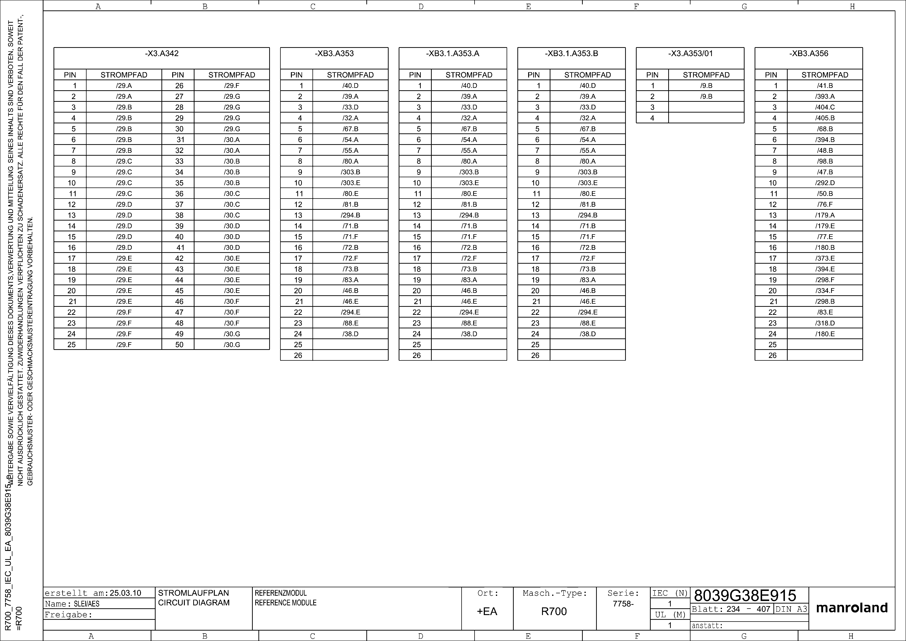

# +EA — Sheet 234 of 407 — REFERENZMODUL

**REFERENCE MODULE**

> Part of the manroland **R700** printing press IEC/UL circuit diagrams.
> Drawing class: **Stromlaufplan / Circuit diagram** (DIN A3).
> Document `+EA` covers the **Printing unit** machine section.

## At a glance

| Field | Value |
|---|---|
| Document | `+EA`  (8039G38E915) |
| Sheet | **234** of 407 |
| Section (DE) | REFERENZMODUL |
| Section (EN) | REFERENCE MODULE |
| Section type | REFERENCE_MODULE — Reference module |
| Machine type | `R700` |
| Series | `7758` |
| Created | 25.03.10 |
| Replaces | — |
| Columns used | A, B, C, D, E, F, G, H |
| Path numbers | — |
| Labels on sheet | 326 |
| Cross-refs out | 148 |
| Cross-refs in | 0 |

**Previous:** [+EA sheet 233](SHEET_0233.md) · **Next:** [+EA sheet 235](SHEET_0235.md) · **Document TOC:** [_TOC.md](_TOC.md)  (+EA) · **Master TOC:** [all sheets](../_MASTER_TOC.md)

## Sheet image (300 DPI, exact vector render)



_Rendered directly from the PDF vector layer at 300 DPI (1-bit), no OCR and no resampling. Use it to confirm anything ambiguous in the text below._

## Cross-references on this sheet

Each entry is a wire leaving this sheet. The printed token is `/sheet.column`; the link resolves to that sheet inside the same document.

| Ref | Target sheet | Col | Path | Destination on target | Target section | From col |
|---|---|---|---|---|---|---|
| `/9.B` | [+EA sheet 9](SHEET_0009.md) | B | — | — | SPANNUNGSVERSORGUNG: 400V, 24V | G |
| `/29.A` | [+EA sheet 29](SHEET_0029.md) | A | — | — | BUSVERBINDUNGEN: SICHERHEITSBUS | A |
| `/41.B` | [+EA sheet 41](SHEET_0041.md) | B | — | — | BUSVERBINDUNGEN: STOP SICHERN | H |
| `/29.F` | [+EA sheet 29](SHEET_0029.md) | F | — | — | BUSVERBINDUNGEN: SICHERHEITSBUS | B |
| `/40.D` | [+EA sheet 40](SHEET_0040.md) | D | — | — | BUSVERBINDUNGEN: STOP SICHERN | C |
| `/40.D` | [+EA sheet 40](SHEET_0040.md) | D | — | — | BUSVERBINDUNGEN: STOP SICHERN | D |
| `/40.D` | [+EA sheet 40](SHEET_0040.md) | D | — | — | BUSVERBINDUNGEN: STOP SICHERN | F |
| `/9.B` | [+EA sheet 9](SHEET_0009.md) | B | — | — | SPANNUNGSVERSORGUNG: 400V, 24V | G |
| `/29.A` | [+EA sheet 29](SHEET_0029.md) | A | — | — | BUSVERBINDUNGEN: SICHERHEITSBUS | A |
| `/39.A` | [+EA sheet 39](SHEET_0039.md) | A | — | — | BUSVERBINDUNGEN: STOP SICHERN | C |
| `/39.A` | [+EA sheet 39](SHEET_0039.md) | A | — | — | BUSVERBINDUNGEN: STOP SICHERN | D |
| `/39.A` | [+EA sheet 39](SHEET_0039.md) | A | — | — | BUSVERBINDUNGEN: STOP SICHERN | F |
| `/393.A` | [+EA sheet 393](SHEET_0393.md) | A | — | — | OPTION: ZWISCHENTROCKNER VORBEREITUNG; | H |
| `/29.G` | [+EA sheet 29](SHEET_0029.md) | G | — | — | BUSVERBINDUNGEN: SICHERHEITSBUS | B |
| `/29.B` | [+EA sheet 29](SHEET_0029.md) | B | — | — | BUSVERBINDUNGEN: SICHERHEITSBUS | A |
| `/29.G` | [+EA sheet 29](SHEET_0029.md) | G | — | — | BUSVERBINDUNGEN: SICHERHEITSBUS | B |
| `/33.D` | [+EA sheet 33](SHEET_0033.md) | D | — | — | BUSVERBINDUNGEN: NOT AUS | C |
| `/33.D` | [+EA sheet 33](SHEET_0033.md) | D | — | — | BUSVERBINDUNGEN: NOT AUS | D |
| `/33.D` | [+EA sheet 33](SHEET_0033.md) | D | — | — | BUSVERBINDUNGEN: NOT AUS | F |
| `/404.C` | [+EA sheet 404](SHEET_0404.md) | C | — | — | OPTION: SCHNITTSTELLE UV ENDTROCKNER | H |
| `/29.B` | [+EA sheet 29](SHEET_0029.md) | B | — | — | BUSVERBINDUNGEN: SICHERHEITSBUS | A |
| `/32.A` | [+EA sheet 32](SHEET_0032.md) | A | — | — | BUSVERBINDUNGEN: NOT AUS | C |
| `/32.A` | [+EA sheet 32](SHEET_0032.md) | A | — | — | BUSVERBINDUNGEN: NOT AUS | D |
| `/32.A` | [+EA sheet 32](SHEET_0032.md) | A | — | — | BUSVERBINDUNGEN: NOT AUS | F |
| `/29.G` | [+EA sheet 29](SHEET_0029.md) | G | — | — | BUSVERBINDUNGEN: SICHERHEITSBUS | B |
| `/405.B` | [+EA sheet 405](SHEET_0405.md) | B | — | — | OPTION: SCHNITTSTELLE UV ENDTROCKNER | H |
| `/29.B` | [+EA sheet 29](SHEET_0029.md) | B | — | — | BUSVERBINDUNGEN: SICHERHEITSBUS | A |
| `/67.B` | [+EA sheet 67](SHEET_0067.md) | B | — | — | LEITSTANDSFUNKTIONEN | C |
| `/67.B` | [+EA sheet 67](SHEET_0067.md) | B | — | — | LEITSTANDSFUNKTIONEN | D |
| `/67.B` | [+EA sheet 67](SHEET_0067.md) | B | — | — | LEITSTANDSFUNKTIONEN | F |
| `/68.B` | [+EA sheet 68](SHEET_0068.md) | B | — | — | LEITSTANDSFUNKTIONEN | H |
| `/29.G` | [+EA sheet 29](SHEET_0029.md) | G | — | — | BUSVERBINDUNGEN: SICHERHEITSBUS | B |
| `/29.B` | [+EA sheet 29](SHEET_0029.md) | B | — | — | BUSVERBINDUNGEN: SICHERHEITSBUS | A |
| `/30.A` | [+EA sheet 30](SHEET_0030.md) | A | — | — | BUSVERBINDUNGEN: SICHERHEITSBUS | B |
| `/54.A` | [+EA sheet 54](SHEET_0054.md) | A | — | — | MASCHINENBEDIENUNG: LAUFKOMMANDOS | C |
| `/54.A` | [+EA sheet 54](SHEET_0054.md) | A | — | — | MASCHINENBEDIENUNG: LAUFKOMMANDOS | D |
| `/54.A` | [+EA sheet 54](SHEET_0054.md) | A | — | — | MASCHINENBEDIENUNG: LAUFKOMMANDOS | F |
| `/394.B` | [+EA sheet 394](SHEET_0394.md) | B | — | — | OPTION: ZWISCHENTROCKNER VORBEREITUNG; | H |
| `/29.B` | [+EA sheet 29](SHEET_0029.md) | B | — | — | BUSVERBINDUNGEN: SICHERHEITSBUS | A |
| `/30.A` | [+EA sheet 30](SHEET_0030.md) | A | — | — | BUSVERBINDUNGEN: SICHERHEITSBUS | B |
| `/55.A` | [+EA sheet 55](SHEET_0055.md) | A | — | — | MASCHINENBEDIENUNG: LAUFKOMMANDOS | C |
| `/55.A` | [+EA sheet 55](SHEET_0055.md) | A | — | — | MASCHINENBEDIENUNG: LAUFKOMMANDOS | D |
| `/55.A` | [+EA sheet 55](SHEET_0055.md) | A | — | — | MASCHINENBEDIENUNG: LAUFKOMMANDOS | F |
| `/48.B` | [+EA sheet 48](SHEET_0048.md) | B | — | — | SCHUTZ | H |
| `/30.B` | [+EA sheet 30](SHEET_0030.md) | B | — | — | BUSVERBINDUNGEN: SICHERHEITSBUS | B |
| `/80.A` | [+EA sheet 80](SHEET_0080.md) | A | — | — | AUSLEGERSTAPELSTEUERUNG: BEDIENKOMMANDOS | C |
| `/80.A` | [+EA sheet 80](SHEET_0080.md) | A | — | — | AUSLEGERSTAPELSTEUERUNG: BEDIENKOMMANDOS | D |
| `/80.A` | [+EA sheet 80](SHEET_0080.md) | A | — | — | AUSLEGERSTAPELSTEUERUNG: BEDIENKOMMANDOS | F |
| `/98.B` | [+EA sheet 98](SHEET_0098.md) | B | — | — | BOGENFÜHRUNGSELEMENT | H |
| `/29.C` | [+EA sheet 29](SHEET_0029.md) | C | — | — | BUSVERBINDUNGEN: SICHERHEITSBUS | A |
| `/30.B` | [+EA sheet 30](SHEET_0030.md) | B | — | — | BUSVERBINDUNGEN: SICHERHEITSBUS | B |
| `/47.B` | [+EA sheet 47](SHEET_0047.md) | B | — | — | SCHUTZ | H |
| `/303.B` | [+EA sheet 303](SHEET_0303.md) | B | — | — | OPTION: ZWISCHENSTAPEL / | C |
| `/303.B` | [+EA sheet 303](SHEET_0303.md) | B | — | — | OPTION: ZWISCHENSTAPEL / | D |
| `/303.B` | [+EA sheet 303](SHEET_0303.md) | B | — | — | OPTION: ZWISCHENSTAPEL / | F |
| `/29.C` | [+EA sheet 29](SHEET_0029.md) | C | — | — | BUSVERBINDUNGEN: SICHERHEITSBUS | A |
| `/30.B` | [+EA sheet 30](SHEET_0030.md) | B | — | — | BUSVERBINDUNGEN: SICHERHEITSBUS | B |
| `/303.E` | [+EA sheet 303](SHEET_0303.md) | E | — | — | OPTION: ZWISCHENSTAPEL / | C |
| `/303.E` | [+EA sheet 303](SHEET_0303.md) | E | — | — | OPTION: ZWISCHENSTAPEL / | D |
| `/303.E` | [+EA sheet 303](SHEET_0303.md) | E | — | — | OPTION: ZWISCHENSTAPEL / | F |
| `/29.C` | [+EA sheet 29](SHEET_0029.md) | C | — | — | BUSVERBINDUNGEN: SICHERHEITSBUS | A |
| `/292.D` | [+EA sheet 292](SHEET_0292.md) | D | — | — | OPTION: PROBEBOGENENTNAHME HALBAUTOMATISCH | H |
| `/80.E` | [+EA sheet 80](SHEET_0080.md) | E | — | — | AUSLEGERSTAPELSTEUERUNG: BEDIENKOMMANDOS | C |
| `/80.E` | [+EA sheet 80](SHEET_0080.md) | E | — | — | AUSLEGERSTAPELSTEUERUNG: BEDIENKOMMANDOS | D |
| `/80.E` | [+EA sheet 80](SHEET_0080.md) | E | — | — | AUSLEGERSTAPELSTEUERUNG: BEDIENKOMMANDOS | F |
| `/50.B` | [+EA sheet 50](SHEET_0050.md) | B | — | — | SCHUTZ | H |
| `/29.C` | [+EA sheet 29](SHEET_0029.md) | C | — | — | BUSVERBINDUNGEN: SICHERHEITSBUS | A |
| `/30.C` | [+EA sheet 30](SHEET_0030.md) | C | — | — | BUSVERBINDUNGEN: SICHERHEITSBUS | B |
| `/81.B` | [+EA sheet 81](SHEET_0081.md) | B | — | — | AUSLEGERSTAPELSTEUERUNG: BEDIENKOMMANDOS | C |
| `/81.B` | [+EA sheet 81](SHEET_0081.md) | B | — | — | AUSLEGERSTAPELSTEUERUNG: BEDIENKOMMANDOS | D |
| `/81.B` | [+EA sheet 81](SHEET_0081.md) | B | — | — | AUSLEGERSTAPELSTEUERUNG: BEDIENKOMMANDOS | F |
| `/76.F` | [+EA sheet 76](SHEET_0076.md) | F | — | — | AUSLEGERSTAPELSTEUERUNG | H |
| `/29.D` | [+EA sheet 29](SHEET_0029.md) | D | — | — | BUSVERBINDUNGEN: SICHERHEITSBUS | A |
| `/30.C` | [+EA sheet 30](SHEET_0030.md) | C | — | — | BUSVERBINDUNGEN: SICHERHEITSBUS | B |
| `/294.B` | [+EA sheet 294](SHEET_0294.md) | B | — | — | OPTION: ZWISCHENSTAPEL / | C |
| `/294.B` | [+EA sheet 294](SHEET_0294.md) | B | — | — | OPTION: ZWISCHENSTAPEL / | D |
| `/294.B` | [+EA sheet 294](SHEET_0294.md) | B | — | — | OPTION: ZWISCHENSTAPEL / | F |
| `/179.A` | [+EA sheet 179](SHEET_0179.md) | A | — | — | RESERVE | H |
| `/29.D` | [+EA sheet 29](SHEET_0029.md) | D | — | — | BUSVERBINDUNGEN: SICHERHEITSBUS | A |
| `/30.C` | [+EA sheet 30](SHEET_0030.md) | C | — | — | BUSVERBINDUNGEN: SICHERHEITSBUS | B |
| `/71.B` | [+EA sheet 71](SHEET_0071.md) | B | — | — | AUSLEGERSTAPELSTEUERUNG | C |
| `/71.B` | [+EA sheet 71](SHEET_0071.md) | B | — | — | AUSLEGERSTAPELSTEUERUNG | D |
| `/71.B` | [+EA sheet 71](SHEET_0071.md) | B | — | — | AUSLEGERSTAPELSTEUERUNG | F |
| `/179.E` | [+EA sheet 179](SHEET_0179.md) | E | — | — | RESERVE | H |
| `/29.D` | [+EA sheet 29](SHEET_0029.md) | D | — | — | BUSVERBINDUNGEN: SICHERHEITSBUS | A |
| `/30.D` | [+EA sheet 30](SHEET_0030.md) | D | — | — | BUSVERBINDUNGEN: SICHERHEITSBUS | B |
| `/77.E` | [+EA sheet 77](SHEET_0077.md) | E | — | — | AUSLEGERSTAPELSTEUERUNG | H |
| `/71.F` | [+EA sheet 71](SHEET_0071.md) | F | — | — | AUSLEGERSTAPELSTEUERUNG | C |
| `/71.F` | [+EA sheet 71](SHEET_0071.md) | F | — | — | AUSLEGERSTAPELSTEUERUNG | D |
| `/71.F` | [+EA sheet 71](SHEET_0071.md) | F | — | — | AUSLEGERSTAPELSTEUERUNG | F |
| `/29.D` | [+EA sheet 29](SHEET_0029.md) | D | — | — | BUSVERBINDUNGEN: SICHERHEITSBUS | A |
| `/30.D` | [+EA sheet 30](SHEET_0030.md) | D | — | — | BUSVERBINDUNGEN: SICHERHEITSBUS | B |
| `/72.B` | [+EA sheet 72](SHEET_0072.md) | B | — | — | AUSLEGERSTAPELSTEUERUNG | C |
| `/72.B` | [+EA sheet 72](SHEET_0072.md) | B | — | — | AUSLEGERSTAPELSTEUERUNG | D |
| `/72.B` | [+EA sheet 72](SHEET_0072.md) | B | — | — | AUSLEGERSTAPELSTEUERUNG | F |
| `/180.B` | [+EA sheet 180](SHEET_0180.md) | B | — | — | RESERVE | H |
| `/29.D` | [+EA sheet 29](SHEET_0029.md) | D | — | — | BUSVERBINDUNGEN: SICHERHEITSBUS | A |
| `/30.D` | [+EA sheet 30](SHEET_0030.md) | D | — | — | BUSVERBINDUNGEN: SICHERHEITSBUS | B |
| `/29.E` | [+EA sheet 29](SHEET_0029.md) | E | — | — | BUSVERBINDUNGEN: SICHERHEITSBUS | A |
| `/30.E` | [+EA sheet 30](SHEET_0030.md) | E | — | — | BUSVERBINDUNGEN: SICHERHEITSBUS | B |
| `/72.F` | [+EA sheet 72](SHEET_0072.md) | F | — | — | AUSLEGERSTAPELSTEUERUNG | C |
| `/72.F` | [+EA sheet 72](SHEET_0072.md) | F | — | — | AUSLEGERSTAPELSTEUERUNG | D |
| `/72.F` | [+EA sheet 72](SHEET_0072.md) | F | — | — | AUSLEGERSTAPELSTEUERUNG | F |
| `/373.E` | [+EA sheet 373](SHEET_0373.md) | E | — | — | OPTION: ENDTROCKNER 1 VORBEREITUNG; | H |
| `/29.E` | [+EA sheet 29](SHEET_0029.md) | E | — | — | BUSVERBINDUNGEN: SICHERHEITSBUS | A |
| `/30.E` | [+EA sheet 30](SHEET_0030.md) | E | — | — | BUSVERBINDUNGEN: SICHERHEITSBUS | B |
| `/73.B` | [+EA sheet 73](SHEET_0073.md) | B | — | — | AUSLEGERSTAPELSTEUERUNG | C |
| `/73.B` | [+EA sheet 73](SHEET_0073.md) | B | — | — | AUSLEGERSTAPELSTEUERUNG | D |
| `/73.B` | [+EA sheet 73](SHEET_0073.md) | B | — | — | AUSLEGERSTAPELSTEUERUNG | F |
| `/394.E` | [+EA sheet 394](SHEET_0394.md) | E | — | — | OPTION: ZWISCHENTROCKNER VORBEREITUNG; | H |
| `/29.E` | [+EA sheet 29](SHEET_0029.md) | E | — | — | BUSVERBINDUNGEN: SICHERHEITSBUS | A |
| `/30.E` | [+EA sheet 30](SHEET_0030.md) | E | — | — | BUSVERBINDUNGEN: SICHERHEITSBUS | B |
| `/83.A` | [+EA sheet 83](SHEET_0083.md) | A | — | — | AUSLEGERSTAPELSTEUERUNG: PROGRAMMSCHALTWERK | C |
| `/83.A` | [+EA sheet 83](SHEET_0083.md) | A | — | — | AUSLEGERSTAPELSTEUERUNG: PROGRAMMSCHALTWERK | D |
| `/83.A` | [+EA sheet 83](SHEET_0083.md) | A | — | — | AUSLEGERSTAPELSTEUERUNG: PROGRAMMSCHALTWERK | F |
| `/298.F` | [+EA sheet 298](SHEET_0298.md) | F | — | — | OPTION: ZWISCHENSTAPEL / | H |
| `/29.E` | [+EA sheet 29](SHEET_0029.md) | E | — | — | BUSVERBINDUNGEN: SICHERHEITSBUS | A |
| `/30.E` | [+EA sheet 30](SHEET_0030.md) | E | — | — | BUSVERBINDUNGEN: SICHERHEITSBUS | B |
| `/46.B` | [+EA sheet 46](SHEET_0046.md) | B | — | — | SCHUTZ | C |
| `/46.B` | [+EA sheet 46](SHEET_0046.md) | B | — | — | SCHUTZ | D |
| `/46.B` | [+EA sheet 46](SHEET_0046.md) | B | — | — | SCHUTZ | F |
| `/334.F` | [+EA sheet 334](SHEET_0334.md) | F | — | — | OPTION: BOGENWEICHE | H |
| `/29.E` | [+EA sheet 29](SHEET_0029.md) | E | — | — | BUSVERBINDUNGEN: SICHERHEITSBUS | A |
| `/46.E` | [+EA sheet 46](SHEET_0046.md) | E | — | — | SCHUTZ | C |
| `/46.E` | [+EA sheet 46](SHEET_0046.md) | E | — | — | SCHUTZ | D |
| `/46.E` | [+EA sheet 46](SHEET_0046.md) | E | — | — | SCHUTZ | F |
| `/30.F` | [+EA sheet 30](SHEET_0030.md) | F | — | — | BUSVERBINDUNGEN: SICHERHEITSBUS | B |
| `/298.B` | [+EA sheet 298](SHEET_0298.md) | B | — | — | OPTION: ZWISCHENSTAPEL / | H |
| `/83.E` | [+EA sheet 83](SHEET_0083.md) | E | — | — | AUSLEGERSTAPELSTEUERUNG: PROGRAMMSCHALTWERK | H |
| `/29.F` | [+EA sheet 29](SHEET_0029.md) | F | — | — | BUSVERBINDUNGEN: SICHERHEITSBUS | A |
| `/30.F` | [+EA sheet 30](SHEET_0030.md) | F | — | — | BUSVERBINDUNGEN: SICHERHEITSBUS | B |
| `/294.E` | [+EA sheet 294](SHEET_0294.md) | E | — | — | OPTION: ZWISCHENSTAPEL / | C |
| `/294.E` | [+EA sheet 294](SHEET_0294.md) | E | — | — | OPTION: ZWISCHENSTAPEL / | D |
| `/294.E` | [+EA sheet 294](SHEET_0294.md) | E | — | — | OPTION: ZWISCHENSTAPEL / | F |
| `/88.E` | [+EA sheet 88](SHEET_0088.md) | E | — | — | SAUGWALZE | C |
| `/88.E` | [+EA sheet 88](SHEET_0088.md) | E | — | — | SAUGWALZE | D |
| `/88.E` | [+EA sheet 88](SHEET_0088.md) | E | — | — | SAUGWALZE | F |
| `/29.F` | [+EA sheet 29](SHEET_0029.md) | F | — | — | BUSVERBINDUNGEN: SICHERHEITSBUS | A |
| `/30.F` | [+EA sheet 30](SHEET_0030.md) | F | — | — | BUSVERBINDUNGEN: SICHERHEITSBUS | B |
| `/318.D` | [+EA sheet 318](SHEET_0318.md) | D | — | — | OPTION: LOGISTIK, AUSLEGER | H |
| `/29.F` | [+EA sheet 29](SHEET_0029.md) | F | — | — | BUSVERBINDUNGEN: SICHERHEITSBUS | A |
| `/180.E` | [+EA sheet 180](SHEET_0180.md) | E | — | — | RESERVE | H |
| `/30.G` | [+EA sheet 30](SHEET_0030.md) | G | — | — | BUSVERBINDUNGEN: SICHERHEITSBUS | B |
| `/38.D` | [+EA sheet 38](SHEET_0038.md) | D | — | — | BUSVERBINDUNGEN: NOT AUS | C |
| `/38.D` | [+EA sheet 38](SHEET_0038.md) | D | — | — | BUSVERBINDUNGEN: NOT AUS | D |
| `/38.D` | [+EA sheet 38](SHEET_0038.md) | D | — | — | BUSVERBINDUNGEN: NOT AUS | F |
| `/29.F` | [+EA sheet 29](SHEET_0029.md) | F | — | — | BUSVERBINDUNGEN: SICHERHEITSBUS | A |
| `/30.G` | [+EA sheet 30](SHEET_0030.md) | G | — | — | BUSVERBINDUNGEN: SICHERHEITSBUS | B |

## Devices on this sheet

| Tag | Class | Class meaning (IEC) | Col | Sub | Terminal | Sign |
|---|---|---|---|---|---|---|
| `XB3.A356` | — | cross-device reference | H | — | — | — |
| `X3.A342` | — | cross-device reference | B | — | — | — |
| `XB3.A353` | — | cross-device reference | C | — | — | — |
| `XB3.1.A353.A` | — | cross-device reference | D | — | — | — |
| `XB3.1.A353.B` | — | cross-device reference | E | — | — | — |

## Potentials / nets

_No named potentials on this sheet._

## Wire-end annotations (grouped as printed)

A wire that continues elsewhere is annotated with a small cluster: the destination description, the path/line number `#NN`, and the `/sheet.column` cross reference. Each row below is one such cluster exactly as it is grouped on the drawing.

| Col | Y | Path | Cross-ref | Text on the wire |
|---|---|---|---|---|
| B | 65.5 | — | — | `X3.A342` |
| C | 65.5 | — | — | `XB3.A353` |
| D | 65.5 | — | — | `XB3.1.A353.A` |
| E | 65.5 | — | — | `XB3.1.A353.B` |
| G | 65.5 | — | — | `X3.A353/01` |
| H | 65.5 | — | — | `XB3.A356` |
| A | 94.2 | — | — | `PIN STROMPFAD` |
| B | 94.2 | — | — | `PIN STROMPFAD` |
| C | 94.2 | — | — | `PIN STROMPFAD` |
| D | 94.2 | — | — | `PIN STROMPFAD` |
| E | 94.2 | — | — | `PIN STROMPFAD` |
| F | 94.2 | — | — | `PIN 2 3 4 1 STROMPFAD` |
| H | 94.2 | — | — | `PIN STROMPFAD` |
| A | 108.4 | — | — | `2 3 4 5 6 7 8 9 1` |
| B | 108.4 | — | — | `26 27 28 29 30 32 33 34 35 36 37 38 39 40 42 43 44 45 46 47 48 49 50 31 41` |
| C | 108.4 | — | — | `2 3 4 5 6 7 8 9 1` |
| D | 108.4 | — | — | `2 3 4 5 6 7 8 9 1` |
| E | 108.4 | — | — | `2 3 4 5 6 7 8 9 1` |
| G | 108.4 | — | — | `2 3 4 5 6 7 8 9 1` |
| A | 108.7 | — | `/29.A` | — |
| B | 108.7 | — | `/29.F` | — |
| C | 108.7 | — | `/40.D` | — |
| D | 108.7 | — | `/40.D` | — |
| F | 108.7 | — | `/40.D` | — |
| G | 108.7 | — | `/9.B` | — |
| H | 108.7 | — | `/41.B` | — |
| A | 122.8 | — | `/29.A` | — |
| C | 122.8 | — | `/39.A` | — |
| D | 122.8 | — | `/39.A` | — |
| F | 122.8 | — | `/39.A` | — |
| G | 122.8 | — | `/9.B` | — |
| B | 122.9 | — | `/29.G` | — |
| H | 122.9 | — | `/393.A` | — |
| A | 137.0 | — | `/29.B` | — |
| B | 137.0 | — | `/29.G` | — |
| C | 137.1 | — | `/33.D` | — |
| D | 137.1 | — | `/33.D` | — |
| F | 137.1 | — | `/33.D` | — |
| H | 137.1 | — | `/404.C` | — |
| A | 151.2 | — | `/29.B` | — |
| B | 151.2 | — | `/29.G` | — |
| C | 151.2 | — | `/32.A` | — |
| D | 151.2 | — | `/32.A` | — |
| F | 151.2 | — | `/32.A` | — |
| H | 151.2 | — | `/405.B` | — |
| A | 165.4 | — | `/29.B` | — |
| B | 165.4 | — | `/29.G` | — |
| C | 165.4 | — | `/67.B` | — |
| D | 165.4 | — | `/67.B` | — |
| F | 165.4 | — | `/67.B` | — |
| H | 165.4 | — | `/68.B` | — |
| A | 179.5 | — | `/29.B` | — |
| B | 179.5 | — | `/30.A` | — |
| C | 179.5 | — | `/54.A` | — |
| D | 179.5 | — | `/54.A` | — |
| F | 179.5 | — | `/54.A` | — |
| H | 179.6 | — | `/394.B` | — |
| A | 193.7 | — | `/29.B` | — |
| B | 193.7 | — | `/30.A` | — |
| C | 193.7 | — | `/55.A` | — |
| D | 193.7 | — | `/55.A` | — |
| F | 193.7 | — | `/55.A` | — |
| H | 193.7 | — | `/48.B` | — |
| A | 207.9 | — | `/29.C` | — |
| B | 207.9 | — | `/30.B` | — |
| C | 207.9 | — | `/80.A` | — |
| D | 207.9 | — | `/80.A` | — |
| F | 207.9 | — | `/80.A` | — |
| H | 207.9 | — | `/98.B` | — |
| A | 222.1 | — | `/29.C` | — |
| B | 222.1 | — | `/30.B` | — |
| C | 222.1 | — | `/303.B` | — |
| D | 222.1 | — | `/303.B` | — |
| F | 222.1 | — | `/303.B` | — |
| H | 222.1 | — | `/47.B` | — |
| A | 235.9 | — | — | `10 12 13 14 15 16 17 18 19 20 11` |
| C | 235.9 | — | — | `10 12 13 14 15 16 17 18 19 20 11` |
| D | 235.9 | — | — | `10 12 13 14 15 16 17 18 19 20 11` |
| E | 235.9 | — | — | `10 12 13 14 15 16 17 18 19 20 11` |
| G | 235.9 | — | — | `10 12 13 14 15 16 17 18 19 20 11` |
| B | 236.2 | — | `/30.B` | — |
| C | 236.2 | — | `/303.E` | — |
| D | 236.2 | — | `/303.E` | — |
| F | 236.2 | — | `/303.E` | — |
| A | 236.3 | — | `/29.C` | — |
| H | 236.3 | — | `/292.D` | — |
| A | 250.4 | — | `/29.C` | — |
| B | 250.4 | — | `/30.C` | — |
| C | 250.4 | — | `/80.E` | — |
| D | 250.4 | — | `/80.E` | — |
| F | 250.4 | — | `/80.E` | — |
| H | 250.4 | — | `/50.B` | — |
| A | 264.6 | — | `/29.D` | — |
| B | 264.6 | — | `/30.C` | — |
| C | 264.6 | — | `/81.B` | — |
| D | 264.6 | — | `/81.B` | — |
| F | 264.6 | — | `/81.B` | — |
| H | 264.6 | — | `/76.F` | — |
| A | 278.8 | — | `/29.D` | — |
| B | 278.8 | — | `/30.C` | — |
| C | 278.8 | — | `/294.B` | — |
| D | 278.8 | — | `/294.B` | — |
| F | 278.8 | — | `/294.B` | — |
| H | 278.8 | — | `/179.A` | — |
| C | 292.9 | — | `/71.B` | — |
| D | 292.9 | — | `/71.B` | — |
| F | 292.9 | — | `/71.B` | — |
| H | 292.9 | — | `/179.E` | — |
| A | 293.0 | — | `/29.D` | — |
| B | 293.0 | — | `/30.D` | — |
| A | 307.1 | — | `/29.D` | — |
| B | 307.1 | — | `/30.D` | — |
| C | 307.1 | — | `/71.F` | — |
| D | 307.1 | — | `/71.F` | — |
| F | 307.1 | — | `/71.F` | — |
| H | 307.1 | — | `/77.E` | — |
| A | 321.3 | — | `/29.D` | — |
| B | 321.3 | — | `/30.D` | — |
| C | 321.3 | — | `/72.B` | — |
| D | 321.3 | — | `/72.B` | — |
| F | 321.3 | — | `/72.B` | — |
| H | 321.3 | — | `/180.B` | — |
| A | 335.4 | — | `/29.E` | — |
| B | 335.4 | — | `/30.E` | — |
| C | 335.5 | — | `/72.F` | — |
| D | 335.5 | — | `/72.F` | — |
| F | 335.5 | — | `/72.F` | — |
| H | 335.5 | — | `/373.E` | — |
| A | 349.6 | — | `/29.E` | — |
| B | 349.6 | — | `/30.E` | — |
| C | 349.6 | — | `/73.B` | — |
| D | 349.6 | — | `/73.B` | — |
| F | 349.6 | — | `/73.B` | — |
| H | 349.6 | — | `/394.E` | — |
| A | 363.8 | — | `/29.E` | — |
| B | 363.8 | — | `/30.E` | — |
| C | 363.8 | — | `/83.A` | — |
| D | 363.8 | — | `/83.A` | — |
| F | 363.8 | — | `/83.A` | — |
| H | 363.8 | — | `/298.F` | — |
| A | 378.0 | — | `/29.E` | — |
| B | 378.0 | — | `/30.E` | — |
| C | 378.0 | — | `/46.B` | — |
| D | 378.0 | — | `/46.B` | — |
| F | 378.0 | — | `/46.B` | — |
| H | 378.0 | — | `/334.F` | — |
| A | 391.8 | — | — | `22 23 24 25 21` |
| C | 391.8 | — | — | `22 23 24 25 26 21` |
| D | 391.8 | — | — | `22 23 24 25 26 21` |
| E | 391.8 | — | — | `22 23 24 25 26 21` |
| G | 391.8 | — | — | `22 23 24 25 26 21` |
| A | 392.1 | — | `/29.E` | — |
| B | 392.1 | — | `/30.F` | — |
| C | 392.1 | — | `/46.E` | — |
| D | 392.1 | — | `/46.E` | — |
| F | 392.1 | — | `/46.E` | — |
| H | 392.1 | — | `/298.B` | — |
| A | 406.3 | — | `/29.F` | — |
| B | 406.3 | — | `/30.F` | — |
| C | 406.3 | — | `/294.E` | — |
| D | 406.3 | — | `/294.E` | — |
| F | 406.3 | — | `/294.E` | — |
| H | 406.3 | — | `/83.E` | — |
| A | 420.5 | — | `/29.F` | — |
| B | 420.5 | — | `/30.F` | — |
| C | 420.5 | — | `/88.E` | — |
| D | 420.5 | — | `/88.E` | — |
| F | 420.5 | — | `/88.E` | — |
| H | 420.5 | — | `/318.D` | — |
| A | 434.7 | — | `/29.F` | — |
| B | 434.7 | — | `/30.G` | — |
| C | 434.7 | — | `/38.D` | — |
| D | 434.7 | — | `/38.D` | — |
| F | 434.7 | — | `/38.D` | — |
| H | 434.7 | — | `/180.E` | — |
| A | 448.8 | — | `/29.F` | — |
| B | 448.9 | — | `/30.G` | — |


## Reconstructed tables

This sheet carries tabular content (pin map / terminal assignment / index). The grid below was rebuilt from the drawing's own rule lines, so each row is exactly one physical row of the table.

### Table 1 — 25 data rows × 4 columns (at x=70.9, y=62.4) — **X3.A342**

| PIN | STROMPFAD | PIN | STROMPFAD |
|---|---|---|---|
| `1` | `/29.A` | `26` | `/29.F` |
| `2` | `/29.A` | `27` | `/29.G` |
| `3` | `/29.B` | `28` | `/29.G` |
| `4` | `/29.B` | `29` | `/29.G` |
| `5` | `/29.B` | `30` | `/29.G` |
| `6` | `/29.B` | `31` | `/30.A` |
| `7` | `/29.B` | `32` | `/30.A` |
| `8` | `/29.C` | `33` | `/30.B` |
| `9` | `/29.C` | `34` | `/30.B` |
| `10` | `/29.C` | `35` | `/30.B` |
| `11` | `/29.C` | `36` | `/30.C` |
| `12` | `/29.D` | `37` | `/30.C` |
| `13` | `/29.D` | `38` | `/30.C` |
| `14` | `/29.D` | `39` | `/30.D` |
| `15` | `/29.D` | `40` | `/30.D` |
| `16` | `/29.D` | `41` | `/30.D` |
| `17` | `/29.E` | `42` | `/30.E` |
| `18` | `/29.E` | `43` | `/30.E` |
| `19` | `/29.E` | `44` | `/30.E` |
| `20` | `/29.E` | `45` | `/30.E` |
| `21` | `/29.E` | `46` | `/30.F` |
| `22` | `/29.F` | `47` | `/30.F` |
| `23` | `/29.F` | `48` | `/30.F` |
| `24` | `/29.F` | `49` | `/30.G` |
| `25` | `/29.F` | `50` | `/30.G` |


### Table 2 — 26 data rows × 2 columns (at x=368.5, y=62.4) — **XB3.A353**

| PIN | STROMPFAD |
|---|---|
| `1` | `/40.D` |
| `2` | `/39.A` |
| `3` | `/33.D` |
| `4` | `/32.A` |
| `5` | `/67.B` |
| `6` | `/54.A` |
| `7` | `/55.A` |
| `8` | `/80.A` |
| `9` | `/303.B` |
| `10` | `/303.E` |
| `11` | `/80.E` |
| `12` | `/81.B` |
| `13` | `/294.B` |
| `14` | `/71.B` |
| `15` | `/71.F` |
| `16` | `/72.B` |
| `17` | `/72.F` |
| `18` | `/73.B` |
| `19` | `/83.A` |
| `20` | `/46.B` |
| `21` | `/46.E` |
| `22` | `/294.E` |
| `23` | `/88.E` |
| `24` | `/38.D` |
| `25` |  |
| `26` |  |


### Table 3 — 26 data rows × 2 columns (at x=524.4, y=62.4) — **XB3.1.A353.A**

| PIN | STROMPFAD |
|---|---|
| `1` | `/40.D` |
| `2` | `/39.A` |
| `3` | `/33.D` |
| `4` | `/32.A` |
| `5` | `/67.B` |
| `6` | `/54.A` |
| `7` | `/55.A` |
| `8` | `/80.A` |
| `9` | `/303.B` |
| `10` | `/303.E` |
| `11` | `/80.E` |
| `12` | `/81.B` |
| `13` | `/294.B` |
| `14` | `/71.B` |
| `15` | `/71.F` |
| `16` | `/72.B` |
| `17` | `/72.F` |
| `18` | `/73.B` |
| `19` | `/83.A` |
| `20` | `/46.B` |
| `21` | `/46.E` |
| `22` | `/294.E` |
| `23` | `/88.E` |
| `24` | `/38.D` |
| `25` |  |
| `26` |  |


### Table 4 — 26 data rows × 2 columns (at x=680.3, y=62.4) — **XB3.1.A353.B**

| PIN | STROMPFAD |
|---|---|
| `1` | `/40.D` |
| `2` | `/39.A` |
| `3` | `/33.D` |
| `4` | `/32.A` |
| `5` | `/67.B` |
| `6` | `/54.A` |
| `7` | `/55.A` |
| `8` | `/80.A` |
| `9` | `/303.B` |
| `10` | `/303.E` |
| `11` | `/80.E` |
| `12` | `/81.B` |
| `13` | `/294.B` |
| `14` | `/71.B` |
| `15` | `/71.F` |
| `16` | `/72.B` |
| `17` | `/72.F` |
| `18` | `/73.B` |
| `19` | `/83.A` |
| `20` | `/46.B` |
| `21` | `/46.E` |
| `22` | `/294.E` |
| `23` | `/88.E` |
| `24` | `/38.D` |
| `25` |  |
| `26` |  |


### Table 5 — 4 data rows × 2 columns (at x=836.2, y=62.4) — **X3.A353/01**

| PIN | STROMPFAD |
|---|---|
| `1` | `/9.B` |
| `2` | `/9.B` |
| `3` |  |
| `4` |  |


### Table 6 — 26 data rows × 2 columns (at x=992.1, y=62.4) — **XB3.A356**

| PIN | STROMPFAD |
|---|---|
| `1` | `/41.B` |
| `2` | `/393.A` |
| `3` | `/404.C` |
| `4` | `/405.B` |
| `5` | `/68.B` |
| `6` | `/394.B` |
| `7` | `/48.B` |
| `8` | `/98.B` |
| `9` | `/47.B` |
| `10` | `/292.D` |
| `11` | `/50.B` |
| `12` | `/76.F` |
| `13` | `/179.A` |
| `14` | `/179.E` |
| `15` | `/77.E` |
| `16` | `/180.B` |
| `17` | `/373.E` |
| `18` | `/394.E` |
| `19` | `/298.F` |
| `20` | `/334.F` |
| `21` | `/298.B` |
| `22` | `/83.E` |
| `23` | `/318.D` |
| `24` | `/180.E` |
| `25` |  |
| `26` |  |


## Notes and free text on this sheet

| Text | Col | Y (pt) |
|---|---|---|
| `PIN` | G | 94.2 |
| `STROMPFAD` | H | 94.15 |
| `PIN` | A | 94.2 |
| `STROMPFAD` | A | 94.15 |
| `PIN` | B | 94.2 |
| `STROMPFAD` | B | 94.15 |
| `PIN` | C | 94.2 |
| `STROMPFAD` | C | 94.15 |
| `PIN` | D | 94.2 |
| `STROMPFAD` | D | 94.15 |
| `PIN` | E | 94.2 |
| `STROMPFAD` | F | 94.15 |
| `PIN` | F | 94.2 |
| `STROMPFAD` | G | 94.15 |
| `X3.A353/01` | G | 65.51 |

## Complete label inventory (exact text from the drawing)

Every text object inside the drawing area of this sheet, in DIN reading order (column A→H, then top→bottom). This is the authoritative list: if a string is not here it is not printed on this sheet.

| Col | Y | X | Dir | Type | Text |
|---|---|---|---|---|---|
| A | 94.2 | 84.0 | → | text | `PIN` |
| A | 94.2 | 132.2 | → | text | `STROMPFAD` |
| A | 108.4 | 95.8 | → | number | `1` |
| A | 108.7 | 152.6 | → | cross-reference | `/29.A` |
| A | 122.5 | 94.1 | → | number | `2` |
| A | 122.8 | 152.6 | → | cross-reference | `/29.A` |
| A | 136.7 | 94.1 | → | number | `3` |
| A | 137.0 | 152.8 | → | cross-reference | `/29.B` |
| A | 150.9 | 94.1 | → | number | `4` |
| A | 151.2 | 152.8 | → | cross-reference | `/29.B` |
| A | 165.1 | 94.1 | → | number | `5` |
| A | 165.4 | 152.8 | → | cross-reference | `/29.B` |
| A | 179.2 | 94.1 | → | number | `6` |
| A | 179.5 | 152.8 | → | cross-reference | `/29.B` |
| A | 193.4 | 94.1 | → | number | `7` |
| A | 193.7 | 152.8 | → | cross-reference | `/29.B` |
| A | 207.6 | 94.1 | → | number | `8` |
| A | 207.9 | 152.6 | → | cross-reference | `/29.C` |
| A | 221.8 | 94.1 | → | number | `9` |
| A | 222.1 | 152.6 | → | cross-reference | `/29.C` |
| A | 235.9 | 88.7 | → | number | `10` |
| A | 236.3 | 152.6 | → | cross-reference | `/29.C` |
| A | 250.1 | 90.4 | → | number | `11` |
| A | 250.4 | 152.6 | → | cross-reference | `/29.C` |
| A | 264.3 | 88.7 | → | number | `12` |
| A | 264.6 | 152.6 | → | cross-reference | `/29.D` |
| A | 278.5 | 88.7 | → | number | `13` |
| A | 278.8 | 152.6 | → | cross-reference | `/29.D` |
| A | 292.6 | 88.7 | → | number | `14` |
| A | 293.0 | 152.6 | → | cross-reference | `/29.D` |
| A | 306.8 | 88.7 | → | number | `15` |
| A | 307.1 | 152.6 | → | cross-reference | `/29.D` |
| A | 321.0 | 88.7 | → | number | `16` |
| A | 321.3 | 152.6 | → | cross-reference | `/29.D` |
| A | 335.1 | 88.7 | → | number | `17` |
| A | 335.4 | 152.9 | → | cross-reference | `/29.E` |
| A | 349.3 | 88.7 | → | number | `18` |
| A | 349.6 | 152.9 | → | cross-reference | `/29.E` |
| A | 363.5 | 88.7 | → | number | `19` |
| A | 363.8 | 152.9 | → | cross-reference | `/29.E` |
| A | 377.7 | 88.7 | → | number | `20` |
| A | 378.0 | 152.9 | → | cross-reference | `/29.E` |
| A | 391.8 | 90.4 | → | number | `21` |
| A | 392.1 | 152.9 | → | cross-reference | `/29.E` |
| A | 406.0 | 88.7 | → | number | `22` |
| A | 406.3 | 153.1 | → | cross-reference | `/29.F` |
| A | 420.2 | 88.7 | → | number | `23` |
| A | 420.5 | 153.1 | → | cross-reference | `/29.F` |
| A | 434.4 | 88.7 | → | number | `24` |
| A | 434.7 | 153.1 | → | cross-reference | `/29.F` |
| A | 448.5 | 88.7 | → | number | `25` |
| A | 448.8 | 153.1 | → | cross-reference | `/29.F` |
| B | 65.5 | 190.6 | → | device ref | `X3.A342` |
| B | 94.2 | 225.8 | → | text | `PIN` |
| B | 94.2 | 274.0 | → | text | `STROMPFAD` |
| B | 108.4 | 230.5 | → | number | `26` |
| B | 108.7 | 294.8 | → | cross-reference | `/29.F` |
| B | 122.5 | 230.5 | → | number | `27` |
| B | 122.9 | 294.2 | → | cross-reference | `/29.G` |
| B | 136.7 | 230.5 | → | number | `28` |
| B | 137.0 | 294.2 | → | cross-reference | `/29.G` |
| B | 150.9 | 230.5 | → | number | `29` |
| B | 151.2 | 294.2 | → | cross-reference | `/29.G` |
| B | 165.1 | 230.5 | → | number | `30` |
| B | 165.4 | 294.2 | → | cross-reference | `/29.G` |
| B | 179.2 | 232.2 | → | number | `31` |
| B | 179.5 | 294.4 | → | cross-reference | `/30.A` |
| B | 193.4 | 230.5 | → | number | `32` |
| B | 193.7 | 294.4 | → | cross-reference | `/30.A` |
| B | 207.6 | 230.5 | → | number | `33` |
| B | 207.9 | 294.5 | → | cross-reference | `/30.B` |
| B | 221.8 | 230.5 | → | number | `34` |
| B | 222.1 | 294.5 | → | cross-reference | `/30.B` |
| B | 235.9 | 230.5 | → | number | `35` |
| B | 236.2 | 294.5 | → | cross-reference | `/30.B` |
| B | 250.1 | 230.5 | → | number | `36` |
| B | 250.4 | 294.4 | → | cross-reference | `/30.C` |
| B | 264.3 | 230.5 | → | number | `37` |
| B | 264.6 | 294.4 | → | cross-reference | `/30.C` |
| B | 278.5 | 230.5 | → | number | `38` |
| B | 278.8 | 294.4 | → | cross-reference | `/30.C` |
| B | 292.6 | 230.5 | → | number | `39` |
| B | 293.0 | 294.4 | → | cross-reference | `/30.D` |
| B | 306.8 | 230.5 | → | number | `40` |
| B | 307.1 | 294.4 | → | cross-reference | `/30.D` |
| B | 321.0 | 232.2 | → | number | `41` |
| B | 321.3 | 294.4 | → | cross-reference | `/30.D` |
| B | 335.1 | 230.5 | → | number | `42` |
| B | 335.4 | 294.7 | → | cross-reference | `/30.E` |
| B | 349.3 | 230.5 | → | number | `43` |
| B | 349.6 | 294.7 | → | cross-reference | `/30.E` |
| B | 363.5 | 230.5 | → | number | `44` |
| B | 363.8 | 294.7 | → | cross-reference | `/30.E` |
| B | 377.7 | 230.5 | → | number | `45` |
| B | 378.0 | 294.7 | → | cross-reference | `/30.E` |
| B | 391.8 | 230.5 | → | number | `46` |
| B | 392.2 | 294.8 | → | cross-reference | `/30.F` |
| B | 406.0 | 230.5 | → | number | `47` |
| B | 406.3 | 294.8 | → | cross-reference | `/30.F` |
| B | 420.2 | 230.5 | → | number | `48` |
| B | 420.5 | 294.8 | → | cross-reference | `/30.F` |
| B | 434.4 | 230.5 | → | number | `49` |
| B | 434.7 | 294.2 | → | cross-reference | `/30.G` |
| B | 448.5 | 230.5 | → | number | `50` |
| B | 448.9 | 294.2 | → | cross-reference | `/30.G` |
| C | 65.5 | 413.9 | → | device ref | `XB3.A353` |
| C | 94.2 | 381.7 | → | text | `PIN` |
| C | 94.2 | 429.9 | → | text | `STROMPFAD` |
| C | 108.4 | 393.4 | → | number | `1` |
| C | 108.7 | 450.3 | → | cross-reference | `/40.D` |
| C | 122.5 | 391.7 | → | number | `2` |
| C | 122.8 | 450.3 | → | cross-reference | `/39.A` |
| C | 136.7 | 391.7 | → | number | `3` |
| C | 137.1 | 450.3 | → | cross-reference | `/33.D` |
| C | 150.9 | 391.7 | → | number | `4` |
| C | 151.2 | 450.3 | → | cross-reference | `/32.A` |
| C | 165.1 | 391.7 | → | number | `5` |
| C | 165.4 | 450.4 | → | cross-reference | `/67.B` |
| C | 179.2 | 391.7 | → | number | `6` |
| C | 179.5 | 450.3 | → | cross-reference | `/54.A` |
| C | 193.4 | 391.7 | → | number | `7` |
| C | 193.7 | 450.3 | → | cross-reference | `/55.A` |
| C | 207.6 | 391.7 | → | number | `8` |
| C | 207.9 | 450.3 | → | cross-reference | `/80.A` |
| C | 221.8 | 391.7 | → | number | `9` |
| C | 222.1 | 448.0 | → | cross-reference | `/303.B` |
| C | 235.9 | 386.4 | → | number | `10` |
| C | 236.2 | 448.2 | → | cross-reference | `/303.E` |
| C | 250.1 | 388.1 | → | number | `11` |
| C | 250.4 | 450.6 | → | cross-reference | `/80.E` |
| C | 264.3 | 386.4 | → | number | `12` |
| C | 264.6 | 450.4 | → | cross-reference | `/81.B` |
| C | 278.5 | 386.4 | → | number | `13` |
| C | 278.8 | 448.0 | → | cross-reference | `/294.B` |
| C | 292.6 | 386.4 | → | number | `14` |
| C | 292.9 | 450.4 | → | cross-reference | `/71.B` |
| C | 306.8 | 386.4 | → | number | `15` |
| C | 307.1 | 450.7 | → | cross-reference | `/71.F` |
| C | 321.0 | 386.4 | → | number | `16` |
| C | 321.3 | 450.4 | → | cross-reference | `/72.B` |
| C | 335.1 | 386.4 | → | number | `17` |
| C | 335.5 | 450.7 | → | cross-reference | `/72.F` |
| C | 349.3 | 386.4 | → | number | `18` |
| C | 349.6 | 450.4 | → | cross-reference | `/73.B` |
| C | 363.5 | 386.4 | → | number | `19` |
| C | 363.8 | 450.3 | → | cross-reference | `/83.A` |
| C | 377.7 | 386.4 | → | number | `20` |
| C | 378.0 | 450.4 | → | cross-reference | `/46.B` |
| C | 391.8 | 388.1 | → | number | `21` |
| C | 392.1 | 450.6 | → | cross-reference | `/46.E` |
| C | 406.0 | 386.4 | → | number | `22` |
| C | 406.3 | 448.2 | → | cross-reference | `/294.E` |
| C | 420.2 | 386.4 | → | number | `23` |
| C | 420.5 | 450.6 | → | cross-reference | `/88.E` |
| C | 434.4 | 386.4 | → | number | `24` |
| C | 434.7 | 450.3 | → | cross-reference | `/38.D` |
| C | 448.5 | 386.4 | → | number | `25` |
| C | 462.7 | 386.4 | → | number | `26` |
| D | 65.5 | 560.0 | → | device ref | `XB3.1.A353.A` |
| D | 94.2 | 537.6 | → | text | `PIN` |
| D | 94.2 | 585.8 | → | text | `STROMPFAD` |
| D | 108.4 | 549.4 | → | number | `1` |
| D | 108.7 | 606.2 | → | cross-reference | `/40.D` |
| D | 122.5 | 547.7 | → | number | `2` |
| D | 122.8 | 606.2 | → | cross-reference | `/39.A` |
| D | 136.7 | 547.7 | → | number | `3` |
| D | 137.1 | 606.2 | → | cross-reference | `/33.D` |
| D | 150.9 | 547.7 | → | number | `4` |
| D | 151.2 | 606.2 | → | cross-reference | `/32.A` |
| D | 165.1 | 547.7 | → | number | `5` |
| D | 165.4 | 606.3 | → | cross-reference | `/67.B` |
| D | 179.2 | 547.7 | → | number | `6` |
| D | 179.5 | 606.2 | → | cross-reference | `/54.A` |
| D | 193.4 | 547.7 | → | number | `7` |
| D | 193.7 | 606.2 | → | cross-reference | `/55.A` |
| D | 207.6 | 547.7 | → | number | `8` |
| D | 207.9 | 606.2 | → | cross-reference | `/80.A` |
| D | 221.8 | 547.7 | → | number | `9` |
| D | 222.1 | 603.9 | → | cross-reference | `/303.B` |
| D | 235.9 | 542.3 | → | number | `10` |
| D | 236.2 | 604.1 | → | cross-reference | `/303.E` |
| D | 250.1 | 544.0 | → | number | `11` |
| D | 250.4 | 606.5 | → | cross-reference | `/80.E` |
| D | 264.3 | 542.3 | → | number | `12` |
| D | 264.6 | 606.3 | → | cross-reference | `/81.B` |
| D | 278.5 | 542.3 | → | number | `13` |
| D | 278.8 | 603.9 | → | cross-reference | `/294.B` |
| D | 292.6 | 542.3 | → | number | `14` |
| D | 292.9 | 606.3 | → | cross-reference | `/71.B` |
| D | 306.8 | 542.3 | → | number | `15` |
| D | 307.1 | 606.6 | → | cross-reference | `/71.F` |
| D | 321.0 | 542.3 | → | number | `16` |
| D | 321.3 | 606.3 | → | cross-reference | `/72.B` |
| D | 335.1 | 542.3 | → | number | `17` |
| D | 335.5 | 606.6 | → | cross-reference | `/72.F` |
| D | 349.3 | 542.3 | → | number | `18` |
| D | 349.6 | 606.3 | → | cross-reference | `/73.B` |
| D | 363.5 | 542.3 | → | number | `19` |
| D | 363.8 | 606.2 | → | cross-reference | `/83.A` |
| D | 377.7 | 542.3 | → | number | `20` |
| D | 378.0 | 606.3 | → | cross-reference | `/46.B` |
| D | 391.8 | 544.0 | → | number | `21` |
| D | 392.1 | 606.5 | → | cross-reference | `/46.E` |
| D | 406.0 | 542.3 | → | number | `22` |
| D | 406.3 | 604.1 | → | cross-reference | `/294.E` |
| D | 420.2 | 542.3 | → | number | `23` |
| D | 420.5 | 606.5 | → | cross-reference | `/88.E` |
| D | 434.4 | 542.3 | → | number | `24` |
| D | 434.7 | 606.2 | → | cross-reference | `/38.D` |
| D | 448.5 | 542.3 | → | number | `25` |
| D | 462.7 | 542.3 | → | number | `26` |
| E | 65.5 | 716.3 | → | device ref | `XB3.1.A353.B` |
| E | 94.2 | 693.5 | → | text | `PIN` |
| E | 108.4 | 705.3 | → | number | `1` |
| E | 122.5 | 703.6 | → | number | `2` |
| E | 136.7 | 703.6 | → | number | `3` |
| E | 150.9 | 703.6 | → | number | `4` |
| E | 165.1 | 703.6 | → | number | `5` |
| E | 179.2 | 703.6 | → | number | `6` |
| E | 193.4 | 703.6 | → | number | `7` |
| E | 207.6 | 703.6 | → | number | `8` |
| E | 221.8 | 703.6 | → | number | `9` |
| E | 235.9 | 698.2 | → | number | `10` |
| E | 250.1 | 699.9 | → | number | `11` |
| E | 264.3 | 698.2 | → | number | `12` |
| E | 278.5 | 698.2 | → | number | `13` |
| E | 292.6 | 698.2 | → | number | `14` |
| E | 306.8 | 698.2 | → | number | `15` |
| E | 321.0 | 698.2 | → | number | `16` |
| E | 335.1 | 698.2 | → | number | `17` |
| E | 349.3 | 698.2 | → | number | `18` |
| E | 363.5 | 698.2 | → | number | `19` |
| E | 377.7 | 698.2 | → | number | `20` |
| E | 391.8 | 699.9 | → | number | `21` |
| E | 406.0 | 698.2 | → | number | `22` |
| E | 420.2 | 698.2 | → | number | `23` |
| E | 434.4 | 698.2 | → | number | `24` |
| E | 448.5 | 698.2 | → | number | `25` |
| E | 462.7 | 698.2 | → | number | `26` |
| F | 94.2 | 741.7 | → | text | `STROMPFAD` |
| F | 94.2 | 849.4 | → | text | `PIN` |
| F | 108.4 | 855.4 | → | number | `1` |
| F | 108.7 | 762.1 | → | cross-reference | `/40.D` |
| F | 122.5 | 854.8 | → | number | `2` |
| F | 122.8 | 762.1 | → | cross-reference | `/39.A` |
| F | 136.7 | 854.8 | → | number | `3` |
| F | 137.1 | 762.1 | → | cross-reference | `/33.D` |
| F | 150.9 | 854.8 | → | number | `4` |
| F | 151.2 | 762.1 | → | cross-reference | `/32.A` |
| F | 165.4 | 762.2 | → | cross-reference | `/67.B` |
| F | 179.5 | 762.1 | → | cross-reference | `/54.A` |
| F | 193.7 | 762.1 | → | cross-reference | `/55.A` |
| F | 207.9 | 762.1 | → | cross-reference | `/80.A` |
| F | 222.1 | 759.8 | → | cross-reference | `/303.B` |
| F | 236.2 | 760.0 | → | cross-reference | `/303.E` |
| F | 250.4 | 762.4 | → | cross-reference | `/80.E` |
| F | 264.6 | 762.2 | → | cross-reference | `/81.B` |
| F | 278.8 | 759.8 | → | cross-reference | `/294.B` |
| F | 292.9 | 762.2 | → | cross-reference | `/71.B` |
| F | 307.1 | 762.5 | → | cross-reference | `/71.F` |
| F | 321.3 | 762.2 | → | cross-reference | `/72.B` |
| F | 335.5 | 762.5 | → | cross-reference | `/72.F` |
| F | 349.6 | 762.2 | → | cross-reference | `/73.B` |
| F | 363.8 | 762.1 | → | cross-reference | `/83.A` |
| F | 378.0 | 762.2 | → | cross-reference | `/46.B` |
| F | 392.1 | 762.4 | → | cross-reference | `/46.E` |
| F | 406.3 | 760.0 | → | cross-reference | `/294.E` |
| F | 420.5 | 762.4 | → | cross-reference | `/88.E` |
| F | 434.7 | 762.1 | → | cross-reference | `/38.D` |
| G | 65.5 | 878.5 | → | text | `X3.A353/01` |
| G | 94.2 | 897.6 | → | text | `STROMPFAD` |
| G | 94.2 | 1005.3 | → | text | `PIN` |
| G | 108.4 | 1017.1 | → | number | `1` |
| G | 108.7 | 920.6 | → | cross-reference | `/9.B` |
| G | 122.5 | 1015.4 | → | number | `2` |
| G | 122.8 | 920.6 | → | cross-reference | `/9.B` |
| G | 136.7 | 1015.4 | → | number | `3` |
| G | 150.9 | 1015.4 | → | number | `4` |
| G | 165.1 | 1015.4 | → | number | `5` |
| G | 179.2 | 1015.4 | → | number | `6` |
| G | 193.4 | 1015.4 | → | number | `7` |
| G | 207.6 | 1015.4 | → | number | `8` |
| G | 221.8 | 1015.4 | → | number | `9` |
| G | 235.9 | 1010.0 | → | number | `10` |
| G | 250.1 | 1011.7 | → | number | `11` |
| G | 264.3 | 1010.0 | → | number | `12` |
| G | 278.5 | 1010.0 | → | number | `13` |
| G | 292.6 | 1010.0 | → | number | `14` |
| G | 306.8 | 1010.0 | → | number | `15` |
| G | 321.0 | 1010.0 | → | number | `16` |
| G | 335.1 | 1010.0 | → | number | `17` |
| G | 349.3 | 1010.0 | → | number | `18` |
| G | 363.5 | 1010.0 | → | number | `19` |
| G | 377.7 | 1010.0 | → | number | `20` |
| G | 391.8 | 1011.7 | → | number | `21` |
| G | 406.0 | 1010.0 | → | number | `22` |
| G | 420.2 | 1010.0 | → | number | `23` |
| G | 434.4 | 1010.0 | → | number | `24` |
| G | 448.5 | 1010.0 | → | number | `25` |
| G | 462.7 | 1010.0 | → | number | `26` |
| H | 65.5 | 1037.5 | → | device ref | `XB3.A356` |
| H | 94.2 | 1053.5 | → | text | `STROMPFAD` |
| H | 108.7 | 1074.0 | → | cross-reference | `/41.B` |
| H | 122.9 | 1071.5 | → | cross-reference | `/393.A` |
| H | 137.1 | 1071.5 | → | cross-reference | `/404.C` |
| H | 151.2 | 1071.6 | → | cross-reference | `/405.B` |
| H | 165.4 | 1074.0 | → | cross-reference | `/68.B` |
| H | 179.6 | 1071.6 | → | cross-reference | `/394.B` |
| H | 193.7 | 1074.0 | → | cross-reference | `/48.B` |
| H | 207.9 | 1074.0 | → | cross-reference | `/98.B` |
| H | 222.1 | 1074.0 | → | cross-reference | `/47.B` |
| H | 236.3 | 1071.5 | → | cross-reference | `/292.D` |
| H | 250.4 | 1074.0 | → | cross-reference | `/50.B` |
| H | 264.6 | 1074.3 | → | cross-reference | `/76.F` |
| H | 278.8 | 1071.5 | → | cross-reference | `/179.A` |
| H | 292.9 | 1071.8 | → | cross-reference | `/179.E` |
| H | 307.1 | 1074.2 | → | cross-reference | `/77.E` |
| H | 321.3 | 1071.6 | → | cross-reference | `/180.B` |
| H | 335.5 | 1071.8 | → | cross-reference | `/373.E` |
| H | 349.6 | 1071.8 | → | cross-reference | `/394.E` |
| H | 363.8 | 1071.9 | → | cross-reference | `/298.F` |
| H | 378.0 | 1071.9 | → | cross-reference | `/334.F` |
| H | 392.2 | 1071.6 | → | cross-reference | `/298.B` |
| H | 406.3 | 1074.2 | → | cross-reference | `/83.E` |
| H | 420.5 | 1071.5 | → | cross-reference | `/318.D` |
| H | 434.7 | 1071.8 | → | cross-reference | `/180.E` |

## Reading-order text block

The same content as a plain block, grouped by DIN column — convenient to paste or to match against a visual description.

```text
=== Column A ===
  94.2   84.0  text         PIN
  94.2  132.2  text         STROMPFAD
 108.4   95.8  numeric      1
 108.7  152.6  xref         /29.A
 122.5   94.1  numeric      2
 122.8  152.6  xref         /29.A
 136.7   94.1  numeric      3
 137.0  152.8  xref         /29.B
 150.9   94.1  numeric      4
 151.2  152.8  xref         /29.B
 165.1   94.1  numeric      5
 165.4  152.8  xref         /29.B
 179.2   94.1  numeric      6
 179.5  152.8  xref         /29.B
 193.4   94.1  numeric      7
 193.7  152.8  xref         /29.B
 207.6   94.1  numeric      8
 207.9  152.6  xref         /29.C
 221.8   94.1  numeric      9
 222.1  152.6  xref         /29.C
 235.9   88.7  numeric      10
 236.3  152.6  xref         /29.C
 250.1   90.4  numeric      11
 250.4  152.6  xref         /29.C
 264.3   88.7  numeric      12
 264.6  152.6  xref         /29.D
 278.5   88.7  numeric      13
 278.8  152.6  xref         /29.D
 292.6   88.7  numeric      14
 293.0  152.6  xref         /29.D
 306.8   88.7  numeric      15
 307.1  152.6  xref         /29.D
 321.0   88.7  numeric      16
 321.3  152.6  xref         /29.D
 335.1   88.7  numeric      17
 335.4  152.9  xref         /29.E
 349.3   88.7  numeric      18
 349.6  152.9  xref         /29.E
 363.5   88.7  numeric      19
 363.8  152.9  xref         /29.E
 377.7   88.7  numeric      20
 378.0  152.9  xref         /29.E
 391.8   90.4  numeric      21
 392.1  152.9  xref         /29.E
 406.0   88.7  numeric      22
 406.3  153.1  xref         /29.F
 420.2   88.7  numeric      23
 420.5  153.1  xref         /29.F
 434.4   88.7  numeric      24
 434.7  153.1  xref         /29.F
 448.5   88.7  numeric      25
 448.8  153.1  xref         /29.F
=== Column B ===
  65.5  190.6  devref       X3.A342
  94.2  225.8  text         PIN
  94.2  274.0  text         STROMPFAD
 108.4  230.5  numeric      26
 108.7  294.8  xref         /29.F
 122.5  230.5  numeric      27
 122.9  294.2  xref         /29.G
 136.7  230.5  numeric      28
 137.0  294.2  xref         /29.G
 150.9  230.5  numeric      29
 151.2  294.2  xref         /29.G
 165.1  230.5  numeric      30
 165.4  294.2  xref         /29.G
 179.2  232.2  numeric      31
 179.5  294.4  xref         /30.A
 193.4  230.5  numeric      32
 193.7  294.4  xref         /30.A
 207.6  230.5  numeric      33
 207.9  294.5  xref         /30.B
 221.8  230.5  numeric      34
 222.1  294.5  xref         /30.B
 235.9  230.5  numeric      35
 236.2  294.5  xref         /30.B
 250.1  230.5  numeric      36
 250.4  294.4  xref         /30.C
 264.3  230.5  numeric      37
 264.6  294.4  xref         /30.C
 278.5  230.5  numeric      38
 278.8  294.4  xref         /30.C
 292.6  230.5  numeric      39
 293.0  294.4  xref         /30.D
 306.8  230.5  numeric      40
 307.1  294.4  xref         /30.D
 321.0  232.2  numeric      41
 321.3  294.4  xref         /30.D
 335.1  230.5  numeric      42
 335.4  294.7  xref         /30.E
 349.3  230.5  numeric      43
 349.6  294.7  xref         /30.E
 363.5  230.5  numeric      44
 363.8  294.7  xref         /30.E
 377.7  230.5  numeric      45
 378.0  294.7  xref         /30.E
 391.8  230.5  numeric      46
 392.2  294.8  xref         /30.F
 406.0  230.5  numeric      47
 406.3  294.8  xref         /30.F
 420.2  230.5  numeric      48
 420.5  294.8  xref         /30.F
 434.4  230.5  numeric      49
 434.7  294.2  xref         /30.G
 448.5  230.5  numeric      50
 448.9  294.2  xref         /30.G
=== Column C ===
  65.5  413.9  devref       XB3.A353
  94.2  381.7  text         PIN
  94.2  429.9  text         STROMPFAD
 108.4  393.4  numeric      1
 108.7  450.3  xref         /40.D
 122.5  391.7  numeric      2
 122.8  450.3  xref         /39.A
 136.7  391.7  numeric      3
 137.1  450.3  xref         /33.D
 150.9  391.7  numeric      4
 151.2  450.3  xref         /32.A
 165.1  391.7  numeric      5
 165.4  450.4  xref         /67.B
 179.2  391.7  numeric      6
 179.5  450.3  xref         /54.A
 193.4  391.7  numeric      7
 193.7  450.3  xref         /55.A
 207.6  391.7  numeric      8
 207.9  450.3  xref         /80.A
 221.8  391.7  numeric      9
 222.1  448.0  xref         /303.B
 235.9  386.4  numeric      10
 236.2  448.2  xref         /303.E
 250.1  388.1  numeric      11
 250.4  450.6  xref         /80.E
 264.3  386.4  numeric      12
 264.6  450.4  xref         /81.B
 278.5  386.4  numeric      13
 278.8  448.0  xref         /294.B
 292.6  386.4  numeric      14
 292.9  450.4  xref         /71.B
 306.8  386.4  numeric      15
 307.1  450.7  xref         /71.F
 321.0  386.4  numeric      16
 321.3  450.4  xref         /72.B
 335.1  386.4  numeric      17
 335.5  450.7  xref         /72.F
 349.3  386.4  numeric      18
 349.6  450.4  xref         /73.B
 363.5  386.4  numeric      19
 363.8  450.3  xref         /83.A
 377.7  386.4  numeric      20
 378.0  450.4  xref         /46.B
 391.8  388.1  numeric      21
 392.1  450.6  xref         /46.E
 406.0  386.4  numeric      22
 406.3  448.2  xref         /294.E
 420.2  386.4  numeric      23
 420.5  450.6  xref         /88.E
 434.4  386.4  numeric      24
 434.7  450.3  xref         /38.D
 448.5  386.4  numeric      25
 462.7  386.4  numeric      26
=== Column D ===
  65.5  560.0  devref       XB3.1.A353.A
  94.2  537.6  text         PIN
  94.2  585.8  text         STROMPFAD
 108.4  549.4  numeric      1
 108.7  606.2  xref         /40.D
 122.5  547.7  numeric      2
 122.8  606.2  xref         /39.A
 136.7  547.7  numeric      3
 137.1  606.2  xref         /33.D
 150.9  547.7  numeric      4
 151.2  606.2  xref         /32.A
 165.1  547.7  numeric      5
 165.4  606.3  xref         /67.B
 179.2  547.7  numeric      6
 179.5  606.2  xref         /54.A
 193.4  547.7  numeric      7
 193.7  606.2  xref         /55.A
 207.6  547.7  numeric      8
 207.9  606.2  xref         /80.A
 221.8  547.7  numeric      9
 222.1  603.9  xref         /303.B
 235.9  542.3  numeric      10
 236.2  604.1  xref         /303.E
 250.1  544.0  numeric      11
 250.4  606.5  xref         /80.E
 264.3  542.3  numeric      12
 264.6  606.3  xref         /81.B
 278.5  542.3  numeric      13
 278.8  603.9  xref         /294.B
 292.6  542.3  numeric      14
 292.9  606.3  xref         /71.B
 306.8  542.3  numeric      15
 307.1  606.6  xref         /71.F
 321.0  542.3  numeric      16
 321.3  606.3  xref         /72.B
 335.1  542.3  numeric      17
 335.5  606.6  xref         /72.F
 349.3  542.3  numeric      18
 349.6  606.3  xref         /73.B
 363.5  542.3  numeric      19
 363.8  606.2  xref         /83.A
 377.7  542.3  numeric      20
 378.0  606.3  xref         /46.B
 391.8  544.0  numeric      21
 392.1  606.5  xref         /46.E
 406.0  542.3  numeric      22
 406.3  604.1  xref         /294.E
 420.2  542.3  numeric      23
 420.5  606.5  xref         /88.E
 434.4  542.3  numeric      24
 434.7  606.2  xref         /38.D
 448.5  542.3  numeric      25
 462.7  542.3  numeric      26
=== Column E ===
  65.5  716.3  devref       XB3.1.A353.B
  94.2  693.5  text         PIN
 108.4  705.3  numeric      1
 122.5  703.6  numeric      2
 136.7  703.6  numeric      3
 150.9  703.6  numeric      4
 165.1  703.6  numeric      5
 179.2  703.6  numeric      6
 193.4  703.6  numeric      7
 207.6  703.6  numeric      8
 221.8  703.6  numeric      9
 235.9  698.2  numeric      10
 250.1  699.9  numeric      11
 264.3  698.2  numeric      12
 278.5  698.2  numeric      13
 292.6  698.2  numeric      14
 306.8  698.2  numeric      15
 321.0  698.2  numeric      16
 335.1  698.2  numeric      17
 349.3  698.2  numeric      18
 363.5  698.2  numeric      19
 377.7  698.2  numeric      20
 391.8  699.9  numeric      21
 406.0  698.2  numeric      22
 420.2  698.2  numeric      23
 434.4  698.2  numeric      24
 448.5  698.2  numeric      25
 462.7  698.2  numeric      26
=== Column F ===
  94.2  741.7  text         STROMPFAD
  94.2  849.4  text         PIN
 108.4  855.4  numeric      1
 108.7  762.1  xref         /40.D
 122.5  854.8  numeric      2
 122.8  762.1  xref         /39.A
 136.7  854.8  numeric      3
 137.1  762.1  xref         /33.D
 150.9  854.8  numeric      4
 151.2  762.1  xref         /32.A
 165.4  762.2  xref         /67.B
 179.5  762.1  xref         /54.A
 193.7  762.1  xref         /55.A
 207.9  762.1  xref         /80.A
 222.1  759.8  xref         /303.B
 236.2  760.0  xref         /303.E
 250.4  762.4  xref         /80.E
 264.6  762.2  xref         /81.B
 278.8  759.8  xref         /294.B
 292.9  762.2  xref         /71.B
 307.1  762.5  xref         /71.F
 321.3  762.2  xref         /72.B
 335.5  762.5  xref         /72.F
 349.6  762.2  xref         /73.B
 363.8  762.1  xref         /83.A
 378.0  762.2  xref         /46.B
 392.1  762.4  xref         /46.E
 406.3  760.0  xref         /294.E
 420.5  762.4  xref         /88.E
 434.7  762.1  xref         /38.D
=== Column G ===
  65.5  878.5  text         X3.A353/01
  94.2  897.6  text         STROMPFAD
  94.2 1005.3  text         PIN
 108.4 1017.1  numeric      1
 108.7  920.6  xref         /9.B
 122.5 1015.4  numeric      2
 122.8  920.6  xref         /9.B
 136.7 1015.4  numeric      3
 150.9 1015.4  numeric      4
 165.1 1015.4  numeric      5
 179.2 1015.4  numeric      6
 193.4 1015.4  numeric      7
 207.6 1015.4  numeric      8
 221.8 1015.4  numeric      9
 235.9 1010.0  numeric      10
 250.1 1011.7  numeric      11
 264.3 1010.0  numeric      12
 278.5 1010.0  numeric      13
 292.6 1010.0  numeric      14
 306.8 1010.0  numeric      15
 321.0 1010.0  numeric      16
 335.1 1010.0  numeric      17
 349.3 1010.0  numeric      18
 363.5 1010.0  numeric      19
 377.7 1010.0  numeric      20
 391.8 1011.7  numeric      21
 406.0 1010.0  numeric      22
 420.2 1010.0  numeric      23
 434.4 1010.0  numeric      24
 448.5 1010.0  numeric      25
 462.7 1010.0  numeric      26
=== Column H ===
  65.5 1037.5  devref       XB3.A356
  94.2 1053.5  text         STROMPFAD
 108.7 1074.0  xref         /41.B
 122.9 1071.5  xref         /393.A
 137.1 1071.5  xref         /404.C
 151.2 1071.6  xref         /405.B
 165.4 1074.0  xref         /68.B
 179.6 1071.6  xref         /394.B
 193.7 1074.0  xref         /48.B
 207.9 1074.0  xref         /98.B
 222.1 1074.0  xref         /47.B
 236.3 1071.5  xref         /292.D
 250.4 1074.0  xref         /50.B
 264.6 1074.3  xref         /76.F
 278.8 1071.5  xref         /179.A
 292.9 1071.8  xref         /179.E
 307.1 1074.2  xref         /77.E
 321.3 1071.6  xref         /180.B
 335.5 1071.8  xref         /373.E
 349.6 1071.8  xref         /394.E
 363.8 1071.9  xref         /298.F
 378.0 1071.9  xref         /334.F
 392.2 1071.6  xref         /298.B
 406.3 1074.2  xref         /83.E
 420.5 1071.5  xref         /318.D
 434.7 1071.8  xref         /180.E
```

---
_Generated from the PDF vector text layer; no OCR. Source: `R700_7758_IEC_UL_EA_8039G38E915_p`, sheet 234._
