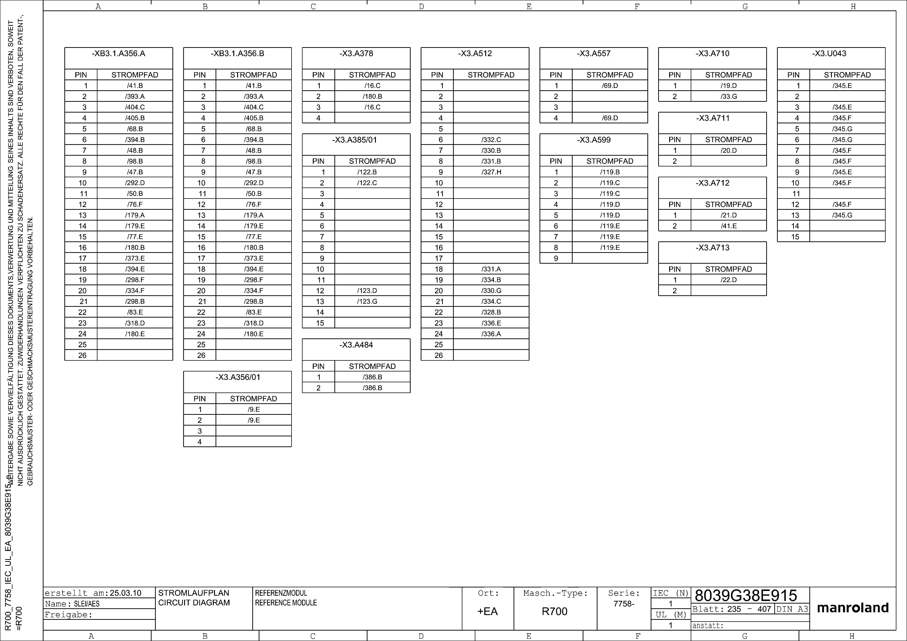

# +EA — Sheet 235 of 407 — REFERENZMODUL

**REFERENCE MODULE**

> Part of the manroland **R700** printing press IEC/UL circuit diagrams.
> Drawing class: **Stromlaufplan / Circuit diagram** (DIN A3).
> Document `+EA` covers the **Printing unit** machine section.

## At a glance

| Field | Value |
|---|---|
| Document | `+EA`  (8039G38E915) |
| Sheet | **235** of 407 |
| Section (DE) | REFERENZMODUL |
| Section (EN) | REFERENCE MODULE |
| Section type | REFERENCE_MODULE — Reference module |
| Machine type | `R700` |
| Series | `7758` |
| Created | 25.03.10 |
| Replaces | — |
| Columns used | A, B, C, D, E, F, G, H |
| Path numbers | — |
| Labels on sheet | 278 |
| Cross-refs out | 97 |
| Cross-refs in | 0 |

**Previous:** [+EA sheet 234](SHEET_0234.md) · **Next:** [+EA sheet 236](SHEET_0236.md) · **Document TOC:** [_TOC.md](_TOC.md)  (+EA) · **Master TOC:** [all sheets](../_MASTER_TOC.md)

## Sheet image (300 DPI, exact vector render)



_Rendered directly from the PDF vector layer at 300 DPI (1-bit), no OCR and no resampling. Use it to confirm anything ambiguous in the text below._

## Cross-references on this sheet

Each entry is a wire leaving this sheet. The printed token is `/sheet.column`; the link resolves to that sheet inside the same document.

| Ref | Target sheet | Col | Path | Destination on target | Target section | From col |
|---|---|---|---|---|---|---|
| `/41.B` | [+EA sheet 41](SHEET_0041.md) | B | — | — | BUSVERBINDUNGEN: STOP SICHERN | A |
| `/41.B` | [+EA sheet 41](SHEET_0041.md) | B | — | — | BUSVERBINDUNGEN: STOP SICHERN | B |
| `/345.E` | [+EA sheet 345](SHEET_0345.md) | E | — | — | OPTION: INLINEOBSERVER | H |
| `/16.C` | [+EA sheet 16](SHEET_0016.md) | C | — | — | SPANNUNGSVERSORGUNG: 400V, 24V | D |
| `/69.D` | [+EA sheet 69](SHEET_0069.md) | D | — | — | SCHMIERUNG | F |
| `/19.D` | [+EA sheet 19](SHEET_0019.md) | D | — | — | SPANNUNGSVERSORGUNG: 400V, 24V | G |
| `/393.A` | [+EA sheet 393](SHEET_0393.md) | A | — | — | OPTION: ZWISCHENTROCKNER VORBEREITUNG; | A |
| `/393.A` | [+EA sheet 393](SHEET_0393.md) | A | — | — | OPTION: ZWISCHENTROCKNER VORBEREITUNG; | B |
| `/180.B` | [+EA sheet 180](SHEET_0180.md) | B | — | — | RESERVE | D |
| `/33.G` | [+EA sheet 33](SHEET_0033.md) | G | — | — | BUSVERBINDUNGEN: NOT AUS | G |
| `/345.E` | [+EA sheet 345](SHEET_0345.md) | E | — | — | OPTION: INLINEOBSERVER | H |
| `/16.C` | [+EA sheet 16](SHEET_0016.md) | C | — | — | SPANNUNGSVERSORGUNG: 400V, 24V | D |
| `/404.C` | [+EA sheet 404](SHEET_0404.md) | C | — | — | OPTION: SCHNITTSTELLE UV ENDTROCKNER | A |
| `/404.C` | [+EA sheet 404](SHEET_0404.md) | C | — | — | OPTION: SCHNITTSTELLE UV ENDTROCKNER | B |
| `/405.B` | [+EA sheet 405](SHEET_0405.md) | B | — | — | OPTION: SCHNITTSTELLE UV ENDTROCKNER | A |
| `/405.B` | [+EA sheet 405](SHEET_0405.md) | B | — | — | OPTION: SCHNITTSTELLE UV ENDTROCKNER | B |
| `/345.F` | [+EA sheet 345](SHEET_0345.md) | F | — | — | OPTION: INLINEOBSERVER | H |
| `/69.D` | [+EA sheet 69](SHEET_0069.md) | D | — | — | SCHMIERUNG | F |
| `/68.B` | [+EA sheet 68](SHEET_0068.md) | B | — | — | LEITSTANDSFUNKTIONEN | A |
| `/68.B` | [+EA sheet 68](SHEET_0068.md) | B | — | — | LEITSTANDSFUNKTIONEN | B |
| `/345.G` | [+EA sheet 345](SHEET_0345.md) | G | — | — | OPTION: INLINEOBSERVER | H |
| `/20.D` | [+EA sheet 20](SHEET_0020.md) | D | — | STROMPFAD PIN 1 2 | SPANNUNGSVERSORGUNG: 400V, 24V | G |
| `/394.B` | [+EA sheet 394](SHEET_0394.md) | B | — | — | OPTION: ZWISCHENTROCKNER VORBEREITUNG; | A |
| `/394.B` | [+EA sheet 394](SHEET_0394.md) | B | — | — | OPTION: ZWISCHENTROCKNER VORBEREITUNG; | B |
| `/345.G` | [+EA sheet 345](SHEET_0345.md) | G | — | — | OPTION: INLINEOBSERVER | H |
| `/332.C` | [+EA sheet 332](SHEET_0332.md) | C | — | — | OPTION: BOGENWEICHE | E |
| `/48.B` | [+EA sheet 48](SHEET_0048.md) | B | — | — | SCHUTZ | A |
| `/48.B` | [+EA sheet 48](SHEET_0048.md) | B | — | — | SCHUTZ | B |
| `/330.B` | [+EA sheet 330](SHEET_0330.md) | B | — | — | OPTION: BOGENWEICHE | E |
| `/345.F` | [+EA sheet 345](SHEET_0345.md) | F | — | — | OPTION: INLINEOBSERVER | H |
| `/98.B` | [+EA sheet 98](SHEET_0098.md) | B | — | — | BOGENFÜHRUNGSELEMENT | A |
| `/98.B` | [+EA sheet 98](SHEET_0098.md) | B | — | — | BOGENFÜHRUNGSELEMENT | B |
| `/331.B` | [+EA sheet 331](SHEET_0331.md) | B | — | — | OPTION: BOGENWEICHE | E |
| `/345.F` | [+EA sheet 345](SHEET_0345.md) | F | — | — | OPTION: INLINEOBSERVER | H |
| `/47.B` | [+EA sheet 47](SHEET_0047.md) | B | — | — | SCHUTZ | A |
| `/47.B` | [+EA sheet 47](SHEET_0047.md) | B | — | — | SCHUTZ | B |
| `/122.B` | [+EA sheet 122](SHEET_0122.md) | B | — | — | TROCKENBESTÄUBER | C |
| `/119.B` | [+EA sheet 119](SHEET_0119.md) | B | — | — | PROZESSMAGAZIN: HANDTERMINAL | F |
| `/345.E` | [+EA sheet 345](SHEET_0345.md) | E | — | — | OPTION: INLINEOBSERVER | H |
| `/327.H` | [+EA sheet 327](SHEET_0327.md) | H | — | — | OPTION: BOGENWEICHE | E |
| `/345.F` | [+EA sheet 345](SHEET_0345.md) | F | — | — | OPTION: INLINEOBSERVER | H |
| `/292.D` | [+EA sheet 292](SHEET_0292.md) | D | — | — | OPTION: PROBEBOGENENTNAHME HALBAUTOMATISCH | A |
| `/292.D` | [+EA sheet 292](SHEET_0292.md) | D | — | — | OPTION: PROBEBOGENENTNAHME HALBAUTOMATISCH | B |
| `/122.C` | [+EA sheet 122](SHEET_0122.md) | C | — | — | TROCKENBESTÄUBER | C |
| `/119.C` | [+EA sheet 119](SHEET_0119.md) | C | — | — | PROZESSMAGAZIN: HANDTERMINAL | F |
| `/50.B` | [+EA sheet 50](SHEET_0050.md) | B | — | — | SCHUTZ | A |
| `/50.B` | [+EA sheet 50](SHEET_0050.md) | B | — | — | SCHUTZ | B |
| `/119.C` | [+EA sheet 119](SHEET_0119.md) | C | — | — | PROZESSMAGAZIN: HANDTERMINAL | F |
| `/76.F` | [+EA sheet 76](SHEET_0076.md) | F | — | — | AUSLEGERSTAPELSTEUERUNG | A |
| `/76.F` | [+EA sheet 76](SHEET_0076.md) | F | — | — | AUSLEGERSTAPELSTEUERUNG | B |
| `/345.F` | [+EA sheet 345](SHEET_0345.md) | F | — | — | OPTION: INLINEOBSERVER | H |
| `/119.D` | [+EA sheet 119](SHEET_0119.md) | D | — | — | PROZESSMAGAZIN: HANDTERMINAL | F |
| `/179.A` | [+EA sheet 179](SHEET_0179.md) | A | — | — | RESERVE | A |
| `/179.A` | [+EA sheet 179](SHEET_0179.md) | A | — | — | RESERVE | B |
| `/345.G` | [+EA sheet 345](SHEET_0345.md) | G | — | — | OPTION: INLINEOBSERVER | H |
| `/119.D` | [+EA sheet 119](SHEET_0119.md) | D | — | — | PROZESSMAGAZIN: HANDTERMINAL | F |
| `/21.D` | [+EA sheet 21](SHEET_0021.md) | D | — | — | SPANNUNGSVERSORGUNG: 400V, 24V | G |
| `/41.E` | [+EA sheet 41](SHEET_0041.md) | E | — | — | BUSVERBINDUNGEN: STOP SICHERN | G |
| `/179.E` | [+EA sheet 179](SHEET_0179.md) | E | — | — | RESERVE | A |
| `/179.E` | [+EA sheet 179](SHEET_0179.md) | E | — | — | RESERVE | B |
| `/119.E` | [+EA sheet 119](SHEET_0119.md) | E | — | — | PROZESSMAGAZIN: HANDTERMINAL | F |
| `/77.E` | [+EA sheet 77](SHEET_0077.md) | E | — | — | AUSLEGERSTAPELSTEUERUNG | A |
| `/77.E` | [+EA sheet 77](SHEET_0077.md) | E | — | — | AUSLEGERSTAPELSTEUERUNG | B |
| `/119.E` | [+EA sheet 119](SHEET_0119.md) | E | — | — | PROZESSMAGAZIN: HANDTERMINAL | F |
| `/180.B` | [+EA sheet 180](SHEET_0180.md) | B | — | — | RESERVE | A |
| `/180.B` | [+EA sheet 180](SHEET_0180.md) | B | — | — | RESERVE | B |
| `/119.E` | [+EA sheet 119](SHEET_0119.md) | E | — | — | PROZESSMAGAZIN: HANDTERMINAL | F |
| `/373.E` | [+EA sheet 373](SHEET_0373.md) | E | — | — | OPTION: ENDTROCKNER 1 VORBEREITUNG; | A |
| `/373.E` | [+EA sheet 373](SHEET_0373.md) | E | — | — | OPTION: ENDTROCKNER 1 VORBEREITUNG; | B |
| `/22.D` | [+EA sheet 22](SHEET_0022.md) | D | — | STROMPFAD PIN 1 2 | SPANNUNGSVERSORGUNG: 400V, 24V | G |
| `/394.E` | [+EA sheet 394](SHEET_0394.md) | E | — | — | OPTION: ZWISCHENTROCKNER VORBEREITUNG; | A |
| `/394.E` | [+EA sheet 394](SHEET_0394.md) | E | — | — | OPTION: ZWISCHENTROCKNER VORBEREITUNG; | B |
| `/331.A` | [+EA sheet 331](SHEET_0331.md) | A | — | — | OPTION: BOGENWEICHE | E |
| `/334.B` | [+EA sheet 334](SHEET_0334.md) | B | — | — | OPTION: BOGENWEICHE | E |
| `/298.F` | [+EA sheet 298](SHEET_0298.md) | F | — | — | OPTION: ZWISCHENSTAPEL / | A |
| `/298.F` | [+EA sheet 298](SHEET_0298.md) | F | — | — | OPTION: ZWISCHENSTAPEL / | B |
| `/334.F` | [+EA sheet 334](SHEET_0334.md) | F | — | — | OPTION: BOGENWEICHE | A |
| `/334.F` | [+EA sheet 334](SHEET_0334.md) | F | — | — | OPTION: BOGENWEICHE | B |
| `/330.G` | [+EA sheet 330](SHEET_0330.md) | G | — | — | OPTION: BOGENWEICHE | E |
| `/123.D` | [+EA sheet 123](SHEET_0123.md) | D | — | — | TROCKENBESTÄUBER | C |
| `/298.B` | [+EA sheet 298](SHEET_0298.md) | B | — | — | OPTION: ZWISCHENSTAPEL / | A |
| `/298.B` | [+EA sheet 298](SHEET_0298.md) | B | — | — | OPTION: ZWISCHENSTAPEL / | B |
| `/123.G` | [+EA sheet 123](SHEET_0123.md) | G | — | — | TROCKENBESTÄUBER | D |
| `/334.C` | [+EA sheet 334](SHEET_0334.md) | C | — | — | OPTION: BOGENWEICHE | E |
| `/83.E` | [+EA sheet 83](SHEET_0083.md) | E | — | — | AUSLEGERSTAPELSTEUERUNG: PROGRAMMSCHALTWERK | A |
| `/83.E` | [+EA sheet 83](SHEET_0083.md) | E | — | — | AUSLEGERSTAPELSTEUERUNG: PROGRAMMSCHALTWERK | B |
| `/328.B` | [+EA sheet 328](SHEET_0328.md) | B | — | — | OPTION: BOGENWEICHE | E |
| `/336.E` | [+EA sheet 336](SHEET_0336.md) | E | — | — | OPTION: BOGENWEICHE | E |
| `/318.D` | [+EA sheet 318](SHEET_0318.md) | D | — | — | OPTION: LOGISTIK, AUSLEGER | A |
| `/318.D` | [+EA sheet 318](SHEET_0318.md) | D | — | — | OPTION: LOGISTIK, AUSLEGER | B |
| `/180.E` | [+EA sheet 180](SHEET_0180.md) | E | — | — | RESERVE | A |
| `/180.E` | [+EA sheet 180](SHEET_0180.md) | E | — | — | RESERVE | B |
| `/336.A` | [+EA sheet 336](SHEET_0336.md) | A | — | — | OPTION: BOGENWEICHE | E |
| `/386.B` | [+EA sheet 386](SHEET_0386.md) | B | — | — | OPTION: ZWISCHENTROCKNER VORBEREITUNG; | D |
| `/386.B` | [+EA sheet 386](SHEET_0386.md) | B | — | — | OPTION: ZWISCHENTROCKNER VORBEREITUNG; | D |
| `/9.E` | [+EA sheet 9](SHEET_0009.md) | E | — | — | SPANNUNGSVERSORGUNG: 400V, 24V | B |
| `/9.E` | [+EA sheet 9](SHEET_0009.md) | E | — | — | SPANNUNGSVERSORGUNG: 400V, 24V | B |

## Devices on this sheet

| Tag | Class | Class meaning (IEC) | Col | Sub | Terminal | Sign |
|---|---|---|---|---|---|---|
| `XB3.1.A356.A` | — | cross-device reference | A | — | — | — |
| `X3.U043` | — | cross-device reference | H | — | — | — |
| `XB3.1.A356.B` | — | cross-device reference | B | — | — | — |
| `X3.A512` | — | cross-device reference | E | — | — | — |
| `X3.A557` | — | cross-device reference | F | — | — | — |
| `X3.A599` | — | cross-device reference | F | — | — | — |
| `X3.A710` | — | cross-device reference | G | — | — | — |
| `X3.A711` | — | cross-device reference | G | — | — | — |
| `X3.A712` | — | cross-device reference | G | — | — | — |
| `X3.A713` | — | cross-device reference | G | — | — | — |
| `X3.A378` | — | cross-device reference | C | — | — | — |
| `X3.A484` | — | cross-device reference | C | — | — | — |

## Potentials / nets

_No named potentials on this sheet._

## Wire-end annotations (grouped as printed)

A wire that continues elsewhere is annotated with a small cluster: the destination description, the path/line number `#NN`, and the `/sheet.column` cross reference. Each row below is one such cluster exactly as it is grouped on the drawing.

| Col | Y | Path | Cross-ref | Text on the wire |
|---|---|---|---|---|
| A | 65.5 | — | — | `XB3.1.A356.A` |
| B | 65.5 | — | — | `XB3.1.A356.B` |
| C | 65.5 | — | — | `X3.A378` |
| E | 65.5 | — | — | `X3.A512` |
| F | 65.5 | — | — | `X3.A557` |
| G | 65.5 | — | — | `X3.A710` |
| H | 65.5 | — | — | `X3.U043` |
| A | 94.2 | — | — | `PIN STROMPFAD` |
| B | 94.2 | — | — | `PIN STROMPFAD` |
| C | 94.2 | — | — | `PIN 2 3 4 1 STROMPFAD` |
| D | 94.2 | — | — | `PIN STROMPFAD` |
| F | 94.2 | — | — | `PIN 2 3 4 1 STROMPFAD` |
| G | 94.2 | — | — | `PIN 2 1 STROMPFAD` |
| H | 94.2 | — | — | `PIN 10 12 13 14 15 11 2 3 4 5 6 7 8 9 1 STROMPFAD` |
| A | 108.4 | — | — | `2 3 4 5 6 7 8 9 1` |
| B | 108.4 | — | — | `2 3 4 5 6 7 8 9 1` |
| D | 108.4 | — | — | `2 3 4 5 6 7 8 9 1` |
| A | 108.7 | — | `/41.B` | — |
| B | 108.7 | — | `/41.B` | — |
| D | 108.7 | — | `/16.C` | — |
| F | 108.7 | — | `/69.D` | — |
| G | 108.7 | — | `/19.D` | — |
| H | 108.7 | — | `/345.E` | — |
| A | 122.9 | — | `/393.A` | — |
| B | 122.9 | — | `/393.A` | — |
| D | 122.9 | — | `/180.B` | — |
| G | 122.9 | — | `/33.G` | — |
| H | 137.0 | — | `/345.E` | — |
| A | 137.1 | — | `/404.C` | — |
| B | 137.1 | — | `/404.C` | — |
| D | 137.1 | — | `/16.C` | — |
| G | 150.6 | — | — | `X3.A711` |
| A | 151.2 | — | `/405.B` | — |
| B | 151.2 | — | `/405.B` | — |
| F | 151.2 | — | `/69.D` | — |
| H | 151.2 | — | `/345.F` | — |
| A | 165.4 | — | `/68.B` | — |
| B | 165.4 | — | `/68.B` | — |
| H | 165.4 | — | `/345.G` | — |
| C | 178.9 | — | — | `X3.A385/01` |
| F | 178.9 | — | — | `X3.A599` |
| G | 179.2 | — | `/20.D` | `PIN 2 1 STROMPFAD` |
| A | 179.6 | — | `/394.B` | — |
| B | 179.6 | — | `/394.B` | — |
| E | 179.6 | — | `/332.C` | — |
| H | 179.6 | — | `/345.G` | — |
| A | 193.7 | — | `/48.B` | — |
| B | 193.7 | — | `/48.B` | — |
| E | 193.7 | — | `/330.B` | — |
| H | 193.7 | — | `/345.F` | — |
| C | 207.5 | — | — | `PIN 10 12 13 14 15 11 2 3 4 5 6 7 8 9 1 STROMPFAD` |
| F | 207.5 | — | — | `PIN 2 3 4 5 6 7 8 9 1 STROMPFAD` |
| A | 207.9 | — | `/98.B` | — |
| B | 207.9 | — | `/98.B` | — |
| E | 207.9 | — | `/331.B` | — |
| H | 207.9 | — | `/345.F` | — |
| A | 222.1 | — | `/47.B` | — |
| B | 222.1 | — | `/47.B` | — |
| C | 222.1 | — | `/122.B` | — |
| E | 222.1 | — | `/327.H` | — |
| F | 222.1 | — | `/119.B` | — |
| H | 222.1 | — | `/345.E` | — |
| G | 235.6 | — | — | `X3.A712` |
| A | 235.9 | — | — | `10 12 13 14 15 16 17 18 19 20 11` |
| B | 235.9 | — | — | `10 12 13 14 15 16 17 18 19 20 11` |
| D | 235.9 | — | — | `10 12 13 14 15 16 17 18 19 20 11` |
| A | 236.3 | — | `/292.D` | — |
| B | 236.3 | — | `/292.D` | — |
| C | 236.3 | — | `/122.C` | — |
| F | 236.3 | — | `/119.C` | — |
| H | 236.3 | — | `/345.F` | — |
| A | 250.4 | — | `/50.B` | — |
| B | 250.4 | — | `/50.B` | — |
| F | 250.4 | — | `/119.C` | — |
| G | 264.2 | — | — | `PIN 2 1 STROMPFAD` |
| A | 264.6 | — | `/76.F` | — |
| B | 264.6 | — | `/76.F` | — |
| F | 264.6 | — | `/119.D` | — |
| H | 264.6 | — | `/345.F` | — |
| A | 278.8 | — | `/179.A` | — |
| B | 278.8 | — | `/179.A` | — |
| F | 278.8 | — | `/119.D` | — |
| G | 278.8 | — | `/21.D` | — |
| H | 278.8 | — | `/345.G` | — |
| A | 292.9 | — | `/179.E` | — |
| B | 292.9 | — | `/179.E` | — |
| F | 292.9 | — | `/119.E` | — |
| G | 292.9 | — | `/41.E` | — |
| A | 307.1 | — | `/77.E` | — |
| B | 307.1 | — | `/77.E` | — |
| F | 307.1 | — | `/119.E` | — |
| G | 320.6 | — | — | `X3.A713` |
| A | 321.3 | — | `/180.B` | — |
| B | 321.3 | — | `/180.B` | — |
| F | 321.3 | — | `/119.E` | — |
| A | 335.5 | — | `/373.E` | — |
| B | 335.5 | — | `/373.E` | — |
| G | 349.3 | — | `/22.D` | `PIN 2 1 STROMPFAD` |
| A | 349.6 | — | `/394.E` | — |
| B | 349.6 | — | `/394.E` | — |
| E | 349.6 | — | `/331.A` | — |
| A | 363.8 | — | `/298.F` | — |
| B | 363.8 | — | `/298.F` | — |
| E | 363.8 | — | `/334.B` | — |
| A | 378.0 | — | `/334.F` | — |
| B | 378.0 | — | `/334.F` | — |
| C | 378.0 | — | `/123.D` | — |
| E | 378.0 | — | `/330.G` | — |
| A | 391.8 | — | — | `22 23 24 25 26 21` |
| B | 391.8 | — | — | `22 23 24 25 26 21` |
| D | 391.8 | — | — | `22 23 24 25 26 21` |
| A | 392.1 | — | `/298.B` | — |
| B | 392.1 | — | `/298.B` | — |
| D | 392.2 | — | `/123.G` | — |
| E | 392.2 | — | `/334.C` | — |
| A | 406.3 | — | `/83.E` | — |
| B | 406.3 | — | `/83.E` | — |
| E | 406.3 | — | `/328.B` | — |
| A | 420.5 | — | `/318.D` | — |
| B | 420.5 | — | `/318.D` | — |
| E | 420.5 | — | `/336.E` | — |
| A | 434.7 | — | `/180.E` | — |
| B | 434.7 | — | `/180.E` | — |
| E | 434.7 | — | `/336.A` | — |
| C | 448.2 | — | — | `X3.A484` |
| C | 476.8 | — | — | `PIN 2 1 STROMPFAD` |
| B | 490.7 | — | — | `X3.A356/01` |
| D | 491.4 | — | `/386.B` | — |
| D | 505.5 | — | `/386.B` | — |
| B | 519.4 | — | — | `PIN 2 3 4 1 STROMPFAD` |
| B | 533.9 | — | `/9.E` | — |
| B | 548.0 | — | `/9.E` | — |


## Reconstructed tables

This sheet carries tabular content (pin map / terminal assignment / index). The grid below was rebuilt from the drawing's own rule lines, so each row is exactly one physical row of the table.

### Table 1 — 26 data rows × 2 columns (at x=85.0, y=62.4) — **XB3.1.A356.A**

| PIN | STROMPFAD |
|---|---|
| `1` | `/41.B` |
| `2` | `/393.A` |
| `3` | `/404.C` |
| `4` | `/405.B` |
| `5` | `/68.B` |
| `6` | `/394.B` |
| `7` | `/48.B` |
| `8` | `/98.B` |
| `9` | `/47.B` |
| `10` | `/292.D` |
| `11` | `/50.B` |
| `12` | `/76.F` |
| `13` | `/179.A` |
| `14` | `/179.E` |
| `15` | `/77.E` |
| `16` | `/180.B` |
| `17` | `/373.E` |
| `18` | `/394.E` |
| `19` | `/298.F` |
| `20` | `/334.F` |
| `21` | `/298.B` |
| `22` | `/83.E` |
| `23` | `/318.D` |
| `24` | `/180.E` |
| `25` |  |
| `26` |  |


### Table 2 — 32 data rows × 2 columns (at x=240.9, y=62.4) — **XB3.1.A356.B**

| PIN | STROMPFAD |
|---|---|
| `1` | `/41.B` |
| `2` | `/393.A` |
| `3` | `/404.C` |
| `4` | `/405.B` |
| `5` | `/68.B` |
| `6` | `/394.B` |
| `7` | `/48.B` |
| `8` | `/98.B` |
| `9` | `/47.B` |
| `10` | `/292.D` |
| `11` | `/50.B` |
| `12` | `/76.F` |
| `13` | `/179.A` |
| `14` | `/179.E` |
| `15` | `/77.E` |
| `16` | `/180.B` |
| `17` | `/373.E` |
| `18` | `/394.E` |
| `19` | `/298.F` |
| `20` | `/334.F` |
| `21` | `/298.B` |
| `22` | `/83.E` |
| `23` | `/318.D` |
| `24` | `/180.E` |
| `25` |  |
| `26` |  |
|  | `X3.A356/01` |
| `PIN` | `STROMPFAD` |
| `1` | `/9.E` |
| `2` | `/9.E` |
| `3` |  |
| `4` |  |


### Table 3 — 25 data rows × 2 columns (at x=396.9, y=62.4) — **X3.A378**

| PIN | STROMPFAD |
|---|---|
| `1` | `/16.C` |
| `2` | `/180.B` |
| `3` | `/16.C` |
| `4` |  |
|  | `X3.A385/01` |
| `PIN` | `STROMPFAD` |
| `1` | `/122.B` |
| `2` | `/122.C` |
| `3` |  |
| `4` |  |
| `5` |  |
| `6` |  |
| `7` |  |
| `8` |  |
| `9` |  |
| `10` |  |
| `11` |  |
| `12` | `/123.D` |
| `13` | `/123.G` |
| `14` |  |
| `15` |  |
|  | `X3.A484` |
| `PIN` | `STROMPFAD` |
| `1` | `/386.B` |
| `2` | `/386.B` |


### Table 4 — 26 data rows × 2 columns (at x=552.8, y=62.4) — **X3.A512**

| PIN | STROMPFAD |
|---|---|
| `1` |  |
| `2` |  |
| `3` |  |
| `4` |  |
| `5` |  |
| `6` | `/332.C` |
| `7` | `/330.B` |
| `8` | `/331.B` |
| `9` | `/327.H` |
| `10` |  |
| `11` |  |
| `12` |  |
| `13` |  |
| `14` |  |
| `15` |  |
| `16` |  |
| `17` |  |
| `18` | `/331.A` |
| `19` | `/334.B` |
| `20` | `/330.G` |
| `21` | `/334.C` |
| `22` | `/328.B` |
| `23` | `/336.E` |
| `24` | `/336.A` |
| `25` |  |
| `26` |  |


### Table 5 — 15 data rows × 2 columns (at x=708.7, y=62.4) — **X3.A557**

| PIN | STROMPFAD |
|---|---|
| `1` | `/69.D` |
| `2` |  |
| `3` |  |
| `4` | `/69.D` |
|  | `X3.A599` |
| `PIN` | `STROMPFAD` |
| `1` | `/119.B` |
| `2` | `/119.C` |
| `3` | `/119.C` |
| `4` | `/119.D` |
| `5` | `/119.D` |
| `6` | `/119.E` |
| `7` | `/119.E` |
| `8` | `/119.E` |
| `9` |  |


### Table 6 — 14 data rows × 2 columns (at x=864.6, y=62.4) — **X3.A710**

| PIN | STROMPFAD |
|---|---|
| `1` | `/19.D` |
| `2` | `/33.G` |
|  | `X3.A711` |
| `PIN` | `STROMPFAD` |
| `1` | `/20.D` |
| `2` |  |
|  | `X3.A712` |
| `PIN` | `STROMPFAD` |
| `1` | `/21.D` |
| `2` | `/41.E` |
|  | `X3.A713` |
| `PIN` | `STROMPFAD` |
| `1` | `/22.D` |
| `2` |  |


### Table 7 — 15 data rows × 2 columns (at x=1020.5, y=62.4) — **X3.U043**

| PIN | STROMPFAD |
|---|---|
| `1` | `/345.E` |
| `2` |  |
| `3` | `/345.E` |
| `4` | `/345.F` |
| `5` | `/345.G` |
| `6` | `/345.G` |
| `7` | `/345.F` |
| `8` | `/345.F` |
| `9` | `/345.E` |
| `10` | `/345.F` |
| `11` |  |
| `12` | `/345.F` |
| `13` | `/345.G` |
| `14` |  |
| `15` |  |


## Notes and free text on this sheet

| Text | Col | Y (pt) |
|---|---|---|
| `PIN` | A | 94.2 |
| `STROMPFAD` | A | 94.15 |
| `PIN` | G | 94.2 |
| `STROMPFAD` | H | 94.15 |
| `PIN` | B | 94.2 |
| `STROMPFAD` | B | 94.15 |
| `PIN` | D | 94.2 |
| `STROMPFAD` | E | 94.15 |
| `PIN` | E | 94.2 |
| `STROMPFAD` | F | 94.15 |
| `PIN` | F | 94.2 |
| `STROMPFAD` | G | 94.15 |
| `X3.A356/01` | B | 490.7 |
| `PIN` | C | 94.2 |
| `STROMPFAD` | D | 94.15 |
| `X3.A385/01` | C | 178.89 |

## Complete label inventory (exact text from the drawing)

Every text object inside the drawing area of this sheet, in DIN reading order (column A→H, then top→bottom). This is the authoritative list: if a string is not here it is not printed on this sheet.

| Col | Y | X | Dir | Type | Text |
|---|---|---|---|---|---|
| A | 65.5 | 120.6 | → | device ref | `XB3.1.A356.A` |
| A | 94.2 | 98.2 | → | text | `PIN` |
| A | 94.2 | 146.4 | → | text | `STROMPFAD` |
| A | 108.4 | 110.0 | → | number | `1` |
| A | 108.7 | 167.0 | → | cross-reference | `/41.B` |
| A | 122.5 | 108.3 | → | number | `2` |
| A | 122.9 | 164.4 | → | cross-reference | `/393.A` |
| A | 136.7 | 108.3 | → | number | `3` |
| A | 137.1 | 164.4 | → | cross-reference | `/404.C` |
| A | 150.9 | 108.3 | → | number | `4` |
| A | 151.2 | 164.6 | → | cross-reference | `/405.B` |
| A | 165.1 | 108.3 | → | number | `5` |
| A | 165.4 | 167.0 | → | cross-reference | `/68.B` |
| A | 179.2 | 108.3 | → | number | `6` |
| A | 179.6 | 164.6 | → | cross-reference | `/394.B` |
| A | 193.4 | 108.3 | → | number | `7` |
| A | 193.7 | 167.0 | → | cross-reference | `/48.B` |
| A | 207.6 | 108.3 | → | number | `8` |
| A | 207.9 | 167.0 | → | cross-reference | `/98.B` |
| A | 221.8 | 108.3 | → | number | `9` |
| A | 222.1 | 167.0 | → | cross-reference | `/47.B` |
| A | 235.9 | 102.9 | → | number | `10` |
| A | 236.3 | 164.4 | → | cross-reference | `/292.D` |
| A | 250.1 | 104.6 | → | number | `11` |
| A | 250.4 | 167.0 | → | cross-reference | `/50.B` |
| A | 264.3 | 102.9 | → | number | `12` |
| A | 264.6 | 167.2 | → | cross-reference | `/76.F` |
| A | 278.5 | 102.9 | → | number | `13` |
| A | 278.8 | 164.4 | → | cross-reference | `/179.A` |
| A | 292.6 | 102.9 | → | number | `14` |
| A | 292.9 | 164.7 | → | cross-reference | `/179.E` |
| A | 306.8 | 102.9 | → | number | `15` |
| A | 307.1 | 167.1 | → | cross-reference | `/77.E` |
| A | 321.0 | 102.9 | → | number | `16` |
| A | 321.3 | 164.6 | → | cross-reference | `/180.B` |
| A | 335.1 | 102.9 | → | number | `17` |
| A | 335.5 | 164.7 | → | cross-reference | `/373.E` |
| A | 349.3 | 102.9 | → | number | `18` |
| A | 349.6 | 164.7 | → | cross-reference | `/394.E` |
| A | 363.5 | 102.9 | → | number | `19` |
| A | 363.8 | 164.8 | → | cross-reference | `/298.F` |
| A | 377.7 | 102.9 | → | number | `20` |
| A | 378.0 | 164.8 | → | cross-reference | `/334.F` |
| A | 391.8 | 104.6 | → | number | `21` |
| A | 392.2 | 164.6 | → | cross-reference | `/298.B` |
| A | 406.0 | 102.9 | → | number | `22` |
| A | 406.3 | 167.1 | → | cross-reference | `/83.E` |
| A | 420.2 | 102.9 | → | number | `23` |
| A | 420.5 | 164.4 | → | cross-reference | `/318.D` |
| A | 434.4 | 102.9 | → | number | `24` |
| A | 434.7 | 164.7 | → | cross-reference | `/180.E` |
| A | 448.5 | 102.9 | → | number | `25` |
| A | 462.7 | 102.9 | → | number | `26` |
| B | 65.5 | 276.9 | → | device ref | `XB3.1.A356.B` |
| B | 94.2 | 254.1 | → | text | `PIN` |
| B | 94.2 | 302.3 | → | text | `STROMPFAD` |
| B | 108.4 | 265.9 | → | number | `1` |
| B | 108.7 | 322.9 | → | cross-reference | `/41.B` |
| B | 122.5 | 264.2 | → | number | `2` |
| B | 122.9 | 320.3 | → | cross-reference | `/393.A` |
| B | 136.7 | 264.2 | → | number | `3` |
| B | 137.1 | 320.3 | → | cross-reference | `/404.C` |
| B | 150.9 | 264.2 | → | number | `4` |
| B | 151.2 | 320.5 | → | cross-reference | `/405.B` |
| B | 165.1 | 264.2 | → | number | `5` |
| B | 165.4 | 322.9 | → | cross-reference | `/68.B` |
| B | 179.2 | 264.2 | → | number | `6` |
| B | 179.6 | 320.5 | → | cross-reference | `/394.B` |
| B | 193.4 | 264.2 | → | number | `7` |
| B | 193.7 | 322.9 | → | cross-reference | `/48.B` |
| B | 207.6 | 264.2 | → | number | `8` |
| B | 207.9 | 322.9 | → | cross-reference | `/98.B` |
| B | 221.8 | 264.2 | → | number | `9` |
| B | 222.1 | 322.9 | → | cross-reference | `/47.B` |
| B | 235.9 | 258.8 | → | number | `10` |
| B | 236.3 | 320.3 | → | cross-reference | `/292.D` |
| B | 250.1 | 260.5 | → | number | `11` |
| B | 250.4 | 322.9 | → | cross-reference | `/50.B` |
| B | 264.3 | 258.8 | → | number | `12` |
| B | 264.6 | 323.1 | → | cross-reference | `/76.F` |
| B | 278.5 | 258.8 | → | number | `13` |
| B | 278.8 | 320.3 | → | cross-reference | `/179.A` |
| B | 292.6 | 258.8 | → | number | `14` |
| B | 292.9 | 320.6 | → | cross-reference | `/179.E` |
| B | 306.8 | 258.8 | → | number | `15` |
| B | 307.1 | 323.0 | → | cross-reference | `/77.E` |
| B | 321.0 | 258.8 | → | number | `16` |
| B | 321.3 | 320.5 | → | cross-reference | `/180.B` |
| B | 335.1 | 258.8 | → | number | `17` |
| B | 335.5 | 320.6 | → | cross-reference | `/373.E` |
| B | 349.3 | 258.8 | → | number | `18` |
| B | 349.6 | 320.6 | → | cross-reference | `/394.E` |
| B | 363.5 | 258.8 | → | number | `19` |
| B | 363.8 | 320.7 | → | cross-reference | `/298.F` |
| B | 377.7 | 258.8 | → | number | `20` |
| B | 378.0 | 320.7 | → | cross-reference | `/334.F` |
| B | 391.8 | 260.5 | → | number | `21` |
| B | 392.2 | 320.5 | → | cross-reference | `/298.B` |
| B | 406.0 | 258.8 | → | number | `22` |
| B | 406.3 | 323.0 | → | cross-reference | `/83.E` |
| B | 420.2 | 258.8 | → | number | `23` |
| B | 420.5 | 320.3 | → | cross-reference | `/318.D` |
| B | 434.4 | 258.8 | → | number | `24` |
| B | 434.7 | 320.6 | → | cross-reference | `/180.E` |
| B | 448.5 | 258.8 | → | number | `25` |
| B | 462.7 | 258.8 | → | number | `26` |
| B | 490.7 | 283.2 | → | text | `X3.A356/01` |
| B | 519.4 | 254.1 | → | text | `PIN` |
| B | 519.4 | 302.3 | → | text | `STROMPFAD` |
| B | 533.6 | 260.1 | → | number | `1` |
| B | 533.8 | 325.4 | → | cross-reference | `/9.E` |
| B | 547.7 | 259.5 | → | number | `2` |
| B | 548.0 | 325.4 | → | cross-reference | `/9.E` |
| B | 561.9 | 259.5 | → | number | `3` |
| B | 576.1 | 259.5 | → | number | `4` |
| C | 65.5 | 445.7 | → | device ref | `X3.A378` |
| C | 94.2 | 410.0 | → | text | `PIN` |
| C | 108.4 | 416.0 | → | number | `1` |
| C | 122.5 | 415.4 | → | number | `2` |
| C | 136.7 | 415.4 | → | number | `3` |
| C | 150.9 | 415.4 | → | number | `4` |
| C | 178.9 | 436.3 | → | text | `X3.A385/01` |
| C | 207.6 | 410.0 | → | text | `PIN` |
| C | 221.8 | 421.8 | → | number | `1` |
| C | 222.1 | 469.3 | → | cross-reference | `/122.B` |
| C | 235.9 | 420.1 | → | number | `2` |
| C | 236.3 | 469.1 | → | cross-reference | `/122.C` |
| C | 250.1 | 420.1 | → | number | `3` |
| C | 264.3 | 420.1 | → | number | `4` |
| C | 278.5 | 420.1 | → | number | `5` |
| C | 292.6 | 420.1 | → | number | `6` |
| C | 306.8 | 420.1 | → | number | `7` |
| C | 321.0 | 420.1 | → | number | `8` |
| C | 335.1 | 420.1 | → | number | `9` |
| C | 349.3 | 414.7 | → | number | `10` |
| C | 363.5 | 416.4 | → | number | `11` |
| C | 377.7 | 414.7 | → | number | `12` |
| C | 378.0 | 469.1 | → | cross-reference | `/123.D` |
| C | 391.8 | 414.7 | → | number | `13` |
| C | 406.0 | 414.7 | → | number | `14` |
| C | 420.2 | 414.7 | → | number | `15` |
| C | 448.2 | 445.7 | → | device ref | `X3.A484` |
| C | 476.9 | 410.0 | → | text | `PIN` |
| C | 491.0 | 416.0 | → | number | `1` |
| C | 505.2 | 415.4 | → | number | `2` |
| D | 94.2 | 458.2 | → | text | `STROMPFAD` |
| D | 94.2 | 565.9 | → | text | `PIN` |
| D | 108.4 | 577.7 | → | number | `1` |
| D | 108.7 | 478.6 | → | cross-reference | `/16.C` |
| D | 122.5 | 576.0 | → | number | `2` |
| D | 122.9 | 476.4 | → | cross-reference | `/180.B` |
| D | 136.7 | 576.0 | → | number | `3` |
| D | 137.1 | 478.6 | → | cross-reference | `/16.C` |
| D | 150.9 | 576.0 | → | number | `4` |
| D | 165.1 | 576.0 | → | number | `5` |
| D | 179.2 | 576.0 | → | number | `6` |
| D | 193.4 | 576.0 | → | number | `7` |
| D | 207.5 | 458.2 | → | text | `STROMPFAD` |
| D | 207.6 | 576.0 | → | number | `8` |
| D | 221.8 | 576.0 | → | number | `9` |
| D | 235.9 | 570.6 | → | number | `10` |
| D | 250.1 | 572.3 | → | number | `11` |
| D | 264.3 | 570.6 | → | number | `12` |
| D | 278.5 | 570.6 | → | number | `13` |
| D | 292.6 | 570.6 | → | number | `14` |
| D | 306.8 | 570.6 | → | number | `15` |
| D | 321.0 | 570.6 | → | number | `16` |
| D | 335.1 | 570.6 | → | number | `17` |
| D | 349.3 | 570.6 | → | number | `18` |
| D | 363.5 | 570.6 | → | number | `19` |
| D | 377.7 | 570.6 | → | number | `20` |
| D | 391.8 | 572.3 | → | number | `21` |
| D | 392.2 | 469.0 | → | cross-reference | `/123.G` |
| D | 406.0 | 570.6 | → | number | `22` |
| D | 420.2 | 570.6 | → | number | `23` |
| D | 434.4 | 570.6 | → | number | `24` |
| D | 448.5 | 570.6 | → | number | `25` |
| D | 462.7 | 570.6 | → | number | `26` |
| D | 476.8 | 458.2 | → | text | `STROMPFAD` |
| D | 491.4 | 476.4 | → | cross-reference | `/386.B` |
| D | 505.5 | 476.4 | → | cross-reference | `/386.B` |
| E | 65.5 | 601.7 | → | device ref | `X3.A512` |
| E | 94.2 | 614.1 | → | text | `STROMPFAD` |
| E | 94.2 | 721.8 | → | text | `PIN` |
| E | 108.4 | 727.8 | → | number | `1` |
| E | 122.5 | 727.2 | → | number | `2` |
| E | 136.7 | 727.2 | → | number | `3` |
| E | 150.9 | 727.2 | → | number | `4` |
| E | 179.6 | 632.1 | → | cross-reference | `/332.C` |
| E | 193.7 | 632.3 | → | cross-reference | `/330.B` |
| E | 207.6 | 721.8 | → | text | `PIN` |
| E | 207.9 | 632.3 | → | cross-reference | `/331.B` |
| E | 221.8 | 727.8 | → | number | `1` |
| E | 222.1 | 632.4 | → | cross-reference | `/327.H` |
| E | 235.9 | 727.2 | → | number | `2` |
| E | 250.1 | 727.2 | → | number | `3` |
| E | 264.3 | 727.2 | → | number | `4` |
| E | 278.5 | 727.2 | → | number | `5` |
| E | 292.6 | 727.2 | → | number | `6` |
| E | 306.8 | 727.2 | → | number | `7` |
| E | 321.0 | 727.2 | → | number | `8` |
| E | 335.1 | 727.2 | → | number | `9` |
| E | 349.6 | 632.1 | → | cross-reference | `/331.A` |
| E | 363.8 | 632.3 | → | cross-reference | `/334.B` |
| E | 378.0 | 632.0 | → | cross-reference | `/330.G` |
| E | 392.2 | 632.1 | → | cross-reference | `/334.C` |
| E | 406.3 | 632.3 | → | cross-reference | `/328.B` |
| E | 420.5 | 632.4 | → | cross-reference | `/336.E` |
| E | 434.7 | 632.1 | → | cross-reference | `/336.A` |
| F | 65.5 | 757.6 | → | device ref | `X3.A557` |
| F | 94.2 | 770.0 | → | text | `STROMPFAD` |
| F | 94.2 | 877.7 | → | text | `PIN` |
| F | 108.4 | 883.7 | → | number | `1` |
| F | 108.7 | 790.4 | → | cross-reference | `/69.D` |
| F | 122.5 | 883.1 | → | number | `2` |
| F | 151.2 | 790.4 | → | cross-reference | `/69.D` |
| F | 178.9 | 757.6 | → | device ref | `X3.A599` |
| F | 179.2 | 877.7 | → | text | `PIN` |
| F | 193.4 | 883.7 | → | number | `1` |
| F | 207.5 | 770.0 | → | text | `STROMPFAD` |
| F | 207.6 | 883.1 | → | number | `2` |
| F | 222.1 | 788.2 | → | cross-reference | `/119.B` |
| F | 236.3 | 788.0 | → | cross-reference | `/119.C` |
| F | 250.4 | 788.0 | → | cross-reference | `/119.C` |
| F | 264.3 | 877.7 | → | text | `PIN` |
| F | 264.6 | 788.0 | → | cross-reference | `/119.D` |
| F | 278.5 | 883.7 | → | number | `1` |
| F | 278.8 | 788.0 | → | cross-reference | `/119.D` |
| F | 292.6 | 883.1 | → | number | `2` |
| F | 292.9 | 788.3 | → | cross-reference | `/119.E` |
| F | 307.1 | 788.3 | → | cross-reference | `/119.E` |
| F | 321.3 | 788.3 | → | cross-reference | `/119.E` |
| F | 349.3 | 877.7 | → | text | `PIN` |
| F | 363.5 | 883.7 | → | number | `1` |
| F | 377.7 | 883.1 | → | number | `2` |
| G | 65.5 | 913.5 | → | device ref | `X3.A710` |
| G | 94.2 | 925.9 | → | text | `STROMPFAD` |
| G | 94.2 | 1033.7 | → | text | `PIN` |
| G | 108.4 | 1045.4 | → | number | `1` |
| G | 108.7 | 946.3 | → | cross-reference | `/19.D` |
| G | 122.5 | 1043.7 | → | number | `2` |
| G | 122.9 | 946.2 | → | cross-reference | `/33.G` |
| G | 136.7 | 1043.7 | → | number | `3` |
| G | 150.5 | 914.2 | → | device ref | `X3.A711` |
| G | 150.9 | 1043.7 | → | number | `4` |
| G | 165.1 | 1043.7 | → | number | `5` |
| G | 179.2 | 925.9 | → | text | `STROMPFAD` |
| G | 179.2 | 1043.7 | → | number | `6` |
| G | 193.4 | 1043.7 | → | number | `7` |
| G | 193.7 | 946.3 | → | cross-reference | `/20.D` |
| G | 207.6 | 1043.7 | → | number | `8` |
| G | 221.8 | 1043.7 | → | number | `9` |
| G | 235.6 | 913.5 | → | device ref | `X3.A712` |
| G | 235.9 | 1038.3 | → | number | `10` |
| G | 250.1 | 1040.0 | → | number | `11` |
| G | 264.2 | 925.9 | → | text | `STROMPFAD` |
| G | 264.3 | 1038.3 | → | number | `12` |
| G | 278.5 | 1038.3 | → | number | `13` |
| G | 278.8 | 946.3 | → | cross-reference | `/21.D` |
| G | 292.6 | 1038.3 | → | number | `14` |
| G | 292.9 | 946.6 | → | cross-reference | `/41.E` |
| G | 306.8 | 1038.3 | → | number | `15` |
| G | 320.6 | 913.5 | → | device ref | `X3.A713` |
| G | 349.3 | 925.9 | → | text | `STROMPFAD` |
| G | 363.8 | 946.3 | → | cross-reference | `/22.D` |
| H | 65.5 | 1066.3 | → | device ref | `X3.U043` |
| H | 94.2 | 1081.8 | → | text | `STROMPFAD` |
| H | 108.7 | 1093.0 | → | cross-reference | `/345.E` |
| H | 137.0 | 1093.0 | → | cross-reference | `/345.E` |
| H | 151.2 | 1093.2 | → | cross-reference | `/345.F` |
| H | 165.4 | 1092.6 | → | cross-reference | `/345.G` |
| H | 179.6 | 1092.6 | → | cross-reference | `/345.G` |
| H | 193.7 | 1093.2 | → | cross-reference | `/345.F` |
| H | 207.9 | 1093.2 | → | cross-reference | `/345.F` |
| H | 222.1 | 1093.0 | → | cross-reference | `/345.E` |
| H | 236.3 | 1093.2 | → | cross-reference | `/345.F` |
| H | 264.6 | 1093.2 | → | cross-reference | `/345.F` |
| H | 278.8 | 1092.6 | → | cross-reference | `/345.G` |

## Reading-order text block

The same content as a plain block, grouped by DIN column — convenient to paste or to match against a visual description.

```text
=== Column A ===
  65.5  120.6  devref       XB3.1.A356.A
  94.2   98.2  text         PIN
  94.2  146.4  text         STROMPFAD
 108.4  110.0  numeric      1
 108.7  167.0  xref         /41.B
 122.5  108.3  numeric      2
 122.9  164.4  xref         /393.A
 136.7  108.3  numeric      3
 137.1  164.4  xref         /404.C
 150.9  108.3  numeric      4
 151.2  164.6  xref         /405.B
 165.1  108.3  numeric      5
 165.4  167.0  xref         /68.B
 179.2  108.3  numeric      6
 179.6  164.6  xref         /394.B
 193.4  108.3  numeric      7
 193.7  167.0  xref         /48.B
 207.6  108.3  numeric      8
 207.9  167.0  xref         /98.B
 221.8  108.3  numeric      9
 222.1  167.0  xref         /47.B
 235.9  102.9  numeric      10
 236.3  164.4  xref         /292.D
 250.1  104.6  numeric      11
 250.4  167.0  xref         /50.B
 264.3  102.9  numeric      12
 264.6  167.2  xref         /76.F
 278.5  102.9  numeric      13
 278.8  164.4  xref         /179.A
 292.6  102.9  numeric      14
 292.9  164.7  xref         /179.E
 306.8  102.9  numeric      15
 307.1  167.1  xref         /77.E
 321.0  102.9  numeric      16
 321.3  164.6  xref         /180.B
 335.1  102.9  numeric      17
 335.5  164.7  xref         /373.E
 349.3  102.9  numeric      18
 349.6  164.7  xref         /394.E
 363.5  102.9  numeric      19
 363.8  164.8  xref         /298.F
 377.7  102.9  numeric      20
 378.0  164.8  xref         /334.F
 391.8  104.6  numeric      21
 392.2  164.6  xref         /298.B
 406.0  102.9  numeric      22
 406.3  167.1  xref         /83.E
 420.2  102.9  numeric      23
 420.5  164.4  xref         /318.D
 434.4  102.9  numeric      24
 434.7  164.7  xref         /180.E
 448.5  102.9  numeric      25
 462.7  102.9  numeric      26
=== Column B ===
  65.5  276.9  devref       XB3.1.A356.B
  94.2  254.1  text         PIN
  94.2  302.3  text         STROMPFAD
 108.4  265.9  numeric      1
 108.7  322.9  xref         /41.B
 122.5  264.2  numeric      2
 122.9  320.3  xref         /393.A
 136.7  264.2  numeric      3
 137.1  320.3  xref         /404.C
 150.9  264.2  numeric      4
 151.2  320.5  xref         /405.B
 165.1  264.2  numeric      5
 165.4  322.9  xref         /68.B
 179.2  264.2  numeric      6
 179.6  320.5  xref         /394.B
 193.4  264.2  numeric      7
 193.7  322.9  xref         /48.B
 207.6  264.2  numeric      8
 207.9  322.9  xref         /98.B
 221.8  264.2  numeric      9
 222.1  322.9  xref         /47.B
 235.9  258.8  numeric      10
 236.3  320.3  xref         /292.D
 250.1  260.5  numeric      11
 250.4  322.9  xref         /50.B
 264.3  258.8  numeric      12
 264.6  323.1  xref         /76.F
 278.5  258.8  numeric      13
 278.8  320.3  xref         /179.A
 292.6  258.8  numeric      14
 292.9  320.6  xref         /179.E
 306.8  258.8  numeric      15
 307.1  323.0  xref         /77.E
 321.0  258.8  numeric      16
 321.3  320.5  xref         /180.B
 335.1  258.8  numeric      17
 335.5  320.6  xref         /373.E
 349.3  258.8  numeric      18
 349.6  320.6  xref         /394.E
 363.5  258.8  numeric      19
 363.8  320.7  xref         /298.F
 377.7  258.8  numeric      20
 378.0  320.7  xref         /334.F
 391.8  260.5  numeric      21
 392.2  320.5  xref         /298.B
 406.0  258.8  numeric      22
 406.3  323.0  xref         /83.E
 420.2  258.8  numeric      23
 420.5  320.3  xref         /318.D
 434.4  258.8  numeric      24
 434.7  320.6  xref         /180.E
 448.5  258.8  numeric      25
 462.7  258.8  numeric      26
 490.7  283.2  text         X3.A356/01
 519.4  254.1  text         PIN
 519.4  302.3  text         STROMPFAD
 533.6  260.1  numeric      1
 533.8  325.4  xref         /9.E
 547.7  259.5  numeric      2
 548.0  325.4  xref         /9.E
 561.9  259.5  numeric      3
 576.1  259.5  numeric      4
=== Column C ===
  65.5  445.7  devref       X3.A378
  94.2  410.0  text         PIN
 108.4  416.0  numeric      1
 122.5  415.4  numeric      2
 136.7  415.4  numeric      3
 150.9  415.4  numeric      4
 178.9  436.3  text         X3.A385/01
 207.6  410.0  text         PIN
 221.8  421.8  numeric      1
 222.1  469.3  xref         /122.B
 235.9  420.1  numeric      2
 236.3  469.1  xref         /122.C
 250.1  420.1  numeric      3
 264.3  420.1  numeric      4
 278.5  420.1  numeric      5
 292.6  420.1  numeric      6
 306.8  420.1  numeric      7
 321.0  420.1  numeric      8
 335.1  420.1  numeric      9
 349.3  414.7  numeric      10
 363.5  416.4  numeric      11
 377.7  414.7  numeric      12
 378.0  469.1  xref         /123.D
 391.8  414.7  numeric      13
 406.0  414.7  numeric      14
 420.2  414.7  numeric      15
 448.2  445.7  devref       X3.A484
 476.9  410.0  text         PIN
 491.0  416.0  numeric      1
 505.2  415.4  numeric      2
=== Column D ===
  94.2  458.2  text         STROMPFAD
  94.2  565.9  text         PIN
 108.4  577.7  numeric      1
 108.7  478.6  xref         /16.C
 122.5  576.0  numeric      2
 122.9  476.4  xref         /180.B
 136.7  576.0  numeric      3
 137.1  478.6  xref         /16.C
 150.9  576.0  numeric      4
 165.1  576.0  numeric      5
 179.2  576.0  numeric      6
 193.4  576.0  numeric      7
 207.5  458.2  text         STROMPFAD
 207.6  576.0  numeric      8
 221.8  576.0  numeric      9
 235.9  570.6  numeric      10
 250.1  572.3  numeric      11
 264.3  570.6  numeric      12
 278.5  570.6  numeric      13
 292.6  570.6  numeric      14
 306.8  570.6  numeric      15
 321.0  570.6  numeric      16
 335.1  570.6  numeric      17
 349.3  570.6  numeric      18
 363.5  570.6  numeric      19
 377.7  570.6  numeric      20
 391.8  572.3  numeric      21
 392.2  469.0  xref         /123.G
 406.0  570.6  numeric      22
 420.2  570.6  numeric      23
 434.4  570.6  numeric      24
 448.5  570.6  numeric      25
 462.7  570.6  numeric      26
 476.8  458.2  text         STROMPFAD
 491.4  476.4  xref         /386.B
 505.5  476.4  xref         /386.B
=== Column E ===
  65.5  601.7  devref       X3.A512
  94.2  614.1  text         STROMPFAD
  94.2  721.8  text         PIN
 108.4  727.8  numeric      1
 122.5  727.2  numeric      2
 136.7  727.2  numeric      3
 150.9  727.2  numeric      4
 179.6  632.1  xref         /332.C
 193.7  632.3  xref         /330.B
 207.6  721.8  text         PIN
 207.9  632.3  xref         /331.B
 221.8  727.8  numeric      1
 222.1  632.4  xref         /327.H
 235.9  727.2  numeric      2
 250.1  727.2  numeric      3
 264.3  727.2  numeric      4
 278.5  727.2  numeric      5
 292.6  727.2  numeric      6
 306.8  727.2  numeric      7
 321.0  727.2  numeric      8
 335.1  727.2  numeric      9
 349.6  632.1  xref         /331.A
 363.8  632.3  xref         /334.B
 378.0  632.0  xref         /330.G
 392.2  632.1  xref         /334.C
 406.3  632.3  xref         /328.B
 420.5  632.4  xref         /336.E
 434.7  632.1  xref         /336.A
=== Column F ===
  65.5  757.6  devref       X3.A557
  94.2  770.0  text         STROMPFAD
  94.2  877.7  text         PIN
 108.4  883.7  numeric      1
 108.7  790.4  xref         /69.D
 122.5  883.1  numeric      2
 151.2  790.4  xref         /69.D
 178.9  757.6  devref       X3.A599
 179.2  877.7  text         PIN
 193.4  883.7  numeric      1
 207.5  770.0  text         STROMPFAD
 207.6  883.1  numeric      2
 222.1  788.2  xref         /119.B
 236.3  788.0  xref         /119.C
 250.4  788.0  xref         /119.C
 264.3  877.7  text         PIN
 264.6  788.0  xref         /119.D
 278.5  883.7  numeric      1
 278.8  788.0  xref         /119.D
 292.6  883.1  numeric      2
 292.9  788.3  xref         /119.E
 307.1  788.3  xref         /119.E
 321.3  788.3  xref         /119.E
 349.3  877.7  text         PIN
 363.5  883.7  numeric      1
 377.7  883.1  numeric      2
=== Column G ===
  65.5  913.5  devref       X3.A710
  94.2  925.9  text         STROMPFAD
  94.2 1033.7  text         PIN
 108.4 1045.4  numeric      1
 108.7  946.3  xref         /19.D
 122.5 1043.7  numeric      2
 122.9  946.2  xref         /33.G
 136.7 1043.7  numeric      3
 150.5  914.2  devref       X3.A711
 150.9 1043.7  numeric      4
 165.1 1043.7  numeric      5
 179.2  925.9  text         STROMPFAD
 179.2 1043.7  numeric      6
 193.4 1043.7  numeric      7
 193.7  946.3  xref         /20.D
 207.6 1043.7  numeric      8
 221.8 1043.7  numeric      9
 235.6  913.5  devref       X3.A712
 235.9 1038.3  numeric      10
 250.1 1040.0  numeric      11
 264.2  925.9  text         STROMPFAD
 264.3 1038.3  numeric      12
 278.5 1038.3  numeric      13
 278.8  946.3  xref         /21.D
 292.6 1038.3  numeric      14
 292.9  946.6  xref         /41.E
 306.8 1038.3  numeric      15
 320.6  913.5  devref       X3.A713
 349.3  925.9  text         STROMPFAD
 363.8  946.3  xref         /22.D
=== Column H ===
  65.5 1066.3  devref       X3.U043
  94.2 1081.8  text         STROMPFAD
 108.7 1093.0  xref         /345.E
 137.0 1093.0  xref         /345.E
 151.2 1093.2  xref         /345.F
 165.4 1092.6  xref         /345.G
 179.6 1092.6  xref         /345.G
 193.7 1093.2  xref         /345.F
 207.9 1093.2  xref         /345.F
 222.1 1093.0  xref         /345.E
 236.3 1093.2  xref         /345.F
 264.6 1093.2  xref         /345.F
 278.8 1092.6  xref         /345.G
```

---
_Generated from the PDF vector text layer; no OCR. Source: `R700_7758_IEC_UL_EA_8039G38E915_p`, sheet 235._
