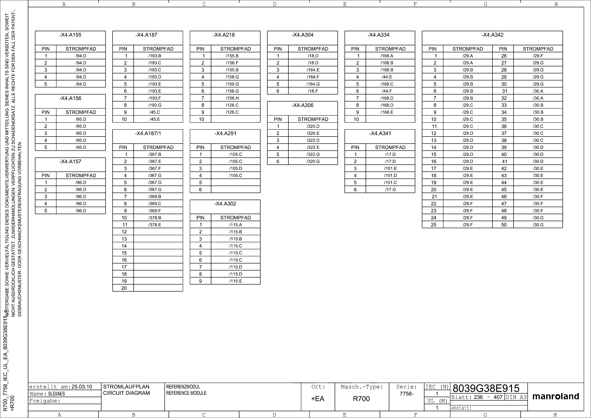

# +EA — Sheet 236 of 407 — REFERENZMODUL

**REFERENCE MODULE**

> Part of the manroland **R700** printing press IEC/UL circuit diagrams.
> Drawing class: **Stromlaufplan / Circuit diagram** (DIN A3).
> Document `+EA` covers the **Printing unit** machine section.

## At a glance

| Field | Value |
|---|---|
| Document | `+EA`  (8039G38E915) |
| Sheet | **236** of 407 |
| Section (DE) | REFERENZMODUL |
| Section (EN) | REFERENCE MODULE |
| Section type | REFERENCE_MODULE — Reference module |
| Machine type | `R700` |
| Series | `7758` |
| Created | 25.03.10 |
| Replaces | — |
| Columns used | A, B, C, D, E, F, G, H |
| Path numbers | — |
| Labels on sheet | 324 |
| Cross-refs out | 135 |
| Cross-refs in | 0 |

**Previous:** [+EA sheet 235](SHEET_0235.md) · **Next:** [+EA sheet 237](SHEET_0237.md) · **Document TOC:** [_TOC.md](_TOC.md)  (+EA) · **Master TOC:** [all sheets](../_MASTER_TOC.md)

## Sheet image (300 DPI, exact vector render)



_Rendered directly from the PDF vector layer at 300 DPI (1-bit), no OCR and no resampling. Use it to confirm anything ambiguous in the text below._

## Cross-references on this sheet

Each entry is a wire leaving this sheet. The printed token is `/sheet.column`; the link resolves to that sheet inside the same document.

| Ref | Target sheet | Col | Path | Destination on target | Target section | From col |
|---|---|---|---|---|---|---|
| `/29.A` | [+EA sheet 29](SHEET_0029.md) | A | — | — | BUSVERBINDUNGEN: SICHERHEITSBUS | G |
| `/193.B` | [+EA sheet 193](SHEET_0193.md) | B | — | — | RESERVE | B |
| `/155.B` | [+EA sheet 155](SHEET_0155.md) | B | — | — | ZUGANGSABSICHERUNG | C |
| `/168.A` | [+EA sheet 168](SHEET_0168.md) | A | — | — | RESERVE | F |
| `/29.F` | [+EA sheet 29](SHEET_0029.md) | F | — | — | BUSVERBINDUNGEN: SICHERHEITSBUS | H |
| `/94.D` | [+EA sheet 94](SHEET_0094.md) | D | — | — | BLASRAHMEN | A |
| `/18.D` | [+EA sheet 18](SHEET_0018.md) | D | — | — | SPANNUNGSVERSORGUNG: 400V, 24V | E |
| `/29.A` | [+EA sheet 29](SHEET_0029.md) | A | — | — | BUSVERBINDUNGEN: SICHERHEITSBUS | G |
| `/168.B` | [+EA sheet 168](SHEET_0168.md) | B | — | — | RESERVE | F |
| `/156.F` | [+EA sheet 156](SHEET_0156.md) | F | — | — | ZUGANGSABSICHERUNG | C |
| `/29.G` | [+EA sheet 29](SHEET_0029.md) | G | — | — | BUSVERBINDUNGEN: SICHERHEITSBUS | H |
| `/94.D` | [+EA sheet 94](SHEET_0094.md) | D | — | — | BLASRAHMEN | A |
| `/18.D` | [+EA sheet 18](SHEET_0018.md) | D | — | — | SPANNUNGSVERSORGUNG: 400V, 24V | E |
| `/193.C` | [+EA sheet 193](SHEET_0193.md) | C | — | — | RESERVE | B |
| `/29.B` | [+EA sheet 29](SHEET_0029.md) | B | — | — | BUSVERBINDUNGEN: SICHERHEITSBUS | G |
| `/155.B` | [+EA sheet 155](SHEET_0155.md) | B | — | — | ZUGANGSABSICHERUNG | C |
| `/164.E` | [+EA sheet 164](SHEET_0164.md) | E | — | — | VERLÄNGERUNG 1828,4MM | E |
| `/168.B` | [+EA sheet 168](SHEET_0168.md) | B | — | — | RESERVE | F |
| `/29.G` | [+EA sheet 29](SHEET_0029.md) | G | — | — | BUSVERBINDUNGEN: SICHERHEITSBUS | H |
| `/94.D` | [+EA sheet 94](SHEET_0094.md) | D | — | — | BLASRAHMEN | A |
| `/193.C` | [+EA sheet 193](SHEET_0193.md) | C | — | — | RESERVE | B |
| `/44.E` | [+EA sheet 44](SHEET_0044.md) | E | — | — | BUSVERBINDUNGEN: 20 mA SCHLEIFE | F |
| `/29.B` | [+EA sheet 29](SHEET_0029.md) | B | — | — | BUSVERBINDUNGEN: SICHERHEITSBUS | G |
| `/29.G` | [+EA sheet 29](SHEET_0029.md) | G | — | — | BUSVERBINDUNGEN: SICHERHEITSBUS | H |
| `/158.G` | [+EA sheet 158](SHEET_0158.md) | G | — | — | ZUGANGSABSICHERUNG | C |
| `/164.F` | [+EA sheet 164](SHEET_0164.md) | F | — | — | VERLÄNGERUNG 1828,4MM | E |
| `/94.D` | [+EA sheet 94](SHEET_0094.md) | D | — | — | BLASRAHMEN | A |
| `/193.D` | [+EA sheet 193](SHEET_0193.md) | D | — | — | RESERVE | B |
| `/29.B` | [+EA sheet 29](SHEET_0029.md) | B | — | — | BUSVERBINDUNGEN: SICHERHEITSBUS | G |
| `/193.E` | [+EA sheet 193](SHEET_0193.md) | E | — | — | RESERVE | B |
| `/29.G` | [+EA sheet 29](SHEET_0029.md) | G | — | — | BUSVERBINDUNGEN: SICHERHEITSBUS | H |
| `/94.D` | [+EA sheet 94](SHEET_0094.md) | D | — | — | BLASRAHMEN | A |
| `/159.G` | [+EA sheet 159](SHEET_0159.md) | G | — | — | ZUGANGSABSICHERUNG | C |
| `/164.G` | [+EA sheet 164](SHEET_0164.md) | G | — | — | VERLÄNGERUNG 1828,4MM | E |
| `/168.C` | [+EA sheet 168](SHEET_0168.md) | C | — | — | RESERVE | F |
| `/29.B` | [+EA sheet 29](SHEET_0029.md) | B | — | — | BUSVERBINDUNGEN: SICHERHEITSBUS | G |
| `/30.A` | [+EA sheet 30](SHEET_0030.md) | A | — | — | BUSVERBINDUNGEN: SICHERHEITSBUS | H |
| `/193.E` | [+EA sheet 193](SHEET_0193.md) | E | — | — | RESERVE | B |
| `/18.F` | [+EA sheet 18](SHEET_0018.md) | F | — | — | SPANNUNGSVERSORGUNG: 400V, 24V | E |
| `/44.F` | [+EA sheet 44](SHEET_0044.md) | F | — | — | BUSVERBINDUNGEN: 20 mA SCHLEIFE | F |
| `/156.G` | [+EA sheet 156](SHEET_0156.md) | G | — | — | ZUGANGSABSICHERUNG | C |
| `/29.B` | [+EA sheet 29](SHEET_0029.md) | B | — | — | BUSVERBINDUNGEN: SICHERHEITSBUS | G |
| `/30.A` | [+EA sheet 30](SHEET_0030.md) | A | — | — | BUSVERBINDUNGEN: SICHERHEITSBUS | H |
| `/193.F` | [+EA sheet 193](SHEET_0193.md) | F | — | — | RESERVE | B |
| `/156.H` | [+EA sheet 156](SHEET_0156.md) | H | — | — | ZUGANGSABSICHERUNG | C |
| `/168.D` | [+EA sheet 168](SHEET_0168.md) | D | — | — | RESERVE | F |
| `/30.B` | [+EA sheet 30](SHEET_0030.md) | B | — | — | BUSVERBINDUNGEN: SICHERHEITSBUS | H |
| `/193.G` | [+EA sheet 193](SHEET_0193.md) | G | — | — | RESERVE | B |
| `/29.C` | [+EA sheet 29](SHEET_0029.md) | C | — | — | BUSVERBINDUNGEN: SICHERHEITSBUS | G |
| `/126.C` | [+EA sheet 126](SHEET_0126.md) | C | — | — | ZUGANGSABSICHERUNG | C |
| `/168.D` | [+EA sheet 168](SHEET_0168.md) | D | — | — | RESERVE | F |
| `/30.B` | [+EA sheet 30](SHEET_0030.md) | B | — | — | BUSVERBINDUNGEN: SICHERHEITSBUS | H |
| `/168.E` | [+EA sheet 168](SHEET_0168.md) | E | — | — | RESERVE | F |
| `/45.C` | [+EA sheet 45](SHEET_0045.md) | C | — | — | BUSVERBINDUNGEN: 20 mA SCHLEIFE | B |
| `/29.C` | [+EA sheet 29](SHEET_0029.md) | C | — | — | BUSVERBINDUNGEN: SICHERHEITSBUS | G |
| `/126.C` | [+EA sheet 126](SHEET_0126.md) | C | — | — | ZUGANGSABSICHERUNG | C |
| `/45.E` | [+EA sheet 45](SHEET_0045.md) | E | — | — | BUSVERBINDUNGEN: 20 mA SCHLEIFE | B |
| `/30.B` | [+EA sheet 30](SHEET_0030.md) | B | — | — | BUSVERBINDUNGEN: SICHERHEITSBUS | H |
| `/95.D` | [+EA sheet 95](SHEET_0095.md) | D | — | — | BLASRAHMEN | A |
| `/29.C` | [+EA sheet 29](SHEET_0029.md) | C | — | — | BUSVERBINDUNGEN: SICHERHEITSBUS | G |
| `/95.D` | [+EA sheet 95](SHEET_0095.md) | D | — | — | BLASRAHMEN | A |
| `/29.C` | [+EA sheet 29](SHEET_0029.md) | C | — | — | BUSVERBINDUNGEN: SICHERHEITSBUS | G |
| `/30.C` | [+EA sheet 30](SHEET_0030.md) | C | — | — | BUSVERBINDUNGEN: SICHERHEITSBUS | H |
| `/320.D` | [+EA sheet 320](SHEET_0320.md) | D | — | — | OPTION: VERLÄNGERUNG 3656,8MM | E |
| `/320.E` | [+EA sheet 320](SHEET_0320.md) | E | — | — | OPTION: VERLÄNGERUNG 3656,8MM | E |
| `/95.D` | [+EA sheet 95](SHEET_0095.md) | D | — | — | BLASRAHMEN | A |
| `/29.D` | [+EA sheet 29](SHEET_0029.md) | D | — | — | BUSVERBINDUNGEN: SICHERHEITSBUS | G |
| `/30.C` | [+EA sheet 30](SHEET_0030.md) | C | — | — | BUSVERBINDUNGEN: SICHERHEITSBUS | H |
| `/95.D` | [+EA sheet 95](SHEET_0095.md) | D | — | — | BLASRAHMEN | A |
| `/322.D` | [+EA sheet 322](SHEET_0322.md) | D | — | — | OPTION: VERLÄNGERUNG 3656,8MM | E |
| `/29.D` | [+EA sheet 29](SHEET_0029.md) | D | — | — | BUSVERBINDUNGEN: SICHERHEITSBUS | G |
| `/30.C` | [+EA sheet 30](SHEET_0030.md) | C | — | — | BUSVERBINDUNGEN: SICHERHEITSBUS | H |
| `/322.E` | [+EA sheet 322](SHEET_0322.md) | E | — | — | OPTION: VERLÄNGERUNG 3656,8MM | E |
| `/95.D` | [+EA sheet 95](SHEET_0095.md) | D | — | — | BLASRAHMEN | A |
| `/29.D` | [+EA sheet 29](SHEET_0029.md) | D | — | — | BUSVERBINDUNGEN: SICHERHEITSBUS | G |
| `/30.D` | [+EA sheet 30](SHEET_0030.md) | D | — | — | BUSVERBINDUNGEN: SICHERHEITSBUS | H |
| `/367.B` | [+EA sheet 367](SHEET_0367.md) | B | — | — | OPTION: TROCKNER VORBEREITUNG; | B |
| `/322.G` | [+EA sheet 322](SHEET_0322.md) | G | — | — | OPTION: VERLÄNGERUNG 3656,8MM | E |
| `/17.D` | [+EA sheet 17](SHEET_0017.md) | D | — | — | SPANNUNGSVERSORGUNG: 400V, 24V | F |
| `/29.D` | [+EA sheet 29](SHEET_0029.md) | D | — | — | BUSVERBINDUNGEN: SICHERHEITSBUS | G |
| `/30.D` | [+EA sheet 30](SHEET_0030.md) | D | — | — | BUSVERBINDUNGEN: SICHERHEITSBUS | H |
| `/105.C` | [+EA sheet 105](SHEET_0105.md) | C | — | — | BOGENFÜHRUNGSELEMENT | C |
| `/367.E` | [+EA sheet 367](SHEET_0367.md) | E | — | — | OPTION: TROCKNER VORBEREITUNG; | B |
| `/320.G` | [+EA sheet 320](SHEET_0320.md) | G | — | — | OPTION: VERLÄNGERUNG 3656,8MM | E |
| `/105.C` | [+EA sheet 105](SHEET_0105.md) | C | — | — | BOGENFÜHRUNGSELEMENT | C |
| `/17.D` | [+EA sheet 17](SHEET_0017.md) | D | — | — | SPANNUNGSVERSORGUNG: 400V, 24V | F |
| `/29.D` | [+EA sheet 29](SHEET_0029.md) | D | — | — | BUSVERBINDUNGEN: SICHERHEITSBUS | G |
| `/30.D` | [+EA sheet 30](SHEET_0030.md) | D | — | — | BUSVERBINDUNGEN: SICHERHEITSBUS | H |
| `/29.E` | [+EA sheet 29](SHEET_0029.md) | E | — | — | BUSVERBINDUNGEN: SICHERHEITSBUS | G |
| `/30.E` | [+EA sheet 30](SHEET_0030.md) | E | — | — | BUSVERBINDUNGEN: SICHERHEITSBUS | H |
| `/101.E` | [+EA sheet 101](SHEET_0101.md) | E | — | — | BOGENFÜHRUNGSELEMENT | F |
| `/367.F` | [+EA sheet 367](SHEET_0367.md) | F | — | — | OPTION: TROCKNER VORBEREITUNG; | B |
| `/105.D` | [+EA sheet 105](SHEET_0105.md) | D | — | — | BOGENFÜHRUNGSELEMENT | C |
| `/29.E` | [+EA sheet 29](SHEET_0029.md) | E | — | — | BUSVERBINDUNGEN: SICHERHEITSBUS | G |
| `/30.E` | [+EA sheet 30](SHEET_0030.md) | E | — | — | BUSVERBINDUNGEN: SICHERHEITSBUS | H |
| `/367.G` | [+EA sheet 367](SHEET_0367.md) | G | — | — | OPTION: TROCKNER VORBEREITUNG; | B |
| `/105.C` | [+EA sheet 105](SHEET_0105.md) | C | — | — | BOGENFÜHRUNGSELEMENT | C |
| `/101.D` | [+EA sheet 101](SHEET_0101.md) | D | — | — | BOGENFÜHRUNGSELEMENT | F |
| `/29.E` | [+EA sheet 29](SHEET_0029.md) | E | — | — | BUSVERBINDUNGEN: SICHERHEITSBUS | G |
| `/30.E` | [+EA sheet 30](SHEET_0030.md) | E | — | — | BUSVERBINDUNGEN: SICHERHEITSBUS | H |
| `/367.G` | [+EA sheet 367](SHEET_0367.md) | G | — | — | OPTION: TROCKNER VORBEREITUNG; | B |
| `/96.D` | [+EA sheet 96](SHEET_0096.md) | D | — | — | BLASRAHMEN | A |
| `/101.C` | [+EA sheet 101](SHEET_0101.md) | C | — | — | BOGENFÜHRUNGSELEMENT | F |
| `/29.E` | [+EA sheet 29](SHEET_0029.md) | E | — | — | BUSVERBINDUNGEN: SICHERHEITSBUS | G |
| `/30.E` | [+EA sheet 30](SHEET_0030.md) | E | — | — | BUSVERBINDUNGEN: SICHERHEITSBUS | H |
| `/17.G` | [+EA sheet 17](SHEET_0017.md) | G | — | — | SPANNUNGSVERSORGUNG: 400V, 24V | F |
| `/96.D` | [+EA sheet 96](SHEET_0096.md) | D | — | — | BLASRAHMEN | A |
| `/367.G` | [+EA sheet 367](SHEET_0367.md) | G | — | — | OPTION: TROCKNER VORBEREITUNG; | B |
| `/29.E` | [+EA sheet 29](SHEET_0029.md) | E | — | — | BUSVERBINDUNGEN: SICHERHEITSBUS | G |
| `/369.B` | [+EA sheet 369](SHEET_0369.md) | B | — | — | OPTION: ENDTROCKNER 1 VORBEREITUNG; | B |
| `/30.F` | [+EA sheet 30](SHEET_0030.md) | F | — | — | BUSVERBINDUNGEN: SICHERHEITSBUS | H |
| `/96.D` | [+EA sheet 96](SHEET_0096.md) | D | — | — | BLASRAHMEN | A |
| `/29.F` | [+EA sheet 29](SHEET_0029.md) | F | — | — | BUSVERBINDUNGEN: SICHERHEITSBUS | G |
| `/30.F` | [+EA sheet 30](SHEET_0030.md) | F | — | — | BUSVERBINDUNGEN: SICHERHEITSBUS | H |
| `/96.D` | [+EA sheet 96](SHEET_0096.md) | D | — | — | BLASRAHMEN | A |
| `/369.C` | [+EA sheet 369](SHEET_0369.md) | C | — | — | OPTION: ENDTROCKNER 1 VORBEREITUNG; | B |
| `/29.F` | [+EA sheet 29](SHEET_0029.md) | F | — | — | BUSVERBINDUNGEN: SICHERHEITSBUS | G |
| `/30.F` | [+EA sheet 30](SHEET_0030.md) | F | — | — | BUSVERBINDUNGEN: SICHERHEITSBUS | H |
| `/369.F` | [+EA sheet 369](SHEET_0369.md) | F | — | — | OPTION: ENDTROCKNER 1 VORBEREITUNG; | B |
| `/96.D` | [+EA sheet 96](SHEET_0096.md) | D | — | — | BLASRAHMEN | A |
| `/378.B` | [+EA sheet 378](SHEET_0378.md) | B | — | — | OPTION: ENDTROCKNER 2 VORBEREITUNG | B |
| `/29.F` | [+EA sheet 29](SHEET_0029.md) | F | — | — | BUSVERBINDUNGEN: SICHERHEITSBUS | G |
| `/30.G` | [+EA sheet 30](SHEET_0030.md) | G | — | — | BUSVERBINDUNGEN: SICHERHEITSBUS | H |
| `/29.F` | [+EA sheet 29](SHEET_0029.md) | F | — | — | BUSVERBINDUNGEN: SICHERHEITSBUS | G |
| `/378.E` | [+EA sheet 378](SHEET_0378.md) | E | — | — | OPTION: ENDTROCKNER 2 VORBEREITUNG | B |
| `/115.A` | [+EA sheet 115](SHEET_0115.md) | A | — | — | FORMATEINSTELLUNG: SAUGWALZE | C |
| `/30.G` | [+EA sheet 30](SHEET_0030.md) | G | — | — | BUSVERBINDUNGEN: SICHERHEITSBUS | H |
| `/115.B` | [+EA sheet 115](SHEET_0115.md) | B | — | — | FORMATEINSTELLUNG: SAUGWALZE | C |
| `/115.B` | [+EA sheet 115](SHEET_0115.md) | B | — | — | FORMATEINSTELLUNG: SAUGWALZE | C |
| `/115.C` | [+EA sheet 115](SHEET_0115.md) | C | — | — | FORMATEINSTELLUNG: SAUGWALZE | C |
| `/115.C` | [+EA sheet 115](SHEET_0115.md) | C | — | — | FORMATEINSTELLUNG: SAUGWALZE | C |
| `/115.C` | [+EA sheet 115](SHEET_0115.md) | C | — | — | FORMATEINSTELLUNG: SAUGWALZE | C |
| `/115.D` | [+EA sheet 115](SHEET_0115.md) | D | — | — | FORMATEINSTELLUNG: SAUGWALZE | C |
| `/115.D` | [+EA sheet 115](SHEET_0115.md) | D | — | — | FORMATEINSTELLUNG: SAUGWALZE | C |
| `/115.E` | [+EA sheet 115](SHEET_0115.md) | E | — | — | FORMATEINSTELLUNG: SAUGWALZE | C |

## Devices on this sheet

| Tag | Class | Class meaning (IEC) | Col | Sub | Terminal | Sign |
|---|---|---|---|---|---|---|
| `X4.A155` | — | cross-device reference | A | — | — | — |
| `X4.A157` | — | cross-device reference | A | — | — | — |
| `X4.A156` | — | cross-device reference | A | — | — | — |
| `X4.A187` | — | cross-device reference | B | — | — | — |
| `X4.A218` | — | cross-device reference | C | — | — | — |
| `X4.A291` | — | cross-device reference | C | — | — | — |
| `X4.A302` | — | cross-device reference | C | — | — | — |
| `X4.A304` | — | cross-device reference | D | — | — | — |
| `X4.A306` | — | cross-device reference | D | — | — | — |
| `X4.A334` | — | cross-device reference | E | — | — | — |
| `X4.A341` | — | cross-device reference | F | — | — | — |
| `X4.A342` | — | cross-device reference | G | — | — | — |

## Potentials / nets

_No named potentials on this sheet._

## Wire-end annotations (grouped as printed)

A wire that continues elsewhere is annotated with a small cluster: the destination description, the path/line number `#NN`, and the `/sheet.column` cross reference. Each row below is one such cluster exactly as it is grouped on the drawing.

| Col | Y | Path | Cross-ref | Text on the wire |
|---|---|---|---|---|
| A | 65.5 | — | — | `X4.A155` |
| B | 65.5 | — | — | `X4.A187` |
| C | 65.5 | — | — | `X4.A218` |
| D | 65.5 | — | — | `X4.A304` |
| E | 65.5 | — | — | `X4.A334` |
| G | 65.5 | — | — | `X4.A342` |
| A | 94.2 | — | — | `PIN 2 3 4 5 1 STROMPFAD` |
| B | 94.2 | — | — | `PIN 10 2 3 4 5 6 7 8 9 1 STROMPFAD` |
| C | 94.2 | — | — | `PIN 10 2 3 4 5 6 7 8 9 1 STROMPFAD` |
| D | 94.2 | — | — | `PIN 2 3 4 5 6 1 STROMPFAD` |
| E | 94.2 | — | — | `PIN 10 2 3 4 5 6 7 8 9 1 STROMPFAD` |
| G | 94.2 | — | — | `PIN STROMPFAD` |
| H | 94.2 | — | — | `PIN STROMPFAD` |
| F | 108.4 | — | — | `2 3 4 5 6 7 8 9 1` |
| G | 108.4 | — | — | `26 27 28 29 30 32 33 34 35 36 37 38 39 40 42 43 44 45 46 47 48 49 50 31 41` |
| A | 108.7 | — | `/94.D` | — |
| B | 108.7 | — | `/193.B` | — |
| C | 108.7 | — | `/155.B` | — |
| E | 108.7 | — | `/18.D` | — |
| F | 108.7 | — | `/168.A` | — |
| G | 108.7 | — | `/29.A` | — |
| H | 108.7 | — | `/29.F` | — |
| G | 122.8 | — | `/29.A` | — |
| A | 122.9 | — | `/94.D` | — |
| B | 122.9 | — | `/193.C` | — |
| C | 122.9 | — | `/156.F` | — |
| E | 122.9 | — | `/18.D` | — |
| F | 122.9 | — | `/168.B` | — |
| H | 122.9 | — | `/29.G` | — |
| C | 137.0 | — | `/155.B` | — |
| E | 137.0 | — | `/164.E` | — |
| F | 137.0 | — | `/168.B` | — |
| G | 137.0 | — | `/29.B` | — |
| H | 137.0 | — | `/29.G` | — |
| A | 137.1 | — | `/94.D` | — |
| B | 137.1 | — | `/193.C` | — |
| A | 151.2 | — | `/94.D` | — |
| B | 151.2 | — | `/193.D` | — |
| C | 151.2 | — | `/158.G` | — |
| E | 151.2 | — | `/164.F` | — |
| F | 151.2 | — | `/44.E` | — |
| G | 151.2 | — | `/29.B` | — |
| H | 151.2 | — | `/29.G` | — |
| A | 165.4 | — | `/94.D` | — |
| B | 165.4 | — | `/193.E` | — |
| C | 165.4 | — | `/159.G` | — |
| E | 165.4 | — | `/164.G` | — |
| F | 165.4 | — | `/168.C` | — |
| G | 165.4 | — | `/29.B` | — |
| H | 165.4 | — | `/29.G` | — |
| G | 179.5 | — | `/29.B` | — |
| H | 179.5 | — | `/30.A` | — |
| B | 179.6 | — | `/193.E` | — |
| C | 179.6 | — | `/156.G` | — |
| E | 179.6 | — | `/18.F` | — |
| F | 179.6 | — | `/44.F` | — |
| A | 193.1 | — | — | `X4.A156` |
| B | 193.7 | — | `/193.F` | — |
| G | 193.7 | — | `/29.B` | — |
| H | 193.7 | — | `/30.A` | — |
| C | 193.8 | — | `/156.H` | — |
| F | 193.8 | — | `/168.D` | — |
| D | 207.2 | — | — | `X4.A306` |
| B | 207.9 | — | `/193.G` | — |
| C | 207.9 | — | `/126.C` | — |
| F | 207.9 | — | `/168.D` | — |
| G | 207.9 | — | `/29.C` | — |
| H | 207.9 | — | `/30.B` | — |
| A | 221.7 | — | — | `PIN 2 3 4 5 1 STROMPFAD` |
| B | 222.1 | — | `/45.C` | — |
| C | 222.1 | — | `/126.C` | — |
| F | 222.1 | — | `/168.E` | — |
| G | 222.1 | — | `/29.C` | — |
| H | 222.1 | — | `/30.B` | — |
| D | 235.9 | — | — | `PIN 2 3 4 5 6 1 STROMPFAD` |
| F | 235.9 | — | — | `10 12 13 14 15 16 17 18 19 20 11` |
| B | 236.2 | — | `/45.E` | — |
| H | 236.2 | — | `/30.B` | — |
| A | 236.3 | — | `/95.D` | — |
| G | 236.3 | — | `/29.C` | — |
| A | 250.4 | — | `/95.D` | — |
| E | 250.4 | — | `/320.D` | — |
| G | 250.4 | — | `/29.C` | — |
| H | 250.4 | — | `/30.C` | — |
| B | 263.9 | — | — | `X4.A187/1` |
| C | 263.9 | — | — | `X4.A291` |
| F | 263.9 | — | — | `X4.A341` |
| A | 264.6 | — | `/95.D` | — |
| E | 264.6 | — | `/320.E` | — |
| G | 264.6 | — | `/29.D` | — |
| H | 264.6 | — | `/30.C` | — |
| A | 278.8 | — | `/95.D` | — |
| E | 278.8 | — | `/322.D` | — |
| G | 278.8 | — | `/29.D` | — |
| H | 278.8 | — | `/30.C` | — |
| B | 292.6 | — | — | `PIN 10 12 13 14 15 16 11 2 3 4 5 6 7 8 9 1 STROMPFAD` |
| C | 292.6 | — | — | `PIN 2 3 4 5 6 1 STROMPFAD` |
| E | 292.6 | — | — | `PIN 2 3 4 5 6 1 STROMPFAD` |
| E | 292.9 | — | `/322.E` | — |
| A | 293.0 | — | `/95.D` | — |
| G | 293.0 | — | `/29.D` | — |
| H | 293.0 | — | `/30.D` | — |
| B | 307.1 | — | `/367.B` | — |
| C | 307.1 | — | `/105.C` | — |
| E | 307.1 | — | `/322.G` | — |
| F | 307.1 | — | `/17.D` | — |
| G | 307.1 | — | `/29.D` | — |
| H | 307.1 | — | `/30.D` | — |
| A | 320.6 | — | — | `X4.A157` |
| B | 321.3 | — | `/367.E` | — |
| C | 321.3 | — | `/105.C` | — |
| E | 321.3 | — | `/320.G` | — |
| F | 321.3 | — | `/17.D` | — |
| G | 321.3 | — | `/29.D` | — |
| H | 321.3 | — | `/30.D` | — |
| G | 335.4 | — | `/29.E` | — |
| H | 335.4 | — | `/30.E` | — |
| B | 335.5 | — | `/367.F` | — |
| C | 335.5 | — | `/105.D` | — |
| F | 335.5 | — | `/101.E` | — |
| A | 349.3 | — | — | `PIN 2 3 4 5 1 STROMPFAD` |
| B | 349.6 | — | `/367.G` | — |
| G | 349.6 | — | `/29.E` | — |
| H | 349.6 | — | `/30.E` | — |
| C | 349.7 | — | `/105.C` | — |
| F | 349.7 | — | `/101.D` | — |
| A | 363.8 | — | `/96.D` | — |
| B | 363.8 | — | `/367.G` | — |
| F | 363.8 | — | `/101.C` | — |
| G | 363.8 | — | `/29.E` | — |
| H | 363.8 | — | `/30.E` | — |
| A | 378.0 | — | `/96.D` | — |
| B | 378.0 | — | `/367.G` | — |
| F | 378.0 | — | `/17.G` | — |
| G | 378.0 | — | `/29.E` | — |
| H | 378.0 | — | `/30.E` | — |
| F | 391.8 | — | — | `22 23 24 25 21` |
| B | 392.1 | — | `/369.B` | — |
| G | 392.1 | — | `/29.E` | — |
| H | 392.1 | — | `/30.F` | — |
| A | 392.2 | — | `/96.D` | — |
| C | 405.7 | — | — | `X4.A302` |
| A | 406.3 | — | `/96.D` | — |
| G | 406.3 | — | `/29.F` | — |
| H | 406.3 | — | `/30.F` | — |
| B | 406.4 | — | `/369.C` | — |
| A | 420.5 | — | `/96.D` | — |
| B | 420.5 | — | `/369.F` | — |
| G | 420.5 | — | `/29.F` | — |
| H | 420.5 | — | `/30.F` | — |
| C | 434.3 | — | — | `PIN 2 3 4 5 6 7 8 9 1 STROMPFAD` |
| B | 434.7 | — | `/378.B` | — |
| G | 434.7 | — | `/29.F` | — |
| H | 434.7 | — | `/30.G` | — |
| G | 448.8 | — | `/29.F` | — |
| B | 448.9 | — | `/378.E` | — |
| C | 448.9 | — | `/115.A` | — |
| H | 448.9 | — | `/30.G` | — |
| C | 463.0 | — | `/115.B` | — |
| C | 477.2 | — | `/115.B` | — |
| C | 491.4 | — | `/115.C` | — |
| C | 505.6 | — | `/115.C` | — |
| C | 519.7 | — | `/115.C` | — |
| B | 533.6 | — | — | `17 18` |
| C | 533.9 | — | `/115.D` | — |
| C | 548.1 | — | `/115.D` | — |
| B | 561.9 | — | — | `19 20` |
| C | 562.2 | — | `/115.E` | — |


## Reconstructed tables

This sheet carries tabular content (pin map / terminal assignment / index). The grid below was rebuilt from the drawing's own rule lines, so each row is exactly one physical row of the table.

### Table 1 — 19 data rows × 2 columns (at x=70.9, y=62.4) — **X4.A155**

| PIN | STROMPFAD |
|---|---|
| `1` | `/94.D` |
| `2` | `/94.D` |
| `3` | `/94.D` |
| `4` | `/94.D` |
| `5` | `/94.D` |
|  | `X4.A156` |
| `PIN` | `STROMPFAD` |
| `1` | `/95.D` |
| `2` | `/95.D` |
| `3` | `/95.D` |
| `4` | `/95.D` |
| `5` | `/95.D` |
|  | `X4.A157` |
| `PIN` | `STROMPFAD` |
| `1` | `/96.D` |
| `2` | `/96.D` |
| `3` | `/96.D` |
| `4` | `/96.D` |
| `5` | `/96.D` |


### Table 2 — 32 data rows × 2 columns (at x=226.8, y=62.4) — **X4.A187**

| PIN | STROMPFAD |
|---|---|
| `1` | `/193.B` |
| `2` | `/193.C` |
| `3` | `/193.C` |
| `4` | `/193.D` |
| `5` | `/193.E` |
| `6` | `/193.E` |
| `7` | `/193.F` |
| `8` | `/193.G` |
| `9` | `/45.C` |
| `10` | `/45.E` |
|  | `X4.A187/1` |
| `PIN` | `STROMPFAD` |
| `1` | `/367.B` |
| `2` | `/367.E` |
| `3` | `/367.F` |
| `4` | `/367.G` |
| `5` | `/367.G` |
| `6` | `/367.G` |
| `7` | `/369.B` |
| `8` | `/369.C` |
| `9` | `/369.F` |
| `10` | `/378.B` |
| `11` | `/378.E` |
| `12` |  |
| `13` |  |
| `14` |  |
| `15` |  |
| `16` |  |
| `17` |  |
| `18` |  |
| `19` |  |
| `20` |  |


### Table 3 — 29 data rows × 2 columns (at x=382.7, y=62.4) — **X4.A218**

| PIN | STROMPFAD |
|---|---|
| `1` | `/155.B` |
| `2` | `/156.F` |
| `3` | `/155.B` |
| `4` | `/158.G` |
| `5` | `/159.G` |
| `6` | `/156.G` |
| `7` | `/156.H` |
| `8` | `/126.C` |
| `9` | `/126.C` |
| `10` |  |
|  | `X4.A291` |
| `PIN` | `STROMPFAD` |
| `1` | `/105.C` |
| `2` | `/105.C` |
| `3` | `/105.D` |
| `4` | `/105.C` |
| `5` |  |
| `6` |  |
|  | `X4.A302` |
| `PIN` | `STROMPFAD` |
| `1` | `/115.A` |
| `2` | `/115.B` |
| `3` | `/115.B` |
| `4` | `/115.C` |
| `5` | `/115.C` |
| `6` | `/115.C` |
| `7` | `/115.D` |
| `8` | `/115.D` |
| `9` | `/115.E` |


### Table 4 — 14 data rows × 2 columns (at x=538.6, y=62.4) — **X4.A304**

| PIN | STROMPFAD |
|---|---|
| `1` | `/18.D` |
| `2` | `/18.D` |
| `3` | `/164.E` |
| `4` | `/164.F` |
| `5` | `/164.G` |
| `6` | `/18.F` |
|  | `X4.A306` |
| `PIN` | `STROMPFAD` |
| `1` | `/320.D` |
| `2` | `/320.E` |
| `3` | `/322.D` |
| `4` | `/322.E` |
| `5` | `/322.G` |
| `6` | `/320.G` |


### Table 5 — 18 data rows × 2 columns (at x=694.5, y=62.4) — **X4.A334**

| PIN | STROMPFAD |
|---|---|
| `1` | `/168.A` |
| `2` | `/168.B` |
| `3` | `/168.B` |
| `4` | `/44.E` |
| `5` | `/168.C` |
| `6` | `/44.F` |
| `7` | `/168.D` |
| `8` | `/168.D` |
| `9` | `/168.E` |
| `10` |  |
|  | `X4.A341` |
| `PIN` | `STROMPFAD` |
| `1` | `/17.D` |
| `2` | `/17.D` |
| `3` | `/101.E` |
| `4` | `/101.D` |
| `5` | `/101.C` |
| `6` | `/17.G` |


### Table 6 — 25 data rows × 4 columns (at x=850.4, y=62.4) — **X4.A342**

| PIN | STROMPFAD | PIN | STROMPFAD |
|---|---|---|---|
| `1` | `/29.A` | `26` | `/29.F` |
| `2` | `/29.A` | `27` | `/29.G` |
| `3` | `/29.B` | `28` | `/29.G` |
| `4` | `/29.B` | `29` | `/29.G` |
| `5` | `/29.B` | `30` | `/29.G` |
| `6` | `/29.B` | `31` | `/30.A` |
| `7` | `/29.B` | `32` | `/30.A` |
| `8` | `/29.C` | `33` | `/30.B` |
| `9` | `/29.C` | `34` | `/30.B` |
| `10` | `/29.C` | `35` | `/30.B` |
| `11` | `/29.C` | `36` | `/30.C` |
| `12` | `/29.D` | `37` | `/30.C` |
| `13` | `/29.D` | `38` | `/30.C` |
| `14` | `/29.D` | `39` | `/30.D` |
| `15` | `/29.D` | `40` | `/30.D` |
| `16` | `/29.D` | `41` | `/30.D` |
| `17` | `/29.E` | `42` | `/30.E` |
| `18` | `/29.E` | `43` | `/30.E` |
| `19` | `/29.E` | `44` | `/30.E` |
| `20` | `/29.E` | `45` | `/30.E` |
| `21` | `/29.E` | `46` | `/30.F` |
| `22` | `/29.F` | `47` | `/30.F` |
| `23` | `/29.F` | `48` | `/30.F` |
| `24` | `/29.F` | `49` | `/30.G` |
| `25` | `/29.F` | `50` | `/30.G` |


## Notes and free text on this sheet

| Text | Col | Y (pt) |
|---|---|---|
| `PIN` | A | 94.2 |
| `STROMPFAD` | A | 94.15 |
| `PIN` | B | 94.2 |
| `STROMPFAD` | B | 94.15 |
| `X4.A187/1` | B | 263.94 |
| `PIN` | C | 94.2 |
| `STROMPFAD` | C | 94.15 |
| `PIN` | D | 94.2 |
| `STROMPFAD` | E | 94.15 |
| `PIN` | E | 94.2 |
| `STROMPFAD` | F | 94.15 |
| `PIN` | F | 94.2 |
| `STROMPFAD` | G | 94.15 |
| `PIN` | G | 94.2 |
| `STROMPFAD` | H | 94.15 |

## Complete label inventory (exact text from the drawing)

Every text object inside the drawing area of this sheet, in DIN reading order (column A→H, then top→bottom). This is the authoritative list: if a string is not here it is not printed on this sheet.

| Col | Y | X | Dir | Type | Text |
|---|---|---|---|---|---|
| A | 65.5 | 119.8 | → | device ref | `X4.A155` |
| A | 94.2 | 84.0 | → | text | `PIN` |
| A | 94.2 | 132.2 | → | text | `STROMPFAD` |
| A | 108.4 | 90.0 | → | number | `1` |
| A | 108.7 | 152.6 | → | cross-reference | `/94.D` |
| A | 122.5 | 89.4 | → | number | `2` |
| A | 122.9 | 152.6 | → | cross-reference | `/94.D` |
| A | 136.7 | 89.4 | → | number | `3` |
| A | 137.1 | 152.6 | → | cross-reference | `/94.D` |
| A | 150.9 | 89.4 | → | number | `4` |
| A | 151.2 | 152.6 | → | cross-reference | `/94.D` |
| A | 165.1 | 89.4 | → | number | `5` |
| A | 165.4 | 152.6 | → | cross-reference | `/94.D` |
| A | 193.1 | 119.8 | → | device ref | `X4.A156` |
| A | 221.7 | 132.2 | → | text | `STROMPFAD` |
| A | 221.8 | 84.0 | → | text | `PIN` |
| A | 235.9 | 90.0 | → | number | `1` |
| A | 236.3 | 152.6 | → | cross-reference | `/95.D` |
| A | 250.1 | 89.4 | → | number | `2` |
| A | 250.4 | 152.6 | → | cross-reference | `/95.D` |
| A | 264.3 | 89.4 | → | number | `3` |
| A | 264.6 | 152.6 | → | cross-reference | `/95.D` |
| A | 278.5 | 89.4 | → | number | `4` |
| A | 278.8 | 152.6 | → | cross-reference | `/95.D` |
| A | 292.6 | 89.4 | → | number | `5` |
| A | 293.0 | 152.6 | → | cross-reference | `/95.D` |
| A | 320.6 | 119.8 | → | device ref | `X4.A157` |
| A | 349.3 | 84.0 | → | text | `PIN` |
| A | 349.3 | 132.2 | → | text | `STROMPFAD` |
| A | 363.5 | 90.0 | → | number | `1` |
| A | 363.8 | 152.6 | → | cross-reference | `/96.D` |
| A | 377.7 | 89.4 | → | number | `2` |
| A | 378.0 | 152.6 | → | cross-reference | `/96.D` |
| A | 391.8 | 89.4 | → | number | `3` |
| A | 392.2 | 152.6 | → | cross-reference | `/96.D` |
| A | 406.0 | 89.4 | → | number | `4` |
| A | 406.3 | 152.6 | → | cross-reference | `/96.D` |
| A | 420.2 | 89.4 | → | number | `5` |
| A | 420.5 | 152.6 | → | cross-reference | `/96.D` |
| B | 65.5 | 272.8 | → | device ref | `X4.A187` |
| B | 94.2 | 240.0 | → | text | `PIN` |
| B | 94.2 | 288.1 | → | text | `STROMPFAD` |
| B | 108.4 | 251.7 | → | number | `1` |
| B | 108.7 | 299.2 | → | cross-reference | `/193.B` |
| B | 122.5 | 250.0 | → | number | `2` |
| B | 122.9 | 299.1 | → | cross-reference | `/193.C` |
| B | 136.7 | 250.0 | → | number | `3` |
| B | 137.1 | 299.1 | → | cross-reference | `/193.C` |
| B | 150.9 | 250.0 | → | number | `4` |
| B | 151.2 | 299.1 | → | cross-reference | `/193.D` |
| B | 165.1 | 250.0 | → | number | `5` |
| B | 165.4 | 299.3 | → | cross-reference | `/193.E` |
| B | 179.2 | 250.0 | → | number | `6` |
| B | 179.6 | 299.3 | → | cross-reference | `/193.E` |
| B | 193.4 | 250.0 | → | number | `7` |
| B | 193.7 | 299.5 | → | cross-reference | `/193.F` |
| B | 207.6 | 250.0 | → | number | `8` |
| B | 207.9 | 298.9 | → | cross-reference | `/193.G` |
| B | 221.8 | 250.0 | → | number | `9` |
| B | 222.1 | 301.5 | → | cross-reference | `/45.C` |
| B | 235.9 | 244.6 | → | number | `10` |
| B | 236.2 | 301.7 | → | cross-reference | `/45.E` |
| B | 263.9 | 272.0 | → | text | `X4.A187/1` |
| B | 292.6 | 240.0 | → | text | `PIN` |
| B | 292.6 | 288.1 | → | text | `STROMPFAD` |
| B | 306.8 | 251.7 | → | number | `1` |
| B | 307.1 | 299.2 | → | cross-reference | `/367.B` |
| B | 321.0 | 250.0 | → | number | `2` |
| B | 321.3 | 299.3 | → | cross-reference | `/367.E` |
| B | 335.1 | 250.0 | → | number | `3` |
| B | 335.5 | 299.5 | → | cross-reference | `/367.F` |
| B | 349.3 | 250.0 | → | number | `4` |
| B | 349.7 | 298.9 | → | cross-reference | `/367.G` |
| B | 363.5 | 250.0 | → | number | `5` |
| B | 363.8 | 298.9 | → | cross-reference | `/367.G` |
| B | 377.7 | 250.0 | → | number | `6` |
| B | 378.0 | 298.9 | → | cross-reference | `/367.G` |
| B | 391.8 | 250.0 | → | number | `7` |
| B | 392.2 | 299.2 | → | cross-reference | `/369.B` |
| B | 406.0 | 250.0 | → | number | `8` |
| B | 406.4 | 299.1 | → | cross-reference | `/369.C` |
| B | 420.2 | 250.0 | → | number | `9` |
| B | 420.5 | 299.5 | → | cross-reference | `/369.F` |
| B | 434.4 | 244.6 | → | number | `10` |
| B | 434.7 | 299.2 | → | cross-reference | `/378.B` |
| B | 448.5 | 246.3 | → | number | `11` |
| B | 448.8 | 299.3 | → | cross-reference | `/378.E` |
| B | 462.7 | 244.6 | → | number | `12` |
| B | 476.9 | 244.6 | → | number | `13` |
| B | 491.0 | 244.6 | → | number | `14` |
| B | 505.2 | 244.6 | → | number | `15` |
| B | 519.4 | 244.6 | → | number | `16` |
| B | 533.6 | 244.6 | → | number | `17` |
| B | 547.7 | 244.6 | → | number | `18` |
| B | 561.9 | 244.6 | → | number | `19` |
| B | 576.1 | 244.6 | → | number | `20` |
| C | 65.5 | 428.7 | → | device ref | `X4.A218` |
| C | 94.2 | 395.9 | → | text | `PIN` |
| C | 94.2 | 444.0 | → | text | `STROMPFAD` |
| C | 108.4 | 407.6 | → | number | `1` |
| C | 108.7 | 455.1 | → | cross-reference | `/155.B` |
| C | 122.5 | 405.9 | → | number | `2` |
| C | 122.9 | 455.4 | → | cross-reference | `/156.F` |
| C | 136.7 | 405.9 | → | number | `3` |
| C | 137.0 | 455.1 | → | cross-reference | `/155.B` |
| C | 150.9 | 405.9 | → | number | `4` |
| C | 151.2 | 454.8 | → | cross-reference | `/158.G` |
| C | 165.1 | 405.9 | → | number | `5` |
| C | 165.4 | 454.8 | → | cross-reference | `/159.G` |
| C | 179.2 | 405.9 | → | number | `6` |
| C | 179.6 | 454.8 | → | cross-reference | `/156.G` |
| C | 193.4 | 405.9 | → | number | `7` |
| C | 193.8 | 455.2 | → | cross-reference | `/156.H` |
| C | 207.6 | 405.9 | → | number | `8` |
| C | 207.9 | 455.0 | → | cross-reference | `/126.C` |
| C | 221.8 | 405.9 | → | number | `9` |
| C | 222.1 | 455.0 | → | cross-reference | `/126.C` |
| C | 235.9 | 400.5 | → | number | `10` |
| C | 263.9 | 432.3 | → | device ref | `X4.A291` |
| C | 292.6 | 395.9 | → | text | `PIN` |
| C | 292.6 | 444.0 | → | text | `STROMPFAD` |
| C | 306.8 | 401.8 | → | number | `1` |
| C | 307.1 | 462.0 | → | cross-reference | `/105.C` |
| C | 321.0 | 401.2 | → | number | `2` |
| C | 321.3 | 462.0 | → | cross-reference | `/105.C` |
| C | 335.1 | 401.2 | → | number | `3` |
| C | 335.5 | 462.0 | → | cross-reference | `/105.D` |
| C | 349.3 | 401.2 | → | number | `4` |
| C | 349.7 | 462.0 | → | cross-reference | `/105.C` |
| C | 363.5 | 401.2 | → | number | `5` |
| C | 377.7 | 401.2 | → | number | `6` |
| C | 405.7 | 431.6 | → | device ref | `X4.A302` |
| C | 434.3 | 444.0 | → | text | `STROMPFAD` |
| C | 434.4 | 395.9 | → | text | `PIN` |
| C | 448.5 | 401.8 | → | number | `1` |
| C | 448.8 | 462.0 | → | cross-reference | `/115.A` |
| C | 462.7 | 401.2 | → | number | `2` |
| C | 463.0 | 462.2 | → | cross-reference | `/115.B` |
| C | 476.9 | 401.2 | → | number | `3` |
| C | 477.2 | 462.2 | → | cross-reference | `/115.B` |
| C | 491.0 | 401.2 | → | number | `4` |
| C | 491.4 | 462.0 | → | cross-reference | `/115.C` |
| C | 505.2 | 401.2 | → | number | `5` |
| C | 505.6 | 462.0 | → | cross-reference | `/115.C` |
| C | 519.4 | 401.2 | → | number | `6` |
| C | 519.7 | 462.0 | → | cross-reference | `/115.C` |
| C | 533.6 | 401.2 | → | number | `7` |
| C | 533.9 | 462.0 | → | cross-reference | `/115.D` |
| C | 547.7 | 401.2 | → | number | `8` |
| C | 548.1 | 462.0 | → | cross-reference | `/115.D` |
| C | 561.9 | 401.2 | → | number | `9` |
| C | 562.2 | 462.3 | → | cross-reference | `/115.E` |
| D | 65.5 | 587.5 | → | device ref | `X4.A304` |
| D | 94.2 | 551.8 | → | text | `PIN` |
| D | 108.4 | 557.7 | → | number | `1` |
| D | 122.5 | 557.1 | → | number | `2` |
| D | 136.7 | 557.1 | → | number | `3` |
| D | 150.9 | 557.1 | → | number | `4` |
| D | 165.1 | 557.1 | → | number | `5` |
| D | 179.2 | 557.1 | → | number | `6` |
| D | 207.2 | 587.5 | → | device ref | `X4.A306` |
| D | 235.9 | 551.8 | → | text | `PIN` |
| D | 250.1 | 557.7 | → | number | `1` |
| D | 264.3 | 557.1 | → | number | `2` |
| D | 278.5 | 557.1 | → | number | `3` |
| D | 292.6 | 557.1 | → | number | `4` |
| D | 306.8 | 557.1 | → | number | `5` |
| D | 321.0 | 557.1 | → | number | `6` |
| E | 65.5 | 740.6 | → | device ref | `X4.A334` |
| E | 94.2 | 600.0 | → | text | `STROMPFAD` |
| E | 94.2 | 707.7 | → | text | `PIN` |
| E | 108.4 | 719.4 | → | number | `1` |
| E | 108.7 | 620.4 | → | cross-reference | `/18.D` |
| E | 122.5 | 717.7 | → | number | `2` |
| E | 122.9 | 620.4 | → | cross-reference | `/18.D` |
| E | 136.7 | 717.7 | → | number | `3` |
| E | 137.0 | 618.2 | → | cross-reference | `/164.E` |
| E | 150.9 | 717.7 | → | number | `4` |
| E | 151.2 | 618.4 | → | cross-reference | `/164.F` |
| E | 165.1 | 717.7 | → | number | `5` |
| E | 165.4 | 617.8 | → | cross-reference | `/164.G` |
| E | 179.2 | 717.7 | → | number | `6` |
| E | 179.6 | 620.8 | → | cross-reference | `/18.F` |
| E | 193.4 | 717.7 | → | number | `7` |
| E | 207.6 | 717.7 | → | number | `8` |
| E | 221.8 | 717.7 | → | number | `9` |
| E | 235.9 | 600.0 | → | text | `STROMPFAD` |
| E | 235.9 | 712.3 | → | number | `10` |
| E | 250.4 | 618.0 | → | cross-reference | `/320.D` |
| E | 264.6 | 618.2 | → | cross-reference | `/320.E` |
| E | 278.8 | 618.0 | → | cross-reference | `/322.D` |
| E | 292.6 | 707.7 | → | text | `PIN` |
| E | 292.9 | 618.2 | → | cross-reference | `/322.E` |
| E | 306.8 | 713.6 | → | number | `1` |
| E | 307.1 | 617.8 | → | cross-reference | `/322.G` |
| E | 321.0 | 713.1 | → | number | `2` |
| E | 321.3 | 617.8 | → | cross-reference | `/320.G` |
| E | 335.1 | 713.1 | → | number | `3` |
| E | 349.3 | 713.1 | → | number | `4` |
| E | 363.5 | 713.1 | → | number | `5` |
| E | 377.7 | 713.1 | → | number | `6` |
| F | 94.2 | 755.9 | → | text | `STROMPFAD` |
| F | 94.2 | 863.6 | → | text | `PIN` |
| F | 108.4 | 875.3 | → | number | `1` |
| F | 108.7 | 766.8 | → | cross-reference | `/168.A` |
| F | 122.5 | 873.6 | → | number | `2` |
| F | 122.9 | 766.9 | → | cross-reference | `/168.B` |
| F | 136.7 | 873.6 | → | number | `3` |
| F | 137.0 | 766.9 | → | cross-reference | `/168.B` |
| F | 150.9 | 873.6 | → | number | `4` |
| F | 151.2 | 769.5 | → | cross-reference | `/44.E` |
| F | 165.1 | 873.6 | → | number | `5` |
| F | 165.4 | 766.8 | → | cross-reference | `/168.C` |
| F | 179.2 | 873.6 | → | number | `6` |
| F | 179.6 | 769.6 | → | cross-reference | `/44.F` |
| F | 193.4 | 873.6 | → | number | `7` |
| F | 193.8 | 766.8 | → | cross-reference | `/168.D` |
| F | 207.6 | 873.6 | → | number | `8` |
| F | 207.9 | 766.8 | → | cross-reference | `/168.D` |
| F | 221.8 | 873.6 | → | number | `9` |
| F | 222.1 | 767.1 | → | cross-reference | `/168.E` |
| F | 235.9 | 868.3 | → | number | `10` |
| F | 250.1 | 870.0 | → | number | `11` |
| F | 263.9 | 744.1 | → | device ref | `X4.A341` |
| F | 264.3 | 868.3 | → | number | `12` |
| F | 278.5 | 868.3 | → | number | `13` |
| F | 292.6 | 755.9 | → | text | `STROMPFAD` |
| F | 292.6 | 868.3 | → | number | `14` |
| F | 306.8 | 868.3 | → | number | `15` |
| F | 307.1 | 776.3 | → | cross-reference | `/17.D` |
| F | 321.0 | 868.3 | → | number | `16` |
| F | 321.3 | 776.3 | → | cross-reference | `/17.D` |
| F | 335.1 | 868.3 | → | number | `17` |
| F | 335.5 | 774.1 | → | cross-reference | `/101.E` |
| F | 349.3 | 868.3 | → | number | `18` |
| F | 349.7 | 773.9 | → | cross-reference | `/101.D` |
| F | 363.5 | 868.3 | → | number | `19` |
| F | 363.8 | 773.9 | → | cross-reference | `/101.C` |
| F | 377.7 | 868.3 | → | number | `20` |
| F | 378.0 | 776.1 | → | cross-reference | `/17.G` |
| F | 391.8 | 870.0 | → | number | `21` |
| F | 406.0 | 868.3 | → | number | `22` |
| F | 420.2 | 868.3 | → | number | `23` |
| F | 434.4 | 868.3 | → | number | `24` |
| F | 448.5 | 868.3 | → | number | `25` |
| G | 65.5 | 970.2 | → | device ref | `X4.A342` |
| G | 94.2 | 911.8 | → | text | `STROMPFAD` |
| G | 94.2 | 1005.3 | → | text | `PIN` |
| G | 108.4 | 1010.0 | → | number | `26` |
| G | 108.7 | 932.2 | → | cross-reference | `/29.A` |
| G | 122.5 | 1010.0 | → | number | `27` |
| G | 122.8 | 932.2 | → | cross-reference | `/29.A` |
| G | 136.7 | 1010.0 | → | number | `28` |
| G | 137.0 | 932.3 | → | cross-reference | `/29.B` |
| G | 150.9 | 1010.0 | → | number | `29` |
| G | 151.2 | 932.3 | → | cross-reference | `/29.B` |
| G | 165.1 | 1010.0 | → | number | `30` |
| G | 165.4 | 932.3 | → | cross-reference | `/29.B` |
| G | 179.2 | 1011.7 | → | number | `31` |
| G | 179.5 | 932.3 | → | cross-reference | `/29.B` |
| G | 193.4 | 1010.0 | → | number | `32` |
| G | 193.7 | 932.3 | → | cross-reference | `/29.B` |
| G | 207.6 | 1010.0 | → | number | `33` |
| G | 207.9 | 932.2 | → | cross-reference | `/29.C` |
| G | 221.8 | 1010.0 | → | number | `34` |
| G | 222.1 | 932.2 | → | cross-reference | `/29.C` |
| G | 235.9 | 1010.0 | → | number | `35` |
| G | 236.3 | 932.2 | → | cross-reference | `/29.C` |
| G | 250.1 | 1010.0 | → | number | `36` |
| G | 250.4 | 932.2 | → | cross-reference | `/29.C` |
| G | 264.3 | 1010.0 | → | number | `37` |
| G | 264.6 | 932.2 | → | cross-reference | `/29.D` |
| G | 278.5 | 1010.0 | → | number | `38` |
| G | 278.8 | 932.2 | → | cross-reference | `/29.D` |
| G | 292.6 | 1010.0 | → | number | `39` |
| G | 293.0 | 932.2 | → | cross-reference | `/29.D` |
| G | 306.8 | 1010.0 | → | number | `40` |
| G | 307.1 | 932.2 | → | cross-reference | `/29.D` |
| G | 321.0 | 1011.7 | → | number | `41` |
| G | 321.3 | 932.2 | → | cross-reference | `/29.D` |
| G | 335.1 | 1010.0 | → | number | `42` |
| G | 335.4 | 932.5 | → | cross-reference | `/29.E` |
| G | 349.3 | 1010.0 | → | number | `43` |
| G | 349.6 | 932.5 | → | cross-reference | `/29.E` |
| G | 363.5 | 1010.0 | → | number | `44` |
| G | 363.8 | 932.5 | → | cross-reference | `/29.E` |
| G | 377.7 | 1010.0 | → | number | `45` |
| G | 378.0 | 932.5 | → | cross-reference | `/29.E` |
| G | 391.8 | 1010.0 | → | number | `46` |
| G | 392.1 | 932.5 | → | cross-reference | `/29.E` |
| G | 406.0 | 1010.0 | → | number | `47` |
| G | 406.3 | 932.6 | → | cross-reference | `/29.F` |
| G | 420.2 | 1010.0 | → | number | `48` |
| G | 420.5 | 932.6 | → | cross-reference | `/29.F` |
| G | 434.4 | 1010.0 | → | number | `49` |
| G | 434.7 | 932.6 | → | cross-reference | `/29.F` |
| G | 448.5 | 1010.0 | → | number | `50` |
| G | 448.8 | 932.6 | → | cross-reference | `/29.F` |
| H | 94.2 | 1053.5 | → | text | `STROMPFAD` |
| H | 108.7 | 1074.3 | → | cross-reference | `/29.F` |
| H | 122.9 | 1073.8 | → | cross-reference | `/29.G` |
| H | 137.0 | 1073.8 | → | cross-reference | `/29.G` |
| H | 151.2 | 1073.8 | → | cross-reference | `/29.G` |
| H | 165.4 | 1073.8 | → | cross-reference | `/29.G` |
| H | 179.5 | 1073.9 | → | cross-reference | `/30.A` |
| H | 193.7 | 1073.9 | → | cross-reference | `/30.A` |
| H | 207.9 | 1074.0 | → | cross-reference | `/30.B` |
| H | 222.1 | 1074.0 | → | cross-reference | `/30.B` |
| H | 236.2 | 1074.0 | → | cross-reference | `/30.B` |
| H | 250.4 | 1073.9 | → | cross-reference | `/30.C` |
| H | 264.6 | 1073.9 | → | cross-reference | `/30.C` |
| H | 278.8 | 1073.9 | → | cross-reference | `/30.C` |
| H | 293.0 | 1073.9 | → | cross-reference | `/30.D` |
| H | 307.1 | 1073.9 | → | cross-reference | `/30.D` |
| H | 321.3 | 1073.9 | → | cross-reference | `/30.D` |
| H | 335.4 | 1074.2 | → | cross-reference | `/30.E` |
| H | 349.6 | 1074.2 | → | cross-reference | `/30.E` |
| H | 363.8 | 1074.2 | → | cross-reference | `/30.E` |
| H | 378.0 | 1074.2 | → | cross-reference | `/30.E` |
| H | 392.2 | 1074.3 | → | cross-reference | `/30.F` |
| H | 406.3 | 1074.3 | → | cross-reference | `/30.F` |
| H | 420.5 | 1074.3 | → | cross-reference | `/30.F` |
| H | 434.7 | 1073.8 | → | cross-reference | `/30.G` |
| H | 448.9 | 1073.8 | → | cross-reference | `/30.G` |

## Reading-order text block

The same content as a plain block, grouped by DIN column — convenient to paste or to match against a visual description.

```text
=== Column A ===
  65.5  119.8  devref       X4.A155
  94.2   84.0  text         PIN
  94.2  132.2  text         STROMPFAD
 108.4   90.0  numeric      1
 108.7  152.6  xref         /94.D
 122.5   89.4  numeric      2
 122.9  152.6  xref         /94.D
 136.7   89.4  numeric      3
 137.1  152.6  xref         /94.D
 150.9   89.4  numeric      4
 151.2  152.6  xref         /94.D
 165.1   89.4  numeric      5
 165.4  152.6  xref         /94.D
 193.1  119.8  devref       X4.A156
 221.7  132.2  text         STROMPFAD
 221.8   84.0  text         PIN
 235.9   90.0  numeric      1
 236.3  152.6  xref         /95.D
 250.1   89.4  numeric      2
 250.4  152.6  xref         /95.D
 264.3   89.4  numeric      3
 264.6  152.6  xref         /95.D
 278.5   89.4  numeric      4
 278.8  152.6  xref         /95.D
 292.6   89.4  numeric      5
 293.0  152.6  xref         /95.D
 320.6  119.8  devref       X4.A157
 349.3   84.0  text         PIN
 349.3  132.2  text         STROMPFAD
 363.5   90.0  numeric      1
 363.8  152.6  xref         /96.D
 377.7   89.4  numeric      2
 378.0  152.6  xref         /96.D
 391.8   89.4  numeric      3
 392.2  152.6  xref         /96.D
 406.0   89.4  numeric      4
 406.3  152.6  xref         /96.D
 420.2   89.4  numeric      5
 420.5  152.6  xref         /96.D
=== Column B ===
  65.5  272.8  devref       X4.A187
  94.2  240.0  text         PIN
  94.2  288.1  text         STROMPFAD
 108.4  251.7  numeric      1
 108.7  299.2  xref         /193.B
 122.5  250.0  numeric      2
 122.9  299.1  xref         /193.C
 136.7  250.0  numeric      3
 137.1  299.1  xref         /193.C
 150.9  250.0  numeric      4
 151.2  299.1  xref         /193.D
 165.1  250.0  numeric      5
 165.4  299.3  xref         /193.E
 179.2  250.0  numeric      6
 179.6  299.3  xref         /193.E
 193.4  250.0  numeric      7
 193.7  299.5  xref         /193.F
 207.6  250.0  numeric      8
 207.9  298.9  xref         /193.G
 221.8  250.0  numeric      9
 222.1  301.5  xref         /45.C
 235.9  244.6  numeric      10
 236.2  301.7  xref         /45.E
 263.9  272.0  text         X4.A187/1
 292.6  240.0  text         PIN
 292.6  288.1  text         STROMPFAD
 306.8  251.7  numeric      1
 307.1  299.2  xref         /367.B
 321.0  250.0  numeric      2
 321.3  299.3  xref         /367.E
 335.1  250.0  numeric      3
 335.5  299.5  xref         /367.F
 349.3  250.0  numeric      4
 349.7  298.9  xref         /367.G
 363.5  250.0  numeric      5
 363.8  298.9  xref         /367.G
 377.7  250.0  numeric      6
 378.0  298.9  xref         /367.G
 391.8  250.0  numeric      7
 392.2  299.2  xref         /369.B
 406.0  250.0  numeric      8
 406.4  299.1  xref         /369.C
 420.2  250.0  numeric      9
 420.5  299.5  xref         /369.F
 434.4  244.6  numeric      10
 434.7  299.2  xref         /378.B
 448.5  246.3  numeric      11
 448.8  299.3  xref         /378.E
 462.7  244.6  numeric      12
 476.9  244.6  numeric      13
 491.0  244.6  numeric      14
 505.2  244.6  numeric      15
 519.4  244.6  numeric      16
 533.6  244.6  numeric      17
 547.7  244.6  numeric      18
 561.9  244.6  numeric      19
 576.1  244.6  numeric      20
=== Column C ===
  65.5  428.7  devref       X4.A218
  94.2  395.9  text         PIN
  94.2  444.0  text         STROMPFAD
 108.4  407.6  numeric      1
 108.7  455.1  xref         /155.B
 122.5  405.9  numeric      2
 122.9  455.4  xref         /156.F
 136.7  405.9  numeric      3
 137.0  455.1  xref         /155.B
 150.9  405.9  numeric      4
 151.2  454.8  xref         /158.G
 165.1  405.9  numeric      5
 165.4  454.8  xref         /159.G
 179.2  405.9  numeric      6
 179.6  454.8  xref         /156.G
 193.4  405.9  numeric      7
 193.8  455.2  xref         /156.H
 207.6  405.9  numeric      8
 207.9  455.0  xref         /126.C
 221.8  405.9  numeric      9
 222.1  455.0  xref         /126.C
 235.9  400.5  numeric      10
 263.9  432.3  devref       X4.A291
 292.6  395.9  text         PIN
 292.6  444.0  text         STROMPFAD
 306.8  401.8  numeric      1
 307.1  462.0  xref         /105.C
 321.0  401.2  numeric      2
 321.3  462.0  xref         /105.C
 335.1  401.2  numeric      3
 335.5  462.0  xref         /105.D
 349.3  401.2  numeric      4
 349.7  462.0  xref         /105.C
 363.5  401.2  numeric      5
 377.7  401.2  numeric      6
 405.7  431.6  devref       X4.A302
 434.3  444.0  text         STROMPFAD
 434.4  395.9  text         PIN
 448.5  401.8  numeric      1
 448.8  462.0  xref         /115.A
 462.7  401.2  numeric      2
 463.0  462.2  xref         /115.B
 476.9  401.2  numeric      3
 477.2  462.2  xref         /115.B
 491.0  401.2  numeric      4
 491.4  462.0  xref         /115.C
 505.2  401.2  numeric      5
 505.6  462.0  xref         /115.C
 519.4  401.2  numeric      6
 519.7  462.0  xref         /115.C
 533.6  401.2  numeric      7
 533.9  462.0  xref         /115.D
 547.7  401.2  numeric      8
 548.1  462.0  xref         /115.D
 561.9  401.2  numeric      9
 562.2  462.3  xref         /115.E
=== Column D ===
  65.5  587.5  devref       X4.A304
  94.2  551.8  text         PIN
 108.4  557.7  numeric      1
 122.5  557.1  numeric      2
 136.7  557.1  numeric      3
 150.9  557.1  numeric      4
 165.1  557.1  numeric      5
 179.2  557.1  numeric      6
 207.2  587.5  devref       X4.A306
 235.9  551.8  text         PIN
 250.1  557.7  numeric      1
 264.3  557.1  numeric      2
 278.5  557.1  numeric      3
 292.6  557.1  numeric      4
 306.8  557.1  numeric      5
 321.0  557.1  numeric      6
=== Column E ===
  65.5  740.6  devref       X4.A334
  94.2  600.0  text         STROMPFAD
  94.2  707.7  text         PIN
 108.4  719.4  numeric      1
 108.7  620.4  xref         /18.D
 122.5  717.7  numeric      2
 122.9  620.4  xref         /18.D
 136.7  717.7  numeric      3
 137.0  618.2  xref         /164.E
 150.9  717.7  numeric      4
 151.2  618.4  xref         /164.F
 165.1  717.7  numeric      5
 165.4  617.8  xref         /164.G
 179.2  717.7  numeric      6
 179.6  620.8  xref         /18.F
 193.4  717.7  numeric      7
 207.6  717.7  numeric      8
 221.8  717.7  numeric      9
 235.9  600.0  text         STROMPFAD
 235.9  712.3  numeric      10
 250.4  618.0  xref         /320.D
 264.6  618.2  xref         /320.E
 278.8  618.0  xref         /322.D
 292.6  707.7  text         PIN
 292.9  618.2  xref         /322.E
 306.8  713.6  numeric      1
 307.1  617.8  xref         /322.G
 321.0  713.1  numeric      2
 321.3  617.8  xref         /320.G
 335.1  713.1  numeric      3
 349.3  713.1  numeric      4
 363.5  713.1  numeric      5
 377.7  713.1  numeric      6
=== Column F ===
  94.2  755.9  text         STROMPFAD
  94.2  863.6  text         PIN
 108.4  875.3  numeric      1
 108.7  766.8  xref         /168.A
 122.5  873.6  numeric      2
 122.9  766.9  xref         /168.B
 136.7  873.6  numeric      3
 137.0  766.9  xref         /168.B
 150.9  873.6  numeric      4
 151.2  769.5  xref         /44.E
 165.1  873.6  numeric      5
 165.4  766.8  xref         /168.C
 179.2  873.6  numeric      6
 179.6  769.6  xref         /44.F
 193.4  873.6  numeric      7
 193.8  766.8  xref         /168.D
 207.6  873.6  numeric      8
 207.9  766.8  xref         /168.D
 221.8  873.6  numeric      9
 222.1  767.1  xref         /168.E
 235.9  868.3  numeric      10
 250.1  870.0  numeric      11
 263.9  744.1  devref       X4.A341
 264.3  868.3  numeric      12
 278.5  868.3  numeric      13
 292.6  755.9  text         STROMPFAD
 292.6  868.3  numeric      14
 306.8  868.3  numeric      15
 307.1  776.3  xref         /17.D
 321.0  868.3  numeric      16
 321.3  776.3  xref         /17.D
 335.1  868.3  numeric      17
 335.5  774.1  xref         /101.E
 349.3  868.3  numeric      18
 349.7  773.9  xref         /101.D
 363.5  868.3  numeric      19
 363.8  773.9  xref         /101.C
 377.7  868.3  numeric      20
 378.0  776.1  xref         /17.G
 391.8  870.0  numeric      21
 406.0  868.3  numeric      22
 420.2  868.3  numeric      23
 434.4  868.3  numeric      24
 448.5  868.3  numeric      25
=== Column G ===
  65.5  970.2  devref       X4.A342
  94.2  911.8  text         STROMPFAD
  94.2 1005.3  text         PIN
 108.4 1010.0  numeric      26
 108.7  932.2  xref         /29.A
 122.5 1010.0  numeric      27
 122.8  932.2  xref         /29.A
 136.7 1010.0  numeric      28
 137.0  932.3  xref         /29.B
 150.9 1010.0  numeric      29
 151.2  932.3  xref         /29.B
 165.1 1010.0  numeric      30
 165.4  932.3  xref         /29.B
 179.2 1011.7  numeric      31
 179.5  932.3  xref         /29.B
 193.4 1010.0  numeric      32
 193.7  932.3  xref         /29.B
 207.6 1010.0  numeric      33
 207.9  932.2  xref         /29.C
 221.8 1010.0  numeric      34
 222.1  932.2  xref         /29.C
 235.9 1010.0  numeric      35
 236.3  932.2  xref         /29.C
 250.1 1010.0  numeric      36
 250.4  932.2  xref         /29.C
 264.3 1010.0  numeric      37
 264.6  932.2  xref         /29.D
 278.5 1010.0  numeric      38
 278.8  932.2  xref         /29.D
 292.6 1010.0  numeric      39
 293.0  932.2  xref         /29.D
 306.8 1010.0  numeric      40
 307.1  932.2  xref         /29.D
 321.0 1011.7  numeric      41
 321.3  932.2  xref         /29.D
 335.1 1010.0  numeric      42
 335.4  932.5  xref         /29.E
 349.3 1010.0  numeric      43
 349.6  932.5  xref         /29.E
 363.5 1010.0  numeric      44
 363.8  932.5  xref         /29.E
 377.7 1010.0  numeric      45
 378.0  932.5  xref         /29.E
 391.8 1010.0  numeric      46
 392.1  932.5  xref         /29.E
 406.0 1010.0  numeric      47
 406.3  932.6  xref         /29.F
 420.2 1010.0  numeric      48
 420.5  932.6  xref         /29.F
 434.4 1010.0  numeric      49
 434.7  932.6  xref         /29.F
 448.5 1010.0  numeric      50
 448.8  932.6  xref         /29.F
=== Column H ===
  94.2 1053.5  text         STROMPFAD
 108.7 1074.3  xref         /29.F
 122.9 1073.8  xref         /29.G
 137.0 1073.8  xref         /29.G
 151.2 1073.8  xref         /29.G
 165.4 1073.8  xref         /29.G
 179.5 1073.9  xref         /30.A
 193.7 1073.9  xref         /30.A
 207.9 1074.0  xref         /30.B
 222.1 1074.0  xref         /30.B
 236.2 1074.0  xref         /30.B
 250.4 1073.9  xref         /30.C
 264.6 1073.9  xref         /30.C
 278.8 1073.9  xref         /30.C
 293.0 1073.9  xref         /30.D
 307.1 1073.9  xref         /30.D
 321.3 1073.9  xref         /30.D
 335.4 1074.2  xref         /30.E
 349.6 1074.2  xref         /30.E
 363.8 1074.2  xref         /30.E
 378.0 1074.2  xref         /30.E
 392.2 1074.3  xref         /30.F
 406.3 1074.3  xref         /30.F
 420.5 1074.3  xref         /30.F
 434.7 1073.8  xref         /30.G
 448.9 1073.8  xref         /30.G
```

---
_Generated from the PDF vector text layer; no OCR. Source: `R700_7758_IEC_UL_EA_8039G38E915_p`, sheet 236._
