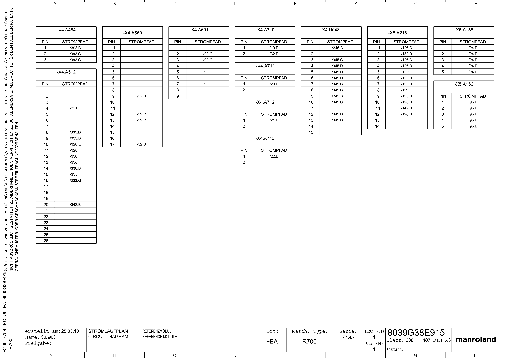

# +EA — Sheet 238 of 407 — REFERENZMODUL

**REFERENCE MODULE**

> Part of the manroland **R700** printing press IEC/UL circuit diagrams.
> Drawing class: **Stromlaufplan / Circuit diagram** (DIN A3).
> Document `+EA` covers the **Printing unit** machine section.

## At a glance

| Field | Value |
|---|---|
| Document | `+EA`  (8039G38E915) |
| Sheet | **238** of 407 |
| Section (DE) | REFERENZMODUL |
| Section (EN) | REFERENCE MODULE |
| Section type | REFERENCE_MODULE — Reference module |
| Machine type | `R700` |
| Series | `7758` |
| Created | 25.03.10 |
| Replaces | — |
| Columns used | A, B, C, D, E, F, G, H |
| Path numbers | — |
| Labels on sheet | 198 |
| Cross-refs out | 60 |
| Cross-refs in | 0 |

**Previous:** [+EA sheet 237](SHEET_0237.md) · **Next:** [+EA sheet 239](SHEET_0239.md) · **Document TOC:** [_TOC.md](_TOC.md)  (+EA) · **Master TOC:** [all sheets](../_MASTER_TOC.md)

## Sheet image (300 DPI, exact vector render)



_Rendered directly from the PDF vector layer at 300 DPI (1-bit), no OCR and no resampling. Use it to confirm anything ambiguous in the text below._

## Cross-references on this sheet

Each entry is a wire leaving this sheet. The printed token is `/sheet.column`; the link resolves to that sheet inside the same document.

| Ref | Target sheet | Col | Path | Destination on target | Target section | From col |
|---|---|---|---|---|---|---|
| `/94.E` | [+EA sheet 94](SHEET_0094.md) | E | — | — | BLASRAHMEN | H |
| `/392.B` | [+EA sheet 392](SHEET_0392.md) | B | — | — | OPTION: ZWISCHENTROCKNER VORBEREITUNG; | A |
| `/345.B` | [+EA sheet 345](SHEET_0345.md) | B | — | — | OPTION: INLINEOBSERVER | F |
| `/19.D` | [+EA sheet 19](SHEET_0019.md) | D | — | — | SPANNUNGSVERSORGUNG: 400V, 24V | E |
| `/126.C` | [+EA sheet 126](SHEET_0126.md) | C | — | — | ZUGANGSABSICHERUNG | G |
| `/94.E` | [+EA sheet 94](SHEET_0094.md) | E | — | — | BLASRAHMEN | H |
| `/139.B` | [+EA sheet 139](SHEET_0139.md) | B | — | — | ZUGANGSABSICHERUNG | G |
| `/93.G` | [+EA sheet 93](SHEET_0093.md) | G | — | — | BLASRAHMEN | D |
| `/32.D` | [+EA sheet 32](SHEET_0032.md) | D | — | — | BUSVERBINDUNGEN: NOT AUS | E |
| `/392.C` | [+EA sheet 392](SHEET_0392.md) | C | — | — | OPTION: ZWISCHENTROCKNER VORBEREITUNG; | A |
| `/94.E` | [+EA sheet 94](SHEET_0094.md) | E | — | — | BLASRAHMEN | H |
| `/93.G` | [+EA sheet 93](SHEET_0093.md) | G | — | — | BLASRAHMEN | D |
| `/392.C` | [+EA sheet 392](SHEET_0392.md) | C | — | — | OPTION: ZWISCHENTROCKNER VORBEREITUNG; | A |
| `/345.C` | [+EA sheet 345](SHEET_0345.md) | C | — | — | OPTION: INLINEOBSERVER | F |
| `/126.C` | [+EA sheet 126](SHEET_0126.md) | C | — | — | ZUGANGSABSICHERUNG | G |
| `/94.E` | [+EA sheet 94](SHEET_0094.md) | E | — | — | BLASRAHMEN | H |
| `/345.D` | [+EA sheet 345](SHEET_0345.md) | D | — | — | OPTION: INLINEOBSERVER | F |
| `/126.D` | [+EA sheet 126](SHEET_0126.md) | D | — | — | ZUGANGSABSICHERUNG | G |
| `/94.E` | [+EA sheet 94](SHEET_0094.md) | E | — | — | BLASRAHMEN | H |
| `/93.G` | [+EA sheet 93](SHEET_0093.md) | G | — | — | BLASRAHMEN | D |
| `/130.F` | [+EA sheet 130](SHEET_0130.md) | F | — | — | ZUGANGSABSICHERUNG | G |
| `/345.D` | [+EA sheet 345](SHEET_0345.md) | D | — | — | OPTION: INLINEOBSERVER | F |
| `/20.D` | [+EA sheet 20](SHEET_0020.md) | D | — | STROMPFAD PIN 1 2 | SPANNUNGSVERSORGUNG: 400V, 24V | D |
| `/345.D` | [+EA sheet 345](SHEET_0345.md) | D | — | — | OPTION: INLINEOBSERVER | F |
| `/126.D` | [+EA sheet 126](SHEET_0126.md) | D | — | — | ZUGANGSABSICHERUNG | G |
| `/93.G` | [+EA sheet 93](SHEET_0093.md) | G | — | — | BLASRAHMEN | D |
| `/345.C` | [+EA sheet 345](SHEET_0345.md) | C | — | — | OPTION: INLINEOBSERVER | F |
| `/126.D` | [+EA sheet 126](SHEET_0126.md) | D | — | — | ZUGANGSABSICHERUNG | G |
| `/345.C` | [+EA sheet 345](SHEET_0345.md) | C | — | — | OPTION: INLINEOBSERVER | F |
| `/129.C` | [+EA sheet 129](SHEET_0129.md) | C | — | — | ZUGANGSABSICHERUNG | G |
| `/52.B` | [+EA sheet 52](SHEET_0052.md) | B | — | — | MASCHINENBEDIENUNG: SPANNUNGSVERSORGUNG | B |
| `/345.B` | [+EA sheet 345](SHEET_0345.md) | B | — | — | OPTION: INLINEOBSERVER | F |
| `/126.D` | [+EA sheet 126](SHEET_0126.md) | D | — | — | ZUGANGSABSICHERUNG | G |
| `/95.E` | [+EA sheet 95](SHEET_0095.md) | E | — | — | BLASRAHMEN | H |
| `/345.C` | [+EA sheet 345](SHEET_0345.md) | C | — | — | OPTION: INLINEOBSERVER | F |
| `/126.D` | [+EA sheet 126](SHEET_0126.md) | D | — | — | ZUGANGSABSICHERUNG | G |
| `/95.E` | [+EA sheet 95](SHEET_0095.md) | E | — | — | BLASRAHMEN | H |
| `/331.F` | [+EA sheet 331](SHEET_0331.md) | F | — | — | OPTION: BOGENWEICHE | A |
| `/142.D` | [+EA sheet 142](SHEET_0142.md) | D | — | — | ZUGANGSABSICHERUNG | G |
| `/21.D` | [+EA sheet 21](SHEET_0021.md) | D | — | STROMPFAD PIN 1 2 | SPANNUNGSVERSORGUNG: 400V, 24V | D |
| `/95.E` | [+EA sheet 95](SHEET_0095.md) | E | — | — | BLASRAHMEN | H |
| `/52.C` | [+EA sheet 52](SHEET_0052.md) | C | — | — | MASCHINENBEDIENUNG: SPANNUNGSVERSORGUNG | B |
| `/345.D` | [+EA sheet 345](SHEET_0345.md) | D | — | — | OPTION: INLINEOBSERVER | F |
| `/126.D` | [+EA sheet 126](SHEET_0126.md) | D | — | — | ZUGANGSABSICHERUNG | G |
| `/95.E` | [+EA sheet 95](SHEET_0095.md) | E | — | — | BLASRAHMEN | H |
| `/52.C` | [+EA sheet 52](SHEET_0052.md) | C | — | — | MASCHINENBEDIENUNG: SPANNUNGSVERSORGUNG | B |
| `/345.D` | [+EA sheet 345](SHEET_0345.md) | D | — | — | OPTION: INLINEOBSERVER | F |
| `/95.E` | [+EA sheet 95](SHEET_0095.md) | E | — | — | BLASRAHMEN | H |
| `/335.D` | [+EA sheet 335](SHEET_0335.md) | D | — | — | OPTION: BOGENWEICHE | A |
| `/335.B` | [+EA sheet 335](SHEET_0335.md) | B | — | — | OPTION: BOGENWEICHE | A |
| `/328.E` | [+EA sheet 328](SHEET_0328.md) | E | — | — | OPTION: BOGENWEICHE | A |
| `/52.D` | [+EA sheet 52](SHEET_0052.md) | D | — | — | MASCHINENBEDIENUNG: SPANNUNGSVERSORGUNG | B |
| `/22.D` | [+EA sheet 22](SHEET_0022.md) | D | — | STROMPFAD PIN 1 2 | SPANNUNGSVERSORGUNG: 400V, 24V | D |
| `/328.F` | [+EA sheet 328](SHEET_0328.md) | F | — | — | OPTION: BOGENWEICHE | A |
| `/330.F` | [+EA sheet 330](SHEET_0330.md) | F | — | — | OPTION: BOGENWEICHE | A |
| `/336.F` | [+EA sheet 336](SHEET_0336.md) | F | — | — | OPTION: BOGENWEICHE | A |
| `/336.B` | [+EA sheet 336](SHEET_0336.md) | B | — | — | OPTION: BOGENWEICHE | A |
| `/335.F` | [+EA sheet 335](SHEET_0335.md) | F | — | — | OPTION: BOGENWEICHE | A |
| `/333.G` | [+EA sheet 333](SHEET_0333.md) | G | — | — | OPTION: BOGENWEICHE | A |
| `/342.B` | [+EA sheet 342](SHEET_0342.md) | B | — | — | OPTION: BOGENWEICHE | A |

## Devices on this sheet

| Tag | Class | Class meaning (IEC) | Col | Sub | Terminal | Sign |
|---|---|---|---|---|---|---|
| `X4.U043` | — | cross-device reference | F | — | — | — |
| `X4.A484` | — | cross-device reference | A | — | — | — |
| `X5.A218` | — | cross-device reference | G | — | — | — |
| `X5.A155` | — | cross-device reference | H | — | — | — |
| `X5.A156` | — | cross-device reference | H | — | — | — |
| `X4.A512` | — | cross-device reference | A | — | — | — |
| `X4.A560` | — | cross-device reference | B | — | — | — |
| `X4.A601` | — | cross-device reference | C | — | — | — |
| `X4.A710` | — | cross-device reference | E | — | — | — |
| `X4.A711` | — | cross-device reference | E | — | — | — |
| `X4.A712` | — | cross-device reference | E | — | — | — |
| `X4.A713` | — | cross-device reference | E | — | — | — |

## Potentials / nets

_No named potentials on this sheet._

## Wire-end annotations (grouped as printed)

A wire that continues elsewhere is annotated with a small cluster: the destination description, the path/line number `#NN`, and the `/sheet.column` cross reference. Each row below is one such cluster exactly as it is grouped on the drawing.

| Col | Y | Path | Cross-ref | Text on the wire |
|---|---|---|---|---|
| A | 65.5 | — | — | `X4.A484` |
| C | 65.5 | — | — | `X4.A601` |
| E | 65.5 | — | — | `X4.A710` |
| F | 65.5 | — | — | `X4.U043` |
| H | 65.5 | — | — | `X5.A155` |
| B | 72.6 | — | — | `X4.A560` |
| G | 72.6 | — | — | `X5.A218` |
| A | 94.2 | — | — | `PIN 2 3 1 STROMPFAD` |
| B | 94.2 | — | — | `PIN STROMPFAD` |
| C | 94.2 | — | — | `PIN 2 3 4 5 6 7 8 9 1 STROMPFAD` |
| D | 94.2 | — | — | `PIN 2 1 STROMPFAD` |
| F | 94.2 | — | — | `PIN 10 12 13 14 15 11 2 3 4 5 6 7 8 9 1 STROMPFAD` |
| G | 94.2 | — | — | `PIN STROMPFAD` |
| H | 94.2 | — | — | `PIN 2 3 4 5 1 STROMPFAD` |
| B | 108.4 | — | — | `2 3 4 5 6 7 8 9 1` |
| F | 108.4 | — | — | `2 3 4 5 6 7 8 9 1` |
| A | 108.7 | — | `/392.B` | — |
| E | 108.7 | — | `/19.D` | — |
| F | 108.7 | — | `/345.B` | — |
| G | 108.7 | — | `/126.C` | — |
| H | 108.7 | — | `/94.E` | — |
| H | 122.8 | — | `/94.E` | — |
| A | 122.9 | — | `/392.C` | — |
| D | 122.9 | — | `/93.G` | — |
| E | 122.9 | — | `/32.D` | — |
| G | 122.9 | — | `/139.B` | — |
| D | 137.0 | — | `/93.G` | — |
| H | 137.0 | — | `/94.E` | — |
| A | 137.1 | — | `/392.C` | — |
| F | 137.1 | — | `/345.C` | — |
| G | 137.1 | — | `/126.C` | — |
| E | 150.6 | — | — | `X4.A711` |
| F | 151.2 | — | `/345.D` | — |
| G | 151.2 | — | `/126.D` | — |
| H | 151.2 | — | `/94.E` | — |
| A | 164.7 | — | — | `X4.A512` |
| D | 165.4 | — | `/93.G` | — |
| F | 165.4 | — | `/345.D` | — |
| G | 165.4 | — | `/130.F` | — |
| H | 165.4 | — | `/94.E` | — |
| D | 179.2 | — | `/20.D` | `PIN 2 1 STROMPFAD` |
| F | 179.6 | — | `/345.D` | — |
| G | 179.6 | — | `/126.D` | — |
| H | 193.1 | — | — | `X5.A156` |
| A | 193.4 | — | — | `PIN STROMPFAD` |
| D | 193.7 | — | `/93.G` | — |
| F | 193.8 | — | `/345.C` | — |
| G | 193.8 | — | `/126.D` | — |
| A | 207.6 | — | — | `2 3 4 5 6 7 8 9 1` |
| F | 207.9 | — | `/345.C` | — |
| G | 207.9 | — | `/129.C` | — |
| H | 221.7 | — | — | `PIN 2 3 4 5 1 STROMPFAD` |
| B | 222.1 | — | `/52.B` | — |
| F | 222.1 | — | `/345.B` | — |
| G | 222.1 | — | `/126.D` | — |
| E | 235.6 | — | — | `X4.A712` |
| B | 235.9 | — | — | `10 12 13 14 15 16 17 11` |
| F | 235.9 | — | — | `10 12 13 14 11` |
| H | 236.2 | — | `/95.E` | — |
| F | 236.3 | — | `/345.C` | — |
| G | 236.3 | — | `/126.D` | — |
| A | 250.4 | — | `/331.F` | — |
| G | 250.4 | — | `/142.D` | — |
| H | 250.4 | — | `/95.E` | — |
| D | 264.2 | — | `/21.D` | `PIN 2 1 STROMPFAD` |
| B | 264.6 | — | `/52.C` | — |
| F | 264.6 | — | `/345.D` | — |
| G | 264.6 | — | `/126.D` | — |
| H | 264.6 | — | `/95.E` | — |
| B | 278.8 | — | `/52.C` | — |
| F | 278.8 | — | `/345.D` | — |
| H | 278.8 | — | `/95.E` | — |
| H | 292.9 | — | `/95.E` | — |
| A | 307.1 | — | `/335.D` | — |
| E | 320.6 | — | — | `X4.A713` |
| A | 321.3 | — | `/335.B` | — |
| A | 335.1 | — | — | `10 12 13 14 15 16 17 18 19 20 11` |
| A | 335.5 | — | `/328.E` | — |
| B | 335.5 | — | `/52.D` | — |
| D | 349.3 | — | `/22.D` | `PIN 2 1 STROMPFAD` |
| A | 349.6 | — | `/328.F` | — |
| A | 363.8 | — | `/330.F` | — |
| A | 378.0 | — | `/336.F` | — |
| A | 392.1 | — | `/336.B` | — |
| A | 406.3 | — | `/335.F` | — |
| A | 420.5 | — | `/333.G` | — |
| A | 477.2 | — | `/342.B` | — |
| A | 491.1 | — | — | `22 23 24 25 26 21` |


## Reconstructed tables

This sheet carries tabular content (pin map / terminal assignment / index). The grid below was rebuilt from the drawing's own rule lines, so each row is exactly one physical row of the table.

### Table 1 — 31 data rows × 2 columns (at x=85.0, y=62.4) — **X4.A484**

| PIN | STROMPFAD |
|---|---|
| `1` | `/392.B` |
| `2` | `/392.C` |
| `3` | `/392.C` |
|  | `X4.A512` |
| `PIN` | `STROMPFAD` |
| `1` |  |
| `2` |  |
| `3` |  |
| `4` | `/331.F` |
| `5` |  |
| `6` |  |
| `7` |  |
| `8` | `/335.D` |
| `9` | `/335.B` |
| `10` | `/328.E` |
| `11` | `/328.F` |
| `12` | `/330.F` |
| `13` | `/336.F` |
| `14` | `/336.B` |
| `15` | `/335.F` |
| `16` | `/333.G` |
| `17` |  |
| `18` |  |
| `19` |  |
| `20` | `/342.B` |
| `21` |  |
| `22` |  |
| `23` |  |
| `24` |  |
| `25` |  |
| `26` |  |


### Table 2 — 17 data rows × 2 columns (at x=240.9, y=62.4) — **X4.A560**

| PIN | STROMPFAD |
|---|---|
| `1` |  |
| `2` |  |
| `3` |  |
| `4` |  |
| `5` |  |
| `6` |  |
| `7` |  |
| `8` |  |
| `9` | `/52.B` |
| `10` |  |
| `11` |  |
| `12` | `/52.C` |
| `13` | `/52.C` |
| `14` |  |
| `15` |  |
| `16` |  |
| `17` | `/52.D` |


### Table 3 — 9 data rows × 2 columns (at x=396.9, y=62.4) — **X4.A601**

| PIN | STROMPFAD |
|---|---|
| `1` |  |
| `2` | `/93.G` |
| `3` | `/93.G` |
| `4` |  |
| `5` | `/93.G` |
| `6` |  |
| `7` | `/93.G` |
| `8` |  |
| `9` |  |


### Table 4 — 14 data rows × 2 columns (at x=552.8, y=62.4) — **X4.A710**

| PIN | STROMPFAD |
|---|---|
| `1` | `/19.D` |
| `2` | `/32.D` |
|  | `X4.A711` |
| `PIN` | `STROMPFAD` |
| `1` | `/20.D` |
| `2` |  |
|  | `X4.A712` |
| `PIN` | `STROMPFAD` |
| `1` | `/21.D` |
| `2` |  |
|  | `X4.A713` |
| `PIN` | `STROMPFAD` |
| `1` | `/22.D` |
| `2` |  |


### Table 5 — 15 data rows × 2 columns (at x=708.7, y=62.4) — **X4.U043**

| PIN | STROMPFAD |
|---|---|
| `1` | `/345.B` |
| `2` |  |
| `3` | `/345.C` |
| `4` | `/345.D` |
| `5` | `/345.D` |
| `6` | `/345.D` |
| `7` | `/345.C` |
| `8` | `/345.C` |
| `9` | `/345.B` |
| `10` | `/345.C` |
| `11` |  |
| `12` | `/345.D` |
| `13` | `/345.D` |
| `14` |  |
| `15` |  |


### Table 6 — 14 data rows × 2 columns (at x=864.6, y=62.4) — **X5.A218**

| PIN | STROMPFAD |
|---|---|
| `1` | `/126.C` |
| `2` | `/139.B` |
| `3` | `/126.C` |
| `4` | `/126.D` |
| `5` | `/130.F` |
| `6` | `/126.D` |
| `7` | `/126.D` |
| `8` | `/129.C` |
| `9` | `/126.D` |
| `10` | `/126.D` |
| `11` | `/142.D` |
| `12` | `/126.D` |
| `13` |  |
| `14` |  |


### Table 7 — 12 data rows × 2 columns (at x=1020.5, y=62.4) — **X5.A155**

| PIN | STROMPFAD |
|---|---|
| `1` | `/94.E` |
| `2` | `/94.E` |
| `3` | `/94.E` |
| `4` | `/94.E` |
| `5` | `/94.E` |
|  | `X5.A156` |
| `PIN` | `STROMPFAD` |
| `1` | `/95.E` |
| `2` | `/95.E` |
| `3` | `/95.E` |
| `4` | `/95.E` |
| `5` | `/95.E` |


## Notes and free text on this sheet

| Text | Col | Y (pt) |
|---|---|---|
| `PIN` | E | 94.2 |
| `STROMPFAD` | F | 94.15 |
| `PIN` | A | 94.2 |
| `STROMPFAD` | A | 94.15 |
| `PIN` | F | 94.2 |
| `STROMPFAD` | G | 94.15 |
| `PIN` | G | 94.2 |
| `STROMPFAD` | H | 94.15 |
| `PIN` | B | 94.2 |
| `STROMPFAD` | B | 94.15 |
| `PIN` | C | 94.2 |
| `STROMPFAD` | D | 94.15 |
| `PIN` | D | 94.2 |
| `STROMPFAD` | E | 94.15 |

## Complete label inventory (exact text from the drawing)

Every text object inside the drawing area of this sheet, in DIN reading order (column A→H, then top→bottom). This is the authoritative list: if a string is not here it is not printed on this sheet.

| Col | Y | X | Dir | Type | Text |
|---|---|---|---|---|---|
| A | 65.5 | 133.9 | → | device ref | `X4.A484` |
| A | 94.2 | 98.2 | → | text | `PIN` |
| A | 94.2 | 146.4 | → | text | `STROMPFAD` |
| A | 108.4 | 104.2 | → | number | `1` |
| A | 108.7 | 164.6 | → | cross-reference | `/392.B` |
| A | 122.5 | 103.6 | → | number | `2` |
| A | 122.9 | 164.4 | → | cross-reference | `/392.C` |
| A | 136.7 | 103.6 | → | number | `3` |
| A | 137.1 | 164.4 | → | cross-reference | `/392.C` |
| A | 164.7 | 133.9 | → | device ref | `X4.A512` |
| A | 193.4 | 98.2 | → | text | `PIN` |
| A | 193.4 | 146.4 | → | text | `STROMPFAD` |
| A | 207.6 | 110.0 | → | number | `1` |
| A | 221.8 | 108.3 | → | number | `2` |
| A | 235.9 | 108.3 | → | number | `3` |
| A | 250.1 | 108.3 | → | number | `4` |
| A | 250.4 | 164.8 | → | cross-reference | `/331.F` |
| A | 264.3 | 108.3 | → | number | `5` |
| A | 278.5 | 108.3 | → | number | `6` |
| A | 292.6 | 108.3 | → | number | `7` |
| A | 306.8 | 108.3 | → | number | `8` |
| A | 307.1 | 164.4 | → | cross-reference | `/335.D` |
| A | 321.0 | 108.3 | → | number | `9` |
| A | 321.3 | 164.6 | → | cross-reference | `/335.B` |
| A | 335.1 | 102.9 | → | number | `10` |
| A | 335.5 | 164.7 | → | cross-reference | `/328.E` |
| A | 349.3 | 104.6 | → | number | `11` |
| A | 349.6 | 164.8 | → | cross-reference | `/328.F` |
| A | 363.5 | 102.9 | → | number | `12` |
| A | 363.8 | 164.8 | → | cross-reference | `/330.F` |
| A | 377.7 | 102.9 | → | number | `13` |
| A | 378.0 | 164.8 | → | cross-reference | `/336.F` |
| A | 391.8 | 102.9 | → | number | `14` |
| A | 392.2 | 164.6 | → | cross-reference | `/336.B` |
| A | 406.0 | 102.9 | → | number | `15` |
| A | 406.3 | 164.8 | → | cross-reference | `/335.F` |
| A | 420.2 | 102.9 | → | number | `16` |
| A | 420.5 | 164.3 | → | cross-reference | `/333.G` |
| A | 434.4 | 102.9 | → | number | `17` |
| A | 448.5 | 102.9 | → | number | `18` |
| A | 462.7 | 102.9 | → | number | `19` |
| A | 476.9 | 102.9 | → | number | `20` |
| A | 477.2 | 164.6 | → | cross-reference | `/342.B` |
| A | 491.0 | 104.6 | → | number | `21` |
| A | 505.2 | 102.9 | → | number | `22` |
| A | 519.4 | 102.9 | → | number | `23` |
| A | 533.6 | 102.9 | → | number | `24` |
| A | 547.7 | 102.9 | → | number | `25` |
| A | 561.9 | 102.9 | → | number | `26` |
| B | 72.6 | 289.8 | → | device ref | `X4.A560` |
| B | 94.2 | 254.1 | → | text | `PIN` |
| B | 94.2 | 302.3 | → | text | `STROMPFAD` |
| B | 108.4 | 265.9 | → | number | `1` |
| B | 122.5 | 264.2 | → | number | `2` |
| B | 136.7 | 264.2 | → | number | `3` |
| B | 150.9 | 264.2 | → | number | `4` |
| B | 165.1 | 264.2 | → | number | `5` |
| B | 179.2 | 264.2 | → | number | `6` |
| B | 193.4 | 264.2 | → | number | `7` |
| B | 207.6 | 264.2 | → | number | `8` |
| B | 221.8 | 264.2 | → | number | `9` |
| B | 222.1 | 322.9 | → | cross-reference | `/52.B` |
| B | 235.9 | 258.8 | → | number | `10` |
| B | 250.1 | 260.5 | → | number | `11` |
| B | 264.3 | 258.8 | → | number | `12` |
| B | 264.6 | 322.7 | → | cross-reference | `/52.C` |
| B | 278.5 | 258.8 | → | number | `13` |
| B | 278.8 | 322.7 | → | cross-reference | `/52.C` |
| B | 292.6 | 258.8 | → | number | `14` |
| B | 306.8 | 258.8 | → | number | `15` |
| B | 321.0 | 258.8 | → | number | `16` |
| B | 335.1 | 258.8 | → | number | `17` |
| B | 335.5 | 322.7 | → | cross-reference | `/52.D` |
| C | 65.5 | 446.5 | → | device ref | `X4.A601` |
| C | 94.2 | 410.0 | → | text | `PIN` |
| C | 108.4 | 416.0 | → | number | `1` |
| C | 122.5 | 415.4 | → | number | `2` |
| C | 136.7 | 415.4 | → | number | `3` |
| C | 150.9 | 415.4 | → | number | `4` |
| C | 165.1 | 415.4 | → | number | `5` |
| C | 179.2 | 415.4 | → | number | `6` |
| C | 193.4 | 415.4 | → | number | `7` |
| C | 207.6 | 415.4 | → | number | `8` |
| C | 221.8 | 415.4 | → | number | `9` |
| D | 94.2 | 458.2 | → | text | `STROMPFAD` |
| D | 94.2 | 565.9 | → | text | `PIN` |
| D | 108.4 | 571.9 | → | number | `1` |
| D | 122.5 | 571.3 | → | number | `2` |
| D | 122.9 | 478.5 | → | cross-reference | `/93.G` |
| D | 137.0 | 478.5 | → | cross-reference | `/93.G` |
| D | 165.4 | 478.5 | → | cross-reference | `/93.G` |
| D | 179.2 | 565.9 | → | text | `PIN` |
| D | 193.4 | 571.9 | → | number | `1` |
| D | 193.7 | 478.5 | → | cross-reference | `/93.G` |
| D | 207.6 | 571.3 | → | number | `2` |
| D | 264.3 | 565.9 | → | text | `PIN` |
| D | 278.5 | 571.9 | → | number | `1` |
| D | 292.6 | 571.3 | → | number | `2` |
| D | 349.3 | 565.9 | → | text | `PIN` |
| D | 363.5 | 571.9 | → | number | `1` |
| D | 377.7 | 571.3 | → | number | `2` |
| E | 65.5 | 601.7 | → | device ref | `X4.A710` |
| E | 94.2 | 614.1 | → | text | `STROMPFAD` |
| E | 94.2 | 721.8 | → | text | `PIN` |
| E | 108.4 | 733.6 | → | number | `1` |
| E | 108.7 | 634.5 | → | cross-reference | `/19.D` |
| E | 122.5 | 731.9 | → | number | `2` |
| E | 122.9 | 634.5 | → | cross-reference | `/32.D` |
| E | 136.7 | 731.9 | → | number | `3` |
| E | 150.5 | 602.4 | → | device ref | `X4.A711` |
| E | 150.9 | 731.9 | → | number | `4` |
| E | 165.1 | 731.9 | → | number | `5` |
| E | 179.2 | 614.1 | → | text | `STROMPFAD` |
| E | 179.2 | 731.9 | → | number | `6` |
| E | 193.4 | 731.9 | → | number | `7` |
| E | 193.7 | 634.5 | → | cross-reference | `/20.D` |
| E | 207.6 | 731.9 | → | number | `8` |
| E | 221.8 | 731.9 | → | number | `9` |
| E | 235.6 | 601.7 | → | device ref | `X4.A712` |
| E | 235.9 | 726.5 | → | number | `10` |
| E | 250.1 | 728.2 | → | number | `11` |
| E | 264.2 | 614.1 | → | text | `STROMPFAD` |
| E | 264.3 | 726.5 | → | number | `12` |
| E | 278.5 | 726.5 | → | number | `13` |
| E | 278.8 | 634.5 | → | cross-reference | `/21.D` |
| E | 292.6 | 726.5 | → | number | `14` |
| E | 306.8 | 726.5 | → | number | `15` |
| E | 320.6 | 601.7 | → | device ref | `X4.A713` |
| E | 349.3 | 614.1 | → | text | `STROMPFAD` |
| E | 363.8 | 634.5 | → | cross-reference | `/22.D` |
| F | 65.5 | 754.4 | → | device ref | `X4.U043` |
| F | 94.2 | 770.0 | → | text | `STROMPFAD` |
| F | 94.2 | 877.7 | → | text | `PIN` |
| F | 108.4 | 889.5 | → | number | `1` |
| F | 108.7 | 781.1 | → | cross-reference | `/345.B` |
| F | 122.5 | 887.8 | → | number | `2` |
| F | 136.7 | 887.8 | → | number | `3` |
| F | 137.1 | 780.9 | → | cross-reference | `/345.C` |
| F | 150.9 | 887.8 | → | number | `4` |
| F | 151.2 | 780.9 | → | cross-reference | `/345.D` |
| F | 165.1 | 887.8 | → | number | `5` |
| F | 165.4 | 780.9 | → | cross-reference | `/345.D` |
| F | 179.2 | 887.8 | → | number | `6` |
| F | 179.6 | 780.9 | → | cross-reference | `/345.D` |
| F | 193.4 | 887.8 | → | number | `7` |
| F | 193.8 | 780.9 | → | cross-reference | `/345.C` |
| F | 207.6 | 887.8 | → | number | `8` |
| F | 207.9 | 780.9 | → | cross-reference | `/345.C` |
| F | 221.8 | 887.8 | → | number | `9` |
| F | 222.1 | 781.1 | → | cross-reference | `/345.B` |
| F | 235.9 | 882.4 | → | number | `10` |
| F | 236.3 | 780.9 | → | cross-reference | `/345.C` |
| F | 250.1 | 884.1 | → | number | `11` |
| F | 264.3 | 882.4 | → | number | `12` |
| F | 264.6 | 780.9 | → | cross-reference | `/345.D` |
| F | 278.5 | 882.4 | → | number | `13` |
| F | 278.8 | 780.9 | → | cross-reference | `/345.D` |
| F | 292.6 | 882.4 | → | number | `14` |
| G | 72.6 | 913.5 | → | device ref | `X5.A218` |
| G | 94.2 | 925.9 | → | text | `STROMPFAD` |
| G | 94.2 | 1033.7 | → | text | `PIN` |
| G | 108.4 | 1039.6 | → | number | `1` |
| G | 108.7 | 943.9 | → | cross-reference | `/126.C` |
| G | 122.5 | 1039.0 | → | number | `2` |
| G | 122.9 | 944.1 | → | cross-reference | `/139.B` |
| G | 136.7 | 1039.0 | → | number | `3` |
| G | 137.1 | 943.9 | → | cross-reference | `/126.C` |
| G | 150.9 | 1039.0 | → | number | `4` |
| G | 151.2 | 943.9 | → | cross-reference | `/126.D` |
| G | 165.1 | 1039.0 | → | number | `5` |
| G | 165.4 | 944.4 | → | cross-reference | `/130.F` |
| G | 179.6 | 943.9 | → | cross-reference | `/126.D` |
| G | 193.8 | 943.9 | → | cross-reference | `/126.D` |
| G | 207.9 | 943.9 | → | cross-reference | `/129.C` |
| G | 221.8 | 1033.7 | → | text | `PIN` |
| G | 222.1 | 943.9 | → | cross-reference | `/126.D` |
| G | 235.9 | 1039.6 | → | number | `1` |
| G | 236.3 | 943.9 | → | cross-reference | `/126.D` |
| G | 250.1 | 1039.0 | → | number | `2` |
| G | 250.4 | 943.9 | → | cross-reference | `/142.D` |
| G | 264.3 | 1039.0 | → | number | `3` |
| G | 264.6 | 943.9 | → | cross-reference | `/126.D` |
| G | 278.5 | 1039.0 | → | number | `4` |
| G | 292.6 | 1039.0 | → | number | `5` |
| H | 65.5 | 1069.4 | → | device ref | `X5.A155` |
| H | 94.2 | 1081.8 | → | text | `STROMPFAD` |
| H | 108.7 | 1102.5 | → | cross-reference | `/94.E` |
| H | 122.8 | 1102.5 | → | cross-reference | `/94.E` |
| H | 137.0 | 1102.5 | → | cross-reference | `/94.E` |
| H | 151.2 | 1102.5 | → | cross-reference | `/94.E` |
| H | 165.4 | 1102.5 | → | cross-reference | `/94.E` |
| H | 193.1 | 1069.4 | → | device ref | `X5.A156` |
| H | 221.7 | 1081.8 | → | text | `STROMPFAD` |
| H | 236.2 | 1102.5 | → | cross-reference | `/95.E` |
| H | 250.4 | 1102.5 | → | cross-reference | `/95.E` |
| H | 264.6 | 1102.5 | → | cross-reference | `/95.E` |
| H | 278.8 | 1102.5 | → | cross-reference | `/95.E` |
| H | 292.9 | 1102.5 | → | cross-reference | `/95.E` |

## Reading-order text block

The same content as a plain block, grouped by DIN column — convenient to paste or to match against a visual description.

```text
=== Column A ===
  65.5  133.9  devref       X4.A484
  94.2   98.2  text         PIN
  94.2  146.4  text         STROMPFAD
 108.4  104.2  numeric      1
 108.7  164.6  xref         /392.B
 122.5  103.6  numeric      2
 122.9  164.4  xref         /392.C
 136.7  103.6  numeric      3
 137.1  164.4  xref         /392.C
 164.7  133.9  devref       X4.A512
 193.4   98.2  text         PIN
 193.4  146.4  text         STROMPFAD
 207.6  110.0  numeric      1
 221.8  108.3  numeric      2
 235.9  108.3  numeric      3
 250.1  108.3  numeric      4
 250.4  164.8  xref         /331.F
 264.3  108.3  numeric      5
 278.5  108.3  numeric      6
 292.6  108.3  numeric      7
 306.8  108.3  numeric      8
 307.1  164.4  xref         /335.D
 321.0  108.3  numeric      9
 321.3  164.6  xref         /335.B
 335.1  102.9  numeric      10
 335.5  164.7  xref         /328.E
 349.3  104.6  numeric      11
 349.6  164.8  xref         /328.F
 363.5  102.9  numeric      12
 363.8  164.8  xref         /330.F
 377.7  102.9  numeric      13
 378.0  164.8  xref         /336.F
 391.8  102.9  numeric      14
 392.2  164.6  xref         /336.B
 406.0  102.9  numeric      15
 406.3  164.8  xref         /335.F
 420.2  102.9  numeric      16
 420.5  164.3  xref         /333.G
 434.4  102.9  numeric      17
 448.5  102.9  numeric      18
 462.7  102.9  numeric      19
 476.9  102.9  numeric      20
 477.2  164.6  xref         /342.B
 491.0  104.6  numeric      21
 505.2  102.9  numeric      22
 519.4  102.9  numeric      23
 533.6  102.9  numeric      24
 547.7  102.9  numeric      25
 561.9  102.9  numeric      26
=== Column B ===
  72.6  289.8  devref       X4.A560
  94.2  254.1  text         PIN
  94.2  302.3  text         STROMPFAD
 108.4  265.9  numeric      1
 122.5  264.2  numeric      2
 136.7  264.2  numeric      3
 150.9  264.2  numeric      4
 165.1  264.2  numeric      5
 179.2  264.2  numeric      6
 193.4  264.2  numeric      7
 207.6  264.2  numeric      8
 221.8  264.2  numeric      9
 222.1  322.9  xref         /52.B
 235.9  258.8  numeric      10
 250.1  260.5  numeric      11
 264.3  258.8  numeric      12
 264.6  322.7  xref         /52.C
 278.5  258.8  numeric      13
 278.8  322.7  xref         /52.C
 292.6  258.8  numeric      14
 306.8  258.8  numeric      15
 321.0  258.8  numeric      16
 335.1  258.8  numeric      17
 335.5  322.7  xref         /52.D
=== Column C ===
  65.5  446.5  devref       X4.A601
  94.2  410.0  text         PIN
 108.4  416.0  numeric      1
 122.5  415.4  numeric      2
 136.7  415.4  numeric      3
 150.9  415.4  numeric      4
 165.1  415.4  numeric      5
 179.2  415.4  numeric      6
 193.4  415.4  numeric      7
 207.6  415.4  numeric      8
 221.8  415.4  numeric      9
=== Column D ===
  94.2  458.2  text         STROMPFAD
  94.2  565.9  text         PIN
 108.4  571.9  numeric      1
 122.5  571.3  numeric      2
 122.9  478.5  xref         /93.G
 137.0  478.5  xref         /93.G
 165.4  478.5  xref         /93.G
 179.2  565.9  text         PIN
 193.4  571.9  numeric      1
 193.7  478.5  xref         /93.G
 207.6  571.3  numeric      2
 264.3  565.9  text         PIN
 278.5  571.9  numeric      1
 292.6  571.3  numeric      2
 349.3  565.9  text         PIN
 363.5  571.9  numeric      1
 377.7  571.3  numeric      2
=== Column E ===
  65.5  601.7  devref       X4.A710
  94.2  614.1  text         STROMPFAD
  94.2  721.8  text         PIN
 108.4  733.6  numeric      1
 108.7  634.5  xref         /19.D
 122.5  731.9  numeric      2
 122.9  634.5  xref         /32.D
 136.7  731.9  numeric      3
 150.5  602.4  devref       X4.A711
 150.9  731.9  numeric      4
 165.1  731.9  numeric      5
 179.2  614.1  text         STROMPFAD
 179.2  731.9  numeric      6
 193.4  731.9  numeric      7
 193.7  634.5  xref         /20.D
 207.6  731.9  numeric      8
 221.8  731.9  numeric      9
 235.6  601.7  devref       X4.A712
 235.9  726.5  numeric      10
 250.1  728.2  numeric      11
 264.2  614.1  text         STROMPFAD
 264.3  726.5  numeric      12
 278.5  726.5  numeric      13
 278.8  634.5  xref         /21.D
 292.6  726.5  numeric      14
 306.8  726.5  numeric      15
 320.6  601.7  devref       X4.A713
 349.3  614.1  text         STROMPFAD
 363.8  634.5  xref         /22.D
=== Column F ===
  65.5  754.4  devref       X4.U043
  94.2  770.0  text         STROMPFAD
  94.2  877.7  text         PIN
 108.4  889.5  numeric      1
 108.7  781.1  xref         /345.B
 122.5  887.8  numeric      2
 136.7  887.8  numeric      3
 137.1  780.9  xref         /345.C
 150.9  887.8  numeric      4
 151.2  780.9  xref         /345.D
 165.1  887.8  numeric      5
 165.4  780.9  xref         /345.D
 179.2  887.8  numeric      6
 179.6  780.9  xref         /345.D
 193.4  887.8  numeric      7
 193.8  780.9  xref         /345.C
 207.6  887.8  numeric      8
 207.9  780.9  xref         /345.C
 221.8  887.8  numeric      9
 222.1  781.1  xref         /345.B
 235.9  882.4  numeric      10
 236.3  780.9  xref         /345.C
 250.1  884.1  numeric      11
 264.3  882.4  numeric      12
 264.6  780.9  xref         /345.D
 278.5  882.4  numeric      13
 278.8  780.9  xref         /345.D
 292.6  882.4  numeric      14
=== Column G ===
  72.6  913.5  devref       X5.A218
  94.2  925.9  text         STROMPFAD
  94.2 1033.7  text         PIN
 108.4 1039.6  numeric      1
 108.7  943.9  xref         /126.C
 122.5 1039.0  numeric      2
 122.9  944.1  xref         /139.B
 136.7 1039.0  numeric      3
 137.1  943.9  xref         /126.C
 150.9 1039.0  numeric      4
 151.2  943.9  xref         /126.D
 165.1 1039.0  numeric      5
 165.4  944.4  xref         /130.F
 179.6  943.9  xref         /126.D
 193.8  943.9  xref         /126.D
 207.9  943.9  xref         /129.C
 221.8 1033.7  text         PIN
 222.1  943.9  xref         /126.D
 235.9 1039.6  numeric      1
 236.3  943.9  xref         /126.D
 250.1 1039.0  numeric      2
 250.4  943.9  xref         /142.D
 264.3 1039.0  numeric      3
 264.6  943.9  xref         /126.D
 278.5 1039.0  numeric      4
 292.6 1039.0  numeric      5
=== Column H ===
  65.5 1069.4  devref       X5.A155
  94.2 1081.8  text         STROMPFAD
 108.7 1102.5  xref         /94.E
 122.8 1102.5  xref         /94.E
 137.0 1102.5  xref         /94.E
 151.2 1102.5  xref         /94.E
 165.4 1102.5  xref         /94.E
 193.1 1069.4  devref       X5.A156
 221.7 1081.8  text         STROMPFAD
 236.2 1102.5  xref         /95.E
 250.4 1102.5  xref         /95.E
 264.6 1102.5  xref         /95.E
 278.8 1102.5  xref         /95.E
 292.9 1102.5  xref         /95.E
```

---
_Generated from the PDF vector text layer; no OCR. Source: `R700_7758_IEC_UL_EA_8039G38E915_p`, sheet 238._
