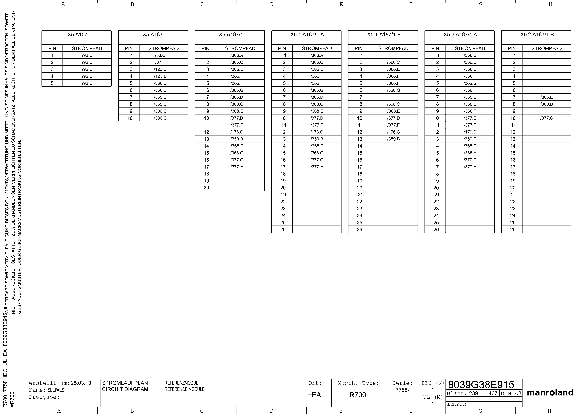

# +EA — Sheet 239 of 407 — REFERENZMODUL

**REFERENCE MODULE**

> Part of the manroland **R700** printing press IEC/UL circuit diagrams.
> Drawing class: **Stromlaufplan / Circuit diagram** (DIN A3).
> Document `+EA` covers the **Printing unit** machine section.

## At a glance

| Field | Value |
|---|---|
| Document | `+EA`  (8039G38E915) |
| Sheet | **239** of 407 |
| Section (DE) | REFERENZMODUL |
| Section (EN) | REFERENCE MODULE |
| Section type | REFERENCE_MODULE — Reference module |
| Machine type | `R700` |
| Series | `7758` |
| Created | 25.03.10 |
| Replaces | — |
| Columns used | A, B, C, D, E, F, G, H |
| Path numbers | — |
| Labels on sheet | 240 |
| Cross-refs out | 80 |
| Cross-refs in | 0 |

**Previous:** [+EA sheet 238](SHEET_0238.md) · **Next:** [+EA sheet 240](SHEET_0240.md) · **Document TOC:** [_TOC.md](_TOC.md)  (+EA) · **Master TOC:** [all sheets](../_MASTER_TOC.md)

## Sheet image (300 DPI, exact vector render)



_Rendered directly from the PDF vector layer at 300 DPI (1-bit), no OCR and no resampling. Use it to confirm anything ambiguous in the text below._

## Cross-references on this sheet

Each entry is a wire leaving this sheet. The printed token is `/sheet.column`; the link resolves to that sheet inside the same document.

| Ref | Target sheet | Col | Path | Destination on target | Target section | From col |
|---|---|---|---|---|---|---|
| `/96.E` | [+EA sheet 96](SHEET_0096.md) | E | — | — | BLASRAHMEN | A |
| `/366.A` | [+EA sheet 366](SHEET_0366.md) | A | — | — | OPTION: TROCKNER VORBEREITUNG; | C |
| `/366.A` | [+EA sheet 366](SHEET_0366.md) | A | — | — | OPTION: TROCKNER VORBEREITUNG; | E |
| `/366.B` | [+EA sheet 366](SHEET_0366.md) | B | — | — | OPTION: TROCKNER VORBEREITUNG; | G |
| `/38.C` | [+EA sheet 38](SHEET_0038.md) | C | — | — | BUSVERBINDUNGEN: NOT AUS | B |
| `/96.E` | [+EA sheet 96](SHEET_0096.md) | E | — | — | BLASRAHMEN | A |
| `/37.F` | [+EA sheet 37](SHEET_0037.md) | F | — | — | BUSVERBINDUNGEN: NOT AUS | B |
| `/366.C` | [+EA sheet 366](SHEET_0366.md) | C | — | — | OPTION: TROCKNER VORBEREITUNG; | C |
| `/366.C` | [+EA sheet 366](SHEET_0366.md) | C | — | — | OPTION: TROCKNER VORBEREITUNG; | E |
| `/366.C` | [+EA sheet 366](SHEET_0366.md) | C | — | — | OPTION: TROCKNER VORBEREITUNG; | F |
| `/366.D` | [+EA sheet 366](SHEET_0366.md) | D | — | — | OPTION: TROCKNER VORBEREITUNG; | G |
| `/96.E` | [+EA sheet 96](SHEET_0096.md) | E | — | — | BLASRAHMEN | A |
| `/366.E` | [+EA sheet 366](SHEET_0366.md) | E | — | — | OPTION: TROCKNER VORBEREITUNG; | D |
| `/366.E` | [+EA sheet 366](SHEET_0366.md) | E | — | — | OPTION: TROCKNER VORBEREITUNG; | E |
| `/366.E` | [+EA sheet 366](SHEET_0366.md) | E | — | — | OPTION: TROCKNER VORBEREITUNG; | F |
| `/366.E` | [+EA sheet 366](SHEET_0366.md) | E | — | — | OPTION: TROCKNER VORBEREITUNG; | G |
| `/123.C` | [+EA sheet 123](SHEET_0123.md) | C | — | — | TROCKENBESTÄUBER | B |
| `/96.E` | [+EA sheet 96](SHEET_0096.md) | E | — | — | BLASRAHMEN | A |
| `/123.E` | [+EA sheet 123](SHEET_0123.md) | E | — | — | TROCKENBESTÄUBER | B |
| `/366.F` | [+EA sheet 366](SHEET_0366.md) | F | — | — | OPTION: TROCKNER VORBEREITUNG; | C |
| `/366.F` | [+EA sheet 366](SHEET_0366.md) | F | — | — | OPTION: TROCKNER VORBEREITUNG; | E |
| `/366.F` | [+EA sheet 366](SHEET_0366.md) | F | — | — | OPTION: TROCKNER VORBEREITUNG; | F |
| `/366.F` | [+EA sheet 366](SHEET_0366.md) | F | — | — | OPTION: TROCKNER VORBEREITUNG; | G |
| `/96.E` | [+EA sheet 96](SHEET_0096.md) | E | — | — | BLASRAHMEN | A |
| `/366.B` | [+EA sheet 366](SHEET_0366.md) | B | — | — | OPTION: TROCKNER VORBEREITUNG; | B |
| `/366.F` | [+EA sheet 366](SHEET_0366.md) | F | — | — | OPTION: TROCKNER VORBEREITUNG; | C |
| `/366.F` | [+EA sheet 366](SHEET_0366.md) | F | — | — | OPTION: TROCKNER VORBEREITUNG; | E |
| `/366.F` | [+EA sheet 366](SHEET_0366.md) | F | — | — | OPTION: TROCKNER VORBEREITUNG; | F |
| `/366.G` | [+EA sheet 366](SHEET_0366.md) | G | — | — | OPTION: TROCKNER VORBEREITUNG; | G |
| `/366.B` | [+EA sheet 366](SHEET_0366.md) | B | — | — | OPTION: TROCKNER VORBEREITUNG; | B |
| `/366.G` | [+EA sheet 366](SHEET_0366.md) | G | — | — | OPTION: TROCKNER VORBEREITUNG; | D |
| `/366.G` | [+EA sheet 366](SHEET_0366.md) | G | — | — | OPTION: TROCKNER VORBEREITUNG; | E |
| `/366.G` | [+EA sheet 366](SHEET_0366.md) | G | — | — | OPTION: TROCKNER VORBEREITUNG; | F |
| `/366.H` | [+EA sheet 366](SHEET_0366.md) | H | — | — | OPTION: TROCKNER VORBEREITUNG; | G |
| `/365.B` | [+EA sheet 365](SHEET_0365.md) | B | — | — | OPTION: TROCKNER VORBEREITUNG; | B |
| `/365.E` | [+EA sheet 365](SHEET_0365.md) | E | — | — | OPTION: TROCKNER VORBEREITUNG; | G |
| `/365.E` | [+EA sheet 365](SHEET_0365.md) | E | — | — | OPTION: TROCKNER VORBEREITUNG; | H |
| `/365.D` | [+EA sheet 365](SHEET_0365.md) | D | — | — | OPTION: TROCKNER VORBEREITUNG; | C |
| `/365.D` | [+EA sheet 365](SHEET_0365.md) | D | — | — | OPTION: TROCKNER VORBEREITUNG; | E |
| `/368.B` | [+EA sheet 368](SHEET_0368.md) | B | — | — | OPTION: ENDTROCKNER 1 VORBEREITUNG; | G |
| `/368.B` | [+EA sheet 368](SHEET_0368.md) | B | — | — | OPTION: ENDTROCKNER 1 VORBEREITUNG; | H |
| `/365.C` | [+EA sheet 365](SHEET_0365.md) | C | — | — | OPTION: TROCKNER VORBEREITUNG; | B |
| `/368.C` | [+EA sheet 368](SHEET_0368.md) | C | — | — | OPTION: ENDTROCKNER 1 VORBEREITUNG; | C |
| `/368.C` | [+EA sheet 368](SHEET_0368.md) | C | — | — | OPTION: ENDTROCKNER 1 VORBEREITUNG; | E |
| `/368.C` | [+EA sheet 368](SHEET_0368.md) | C | — | — | OPTION: ENDTROCKNER 1 VORBEREITUNG; | F |
| `/368.E` | [+EA sheet 368](SHEET_0368.md) | E | — | — | OPTION: ENDTROCKNER 1 VORBEREITUNG; | D |
| `/368.E` | [+EA sheet 368](SHEET_0368.md) | E | — | — | OPTION: ENDTROCKNER 1 VORBEREITUNG; | E |
| `/368.E` | [+EA sheet 368](SHEET_0368.md) | E | — | — | OPTION: ENDTROCKNER 1 VORBEREITUNG; | F |
| `/368.F` | [+EA sheet 368](SHEET_0368.md) | F | — | — | OPTION: ENDTROCKNER 1 VORBEREITUNG; | G |
| `/386.C` | [+EA sheet 386](SHEET_0386.md) | C | — | — | OPTION: ZWISCHENTROCKNER VORBEREITUNG; | B |
| `/386.C` | [+EA sheet 386](SHEET_0386.md) | C | — | — | OPTION: ZWISCHENTROCKNER VORBEREITUNG; | B |
| `/377.D` | [+EA sheet 377](SHEET_0377.md) | D | — | — | OPTION: ENDTROCKNER 2 VORBEREITUNG | C |
| `/377.D` | [+EA sheet 377](SHEET_0377.md) | D | — | — | OPTION: ENDTROCKNER 2 VORBEREITUNG | E |
| `/377.D` | [+EA sheet 377](SHEET_0377.md) | D | — | — | OPTION: ENDTROCKNER 2 VORBEREITUNG | F |
| `/377.C` | [+EA sheet 377](SHEET_0377.md) | C | — | — | OPTION: ENDTROCKNER 2 VORBEREITUNG | G |
| `/377.C` | [+EA sheet 377](SHEET_0377.md) | C | — | — | OPTION: ENDTROCKNER 2 VORBEREITUNG | H |
| `/377.F` | [+EA sheet 377](SHEET_0377.md) | F | — | — | OPTION: ENDTROCKNER 2 VORBEREITUNG | C |
| `/377.F` | [+EA sheet 377](SHEET_0377.md) | F | — | — | OPTION: ENDTROCKNER 2 VORBEREITUNG | E |
| `/377.F` | [+EA sheet 377](SHEET_0377.md) | F | — | — | OPTION: ENDTROCKNER 2 VORBEREITUNG | F |
| `/377.F` | [+EA sheet 377](SHEET_0377.md) | F | — | — | OPTION: ENDTROCKNER 2 VORBEREITUNG | G |
| `/176.C` | [+EA sheet 176](SHEET_0176.md) | C | — | — | RESERVE | C |
| `/176.C` | [+EA sheet 176](SHEET_0176.md) | C | — | — | RESERVE | E |
| `/176.C` | [+EA sheet 176](SHEET_0176.md) | C | — | — | RESERVE | F |
| `/176.D` | [+EA sheet 176](SHEET_0176.md) | D | — | — | RESERVE | G |
| `/359.B` | [+EA sheet 359](SHEET_0359.md) | B | — | — | OPTION: | C |
| `/359.B` | [+EA sheet 359](SHEET_0359.md) | B | — | — | OPTION: | E |
| `/359.B` | [+EA sheet 359](SHEET_0359.md) | B | — | — | OPTION: | F |
| `/359.C` | [+EA sheet 359](SHEET_0359.md) | C | — | — | OPTION: | G |
| `/368.F` | [+EA sheet 368](SHEET_0368.md) | F | — | — | OPTION: ENDTROCKNER 1 VORBEREITUNG; | C |
| `/368.F` | [+EA sheet 368](SHEET_0368.md) | F | — | — | OPTION: ENDTROCKNER 1 VORBEREITUNG; | E |
| `/368.G` | [+EA sheet 368](SHEET_0368.md) | G | — | — | OPTION: ENDTROCKNER 1 VORBEREITUNG; | G |
| `/368.G` | [+EA sheet 368](SHEET_0368.md) | G | — | — | OPTION: ENDTROCKNER 1 VORBEREITUNG; | D |
| `/368.G` | [+EA sheet 368](SHEET_0368.md) | G | — | — | OPTION: ENDTROCKNER 1 VORBEREITUNG; | E |
| `/368.H` | [+EA sheet 368](SHEET_0368.md) | H | — | — | OPTION: ENDTROCKNER 1 VORBEREITUNG; | G |
| `/377.G` | [+EA sheet 377](SHEET_0377.md) | G | — | — | OPTION: ENDTROCKNER 2 VORBEREITUNG | D |
| `/377.G` | [+EA sheet 377](SHEET_0377.md) | G | — | — | OPTION: ENDTROCKNER 2 VORBEREITUNG | E |
| `/377.G` | [+EA sheet 377](SHEET_0377.md) | G | — | — | OPTION: ENDTROCKNER 2 VORBEREITUNG | G |
| `/377.H` | [+EA sheet 377](SHEET_0377.md) | H | — | — | OPTION: ENDTROCKNER 2 VORBEREITUNG | D |
| `/377.H` | [+EA sheet 377](SHEET_0377.md) | H | — | — | OPTION: ENDTROCKNER 2 VORBEREITUNG | E |
| `/377.H` | [+EA sheet 377](SHEET_0377.md) | H | — | — | OPTION: ENDTROCKNER 2 VORBEREITUNG | G |

## Devices on this sheet

| Tag | Class | Class meaning (IEC) | Col | Sub | Terminal | Sign |
|---|---|---|---|---|---|---|
| `X5.A187` | — | cross-device reference | B | — | — | — |
| `X5.A157` | — | cross-device reference | A | — | — | — |

## Potentials / nets

_No named potentials on this sheet._

## Wire-end annotations (grouped as printed)

A wire that continues elsewhere is annotated with a small cluster: the destination description, the path/line number `#NN`, and the `/sheet.column` cross reference. Each row below is one such cluster exactly as it is grouped on the drawing.

| Col | Y | Path | Cross-ref | Text on the wire |
|---|---|---|---|---|
| A | 65.5 | — | — | `X5.A157` |
| B | 65.5 | — | — | `X5.A187` |
| C | 65.5 | — | — | `X5.A187/1` |
| D | 65.5 | — | — | `X5.1.A187/1.A` |
| F | 65.5 | — | — | `X5.1.A187/1.B` |
| G | 65.5 | — | — | `X5.2.A187/1.A` |
| H | 65.5 | — | — | `X5.2.A187/1.B` |
| A | 94.2 | — | — | `PIN 2 3 4 5 1 STROMPFAD` |
| B | 94.2 | — | — | `PIN 10 2 3 4 5 6 7 8 9 1 STROMPFAD` |
| C | 94.2 | — | — | `PIN 10 12 13 14 15 16 11 2 3 4 5 6 7 8 9 1 STROMPFAD` |
| D | 94.2 | — | — | `PIN STROMPFAD` |
| F | 94.2 | — | — | `PIN STROMPFAD` |
| G | 94.2 | — | — | `PIN STROMPFAD` |
| H | 94.2 | — | — | `PIN STROMPFAD` |
| D | 108.4 | — | — | `2 3 4 5 6 7 8 9 1` |
| E | 108.4 | — | — | `2 3 4 5 6 7 8 9 1` |
| F | 108.4 | — | — | `2 3 4 5 6 7 8 9 1` |
| G | 108.4 | — | — | `2 3 4 5 6 7 8 9 1` |
| A | 108.7 | — | `/96.E` | — |
| B | 108.7 | — | `/38.C` | — |
| C | 108.7 | — | `/366.A` | — |
| E | 108.7 | — | `/366.A` | — |
| G | 108.7 | — | `/366.B` | — |
| A | 122.8 | — | `/96.E` | — |
| B | 122.9 | — | `/37.F` | — |
| C | 122.9 | — | `/366.C` | — |
| E | 122.9 | — | `/366.C` | — |
| F | 122.9 | — | `/366.C` | — |
| G | 122.9 | — | `/366.D` | — |
| A | 137.0 | — | `/96.E` | — |
| D | 137.0 | — | `/366.E` | — |
| E | 137.0 | — | `/366.E` | — |
| F | 137.0 | — | `/366.E` | — |
| G | 137.0 | — | `/366.E` | — |
| B | 137.1 | — | `/123.C` | — |
| A | 151.2 | — | `/96.E` | — |
| B | 151.2 | — | `/123.E` | — |
| C | 151.2 | — | `/366.F` | — |
| E | 151.2 | — | `/366.F` | — |
| F | 151.2 | — | `/366.F` | — |
| G | 151.2 | — | `/366.F` | — |
| A | 165.4 | — | `/96.E` | — |
| B | 165.4 | — | `/366.B` | — |
| C | 165.4 | — | `/366.F` | — |
| E | 165.4 | — | `/366.F` | — |
| F | 165.4 | — | `/366.F` | — |
| G | 165.4 | — | `/366.G` | — |
| B | 179.6 | — | `/366.B` | — |
| D | 179.6 | — | `/366.G` | — |
| E | 179.6 | — | `/366.G` | — |
| F | 179.6 | — | `/366.G` | — |
| G | 179.6 | — | `/366.H` | — |
| B | 193.7 | — | `/365.B` | — |
| G | 193.7 | — | `/365.E` | — |
| H | 193.7 | — | `/365.E` | — |
| C | 193.8 | — | `/365.D` | — |
| E | 193.8 | — | `/365.D` | — |
| B | 207.9 | — | `/365.C` | — |
| C | 207.9 | — | `/368.C` | — |
| E | 207.9 | — | `/368.C` | — |
| F | 207.9 | — | `/368.C` | — |
| G | 207.9 | — | `/368.B` | — |
| H | 207.9 | — | `/368.B` | — |
| B | 222.1 | — | `/386.C` | — |
| D | 222.1 | — | `/368.E` | — |
| E | 222.1 | — | `/368.E` | — |
| F | 222.1 | — | `/368.E` | — |
| G | 222.1 | — | `/368.F` | — |
| D | 235.9 | — | — | `10 12 13 14 15 16 17 18 19 20 11` |
| E | 235.9 | — | — | `10 12 13 14 15 16 17 18 19 20 11` |
| F | 235.9 | — | — | `10 12 13 14 15 16 17 18 19 20 11` |
| G | 235.9 | — | — | `10 12 13 14 15 16 17 18 19 20 11` |
| B | 236.3 | — | `/386.C` | — |
| C | 236.3 | — | `/377.D` | — |
| E | 236.3 | — | `/377.D` | — |
| F | 236.3 | — | `/377.D` | — |
| G | 236.3 | — | `/377.C` | — |
| H | 236.3 | — | `/377.C` | — |
| C | 250.4 | — | `/377.F` | — |
| E | 250.4 | — | `/377.F` | — |
| F | 250.4 | — | `/377.F` | — |
| G | 250.4 | — | `/377.F` | — |
| C | 264.6 | — | `/176.C` | — |
| E | 264.6 | — | `/176.C` | — |
| F | 264.6 | — | `/176.C` | — |
| G | 264.6 | — | `/176.D` | — |
| C | 278.8 | — | `/359.B` | — |
| E | 278.8 | — | `/359.B` | — |
| F | 278.8 | — | `/359.B` | — |
| G | 278.8 | — | `/359.C` | — |
| C | 292.9 | — | `/368.F` | — |
| E | 292.9 | — | `/368.F` | — |
| G | 293.0 | — | `/368.G` | — |
| D | 307.1 | — | `/368.G` | — |
| E | 307.1 | — | `/368.G` | — |
| G | 307.1 | — | `/368.H` | — |
| D | 321.3 | — | `/377.G` | — |
| E | 321.3 | — | `/377.G` | — |
| G | 321.3 | — | `/377.G` | — |
| C | 335.1 | — | — | `17 18` |
| D | 335.5 | — | `/377.H` | — |
| E | 335.5 | — | `/377.H` | — |
| G | 335.5 | — | `/377.H` | — |
| C | 363.5 | — | — | `19 20` |
| D | 391.8 | — | — | `22 23 24 25 26 21` |
| E | 391.8 | — | — | `22 23 24 25 26 21` |
| F | 391.8 | — | — | `22 23 24 25 26 21` |
| G | 391.8 | — | — | `22 23 24 25 26 21` |


## Reconstructed tables

This sheet carries tabular content (pin map / terminal assignment / index). The grid below was rebuilt from the drawing's own rule lines, so each row is exactly one physical row of the table.

### Table 1 — 5 data rows × 2 columns (at x=85.0, y=62.4) — **X5.A157**

| PIN | STROMPFAD |
|---|---|
| `1` | `/96.E` |
| `2` | `/96.E` |
| `3` | `/96.E` |
| `4` | `/96.E` |
| `5` | `/96.E` |


### Table 2 — 10 data rows × 2 columns (at x=240.9, y=62.4) — **X5.A187**

| PIN | STROMPFAD |
|---|---|
| `1` | `/38.C` |
| `2` | `/37.F` |
| `3` | `/123.C` |
| `4` | `/123.E` |
| `5` | `/366.B` |
| `6` | `/366.B` |
| `7` | `/365.B` |
| `8` | `/365.C` |
| `9` | `/386.C` |
| `10` | `/386.C` |


### Table 3 — 20 data rows × 2 columns (at x=396.9, y=62.4) — **X5.A187/1**

| PIN | STROMPFAD |
|---|---|
| `1` | `/366.A` |
| `2` | `/366.C` |
| `3` | `/366.E` |
| `4` | `/366.F` |
| `5` | `/366.F` |
| `6` | `/366.G` |
| `7` | `/365.D` |
| `8` | `/368.C` |
| `9` | `/368.E` |
| `10` | `/377.D` |
| `11` | `/377.F` |
| `12` | `/176.C` |
| `13` | `/359.B` |
| `14` | `/368.F` |
| `15` | `/368.G` |
| `16` | `/377.G` |
| `17` | `/377.H` |
| `18` |  |
| `19` |  |
| `20` |  |


### Table 4 — 26 data rows × 2 columns (at x=552.8, y=62.4) — **X5.1.A187/1.A**

| PIN | STROMPFAD |
|---|---|
| `1` | `/366.A` |
| `2` | `/366.C` |
| `3` | `/366.E` |
| `4` | `/366.F` |
| `5` | `/366.F` |
| `6` | `/366.G` |
| `7` | `/365.D` |
| `8` | `/368.C` |
| `9` | `/368.E` |
| `10` | `/377.D` |
| `11` | `/377.F` |
| `12` | `/176.C` |
| `13` | `/359.B` |
| `14` | `/368.F` |
| `15` | `/368.G` |
| `16` | `/377.G` |
| `17` | `/377.H` |
| `18` |  |
| `19` |  |
| `20` |  |
| `21` |  |
| `22` |  |
| `23` |  |
| `24` |  |
| `25` |  |
| `26` |  |


### Table 5 — 26 data rows × 2 columns (at x=708.7, y=62.4) — **X5.1.A187/1.B**

| PIN | STROMPFAD |
|---|---|
| `1` |  |
| `2` | `/366.C` |
| `3` | `/366.E` |
| `4` | `/366.F` |
| `5` | `/366.F` |
| `6` | `/366.G` |
| `7` |  |
| `8` | `/368.C` |
| `9` | `/368.E` |
| `10` | `/377.D` |
| `11` | `/377.F` |
| `12` | `/176.C` |
| `13` | `/359.B` |
| `14` |  |
| `15` |  |
| `16` |  |
| `17` |  |
| `18` |  |
| `19` |  |
| `20` |  |
| `21` |  |
| `22` |  |
| `23` |  |
| `24` |  |
| `25` |  |
| `26` |  |


### Table 6 — 26 data rows × 2 columns (at x=864.6, y=62.4) — **X5.2.A187/1.A**

| PIN | STROMPFAD |
|---|---|
| `1` | `/366.B` |
| `2` | `/366.D` |
| `3` | `/366.E` |
| `4` | `/366.F` |
| `5` | `/366.G` |
| `6` | `/366.H` |
| `7` | `/365.E` |
| `8` | `/368.B` |
| `9` | `/368.F` |
| `10` | `/377.C` |
| `11` | `/377.F` |
| `12` | `/176.D` |
| `13` | `/359.C` |
| `14` | `/368.G` |
| `15` | `/368.H` |
| `16` | `/377.G` |
| `17` | `/377.H` |
| `18` |  |
| `19` |  |
| `20` |  |
| `21` |  |
| `22` |  |
| `23` |  |
| `24` |  |
| `25` |  |
| `26` |  |


### Table 7 — 26 data rows × 2 columns (at x=1020.5, y=62.4) — **X5.2.A187/1.B**

| PIN | STROMPFAD |
|---|---|
| `1` |  |
| `2` |  |
| `3` |  |
| `4` |  |
| `5` |  |
| `6` |  |
| `7` | `/365.E` |
| `8` | `/368.B` |
| `9` |  |
| `10` | `/377.C` |
| `11` |  |
| `12` |  |
| `13` |  |
| `14` |  |
| `15` |  |
| `16` |  |
| `17` |  |
| `18` |  |
| `19` |  |
| `20` |  |
| `21` |  |
| `22` |  |
| `23` |  |
| `24` |  |
| `25` |  |
| `26` |  |


## Notes and free text on this sheet

| Text | Col | Y (pt) |
|---|---|---|
| `PIN` | C | 94.2 |
| `STROMPFAD` | D | 94.15 |
| `X5.A187/1` | C | 65.51 |
| `PIN` | D | 94.2 |
| `STROMPFAD` | E | 94.15 |
| `X5.1.A187/1.A` | D | 65.52 |
| `PIN` | E | 94.2 |
| `STROMPFAD` | F | 94.15 |
| `X5.1.A187/1.B` | F | 65.52 |
| `PIN` | F | 94.2 |
| `STROMPFAD` | G | 94.15 |
| `X5.2.A187/1.A` | G | 65.52 |
| `PIN` | G | 94.2 |
| `STROMPFAD` | H | 94.15 |
| `X5.2.A187/1.B` | H | 65.52 |
| `PIN` | B | 94.2 |
| `STROMPFAD` | B | 94.15 |
| `PIN` | A | 94.2 |
| `STROMPFAD` | A | 94.15 |

## Complete label inventory (exact text from the drawing)

Every text object inside the drawing area of this sheet, in DIN reading order (column A→H, then top→bottom). This is the authoritative list: if a string is not here it is not printed on this sheet.

| Col | Y | X | Dir | Type | Text |
|---|---|---|---|---|---|
| A | 65.5 | 133.9 | → | device ref | `X5.A157` |
| A | 94.2 | 98.2 | → | text | `PIN` |
| A | 94.2 | 146.4 | → | text | `STROMPFAD` |
| A | 108.4 | 104.2 | → | number | `1` |
| A | 108.7 | 167.1 | → | cross-reference | `/96.E` |
| A | 122.5 | 103.6 | → | number | `2` |
| A | 122.8 | 167.1 | → | cross-reference | `/96.E` |
| A | 136.7 | 103.6 | → | number | `3` |
| A | 137.0 | 167.1 | → | cross-reference | `/96.E` |
| A | 150.9 | 103.6 | → | number | `4` |
| A | 151.2 | 167.1 | → | cross-reference | `/96.E` |
| A | 165.1 | 103.6 | → | number | `5` |
| A | 165.4 | 167.1 | → | cross-reference | `/96.E` |
| B | 65.5 | 287.0 | → | device ref | `X5.A187` |
| B | 94.2 | 254.1 | → | text | `PIN` |
| B | 94.2 | 302.3 | → | text | `STROMPFAD` |
| B | 108.4 | 265.9 | → | number | `1` |
| B | 108.7 | 315.6 | → | cross-reference | `/38.C` |
| B | 122.5 | 264.2 | → | number | `2` |
| B | 122.9 | 316.1 | → | cross-reference | `/37.F` |
| B | 136.7 | 264.2 | → | number | `3` |
| B | 137.1 | 313.2 | → | cross-reference | `/123.C` |
| B | 150.9 | 264.2 | → | number | `4` |
| B | 151.2 | 313.5 | → | cross-reference | `/123.E` |
| B | 165.1 | 264.2 | → | number | `5` |
| B | 165.4 | 313.4 | → | cross-reference | `/366.B` |
| B | 179.2 | 264.2 | → | number | `6` |
| B | 179.6 | 313.4 | → | cross-reference | `/366.B` |
| B | 193.4 | 264.2 | → | number | `7` |
| B | 193.7 | 313.4 | → | cross-reference | `/365.B` |
| B | 207.6 | 264.2 | → | number | `8` |
| B | 207.9 | 313.2 | → | cross-reference | `/365.C` |
| B | 221.8 | 264.2 | → | number | `9` |
| B | 222.1 | 313.2 | → | cross-reference | `/386.C` |
| B | 235.9 | 258.8 | → | number | `10` |
| B | 236.3 | 313.2 | → | cross-reference | `/386.C` |
| C | 65.5 | 442.1 | → | text | `X5.A187/1` |
| C | 94.2 | 410.0 | → | text | `PIN` |
| C | 108.4 | 421.8 | → | number | `1` |
| C | 108.7 | 469.1 | → | cross-reference | `/366.A` |
| C | 122.5 | 420.1 | → | number | `2` |
| C | 122.9 | 469.1 | → | cross-reference | `/366.C` |
| C | 136.7 | 420.1 | → | number | `3` |
| C | 150.9 | 420.1 | → | number | `4` |
| C | 151.2 | 469.6 | → | cross-reference | `/366.F` |
| C | 165.1 | 420.1 | → | number | `5` |
| C | 165.4 | 469.6 | → | cross-reference | `/366.F` |
| C | 179.2 | 420.1 | → | number | `6` |
| C | 193.4 | 420.1 | → | number | `7` |
| C | 193.8 | 469.1 | → | cross-reference | `/365.D` |
| C | 207.6 | 420.1 | → | number | `8` |
| C | 207.9 | 469.1 | → | cross-reference | `/368.C` |
| C | 221.8 | 420.1 | → | number | `9` |
| C | 235.9 | 414.7 | → | number | `10` |
| C | 236.3 | 469.1 | → | cross-reference | `/377.D` |
| C | 250.1 | 416.4 | → | number | `11` |
| C | 250.4 | 469.6 | → | cross-reference | `/377.F` |
| C | 264.3 | 414.7 | → | number | `12` |
| C | 264.6 | 469.1 | → | cross-reference | `/176.C` |
| C | 278.5 | 414.7 | → | number | `13` |
| C | 278.8 | 469.3 | → | cross-reference | `/359.B` |
| C | 292.6 | 414.7 | → | number | `14` |
| C | 293.0 | 469.6 | → | cross-reference | `/368.F` |
| C | 306.8 | 414.7 | → | number | `15` |
| C | 321.0 | 414.7 | → | number | `16` |
| C | 335.1 | 414.7 | → | number | `17` |
| C | 349.3 | 414.7 | → | number | `18` |
| C | 363.5 | 414.7 | → | number | `19` |
| C | 377.7 | 414.7 | → | number | `20` |
| D | 65.5 | 587.5 | → | text | `X5.1.A187/1.A` |
| D | 94.2 | 458.2 | → | text | `STROMPFAD` |
| D | 94.2 | 565.9 | → | text | `PIN` |
| D | 108.4 | 577.7 | → | number | `1` |
| D | 122.5 | 576.0 | → | number | `2` |
| D | 136.7 | 576.0 | → | number | `3` |
| D | 137.0 | 469.4 | → | cross-reference | `/366.E` |
| D | 150.9 | 576.0 | → | number | `4` |
| D | 165.1 | 576.0 | → | number | `5` |
| D | 179.2 | 576.0 | → | number | `6` |
| D | 179.6 | 469.0 | → | cross-reference | `/366.G` |
| D | 193.4 | 576.0 | → | number | `7` |
| D | 207.6 | 576.0 | → | number | `8` |
| D | 221.8 | 576.0 | → | number | `9` |
| D | 222.1 | 469.4 | → | cross-reference | `/368.E` |
| D | 235.9 | 570.6 | → | number | `10` |
| D | 250.1 | 572.3 | → | number | `11` |
| D | 264.3 | 570.6 | → | number | `12` |
| D | 278.5 | 570.6 | → | number | `13` |
| D | 292.6 | 570.6 | → | number | `14` |
| D | 306.8 | 570.6 | → | number | `15` |
| D | 307.1 | 469.0 | → | cross-reference | `/368.G` |
| D | 321.0 | 570.6 | → | number | `16` |
| D | 321.3 | 469.0 | → | cross-reference | `/377.G` |
| D | 335.1 | 570.6 | → | number | `17` |
| D | 335.5 | 469.4 | → | cross-reference | `/377.H` |
| D | 349.3 | 570.6 | → | number | `18` |
| D | 363.5 | 570.6 | → | number | `19` |
| D | 377.7 | 570.6 | → | number | `20` |
| D | 391.8 | 572.3 | → | number | `21` |
| D | 406.0 | 570.6 | → | number | `22` |
| D | 420.2 | 570.6 | → | number | `23` |
| D | 434.4 | 570.6 | → | number | `24` |
| D | 448.5 | 570.6 | → | number | `25` |
| D | 462.7 | 570.6 | → | number | `26` |
| E | 94.2 | 614.1 | → | text | `STROMPFAD` |
| E | 94.2 | 721.8 | → | text | `PIN` |
| E | 108.4 | 733.6 | → | number | `1` |
| E | 108.7 | 632.1 | → | cross-reference | `/366.A` |
| E | 122.5 | 731.9 | → | number | `2` |
| E | 122.9 | 632.1 | → | cross-reference | `/366.C` |
| E | 136.7 | 731.9 | → | number | `3` |
| E | 137.0 | 632.4 | → | cross-reference | `/366.E` |
| E | 150.9 | 731.9 | → | number | `4` |
| E | 151.2 | 632.6 | → | cross-reference | `/366.F` |
| E | 165.1 | 731.9 | → | number | `5` |
| E | 165.4 | 632.6 | → | cross-reference | `/366.F` |
| E | 179.2 | 731.9 | → | number | `6` |
| E | 179.6 | 632.0 | → | cross-reference | `/366.G` |
| E | 193.4 | 731.9 | → | number | `7` |
| E | 193.8 | 632.1 | → | cross-reference | `/365.D` |
| E | 207.6 | 731.9 | → | number | `8` |
| E | 207.9 | 632.1 | → | cross-reference | `/368.C` |
| E | 221.8 | 731.9 | → | number | `9` |
| E | 222.1 | 632.4 | → | cross-reference | `/368.E` |
| E | 235.9 | 726.5 | → | number | `10` |
| E | 236.3 | 632.1 | → | cross-reference | `/377.D` |
| E | 250.1 | 728.2 | → | number | `11` |
| E | 250.4 | 632.6 | → | cross-reference | `/377.F` |
| E | 264.3 | 726.5 | → | number | `12` |
| E | 264.6 | 632.1 | → | cross-reference | `/176.C` |
| E | 278.5 | 726.5 | → | number | `13` |
| E | 278.8 | 632.3 | → | cross-reference | `/359.B` |
| E | 292.6 | 726.5 | → | number | `14` |
| E | 293.0 | 632.6 | → | cross-reference | `/368.F` |
| E | 306.8 | 726.5 | → | number | `15` |
| E | 307.1 | 632.0 | → | cross-reference | `/368.G` |
| E | 321.0 | 726.5 | → | number | `16` |
| E | 321.3 | 632.0 | → | cross-reference | `/377.G` |
| E | 335.1 | 726.5 | → | number | `17` |
| E | 335.5 | 632.4 | → | cross-reference | `/377.H` |
| E | 349.3 | 726.5 | → | number | `18` |
| E | 363.5 | 726.5 | → | number | `19` |
| E | 377.7 | 726.5 | → | number | `20` |
| E | 391.8 | 728.2 | → | number | `21` |
| E | 406.0 | 726.5 | → | number | `22` |
| E | 420.2 | 726.5 | → | number | `23` |
| E | 434.4 | 726.5 | → | number | `24` |
| E | 448.5 | 726.5 | → | number | `25` |
| E | 462.7 | 726.5 | → | number | `26` |
| F | 65.5 | 743.8 | → | text | `X5.1.A187/1.B` |
| F | 94.2 | 770.0 | → | text | `STROMPFAD` |
| F | 94.2 | 877.7 | → | text | `PIN` |
| F | 108.4 | 889.5 | → | number | `1` |
| F | 122.5 | 887.8 | → | number | `2` |
| F | 122.9 | 788.0 | → | cross-reference | `/366.C` |
| F | 136.7 | 887.8 | → | number | `3` |
| F | 137.0 | 788.3 | → | cross-reference | `/366.E` |
| F | 150.9 | 887.8 | → | number | `4` |
| F | 151.2 | 788.5 | → | cross-reference | `/366.F` |
| F | 165.1 | 887.8 | → | number | `5` |
| F | 165.4 | 788.5 | → | cross-reference | `/366.F` |
| F | 179.2 | 887.8 | → | number | `6` |
| F | 179.6 | 787.9 | → | cross-reference | `/366.G` |
| F | 193.4 | 887.8 | → | number | `7` |
| F | 207.6 | 887.8 | → | number | `8` |
| F | 207.9 | 788.0 | → | cross-reference | `/368.C` |
| F | 221.8 | 887.8 | → | number | `9` |
| F | 222.1 | 788.3 | → | cross-reference | `/368.E` |
| F | 235.9 | 882.4 | → | number | `10` |
| F | 236.3 | 788.0 | → | cross-reference | `/377.D` |
| F | 250.1 | 884.1 | → | number | `11` |
| F | 250.4 | 788.5 | → | cross-reference | `/377.F` |
| F | 264.3 | 882.4 | → | number | `12` |
| F | 264.6 | 788.0 | → | cross-reference | `/176.C` |
| F | 278.5 | 882.4 | → | number | `13` |
| F | 278.8 | 788.2 | → | cross-reference | `/359.B` |
| F | 292.6 | 882.4 | → | number | `14` |
| F | 306.8 | 882.4 | → | number | `15` |
| F | 321.0 | 882.4 | → | number | `16` |
| F | 335.1 | 882.4 | → | number | `17` |
| F | 349.3 | 882.4 | → | number | `18` |
| F | 363.5 | 882.4 | → | number | `19` |
| F | 377.7 | 882.4 | → | number | `20` |
| F | 391.8 | 884.1 | → | number | `21` |
| F | 406.0 | 882.4 | → | number | `22` |
| F | 420.2 | 882.4 | → | number | `23` |
| F | 434.4 | 882.4 | → | number | `24` |
| F | 448.5 | 882.4 | → | number | `25` |
| F | 462.7 | 882.4 | → | number | `26` |
| G | 65.5 | 899.3 | → | text | `X5.2.A187/1.A` |
| G | 94.2 | 925.9 | → | text | `STROMPFAD` |
| G | 94.2 | 1033.7 | → | text | `PIN` |
| G | 108.4 | 1045.4 | → | number | `1` |
| G | 108.7 | 944.1 | → | cross-reference | `/366.B` |
| G | 122.5 | 1043.7 | → | number | `2` |
| G | 122.9 | 943.9 | → | cross-reference | `/366.D` |
| G | 136.7 | 1043.7 | → | number | `3` |
| G | 137.0 | 944.2 | → | cross-reference | `/366.E` |
| G | 150.9 | 1043.7 | → | number | `4` |
| G | 151.2 | 944.4 | → | cross-reference | `/366.F` |
| G | 165.1 | 1043.7 | → | number | `5` |
| G | 165.4 | 943.8 | → | cross-reference | `/366.G` |
| G | 179.2 | 1043.7 | → | number | `6` |
| G | 179.6 | 944.2 | → | cross-reference | `/366.H` |
| G | 193.4 | 1043.7 | → | number | `7` |
| G | 193.7 | 944.2 | → | cross-reference | `/365.E` |
| G | 207.6 | 1043.7 | → | number | `8` |
| G | 207.9 | 944.1 | → | cross-reference | `/368.B` |
| G | 221.8 | 1043.7 | → | number | `9` |
| G | 222.1 | 944.4 | → | cross-reference | `/368.F` |
| G | 235.9 | 1038.3 | → | number | `10` |
| G | 236.3 | 943.9 | → | cross-reference | `/377.C` |
| G | 250.1 | 1040.0 | → | number | `11` |
| G | 250.4 | 944.4 | → | cross-reference | `/377.F` |
| G | 264.3 | 1038.3 | → | number | `12` |
| G | 264.6 | 943.9 | → | cross-reference | `/176.D` |
| G | 278.5 | 1038.3 | → | number | `13` |
| G | 278.8 | 943.9 | → | cross-reference | `/359.C` |
| G | 292.6 | 1038.3 | → | number | `14` |
| G | 293.0 | 943.8 | → | cross-reference | `/368.G` |
| G | 306.8 | 1038.3 | → | number | `15` |
| G | 307.1 | 944.2 | → | cross-reference | `/368.H` |
| G | 321.0 | 1038.3 | → | number | `16` |
| G | 321.3 | 943.8 | → | cross-reference | `/377.G` |
| G | 335.1 | 1038.3 | → | number | `17` |
| G | 335.5 | 944.2 | → | cross-reference | `/377.H` |
| G | 349.3 | 1038.3 | → | number | `18` |
| G | 363.5 | 1038.3 | → | number | `19` |
| G | 377.7 | 1038.3 | → | number | `20` |
| G | 391.8 | 1040.0 | → | number | `21` |
| G | 406.0 | 1038.3 | → | number | `22` |
| G | 420.2 | 1038.3 | → | number | `23` |
| G | 434.4 | 1038.3 | → | number | `24` |
| G | 448.5 | 1038.3 | → | number | `25` |
| G | 462.7 | 1038.3 | → | number | `26` |
| H | 65.5 | 1055.6 | → | text | `X5.2.A187/1.B` |
| H | 94.2 | 1081.8 | → | text | `STROMPFAD` |
| H | 193.7 | 1100.1 | → | cross-reference | `/365.E` |
| H | 207.9 | 1100.0 | → | cross-reference | `/368.B` |
| H | 236.3 | 1099.8 | → | cross-reference | `/377.C` |

## Reading-order text block

The same content as a plain block, grouped by DIN column — convenient to paste or to match against a visual description.

```text
=== Column A ===
  65.5  133.9  devref       X5.A157
  94.2   98.2  text         PIN
  94.2  146.4  text         STROMPFAD
 108.4  104.2  numeric      1
 108.7  167.1  xref         /96.E
 122.5  103.6  numeric      2
 122.8  167.1  xref         /96.E
 136.7  103.6  numeric      3
 137.0  167.1  xref         /96.E
 150.9  103.6  numeric      4
 151.2  167.1  xref         /96.E
 165.1  103.6  numeric      5
 165.4  167.1  xref         /96.E
=== Column B ===
  65.5  287.0  devref       X5.A187
  94.2  254.1  text         PIN
  94.2  302.3  text         STROMPFAD
 108.4  265.9  numeric      1
 108.7  315.6  xref         /38.C
 122.5  264.2  numeric      2
 122.9  316.1  xref         /37.F
 136.7  264.2  numeric      3
 137.1  313.2  xref         /123.C
 150.9  264.2  numeric      4
 151.2  313.5  xref         /123.E
 165.1  264.2  numeric      5
 165.4  313.4  xref         /366.B
 179.2  264.2  numeric      6
 179.6  313.4  xref         /366.B
 193.4  264.2  numeric      7
 193.7  313.4  xref         /365.B
 207.6  264.2  numeric      8
 207.9  313.2  xref         /365.C
 221.8  264.2  numeric      9
 222.1  313.2  xref         /386.C
 235.9  258.8  numeric      10
 236.3  313.2  xref         /386.C
=== Column C ===
  65.5  442.1  text         X5.A187/1
  94.2  410.0  text         PIN
 108.4  421.8  numeric      1
 108.7  469.1  xref         /366.A
 122.5  420.1  numeric      2
 122.9  469.1  xref         /366.C
 136.7  420.1  numeric      3
 150.9  420.1  numeric      4
 151.2  469.6  xref         /366.F
 165.1  420.1  numeric      5
 165.4  469.6  xref         /366.F
 179.2  420.1  numeric      6
 193.4  420.1  numeric      7
 193.8  469.1  xref         /365.D
 207.6  420.1  numeric      8
 207.9  469.1  xref         /368.C
 221.8  420.1  numeric      9
 235.9  414.7  numeric      10
 236.3  469.1  xref         /377.D
 250.1  416.4  numeric      11
 250.4  469.6  xref         /377.F
 264.3  414.7  numeric      12
 264.6  469.1  xref         /176.C
 278.5  414.7  numeric      13
 278.8  469.3  xref         /359.B
 292.6  414.7  numeric      14
 293.0  469.6  xref         /368.F
 306.8  414.7  numeric      15
 321.0  414.7  numeric      16
 335.1  414.7  numeric      17
 349.3  414.7  numeric      18
 363.5  414.7  numeric      19
 377.7  414.7  numeric      20
=== Column D ===
  65.5  587.5  text         X5.1.A187/1.A
  94.2  458.2  text         STROMPFAD
  94.2  565.9  text         PIN
 108.4  577.7  numeric      1
 122.5  576.0  numeric      2
 136.7  576.0  numeric      3
 137.0  469.4  xref         /366.E
 150.9  576.0  numeric      4
 165.1  576.0  numeric      5
 179.2  576.0  numeric      6
 179.6  469.0  xref         /366.G
 193.4  576.0  numeric      7
 207.6  576.0  numeric      8
 221.8  576.0  numeric      9
 222.1  469.4  xref         /368.E
 235.9  570.6  numeric      10
 250.1  572.3  numeric      11
 264.3  570.6  numeric      12
 278.5  570.6  numeric      13
 292.6  570.6  numeric      14
 306.8  570.6  numeric      15
 307.1  469.0  xref         /368.G
 321.0  570.6  numeric      16
 321.3  469.0  xref         /377.G
 335.1  570.6  numeric      17
 335.5  469.4  xref         /377.H
 349.3  570.6  numeric      18
 363.5  570.6  numeric      19
 377.7  570.6  numeric      20
 391.8  572.3  numeric      21
 406.0  570.6  numeric      22
 420.2  570.6  numeric      23
 434.4  570.6  numeric      24
 448.5  570.6  numeric      25
 462.7  570.6  numeric      26
=== Column E ===
  94.2  614.1  text         STROMPFAD
  94.2  721.8  text         PIN
 108.4  733.6  numeric      1
 108.7  632.1  xref         /366.A
 122.5  731.9  numeric      2
 122.9  632.1  xref         /366.C
 136.7  731.9  numeric      3
 137.0  632.4  xref         /366.E
 150.9  731.9  numeric      4
 151.2  632.6  xref         /366.F
 165.1  731.9  numeric      5
 165.4  632.6  xref         /366.F
 179.2  731.9  numeric      6
 179.6  632.0  xref         /366.G
 193.4  731.9  numeric      7
 193.8  632.1  xref         /365.D
 207.6  731.9  numeric      8
 207.9  632.1  xref         /368.C
 221.8  731.9  numeric      9
 222.1  632.4  xref         /368.E
 235.9  726.5  numeric      10
 236.3  632.1  xref         /377.D
 250.1  728.2  numeric      11
 250.4  632.6  xref         /377.F
 264.3  726.5  numeric      12
 264.6  632.1  xref         /176.C
 278.5  726.5  numeric      13
 278.8  632.3  xref         /359.B
 292.6  726.5  numeric      14
 293.0  632.6  xref         /368.F
 306.8  726.5  numeric      15
 307.1  632.0  xref         /368.G
 321.0  726.5  numeric      16
 321.3  632.0  xref         /377.G
 335.1  726.5  numeric      17
 335.5  632.4  xref         /377.H
 349.3  726.5  numeric      18
 363.5  726.5  numeric      19
 377.7  726.5  numeric      20
 391.8  728.2  numeric      21
 406.0  726.5  numeric      22
 420.2  726.5  numeric      23
 434.4  726.5  numeric      24
 448.5  726.5  numeric      25
 462.7  726.5  numeric      26
=== Column F ===
  65.5  743.8  text         X5.1.A187/1.B
  94.2  770.0  text         STROMPFAD
  94.2  877.7  text         PIN
 108.4  889.5  numeric      1
 122.5  887.8  numeric      2
 122.9  788.0  xref         /366.C
 136.7  887.8  numeric      3
 137.0  788.3  xref         /366.E
 150.9  887.8  numeric      4
 151.2  788.5  xref         /366.F
 165.1  887.8  numeric      5
 165.4  788.5  xref         /366.F
 179.2  887.8  numeric      6
 179.6  787.9  xref         /366.G
 193.4  887.8  numeric      7
 207.6  887.8  numeric      8
 207.9  788.0  xref         /368.C
 221.8  887.8  numeric      9
 222.1  788.3  xref         /368.E
 235.9  882.4  numeric      10
 236.3  788.0  xref         /377.D
 250.1  884.1  numeric      11
 250.4  788.5  xref         /377.F
 264.3  882.4  numeric      12
 264.6  788.0  xref         /176.C
 278.5  882.4  numeric      13
 278.8  788.2  xref         /359.B
 292.6  882.4  numeric      14
 306.8  882.4  numeric      15
 321.0  882.4  numeric      16
 335.1  882.4  numeric      17
 349.3  882.4  numeric      18
 363.5  882.4  numeric      19
 377.7  882.4  numeric      20
 391.8  884.1  numeric      21
 406.0  882.4  numeric      22
 420.2  882.4  numeric      23
 434.4  882.4  numeric      24
 448.5  882.4  numeric      25
 462.7  882.4  numeric      26
=== Column G ===
  65.5  899.3  text         X5.2.A187/1.A
  94.2  925.9  text         STROMPFAD
  94.2 1033.7  text         PIN
 108.4 1045.4  numeric      1
 108.7  944.1  xref         /366.B
 122.5 1043.7  numeric      2
 122.9  943.9  xref         /366.D
 136.7 1043.7  numeric      3
 137.0  944.2  xref         /366.E
 150.9 1043.7  numeric      4
 151.2  944.4  xref         /366.F
 165.1 1043.7  numeric      5
 165.4  943.8  xref         /366.G
 179.2 1043.7  numeric      6
 179.6  944.2  xref         /366.H
 193.4 1043.7  numeric      7
 193.7  944.2  xref         /365.E
 207.6 1043.7  numeric      8
 207.9  944.1  xref         /368.B
 221.8 1043.7  numeric      9
 222.1  944.4  xref         /368.F
 235.9 1038.3  numeric      10
 236.3  943.9  xref         /377.C
 250.1 1040.0  numeric      11
 250.4  944.4  xref         /377.F
 264.3 1038.3  numeric      12
 264.6  943.9  xref         /176.D
 278.5 1038.3  numeric      13
 278.8  943.9  xref         /359.C
 292.6 1038.3  numeric      14
 293.0  943.8  xref         /368.G
 306.8 1038.3  numeric      15
 307.1  944.2  xref         /368.H
 321.0 1038.3  numeric      16
 321.3  943.8  xref         /377.G
 335.1 1038.3  numeric      17
 335.5  944.2  xref         /377.H
 349.3 1038.3  numeric      18
 363.5 1038.3  numeric      19
 377.7 1038.3  numeric      20
 391.8 1040.0  numeric      21
 406.0 1038.3  numeric      22
 420.2 1038.3  numeric      23
 434.4 1038.3  numeric      24
 448.5 1038.3  numeric      25
 462.7 1038.3  numeric      26
=== Column H ===
  65.5 1055.6  text         X5.2.A187/1.B
  94.2 1081.8  text         STROMPFAD
 193.7 1100.1  xref         /365.E
 207.9 1100.0  xref         /368.B
 236.3 1099.8  xref         /377.C
```

---
_Generated from the PDF vector text layer; no OCR. Source: `R700_7758_IEC_UL_EA_8039G38E915_p`, sheet 239._
