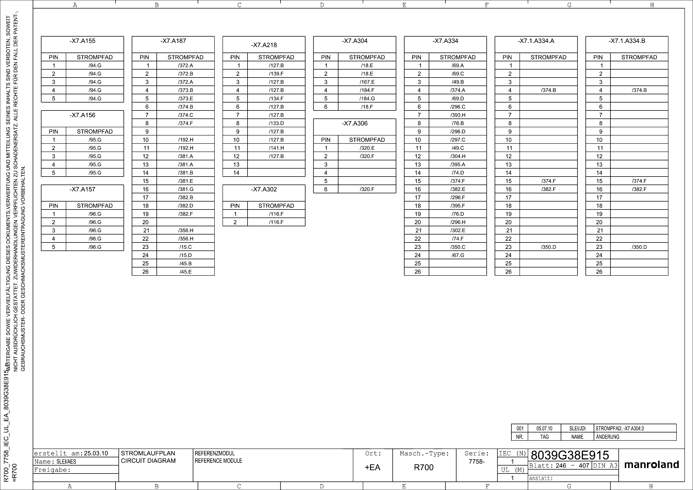

# +EA — Sheet 246 of 407 — REFERENZMODUL

**REFERENCE MODULE**

> Part of the manroland **R700** printing press IEC/UL circuit diagrams.
> Drawing class: **Stromlaufplan / Circuit diagram** (DIN A3).
> Document `+EA` covers the **Printing unit** machine section.

## At a glance

| Field | Value |
|---|---|
| Document | `+EA`  (8039G38E915) |
| Sheet | **246** of 407 |
| Section (DE) | REFERENZMODUL |
| Section (EN) | REFERENCE MODULE |
| Section type | REFERENCE_MODULE — Reference module |
| Machine type | `R700` |
| Series | `7758` |
| Created | 25.03.10 |
| Replaces | — |
| Columns used | A, B, C, D, E, F, G, H |
| Path numbers | — |
| Labels on sheet | 282 |
| Cross-refs out | 94 |
| Cross-refs in | 0 |

**Previous:** [+EA sheet 245](SHEET_0245.md) · **Next:** [+EA sheet 247](SHEET_0247.md) · **Document TOC:** [_TOC.md](_TOC.md)  (+EA) · **Master TOC:** [all sheets](../_MASTER_TOC.md)

## Sheet image (300 DPI, exact vector render)



_Rendered directly from the PDF vector layer at 300 DPI (1-bit), no OCR and no resampling. Use it to confirm anything ambiguous in the text below._

## Cross-references on this sheet

Each entry is a wire leaving this sheet. The printed token is `/sheet.column`; the link resolves to that sheet inside the same document.

| Ref | Target sheet | Col | Path | Destination on target | Target section | From col |
|---|---|---|---|---|---|---|
| `/18.E` | [+EA sheet 18](SHEET_0018.md) | E | — | — | SPANNUNGSVERSORGUNG: 400V, 24V | E |
| `/69.A` | [+EA sheet 69](SHEET_0069.md) | A | — | — | SCHMIERUNG | F |
| `/372.A` | [+EA sheet 372](SHEET_0372.md) | A | — | — | OPTION: ENDTROCKNER 1 VORBEREITUNG; | B |
| `/127.B` | [+EA sheet 127](SHEET_0127.md) | B | — | — | ZUGANGSABSICHERUNG | C |
| `/94.G` | [+EA sheet 94](SHEET_0094.md) | G | — | — | BLASRAHMEN | A |
| `/18.E` | [+EA sheet 18](SHEET_0018.md) | E | — | — | SPANNUNGSVERSORGUNG: 400V, 24V | E |
| `/372.B` | [+EA sheet 372](SHEET_0372.md) | B | — | — | OPTION: ENDTROCKNER 1 VORBEREITUNG; | B |
| `/94.G` | [+EA sheet 94](SHEET_0094.md) | G | — | — | BLASRAHMEN | A |
| `/139.F` | [+EA sheet 139](SHEET_0139.md) | F | — | — | ZUGANGSABSICHERUNG | C |
| `/69.C` | [+EA sheet 69](SHEET_0069.md) | C | — | — | SCHMIERUNG | F |
| `/49.B` | [+EA sheet 49](SHEET_0049.md) | B | — | — | SCHUTZ | F |
| `/94.G` | [+EA sheet 94](SHEET_0094.md) | G | — | — | BLASRAHMEN | A |
| `/372.A` | [+EA sheet 372](SHEET_0372.md) | A | — | — | OPTION: ENDTROCKNER 1 VORBEREITUNG; | B |
| `/127.B` | [+EA sheet 127](SHEET_0127.md) | B | — | — | ZUGANGSABSICHERUNG | C |
| `/167.E` | [+EA sheet 167](SHEET_0167.md) | E | — | — | BOGENFÜHRUNGSELEMENT (BLASROHRE) | E |
| `/94.G` | [+EA sheet 94](SHEET_0094.md) | G | — | — | BLASRAHMEN | A |
| `/373.B` | [+EA sheet 373](SHEET_0373.md) | B | — | — | OPTION: ENDTROCKNER 1 VORBEREITUNG; | B |
| `/127.B` | [+EA sheet 127](SHEET_0127.md) | B | — | — | ZUGANGSABSICHERUNG | C |
| `/374.A` | [+EA sheet 374](SHEET_0374.md) | A | — | — | OPTION: ENDTROCKNER 1 VORBEREITUNG; | F |
| `/374.B` | [+EA sheet 374](SHEET_0374.md) | B | — | — | OPTION: ENDTROCKNER 1 VORBEREITUNG; | G |
| `/374.B` | [+EA sheet 374](SHEET_0374.md) | B | — | — | OPTION: ENDTROCKNER 1 VORBEREITUNG; | H |
| `/184.F` | [+EA sheet 184](SHEET_0184.md) | F | — | — | RESERVE | E |
| `/373.E` | [+EA sheet 373](SHEET_0373.md) | E | — | — | OPTION: ENDTROCKNER 1 VORBEREITUNG; | B |
| `/94.G` | [+EA sheet 94](SHEET_0094.md) | G | — | — | BLASRAHMEN | A |
| `/134.F` | [+EA sheet 134](SHEET_0134.md) | F | — | — | ZUGANGSABSICHERUNG | C |
| `/184.G` | [+EA sheet 184](SHEET_0184.md) | G | — | — | RESERVE | E |
| `/69.D` | [+EA sheet 69](SHEET_0069.md) | D | — | — | SCHMIERUNG | F |
| `/374.B` | [+EA sheet 374](SHEET_0374.md) | B | — | — | OPTION: ENDTROCKNER 1 VORBEREITUNG; | B |
| `/127.B` | [+EA sheet 127](SHEET_0127.md) | B | — | — | ZUGANGSABSICHERUNG | C |
| `/18.F` | [+EA sheet 18](SHEET_0018.md) | F | — | — | SPANNUNGSVERSORGUNG: 400V, 24V | E |
| `/296.C` | [+EA sheet 296](SHEET_0296.md) | C | — | — | OPTION: ZWISCHENSTAPEL / | F |
| `/127.B` | [+EA sheet 127](SHEET_0127.md) | B | — | — | ZUGANGSABSICHERUNG | C |
| `/374.C` | [+EA sheet 374](SHEET_0374.md) | C | — | — | OPTION: ENDTROCKNER 1 VORBEREITUNG; | B |
| `/393.H` | [+EA sheet 393](SHEET_0393.md) | H | — | — | OPTION: ZWISCHENTROCKNER VORBEREITUNG; | F |
| `/76.B` | [+EA sheet 76](SHEET_0076.md) | B | — | — | AUSLEGERSTAPELSTEUERUNG | F |
| `/374.F` | [+EA sheet 374](SHEET_0374.md) | F | — | — | OPTION: ENDTROCKNER 1 VORBEREITUNG; | B |
| `/133.D` | [+EA sheet 133](SHEET_0133.md) | D | — | — | ZUGANGSABSICHERUNG | C |
| `/127.B` | [+EA sheet 127](SHEET_0127.md) | B | — | — | ZUGANGSABSICHERUNG | C |
| `/296.D` | [+EA sheet 296](SHEET_0296.md) | D | — | — | OPTION: ZWISCHENSTAPEL / | F |
| `/95.G` | [+EA sheet 95](SHEET_0095.md) | G | — | — | BLASRAHMEN | A |
| `/127.B` | [+EA sheet 127](SHEET_0127.md) | B | — | — | ZUGANGSABSICHERUNG | C |
| `/192.H` | [+EA sheet 192](SHEET_0192.md) | H | — | — | RESERVE | B |
| `/297.C` | [+EA sheet 297](SHEET_0297.md) | C | — | — | OPTION: ZWISCHENSTAPEL / | F |
| `/320.E` | [+EA sheet 320](SHEET_0320.md) | E | — | — | OPTION: VERLÄNGERUNG 3656,8MM | E |
| `/95.G` | [+EA sheet 95](SHEET_0095.md) | G | — | — | BLASRAHMEN | A |
| `/49.C` | [+EA sheet 49](SHEET_0049.md) | C | — | — | SCHUTZ | F |
| `/192.H` | [+EA sheet 192](SHEET_0192.md) | H | — | — | RESERVE | B |
| `/141.H` | [+EA sheet 141](SHEET_0141.md) | H | — | — | ZUGANGSABSICHERUNG | C |
| `/381.A` | [+EA sheet 381](SHEET_0381.md) | A | — | — | OPTION: ENDTROCKNER 2 VORBEREITUNG | B |
| `/127.B` | [+EA sheet 127](SHEET_0127.md) | B | — | — | ZUGANGSABSICHERUNG | C |
| `/95.G` | [+EA sheet 95](SHEET_0095.md) | G | — | — | BLASRAHMEN | A |
| `/320.F` | [+EA sheet 320](SHEET_0320.md) | F | — | — | OPTION: VERLÄNGERUNG 3656,8MM | E |
| `/304.H` | [+EA sheet 304](SHEET_0304.md) | H | — | — | OPTION: ZWISCHENSTAPEL / | F |
| `/95.G` | [+EA sheet 95](SHEET_0095.md) | G | — | — | BLASRAHMEN | A |
| `/381.A` | [+EA sheet 381](SHEET_0381.md) | A | — | — | OPTION: ENDTROCKNER 2 VORBEREITUNG | B |
| `/395.A` | [+EA sheet 395](SHEET_0395.md) | A | — | — | OPTION: ZWISCHENTROCKNER VORBEREITUNG; | F |
| `/381.B` | [+EA sheet 381](SHEET_0381.md) | B | — | — | OPTION: ENDTROCKNER 2 VORBEREITUNG | B |
| `/95.G` | [+EA sheet 95](SHEET_0095.md) | G | — | — | BLASRAHMEN | A |
| `/74.D` | [+EA sheet 74](SHEET_0074.md) | D | — | — | AUSLEGERSTAPELSTEUERUNG | F |
| `/381.E` | [+EA sheet 381](SHEET_0381.md) | E | — | — | OPTION: ENDTROCKNER 2 VORBEREITUNG | B |
| `/374.F` | [+EA sheet 374](SHEET_0374.md) | F | — | — | OPTION: ENDTROCKNER 1 VORBEREITUNG; | F |
| `/374.F` | [+EA sheet 374](SHEET_0374.md) | F | — | — | OPTION: ENDTROCKNER 1 VORBEREITUNG; | G |
| `/374.F` | [+EA sheet 374](SHEET_0374.md) | F | — | — | OPTION: ENDTROCKNER 1 VORBEREITUNG; | H |
| `/382.E` | [+EA sheet 382](SHEET_0382.md) | E | — | — | OPTION: ENDTROCKNER 2 VORBEREITUNG | F |
| `/381.G` | [+EA sheet 381](SHEET_0381.md) | G | — | — | OPTION: ENDTROCKNER 2 VORBEREITUNG | B |
| `/320.F` | [+EA sheet 320](SHEET_0320.md) | F | — | — | OPTION: VERLÄNGERUNG 3656,8MM | E |
| `/382.F` | [+EA sheet 382](SHEET_0382.md) | F | — | — | OPTION: ENDTROCKNER 2 VORBEREITUNG | G |
| `/382.F` | [+EA sheet 382](SHEET_0382.md) | F | — | — | OPTION: ENDTROCKNER 2 VORBEREITUNG | H |
| `/382.B` | [+EA sheet 382](SHEET_0382.md) | B | — | — | OPTION: ENDTROCKNER 2 VORBEREITUNG | B |
| `/296.F` | [+EA sheet 296](SHEET_0296.md) | F | — | — | OPTION: ZWISCHENSTAPEL / | F |
| `/395.F` | [+EA sheet 395](SHEET_0395.md) | F | — | — | OPTION: ZWISCHENTROCKNER VORBEREITUNG; | F |
| `/382.D` | [+EA sheet 382](SHEET_0382.md) | D | — | — | OPTION: ENDTROCKNER 2 VORBEREITUNG | B |
| `/96.G` | [+EA sheet 96](SHEET_0096.md) | G | — | — | BLASRAHMEN | A |
| `/382.F` | [+EA sheet 382](SHEET_0382.md) | F | — | — | OPTION: ENDTROCKNER 2 VORBEREITUNG | B |
| `/116.F` | [+EA sheet 116](SHEET_0116.md) | F | — | — | FORMATEINSTELLUNG: BOGENGERADESTOSSER | C |
| `/76.D` | [+EA sheet 76](SHEET_0076.md) | D | — | — | AUSLEGERSTAPELSTEUERUNG | F |
| `/96.G` | [+EA sheet 96](SHEET_0096.md) | G | — | — | BLASRAHMEN | A |
| `/116.F` | [+EA sheet 116](SHEET_0116.md) | F | — | — | FORMATEINSTELLUNG: BOGENGERADESTOSSER | C |
| `/296.H` | [+EA sheet 296](SHEET_0296.md) | H | — | — | OPTION: ZWISCHENSTAPEL / | F |
| `/302.E` | [+EA sheet 302](SHEET_0302.md) | E | — | — | OPTION: ZWISCHENSTAPEL / | F |
| `/96.G` | [+EA sheet 96](SHEET_0096.md) | G | — | — | BLASRAHMEN | A |
| `/356.H` | [+EA sheet 356](SHEET_0356.md) | H | — | — | OPTION: VORBEREITUNG: PUDERABSAUGUNG | B |
| `/74.F` | [+EA sheet 74](SHEET_0074.md) | F | — | — | AUSLEGERSTAPELSTEUERUNG | F |
| `/96.G` | [+EA sheet 96](SHEET_0096.md) | G | — | — | BLASRAHMEN | A |
| `/356.H` | [+EA sheet 356](SHEET_0356.md) | H | — | — | OPTION: VORBEREITUNG: PUDERABSAUGUNG | B |
| `/96.G` | [+EA sheet 96](SHEET_0096.md) | G | — | — | BLASRAHMEN | A |
| `/15.C` | [+EA sheet 15](SHEET_0015.md) | C | — | — | SPANNUNGSVERSORGUNG: 400V, 24V | B |
| `/350.C` | [+EA sheet 350](SHEET_0350.md) | C | — | — | OPTION: VORBEREITUNG: PUDERABSAUGUNG | F |
| `/350.D` | [+EA sheet 350](SHEET_0350.md) | D | — | — | OPTION: VORBEREITUNG: PUDERABSAUGUNG | G |
| `/350.D` | [+EA sheet 350](SHEET_0350.md) | D | — | — | OPTION: VORBEREITUNG: PUDERABSAUGUNG | H |
| `/67.G` | [+EA sheet 67](SHEET_0067.md) | G | — | — | LEITSTANDSFUNKTIONEN | F |
| `/15.D` | [+EA sheet 15](SHEET_0015.md) | D | — | — | SPANNUNGSVERSORGUNG: 400V, 24V | B |
| `/45.B` | [+EA sheet 45](SHEET_0045.md) | B | — | — | BUSVERBINDUNGEN: 20 mA SCHLEIFE | B |
| `/45.E` | [+EA sheet 45](SHEET_0045.md) | E | — | — | BUSVERBINDUNGEN: 20 mA SCHLEIFE | B |

## Devices on this sheet

| Tag | Class | Class meaning (IEC) | Col | Sub | Terminal | Sign |
|---|---|---|---|---|---|---|
| `X7.A155` | — | cross-device reference | A | — | — | — |
| `X7.A156` | — | cross-device reference | A | — | — | — |
| `X7.A157` | — | cross-device reference | A | — | — | — |
| `X7.A187` | — | cross-device reference | B | — | — | — |
| `X7.A218` | — | cross-device reference | C | — | — | — |
| `X7.A302` | — | cross-device reference | C | — | — | — |
| `X7.A334` | — | cross-device reference | F | — | — | — |
| `X7.A304` | — | cross-device reference | D | — | — | — |
| `X7.A306` | — | cross-device reference | D | — | — | — |
| `X7.1.A334.B` | — | cross-device reference | H | — | — | — |
| `X7.1.A334.A` | — | cross-device reference | G | — | — | — |
| `NR.` | — | cross-device reference | F | — | — | — |
| `05.07.10` | — | cross-device reference | G | — | — | — |

## Potentials / nets

_No named potentials on this sheet._

## Wire-end annotations (grouped as printed)

A wire that continues elsewhere is annotated with a small cluster: the destination description, the path/line number `#NN`, and the `/sheet.column` cross reference. Each row below is one such cluster exactly as it is grouped on the drawing.

| Col | Y | Path | Cross-ref | Text on the wire |
|---|---|---|---|---|
| A | 65.5 | — | — | `X7.A155` |
| B | 65.5 | — | — | `X7.A187` |
| D | 65.5 | — | — | `X7.A304` |
| F | 65.5 | — | — | `X7.A334` |
| G | 65.5 | — | — | `X7.1.A334.A` |
| H | 65.5 | — | — | `X7.1.A334.B` |
| C | 72.6 | — | — | `X7.A218` |
| A | 94.2 | — | — | `PIN 2 3 4 5 1 STROMPFAD` |
| B | 94.2 | — | — | `PIN STROMPFAD` |
| C | 94.2 | — | — | `PIN STROMPFAD` |
| D | 94.2 | — | — | `PIN 2 3 4 5 6 1 STROMPFAD` |
| E | 94.2 | — | — | `PIN STROMPFAD` |
| G | 94.2 | — | — | `PIN STROMPFAD` |
| H | 94.2 | — | — | `PIN STROMPFAD` |
| B | 108.4 | — | — | `2 3 4 5 6 7 8 9 1` |
| C | 108.4 | — | — | `2 3 4 5 6 7 8 9 1` |
| E | 108.4 | — | — | `2 3 4 5 6 7 8 9 1` |
| F | 108.4 | — | — | `2 3 4 5 6 7 8 9 1` |
| G | 108.4 | — | — | `2 3 4 5 6 7 8 9 1` |
| A | 108.7 | — | `/94.G` | — |
| B | 108.7 | — | `/372.A` | — |
| C | 108.7 | — | `/127.B` | — |
| E | 108.7 | — | `/18.E` | — |
| F | 108.7 | — | `/69.A` | — |
| E | 122.8 | — | `/18.E` | — |
| A | 122.9 | — | `/94.G` | — |
| B | 122.9 | — | `/372.B` | — |
| C | 122.9 | — | `/139.F` | — |
| F | 122.9 | — | `/69.C` | — |
| A | 137.0 | — | `/94.G` | — |
| B | 137.0 | — | `/372.A` | — |
| C | 137.0 | — | `/127.B` | — |
| E | 137.0 | — | `/167.E` | — |
| F | 137.0 | — | `/49.B` | — |
| A | 151.2 | — | `/94.G` | — |
| B | 151.2 | — | `/373.B` | — |
| C | 151.2 | — | `/127.B` | — |
| E | 151.2 | — | `/184.F` | — |
| F | 151.2 | — | `/374.A` | — |
| G | 151.2 | — | `/374.B` | — |
| H | 151.2 | — | `/374.B` | — |
| A | 165.4 | — | `/94.G` | — |
| B | 165.4 | — | `/373.E` | — |
| C | 165.4 | — | `/134.F` | — |
| E | 165.4 | — | `/184.G` | — |
| F | 165.4 | — | `/69.D` | — |
| B | 179.6 | — | `/374.B` | — |
| C | 179.6 | — | `/127.B` | — |
| E | 179.6 | — | `/18.F` | — |
| F | 179.6 | — | `/296.C` | — |
| A | 193.1 | — | — | `X7.A156` |
| C | 193.7 | — | `/127.B` | — |
| B | 193.8 | — | `/374.C` | — |
| F | 193.8 | — | `/393.H` | — |
| D | 207.2 | — | — | `X7.A306` |
| B | 207.9 | — | `/374.F` | — |
| C | 207.9 | — | `/133.D` | — |
| F | 207.9 | — | `/76.B` | — |
| A | 221.7 | — | — | `PIN 2 3 4 5 1 STROMPFAD` |
| C | 222.1 | — | `/127.B` | — |
| F | 222.1 | — | `/296.D` | — |
| B | 235.9 | — | — | `10 12 13 14 15 16 17 18 19 20 11` |
| C | 235.9 | — | — | `10 12 13 14 11` |
| D | 235.9 | — | — | `PIN 2 3 4 5 6 1 STROMPFAD` |
| E | 235.9 | — | — | `10 12 13 14 15 16 17 18 19 20 11` |
| F | 235.9 | — | — | `10 12 13 14 15 16 17 18 19 20 11` |
| G | 235.9 | — | — | `10 12 13 14 15 16 17 18 19 20 11` |
| A | 236.2 | — | `/95.G` | — |
| C | 236.2 | — | `/127.B` | — |
| B | 236.3 | — | `/192.H` | — |
| F | 236.3 | — | `/297.C` | — |
| A | 250.4 | — | `/95.G` | — |
| B | 250.4 | — | `/192.H` | — |
| C | 250.4 | — | `/141.H` | — |
| E | 250.4 | — | `/320.E` | — |
| F | 250.4 | — | `/49.C` | — |
| A | 264.6 | — | `/95.G` | — |
| B | 264.6 | — | `/381.A` | — |
| C | 264.6 | — | `/127.B` | — |
| E | 264.6 | — | `/320.F` | — |
| F | 264.6 | — | `/304.H` | — |
| A | 278.8 | — | `/95.G` | — |
| B | 278.8 | — | `/381.A` | — |
| F | 278.8 | — | `/395.A` | — |
| A | 292.9 | — | `/95.G` | — |
| B | 292.9 | — | `/381.B` | — |
| F | 293.0 | — | `/74.D` | — |
| B | 307.1 | — | `/381.E` | — |
| F | 307.1 | — | `/374.F` | — |
| G | 307.1 | — | `/374.F` | — |
| H | 307.1 | — | `/374.F` | — |
| A | 320.6 | — | — | `X7.A157` |
| C | 320.6 | — | — | `X7.A302` |
| B | 321.3 | — | `/381.G` | — |
| E | 321.3 | — | `/320.F` | — |
| F | 321.3 | — | `/382.E` | — |
| G | 321.3 | — | `/382.F` | — |
| H | 321.3 | — | `/382.F` | — |
| B | 335.5 | — | `/382.B` | — |
| F | 335.5 | — | `/296.F` | — |
| A | 349.3 | — | — | `PIN 2 3 4 5 1 STROMPFAD` |
| C | 349.3 | — | — | `PIN 2 1 STROMPFAD` |
| F | 349.6 | — | `/395.F` | — |
| B | 349.7 | — | `/382.D` | — |
| A | 363.8 | — | `/96.G` | — |
| B | 363.8 | — | `/382.F` | — |
| C | 363.8 | — | `/116.F` | — |
| F | 363.8 | — | `/76.D` | — |
| A | 378.0 | — | `/96.G` | — |
| C | 378.0 | — | `/116.F` | — |
| F | 378.0 | — | `/296.H` | — |
| B | 391.8 | — | — | `22 23 24 25 26 21` |
| E | 391.8 | — | — | `22 23 24 25 26 21` |
| F | 391.8 | — | — | `22 23 24 25 26 21` |
| G | 391.8 | — | — | `22 23 24 25 26 21` |
| F | 392.1 | — | `/302.E` | — |
| A | 392.2 | — | `/96.G` | — |
| B | 392.2 | — | `/356.H` | — |
| A | 406.3 | — | `/96.G` | — |
| F | 406.3 | — | `/74.F` | — |
| B | 406.4 | — | `/356.H` | — |
| A | 420.5 | — | `/96.G` | — |
| B | 420.5 | — | `/15.C` | — |
| F | 420.5 | — | `/350.C` | — |
| G | 420.5 | — | `/350.D` | — |
| H | 420.5 | — | `/350.D` | — |
| B | 434.7 | — | `/15.D` | — |
| F | 434.7 | — | `/67.G` | — |
| B | 448.8 | — | `/45.B` | — |
| B | 463.0 | — | `/45.E` | — |
| G | 733.0 | — | — | `001 05.07.10 SLEI/JDI STROMPFAD; X7.A304:3` |
| G | 747.1 | — | — | `NR. TAG NAME ÄNDERUNG` |


## Reconstructed tables

This sheet carries tabular content (pin map / terminal assignment / index). The grid below was rebuilt from the drawing's own rule lines, so each row is exactly one physical row of the table.

### Table 1 — 19 data rows × 2 columns (at x=70.9, y=62.4) — **X7.A155**

| PIN | STROMPFAD |
|---|---|
| `1` | `/94.G` |
| `2` | `/94.G` |
| `3` | `/94.G` |
| `4` | `/94.G` |
| `5` | `/94.G` |
|  | `X7.A156` |
| `PIN` | `STROMPFAD` |
| `1` | `/95.G` |
| `2` | `/95.G` |
| `3` | `/95.G` |
| `4` | `/95.G` |
| `5` | `/95.G` |
|  | `X7.A157` |
| `PIN` | `STROMPFAD` |
| `1` | `/96.G` |
| `2` | `/96.G` |
| `3` | `/96.G` |
| `4` | `/96.G` |
| `5` | `/96.G` |


### Table 2 — 26 data rows × 2 columns (at x=226.8, y=62.4) — **X7.A187**

| PIN | STROMPFAD |
|---|---|
| `1` | `/372.A` |
| `2` | `/372.B` |
| `3` | `/372.A` |
| `4` | `/373.B` |
| `5` | `/373.E` |
| `6` | `/374.B` |
| `7` | `/374.C` |
| `8` | `/374.F` |
| `9` |  |
| `10` | `/192.H` |
| `11` | `/192.H` |
| `12` | `/381.A` |
| `13` | `/381.A` |
| `14` | `/381.B` |
| `15` | `/381.E` |
| `16` | `/381.G` |
| `17` | `/382.B` |
| `18` | `/382.D` |
| `19` | `/382.F` |
| `20` |  |
| `21` | `/356.H` |
| `22` | `/356.H` |
| `23` | `/15.C` |
| `24` | `/15.D` |
| `25` | `/45.B` |
| `26` | `/45.E` |


### Table 3 — 18 data rows × 2 columns (at x=382.7, y=62.4) — **X7.A218**

| PIN | STROMPFAD |
|---|---|
| `1` | `/127.B` |
| `2` | `/139.F` |
| `3` | `/127.B` |
| `4` | `/127.B` |
| `5` | `/134.F` |
| `6` | `/127.B` |
| `7` | `/127.B` |
| `8` | `/133.D` |
| `9` | `/127.B` |
| `10` | `/127.B` |
| `11` | `/141.H` |
| `12` | `/127.B` |
| `13` |  |
| `14` |  |
|  | `X7.A302` |
| `PIN` | `STROMPFAD` |
| `1` | `/116.F` |
| `2` | `/116.F` |


### Table 4 — 14 data rows × 2 columns (at x=538.6, y=62.4) — **X7.A304**

| PIN | STROMPFAD |
|---|---|
| `1` | `/18.E` |
| `2` | `/18.E` |
| `3` | `/167.E` |
| `4` | `/184.F` |
| `5` | `/184.G` |
| `6` | `/18.F` |
|  | `X7.A306` |
| `PIN` | `STROMPFAD` |
| `1` | `/320.E` |
| `2` | `/320.F` |
| `3` |  |
| `4` |  |
| `5` |  |
| `6` | `/320.F` |


### Table 5 — 26 data rows × 2 columns (at x=694.5, y=62.4) — **X7.A334**

| PIN | STROMPFAD |
|---|---|
| `1` | `/69.A` |
| `2` | `/69.C` |
| `3` | `/49.B` |
| `4` | `/374.A` |
| `5` | `/69.D` |
| `6` | `/296.C` |
| `7` | `/393.H` |
| `8` | `/76.B` |
| `9` | `/296.D` |
| `10` | `/297.C` |
| `11` | `/49.C` |
| `12` | `/304.H` |
| `13` | `/395.A` |
| `14` | `/74.D` |
| `15` | `/374.F` |
| `16` | `/382.E` |
| `17` | `/296.F` |
| `18` | `/395.F` |
| `19` | `/76.D` |
| `20` | `/296.H` |
| `21` | `/302.E` |
| `22` | `/74.F` |
| `23` | `/350.C` |
| `24` | `/67.G` |
| `25` |  |
| `26` |  |


### Table 6 — 26 data rows × 2 columns (at x=850.4, y=62.4) — **X7.1.A334.A**

| PIN | STROMPFAD |
|---|---|
| `1` |  |
| `2` |  |
| `3` |  |
| `4` | `/374.B` |
| `5` |  |
| `6` |  |
| `7` |  |
| `8` |  |
| `9` |  |
| `10` |  |
| `11` |  |
| `12` |  |
| `13` |  |
| `14` |  |
| `15` | `/374.F` |
| `16` | `/382.F` |
| `17` |  |
| `18` |  |
| `19` |  |
| `20` |  |
| `21` |  |
| `22` |  |
| `23` | `/350.D` |
| `24` |  |
| `25` |  |
| `26` |  |


### Table 7 — 26 data rows × 2 columns (at x=1006.3, y=62.4) — **X7.1.A334.B**

| PIN | STROMPFAD |
|---|---|
| `1` |  |
| `2` |  |
| `3` |  |
| `4` | `/374.B` |
| `5` |  |
| `6` |  |
| `7` |  |
| `8` |  |
| `9` |  |
| `10` |  |
| `11` |  |
| `12` |  |
| `13` |  |
| `14` |  |
| `15` | `/374.F` |
| `16` | `/382.F` |
| `17` |  |
| `18` |  |
| `19` |  |
| `20` |  |
| `21` |  |
| `22` |  |
| `23` | `/350.D` |
| `24` |  |
| `25` |  |
| `26` |  |


## Notes and free text on this sheet

| Text | Col | Y (pt) |
|---|---|---|
| `PIN` | A | 94.2 |
| `STROMPFAD` | A | 94.15 |
| `PIN` | B | 94.2 |
| `STROMPFAD` | B | 94.15 |
| `PIN` | C | 94.2 |
| `STROMPFAD` | C | 94.15 |
| `PIN` | E | 94.2 |
| `STROMPFAD` | F | 94.15 |
| `PIN` | D | 94.2 |
| `STROMPFAD` | E | 94.15 |
| `PIN` | G | 94.2 |
| `STROMPFAD` | H | 94.15 |
| `PIN` | F | 94.2 |
| `STROMPFAD` | G | 94.15 |
| `TAG` | G | 747.27 |
| `NAME` | G | 747.25 |
| `ÄNDERUNG` | G | 747.31 |
| `SLEI/JDI` | G | 733.11 |
| `STROMPFAD; X7.A304:3` | H | 733.13 |

## Complete label inventory (exact text from the drawing)

Every text object inside the drawing area of this sheet, in DIN reading order (column A→H, then top→bottom). This is the authoritative list: if a string is not here it is not printed on this sheet.

| Col | Y | X | Dir | Type | Text |
|---|---|---|---|---|---|
| A | 65.5 | 119.8 | → | device ref | `X7.A155` |
| A | 94.2 | 84.0 | → | text | `PIN` |
| A | 94.2 | 132.2 | → | text | `STROMPFAD` |
| A | 108.4 | 90.0 | → | number | `1` |
| A | 108.7 | 152.5 | → | cross-reference | `/94.G` |
| A | 122.5 | 89.4 | → | number | `2` |
| A | 122.9 | 152.5 | → | cross-reference | `/94.G` |
| A | 136.7 | 89.4 | → | number | `3` |
| A | 137.0 | 152.5 | → | cross-reference | `/94.G` |
| A | 150.9 | 89.4 | → | number | `4` |
| A | 151.2 | 152.5 | → | cross-reference | `/94.G` |
| A | 165.1 | 89.4 | → | number | `5` |
| A | 165.4 | 152.5 | → | cross-reference | `/94.G` |
| A | 193.1 | 119.8 | → | device ref | `X7.A156` |
| A | 221.7 | 132.2 | → | text | `STROMPFAD` |
| A | 221.8 | 84.0 | → | text | `PIN` |
| A | 235.9 | 90.0 | → | number | `1` |
| A | 236.3 | 152.5 | → | cross-reference | `/95.G` |
| A | 250.1 | 89.4 | → | number | `2` |
| A | 250.4 | 152.5 | → | cross-reference | `/95.G` |
| A | 264.3 | 89.4 | → | number | `3` |
| A | 264.6 | 152.5 | → | cross-reference | `/95.G` |
| A | 278.5 | 89.4 | → | number | `4` |
| A | 278.8 | 152.5 | → | cross-reference | `/95.G` |
| A | 292.6 | 89.4 | → | number | `5` |
| A | 292.9 | 152.5 | → | cross-reference | `/95.G` |
| A | 320.6 | 119.8 | → | device ref | `X7.A157` |
| A | 349.3 | 84.0 | → | text | `PIN` |
| A | 349.3 | 132.2 | → | text | `STROMPFAD` |
| A | 363.5 | 90.0 | → | number | `1` |
| A | 363.8 | 152.5 | → | cross-reference | `/96.G` |
| A | 377.7 | 89.4 | → | number | `2` |
| A | 378.0 | 152.5 | → | cross-reference | `/96.G` |
| A | 391.8 | 89.4 | → | number | `3` |
| A | 392.2 | 152.5 | → | cross-reference | `/96.G` |
| A | 406.0 | 89.4 | → | number | `4` |
| A | 406.3 | 152.5 | → | cross-reference | `/96.G` |
| A | 420.2 | 89.4 | → | number | `5` |
| A | 420.5 | 152.5 | → | cross-reference | `/96.G` |
| B | 65.5 | 275.7 | → | device ref | `X7.A187` |
| B | 94.2 | 240.0 | → | text | `PIN` |
| B | 94.2 | 288.1 | → | text | `STROMPFAD` |
| B | 108.4 | 251.7 | → | number | `1` |
| B | 108.7 | 306.1 | → | cross-reference | `/372.A` |
| B | 122.5 | 250.0 | → | number | `2` |
| B | 122.9 | 306.3 | → | cross-reference | `/372.B` |
| B | 136.7 | 250.0 | → | number | `3` |
| B | 137.0 | 306.1 | → | cross-reference | `/372.A` |
| B | 150.9 | 250.0 | → | number | `4` |
| B | 151.2 | 306.3 | → | cross-reference | `/373.B` |
| B | 165.1 | 250.0 | → | number | `5` |
| B | 165.4 | 306.4 | → | cross-reference | `/373.E` |
| B | 179.2 | 250.0 | → | number | `6` |
| B | 179.6 | 306.3 | → | cross-reference | `/374.B` |
| B | 193.4 | 250.0 | → | number | `7` |
| B | 193.8 | 306.1 | → | cross-reference | `/374.C` |
| B | 207.6 | 250.0 | → | number | `8` |
| B | 207.9 | 306.6 | → | cross-reference | `/374.F` |
| B | 221.8 | 250.0 | → | number | `9` |
| B | 235.9 | 244.6 | → | number | `10` |
| B | 236.3 | 306.4 | → | cross-reference | `/192.H` |
| B | 250.1 | 246.3 | → | number | `11` |
| B | 250.4 | 306.4 | → | cross-reference | `/192.H` |
| B | 264.3 | 244.6 | → | number | `12` |
| B | 264.6 | 306.1 | → | cross-reference | `/381.A` |
| B | 278.5 | 244.6 | → | number | `13` |
| B | 278.8 | 306.1 | → | cross-reference | `/381.A` |
| B | 292.6 | 244.6 | → | number | `14` |
| B | 292.9 | 306.3 | → | cross-reference | `/381.B` |
| B | 306.8 | 244.6 | → | number | `15` |
| B | 307.1 | 306.4 | → | cross-reference | `/381.E` |
| B | 321.0 | 244.6 | → | number | `16` |
| B | 321.3 | 306.0 | → | cross-reference | `/381.G` |
| B | 335.1 | 244.6 | → | number | `17` |
| B | 335.5 | 306.3 | → | cross-reference | `/382.B` |
| B | 349.3 | 244.6 | → | number | `18` |
| B | 349.7 | 306.1 | → | cross-reference | `/382.D` |
| B | 363.5 | 244.6 | → | number | `19` |
| B | 363.8 | 306.6 | → | cross-reference | `/382.F` |
| B | 377.7 | 244.6 | → | number | `20` |
| B | 391.8 | 246.3 | → | number | `21` |
| B | 392.2 | 306.4 | → | cross-reference | `/356.H` |
| B | 406.0 | 244.6 | → | number | `22` |
| B | 406.4 | 306.4 | → | cross-reference | `/356.H` |
| B | 420.2 | 244.6 | → | number | `23` |
| B | 420.5 | 308.6 | → | cross-reference | `/15.C` |
| B | 434.4 | 244.6 | → | number | `24` |
| B | 434.7 | 308.6 | → | cross-reference | `/15.D` |
| B | 448.5 | 244.6 | → | number | `25` |
| B | 448.8 | 308.7 | → | cross-reference | `/45.B` |
| B | 462.7 | 244.6 | → | number | `26` |
| B | 463.0 | 308.8 | → | cross-reference | `/45.E` |
| C | 72.6 | 431.6 | → | device ref | `X7.A218` |
| C | 94.2 | 395.9 | → | text | `PIN` |
| C | 94.2 | 444.0 | → | text | `STROMPFAD` |
| C | 108.4 | 407.6 | → | number | `1` |
| C | 108.7 | 462.2 | → | cross-reference | `/127.B` |
| C | 122.5 | 405.9 | → | number | `2` |
| C | 122.9 | 462.5 | → | cross-reference | `/139.F` |
| C | 136.7 | 405.9 | → | number | `3` |
| C | 137.0 | 462.2 | → | cross-reference | `/127.B` |
| C | 150.9 | 405.9 | → | number | `4` |
| C | 151.2 | 462.2 | → | cross-reference | `/127.B` |
| C | 165.1 | 405.9 | → | number | `5` |
| C | 165.4 | 462.5 | → | cross-reference | `/134.F` |
| C | 179.2 | 405.9 | → | number | `6` |
| C | 179.6 | 462.2 | → | cross-reference | `/127.B` |
| C | 193.4 | 405.9 | → | number | `7` |
| C | 193.7 | 462.2 | → | cross-reference | `/127.B` |
| C | 207.6 | 405.9 | → | number | `8` |
| C | 207.9 | 462.0 | → | cross-reference | `/133.D` |
| C | 221.8 | 405.9 | → | number | `9` |
| C | 222.1 | 462.2 | → | cross-reference | `/127.B` |
| C | 235.9 | 400.5 | → | number | `10` |
| C | 236.2 | 462.2 | → | cross-reference | `/127.B` |
| C | 250.1 | 402.2 | → | number | `11` |
| C | 250.4 | 462.3 | → | cross-reference | `/141.H` |
| C | 264.3 | 400.5 | → | number | `12` |
| C | 264.6 | 462.2 | → | cross-reference | `/127.B` |
| C | 278.5 | 400.5 | → | number | `13` |
| C | 292.6 | 400.5 | → | number | `14` |
| C | 320.6 | 431.6 | → | device ref | `X7.A302` |
| C | 349.3 | 395.9 | → | text | `PIN` |
| C | 349.3 | 444.0 | → | text | `STROMPFAD` |
| C | 363.5 | 401.8 | → | number | `1` |
| C | 363.8 | 462.5 | → | cross-reference | `/116.F` |
| C | 377.7 | 401.2 | → | number | `2` |
| C | 378.0 | 462.5 | → | cross-reference | `/116.F` |
| D | 65.5 | 587.5 | → | device ref | `X7.A304` |
| D | 94.2 | 551.8 | → | text | `PIN` |
| D | 108.4 | 557.7 | → | number | `1` |
| D | 122.5 | 557.1 | → | number | `2` |
| D | 136.7 | 557.1 | → | number | `3` |
| D | 150.9 | 557.1 | → | number | `4` |
| D | 165.1 | 557.1 | → | number | `5` |
| D | 179.2 | 557.1 | → | number | `6` |
| D | 207.2 | 587.5 | → | device ref | `X7.A306` |
| D | 235.9 | 551.8 | → | text | `PIN` |
| D | 250.1 | 557.7 | → | number | `1` |
| D | 264.3 | 557.1 | → | number | `2` |
| D | 278.5 | 557.1 | → | number | `3` |
| D | 292.6 | 557.1 | → | number | `4` |
| D | 306.8 | 557.1 | → | number | `5` |
| D | 321.0 | 557.1 | → | number | `6` |
| E | 94.2 | 600.0 | → | text | `STROMPFAD` |
| E | 94.2 | 707.7 | → | text | `PIN` |
| E | 108.4 | 719.4 | → | number | `1` |
| E | 108.7 | 620.6 | → | cross-reference | `/18.E` |
| E | 122.5 | 717.7 | → | number | `2` |
| E | 122.8 | 620.6 | → | cross-reference | `/18.E` |
| E | 136.7 | 717.7 | → | number | `3` |
| E | 137.0 | 618.2 | → | cross-reference | `/167.E` |
| E | 150.9 | 717.7 | → | number | `4` |
| E | 151.2 | 618.4 | → | cross-reference | `/184.F` |
| E | 165.1 | 717.7 | → | number | `5` |
| E | 165.4 | 617.8 | → | cross-reference | `/184.G` |
| E | 179.2 | 717.7 | → | number | `6` |
| E | 179.6 | 620.8 | → | cross-reference | `/18.F` |
| E | 193.4 | 717.7 | → | number | `7` |
| E | 207.6 | 717.7 | → | number | `8` |
| E | 221.8 | 717.7 | → | number | `9` |
| E | 235.9 | 600.0 | → | text | `STROMPFAD` |
| E | 235.9 | 712.3 | → | number | `10` |
| E | 250.1 | 714.0 | → | number | `11` |
| E | 250.4 | 618.2 | → | cross-reference | `/320.E` |
| E | 264.3 | 712.3 | → | number | `12` |
| E | 264.6 | 618.4 | → | cross-reference | `/320.F` |
| E | 278.5 | 712.3 | → | number | `13` |
| E | 292.6 | 712.3 | → | number | `14` |
| E | 306.8 | 712.3 | → | number | `15` |
| E | 321.0 | 712.3 | → | number | `16` |
| E | 321.3 | 618.4 | → | cross-reference | `/320.F` |
| E | 335.1 | 712.3 | → | number | `17` |
| E | 349.3 | 712.3 | → | number | `18` |
| E | 363.5 | 712.3 | → | number | `19` |
| E | 377.7 | 712.3 | → | number | `20` |
| E | 391.8 | 714.0 | → | number | `21` |
| E | 406.0 | 712.3 | → | number | `22` |
| E | 420.2 | 712.3 | → | number | `23` |
| E | 434.4 | 712.3 | → | number | `24` |
| E | 448.5 | 712.3 | → | number | `25` |
| E | 462.7 | 712.3 | → | number | `26` |
| F | 65.5 | 743.4 | → | device ref | `X7.A334` |
| F | 94.2 | 755.9 | → | text | `STROMPFAD` |
| F | 94.2 | 863.6 | → | text | `PIN` |
| F | 108.4 | 875.3 | → | number | `1` |
| F | 108.7 | 776.3 | → | cross-reference | `/69.A` |
| F | 122.5 | 873.6 | → | number | `2` |
| F | 122.9 | 776.3 | → | cross-reference | `/69.C` |
| F | 136.7 | 873.6 | → | number | `3` |
| F | 137.0 | 776.4 | → | cross-reference | `/49.B` |
| F | 150.9 | 873.6 | → | number | `4` |
| F | 151.2 | 773.9 | → | cross-reference | `/374.A` |
| F | 165.1 | 873.6 | → | number | `5` |
| F | 165.4 | 776.3 | → | cross-reference | `/69.D` |
| F | 179.2 | 873.6 | → | number | `6` |
| F | 179.6 | 773.9 | → | cross-reference | `/296.C` |
| F | 193.4 | 873.6 | → | number | `7` |
| F | 193.8 | 774.1 | → | cross-reference | `/393.H` |
| F | 207.6 | 873.6 | → | number | `8` |
| F | 207.9 | 776.4 | → | cross-reference | `/76.B` |
| F | 221.8 | 873.6 | → | number | `9` |
| F | 222.1 | 773.9 | → | cross-reference | `/296.D` |
| F | 235.9 | 868.3 | → | number | `10` |
| F | 236.3 | 773.9 | → | cross-reference | `/297.C` |
| F | 250.1 | 870.0 | → | number | `11` |
| F | 250.4 | 776.3 | → | cross-reference | `/49.C` |
| F | 264.3 | 868.3 | → | number | `12` |
| F | 264.6 | 774.1 | → | cross-reference | `/304.H` |
| F | 278.5 | 868.3 | → | number | `13` |
| F | 278.8 | 773.9 | → | cross-reference | `/395.A` |
| F | 292.6 | 868.3 | → | number | `14` |
| F | 293.0 | 776.3 | → | cross-reference | `/74.D` |
| F | 306.8 | 868.3 | → | number | `15` |
| F | 307.1 | 774.3 | → | cross-reference | `/374.F` |
| F | 321.0 | 868.3 | → | number | `16` |
| F | 321.3 | 774.1 | → | cross-reference | `/382.E` |
| F | 335.1 | 868.3 | → | number | `17` |
| F | 335.5 | 774.3 | → | cross-reference | `/296.F` |
| F | 349.3 | 868.3 | → | number | `18` |
| F | 349.6 | 774.3 | → | cross-reference | `/395.F` |
| F | 363.5 | 868.3 | → | number | `19` |
| F | 363.8 | 776.3 | → | cross-reference | `/76.D` |
| F | 377.7 | 868.3 | → | number | `20` |
| F | 378.0 | 774.1 | → | cross-reference | `/296.H` |
| F | 391.8 | 870.0 | → | number | `21` |
| F | 392.2 | 774.1 | → | cross-reference | `/302.E` |
| F | 406.0 | 868.3 | → | number | `22` |
| F | 406.3 | 776.7 | → | cross-reference | `/74.F` |
| F | 420.2 | 868.3 | → | number | `23` |
| F | 420.5 | 773.9 | → | cross-reference | `/350.C` |
| F | 434.4 | 868.3 | → | number | `24` |
| F | 434.7 | 776.1 | → | cross-reference | `/67.G` |
| F | 448.5 | 868.3 | → | number | `25` |
| F | 462.7 | 868.3 | → | number | `26` |
| F | 733.0 | 887.7 | → | number | `001` |
| F | 747.1 | 886.7 | → | device ref | `NR.` |
| G | 65.5 | 889.5 | → | device ref | `X7.1.A334.A` |
| G | 94.2 | 911.8 | → | text | `STROMPFAD` |
| G | 94.2 | 1019.5 | → | text | `PIN` |
| G | 108.4 | 1031.2 | → | number | `1` |
| G | 122.5 | 1029.5 | → | number | `2` |
| G | 136.7 | 1029.5 | → | number | `3` |
| G | 150.9 | 1029.5 | → | number | `4` |
| G | 151.2 | 929.9 | → | cross-reference | `/374.B` |
| G | 165.1 | 1029.5 | → | number | `5` |
| G | 179.2 | 1029.5 | → | number | `6` |
| G | 193.4 | 1029.5 | → | number | `7` |
| G | 207.6 | 1029.5 | → | number | `8` |
| G | 221.8 | 1029.5 | → | number | `9` |
| G | 235.9 | 1024.2 | → | number | `10` |
| G | 250.1 | 1025.9 | → | number | `11` |
| G | 264.3 | 1024.2 | → | number | `12` |
| G | 278.5 | 1024.2 | → | number | `13` |
| G | 292.6 | 1024.2 | → | number | `14` |
| G | 306.8 | 1024.2 | → | number | `15` |
| G | 307.1 | 930.2 | → | cross-reference | `/374.F` |
| G | 321.0 | 1024.2 | → | number | `16` |
| G | 321.3 | 930.2 | → | cross-reference | `/382.F` |
| G | 335.1 | 1024.2 | → | number | `17` |
| G | 349.3 | 1024.2 | → | number | `18` |
| G | 363.5 | 1024.2 | → | number | `19` |
| G | 377.7 | 1024.2 | → | number | `20` |
| G | 391.8 | 1025.9 | → | number | `21` |
| G | 406.0 | 1024.2 | → | number | `22` |
| G | 420.2 | 1024.2 | → | number | `23` |
| G | 420.5 | 929.8 | → | cross-reference | `/350.D` |
| G | 434.4 | 1024.2 | → | number | `24` |
| G | 448.5 | 1024.2 | → | number | `25` |
| G | 462.7 | 1024.2 | → | number | `26` |
| G | 733.1 | 921.9 | → | device ref | `05.07.10` |
| G | 733.1 | 978.4 | → | text | `SLEI/JDI` |
| G | 747.3 | 928.3 | → | text | `TAG` |
| G | 747.3 | 981.7 | → | text | `NAME` |
| G | 747.3 | 1024.3 | → | text | `ÄNDERUNG` |
| H | 65.5 | 1045.8 | → | device ref | `X7.1.A334.B` |
| H | 94.2 | 1067.7 | → | text | `STROMPFAD` |
| H | 151.2 | 1085.8 | → | cross-reference | `/374.B` |
| H | 307.1 | 1086.1 | → | cross-reference | `/374.F` |
| H | 321.3 | 1086.1 | → | cross-reference | `/382.F` |
| H | 420.5 | 1085.7 | → | cross-reference | `/350.D` |
| H | 733.1 | 1023.4 | → | text | `STROMPFAD; X7.A304:3` |

## Reading-order text block

The same content as a plain block, grouped by DIN column — convenient to paste or to match against a visual description.

```text
=== Column A ===
  65.5  119.8  devref       X7.A155
  94.2   84.0  text         PIN
  94.2  132.2  text         STROMPFAD
 108.4   90.0  numeric      1
 108.7  152.5  xref         /94.G
 122.5   89.4  numeric      2
 122.9  152.5  xref         /94.G
 136.7   89.4  numeric      3
 137.0  152.5  xref         /94.G
 150.9   89.4  numeric      4
 151.2  152.5  xref         /94.G
 165.1   89.4  numeric      5
 165.4  152.5  xref         /94.G
 193.1  119.8  devref       X7.A156
 221.7  132.2  text         STROMPFAD
 221.8   84.0  text         PIN
 235.9   90.0  numeric      1
 236.3  152.5  xref         /95.G
 250.1   89.4  numeric      2
 250.4  152.5  xref         /95.G
 264.3   89.4  numeric      3
 264.6  152.5  xref         /95.G
 278.5   89.4  numeric      4
 278.8  152.5  xref         /95.G
 292.6   89.4  numeric      5
 292.9  152.5  xref         /95.G
 320.6  119.8  devref       X7.A157
 349.3   84.0  text         PIN
 349.3  132.2  text         STROMPFAD
 363.5   90.0  numeric      1
 363.8  152.5  xref         /96.G
 377.7   89.4  numeric      2
 378.0  152.5  xref         /96.G
 391.8   89.4  numeric      3
 392.2  152.5  xref         /96.G
 406.0   89.4  numeric      4
 406.3  152.5  xref         /96.G
 420.2   89.4  numeric      5
 420.5  152.5  xref         /96.G
=== Column B ===
  65.5  275.7  devref       X7.A187
  94.2  240.0  text         PIN
  94.2  288.1  text         STROMPFAD
 108.4  251.7  numeric      1
 108.7  306.1  xref         /372.A
 122.5  250.0  numeric      2
 122.9  306.3  xref         /372.B
 136.7  250.0  numeric      3
 137.0  306.1  xref         /372.A
 150.9  250.0  numeric      4
 151.2  306.3  xref         /373.B
 165.1  250.0  numeric      5
 165.4  306.4  xref         /373.E
 179.2  250.0  numeric      6
 179.6  306.3  xref         /374.B
 193.4  250.0  numeric      7
 193.8  306.1  xref         /374.C
 207.6  250.0  numeric      8
 207.9  306.6  xref         /374.F
 221.8  250.0  numeric      9
 235.9  244.6  numeric      10
 236.3  306.4  xref         /192.H
 250.1  246.3  numeric      11
 250.4  306.4  xref         /192.H
 264.3  244.6  numeric      12
 264.6  306.1  xref         /381.A
 278.5  244.6  numeric      13
 278.8  306.1  xref         /381.A
 292.6  244.6  numeric      14
 292.9  306.3  xref         /381.B
 306.8  244.6  numeric      15
 307.1  306.4  xref         /381.E
 321.0  244.6  numeric      16
 321.3  306.0  xref         /381.G
 335.1  244.6  numeric      17
 335.5  306.3  xref         /382.B
 349.3  244.6  numeric      18
 349.7  306.1  xref         /382.D
 363.5  244.6  numeric      19
 363.8  306.6  xref         /382.F
 377.7  244.6  numeric      20
 391.8  246.3  numeric      21
 392.2  306.4  xref         /356.H
 406.0  244.6  numeric      22
 406.4  306.4  xref         /356.H
 420.2  244.6  numeric      23
 420.5  308.6  xref         /15.C
 434.4  244.6  numeric      24
 434.7  308.6  xref         /15.D
 448.5  244.6  numeric      25
 448.8  308.7  xref         /45.B
 462.7  244.6  numeric      26
 463.0  308.8  xref         /45.E
=== Column C ===
  72.6  431.6  devref       X7.A218
  94.2  395.9  text         PIN
  94.2  444.0  text         STROMPFAD
 108.4  407.6  numeric      1
 108.7  462.2  xref         /127.B
 122.5  405.9  numeric      2
 122.9  462.5  xref         /139.F
 136.7  405.9  numeric      3
 137.0  462.2  xref         /127.B
 150.9  405.9  numeric      4
 151.2  462.2  xref         /127.B
 165.1  405.9  numeric      5
 165.4  462.5  xref         /134.F
 179.2  405.9  numeric      6
 179.6  462.2  xref         /127.B
 193.4  405.9  numeric      7
 193.7  462.2  xref         /127.B
 207.6  405.9  numeric      8
 207.9  462.0  xref         /133.D
 221.8  405.9  numeric      9
 222.1  462.2  xref         /127.B
 235.9  400.5  numeric      10
 236.2  462.2  xref         /127.B
 250.1  402.2  numeric      11
 250.4  462.3  xref         /141.H
 264.3  400.5  numeric      12
 264.6  462.2  xref         /127.B
 278.5  400.5  numeric      13
 292.6  400.5  numeric      14
 320.6  431.6  devref       X7.A302
 349.3  395.9  text         PIN
 349.3  444.0  text         STROMPFAD
 363.5  401.8  numeric      1
 363.8  462.5  xref         /116.F
 377.7  401.2  numeric      2
 378.0  462.5  xref         /116.F
=== Column D ===
  65.5  587.5  devref       X7.A304
  94.2  551.8  text         PIN
 108.4  557.7  numeric      1
 122.5  557.1  numeric      2
 136.7  557.1  numeric      3
 150.9  557.1  numeric      4
 165.1  557.1  numeric      5
 179.2  557.1  numeric      6
 207.2  587.5  devref       X7.A306
 235.9  551.8  text         PIN
 250.1  557.7  numeric      1
 264.3  557.1  numeric      2
 278.5  557.1  numeric      3
 292.6  557.1  numeric      4
 306.8  557.1  numeric      5
 321.0  557.1  numeric      6
=== Column E ===
  94.2  600.0  text         STROMPFAD
  94.2  707.7  text         PIN
 108.4  719.4  numeric      1
 108.7  620.6  xref         /18.E
 122.5  717.7  numeric      2
 122.8  620.6  xref         /18.E
 136.7  717.7  numeric      3
 137.0  618.2  xref         /167.E
 150.9  717.7  numeric      4
 151.2  618.4  xref         /184.F
 165.1  717.7  numeric      5
 165.4  617.8  xref         /184.G
 179.2  717.7  numeric      6
 179.6  620.8  xref         /18.F
 193.4  717.7  numeric      7
 207.6  717.7  numeric      8
 221.8  717.7  numeric      9
 235.9  600.0  text         STROMPFAD
 235.9  712.3  numeric      10
 250.1  714.0  numeric      11
 250.4  618.2  xref         /320.E
 264.3  712.3  numeric      12
 264.6  618.4  xref         /320.F
 278.5  712.3  numeric      13
 292.6  712.3  numeric      14
 306.8  712.3  numeric      15
 321.0  712.3  numeric      16
 321.3  618.4  xref         /320.F
 335.1  712.3  numeric      17
 349.3  712.3  numeric      18
 363.5  712.3  numeric      19
 377.7  712.3  numeric      20
 391.8  714.0  numeric      21
 406.0  712.3  numeric      22
 420.2  712.3  numeric      23
 434.4  712.3  numeric      24
 448.5  712.3  numeric      25
 462.7  712.3  numeric      26
=== Column F ===
  65.5  743.4  devref       X7.A334
  94.2  755.9  text         STROMPFAD
  94.2  863.6  text         PIN
 108.4  875.3  numeric      1
 108.7  776.3  xref         /69.A
 122.5  873.6  numeric      2
 122.9  776.3  xref         /69.C
 136.7  873.6  numeric      3
 137.0  776.4  xref         /49.B
 150.9  873.6  numeric      4
 151.2  773.9  xref         /374.A
 165.1  873.6  numeric      5
 165.4  776.3  xref         /69.D
 179.2  873.6  numeric      6
 179.6  773.9  xref         /296.C
 193.4  873.6  numeric      7
 193.8  774.1  xref         /393.H
 207.6  873.6  numeric      8
 207.9  776.4  xref         /76.B
 221.8  873.6  numeric      9
 222.1  773.9  xref         /296.D
 235.9  868.3  numeric      10
 236.3  773.9  xref         /297.C
 250.1  870.0  numeric      11
 250.4  776.3  xref         /49.C
 264.3  868.3  numeric      12
 264.6  774.1  xref         /304.H
 278.5  868.3  numeric      13
 278.8  773.9  xref         /395.A
 292.6  868.3  numeric      14
 293.0  776.3  xref         /74.D
 306.8  868.3  numeric      15
 307.1  774.3  xref         /374.F
 321.0  868.3  numeric      16
 321.3  774.1  xref         /382.E
 335.1  868.3  numeric      17
 335.5  774.3  xref         /296.F
 349.3  868.3  numeric      18
 349.6  774.3  xref         /395.F
 363.5  868.3  numeric      19
 363.8  776.3  xref         /76.D
 377.7  868.3  numeric      20
 378.0  774.1  xref         /296.H
 391.8  870.0  numeric      21
 392.2  774.1  xref         /302.E
 406.0  868.3  numeric      22
 406.3  776.7  xref         /74.F
 420.2  868.3  numeric      23
 420.5  773.9  xref         /350.C
 434.4  868.3  numeric      24
 434.7  776.1  xref         /67.G
 448.5  868.3  numeric      25
 462.7  868.3  numeric      26
 733.0  887.7  numeric      001
 747.1  886.7  devref       NR.
=== Column G ===
  65.5  889.5  devref       X7.1.A334.A
  94.2  911.8  text         STROMPFAD
  94.2 1019.5  text         PIN
 108.4 1031.2  numeric      1
 122.5 1029.5  numeric      2
 136.7 1029.5  numeric      3
 150.9 1029.5  numeric      4
 151.2  929.9  xref         /374.B
 165.1 1029.5  numeric      5
 179.2 1029.5  numeric      6
 193.4 1029.5  numeric      7
 207.6 1029.5  numeric      8
 221.8 1029.5  numeric      9
 235.9 1024.2  numeric      10
 250.1 1025.9  numeric      11
 264.3 1024.2  numeric      12
 278.5 1024.2  numeric      13
 292.6 1024.2  numeric      14
 306.8 1024.2  numeric      15
 307.1  930.2  xref         /374.F
 321.0 1024.2  numeric      16
 321.3  930.2  xref         /382.F
 335.1 1024.2  numeric      17
 349.3 1024.2  numeric      18
 363.5 1024.2  numeric      19
 377.7 1024.2  numeric      20
 391.8 1025.9  numeric      21
 406.0 1024.2  numeric      22
 420.2 1024.2  numeric      23
 420.5  929.8  xref         /350.D
 434.4 1024.2  numeric      24
 448.5 1024.2  numeric      25
 462.7 1024.2  numeric      26
 733.1  921.9  devref       05.07.10
 733.1  978.4  text         SLEI/JDI
 747.3  928.3  text         TAG
 747.3  981.7  text         NAME
 747.3 1024.3  text         ÄNDERUNG
=== Column H ===
  65.5 1045.8  devref       X7.1.A334.B
  94.2 1067.7  text         STROMPFAD
 151.2 1085.8  xref         /374.B
 307.1 1086.1  xref         /374.F
 321.3 1086.1  xref         /382.F
 420.5 1085.7  xref         /350.D
 733.1 1023.4  text         STROMPFAD; X7.A304:3
```

---
_Generated from the PDF vector text layer; no OCR. Source: `R700_7758_IEC_UL_EA_8039G38E915_p`, sheet 246._
