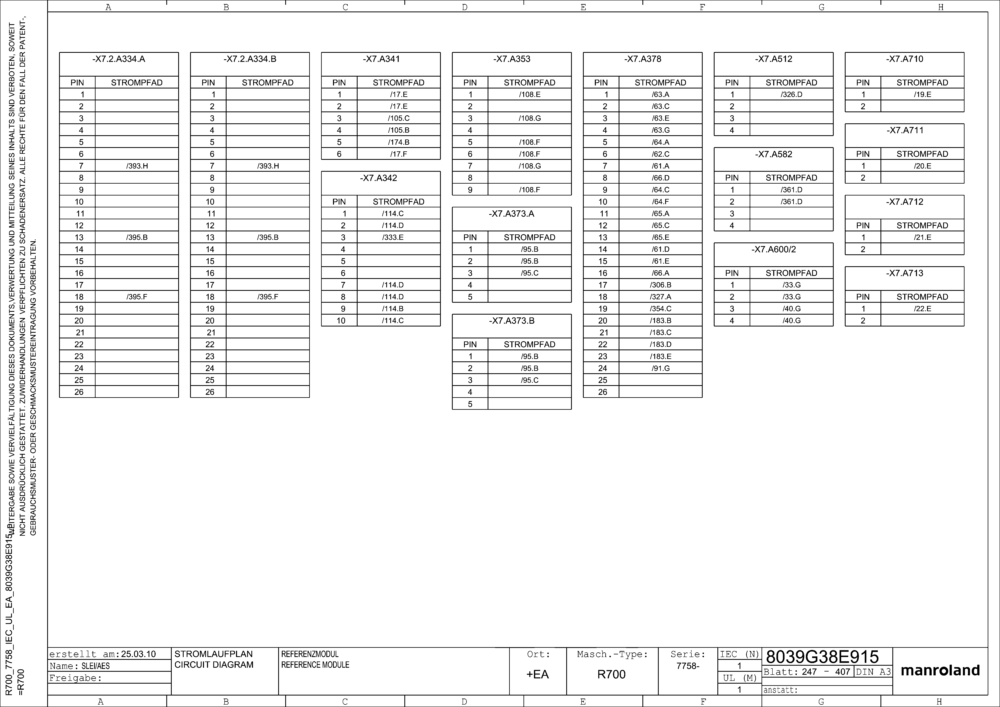

# +EA — Sheet 247 of 407 — REFERENZMODUL

**REFERENCE MODULE**

> Part of the manroland **R700** printing press IEC/UL circuit diagrams.
> Drawing class: **Stromlaufplan / Circuit diagram** (DIN A3).
> Document `+EA` covers the **Printing unit** machine section.

## At a glance

| Field | Value |
|---|---|
| Document | `+EA`  (8039G38E915) |
| Sheet | **247** of 407 |
| Section (DE) | REFERENZMODUL |
| Section (EN) | REFERENCE MODULE |
| Section type | REFERENCE_MODULE — Reference module |
| Machine type | `R700` |
| Series | `7758` |
| Created | 25.03.10 |
| Replaces | — |
| Columns used | A, B, C, D, E, F, G, H |
| Path numbers | — |
| Labels on sheet | 244 |
| Cross-refs out | 66 |
| Cross-refs in | 0 |

**Previous:** [+EA sheet 246](SHEET_0246.md) · **Next:** [+EA sheet 248](SHEET_0248.md) · **Document TOC:** [_TOC.md](_TOC.md)  (+EA) · **Master TOC:** [all sheets](../_MASTER_TOC.md)

## Sheet image (300 DPI, exact vector render)



_Rendered directly from the PDF vector layer at 300 DPI (1-bit), no OCR and no resampling. Use it to confirm anything ambiguous in the text below._

## Cross-references on this sheet

Each entry is a wire leaving this sheet. The printed token is `/sheet.column`; the link resolves to that sheet inside the same document.

| Ref | Target sheet | Col | Path | Destination on target | Target section | From col |
|---|---|---|---|---|---|---|
| `/326.D` | [+EA sheet 326](SHEET_0326.md) | D | — | STROMPFAD PIN 1 2 3 4 | OPTION: BOGENWEICHE | G |
| `/19.E` | [+EA sheet 19](SHEET_0019.md) | E | — | STROMPFAD PIN 1 2 | SPANNUNGSVERSORGUNG: 400V, 24V | H |
| `/17.E` | [+EA sheet 17](SHEET_0017.md) | E | — | — | SPANNUNGSVERSORGUNG: 400V, 24V | C |
| `/63.A` | [+EA sheet 63](SHEET_0063.md) | A | — | — | MASCHINENBEDIENUNG: BEDIENUNGKOMMANDOS | F |
| `/108.E` | [+EA sheet 108](SHEET_0108.md) | E | — | — | BLAS/SAUGLUFT MIT MOTORVENTILEINSTELLUNG | E |
| `/17.E` | [+EA sheet 17](SHEET_0017.md) | E | — | — | SPANNUNGSVERSORGUNG: 400V, 24V | C |
| `/63.C` | [+EA sheet 63](SHEET_0063.md) | C | — | — | MASCHINENBEDIENUNG: BEDIENUNGKOMMANDOS | F |
| `/63.E` | [+EA sheet 63](SHEET_0063.md) | E | — | — | MASCHINENBEDIENUNG: BEDIENUNGKOMMANDOS | F |
| `/108.G` | [+EA sheet 108](SHEET_0108.md) | G | — | — | BLAS/SAUGLUFT MIT MOTORVENTILEINSTELLUNG | E |
| `/105.C` | [+EA sheet 105](SHEET_0105.md) | C | — | — | BOGENFÜHRUNGSELEMENT | C |
| `/105.B` | [+EA sheet 105](SHEET_0105.md) | B | — | — | BOGENFÜHRUNGSELEMENT | C |
| `/63.G` | [+EA sheet 63](SHEET_0063.md) | G | — | — | MASCHINENBEDIENUNG: BEDIENUNGKOMMANDOS | F |
| `/64.A` | [+EA sheet 64](SHEET_0064.md) | A | — | — | MASCHINENBEDIENUNG: BEDIENUNGKOMMANDOS | F |
| `/174.B` | [+EA sheet 174](SHEET_0174.md) | B | — | — | RESERVE | C |
| `/108.F` | [+EA sheet 108](SHEET_0108.md) | F | — | — | BLAS/SAUGLUFT MIT MOTORVENTILEINSTELLUNG | E |
| `/20.E` | [+EA sheet 20](SHEET_0020.md) | E | — | STROMPFAD PIN 1 2 | SPANNUNGSVERSORGUNG: 400V, 24V | H |
| `/17.F` | [+EA sheet 17](SHEET_0017.md) | F | — | — | SPANNUNGSVERSORGUNG: 400V, 24V | C |
| `/108.F` | [+EA sheet 108](SHEET_0108.md) | F | — | — | BLAS/SAUGLUFT MIT MOTORVENTILEINSTELLUNG | E |
| `/62.C` | [+EA sheet 62](SHEET_0062.md) | C | — | — | MASCHINENBEDIENUNG: BEDIENUNGKOMMANDOS | F |
| `/61.A` | [+EA sheet 61](SHEET_0061.md) | A | — | — | MASCHINENBEDIENUNG: BEDIENUNGKOMMANDOS | F |
| `/108.G` | [+EA sheet 108](SHEET_0108.md) | G | — | — | BLAS/SAUGLUFT MIT MOTORVENTILEINSTELLUNG | E |
| `/393.H` | [+EA sheet 393](SHEET_0393.md) | H | — | — | OPTION: ZWISCHENTROCKNER VORBEREITUNG; | A |
| `/393.H` | [+EA sheet 393](SHEET_0393.md) | H | — | — | OPTION: ZWISCHENTROCKNER VORBEREITUNG; | B |
| `/66.D` | [+EA sheet 66](SHEET_0066.md) | D | — | — | MASCHINENBEDIENUNG: BEDIENUNGKOMMANDOS | F |
| `/108.F` | [+EA sheet 108](SHEET_0108.md) | F | — | — | BLAS/SAUGLUFT MIT MOTORVENTILEINSTELLUNG | E |
| `/64.C` | [+EA sheet 64](SHEET_0064.md) | C | — | — | MASCHINENBEDIENUNG: BEDIENUNGKOMMANDOS | F |
| `/361.D` | [+EA sheet 361](SHEET_0361.md) | D | — | — | OPTION: | G |
| `/64.F` | [+EA sheet 64](SHEET_0064.md) | F | — | — | MASCHINENBEDIENUNG: BEDIENUNGKOMMANDOS | F |
| `/361.D` | [+EA sheet 361](SHEET_0361.md) | D | — | — | OPTION: | G |
| `/65.A` | [+EA sheet 65](SHEET_0065.md) | A | — | — | MASCHINENBEDIENUNG: BEDIENUNGKOMMANDOS | F |
| `/114.C` | [+EA sheet 114](SHEET_0114.md) | C | — | — | FEHLBOGENKONTROLLE | C |
| `/21.E` | [+EA sheet 21](SHEET_0021.md) | E | — | STROMPFAD PIN 1 2 | SPANNUNGSVERSORGUNG: 400V, 24V | H |
| `/65.C` | [+EA sheet 65](SHEET_0065.md) | C | — | — | MASCHINENBEDIENUNG: BEDIENUNGKOMMANDOS | F |
| `/114.D` | [+EA sheet 114](SHEET_0114.md) | D | — | — | FEHLBOGENKONTROLLE | C |
| `/65.E` | [+EA sheet 65](SHEET_0065.md) | E | — | — | MASCHINENBEDIENUNG: BEDIENUNGKOMMANDOS | F |
| `/395.B` | [+EA sheet 395](SHEET_0395.md) | B | — | — | OPTION: ZWISCHENTROCKNER VORBEREITUNG; | A |
| `/395.B` | [+EA sheet 395](SHEET_0395.md) | B | — | — | OPTION: ZWISCHENTROCKNER VORBEREITUNG; | B |
| `/333.E` | [+EA sheet 333](SHEET_0333.md) | E | — | — | OPTION: BOGENWEICHE | C |
| `/95.B` | [+EA sheet 95](SHEET_0095.md) | B | — | — | BLASRAHMEN | E |
| `/61.D` | [+EA sheet 61](SHEET_0061.md) | D | — | — | MASCHINENBEDIENUNG: BEDIENUNGKOMMANDOS | F |
| `/95.B` | [+EA sheet 95](SHEET_0095.md) | B | — | — | BLASRAHMEN | E |
| `/61.E` | [+EA sheet 61](SHEET_0061.md) | E | — | — | MASCHINENBEDIENUNG: BEDIENUNGKOMMANDOS | F |
| `/66.A` | [+EA sheet 66](SHEET_0066.md) | A | — | — | MASCHINENBEDIENUNG: BEDIENUNGKOMMANDOS | F |
| `/95.C` | [+EA sheet 95](SHEET_0095.md) | C | — | — | BLASRAHMEN | E |
| `/306.B` | [+EA sheet 306](SHEET_0306.md) | B | — | — | OPTION: ZWISCHENSTAPEL / | F |
| `/33.G` | [+EA sheet 33](SHEET_0033.md) | G | — | — | BUSVERBINDUNGEN: NOT AUS | G |
| `/114.D` | [+EA sheet 114](SHEET_0114.md) | D | — | — | FEHLBOGENKONTROLLE | C |
| `/22.E` | [+EA sheet 22](SHEET_0022.md) | E | — | STROMPFAD PIN 1 2 | SPANNUNGSVERSORGUNG: 400V, 24V | H |
| `/327.A` | [+EA sheet 327](SHEET_0327.md) | A | — | — | OPTION: BOGENWEICHE | F |
| `/395.F` | [+EA sheet 395](SHEET_0395.md) | F | — | — | OPTION: ZWISCHENTROCKNER VORBEREITUNG; | A |
| `/395.F` | [+EA sheet 395](SHEET_0395.md) | F | — | — | OPTION: ZWISCHENTROCKNER VORBEREITUNG; | B |
| `/33.G` | [+EA sheet 33](SHEET_0033.md) | G | — | — | BUSVERBINDUNGEN: NOT AUS | G |
| `/114.D` | [+EA sheet 114](SHEET_0114.md) | D | — | — | FEHLBOGENKONTROLLE | C |
| `/114.B` | [+EA sheet 114](SHEET_0114.md) | B | — | — | FEHLBOGENKONTROLLE | C |
| `/40.G` | [+EA sheet 40](SHEET_0040.md) | G | — | — | BUSVERBINDUNGEN: STOP SICHERN | G |
| `/354.C` | [+EA sheet 354](SHEET_0354.md) | C | — | — | OPTION: VORBEREITUNG: PUDERABSAUGUNG | F |
| `/183.B` | [+EA sheet 183](SHEET_0183.md) | B | — | — | RESERVE | F |
| `/40.G` | [+EA sheet 40](SHEET_0040.md) | G | — | — | BUSVERBINDUNGEN: STOP SICHERN | G |
| `/114.C` | [+EA sheet 114](SHEET_0114.md) | C | — | — | FEHLBOGENKONTROLLE | C |
| `/183.C` | [+EA sheet 183](SHEET_0183.md) | C | — | — | RESERVE | F |
| `/183.D` | [+EA sheet 183](SHEET_0183.md) | D | — | — | RESERVE | F |
| `/95.B` | [+EA sheet 95](SHEET_0095.md) | B | — | — | BLASRAHMEN | E |
| `/183.E` | [+EA sheet 183](SHEET_0183.md) | E | — | — | RESERVE | F |
| `/95.B` | [+EA sheet 95](SHEET_0095.md) | B | — | — | BLASRAHMEN | E |
| `/91.G` | [+EA sheet 91](SHEET_0091.md) | G | — | — | BLASROHRE (BLASRAHMEN) | F |
| `/95.C` | [+EA sheet 95](SHEET_0095.md) | C | — | — | BLASRAHMEN | E |

## Devices on this sheet

| Tag | Class | Class meaning (IEC) | Col | Sub | Terminal | Sign |
|---|---|---|---|---|---|---|
| `X7.A378` | — | cross-device reference | F | — | — | — |
| `X7.A341` | — | cross-device reference | C | — | — | — |
| `X7.A342` | — | cross-device reference | C | — | — | — |
| `X7.2.A334.B` | — | cross-device reference | B | — | — | — |
| `X7.2.A334.A` | — | cross-device reference | A | — | — | — |
| `X7.A353` | — | cross-device reference | D | — | — | — |
| `X7.A373.A` | — | cross-device reference | D | — | — | — |
| `X7.A373.B` | — | cross-device reference | D | — | — | — |
| `X7.A512` | — | cross-device reference | G | — | — | — |
| `X7.A582` | — | cross-device reference | G | — | — | — |
| `X7.A711` | — | cross-device reference | H | — | — | — |
| `X7.A710` | — | cross-device reference | H | — | — | — |
| `X7.A712` | — | cross-device reference | H | — | — | — |
| `X7.A713` | — | cross-device reference | H | — | — | — |

## Potentials / nets

_No named potentials on this sheet._

## Wire-end annotations (grouped as printed)

A wire that continues elsewhere is annotated with a small cluster: the destination description, the path/line number `#NN`, and the `/sheet.column` cross reference. Each row below is one such cluster exactly as it is grouped on the drawing.

| Col | Y | Path | Cross-ref | Text on the wire |
|---|---|---|---|---|
| A | 65.5 | — | — | `X7.2.A334.A` |
| B | 65.5 | — | — | `X7.2.A334.B` |
| C | 65.5 | — | — | `X7.A341` |
| D | 65.5 | — | — | `X7.A353` |
| F | 65.5 | — | — | `X7.A378` |
| G | 65.5 | — | — | `X7.A512` |
| H | 65.5 | — | — | `X7.A710` |
| A | 94.2 | — | — | `PIN STROMPFAD` |
| B | 94.2 | — | — | `PIN STROMPFAD` |
| C | 94.2 | — | — | `PIN 2 3 4 5 6 1 STROMPFAD` |
| D | 94.2 | — | — | `PIN 2 3 4 5 6 7 8 9 1 STROMPFAD` |
| E | 94.2 | — | — | `PIN STROMPFAD` |
| G | 94.2 | — | `/326.D` | `PIN 2 3 4 1 STROMPFAD` |
| H | 94.2 | — | `/19.E` | `PIN 2 1 STROMPFAD` |
| A | 108.4 | — | — | `2 3 4 5 6 7 8 9 1` |
| B | 108.4 | — | — | `2 3 4 5 6 7 8 9 1` |
| E | 108.4 | — | — | `2 3 4 5 6 7 8 9 1` |
| C | 108.7 | — | `/17.E` | — |
| E | 108.7 | — | `/108.E` | — |
| F | 108.7 | — | `/63.A` | — |
| C | 122.8 | — | `/17.E` | — |
| F | 122.9 | — | `/63.C` | — |
| F | 137.0 | — | `/63.E` | — |
| C | 137.1 | — | `/105.C` | — |
| E | 137.1 | — | `/108.G` | — |
| H | 150.6 | — | — | `X7.A711` |
| C | 151.2 | — | `/105.B` | — |
| F | 151.2 | — | `/63.G` | — |
| C | 165.4 | — | `/174.B` | — |
| E | 165.4 | — | `/108.F` | — |
| F | 165.4 | — | `/64.A` | — |
| G | 178.9 | — | — | `X7.A582` |
| H | 179.2 | — | `/20.E` | `PIN 2 1 STROMPFAD` |
| C | 179.6 | — | `/17.F` | — |
| E | 179.6 | — | `/108.F` | — |
| F | 179.6 | — | `/62.C` | — |
| E | 193.7 | — | `/108.G` | — |
| F | 193.7 | — | `/61.A` | — |
| A | 193.8 | — | `/393.H` | — |
| B | 193.8 | — | `/393.H` | — |
| C | 207.2 | — | — | `X7.A342` |
| G | 207.5 | — | — | `PIN 2 3 4 1 STROMPFAD` |
| F | 207.9 | — | `/66.D` | — |
| E | 222.1 | — | `/108.F` | — |
| F | 222.1 | — | `/64.C` | — |
| G | 222.1 | — | `/361.D` | — |
| H | 235.6 | — | — | `X7.A712` |
| A | 235.9 | — | — | `10 12 13 14 15 16 17 18 19 20 11` |
| B | 235.9 | — | — | `10 12 13 14 15 16 17 18 19 20 11` |
| C | 235.9 | — | — | `PIN 10 2 3 4 5 6 7 8 9 1 STROMPFAD` |
| E | 235.9 | — | — | `10 12 13 14 15 16 17 18 19 20 11` |
| F | 236.2 | — | `/64.F` | — |
| G | 236.3 | — | `/361.D` | — |
| D | 249.8 | — | — | `X7.A373.A` |
| C | 250.4 | — | `/114.C` | — |
| F | 250.4 | — | `/65.A` | — |
| H | 264.2 | — | `/21.E` | `PIN 2 1 STROMPFAD` |
| C | 264.6 | — | `/114.D` | — |
| F | 264.6 | — | `/65.C` | — |
| D | 278.4 | — | — | `PIN 2 3 4 5 1 STROMPFAD` |
| A | 278.8 | — | `/395.B` | — |
| B | 278.8 | — | `/395.B` | — |
| C | 278.8 | — | `/333.E` | — |
| F | 278.8 | — | `/65.E` | — |
| G | 292.3 | — | — | `X7.A600/2` |
| E | 292.9 | — | `/95.B` | — |
| F | 293.0 | — | `/61.D` | — |
| E | 307.1 | — | `/95.B` | — |
| F | 307.1 | — | `/61.E` | — |
| H | 320.6 | — | — | `X7.A713` |
| G | 320.9 | — | — | `PIN 2 3 4 1 STROMPFAD` |
| E | 321.3 | — | `/95.C` | — |
| F | 321.3 | — | `/66.A` | — |
| C | 335.5 | — | `/114.D` | — |
| F | 335.5 | — | `/306.B` | — |
| G | 335.5 | — | `/33.G` | — |
| H | 349.3 | — | `/22.E` | `PIN 2 1 STROMPFAD` |
| A | 349.6 | — | `/395.F` | — |
| B | 349.6 | — | `/395.F` | — |
| F | 349.6 | — | `/327.A` | — |
| G | 349.6 | — | `/33.G` | — |
| C | 349.7 | — | `/114.D` | — |
| C | 363.8 | — | `/114.B` | — |
| F | 363.8 | — | `/354.C` | — |
| G | 363.8 | — | `/40.G` | — |
| D | 377.3 | — | — | `X7.A373.B` |
| C | 378.0 | — | `/114.C` | — |
| F | 378.0 | — | `/183.B` | — |
| G | 378.0 | — | `/40.G` | — |
| A | 391.8 | — | — | `22 23 24 25 26 21` |
| B | 391.8 | — | — | `22 23 24 25 26 21` |
| E | 391.8 | — | — | `22 23 24 25 26 21` |
| F | 392.2 | — | `/183.C` | — |
| D | 406.0 | — | — | `PIN 2 3 4 5 1 STROMPFAD` |
| F | 406.4 | — | `/183.D` | — |
| E | 420.5 | — | `/95.B` | — |
| F | 420.5 | — | `/183.E` | — |
| E | 434.7 | — | `/95.B` | — |
| F | 434.7 | — | `/91.G` | — |
| E | 448.9 | — | `/95.C` | — |


## Reconstructed tables

This sheet carries tabular content (pin map / terminal assignment / index). The grid below was rebuilt from the drawing's own rule lines, so each row is exactly one physical row of the table.

### Table 1 — 26 data rows × 2 columns (at x=70.9, y=62.4) — **X7.2.A334.A**

| PIN | STROMPFAD |
|---|---|
| `1` |  |
| `2` |  |
| `3` |  |
| `4` |  |
| `5` |  |
| `6` |  |
| `7` | `/393.H` |
| `8` |  |
| `9` |  |
| `10` |  |
| `11` |  |
| `12` |  |
| `13` | `/395.B` |
| `14` |  |
| `15` |  |
| `16` |  |
| `17` |  |
| `18` | `/395.F` |
| `19` |  |
| `20` |  |
| `21` |  |
| `22` |  |
| `23` |  |
| `24` |  |
| `25` |  |
| `26` |  |


### Table 2 — 26 data rows × 2 columns (at x=226.8, y=62.4) — **X7.2.A334.B**

| PIN | STROMPFAD |
|---|---|
| `1` |  |
| `2` |  |
| `3` |  |
| `4` |  |
| `5` |  |
| `6` |  |
| `7` | `/393.H` |
| `8` |  |
| `9` |  |
| `10` |  |
| `11` |  |
| `12` |  |
| `13` | `/395.B` |
| `14` |  |
| `15` |  |
| `16` |  |
| `17` |  |
| `18` | `/395.F` |
| `19` |  |
| `20` |  |
| `21` |  |
| `22` |  |
| `23` |  |
| `24` |  |
| `25` |  |
| `26` |  |


### Table 3 — 18 data rows × 2 columns (at x=382.7, y=62.4) — **X7.A341**

| PIN | STROMPFAD |
|---|---|
| `1` | `/17.E` |
| `2` | `/17.E` |
| `3` | `/105.C` |
| `4` | `/105.B` |
| `5` | `/174.B` |
| `6` | `/17.F` |
|  | `X7.A342` |
| `PIN` | `STROMPFAD` |
| `1` | `/114.C` |
| `2` | `/114.D` |
| `3` | `/333.E` |
| `4` |  |
| `5` |  |
| `6` |  |
| `7` | `/114.D` |
| `8` | `/114.D` |
| `9` | `/114.B` |
| `10` | `/114.C` |


### Table 4 — 23 data rows × 2 columns (at x=538.6, y=62.4) — **X7.A353**

| PIN | STROMPFAD |
|---|---|
| `1` | `/108.E` |
| `2` |  |
| `3` | `/108.G` |
| `4` |  |
| `5` | `/108.F` |
| `6` | `/108.F` |
| `7` | `/108.G` |
| `8` |  |
| `9` | `/108.F` |
|  | `X7.A373.A` |
| `PIN` | `STROMPFAD` |
| `1` | `/95.B` |
| `2` | `/95.B` |
| `3` | `/95.C` |
| `4` |  |
| `5` |  |
|  | `X7.A373.B` |
| `PIN` | `STROMPFAD` |
| `1` | `/95.B` |
| `2` | `/95.B` |
| `3` | `/95.C` |
| `4` |  |
| `5` |  |


### Table 5 — 26 data rows × 2 columns (at x=694.5, y=62.4) — **X7.A378**

| PIN | STROMPFAD |
|---|---|
| `1` | `/63.A` |
| `2` | `/63.C` |
| `3` | `/63.E` |
| `4` | `/63.G` |
| `5` | `/64.A` |
| `6` | `/62.C` |
| `7` | `/61.A` |
| `8` | `/66.D` |
| `9` | `/64.C` |
| `10` | `/64.F` |
| `11` | `/65.A` |
| `12` | `/65.C` |
| `13` | `/65.E` |
| `14` | `/61.D` |
| `15` | `/61.E` |
| `16` | `/66.A` |
| `17` | `/306.B` |
| `18` | `/327.A` |
| `19` | `/354.C` |
| `20` | `/183.B` |
| `21` | `/183.C` |
| `22` | `/183.D` |
| `23` | `/183.E` |
| `24` | `/91.G` |
| `25` |  |
| `26` |  |


### Table 6 — 16 data rows × 2 columns (at x=850.4, y=62.4) — **X7.A512**

| PIN | STROMPFAD |
|---|---|
| `1` | `/326.D` |
| `2` |  |
| `3` |  |
| `4` |  |
|  | `X7.A582` |
| `PIN` | `STROMPFAD` |
| `1` | `/361.D` |
| `2` | `/361.D` |
| `3` |  |
| `4` |  |
|  | `X7.A600/2` |
| `PIN` | `STROMPFAD` |
| `1` | `/33.G` |
| `2` | `/33.G` |
| `3` | `/40.G` |
| `4` | `/40.G` |


### Table 7 — 14 data rows × 2 columns (at x=1006.3, y=62.4) — **X7.A710**

| PIN | STROMPFAD |
|---|---|
| `1` | `/19.E` |
| `2` |  |
|  | `X7.A711` |
| `PIN` | `STROMPFAD` |
| `1` | `/20.E` |
| `2` |  |
|  | `X7.A712` |
| `PIN` | `STROMPFAD` |
| `1` | `/21.E` |
| `2` |  |
|  | `X7.A713` |
| `PIN` | `STROMPFAD` |
| `1` | `/22.E` |
| `2` |  |


## Notes and free text on this sheet

| Text | Col | Y (pt) |
|---|---|---|
| `PIN` | E | 94.2 |
| `STROMPFAD` | F | 94.15 |
| `PIN` | C | 94.2 |
| `STROMPFAD` | C | 94.15 |
| `PIN` | B | 94.2 |
| `STROMPFAD` | B | 94.15 |
| `PIN` | A | 94.2 |
| `STROMPFAD` | A | 94.15 |
| `PIN` | D | 94.2 |
| `STROMPFAD` | E | 94.15 |
| `PIN` | F | 94.2 |
| `STROMPFAD` | G | 94.15 |
| `X7.A600/2` | G | 292.28 |
| `PIN` | G | 179.24 |
| `STROMPFAD` | H | 179.19 |

## Complete label inventory (exact text from the drawing)

Every text object inside the drawing area of this sheet, in DIN reading order (column A→H, then top→bottom). This is the authoritative list: if a string is not here it is not printed on this sheet.

| Col | Y | X | Dir | Type | Text |
|---|---|---|---|---|---|
| A | 65.5 | 110.0 | → | device ref | `X7.2.A334.A` |
| A | 94.2 | 84.0 | → | text | `PIN` |
| A | 94.2 | 132.2 | → | text | `STROMPFAD` |
| A | 108.4 | 95.8 | → | number | `1` |
| A | 122.5 | 94.1 | → | number | `2` |
| A | 136.7 | 94.1 | → | number | `3` |
| A | 150.9 | 94.1 | → | number | `4` |
| A | 165.1 | 94.1 | → | number | `5` |
| A | 179.2 | 94.1 | → | number | `6` |
| A | 193.4 | 94.1 | → | number | `7` |
| A | 193.8 | 150.5 | → | cross-reference | `/393.H` |
| A | 207.6 | 94.1 | → | number | `8` |
| A | 221.8 | 94.1 | → | number | `9` |
| A | 235.9 | 88.7 | → | number | `10` |
| A | 250.1 | 90.4 | → | number | `11` |
| A | 264.3 | 88.7 | → | number | `12` |
| A | 278.5 | 88.7 | → | number | `13` |
| A | 278.8 | 150.4 | → | cross-reference | `/395.B` |
| A | 292.6 | 88.7 | → | number | `14` |
| A | 306.8 | 88.7 | → | number | `15` |
| A | 321.0 | 88.7 | → | number | `16` |
| A | 335.1 | 88.7 | → | number | `17` |
| A | 349.3 | 88.7 | → | number | `18` |
| A | 349.6 | 150.7 | → | cross-reference | `/395.F` |
| A | 363.5 | 88.7 | → | number | `19` |
| A | 377.7 | 88.7 | → | number | `20` |
| A | 391.8 | 90.4 | → | number | `21` |
| A | 406.0 | 88.7 | → | number | `22` |
| A | 420.2 | 88.7 | → | number | `23` |
| A | 434.4 | 88.7 | → | number | `24` |
| A | 448.5 | 88.7 | → | number | `25` |
| A | 462.7 | 88.7 | → | number | `26` |
| B | 65.5 | 266.3 | → | device ref | `X7.2.A334.B` |
| B | 94.2 | 240.0 | → | text | `PIN` |
| B | 94.2 | 288.1 | → | text | `STROMPFAD` |
| B | 108.4 | 251.7 | → | number | `1` |
| B | 122.5 | 250.0 | → | number | `2` |
| B | 136.7 | 250.0 | → | number | `3` |
| B | 150.9 | 250.0 | → | number | `4` |
| B | 165.1 | 250.0 | → | number | `5` |
| B | 179.2 | 250.0 | → | number | `6` |
| B | 193.4 | 250.0 | → | number | `7` |
| B | 193.8 | 306.4 | → | cross-reference | `/393.H` |
| B | 207.6 | 250.0 | → | number | `8` |
| B | 221.8 | 250.0 | → | number | `9` |
| B | 235.9 | 244.6 | → | number | `10` |
| B | 250.1 | 246.3 | → | number | `11` |
| B | 264.3 | 244.6 | → | number | `12` |
| B | 278.5 | 244.6 | → | number | `13` |
| B | 278.8 | 306.3 | → | cross-reference | `/395.B` |
| B | 292.6 | 244.6 | → | number | `14` |
| B | 306.8 | 244.6 | → | number | `15` |
| B | 321.0 | 244.6 | → | number | `16` |
| B | 335.1 | 244.6 | → | number | `17` |
| B | 349.3 | 244.6 | → | number | `18` |
| B | 349.6 | 306.6 | → | cross-reference | `/395.F` |
| B | 363.5 | 244.6 | → | number | `19` |
| B | 377.7 | 244.6 | → | number | `20` |
| B | 391.8 | 246.3 | → | number | `21` |
| B | 406.0 | 244.6 | → | number | `22` |
| B | 420.2 | 244.6 | → | number | `23` |
| B | 434.4 | 244.6 | → | number | `24` |
| B | 448.5 | 244.6 | → | number | `25` |
| B | 462.7 | 244.6 | → | number | `26` |
| C | 65.5 | 432.3 | → | device ref | `X7.A341` |
| C | 94.2 | 395.9 | → | text | `PIN` |
| C | 94.2 | 444.0 | → | text | `STROMPFAD` |
| C | 108.4 | 401.8 | → | number | `1` |
| C | 108.7 | 464.7 | → | cross-reference | `/17.E` |
| C | 122.5 | 401.2 | → | number | `2` |
| C | 122.8 | 464.7 | → | cross-reference | `/17.E` |
| C | 136.7 | 401.2 | → | number | `3` |
| C | 137.1 | 462.0 | → | cross-reference | `/105.C` |
| C | 150.9 | 401.2 | → | number | `4` |
| C | 151.2 | 462.2 | → | cross-reference | `/105.B` |
| C | 165.1 | 401.2 | → | number | `5` |
| C | 165.4 | 462.2 | → | cross-reference | `/174.B` |
| C | 179.2 | 401.2 | → | number | `6` |
| C | 179.6 | 464.9 | → | cross-reference | `/17.F` |
| C | 207.2 | 428.7 | → | device ref | `X7.A342` |
| C | 235.9 | 395.9 | → | text | `PIN` |
| C | 235.9 | 444.0 | → | text | `STROMPFAD` |
| C | 250.1 | 407.6 | → | number | `1` |
| C | 250.4 | 455.0 | → | cross-reference | `/114.C` |
| C | 264.3 | 405.9 | → | number | `2` |
| C | 264.6 | 455.0 | → | cross-reference | `/114.D` |
| C | 278.5 | 405.9 | → | number | `3` |
| C | 278.8 | 455.2 | → | cross-reference | `/333.E` |
| C | 292.6 | 405.9 | → | number | `4` |
| C | 306.8 | 405.9 | → | number | `5` |
| C | 321.0 | 405.9 | → | number | `6` |
| C | 335.1 | 405.9 | → | number | `7` |
| C | 335.5 | 455.0 | → | cross-reference | `/114.D` |
| C | 349.3 | 405.9 | → | number | `8` |
| C | 349.7 | 455.0 | → | cross-reference | `/114.D` |
| C | 363.5 | 405.9 | → | number | `9` |
| C | 363.8 | 455.1 | → | cross-reference | `/114.B` |
| C | 377.7 | 400.5 | → | number | `10` |
| C | 378.0 | 455.0 | → | cross-reference | `/114.C` |
| D | 65.5 | 587.5 | → | device ref | `X7.A353` |
| D | 94.2 | 551.8 | → | text | `PIN` |
| D | 108.4 | 557.7 | → | number | `1` |
| D | 122.5 | 557.1 | → | number | `2` |
| D | 136.7 | 557.1 | → | number | `3` |
| D | 150.9 | 557.1 | → | number | `4` |
| D | 165.1 | 557.1 | → | number | `5` |
| D | 179.2 | 557.1 | → | number | `6` |
| D | 193.4 | 557.1 | → | number | `7` |
| D | 207.6 | 557.1 | → | number | `8` |
| D | 221.8 | 557.1 | → | number | `9` |
| D | 249.8 | 582.1 | → | device ref | `X7.A373.A` |
| D | 278.4 | 551.8 | → | text | `PIN` |
| D | 292.6 | 557.7 | → | number | `1` |
| D | 306.8 | 557.1 | → | number | `2` |
| D | 321.0 | 557.1 | → | number | `3` |
| D | 335.1 | 557.1 | → | number | `4` |
| D | 349.3 | 557.1 | → | number | `5` |
| D | 377.3 | 582.5 | → | device ref | `X7.A373.B` |
| D | 406.0 | 551.8 | → | text | `PIN` |
| D | 420.2 | 557.7 | → | number | `1` |
| D | 434.4 | 557.1 | → | number | `2` |
| D | 448.5 | 557.1 | → | number | `3` |
| D | 462.7 | 557.1 | → | number | `4` |
| D | 476.9 | 557.1 | → | number | `5` |
| E | 94.2 | 600.0 | → | text | `STROMPFAD` |
| E | 94.2 | 707.7 | → | text | `PIN` |
| E | 108.4 | 719.4 | → | number | `1` |
| E | 108.7 | 618.2 | → | cross-reference | `/108.E` |
| E | 122.5 | 717.7 | → | number | `2` |
| E | 136.7 | 717.7 | → | number | `3` |
| E | 137.1 | 617.8 | → | cross-reference | `/108.G` |
| E | 150.9 | 717.7 | → | number | `4` |
| E | 165.1 | 717.7 | → | number | `5` |
| E | 165.4 | 618.4 | → | cross-reference | `/108.F` |
| E | 179.2 | 717.7 | → | number | `6` |
| E | 179.6 | 618.4 | → | cross-reference | `/108.F` |
| E | 193.4 | 717.7 | → | number | `7` |
| E | 193.7 | 617.8 | → | cross-reference | `/108.G` |
| E | 207.6 | 717.7 | → | number | `8` |
| E | 221.8 | 717.7 | → | number | `9` |
| E | 222.1 | 618.4 | → | cross-reference | `/108.F` |
| E | 235.9 | 712.3 | → | number | `10` |
| E | 250.1 | 714.0 | → | number | `11` |
| E | 264.3 | 712.3 | → | number | `12` |
| E | 278.4 | 600.0 | → | text | `STROMPFAD` |
| E | 278.5 | 712.3 | → | number | `13` |
| E | 292.6 | 712.3 | → | number | `14` |
| E | 292.9 | 620.5 | → | cross-reference | `/95.B` |
| E | 306.8 | 712.3 | → | number | `15` |
| E | 307.1 | 620.5 | → | cross-reference | `/95.B` |
| E | 321.0 | 712.3 | → | number | `16` |
| E | 321.3 | 620.4 | → | cross-reference | `/95.C` |
| E | 335.1 | 712.3 | → | number | `17` |
| E | 349.3 | 712.3 | → | number | `18` |
| E | 363.5 | 712.3 | → | number | `19` |
| E | 377.7 | 712.3 | → | number | `20` |
| E | 391.8 | 714.0 | → | number | `21` |
| E | 406.0 | 600.0 | → | text | `STROMPFAD` |
| E | 406.0 | 712.3 | → | number | `22` |
| E | 420.2 | 712.3 | → | number | `23` |
| E | 420.5 | 620.5 | → | cross-reference | `/95.B` |
| E | 434.4 | 712.3 | → | number | `24` |
| E | 434.7 | 620.5 | → | cross-reference | `/95.B` |
| E | 448.5 | 712.3 | → | number | `25` |
| E | 448.9 | 620.4 | → | cross-reference | `/95.C` |
| E | 462.7 | 712.3 | → | number | `26` |
| F | 65.5 | 743.4 | → | device ref | `X7.A378` |
| F | 94.2 | 755.9 | → | text | `STROMPFAD` |
| F | 94.2 | 863.6 | → | text | `PIN` |
| F | 108.4 | 869.5 | → | number | `1` |
| F | 108.7 | 776.3 | → | cross-reference | `/63.A` |
| F | 122.5 | 869.0 | → | number | `2` |
| F | 122.9 | 776.3 | → | cross-reference | `/63.C` |
| F | 136.7 | 869.0 | → | number | `3` |
| F | 137.0 | 776.6 | → | cross-reference | `/63.E` |
| F | 150.9 | 869.0 | → | number | `4` |
| F | 151.2 | 776.1 | → | cross-reference | `/63.G` |
| F | 165.4 | 776.3 | → | cross-reference | `/64.A` |
| F | 179.6 | 776.3 | → | cross-reference | `/62.C` |
| F | 193.7 | 776.3 | → | cross-reference | `/61.A` |
| F | 207.6 | 863.6 | → | text | `PIN` |
| F | 207.9 | 776.3 | → | cross-reference | `/66.D` |
| F | 221.8 | 869.5 | → | number | `1` |
| F | 222.1 | 776.3 | → | cross-reference | `/64.C` |
| F | 235.9 | 869.0 | → | number | `2` |
| F | 236.2 | 776.7 | → | cross-reference | `/64.F` |
| F | 250.1 | 869.0 | → | number | `3` |
| F | 250.4 | 776.3 | → | cross-reference | `/65.A` |
| F | 264.3 | 869.0 | → | number | `4` |
| F | 264.6 | 776.3 | → | cross-reference | `/65.C` |
| F | 278.8 | 776.6 | → | cross-reference | `/65.E` |
| F | 293.0 | 776.3 | → | cross-reference | `/61.D` |
| F | 307.1 | 776.6 | → | cross-reference | `/61.E` |
| F | 321.0 | 863.6 | → | text | `PIN` |
| F | 321.3 | 776.3 | → | cross-reference | `/66.A` |
| F | 335.1 | 869.5 | → | number | `1` |
| F | 335.5 | 774.0 | → | cross-reference | `/306.B` |
| F | 349.3 | 869.0 | → | number | `2` |
| F | 349.6 | 773.9 | → | cross-reference | `/327.A` |
| F | 363.5 | 869.0 | → | number | `3` |
| F | 363.8 | 773.9 | → | cross-reference | `/354.C` |
| F | 377.7 | 869.0 | → | number | `4` |
| F | 378.0 | 774.0 | → | cross-reference | `/183.B` |
| F | 392.2 | 773.9 | → | cross-reference | `/183.C` |
| F | 406.4 | 773.9 | → | cross-reference | `/183.D` |
| F | 420.5 | 774.1 | → | cross-reference | `/183.E` |
| F | 434.7 | 776.1 | → | cross-reference | `/91.G` |
| G | 65.5 | 899.3 | → | device ref | `X7.A512` |
| G | 94.2 | 911.8 | → | text | `STROMPFAD` |
| G | 94.2 | 1019.5 | → | text | `PIN` |
| G | 108.4 | 1025.4 | → | number | `1` |
| G | 108.7 | 929.8 | → | cross-reference | `/326.D` |
| G | 122.5 | 1024.9 | → | number | `2` |
| G | 178.9 | 899.3 | → | device ref | `X7.A582` |
| G | 179.2 | 1019.5 | → | text | `PIN` |
| G | 193.4 | 1025.4 | → | number | `1` |
| G | 207.5 | 911.8 | → | text | `STROMPFAD` |
| G | 207.6 | 1024.9 | → | number | `2` |
| G | 222.1 | 929.8 | → | cross-reference | `/361.D` |
| G | 236.3 | 929.8 | → | cross-reference | `/361.D` |
| G | 264.3 | 1019.5 | → | text | `PIN` |
| G | 278.5 | 1025.4 | → | number | `1` |
| G | 292.3 | 894.9 | → | text | `X7.A600/2` |
| G | 292.6 | 1024.9 | → | number | `2` |
| G | 320.9 | 911.8 | → | text | `STROMPFAD` |
| G | 335.5 | 932.0 | → | cross-reference | `/33.G` |
| G | 349.3 | 1019.5 | → | text | `PIN` |
| G | 349.6 | 932.0 | → | cross-reference | `/33.G` |
| G | 363.5 | 1025.4 | → | number | `1` |
| G | 363.8 | 932.0 | → | cross-reference | `/40.G` |
| G | 377.7 | 1024.9 | → | number | `2` |
| G | 378.0 | 932.0 | → | cross-reference | `/40.G` |
| H | 65.5 | 1055.2 | → | device ref | `X7.A710` |
| H | 94.2 | 1067.7 | → | text | `STROMPFAD` |
| H | 108.7 | 1088.4 | → | cross-reference | `/19.E` |
| H | 150.5 | 1055.9 | → | device ref | `X7.A711` |
| H | 179.2 | 1067.7 | → | text | `STROMPFAD` |
| H | 193.7 | 1088.4 | → | cross-reference | `/20.E` |
| H | 235.6 | 1055.2 | → | device ref | `X7.A712` |
| H | 264.2 | 1067.7 | → | text | `STROMPFAD` |
| H | 278.8 | 1088.4 | → | cross-reference | `/21.E` |
| H | 320.6 | 1055.2 | → | device ref | `X7.A713` |
| H | 349.3 | 1067.7 | → | text | `STROMPFAD` |
| H | 363.8 | 1088.4 | → | cross-reference | `/22.E` |

## Reading-order text block

The same content as a plain block, grouped by DIN column — convenient to paste or to match against a visual description.

```text
=== Column A ===
  65.5  110.0  devref       X7.2.A334.A
  94.2   84.0  text         PIN
  94.2  132.2  text         STROMPFAD
 108.4   95.8  numeric      1
 122.5   94.1  numeric      2
 136.7   94.1  numeric      3
 150.9   94.1  numeric      4
 165.1   94.1  numeric      5
 179.2   94.1  numeric      6
 193.4   94.1  numeric      7
 193.8  150.5  xref         /393.H
 207.6   94.1  numeric      8
 221.8   94.1  numeric      9
 235.9   88.7  numeric      10
 250.1   90.4  numeric      11
 264.3   88.7  numeric      12
 278.5   88.7  numeric      13
 278.8  150.4  xref         /395.B
 292.6   88.7  numeric      14
 306.8   88.7  numeric      15
 321.0   88.7  numeric      16
 335.1   88.7  numeric      17
 349.3   88.7  numeric      18
 349.6  150.7  xref         /395.F
 363.5   88.7  numeric      19
 377.7   88.7  numeric      20
 391.8   90.4  numeric      21
 406.0   88.7  numeric      22
 420.2   88.7  numeric      23
 434.4   88.7  numeric      24
 448.5   88.7  numeric      25
 462.7   88.7  numeric      26
=== Column B ===
  65.5  266.3  devref       X7.2.A334.B
  94.2  240.0  text         PIN
  94.2  288.1  text         STROMPFAD
 108.4  251.7  numeric      1
 122.5  250.0  numeric      2
 136.7  250.0  numeric      3
 150.9  250.0  numeric      4
 165.1  250.0  numeric      5
 179.2  250.0  numeric      6
 193.4  250.0  numeric      7
 193.8  306.4  xref         /393.H
 207.6  250.0  numeric      8
 221.8  250.0  numeric      9
 235.9  244.6  numeric      10
 250.1  246.3  numeric      11
 264.3  244.6  numeric      12
 278.5  244.6  numeric      13
 278.8  306.3  xref         /395.B
 292.6  244.6  numeric      14
 306.8  244.6  numeric      15
 321.0  244.6  numeric      16
 335.1  244.6  numeric      17
 349.3  244.6  numeric      18
 349.6  306.6  xref         /395.F
 363.5  244.6  numeric      19
 377.7  244.6  numeric      20
 391.8  246.3  numeric      21
 406.0  244.6  numeric      22
 420.2  244.6  numeric      23
 434.4  244.6  numeric      24
 448.5  244.6  numeric      25
 462.7  244.6  numeric      26
=== Column C ===
  65.5  432.3  devref       X7.A341
  94.2  395.9  text         PIN
  94.2  444.0  text         STROMPFAD
 108.4  401.8  numeric      1
 108.7  464.7  xref         /17.E
 122.5  401.2  numeric      2
 122.8  464.7  xref         /17.E
 136.7  401.2  numeric      3
 137.1  462.0  xref         /105.C
 150.9  401.2  numeric      4
 151.2  462.2  xref         /105.B
 165.1  401.2  numeric      5
 165.4  462.2  xref         /174.B
 179.2  401.2  numeric      6
 179.6  464.9  xref         /17.F
 207.2  428.7  devref       X7.A342
 235.9  395.9  text         PIN
 235.9  444.0  text         STROMPFAD
 250.1  407.6  numeric      1
 250.4  455.0  xref         /114.C
 264.3  405.9  numeric      2
 264.6  455.0  xref         /114.D
 278.5  405.9  numeric      3
 278.8  455.2  xref         /333.E
 292.6  405.9  numeric      4
 306.8  405.9  numeric      5
 321.0  405.9  numeric      6
 335.1  405.9  numeric      7
 335.5  455.0  xref         /114.D
 349.3  405.9  numeric      8
 349.7  455.0  xref         /114.D
 363.5  405.9  numeric      9
 363.8  455.1  xref         /114.B
 377.7  400.5  numeric      10
 378.0  455.0  xref         /114.C
=== Column D ===
  65.5  587.5  devref       X7.A353
  94.2  551.8  text         PIN
 108.4  557.7  numeric      1
 122.5  557.1  numeric      2
 136.7  557.1  numeric      3
 150.9  557.1  numeric      4
 165.1  557.1  numeric      5
 179.2  557.1  numeric      6
 193.4  557.1  numeric      7
 207.6  557.1  numeric      8
 221.8  557.1  numeric      9
 249.8  582.1  devref       X7.A373.A
 278.4  551.8  text         PIN
 292.6  557.7  numeric      1
 306.8  557.1  numeric      2
 321.0  557.1  numeric      3
 335.1  557.1  numeric      4
 349.3  557.1  numeric      5
 377.3  582.5  devref       X7.A373.B
 406.0  551.8  text         PIN
 420.2  557.7  numeric      1
 434.4  557.1  numeric      2
 448.5  557.1  numeric      3
 462.7  557.1  numeric      4
 476.9  557.1  numeric      5
=== Column E ===
  94.2  600.0  text         STROMPFAD
  94.2  707.7  text         PIN
 108.4  719.4  numeric      1
 108.7  618.2  xref         /108.E
 122.5  717.7  numeric      2
 136.7  717.7  numeric      3
 137.1  617.8  xref         /108.G
 150.9  717.7  numeric      4
 165.1  717.7  numeric      5
 165.4  618.4  xref         /108.F
 179.2  717.7  numeric      6
 179.6  618.4  xref         /108.F
 193.4  717.7  numeric      7
 193.7  617.8  xref         /108.G
 207.6  717.7  numeric      8
 221.8  717.7  numeric      9
 222.1  618.4  xref         /108.F
 235.9  712.3  numeric      10
 250.1  714.0  numeric      11
 264.3  712.3  numeric      12
 278.4  600.0  text         STROMPFAD
 278.5  712.3  numeric      13
 292.6  712.3  numeric      14
 292.9  620.5  xref         /95.B
 306.8  712.3  numeric      15
 307.1  620.5  xref         /95.B
 321.0  712.3  numeric      16
 321.3  620.4  xref         /95.C
 335.1  712.3  numeric      17
 349.3  712.3  numeric      18
 363.5  712.3  numeric      19
 377.7  712.3  numeric      20
 391.8  714.0  numeric      21
 406.0  600.0  text         STROMPFAD
 406.0  712.3  numeric      22
 420.2  712.3  numeric      23
 420.5  620.5  xref         /95.B
 434.4  712.3  numeric      24
 434.7  620.5  xref         /95.B
 448.5  712.3  numeric      25
 448.9  620.4  xref         /95.C
 462.7  712.3  numeric      26
=== Column F ===
  65.5  743.4  devref       X7.A378
  94.2  755.9  text         STROMPFAD
  94.2  863.6  text         PIN
 108.4  869.5  numeric      1
 108.7  776.3  xref         /63.A
 122.5  869.0  numeric      2
 122.9  776.3  xref         /63.C
 136.7  869.0  numeric      3
 137.0  776.6  xref         /63.E
 150.9  869.0  numeric      4
 151.2  776.1  xref         /63.G
 165.4  776.3  xref         /64.A
 179.6  776.3  xref         /62.C
 193.7  776.3  xref         /61.A
 207.6  863.6  text         PIN
 207.9  776.3  xref         /66.D
 221.8  869.5  numeric      1
 222.1  776.3  xref         /64.C
 235.9  869.0  numeric      2
 236.2  776.7  xref         /64.F
 250.1  869.0  numeric      3
 250.4  776.3  xref         /65.A
 264.3  869.0  numeric      4
 264.6  776.3  xref         /65.C
 278.8  776.6  xref         /65.E
 293.0  776.3  xref         /61.D
 307.1  776.6  xref         /61.E
 321.0  863.6  text         PIN
 321.3  776.3  xref         /66.A
 335.1  869.5  numeric      1
 335.5  774.0  xref         /306.B
 349.3  869.0  numeric      2
 349.6  773.9  xref         /327.A
 363.5  869.0  numeric      3
 363.8  773.9  xref         /354.C
 377.7  869.0  numeric      4
 378.0  774.0  xref         /183.B
 392.2  773.9  xref         /183.C
 406.4  773.9  xref         /183.D
 420.5  774.1  xref         /183.E
 434.7  776.1  xref         /91.G
=== Column G ===
  65.5  899.3  devref       X7.A512
  94.2  911.8  text         STROMPFAD
  94.2 1019.5  text         PIN
 108.4 1025.4  numeric      1
 108.7  929.8  xref         /326.D
 122.5 1024.9  numeric      2
 178.9  899.3  devref       X7.A582
 179.2 1019.5  text         PIN
 193.4 1025.4  numeric      1
 207.5  911.8  text         STROMPFAD
 207.6 1024.9  numeric      2
 222.1  929.8  xref         /361.D
 236.3  929.8  xref         /361.D
 264.3 1019.5  text         PIN
 278.5 1025.4  numeric      1
 292.3  894.9  text         X7.A600/2
 292.6 1024.9  numeric      2
 320.9  911.8  text         STROMPFAD
 335.5  932.0  xref         /33.G
 349.3 1019.5  text         PIN
 349.6  932.0  xref         /33.G
 363.5 1025.4  numeric      1
 363.8  932.0  xref         /40.G
 377.7 1024.9  numeric      2
 378.0  932.0  xref         /40.G
=== Column H ===
  65.5 1055.2  devref       X7.A710
  94.2 1067.7  text         STROMPFAD
 108.7 1088.4  xref         /19.E
 150.5 1055.9  devref       X7.A711
 179.2 1067.7  text         STROMPFAD
 193.7 1088.4  xref         /20.E
 235.6 1055.2  devref       X7.A712
 264.2 1067.7  text         STROMPFAD
 278.8 1088.4  xref         /21.E
 320.6 1055.2  devref       X7.A713
 349.3 1067.7  text         STROMPFAD
 363.8 1088.4  xref         /22.E
```

---
_Generated from the PDF vector text layer; no OCR. Source: `R700_7758_IEC_UL_EA_8039G38E915_p`, sheet 247._
