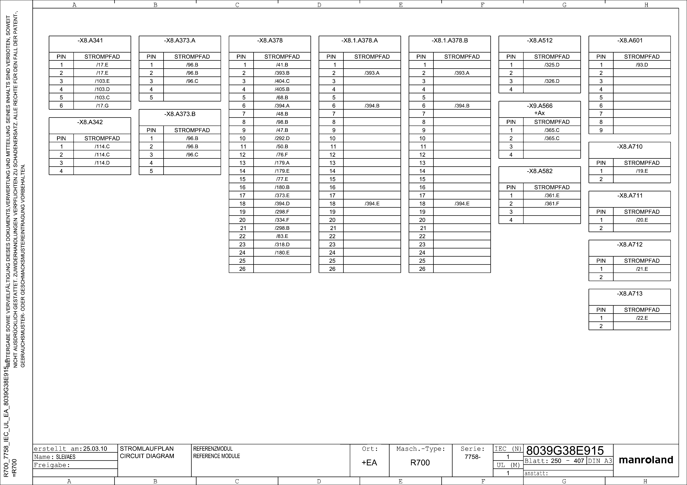

# +EA — Sheet 250 of 407 — REFERENZMODUL

**REFERENCE MODULE**

> Part of the manroland **R700** printing press IEC/UL circuit diagrams.
> Drawing class: **Stromlaufplan / Circuit diagram** (DIN A3).
> Document `+EA` covers the **Printing unit** machine section.

## At a glance

| Field | Value |
|---|---|
| Document | `+EA`  (8039G38E915) |
| Sheet | **250** of 407 |
| Section (DE) | REFERENZMODUL |
| Section (EN) | REFERENCE MODULE |
| Section type | REFERENCE_MODULE — Reference module |
| Machine type | `R700` |
| Series | `7758` |
| Created | 25.03.10 |
| Replaces | — |
| Columns used | A, B, C, D, E, F, G, H |
| Path numbers | — |
| Labels on sheet | 229 |
| Cross-refs out | 56 |
| Cross-refs in | 0 |

**Previous:** [+EA sheet 249](SHEET_0249.md) · **Next:** [+EA sheet 251](SHEET_0251.md) · **Document TOC:** [_TOC.md](_TOC.md)  (+EA) · **Master TOC:** [all sheets](../_MASTER_TOC.md)

## Sheet image (300 DPI, exact vector render)



_Rendered directly from the PDF vector layer at 300 DPI (1-bit), no OCR and no resampling. Use it to confirm anything ambiguous in the text below._

## Cross-references on this sheet

Each entry is a wire leaving this sheet. The printed token is `/sheet.column`; the link resolves to that sheet inside the same document.

| Ref | Target sheet | Col | Path | Destination on target | Target section | From col |
|---|---|---|---|---|---|---|
| `/93.D` | [+EA sheet 93](SHEET_0093.md) | D | — | STROMPFAD PIN 1 2 3 4 5 6 7 8 9 | BLASRAHMEN | H |
| `/17.E` | [+EA sheet 17](SHEET_0017.md) | E | — | — | SPANNUNGSVERSORGUNG: 400V, 24V | A |
| `/96.B` | [+EA sheet 96](SHEET_0096.md) | B | — | — | BLASRAHMEN | B |
| `/41.B` | [+EA sheet 41](SHEET_0041.md) | B | — | — | BUSVERBINDUNGEN: STOP SICHERN | D |
| `/325.D` | [+EA sheet 325](SHEET_0325.md) | D | — | — | OPTION: BOGENWEICHE | G |
| `/17.E` | [+EA sheet 17](SHEET_0017.md) | E | — | — | SPANNUNGSVERSORGUNG: 400V, 24V | A |
| `/96.B` | [+EA sheet 96](SHEET_0096.md) | B | — | — | BLASRAHMEN | B |
| `/393.B` | [+EA sheet 393](SHEET_0393.md) | B | — | — | OPTION: ZWISCHENTROCKNER VORBEREITUNG; | D |
| `/393.A` | [+EA sheet 393](SHEET_0393.md) | A | — | — | OPTION: ZWISCHENTROCKNER VORBEREITUNG; | E |
| `/393.A` | [+EA sheet 393](SHEET_0393.md) | A | — | — | OPTION: ZWISCHENTROCKNER VORBEREITUNG; | F |
| `/103.E` | [+EA sheet 103](SHEET_0103.md) | E | — | — | BOGENFÜHRUNGSELEMENT | A |
| `/96.C` | [+EA sheet 96](SHEET_0096.md) | C | — | — | BLASRAHMEN | B |
| `/404.C` | [+EA sheet 404](SHEET_0404.md) | C | — | — | OPTION: SCHNITTSTELLE UV ENDTROCKNER | D |
| `/326.D` | [+EA sheet 326](SHEET_0326.md) | D | — | — | OPTION: BOGENWEICHE | G |
| `/405.B` | [+EA sheet 405](SHEET_0405.md) | B | — | — | OPTION: SCHNITTSTELLE UV ENDTROCKNER | D |
| `/103.D` | [+EA sheet 103](SHEET_0103.md) | D | — | — | BOGENFÜHRUNGSELEMENT | A |
| `/68.B` | [+EA sheet 68](SHEET_0068.md) | B | — | — | LEITSTANDSFUNKTIONEN | D |
| `/103.C` | [+EA sheet 103](SHEET_0103.md) | C | — | — | BOGENFÜHRUNGSELEMENT | A |
| `/394.A` | [+EA sheet 394](SHEET_0394.md) | A | — | — | OPTION: ZWISCHENTROCKNER VORBEREITUNG; | D |
| `/394.B` | [+EA sheet 394](SHEET_0394.md) | B | — | — | OPTION: ZWISCHENTROCKNER VORBEREITUNG; | E |
| `/394.B` | [+EA sheet 394](SHEET_0394.md) | B | — | — | OPTION: ZWISCHENTROCKNER VORBEREITUNG; | F |
| `/17.G` | [+EA sheet 17](SHEET_0017.md) | G | — | — | SPANNUNGSVERSORGUNG: 400V, 24V | A |
| `/48.B` | [+EA sheet 48](SHEET_0048.md) | B | — | — | SCHUTZ | D |
| `/98.B` | [+EA sheet 98](SHEET_0098.md) | B | — | — | BOGENFÜHRUNGSELEMENT | D |
| `/47.B` | [+EA sheet 47](SHEET_0047.md) | B | — | — | SCHUTZ | D |
| `/365.C` | [+EA sheet 365](SHEET_0365.md) | C | — | — | OPTION: TROCKNER VORBEREITUNG; | G |
| `/96.B` | [+EA sheet 96](SHEET_0096.md) | B | — | — | BLASRAHMEN | B |
| `/292.D` | [+EA sheet 292](SHEET_0292.md) | D | — | — | OPTION: PROBEBOGENENTNAHME HALBAUTOMATISCH | D |
| `/365.C` | [+EA sheet 365](SHEET_0365.md) | C | — | — | OPTION: TROCKNER VORBEREITUNG; | G |
| `/96.B` | [+EA sheet 96](SHEET_0096.md) | B | — | — | BLASRAHMEN | B |
| `/50.B` | [+EA sheet 50](SHEET_0050.md) | B | — | — | SCHUTZ | D |
| `/114.C` | [+EA sheet 114](SHEET_0114.md) | C | — | — | FEHLBOGENKONTROLLE | A |
| `/76.F` | [+EA sheet 76](SHEET_0076.md) | F | — | — | AUSLEGERSTAPELSTEUERUNG | D |
| `/96.C` | [+EA sheet 96](SHEET_0096.md) | C | — | — | BLASRAHMEN | B |
| `/114.C` | [+EA sheet 114](SHEET_0114.md) | C | — | — | FEHLBOGENKONTROLLE | A |
| `/19.E` | [+EA sheet 19](SHEET_0019.md) | E | — | STROMPFAD PIN 1 2 | SPANNUNGSVERSORGUNG: 400V, 24V | H |
| `/179.A` | [+EA sheet 179](SHEET_0179.md) | A | — | — | RESERVE | D |
| `/114.D` | [+EA sheet 114](SHEET_0114.md) | D | — | — | FEHLBOGENKONTROLLE | A |
| `/179.E` | [+EA sheet 179](SHEET_0179.md) | E | — | — | RESERVE | D |
| `/77.E` | [+EA sheet 77](SHEET_0077.md) | E | — | — | AUSLEGERSTAPELSTEUERUNG | D |
| `/180.B` | [+EA sheet 180](SHEET_0180.md) | B | — | — | RESERVE | D |
| `/373.E` | [+EA sheet 373](SHEET_0373.md) | E | — | — | OPTION: ENDTROCKNER 1 VORBEREITUNG; | D |
| `/361.E` | [+EA sheet 361](SHEET_0361.md) | E | — | — | OPTION: | G |
| `/394.E` | [+EA sheet 394](SHEET_0394.md) | E | — | — | OPTION: ZWISCHENTROCKNER VORBEREITUNG; | E |
| `/394.E` | [+EA sheet 394](SHEET_0394.md) | E | — | — | OPTION: ZWISCHENTROCKNER VORBEREITUNG; | F |
| `/361.F` | [+EA sheet 361](SHEET_0361.md) | F | — | — | OPTION: | G |
| `/394.D` | [+EA sheet 394](SHEET_0394.md) | D | — | — | OPTION: ZWISCHENTROCKNER VORBEREITUNG; | D |
| `/20.E` | [+EA sheet 20](SHEET_0020.md) | E | — | STROMPFAD PIN 1 2 | SPANNUNGSVERSORGUNG: 400V, 24V | H |
| `/298.F` | [+EA sheet 298](SHEET_0298.md) | F | — | — | OPTION: ZWISCHENSTAPEL / | D |
| `/334.F` | [+EA sheet 334](SHEET_0334.md) | F | — | — | OPTION: BOGENWEICHE | D |
| `/298.B` | [+EA sheet 298](SHEET_0298.md) | B | — | — | OPTION: ZWISCHENSTAPEL / | D |
| `/83.E` | [+EA sheet 83](SHEET_0083.md) | E | — | — | AUSLEGERSTAPELSTEUERUNG: PROGRAMMSCHALTWERK | D |
| `/318.D` | [+EA sheet 318](SHEET_0318.md) | D | — | — | OPTION: LOGISTIK, AUSLEGER | D |
| `/180.E` | [+EA sheet 180](SHEET_0180.md) | E | — | — | RESERVE | D |
| `/21.E` | [+EA sheet 21](SHEET_0021.md) | E | — | STROMPFAD PIN 1 2 | SPANNUNGSVERSORGUNG: 400V, 24V | H |
| `/22.E` | [+EA sheet 22](SHEET_0022.md) | E | — | STROMPFAD PIN 1 2 | SPANNUNGSVERSORGUNG: 400V, 24V | H |

## Devices on this sheet

| Tag | Class | Class meaning (IEC) | Col | Sub | Terminal | Sign |
|---|---|---|---|---|---|---|
| `X8.A601` | — | cross-device reference | H | — | — | — |
| `X8.A373.A` | — | cross-device reference | B | — | — | — |
| `X8.A373.B` | — | cross-device reference | B | — | — | — |
| `X8.A378` | — | cross-device reference | C | — | — | — |
| `X8.1.A378.A` | — | cross-device reference | D | — | — | — |
| `X8.1.A378.B` | — | cross-device reference | F | — | — | — |
| `X8.A512` | — | cross-device reference | G | — | — | — |
| `X9.A566` | — | cross-device reference | G | — | — | — |
| `X8.A582` | — | cross-device reference | G | — | — | — |
| `X8.A341` | — | cross-device reference | A | — | — | — |
| `X8.A342` | — | cross-device reference | A | — | — | — |
| `X8.A711` | — | cross-device reference | H | — | — | — |
| `X8.A712` | — | cross-device reference | H | — | — | — |
| `X8.A710` | — | cross-device reference | H | — | — | — |
| `X8.A713` | — | cross-device reference | H | — | — | — |

## Potentials / nets

_No named potentials on this sheet._

## Wire-end annotations (grouped as printed)

A wire that continues elsewhere is annotated with a small cluster: the destination description, the path/line number `#NN`, and the `/sheet.column` cross reference. Each row below is one such cluster exactly as it is grouped on the drawing.

| Col | Y | Path | Cross-ref | Text on the wire |
|---|---|---|---|---|
| A | 65.5 | — | — | `X8.A341` |
| B | 65.5 | — | — | `X8.A373.A` |
| C | 65.5 | — | — | `X8.A378` |
| D | 65.5 | — | — | `X8.1.A378.A` |
| F | 65.5 | — | — | `X8.1.A378.B` |
| G | 65.5 | — | — | `X8.A512` |
| H | 65.5 | — | — | `X8.A601` |
| A | 94.2 | — | — | `PIN 2 3 4 5 6 1 STROMPFAD` |
| B | 94.2 | — | — | `PIN 2 3 4 5 1 STROMPFAD` |
| C | 94.2 | — | — | `PIN STROMPFAD` |
| D | 94.2 | — | — | `PIN STROMPFAD` |
| F | 94.2 | — | — | `PIN STROMPFAD` |
| G | 94.2 | — | — | `PIN 2 3 4 1 STROMPFAD` |
| H | 94.2 | — | `/93.D` | `PIN 2 3 4 5 6 7 8 9 1 STROMPFAD` |
| C | 108.4 | — | — | `2 3 4 5 6 7 8 9 1` |
| D | 108.4 | — | — | `2 3 4 5 6 7 8 9 1` |
| E | 108.4 | — | — | `2 3 4 5 6 7 8 9 1` |
| A | 108.7 | — | `/17.E` | — |
| B | 108.7 | — | `/96.B` | — |
| D | 108.7 | — | `/41.B` | — |
| G | 108.7 | — | `/325.D` | — |
| A | 122.8 | — | `/17.E` | — |
| B | 122.8 | — | `/96.B` | — |
| D | 122.9 | — | `/393.B` | — |
| E | 122.9 | — | `/393.A` | — |
| F | 122.9 | — | `/393.A` | — |
| A | 137.0 | — | `/103.E` | — |
| B | 137.1 | — | `/96.C` | — |
| D | 137.1 | — | `/404.C` | — |
| G | 137.1 | — | `/326.D` | — |
| A | 151.2 | — | `/103.D` | — |
| D | 151.2 | — | `/405.B` | — |
| A | 165.4 | — | `/103.C` | — |
| D | 165.4 | — | `/68.B` | — |
| G | 178.9 | — | — | `X9.A566` |
| A | 179.6 | — | `/17.G` | — |
| D | 179.6 | — | `/394.A` | — |
| E | 179.6 | — | `/394.B` | — |
| F | 179.6 | — | `/394.B` | — |
| G | 191.7 | — | — | `+Ax` |
| B | 193.1 | — | — | `X8.A373.B` |
| D | 193.7 | — | `/48.B` | — |
| A | 207.2 | — | — | `X8.A342` |
| G | 207.5 | — | — | `PIN 2 3 4 1 STROMPFAD` |
| D | 207.9 | — | `/98.B` | — |
| B | 221.7 | — | — | `PIN 2 3 4 5 1 STROMPFAD` |
| D | 222.1 | — | `/47.B` | — |
| G | 222.1 | — | `/365.C` | — |
| A | 235.9 | — | — | `PIN 2 3 4 1 STROMPFAD` |
| C | 235.9 | — | — | `10 12 13 14 15 16 17 18 19 20 11` |
| D | 235.9 | — | — | `10 12 13 14 15 16 17 18 19 20 11` |
| E | 235.9 | — | — | `10 12 13 14 15 16 17 18 19 20 11` |
| B | 236.2 | — | `/96.B` | — |
| D | 236.3 | — | `/292.D` | — |
| G | 236.3 | — | `/365.C` | — |
| H | 249.8 | — | — | `X8.A710` |
| A | 250.4 | — | `/114.C` | — |
| B | 250.4 | — | `/96.B` | — |
| D | 250.4 | — | `/50.B` | — |
| A | 264.6 | — | `/114.C` | — |
| B | 264.6 | — | `/96.C` | — |
| D | 264.6 | — | `/76.F` | — |
| H | 278.4 | — | `/19.E` | `PIN 2 1 STROMPFAD` |
| A | 278.8 | — | `/114.D` | — |
| D | 278.8 | — | `/179.A` | — |
| G | 292.3 | — | — | `X8.A582` |
| D | 292.9 | — | `/179.E` | — |
| D | 307.1 | — | `/77.E` | — |
| G | 320.9 | — | — | `PIN 2 3 4 1 STROMPFAD` |
| D | 321.3 | — | `/180.B` | — |
| H | 334.8 | — | — | `X8.A711` |
| D | 335.5 | — | `/373.E` | — |
| G | 335.5 | — | `/361.E` | — |
| E | 349.6 | — | `/394.E` | — |
| F | 349.6 | — | `/394.E` | — |
| G | 349.6 | — | `/361.F` | — |
| D | 349.7 | — | `/394.D` | — |
| H | 363.4 | — | `/20.E` | `PIN 2 1 STROMPFAD` |
| D | 363.8 | — | `/298.F` | — |
| D | 378.0 | — | `/334.F` | — |
| C | 391.8 | — | — | `22 23 24 25 26 21` |
| D | 391.8 | — | — | `22 23 24 25 26 21` |
| E | 391.8 | — | — | `22 23 24 25 26 21` |
| D | 392.1 | — | `/298.B` | — |
| D | 406.3 | — | `/83.E` | — |
| H | 419.8 | — | — | `X8.A712` |
| D | 420.5 | — | `/318.D` | — |
| D | 434.7 | — | `/180.E` | — |
| H | 448.5 | — | `/21.E` | `PIN 2 1 STROMPFAD` |
| H | 504.9 | — | — | `X8.A713` |
| H | 533.5 | — | `/22.E` | `PIN 2 1 STROMPFAD` |


## Reconstructed tables

This sheet carries tabular content (pin map / terminal assignment / index). The grid below was rebuilt from the drawing's own rule lines, so each row is exactly one physical row of the table.

### Table 1 — 12 data rows × 2 columns (at x=85.0, y=62.4) — **X8.A341**

| PIN | STROMPFAD |
|---|---|
| `1` | `/17.E` |
| `2` | `/17.E` |
| `3` | `/103.E` |
| `4` | `/103.D` |
| `5` | `/103.C` |
| `6` | `/17.G` |
|  | `X8.A342` |
| `PIN` | `STROMPFAD` |
| `1` | `/114.C` |
| `2` | `/114.C` |
| `3` | `/114.D` |
| `4` |  |


### Table 2 — 12 data rows × 2 columns (at x=240.9, y=62.4) — **X8.A373.A**

| PIN | STROMPFAD |
|---|---|
| `1` | `/96.B` |
| `2` | `/96.B` |
| `3` | `/96.C` |
| `4` |  |
| `5` |  |
|  | `X8.A373.B` |
| `PIN` | `STROMPFAD` |
| `1` | `/96.B` |
| `2` | `/96.B` |
| `3` | `/96.C` |
| `4` |  |
| `5` |  |


### Table 3 — 26 data rows × 2 columns (at x=396.9, y=62.4) — **X8.A378**

| PIN | STROMPFAD |
|---|---|
| `1` | `/41.B` |
| `2` | `/393.B` |
| `3` | `/404.C` |
| `4` | `/405.B` |
| `5` | `/68.B` |
| `6` | `/394.A` |
| `7` | `/48.B` |
| `8` | `/98.B` |
| `9` | `/47.B` |
| `10` | `/292.D` |
| `11` | `/50.B` |
| `12` | `/76.F` |
| `13` | `/179.A` |
| `14` | `/179.E` |
| `15` | `/77.E` |
| `16` | `/180.B` |
| `17` | `/373.E` |
| `18` | `/394.D` |
| `19` | `/298.F` |
| `20` | `/334.F` |
| `21` | `/298.B` |
| `22` | `/83.E` |
| `23` | `/318.D` |
| `24` | `/180.E` |
| `25` |  |
| `26` |  |


### Table 4 — 26 data rows × 2 columns (at x=552.8, y=62.4) — **X8.1.A378.A**

| PIN | STROMPFAD |
|---|---|
| `1` |  |
| `2` | `/393.A` |
| `3` |  |
| `4` |  |
| `5` |  |
| `6` | `/394.B` |
| `7` |  |
| `8` |  |
| `9` |  |
| `10` |  |
| `11` |  |
| `12` |  |
| `13` |  |
| `14` |  |
| `15` |  |
| `16` |  |
| `17` |  |
| `18` | `/394.E` |
| `19` |  |
| `20` |  |
| `21` |  |
| `22` |  |
| `23` |  |
| `24` |  |
| `25` |  |
| `26` |  |


### Table 5 — 26 data rows × 2 columns (at x=708.7, y=62.4) — **X8.1.A378.B**

| PIN | STROMPFAD |
|---|---|
| `1` |  |
| `2` | `/393.A` |
| `3` |  |
| `4` |  |
| `5` |  |
| `6` | `/394.B` |
| `7` |  |
| `8` |  |
| `9` |  |
| `10` |  |
| `11` |  |
| `12` |  |
| `13` |  |
| `14` |  |
| `15` |  |
| `16` |  |
| `17` |  |
| `18` | `/394.E` |
| `19` |  |
| `20` |  |
| `21` |  |
| `22` |  |
| `23` |  |
| `24` |  |
| `25` |  |
| `26` |  |


### Table 6 — 17 data rows × 2 columns (at x=864.6, y=62.4) — **X8.A512**

| PIN | STROMPFAD |
|---|---|
| `1` | `/325.D` |
| `2` |  |
| `3` | `/326.D` |
| `4` |  |
|  | `X9.A566` |
|  | `+Ax` |
| `PIN` | `STROMPFAD` |
| `1` | `/365.C` |
| `2` | `/365.C` |
| `3` |  |
| `4` |  |
|  | `X8.A582` |
| `PIN` | `STROMPFAD` |
| `1` | `/361.E` |
| `2` | `/361.F` |
| `3` |  |
| `4` |  |


### Table 7 — 25 data rows × 2 columns (at x=1020.5, y=62.4) — **X8.A601**

| PIN | STROMPFAD |
|---|---|
| `1` | `/93.D` |
| `2` |  |
| `3` |  |
| `4` |  |
| `5` |  |
| `6` |  |
| `7` |  |
| `8` |  |
| `9` |  |
|  | `X8.A710` |
| `PIN` | `STROMPFAD` |
| `1` | `/19.E` |
| `2` |  |
|  | `X8.A711` |
| `PIN` | `STROMPFAD` |
| `1` | `/20.E` |
| `2` |  |
|  | `X8.A712` |
| `PIN` | `STROMPFAD` |
| `1` | `/21.E` |
| `2` |  |
|  | `X8.A713` |
| `PIN` | `STROMPFAD` |
| `1` | `/22.E` |
| `2` |  |


## Notes and free text on this sheet

| Text | Col | Y (pt) |
|---|---|---|
| `PIN` | G | 94.2 |
| `STROMPFAD` | H | 94.15 |
| `PIN` | B | 94.2 |
| `STROMPFAD` | B | 94.15 |
| `PIN` | C | 94.2 |
| `STROMPFAD` | D | 94.15 |
| `PIN` | D | 94.2 |
| `STROMPFAD` | E | 94.15 |
| `PIN` | E | 94.2 |
| `STROMPFAD` | F | 94.15 |
| `PIN` | F | 94.2 |
| `STROMPFAD` | G | 94.15 |
| `+Ax` | G | 191.68 |
| `PIN` | A | 94.2 |
| `STROMPFAD` | A | 94.15 |

## Complete label inventory (exact text from the drawing)

Every text object inside the drawing area of this sheet, in DIN reading order (column A→H, then top→bottom). This is the authoritative list: if a string is not here it is not printed on this sheet.

| Col | Y | X | Dir | Type | Text |
|---|---|---|---|---|---|
| A | 65.5 | 134.6 | → | device ref | `X8.A341` |
| A | 94.2 | 98.2 | → | text | `PIN` |
| A | 94.2 | 146.4 | → | text | `STROMPFAD` |
| A | 108.4 | 104.2 | → | number | `1` |
| A | 108.7 | 167.1 | → | cross-reference | `/17.E` |
| A | 122.5 | 103.6 | → | number | `2` |
| A | 122.8 | 167.1 | → | cross-reference | `/17.E` |
| A | 136.7 | 103.6 | → | number | `3` |
| A | 137.0 | 164.7 | → | cross-reference | `/103.E` |
| A | 150.9 | 103.6 | → | number | `4` |
| A | 151.2 | 164.4 | → | cross-reference | `/103.D` |
| A | 165.1 | 103.6 | → | number | `5` |
| A | 165.4 | 164.4 | → | cross-reference | `/103.C` |
| A | 179.2 | 103.6 | → | number | `6` |
| A | 179.6 | 166.7 | → | cross-reference | `/17.G` |
| A | 207.2 | 133.9 | → | device ref | `X8.A342` |
| A | 235.9 | 98.2 | → | text | `PIN` |
| A | 235.9 | 146.4 | → | text | `STROMPFAD` |
| A | 250.1 | 104.2 | → | number | `1` |
| A | 250.4 | 164.4 | → | cross-reference | `/114.C` |
| A | 264.3 | 103.6 | → | number | `2` |
| A | 264.6 | 164.4 | → | cross-reference | `/114.C` |
| A | 278.5 | 103.6 | → | number | `3` |
| A | 278.8 | 164.4 | → | cross-reference | `/114.D` |
| A | 292.6 | 103.6 | → | number | `4` |
| B | 65.5 | 284.5 | → | device ref | `X8.A373.A` |
| B | 94.2 | 254.1 | → | text | `PIN` |
| B | 94.2 | 302.3 | → | text | `STROMPFAD` |
| B | 108.4 | 260.1 | → | number | `1` |
| B | 108.7 | 322.9 | → | cross-reference | `/96.B` |
| B | 122.5 | 259.5 | → | number | `2` |
| B | 122.8 | 322.9 | → | cross-reference | `/96.B` |
| B | 136.7 | 259.5 | → | number | `3` |
| B | 137.1 | 322.7 | → | cross-reference | `/96.C` |
| B | 150.9 | 259.5 | → | number | `4` |
| B | 165.1 | 259.5 | → | number | `5` |
| B | 193.1 | 284.9 | → | device ref | `X8.A373.B` |
| B | 221.7 | 302.3 | → | text | `STROMPFAD` |
| B | 221.8 | 254.1 | → | text | `PIN` |
| B | 235.9 | 260.1 | → | number | `1` |
| B | 236.2 | 322.9 | → | cross-reference | `/96.B` |
| B | 250.1 | 259.5 | → | number | `2` |
| B | 250.4 | 322.9 | → | cross-reference | `/96.B` |
| B | 264.3 | 259.5 | → | number | `3` |
| B | 264.6 | 322.7 | → | cross-reference | `/96.C` |
| B | 278.5 | 259.5 | → | number | `4` |
| B | 292.6 | 259.5 | → | number | `5` |
| C | 65.5 | 445.7 | → | device ref | `X8.A378` |
| C | 94.2 | 410.0 | → | text | `PIN` |
| C | 108.4 | 421.8 | → | number | `1` |
| C | 122.5 | 420.1 | → | number | `2` |
| C | 136.7 | 420.1 | → | number | `3` |
| C | 150.9 | 420.1 | → | number | `4` |
| C | 165.1 | 420.1 | → | number | `5` |
| C | 179.2 | 420.1 | → | number | `6` |
| C | 193.4 | 420.1 | → | number | `7` |
| C | 207.6 | 420.1 | → | number | `8` |
| C | 221.8 | 420.1 | → | number | `9` |
| C | 235.9 | 414.7 | → | number | `10` |
| C | 250.1 | 416.4 | → | number | `11` |
| C | 264.3 | 414.7 | → | number | `12` |
| C | 278.5 | 414.7 | → | number | `13` |
| C | 292.6 | 414.7 | → | number | `14` |
| C | 306.8 | 414.7 | → | number | `15` |
| C | 321.0 | 414.7 | → | number | `16` |
| C | 335.1 | 414.7 | → | number | `17` |
| C | 349.3 | 414.7 | → | number | `18` |
| C | 363.5 | 414.7 | → | number | `19` |
| C | 377.7 | 414.7 | → | number | `20` |
| C | 391.8 | 416.4 | → | number | `21` |
| C | 406.0 | 414.7 | → | number | `22` |
| C | 420.2 | 414.7 | → | number | `23` |
| C | 434.4 | 414.7 | → | number | `24` |
| C | 448.5 | 414.7 | → | number | `25` |
| C | 462.7 | 414.7 | → | number | `26` |
| D | 65.5 | 591.9 | → | device ref | `X8.1.A378.A` |
| D | 94.2 | 458.2 | → | text | `STROMPFAD` |
| D | 94.2 | 565.9 | → | text | `PIN` |
| D | 108.4 | 577.7 | → | number | `1` |
| D | 108.7 | 478.8 | → | cross-reference | `/41.B` |
| D | 122.5 | 576.0 | → | number | `2` |
| D | 122.9 | 476.4 | → | cross-reference | `/393.B` |
| D | 136.7 | 576.0 | → | number | `3` |
| D | 137.1 | 476.2 | → | cross-reference | `/404.C` |
| D | 150.9 | 576.0 | → | number | `4` |
| D | 151.2 | 476.4 | → | cross-reference | `/405.B` |
| D | 165.1 | 576.0 | → | number | `5` |
| D | 165.4 | 478.8 | → | cross-reference | `/68.B` |
| D | 179.2 | 576.0 | → | number | `6` |
| D | 179.6 | 476.2 | → | cross-reference | `/394.A` |
| D | 193.4 | 576.0 | → | number | `7` |
| D | 193.7 | 478.8 | → | cross-reference | `/48.B` |
| D | 207.6 | 576.0 | → | number | `8` |
| D | 207.9 | 478.8 | → | cross-reference | `/98.B` |
| D | 221.8 | 576.0 | → | number | `9` |
| D | 222.1 | 478.8 | → | cross-reference | `/47.B` |
| D | 235.9 | 570.6 | → | number | `10` |
| D | 236.3 | 476.2 | → | cross-reference | `/292.D` |
| D | 250.1 | 572.3 | → | number | `11` |
| D | 250.4 | 478.8 | → | cross-reference | `/50.B` |
| D | 264.3 | 570.6 | → | number | `12` |
| D | 264.6 | 479.1 | → | cross-reference | `/76.F` |
| D | 278.5 | 570.6 | → | number | `13` |
| D | 278.8 | 476.2 | → | cross-reference | `/179.A` |
| D | 292.6 | 570.6 | → | number | `14` |
| D | 292.9 | 476.5 | → | cross-reference | `/179.E` |
| D | 306.8 | 570.6 | → | number | `15` |
| D | 307.1 | 478.9 | → | cross-reference | `/77.E` |
| D | 321.0 | 570.6 | → | number | `16` |
| D | 321.3 | 476.4 | → | cross-reference | `/180.B` |
| D | 335.1 | 570.6 | → | number | `17` |
| D | 335.5 | 476.5 | → | cross-reference | `/373.E` |
| D | 349.3 | 570.6 | → | number | `18` |
| D | 349.7 | 476.2 | → | cross-reference | `/394.D` |
| D | 363.5 | 570.6 | → | number | `19` |
| D | 363.8 | 476.6 | → | cross-reference | `/298.F` |
| D | 377.7 | 570.6 | → | number | `20` |
| D | 378.0 | 476.6 | → | cross-reference | `/334.F` |
| D | 391.8 | 572.3 | → | number | `21` |
| D | 392.2 | 476.4 | → | cross-reference | `/298.B` |
| D | 406.0 | 570.6 | → | number | `22` |
| D | 406.3 | 478.9 | → | cross-reference | `/83.E` |
| D | 420.2 | 570.6 | → | number | `23` |
| D | 420.5 | 476.2 | → | cross-reference | `/318.D` |
| D | 434.4 | 570.6 | → | number | `24` |
| D | 434.7 | 476.5 | → | cross-reference | `/180.E` |
| D | 448.5 | 570.6 | → | number | `25` |
| D | 462.7 | 570.6 | → | number | `26` |
| E | 94.2 | 614.1 | → | text | `STROMPFAD` |
| E | 94.2 | 721.8 | → | text | `PIN` |
| E | 108.4 | 733.6 | → | number | `1` |
| E | 122.5 | 731.9 | → | number | `2` |
| E | 122.9 | 632.1 | → | cross-reference | `/393.A` |
| E | 136.7 | 731.9 | → | number | `3` |
| E | 150.9 | 731.9 | → | number | `4` |
| E | 165.1 | 731.9 | → | number | `5` |
| E | 179.2 | 731.9 | → | number | `6` |
| E | 179.6 | 632.3 | → | cross-reference | `/394.B` |
| E | 193.4 | 731.9 | → | number | `7` |
| E | 207.6 | 731.9 | → | number | `8` |
| E | 221.8 | 731.9 | → | number | `9` |
| E | 235.9 | 726.5 | → | number | `10` |
| E | 250.1 | 728.2 | → | number | `11` |
| E | 264.3 | 726.5 | → | number | `12` |
| E | 278.5 | 726.5 | → | number | `13` |
| E | 292.6 | 726.5 | → | number | `14` |
| E | 306.8 | 726.5 | → | number | `15` |
| E | 321.0 | 726.5 | → | number | `16` |
| E | 335.1 | 726.5 | → | number | `17` |
| E | 349.3 | 726.5 | → | number | `18` |
| E | 349.6 | 632.4 | → | cross-reference | `/394.E` |
| E | 363.5 | 726.5 | → | number | `19` |
| E | 377.7 | 726.5 | → | number | `20` |
| E | 391.8 | 728.2 | → | number | `21` |
| E | 406.0 | 726.5 | → | number | `22` |
| E | 420.2 | 726.5 | → | number | `23` |
| E | 434.4 | 726.5 | → | number | `24` |
| E | 448.5 | 726.5 | → | number | `25` |
| E | 462.7 | 726.5 | → | number | `26` |
| F | 65.5 | 748.2 | → | device ref | `X8.1.A378.B` |
| F | 94.2 | 770.0 | → | text | `STROMPFAD` |
| F | 94.2 | 877.7 | → | text | `PIN` |
| F | 108.4 | 883.7 | → | number | `1` |
| F | 122.5 | 883.1 | → | number | `2` |
| F | 122.9 | 788.0 | → | cross-reference | `/393.A` |
| F | 136.7 | 883.1 | → | number | `3` |
| F | 150.9 | 883.1 | → | number | `4` |
| F | 179.6 | 788.2 | → | cross-reference | `/394.B` |
| F | 207.6 | 877.7 | → | text | `PIN` |
| F | 221.8 | 883.7 | → | number | `1` |
| F | 235.9 | 883.1 | → | number | `2` |
| F | 250.1 | 883.1 | → | number | `3` |
| F | 264.3 | 883.1 | → | number | `4` |
| F | 321.0 | 877.7 | → | text | `PIN` |
| F | 335.1 | 883.7 | → | number | `1` |
| F | 349.3 | 883.1 | → | number | `2` |
| F | 349.6 | 788.3 | → | cross-reference | `/394.E` |
| F | 363.5 | 883.1 | → | number | `3` |
| F | 377.7 | 883.1 | → | number | `4` |
| G | 65.5 | 913.5 | → | device ref | `X8.A512` |
| G | 94.2 | 925.9 | → | text | `STROMPFAD` |
| G | 94.2 | 1033.7 | → | text | `PIN` |
| G | 108.4 | 1039.6 | → | number | `1` |
| G | 108.7 | 943.9 | → | cross-reference | `/325.D` |
| G | 122.5 | 1039.0 | → | number | `2` |
| G | 136.7 | 1039.0 | → | number | `3` |
| G | 137.1 | 943.9 | → | cross-reference | `/326.D` |
| G | 150.9 | 1039.0 | → | number | `4` |
| G | 165.1 | 1039.0 | → | number | `5` |
| G | 178.9 | 913.5 | → | device ref | `X9.A566` |
| G | 179.2 | 1039.0 | → | number | `6` |
| G | 191.7 | 925.9 | → | text | `+Ax` |
| G | 193.4 | 1039.0 | → | number | `7` |
| G | 207.5 | 925.9 | → | text | `STROMPFAD` |
| G | 207.6 | 1039.0 | → | number | `8` |
| G | 221.8 | 1039.0 | → | number | `9` |
| G | 222.1 | 943.9 | → | cross-reference | `/365.C` |
| G | 236.3 | 943.9 | → | cross-reference | `/365.C` |
| G | 278.4 | 1033.7 | → | text | `PIN` |
| G | 292.3 | 913.5 | → | device ref | `X8.A582` |
| G | 292.6 | 1039.6 | → | number | `1` |
| G | 306.8 | 1039.0 | → | number | `2` |
| G | 320.9 | 925.9 | → | text | `STROMPFAD` |
| G | 335.5 | 944.2 | → | cross-reference | `/361.E` |
| G | 349.6 | 944.4 | → | cross-reference | `/361.F` |
| G | 363.5 | 1033.7 | → | text | `PIN` |
| G | 377.7 | 1039.6 | → | number | `1` |
| G | 391.8 | 1039.0 | → | number | `2` |
| G | 448.5 | 1033.7 | → | text | `PIN` |
| G | 462.7 | 1039.6 | → | number | `1` |
| G | 476.9 | 1039.0 | → | number | `2` |
| G | 533.6 | 1033.7 | → | text | `PIN` |
| G | 547.7 | 1039.6 | → | number | `1` |
| G | 561.9 | 1039.0 | → | number | `2` |
| H | 65.5 | 1070.1 | → | device ref | `X8.A601` |
| H | 94.2 | 1081.8 | → | text | `STROMPFAD` |
| H | 108.7 | 1102.3 | → | cross-reference | `/93.D` |
| H | 249.8 | 1069.4 | → | device ref | `X8.A710` |
| H | 278.4 | 1081.8 | → | text | `STROMPFAD` |
| H | 292.9 | 1102.5 | → | cross-reference | `/19.E` |
| H | 334.8 | 1070.1 | → | device ref | `X8.A711` |
| H | 363.4 | 1081.8 | → | text | `STROMPFAD` |
| H | 378.0 | 1102.5 | → | cross-reference | `/20.E` |
| H | 419.8 | 1069.4 | → | device ref | `X8.A712` |
| H | 448.5 | 1081.8 | → | text | `STROMPFAD` |
| H | 463.0 | 1102.5 | → | cross-reference | `/21.E` |
| H | 504.9 | 1069.4 | → | device ref | `X8.A713` |
| H | 533.5 | 1081.8 | → | text | `STROMPFAD` |
| H | 548.0 | 1102.5 | → | cross-reference | `/22.E` |

## Reading-order text block

The same content as a plain block, grouped by DIN column — convenient to paste or to match against a visual description.

```text
=== Column A ===
  65.5  134.6  devref       X8.A341
  94.2   98.2  text         PIN
  94.2  146.4  text         STROMPFAD
 108.4  104.2  numeric      1
 108.7  167.1  xref         /17.E
 122.5  103.6  numeric      2
 122.8  167.1  xref         /17.E
 136.7  103.6  numeric      3
 137.0  164.7  xref         /103.E
 150.9  103.6  numeric      4
 151.2  164.4  xref         /103.D
 165.1  103.6  numeric      5
 165.4  164.4  xref         /103.C
 179.2  103.6  numeric      6
 179.6  166.7  xref         /17.G
 207.2  133.9  devref       X8.A342
 235.9   98.2  text         PIN
 235.9  146.4  text         STROMPFAD
 250.1  104.2  numeric      1
 250.4  164.4  xref         /114.C
 264.3  103.6  numeric      2
 264.6  164.4  xref         /114.C
 278.5  103.6  numeric      3
 278.8  164.4  xref         /114.D
 292.6  103.6  numeric      4
=== Column B ===
  65.5  284.5  devref       X8.A373.A
  94.2  254.1  text         PIN
  94.2  302.3  text         STROMPFAD
 108.4  260.1  numeric      1
 108.7  322.9  xref         /96.B
 122.5  259.5  numeric      2
 122.8  322.9  xref         /96.B
 136.7  259.5  numeric      3
 137.1  322.7  xref         /96.C
 150.9  259.5  numeric      4
 165.1  259.5  numeric      5
 193.1  284.9  devref       X8.A373.B
 221.7  302.3  text         STROMPFAD
 221.8  254.1  text         PIN
 235.9  260.1  numeric      1
 236.2  322.9  xref         /96.B
 250.1  259.5  numeric      2
 250.4  322.9  xref         /96.B
 264.3  259.5  numeric      3
 264.6  322.7  xref         /96.C
 278.5  259.5  numeric      4
 292.6  259.5  numeric      5
=== Column C ===
  65.5  445.7  devref       X8.A378
  94.2  410.0  text         PIN
 108.4  421.8  numeric      1
 122.5  420.1  numeric      2
 136.7  420.1  numeric      3
 150.9  420.1  numeric      4
 165.1  420.1  numeric      5
 179.2  420.1  numeric      6
 193.4  420.1  numeric      7
 207.6  420.1  numeric      8
 221.8  420.1  numeric      9
 235.9  414.7  numeric      10
 250.1  416.4  numeric      11
 264.3  414.7  numeric      12
 278.5  414.7  numeric      13
 292.6  414.7  numeric      14
 306.8  414.7  numeric      15
 321.0  414.7  numeric      16
 335.1  414.7  numeric      17
 349.3  414.7  numeric      18
 363.5  414.7  numeric      19
 377.7  414.7  numeric      20
 391.8  416.4  numeric      21
 406.0  414.7  numeric      22
 420.2  414.7  numeric      23
 434.4  414.7  numeric      24
 448.5  414.7  numeric      25
 462.7  414.7  numeric      26
=== Column D ===
  65.5  591.9  devref       X8.1.A378.A
  94.2  458.2  text         STROMPFAD
  94.2  565.9  text         PIN
 108.4  577.7  numeric      1
 108.7  478.8  xref         /41.B
 122.5  576.0  numeric      2
 122.9  476.4  xref         /393.B
 136.7  576.0  numeric      3
 137.1  476.2  xref         /404.C
 150.9  576.0  numeric      4
 151.2  476.4  xref         /405.B
 165.1  576.0  numeric      5
 165.4  478.8  xref         /68.B
 179.2  576.0  numeric      6
 179.6  476.2  xref         /394.A
 193.4  576.0  numeric      7
 193.7  478.8  xref         /48.B
 207.6  576.0  numeric      8
 207.9  478.8  xref         /98.B
 221.8  576.0  numeric      9
 222.1  478.8  xref         /47.B
 235.9  570.6  numeric      10
 236.3  476.2  xref         /292.D
 250.1  572.3  numeric      11
 250.4  478.8  xref         /50.B
 264.3  570.6  numeric      12
 264.6  479.1  xref         /76.F
 278.5  570.6  numeric      13
 278.8  476.2  xref         /179.A
 292.6  570.6  numeric      14
 292.9  476.5  xref         /179.E
 306.8  570.6  numeric      15
 307.1  478.9  xref         /77.E
 321.0  570.6  numeric      16
 321.3  476.4  xref         /180.B
 335.1  570.6  numeric      17
 335.5  476.5  xref         /373.E
 349.3  570.6  numeric      18
 349.7  476.2  xref         /394.D
 363.5  570.6  numeric      19
 363.8  476.6  xref         /298.F
 377.7  570.6  numeric      20
 378.0  476.6  xref         /334.F
 391.8  572.3  numeric      21
 392.2  476.4  xref         /298.B
 406.0  570.6  numeric      22
 406.3  478.9  xref         /83.E
 420.2  570.6  numeric      23
 420.5  476.2  xref         /318.D
 434.4  570.6  numeric      24
 434.7  476.5  xref         /180.E
 448.5  570.6  numeric      25
 462.7  570.6  numeric      26
=== Column E ===
  94.2  614.1  text         STROMPFAD
  94.2  721.8  text         PIN
 108.4  733.6  numeric      1
 122.5  731.9  numeric      2
 122.9  632.1  xref         /393.A
 136.7  731.9  numeric      3
 150.9  731.9  numeric      4
 165.1  731.9  numeric      5
 179.2  731.9  numeric      6
 179.6  632.3  xref         /394.B
 193.4  731.9  numeric      7
 207.6  731.9  numeric      8
 221.8  731.9  numeric      9
 235.9  726.5  numeric      10
 250.1  728.2  numeric      11
 264.3  726.5  numeric      12
 278.5  726.5  numeric      13
 292.6  726.5  numeric      14
 306.8  726.5  numeric      15
 321.0  726.5  numeric      16
 335.1  726.5  numeric      17
 349.3  726.5  numeric      18
 349.6  632.4  xref         /394.E
 363.5  726.5  numeric      19
 377.7  726.5  numeric      20
 391.8  728.2  numeric      21
 406.0  726.5  numeric      22
 420.2  726.5  numeric      23
 434.4  726.5  numeric      24
 448.5  726.5  numeric      25
 462.7  726.5  numeric      26
=== Column F ===
  65.5  748.2  devref       X8.1.A378.B
  94.2  770.0  text         STROMPFAD
  94.2  877.7  text         PIN
 108.4  883.7  numeric      1
 122.5  883.1  numeric      2
 122.9  788.0  xref         /393.A
 136.7  883.1  numeric      3
 150.9  883.1  numeric      4
 179.6  788.2  xref         /394.B
 207.6  877.7  text         PIN
 221.8  883.7  numeric      1
 235.9  883.1  numeric      2
 250.1  883.1  numeric      3
 264.3  883.1  numeric      4
 321.0  877.7  text         PIN
 335.1  883.7  numeric      1
 349.3  883.1  numeric      2
 349.6  788.3  xref         /394.E
 363.5  883.1  numeric      3
 377.7  883.1  numeric      4
=== Column G ===
  65.5  913.5  devref       X8.A512
  94.2  925.9  text         STROMPFAD
  94.2 1033.7  text         PIN
 108.4 1039.6  numeric      1
 108.7  943.9  xref         /325.D
 122.5 1039.0  numeric      2
 136.7 1039.0  numeric      3
 137.1  943.9  xref         /326.D
 150.9 1039.0  numeric      4
 165.1 1039.0  numeric      5
 178.9  913.5  devref       X9.A566
 179.2 1039.0  numeric      6
 191.7  925.9  text         +Ax
 193.4 1039.0  numeric      7
 207.5  925.9  text         STROMPFAD
 207.6 1039.0  numeric      8
 221.8 1039.0  numeric      9
 222.1  943.9  xref         /365.C
 236.3  943.9  xref         /365.C
 278.4 1033.7  text         PIN
 292.3  913.5  devref       X8.A582
 292.6 1039.6  numeric      1
 306.8 1039.0  numeric      2
 320.9  925.9  text         STROMPFAD
 335.5  944.2  xref         /361.E
 349.6  944.4  xref         /361.F
 363.5 1033.7  text         PIN
 377.7 1039.6  numeric      1
 391.8 1039.0  numeric      2
 448.5 1033.7  text         PIN
 462.7 1039.6  numeric      1
 476.9 1039.0  numeric      2
 533.6 1033.7  text         PIN
 547.7 1039.6  numeric      1
 561.9 1039.0  numeric      2
=== Column H ===
  65.5 1070.1  devref       X8.A601
  94.2 1081.8  text         STROMPFAD
 108.7 1102.3  xref         /93.D
 249.8 1069.4  devref       X8.A710
 278.4 1081.8  text         STROMPFAD
 292.9 1102.5  xref         /19.E
 334.8 1070.1  devref       X8.A711
 363.4 1081.8  text         STROMPFAD
 378.0 1102.5  xref         /20.E
 419.8 1069.4  devref       X8.A712
 448.5 1081.8  text         STROMPFAD
 463.0 1102.5  xref         /21.E
 504.9 1069.4  devref       X8.A713
 533.5 1081.8  text         STROMPFAD
 548.0 1102.5  xref         /22.E
```

---
_Generated from the PDF vector text layer; no OCR. Source: `R700_7758_IEC_UL_EA_8039G38E915_p`, sheet 250._
