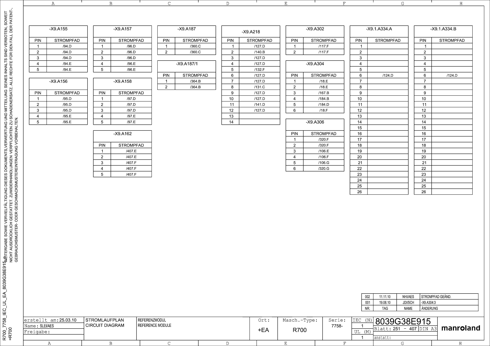

# +EA — Sheet 251 of 407 — REFERENZMODUL

**REFERENCE MODULE**

> Part of the manroland **R700** printing press IEC/UL circuit diagrams.
> Drawing class: **Stromlaufplan / Circuit diagram** (DIN A3).
> Document `+EA` covers the **Printing unit** machine section.

## At a glance

| Field | Value |
|---|---|
| Document | `+EA`  (8039G38E915) |
| Sheet | **251** of 407 |
| Section (DE) | REFERENZMODUL |
| Section (EN) | REFERENCE MODULE |
| Section type | REFERENCE_MODULE — Reference module |
| Machine type | `R700` |
| Series | `7758` |
| Created | 25.03.10 |
| Replaces | — |
| Columns used | A, B, C, D, E, F, G, H |
| Path numbers | — |
| Labels on sheet | 217 |
| Cross-refs out | 57 |
| Cross-refs in | 0 |

**Previous:** [+EA sheet 250](SHEET_0250.md) · **Next:** [+EA sheet 252](SHEET_0252.md) · **Document TOC:** [_TOC.md](_TOC.md)  (+EA) · **Master TOC:** [all sheets](../_MASTER_TOC.md)

## Sheet image (300 DPI, exact vector render)



_Rendered directly from the PDF vector layer at 300 DPI (1-bit), no OCR and no resampling. Use it to confirm anything ambiguous in the text below._

## Cross-references on this sheet

Each entry is a wire leaving this sheet. The printed token is `/sheet.column`; the link resolves to that sheet inside the same document.

| Ref | Target sheet | Col | Path | Destination on target | Target section | From col |
|---|---|---|---|---|---|---|
| `/117.F` | [+EA sheet 117](SHEET_0117.md) | F | — | — | FORMATEINSTELLUNG: BOGENGERADESTOSSER | F |
| `/94.D` | [+EA sheet 94](SHEET_0094.md) | D | — | — | BLASRAHMEN | A |
| `/96.D` | [+EA sheet 96](SHEET_0096.md) | D | — | — | BLASRAHMEN | B |
| `/360.C` | [+EA sheet 360](SHEET_0360.md) | C | — | — | OPTION: | C |
| `/127.D` | [+EA sheet 127](SHEET_0127.md) | D | — | — | ZUGANGSABSICHERUNG | E |
| `/140.B` | [+EA sheet 140](SHEET_0140.md) | B | — | — | ZUGANGSABSICHERUNG | E |
| `/117.F` | [+EA sheet 117](SHEET_0117.md) | F | — | — | FORMATEINSTELLUNG: BOGENGERADESTOSSER | F |
| `/94.D` | [+EA sheet 94](SHEET_0094.md) | D | — | — | BLASRAHMEN | A |
| `/96.D` | [+EA sheet 96](SHEET_0096.md) | D | — | — | BLASRAHMEN | B |
| `/360.C` | [+EA sheet 360](SHEET_0360.md) | C | — | — | OPTION: | C |
| `/94.D` | [+EA sheet 94](SHEET_0094.md) | D | — | — | BLASRAHMEN | A |
| `/96.D` | [+EA sheet 96](SHEET_0096.md) | D | — | — | BLASRAHMEN | B |
| `/127.D` | [+EA sheet 127](SHEET_0127.md) | D | — | — | ZUGANGSABSICHERUNG | E |
| `/94.E` | [+EA sheet 94](SHEET_0094.md) | E | — | — | BLASRAHMEN | A |
| `/96.E` | [+EA sheet 96](SHEET_0096.md) | E | — | — | BLASRAHMEN | B |
| `/127.D` | [+EA sheet 127](SHEET_0127.md) | D | — | — | ZUGANGSABSICHERUNG | E |
| `/94.E` | [+EA sheet 94](SHEET_0094.md) | E | — | — | BLASRAHMEN | A |
| `/96.E` | [+EA sheet 96](SHEET_0096.md) | E | — | — | BLASRAHMEN | B |
| `/132.F` | [+EA sheet 132](SHEET_0132.md) | F | — | — | ZUGANGSABSICHERUNG | E |
| `/127.D` | [+EA sheet 127](SHEET_0127.md) | D | — | — | ZUGANGSABSICHERUNG | E |
| `/124.D` | [+EA sheet 124](SHEET_0124.md) | D | — | — | TROCKENBESTÄUBER | G |
| `/124.D` | [+EA sheet 124](SHEET_0124.md) | D | — | — | TROCKENBESTÄUBER | H |
| `/18.E` | [+EA sheet 18](SHEET_0018.md) | E | — | — | SPANNUNGSVERSORGUNG: 400V, 24V | F |
| `/364.B` | [+EA sheet 364](SHEET_0364.md) | B | — | — | OPTION: TROCKNER VORBEREITUNG; | C |
| `/127.D` | [+EA sheet 127](SHEET_0127.md) | D | — | — | ZUGANGSABSICHERUNG | E |
| `/18.E` | [+EA sheet 18](SHEET_0018.md) | E | — | — | SPANNUNGSVERSORGUNG: 400V, 24V | F |
| `/364.B` | [+EA sheet 364](SHEET_0364.md) | B | — | — | OPTION: TROCKNER VORBEREITUNG; | C |
| `/131.C` | [+EA sheet 131](SHEET_0131.md) | C | — | — | ZUGANGSABSICHERUNG | E |
| `/167.B` | [+EA sheet 167](SHEET_0167.md) | B | — | — | BOGENFÜHRUNGSELEMENT (BLASROHRE) | F |
| `/127.D` | [+EA sheet 127](SHEET_0127.md) | D | — | — | ZUGANGSABSICHERUNG | E |
| `/184.B` | [+EA sheet 184](SHEET_0184.md) | B | — | — | RESERVE | F |
| `/95.D` | [+EA sheet 95](SHEET_0095.md) | D | — | — | BLASRAHMEN | A |
| `/97.D` | [+EA sheet 97](SHEET_0097.md) | D | — | — | BLASRAHMEN | B |
| `/127.D` | [+EA sheet 127](SHEET_0127.md) | D | — | — | ZUGANGSABSICHERUNG | E |
| `/95.D` | [+EA sheet 95](SHEET_0095.md) | D | — | — | BLASRAHMEN | A |
| `/97.D` | [+EA sheet 97](SHEET_0097.md) | D | — | — | BLASRAHMEN | B |
| `/141.D` | [+EA sheet 141](SHEET_0141.md) | D | — | — | ZUGANGSABSICHERUNG | E |
| `/184.D` | [+EA sheet 184](SHEET_0184.md) | D | — | — | RESERVE | F |
| `/18.F` | [+EA sheet 18](SHEET_0018.md) | F | — | — | SPANNUNGSVERSORGUNG: 400V, 24V | F |
| `/95.D` | [+EA sheet 95](SHEET_0095.md) | D | — | — | BLASRAHMEN | A |
| `/97.D` | [+EA sheet 97](SHEET_0097.md) | D | — | — | BLASRAHMEN | B |
| `/127.D` | [+EA sheet 127](SHEET_0127.md) | D | — | — | ZUGANGSABSICHERUNG | E |
| `/95.E` | [+EA sheet 95](SHEET_0095.md) | E | — | — | BLASRAHMEN | A |
| `/97.E` | [+EA sheet 97](SHEET_0097.md) | E | — | — | BLASRAHMEN | B |
| `/95.E` | [+EA sheet 95](SHEET_0095.md) | E | — | — | BLASRAHMEN | A |
| `/97.E` | [+EA sheet 97](SHEET_0097.md) | E | — | — | BLASRAHMEN | B |
| `/320.F` | [+EA sheet 320](SHEET_0320.md) | F | — | — | OPTION: VERLÄNGERUNG 3656,8MM | F |
| `/320.F` | [+EA sheet 320](SHEET_0320.md) | F | — | — | OPTION: VERLÄNGERUNG 3656,8MM | F |
| `/407.E` | [+EA sheet 407](SHEET_0407.md) | E | — | — | OPTION: AIR STATION | B |
| `/106.E` | [+EA sheet 106](SHEET_0106.md) | E | — | — | BOGENFÜHRUNGSELEMENT | F |
| `/407.E` | [+EA sheet 407](SHEET_0407.md) | E | — | — | OPTION: AIR STATION | B |
| `/106.F` | [+EA sheet 106](SHEET_0106.md) | F | — | — | BOGENFÜHRUNGSELEMENT | F |
| `/407.F` | [+EA sheet 407](SHEET_0407.md) | F | — | — | OPTION: AIR STATION | B |
| `/106.G` | [+EA sheet 106](SHEET_0106.md) | G | — | — | BOGENFÜHRUNGSELEMENT | F |
| `/407.F` | [+EA sheet 407](SHEET_0407.md) | F | — | — | OPTION: AIR STATION | B |
| `/320.G` | [+EA sheet 320](SHEET_0320.md) | G | — | — | OPTION: VERLÄNGERUNG 3656,8MM | F |
| `/407.F` | [+EA sheet 407](SHEET_0407.md) | F | — | — | OPTION: AIR STATION | B |

## Devices on this sheet

| Tag | Class | Class meaning (IEC) | Col | Sub | Terminal | Sign |
|---|---|---|---|---|---|---|
| `X9.A155` | — | cross-device reference | A | — | — | — |
| `X9.A156` | — | cross-device reference | A | — | — | — |
| `X9.A218` | — | cross-device reference | D | — | — | — |
| `X9.A302` | — | cross-device reference | F | — | — | — |
| `X9.A304` | — | cross-device reference | F | — | — | — |
| `X9.A306` | — | cross-device reference | F | — | — | — |
| `X9.A157` | — | cross-device reference | B | — | — | — |
| `X9.A158` | — | cross-device reference | B | — | — | — |
| `X9.A187` | — | cross-device reference | C | — | — | — |
| `X9.1.A334.A` | — | cross-device reference | G | — | — | — |
| `X9.1.A334.B` | — | cross-device reference | H | — | — | — |
| `X9.A162` | — | cross-device reference | B | — | — | — |
| `NR.` | — | cross-device reference | F | — | — | — |
| `19.08.10` | — | cross-device reference | G | — | — | — |
| `X9.A304:3` | — | cross-device reference | G | — | 3 | — |
| `11.11.10` | — | cross-device reference | G | — | — | — |

## Potentials / nets

_No named potentials on this sheet._

## Wire-end annotations (grouped as printed)

A wire that continues elsewhere is annotated with a small cluster: the destination description, the path/line number `#NN`, and the `/sheet.column` cross reference. Each row below is one such cluster exactly as it is grouped on the drawing.

| Col | Y | Path | Cross-ref | Text on the wire |
|---|---|---|---|---|
| A | 65.5 | — | — | `X9.A155` |
| B | 65.5 | — | — | `X9.A157` |
| C | 65.5 | — | — | `X9.A187` |
| F | 65.5 | — | — | `X9.A302` |
| G | 65.5 | — | — | `X9.1.A334.A` |
| H | 65.5 | — | — | `X9.1.A334.B` |
| D | 72.6 | — | — | `X9.A218` |
| A | 94.2 | — | — | `PIN 2 3 4 5 1 STROMPFAD` |
| B | 94.2 | — | — | `PIN 2 3 4 5 1 STROMPFAD` |
| C | 94.2 | — | — | `PIN 2 1 STROMPFAD` |
| D | 94.2 | — | — | `PIN STROMPFAD` |
| E | 94.2 | — | — | `PIN 2 1 STROMPFAD` |
| G | 94.2 | — | — | `PIN STROMPFAD` |
| H | 94.2 | — | — | `PIN STROMPFAD` |
| D | 108.4 | — | — | `2 3 4 5 6 7 8 9 1` |
| F | 108.4 | — | — | `2 3 4 5 6 7 8 9 1` |
| G | 108.4 | — | — | `2 3 4 5 6 7 8 9 1` |
| A | 108.7 | — | `/94.D` | — |
| B | 108.7 | — | `/96.D` | — |
| C | 108.7 | — | `/360.C` | — |
| E | 108.7 | — | `/127.D` | — |
| F | 108.7 | — | `/117.F` | — |
| A | 122.9 | — | `/94.D` | — |
| B | 122.9 | — | `/96.D` | — |
| C | 122.9 | — | `/360.C` | — |
| E | 122.9 | — | `/140.B` | — |
| F | 122.9 | — | `/117.F` | — |
| A | 137.1 | — | `/94.D` | — |
| B | 137.1 | — | `/96.D` | — |
| E | 137.1 | — | `/127.D` | — |
| C | 150.6 | — | — | `X9.A187/1` |
| F | 150.6 | — | — | `X9.A304` |
| A | 151.2 | — | `/94.E` | — |
| B | 151.2 | — | `/96.E` | — |
| E | 151.2 | — | `/127.D` | — |
| A | 165.4 | — | `/94.E` | — |
| B | 165.4 | — | `/96.E` | — |
| E | 165.4 | — | `/132.F` | — |
| C | 179.2 | — | — | `PIN 2 1 STROMPFAD` |
| E | 179.2 | — | — | `PIN 2 3 4 5 6 1 STROMPFAD` |
| E | 179.6 | — | `/127.D` | — |
| G | 179.6 | — | `/124.D` | — |
| H | 179.6 | — | `/124.D` | — |
| A | 193.1 | — | — | `X9.A156` |
| B | 193.1 | — | — | `X9.A158` |
| C | 193.7 | — | `/364.B` | — |
| F | 193.7 | — | `/18.E` | — |
| E | 193.8 | — | `/127.D` | — |
| C | 207.9 | — | `/364.B` | — |
| E | 207.9 | — | `/131.C` | — |
| F | 207.9 | — | `/18.E` | — |
| A | 221.7 | — | — | `PIN 2 3 4 5 1 STROMPFAD` |
| B | 221.7 | — | — | `PIN 2 3 4 5 1 STROMPFAD` |
| E | 222.1 | — | `/127.D` | — |
| F | 222.1 | — | `/167.B` | — |
| D | 235.9 | — | — | `10 12 13 14 11` |
| F | 235.9 | — | — | `10 12 13 14 15 16 17 18 19 20 11` |
| G | 235.9 | — | — | `10 12 13 14 15 16 17 18 19 20 11` |
| F | 236.2 | — | `/184.B` | — |
| A | 236.3 | — | `/95.D` | — |
| B | 236.3 | — | `/97.D` | — |
| E | 236.3 | — | `/127.D` | — |
| A | 250.4 | — | `/95.D` | — |
| B | 250.4 | — | `/97.D` | — |
| E | 250.4 | — | `/141.D` | — |
| F | 250.4 | — | `/184.D` | — |
| A | 264.6 | — | `/95.D` | — |
| B | 264.6 | — | `/97.D` | — |
| E | 264.6 | — | `/127.D` | — |
| F | 264.6 | — | `/18.F` | — |
| A | 278.8 | — | `/95.E` | — |
| B | 278.8 | — | `/97.E` | — |
| F | 292.3 | — | — | `X9.A306` |
| A | 292.9 | — | `/95.E` | — |
| B | 292.9 | — | `/97.E` | — |
| B | 320.6 | — | — | `X9.A162` |
| E | 320.9 | — | — | `PIN 2 3 4 5 6 1 STROMPFAD` |
| F | 335.5 | — | `/320.F` | — |
| B | 349.3 | — | — | `PIN 2 3 4 5 1 STROMPFAD` |
| F | 349.6 | — | `/320.F` | — |
| B | 363.8 | — | `/407.E` | — |
| F | 363.8 | — | `/106.E` | — |
| B | 378.0 | — | `/407.E` | — |
| F | 378.0 | — | `/106.F` | — |
| F | 391.8 | — | — | `22 23 24 25 26 21` |
| G | 391.8 | — | — | `22 23 24 25 26 21` |
| B | 392.2 | — | `/407.F` | — |
| F | 392.2 | — | `/106.G` | — |
| B | 406.3 | — | `/407.F` | — |
| F | 406.3 | — | `/320.G` | — |
| B | 420.5 | — | `/407.F` | — |
| G | 718.9 | — | — | `002 11.11.10 NHI/AES STROMPFAD GEÄND.` |
| G | 733.0 | — | — | `001 19.08.10 JDI/SCH X9.A304:3` |
| G | 747.1 | — | — | `NR. TAG NAME ÄNDERUNG` |


## Reconstructed tables

This sheet carries tabular content (pin map / terminal assignment / index). The grid below was rebuilt from the drawing's own rule lines, so each row is exactly one physical row of the table.

### Table 1 — 12 data rows × 2 columns (at x=70.9, y=62.4) — **X9.A155**

| PIN | STROMPFAD |
|---|---|
| `1` | `/94.D` |
| `2` | `/94.D` |
| `3` | `/94.D` |
| `4` | `/94.E` |
| `5` | `/94.E` |
|  | `X9.A156` |
| `PIN` | `STROMPFAD` |
| `1` | `/95.D` |
| `2` | `/95.D` |
| `3` | `/95.D` |
| `4` | `/95.E` |
| `5` | `/95.E` |


### Table 2 — 19 data rows × 2 columns (at x=226.8, y=62.4) — **X9.A157**

| PIN | STROMPFAD |
|---|---|
| `1` | `/96.D` |
| `2` | `/96.D` |
| `3` | `/96.D` |
| `4` | `/96.E` |
| `5` | `/96.E` |
|  | `X9.A158` |
| `PIN` | `STROMPFAD` |
| `1` | `/97.D` |
| `2` | `/97.D` |
| `3` | `/97.D` |
| `4` | `/97.E` |
| `5` | `/97.E` |
|  | `X9.A162` |
| `PIN` | `STROMPFAD` |
| `1` | `/407.E` |
| `2` | `/407.E` |
| `3` | `/407.F` |
| `4` | `/407.F` |
| `5` | `/407.F` |


### Table 3 — 6 data rows × 2 columns (at x=382.7, y=62.4) — **X9.A187**

| PIN | STROMPFAD |
|---|---|
| `1` | `/360.C` |
| `2` | `/360.C` |
|  | `X9.A187/1` |
| `PIN` | `STROMPFAD` |
| `1` | `/364.B` |
| `2` | `/364.B` |


### Table 4 — 14 data rows × 2 columns (at x=538.6, y=62.4) — **X9.A218**

| PIN | STROMPFAD |
|---|---|
| `1` | `/127.D` |
| `2` | `/140.B` |
| `3` | `/127.D` |
| `4` | `/127.D` |
| `5` | `/132.F` |
| `6` | `/127.D` |
| `7` | `/127.D` |
| `8` | `/131.C` |
| `9` | `/127.D` |
| `10` | `/127.D` |
| `11` | `/141.D` |
| `12` | `/127.D` |
| `13` |  |
| `14` |  |


### Table 5 — 18 data rows × 2 columns (at x=694.5, y=62.4) — **X9.A302**

| PIN | STROMPFAD |
|---|---|
| `1` | `/117.F` |
| `2` | `/117.F` |
|  | `X9.A304` |
| `PIN` | `STROMPFAD` |
| `1` | `/18.E` |
| `2` | `/18.E` |
| `3` | `/167.B` |
| `4` | `/184.B` |
| `5` | `/184.D` |
| `6` | `/18.F` |
|  | `X9.A306` |
| `PIN` | `STROMPFAD` |
| `1` | `/320.F` |
| `2` | `/320.F` |
| `3` | `/106.E` |
| `4` | `/106.F` |
| `5` | `/106.G` |
| `6` | `/320.G` |


### Table 6 — 26 data rows × 2 columns (at x=850.4, y=62.4) — **X9.1.A334.A**

| PIN | STROMPFAD |
|---|---|
| `1` |  |
| `2` |  |
| `3` |  |
| `4` |  |
| `5` |  |
| `6` | `/124.D` |
| `7` |  |
| `8` |  |
| `9` |  |
| `10` |  |
| `11` |  |
| `12` |  |
| `13` |  |
| `14` |  |
| `15` |  |
| `16` |  |
| `17` |  |
| `18` |  |
| `19` |  |
| `20` |  |
| `21` |  |
| `22` |  |
| `23` |  |
| `24` |  |
| `25` |  |
| `26` |  |


### Table 7 — 26 data rows × 2 columns (at x=1006.3, y=62.4) — **X9.1.A334.B**

| PIN | STROMPFAD |
|---|---|
| `1` |  |
| `2` |  |
| `3` |  |
| `4` |  |
| `5` |  |
| `6` | `/124.D` |
| `7` |  |
| `8` |  |
| `9` |  |
| `10` |  |
| `11` |  |
| `12` |  |
| `13` |  |
| `14` |  |
| `15` |  |
| `16` |  |
| `17` |  |
| `18` |  |
| `19` |  |
| `20` |  |
| `21` |  |
| `22` |  |
| `23` |  |
| `24` |  |
| `25` |  |
| `26` |  |


## Notes and free text on this sheet

| Text | Col | Y (pt) |
|---|---|---|
| `PIN` | A | 94.2 |
| `STROMPFAD` | A | 94.15 |
| `PIN` | D | 94.2 |
| `STROMPFAD` | E | 94.15 |
| `PIN` | E | 94.2 |
| `STROMPFAD` | F | 94.15 |
| `PIN` | B | 94.2 |
| `STROMPFAD` | B | 94.15 |
| `PIN` | C | 94.2 |
| `STROMPFAD` | C | 94.15 |
| `X9.A187/1` | C | 150.55 |
| `PIN` | F | 94.2 |
| `STROMPFAD` | G | 94.15 |
| `PIN` | G | 94.2 |
| `STROMPFAD` | H | 94.15 |
| `TAG` | G | 747.27 |
| `NAME` | G | 747.25 |
| `ÄNDERUNG` | G | 747.31 |
| `JDI/SCH` | G | 733.1 |
| `NHI/AES` | G | 718.93 |
| `STROMPFAD GEÄND.` | H | 718.94 |

## Complete label inventory (exact text from the drawing)

Every text object inside the drawing area of this sheet, in DIN reading order (column A→H, then top→bottom). This is the authoritative list: if a string is not here it is not printed on this sheet.

| Col | Y | X | Dir | Type | Text |
|---|---|---|---|---|---|
| A | 65.5 | 119.8 | → | device ref | `X9.A155` |
| A | 94.2 | 84.0 | → | text | `PIN` |
| A | 94.2 | 132.2 | → | text | `STROMPFAD` |
| A | 108.4 | 90.0 | → | number | `1` |
| A | 108.7 | 152.6 | → | cross-reference | `/94.D` |
| A | 122.5 | 89.4 | → | number | `2` |
| A | 122.9 | 152.6 | → | cross-reference | `/94.D` |
| A | 136.7 | 89.4 | → | number | `3` |
| A | 137.1 | 152.6 | → | cross-reference | `/94.D` |
| A | 150.9 | 89.4 | → | number | `4` |
| A | 151.2 | 152.9 | → | cross-reference | `/94.E` |
| A | 165.1 | 89.4 | → | number | `5` |
| A | 165.4 | 152.9 | → | cross-reference | `/94.E` |
| A | 193.1 | 119.8 | → | device ref | `X9.A156` |
| A | 221.7 | 132.2 | → | text | `STROMPFAD` |
| A | 221.8 | 84.0 | → | text | `PIN` |
| A | 235.9 | 90.0 | → | number | `1` |
| A | 236.3 | 152.6 | → | cross-reference | `/95.D` |
| A | 250.1 | 89.4 | → | number | `2` |
| A | 250.4 | 152.6 | → | cross-reference | `/95.D` |
| A | 264.3 | 89.4 | → | number | `3` |
| A | 264.6 | 152.6 | → | cross-reference | `/95.D` |
| A | 278.5 | 89.4 | → | number | `4` |
| A | 278.8 | 152.9 | → | cross-reference | `/95.E` |
| A | 292.6 | 89.4 | → | number | `5` |
| A | 292.9 | 152.9 | → | cross-reference | `/95.E` |
| B | 65.5 | 275.7 | → | device ref | `X9.A157` |
| B | 94.2 | 240.0 | → | text | `PIN` |
| B | 94.2 | 288.1 | → | text | `STROMPFAD` |
| B | 108.4 | 245.9 | → | number | `1` |
| B | 108.7 | 308.6 | → | cross-reference | `/96.D` |
| B | 122.5 | 245.3 | → | number | `2` |
| B | 122.9 | 308.6 | → | cross-reference | `/96.D` |
| B | 136.7 | 245.3 | → | number | `3` |
| B | 137.1 | 308.6 | → | cross-reference | `/96.D` |
| B | 150.9 | 245.3 | → | number | `4` |
| B | 151.2 | 308.8 | → | cross-reference | `/96.E` |
| B | 165.1 | 245.3 | → | number | `5` |
| B | 165.4 | 308.8 | → | cross-reference | `/96.E` |
| B | 193.1 | 275.7 | → | device ref | `X9.A158` |
| B | 221.7 | 288.1 | → | text | `STROMPFAD` |
| B | 221.8 | 240.0 | → | text | `PIN` |
| B | 235.9 | 245.9 | → | number | `1` |
| B | 236.3 | 308.6 | → | cross-reference | `/97.D` |
| B | 250.1 | 245.3 | → | number | `2` |
| B | 250.4 | 308.6 | → | cross-reference | `/97.D` |
| B | 264.3 | 245.3 | → | number | `3` |
| B | 264.6 | 308.6 | → | cross-reference | `/97.D` |
| B | 278.5 | 245.3 | → | number | `4` |
| B | 278.8 | 308.8 | → | cross-reference | `/97.E` |
| B | 292.6 | 245.3 | → | number | `5` |
| B | 292.9 | 308.8 | → | cross-reference | `/97.E` |
| B | 320.6 | 275.7 | → | device ref | `X9.A162` |
| B | 349.3 | 240.0 | → | text | `PIN` |
| B | 349.3 | 288.1 | → | text | `STROMPFAD` |
| B | 363.5 | 245.9 | → | number | `1` |
| B | 363.8 | 306.4 | → | cross-reference | `/407.E` |
| B | 377.7 | 245.3 | → | number | `2` |
| B | 378.0 | 306.4 | → | cross-reference | `/407.E` |
| B | 391.8 | 245.3 | → | number | `3` |
| B | 392.2 | 306.6 | → | cross-reference | `/407.F` |
| B | 406.0 | 245.3 | → | number | `4` |
| B | 406.3 | 306.6 | → | cross-reference | `/407.F` |
| B | 420.2 | 245.3 | → | number | `5` |
| B | 420.5 | 306.6 | → | cross-reference | `/407.F` |
| C | 65.5 | 431.6 | → | device ref | `X9.A187` |
| C | 94.2 | 395.9 | → | text | `PIN` |
| C | 94.2 | 444.0 | → | text | `STROMPFAD` |
| C | 108.4 | 401.8 | → | number | `1` |
| C | 108.7 | 462.0 | → | cross-reference | `/360.C` |
| C | 122.5 | 401.2 | → | number | `2` |
| C | 122.9 | 462.0 | → | cross-reference | `/360.C` |
| C | 150.5 | 427.9 | → | text | `X9.A187/1` |
| C | 179.2 | 395.9 | → | text | `PIN` |
| C | 179.2 | 444.0 | → | text | `STROMPFAD` |
| C | 193.4 | 401.8 | → | number | `1` |
| C | 193.7 | 462.2 | → | cross-reference | `/364.B` |
| C | 207.6 | 401.2 | → | number | `2` |
| C | 207.9 | 462.2 | → | cross-reference | `/364.B` |
| D | 72.6 | 587.5 | → | device ref | `X9.A218` |
| D | 94.2 | 551.8 | → | text | `PIN` |
| D | 108.4 | 563.5 | → | number | `1` |
| D | 122.5 | 561.8 | → | number | `2` |
| D | 136.7 | 561.8 | → | number | `3` |
| D | 150.9 | 561.8 | → | number | `4` |
| D | 165.1 | 561.8 | → | number | `5` |
| D | 179.2 | 561.8 | → | number | `6` |
| D | 193.4 | 561.8 | → | number | `7` |
| D | 207.6 | 561.8 | → | number | `8` |
| D | 221.8 | 561.8 | → | number | `9` |
| D | 235.9 | 556.4 | → | number | `10` |
| D | 250.1 | 558.1 | → | number | `11` |
| D | 264.3 | 556.4 | → | number | `12` |
| D | 278.5 | 556.4 | → | number | `13` |
| D | 292.6 | 556.4 | → | number | `14` |
| E | 94.2 | 600.0 | → | text | `STROMPFAD` |
| E | 94.2 | 707.7 | → | text | `PIN` |
| E | 108.4 | 713.6 | → | number | `1` |
| E | 108.7 | 618.0 | → | cross-reference | `/127.D` |
| E | 122.5 | 713.1 | → | number | `2` |
| E | 122.9 | 618.1 | → | cross-reference | `/140.B` |
| E | 137.1 | 618.0 | → | cross-reference | `/127.D` |
| E | 151.2 | 618.0 | → | cross-reference | `/127.D` |
| E | 165.4 | 618.4 | → | cross-reference | `/132.F` |
| E | 179.2 | 707.7 | → | text | `PIN` |
| E | 179.6 | 618.0 | → | cross-reference | `/127.D` |
| E | 193.4 | 713.6 | → | number | `1` |
| E | 193.8 | 618.0 | → | cross-reference | `/127.D` |
| E | 207.6 | 713.1 | → | number | `2` |
| E | 207.9 | 618.0 | → | cross-reference | `/131.C` |
| E | 221.8 | 713.1 | → | number | `3` |
| E | 222.1 | 618.0 | → | cross-reference | `/127.D` |
| E | 235.9 | 713.1 | → | number | `4` |
| E | 236.3 | 618.0 | → | cross-reference | `/127.D` |
| E | 250.1 | 713.1 | → | number | `5` |
| E | 250.4 | 618.0 | → | cross-reference | `/141.D` |
| E | 264.3 | 713.1 | → | number | `6` |
| E | 264.6 | 618.0 | → | cross-reference | `/127.D` |
| E | 321.0 | 707.7 | → | text | `PIN` |
| E | 335.1 | 713.6 | → | number | `1` |
| E | 349.3 | 713.1 | → | number | `2` |
| E | 363.5 | 713.1 | → | number | `3` |
| E | 377.7 | 713.1 | → | number | `4` |
| E | 391.8 | 713.1 | → | number | `5` |
| E | 406.0 | 713.1 | → | number | `6` |
| F | 65.5 | 743.4 | → | device ref | `X9.A302` |
| F | 94.2 | 755.9 | → | text | `STROMPFAD` |
| F | 94.2 | 863.6 | → | text | `PIN` |
| F | 108.4 | 875.3 | → | number | `1` |
| F | 108.7 | 774.3 | → | cross-reference | `/117.F` |
| F | 122.5 | 873.6 | → | number | `2` |
| F | 122.9 | 774.3 | → | cross-reference | `/117.F` |
| F | 136.7 | 873.6 | → | number | `3` |
| F | 150.5 | 743.4 | → | device ref | `X9.A304` |
| F | 150.9 | 873.6 | → | number | `4` |
| F | 165.1 | 873.6 | → | number | `5` |
| F | 179.2 | 755.9 | → | text | `STROMPFAD` |
| F | 179.2 | 873.6 | → | number | `6` |
| F | 193.4 | 873.6 | → | number | `7` |
| F | 193.7 | 776.6 | → | cross-reference | `/18.E` |
| F | 207.6 | 873.6 | → | number | `8` |
| F | 207.9 | 776.6 | → | cross-reference | `/18.E` |
| F | 221.8 | 873.6 | → | number | `9` |
| F | 222.1 | 774.0 | → | cross-reference | `/167.B` |
| F | 235.9 | 868.3 | → | number | `10` |
| F | 236.2 | 774.0 | → | cross-reference | `/184.B` |
| F | 250.1 | 870.0 | → | number | `11` |
| F | 250.4 | 773.9 | → | cross-reference | `/184.D` |
| F | 264.3 | 868.3 | → | number | `12` |
| F | 264.6 | 776.7 | → | cross-reference | `/18.F` |
| F | 278.5 | 868.3 | → | number | `13` |
| F | 292.3 | 743.4 | → | device ref | `X9.A306` |
| F | 292.6 | 868.3 | → | number | `14` |
| F | 306.8 | 868.3 | → | number | `15` |
| F | 320.9 | 755.9 | → | text | `STROMPFAD` |
| F | 321.0 | 868.3 | → | number | `16` |
| F | 335.1 | 868.3 | → | number | `17` |
| F | 335.5 | 774.3 | → | cross-reference | `/320.F` |
| F | 349.3 | 868.3 | → | number | `18` |
| F | 349.6 | 774.3 | → | cross-reference | `/320.F` |
| F | 363.5 | 868.3 | → | number | `19` |
| F | 363.8 | 774.1 | → | cross-reference | `/106.E` |
| F | 377.7 | 868.3 | → | number | `20` |
| F | 378.0 | 774.3 | → | cross-reference | `/106.F` |
| F | 391.8 | 870.0 | → | number | `21` |
| F | 392.2 | 773.7 | → | cross-reference | `/106.G` |
| F | 406.0 | 868.3 | → | number | `22` |
| F | 406.3 | 773.7 | → | cross-reference | `/320.G` |
| F | 420.2 | 868.3 | → | number | `23` |
| F | 434.4 | 868.3 | → | number | `24` |
| F | 448.5 | 868.3 | → | number | `25` |
| F | 462.7 | 868.3 | → | number | `26` |
| F | 719.0 | 887.1 | → | number | `002` |
| F | 733.0 | 887.7 | → | number | `001` |
| F | 747.1 | 886.7 | → | device ref | `NR.` |
| G | 65.5 | 889.5 | → | device ref | `X9.1.A334.A` |
| G | 94.2 | 911.8 | → | text | `STROMPFAD` |
| G | 94.2 | 1019.5 | → | text | `PIN` |
| G | 108.4 | 1031.2 | → | number | `1` |
| G | 122.5 | 1029.5 | → | number | `2` |
| G | 136.7 | 1029.5 | → | number | `3` |
| G | 150.9 | 1029.5 | → | number | `4` |
| G | 165.1 | 1029.5 | → | number | `5` |
| G | 179.2 | 1029.5 | → | number | `6` |
| G | 179.6 | 929.8 | → | cross-reference | `/124.D` |
| G | 193.4 | 1029.5 | → | number | `7` |
| G | 207.6 | 1029.5 | → | number | `8` |
| G | 221.8 | 1029.5 | → | number | `9` |
| G | 235.9 | 1024.2 | → | number | `10` |
| G | 250.1 | 1025.9 | → | number | `11` |
| G | 264.3 | 1024.2 | → | number | `12` |
| G | 278.5 | 1024.2 | → | number | `13` |
| G | 292.6 | 1024.2 | → | number | `14` |
| G | 306.8 | 1024.2 | → | number | `15` |
| G | 321.0 | 1024.2 | → | number | `16` |
| G | 335.1 | 1024.2 | → | number | `17` |
| G | 349.3 | 1024.2 | → | number | `18` |
| G | 363.5 | 1024.2 | → | number | `19` |
| G | 377.7 | 1024.2 | → | number | `20` |
| G | 391.8 | 1025.9 | → | number | `21` |
| G | 406.0 | 1024.2 | → | number | `22` |
| G | 420.2 | 1024.2 | → | number | `23` |
| G | 434.4 | 1024.2 | → | number | `24` |
| G | 448.5 | 1024.2 | → | number | `25` |
| G | 462.7 | 1024.2 | → | number | `26` |
| G | 718.9 | 921.5 | → | device ref | `11.11.10` |
| G | 718.9 | 977.9 | → | text | `NHI/AES` |
| G | 733.1 | 921.5 | → | device ref | `19.08.10` |
| G | 733.1 | 978.7 | → | text | `JDI/SCH` |
| G | 733.1 | 1023.7 | → | device ref | `X9.A304:3` |
| G | 747.3 | 928.3 | → | text | `TAG` |
| G | 747.3 | 981.7 | → | text | `NAME` |
| G | 747.3 | 1024.3 | → | text | `ÄNDERUNG` |
| H | 65.5 | 1045.8 | → | device ref | `X9.1.A334.B` |
| H | 94.2 | 1067.7 | → | text | `STROMPFAD` |
| H | 179.6 | 1085.7 | → | cross-reference | `/124.D` |
| H | 718.9 | 1023.4 | → | text | `STROMPFAD GEÄND.` |

## Reading-order text block

The same content as a plain block, grouped by DIN column — convenient to paste or to match against a visual description.

```text
=== Column A ===
  65.5  119.8  devref       X9.A155
  94.2   84.0  text         PIN
  94.2  132.2  text         STROMPFAD
 108.4   90.0  numeric      1
 108.7  152.6  xref         /94.D
 122.5   89.4  numeric      2
 122.9  152.6  xref         /94.D
 136.7   89.4  numeric      3
 137.1  152.6  xref         /94.D
 150.9   89.4  numeric      4
 151.2  152.9  xref         /94.E
 165.1   89.4  numeric      5
 165.4  152.9  xref         /94.E
 193.1  119.8  devref       X9.A156
 221.7  132.2  text         STROMPFAD
 221.8   84.0  text         PIN
 235.9   90.0  numeric      1
 236.3  152.6  xref         /95.D
 250.1   89.4  numeric      2
 250.4  152.6  xref         /95.D
 264.3   89.4  numeric      3
 264.6  152.6  xref         /95.D
 278.5   89.4  numeric      4
 278.8  152.9  xref         /95.E
 292.6   89.4  numeric      5
 292.9  152.9  xref         /95.E
=== Column B ===
  65.5  275.7  devref       X9.A157
  94.2  240.0  text         PIN
  94.2  288.1  text         STROMPFAD
 108.4  245.9  numeric      1
 108.7  308.6  xref         /96.D
 122.5  245.3  numeric      2
 122.9  308.6  xref         /96.D
 136.7  245.3  numeric      3
 137.1  308.6  xref         /96.D
 150.9  245.3  numeric      4
 151.2  308.8  xref         /96.E
 165.1  245.3  numeric      5
 165.4  308.8  xref         /96.E
 193.1  275.7  devref       X9.A158
 221.7  288.1  text         STROMPFAD
 221.8  240.0  text         PIN
 235.9  245.9  numeric      1
 236.3  308.6  xref         /97.D
 250.1  245.3  numeric      2
 250.4  308.6  xref         /97.D
 264.3  245.3  numeric      3
 264.6  308.6  xref         /97.D
 278.5  245.3  numeric      4
 278.8  308.8  xref         /97.E
 292.6  245.3  numeric      5
 292.9  308.8  xref         /97.E
 320.6  275.7  devref       X9.A162
 349.3  240.0  text         PIN
 349.3  288.1  text         STROMPFAD
 363.5  245.9  numeric      1
 363.8  306.4  xref         /407.E
 377.7  245.3  numeric      2
 378.0  306.4  xref         /407.E
 391.8  245.3  numeric      3
 392.2  306.6  xref         /407.F
 406.0  245.3  numeric      4
 406.3  306.6  xref         /407.F
 420.2  245.3  numeric      5
 420.5  306.6  xref         /407.F
=== Column C ===
  65.5  431.6  devref       X9.A187
  94.2  395.9  text         PIN
  94.2  444.0  text         STROMPFAD
 108.4  401.8  numeric      1
 108.7  462.0  xref         /360.C
 122.5  401.2  numeric      2
 122.9  462.0  xref         /360.C
 150.5  427.9  text         X9.A187/1
 179.2  395.9  text         PIN
 179.2  444.0  text         STROMPFAD
 193.4  401.8  numeric      1
 193.7  462.2  xref         /364.B
 207.6  401.2  numeric      2
 207.9  462.2  xref         /364.B
=== Column D ===
  72.6  587.5  devref       X9.A218
  94.2  551.8  text         PIN
 108.4  563.5  numeric      1
 122.5  561.8  numeric      2
 136.7  561.8  numeric      3
 150.9  561.8  numeric      4
 165.1  561.8  numeric      5
 179.2  561.8  numeric      6
 193.4  561.8  numeric      7
 207.6  561.8  numeric      8
 221.8  561.8  numeric      9
 235.9  556.4  numeric      10
 250.1  558.1  numeric      11
 264.3  556.4  numeric      12
 278.5  556.4  numeric      13
 292.6  556.4  numeric      14
=== Column E ===
  94.2  600.0  text         STROMPFAD
  94.2  707.7  text         PIN
 108.4  713.6  numeric      1
 108.7  618.0  xref         /127.D
 122.5  713.1  numeric      2
 122.9  618.1  xref         /140.B
 137.1  618.0  xref         /127.D
 151.2  618.0  xref         /127.D
 165.4  618.4  xref         /132.F
 179.2  707.7  text         PIN
 179.6  618.0  xref         /127.D
 193.4  713.6  numeric      1
 193.8  618.0  xref         /127.D
 207.6  713.1  numeric      2
 207.9  618.0  xref         /131.C
 221.8  713.1  numeric      3
 222.1  618.0  xref         /127.D
 235.9  713.1  numeric      4
 236.3  618.0  xref         /127.D
 250.1  713.1  numeric      5
 250.4  618.0  xref         /141.D
 264.3  713.1  numeric      6
 264.6  618.0  xref         /127.D
 321.0  707.7  text         PIN
 335.1  713.6  numeric      1
 349.3  713.1  numeric      2
 363.5  713.1  numeric      3
 377.7  713.1  numeric      4
 391.8  713.1  numeric      5
 406.0  713.1  numeric      6
=== Column F ===
  65.5  743.4  devref       X9.A302
  94.2  755.9  text         STROMPFAD
  94.2  863.6  text         PIN
 108.4  875.3  numeric      1
 108.7  774.3  xref         /117.F
 122.5  873.6  numeric      2
 122.9  774.3  xref         /117.F
 136.7  873.6  numeric      3
 150.5  743.4  devref       X9.A304
 150.9  873.6  numeric      4
 165.1  873.6  numeric      5
 179.2  755.9  text         STROMPFAD
 179.2  873.6  numeric      6
 193.4  873.6  numeric      7
 193.7  776.6  xref         /18.E
 207.6  873.6  numeric      8
 207.9  776.6  xref         /18.E
 221.8  873.6  numeric      9
 222.1  774.0  xref         /167.B
 235.9  868.3  numeric      10
 236.2  774.0  xref         /184.B
 250.1  870.0  numeric      11
 250.4  773.9  xref         /184.D
 264.3  868.3  numeric      12
 264.6  776.7  xref         /18.F
 278.5  868.3  numeric      13
 292.3  743.4  devref       X9.A306
 292.6  868.3  numeric      14
 306.8  868.3  numeric      15
 320.9  755.9  text         STROMPFAD
 321.0  868.3  numeric      16
 335.1  868.3  numeric      17
 335.5  774.3  xref         /320.F
 349.3  868.3  numeric      18
 349.6  774.3  xref         /320.F
 363.5  868.3  numeric      19
 363.8  774.1  xref         /106.E
 377.7  868.3  numeric      20
 378.0  774.3  xref         /106.F
 391.8  870.0  numeric      21
 392.2  773.7  xref         /106.G
 406.0  868.3  numeric      22
 406.3  773.7  xref         /320.G
 420.2  868.3  numeric      23
 434.4  868.3  numeric      24
 448.5  868.3  numeric      25
 462.7  868.3  numeric      26
 719.0  887.1  numeric      002
 733.0  887.7  numeric      001
 747.1  886.7  devref       NR.
=== Column G ===
  65.5  889.5  devref       X9.1.A334.A
  94.2  911.8  text         STROMPFAD
  94.2 1019.5  text         PIN
 108.4 1031.2  numeric      1
 122.5 1029.5  numeric      2
 136.7 1029.5  numeric      3
 150.9 1029.5  numeric      4
 165.1 1029.5  numeric      5
 179.2 1029.5  numeric      6
 179.6  929.8  xref         /124.D
 193.4 1029.5  numeric      7
 207.6 1029.5  numeric      8
 221.8 1029.5  numeric      9
 235.9 1024.2  numeric      10
 250.1 1025.9  numeric      11
 264.3 1024.2  numeric      12
 278.5 1024.2  numeric      13
 292.6 1024.2  numeric      14
 306.8 1024.2  numeric      15
 321.0 1024.2  numeric      16
 335.1 1024.2  numeric      17
 349.3 1024.2  numeric      18
 363.5 1024.2  numeric      19
 377.7 1024.2  numeric      20
 391.8 1025.9  numeric      21
 406.0 1024.2  numeric      22
 420.2 1024.2  numeric      23
 434.4 1024.2  numeric      24
 448.5 1024.2  numeric      25
 462.7 1024.2  numeric      26
 718.9  921.5  devref       11.11.10
 718.9  977.9  text         NHI/AES
 733.1  921.5  devref       19.08.10
 733.1  978.7  text         JDI/SCH
 733.1 1023.7  devref       X9.A304:3
 747.3  928.3  text         TAG
 747.3  981.7  text         NAME
 747.3 1024.3  text         ÄNDERUNG
=== Column H ===
  65.5 1045.8  devref       X9.1.A334.B
  94.2 1067.7  text         STROMPFAD
 179.6 1085.7  xref         /124.D
 718.9 1023.4  text         STROMPFAD GEÄND.
```

---
_Generated from the PDF vector text layer; no OCR. Source: `R700_7758_IEC_UL_EA_8039G38E915_p`, sheet 251._
