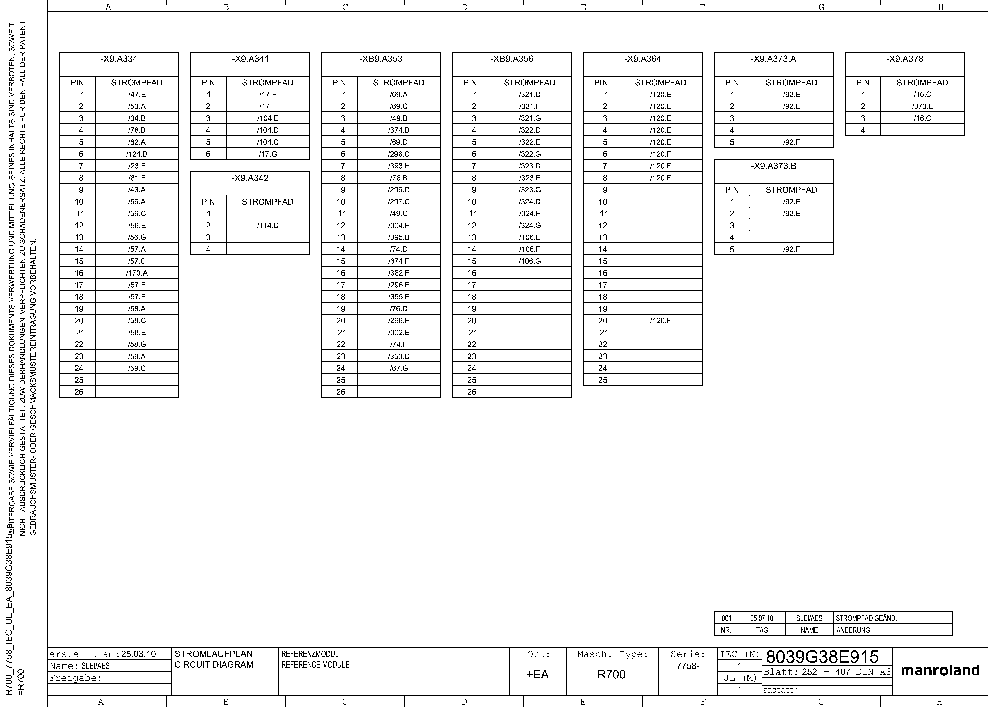

# +EA — Sheet 252 of 407 — REFERENZMODUL

**REFERENCE MODULE**

> Part of the manroland **R700** printing press IEC/UL circuit diagrams.
> Drawing class: **Stromlaufplan / Circuit diagram** (DIN A3).
> Document `+EA` covers the **Printing unit** machine section.

## At a glance

| Field | Value |
|---|---|
| Document | `+EA`  (8039G38E915) |
| Sheet | **252** of 407 |
| Section (DE) | REFERENZMODUL |
| Section (EN) | REFERENCE MODULE |
| Section type | REFERENCE_MODULE — Reference module |
| Machine type | `R700` |
| Series | `7758` |
| Created | 25.03.10 |
| Replaces | — |
| Columns used | A, B, C, D, E, F, G, H |
| Path numbers | — |
| Labels on sheet | 250 |
| Cross-refs out | 88 |
| Cross-refs in | 0 |

**Previous:** [+EA sheet 251](SHEET_0251.md) · **Next:** [+EA sheet 253](SHEET_0253.md) · **Document TOC:** [_TOC.md](_TOC.md)  (+EA) · **Master TOC:** [all sheets](../_MASTER_TOC.md)

## Sheet image (300 DPI, exact vector render)



_Rendered directly from the PDF vector layer at 300 DPI (1-bit), no OCR and no resampling. Use it to confirm anything ambiguous in the text below._

## Cross-references on this sheet

Each entry is a wire leaving this sheet. The printed token is `/sheet.column`; the link resolves to that sheet inside the same document.

| Ref | Target sheet | Col | Path | Destination on target | Target section | From col |
|---|---|---|---|---|---|---|
| `/47.E` | [+EA sheet 47](SHEET_0047.md) | E | — | — | SCHUTZ | A |
| `/69.A` | [+EA sheet 69](SHEET_0069.md) | A | — | — | SCHMIERUNG | C |
| `/92.E` | [+EA sheet 92](SHEET_0092.md) | E | — | — | BLASRAHMEN | G |
| `/17.F` | [+EA sheet 17](SHEET_0017.md) | F | — | — | SPANNUNGSVERSORGUNG: 400V, 24V | B |
| `/120.E` | [+EA sheet 120](SHEET_0120.md) | E | — | — | SCHNITTSTELLE: FREMDGERÄTE | F |
| `/16.C` | [+EA sheet 16](SHEET_0016.md) | C | — | — | SPANNUNGSVERSORGUNG: 400V, 24V | H |
| `/321.D` | [+EA sheet 321](SHEET_0321.md) | D | — | — | OPTION: VERLÄNGERUNG 3656,8MM | E |
| `/53.A` | [+EA sheet 53](SHEET_0053.md) | A | — | — | MASCHINENBEDIENUNG: LAUFKOMMANDOS | A |
| `/92.E` | [+EA sheet 92](SHEET_0092.md) | E | — | — | BLASRAHMEN | G |
| `/17.F` | [+EA sheet 17](SHEET_0017.md) | F | — | — | SPANNUNGSVERSORGUNG: 400V, 24V | B |
| `/120.E` | [+EA sheet 120](SHEET_0120.md) | E | — | — | SCHNITTSTELLE: FREMDGERÄTE | F |
| `/373.E` | [+EA sheet 373](SHEET_0373.md) | E | — | — | OPTION: ENDTROCKNER 1 VORBEREITUNG; | H |
| `/321.F` | [+EA sheet 321](SHEET_0321.md) | F | — | — | OPTION: VERLÄNGERUNG 3656,8MM | E |
| `/69.C` | [+EA sheet 69](SHEET_0069.md) | C | — | — | SCHMIERUNG | C |
| `/34.B` | [+EA sheet 34](SHEET_0034.md) | B | — | — | BUSVERBINDUNGEN: NOT AUS | A |
| `/49.B` | [+EA sheet 49](SHEET_0049.md) | B | — | — | SCHUTZ | C |
| `/104.E` | [+EA sheet 104](SHEET_0104.md) | E | — | — | BOGENFÜHRUNGSELEMENT | B |
| `/120.E` | [+EA sheet 120](SHEET_0120.md) | E | — | — | SCHNITTSTELLE: FREMDGERÄTE | F |
| `/321.G` | [+EA sheet 321](SHEET_0321.md) | G | — | — | OPTION: VERLÄNGERUNG 3656,8MM | E |
| `/16.C` | [+EA sheet 16](SHEET_0016.md) | C | — | — | SPANNUNGSVERSORGUNG: 400V, 24V | H |
| `/78.B` | [+EA sheet 78](SHEET_0078.md) | B | — | — | AUSLEGERSTAPELSTEUERUNG | A |
| `/374.B` | [+EA sheet 374](SHEET_0374.md) | B | — | — | OPTION: ENDTROCKNER 1 VORBEREITUNG; | C |
| `/120.E` | [+EA sheet 120](SHEET_0120.md) | E | — | — | SCHNITTSTELLE: FREMDGERÄTE | F |
| `/104.D` | [+EA sheet 104](SHEET_0104.md) | D | — | — | BOGENFÜHRUNGSELEMENT | B |
| `/322.D` | [+EA sheet 322](SHEET_0322.md) | D | — | — | OPTION: VERLÄNGERUNG 3656,8MM | E |
| `/82.A` | [+EA sheet 82](SHEET_0082.md) | A | — | — | AUSLEGERSTAPELSTEUERUNG: PROGRAMMSCHALTWERK | A |
| `/322.E` | [+EA sheet 322](SHEET_0322.md) | E | — | — | OPTION: VERLÄNGERUNG 3656,8MM | E |
| `/120.E` | [+EA sheet 120](SHEET_0120.md) | E | — | — | SCHNITTSTELLE: FREMDGERÄTE | F |
| `/92.F` | [+EA sheet 92](SHEET_0092.md) | F | — | — | BLASRAHMEN | G |
| `/69.D` | [+EA sheet 69](SHEET_0069.md) | D | — | — | SCHMIERUNG | C |
| `/104.C` | [+EA sheet 104](SHEET_0104.md) | C | — | — | BOGENFÜHRUNGSELEMENT | B |
| `/124.B` | [+EA sheet 124](SHEET_0124.md) | B | — | — | TROCKENBESTÄUBER | A |
| `/17.G` | [+EA sheet 17](SHEET_0017.md) | G | — | — | SPANNUNGSVERSORGUNG: 400V, 24V | B |
| `/120.F` | [+EA sheet 120](SHEET_0120.md) | F | — | — | SCHNITTSTELLE: FREMDGERÄTE | F |
| `/322.G` | [+EA sheet 322](SHEET_0322.md) | G | — | — | OPTION: VERLÄNGERUNG 3656,8MM | E |
| `/296.C` | [+EA sheet 296](SHEET_0296.md) | C | — | — | OPTION: ZWISCHENSTAPEL / | C |
| `/23.E` | [+EA sheet 23](SHEET_0023.md) | E | — | — | SPANNUNGSVERSORGUNG: 400V, 24V | A |
| `/120.F` | [+EA sheet 120](SHEET_0120.md) | F | — | — | SCHNITTSTELLE: FREMDGERÄTE | F |
| `/393.H` | [+EA sheet 393](SHEET_0393.md) | H | — | — | OPTION: ZWISCHENTROCKNER VORBEREITUNG; | C |
| `/323.D` | [+EA sheet 323](SHEET_0323.md) | D | — | — | OPTION: VERLÄNGERUNG 3656,8MM | E |
| `/76.B` | [+EA sheet 76](SHEET_0076.md) | B | — | — | AUSLEGERSTAPELSTEUERUNG | C |
| `/81.F` | [+EA sheet 81](SHEET_0081.md) | F | — | — | AUSLEGERSTAPELSTEUERUNG: BEDIENKOMMANDOS | A |
| `/323.F` | [+EA sheet 323](SHEET_0323.md) | F | — | — | OPTION: VERLÄNGERUNG 3656,8MM | E |
| `/120.F` | [+EA sheet 120](SHEET_0120.md) | F | — | — | SCHNITTSTELLE: FREMDGERÄTE | F |
| `/43.A` | [+EA sheet 43](SHEET_0043.md) | A | — | — | BUSVERBINDUNGEN: SIGNALSCHLEIFE | A |
| `/323.G` | [+EA sheet 323](SHEET_0323.md) | G | — | — | OPTION: VERLÄNGERUNG 3656,8MM | E |
| `/296.D` | [+EA sheet 296](SHEET_0296.md) | D | — | — | OPTION: ZWISCHENSTAPEL / | C |
| `/56.A` | [+EA sheet 56](SHEET_0056.md) | A | — | — | MASCHINENBEDIENUNG: BEDIENUNGKOMMANDOS | A |
| `/92.E` | [+EA sheet 92](SHEET_0092.md) | E | — | — | BLASRAHMEN | G |
| `/297.C` | [+EA sheet 297](SHEET_0297.md) | C | — | — | OPTION: ZWISCHENSTAPEL / | C |
| `/324.D` | [+EA sheet 324](SHEET_0324.md) | D | — | — | OPTION: VERLÄNGERUNG 3656,8MM | E |
| `/92.E` | [+EA sheet 92](SHEET_0092.md) | E | — | — | BLASRAHMEN | G |
| `/324.F` | [+EA sheet 324](SHEET_0324.md) | F | — | — | OPTION: VERLÄNGERUNG 3656,8MM | E |
| `/56.C` | [+EA sheet 56](SHEET_0056.md) | C | — | — | MASCHINENBEDIENUNG: BEDIENUNGKOMMANDOS | A |
| `/49.C` | [+EA sheet 49](SHEET_0049.md) | C | — | — | SCHUTZ | C |
| `/56.E` | [+EA sheet 56](SHEET_0056.md) | E | — | — | MASCHINENBEDIENUNG: BEDIENUNGKOMMANDOS | A |
| `/324.G` | [+EA sheet 324](SHEET_0324.md) | G | — | — | OPTION: VERLÄNGERUNG 3656,8MM | E |
| `/114.D` | [+EA sheet 114](SHEET_0114.md) | D | — | — | FEHLBOGENKONTROLLE | B |
| `/304.H` | [+EA sheet 304](SHEET_0304.md) | H | — | — | OPTION: ZWISCHENSTAPEL / | C |
| `/56.G` | [+EA sheet 56](SHEET_0056.md) | G | — | — | MASCHINENBEDIENUNG: BEDIENUNGKOMMANDOS | A |
| `/395.B` | [+EA sheet 395](SHEET_0395.md) | B | — | — | OPTION: ZWISCHENTROCKNER VORBEREITUNG; | C |
| `/106.E` | [+EA sheet 106](SHEET_0106.md) | E | — | — | BOGENFÜHRUNGSELEMENT | E |
| `/57.A` | [+EA sheet 57](SHEET_0057.md) | A | — | — | MASCHINENBEDIENUNG: BEDIENUNGKOMMANDOS | A |
| `/92.F` | [+EA sheet 92](SHEET_0092.md) | F | — | — | BLASRAHMEN | G |
| `/106.F` | [+EA sheet 106](SHEET_0106.md) | F | — | — | BOGENFÜHRUNGSELEMENT | E |
| `/74.D` | [+EA sheet 74](SHEET_0074.md) | D | — | — | AUSLEGERSTAPELSTEUERUNG | C |
| `/374.F` | [+EA sheet 374](SHEET_0374.md) | F | — | — | OPTION: ENDTROCKNER 1 VORBEREITUNG; | C |
| `/57.C` | [+EA sheet 57](SHEET_0057.md) | C | — | — | MASCHINENBEDIENUNG: BEDIENUNGKOMMANDOS | A |
| `/106.G` | [+EA sheet 106](SHEET_0106.md) | G | — | — | BOGENFÜHRUNGSELEMENT | E |
| `/170.A` | [+EA sheet 170](SHEET_0170.md) | A | — | — | RESERVE | A |
| `/382.F` | [+EA sheet 382](SHEET_0382.md) | F | — | — | OPTION: ENDTROCKNER 2 VORBEREITUNG | C |
| `/57.E` | [+EA sheet 57](SHEET_0057.md) | E | — | — | MASCHINENBEDIENUNG: BEDIENUNGKOMMANDOS | A |
| `/296.F` | [+EA sheet 296](SHEET_0296.md) | F | — | — | OPTION: ZWISCHENSTAPEL / | C |
| `/57.F` | [+EA sheet 57](SHEET_0057.md) | F | — | — | MASCHINENBEDIENUNG: BEDIENUNGKOMMANDOS | A |
| `/395.F` | [+EA sheet 395](SHEET_0395.md) | F | — | — | OPTION: ZWISCHENTROCKNER VORBEREITUNG; | C |
| `/58.A` | [+EA sheet 58](SHEET_0058.md) | A | — | — | MASCHINENBEDIENUNG: BEDIENUNGKOMMANDOS | A |
| `/76.D` | [+EA sheet 76](SHEET_0076.md) | D | — | — | AUSLEGERSTAPELSTEUERUNG | C |
| `/120.F` | [+EA sheet 120](SHEET_0120.md) | F | — | — | SCHNITTSTELLE: FREMDGERÄTE | F |
| `/58.C` | [+EA sheet 58](SHEET_0058.md) | C | — | — | MASCHINENBEDIENUNG: BEDIENUNGKOMMANDOS | A |
| `/296.H` | [+EA sheet 296](SHEET_0296.md) | H | — | — | OPTION: ZWISCHENSTAPEL / | C |
| `/58.E` | [+EA sheet 58](SHEET_0058.md) | E | — | — | MASCHINENBEDIENUNG: BEDIENUNGKOMMANDOS | A |
| `/302.E` | [+EA sheet 302](SHEET_0302.md) | E | — | — | OPTION: ZWISCHENSTAPEL / | C |
| `/74.F` | [+EA sheet 74](SHEET_0074.md) | F | — | — | AUSLEGERSTAPELSTEUERUNG | C |
| `/58.G` | [+EA sheet 58](SHEET_0058.md) | G | — | — | MASCHINENBEDIENUNG: BEDIENUNGKOMMANDOS | A |
| `/59.A` | [+EA sheet 59](SHEET_0059.md) | A | — | — | MASCHINENBEDIENUNG: BEDIENUNGKOMMANDOS | A |
| `/350.D` | [+EA sheet 350](SHEET_0350.md) | D | — | — | OPTION: VORBEREITUNG: PUDERABSAUGUNG | C |
| `/67.G` | [+EA sheet 67](SHEET_0067.md) | G | — | — | LEITSTANDSFUNKTIONEN | C |
| `/59.C` | [+EA sheet 59](SHEET_0059.md) | C | — | — | MASCHINENBEDIENUNG: BEDIENUNGKOMMANDOS | A |

## Devices on this sheet

| Tag | Class | Class meaning (IEC) | Col | Sub | Terminal | Sign |
|---|---|---|---|---|---|---|
| `X9.A341` | — | cross-device reference | B | — | — | — |
| `X9.A342` | — | cross-device reference | B | — | — | — |
| `XB9.A353` | — | cross-device reference | C | — | — | — |
| `XB9.A356` | — | cross-device reference | D | — | — | — |
| `X9.A334` | — | cross-device reference | A | — | — | — |
| `X9.A378` | — | cross-device reference | H | — | — | — |
| `X9.A373.A` | — | cross-device reference | G | — | — | — |
| `X9.A373.B` | — | cross-device reference | G | — | — | — |
| `X9.A364` | — | cross-device reference | F | — | — | — |
| `NR.` | — | cross-device reference | F | — | — | — |
| `05.07.10` | — | cross-device reference | F | — | — | — |

## Potentials / nets

_No named potentials on this sheet._

## Wire-end annotations (grouped as printed)

A wire that continues elsewhere is annotated with a small cluster: the destination description, the path/line number `#NN`, and the `/sheet.column` cross reference. Each row below is one such cluster exactly as it is grouped on the drawing.

| Col | Y | Path | Cross-ref | Text on the wire |
|---|---|---|---|---|
| A | 65.5 | — | — | `X9.A334` |
| B | 65.5 | — | — | `X9.A341` |
| C | 65.5 | — | — | `XB9.A353` |
| D | 65.5 | — | — | `XB9.A356` |
| F | 65.5 | — | — | `X9.A364` |
| G | 65.5 | — | — | `X9.A373.A` |
| H | 65.5 | — | — | `X9.A378` |
| A | 94.2 | — | — | `PIN STROMPFAD` |
| B | 94.2 | — | — | `PIN 2 3 4 5 6 1 STROMPFAD` |
| C | 94.2 | — | — | `PIN STROMPFAD` |
| D | 94.2 | — | — | `PIN STROMPFAD` |
| E | 94.2 | — | — | `PIN STROMPFAD` |
| G | 94.2 | — | — | `PIN 2 3 4 5 1 STROMPFAD` |
| H | 94.2 | — | — | `PIN 2 3 4 1 STROMPFAD` |
| A | 108.4 | — | — | `2 3 4 5 6 7 8 9 1` |
| C | 108.4 | — | — | `2 3 4 5 6 7 8 9 1` |
| D | 108.4 | — | — | `2 3 4 5 6 7 8 9 1` |
| E | 108.4 | — | — | `2 3 4 5 6 7 8 9 1` |
| A | 108.7 | — | `/47.E` | — |
| B | 108.7 | — | `/17.F` | — |
| C | 108.7 | — | `/69.A` | — |
| E | 108.7 | — | `/321.D` | — |
| F | 108.7 | — | `/120.E` | — |
| G | 108.7 | — | `/92.E` | — |
| H | 108.7 | — | `/16.C` | — |
| A | 122.8 | — | `/53.A` | — |
| G | 122.8 | — | `/92.E` | — |
| B | 122.9 | — | `/17.F` | — |
| C | 122.9 | — | `/69.C` | — |
| E | 122.9 | — | `/321.F` | — |
| F | 122.9 | — | `/120.E` | — |
| H | 122.9 | — | `/373.E` | — |
| A | 137.0 | — | `/34.B` | — |
| B | 137.0 | — | `/104.E` | — |
| C | 137.0 | — | `/49.B` | — |
| F | 137.0 | — | `/120.E` | — |
| E | 137.1 | — | `/321.G` | — |
| H | 137.1 | — | `/16.C` | — |
| A | 151.2 | — | `/78.B` | — |
| B | 151.2 | — | `/104.D` | — |
| C | 151.2 | — | `/374.B` | — |
| E | 151.2 | — | `/322.D` | — |
| F | 151.2 | — | `/120.E` | — |
| A | 165.4 | — | `/82.A` | — |
| B | 165.4 | — | `/104.C` | — |
| C | 165.4 | — | `/69.D` | — |
| E | 165.4 | — | `/322.E` | — |
| F | 165.4 | — | `/120.E` | — |
| G | 165.4 | — | `/92.F` | — |
| A | 179.6 | — | `/124.B` | — |
| B | 179.6 | — | `/17.G` | — |
| C | 179.6 | — | `/296.C` | — |
| E | 179.6 | — | `/322.G` | — |
| F | 179.6 | — | `/120.F` | — |
| G | 193.1 | — | — | `X9.A373.B` |
| A | 193.7 | — | `/23.E` | — |
| F | 193.7 | — | `/120.F` | — |
| C | 193.8 | — | `/393.H` | — |
| E | 193.8 | — | `/323.D` | — |
| B | 207.2 | — | — | `X9.A342` |
| A | 207.9 | — | `/81.F` | — |
| C | 207.9 | — | `/76.B` | — |
| E | 207.9 | — | `/323.F` | — |
| F | 207.9 | — | `/120.F` | — |
| G | 221.7 | — | — | `PIN 2 3 4 5 1 STROMPFAD` |
| A | 222.1 | — | `/43.A` | — |
| C | 222.1 | — | `/296.D` | — |
| E | 222.1 | — | `/323.G` | — |
| A | 235.9 | — | — | `10 12 13 14 15 16 17 18 19 20 11` |
| B | 235.9 | — | — | `PIN 2 3 4 1 STROMPFAD` |
| C | 235.9 | — | — | `10 12 13 14 15 16 17 18 19 20 11` |
| D | 235.9 | — | — | `10 12 13 14 15 16 17 18 19 20 11` |
| E | 235.9 | — | — | `10 12 13 14 15 16 17 18 19 20 11` |
| A | 236.2 | — | `/56.A` | — |
| G | 236.2 | — | `/92.E` | — |
| C | 236.3 | — | `/297.C` | — |
| E | 236.3 | — | `/324.D` | — |
| A | 250.4 | — | `/56.C` | — |
| C | 250.4 | — | `/49.C` | — |
| E | 250.4 | — | `/324.F` | — |
| G | 250.4 | — | `/92.E` | — |
| A | 264.6 | — | `/56.E` | — |
| B | 264.6 | — | `/114.D` | — |
| C | 264.6 | — | `/304.H` | — |
| E | 264.6 | — | `/324.G` | — |
| A | 278.8 | — | `/56.G` | — |
| C | 278.8 | — | `/395.B` | — |
| E | 278.8 | — | `/106.E` | — |
| A | 292.9 | — | `/57.A` | — |
| E | 292.9 | — | `/106.F` | — |
| G | 292.9 | — | `/92.F` | — |
| C | 293.0 | — | `/74.D` | — |
| A | 307.1 | — | `/57.C` | — |
| C | 307.1 | — | `/374.F` | — |
| E | 307.1 | — | `/106.G` | — |
| A | 321.3 | — | `/170.A` | — |
| C | 321.3 | — | `/382.F` | — |
| A | 335.4 | — | `/57.E` | — |
| C | 335.5 | — | `/296.F` | — |
| A | 349.6 | — | `/57.F` | — |
| C | 349.6 | — | `/395.F` | — |
| A | 363.8 | — | `/58.A` | — |
| C | 363.8 | — | `/76.D` | — |
| A | 378.0 | — | `/58.C` | — |
| C | 378.0 | — | `/296.H` | — |
| F | 378.0 | — | `/120.F` | — |
| A | 391.8 | — | — | `22 23 24 25 26 21` |
| C | 391.8 | — | — | `22 23 24 25 26 21` |
| D | 391.8 | — | — | `22 23 24 25 26 21` |
| E | 391.8 | — | — | `22 23 24 25 21` |
| A | 392.1 | — | `/58.E` | — |
| C | 392.1 | — | `/302.E` | — |
| A | 406.3 | — | `/58.G` | — |
| C | 406.3 | — | `/74.F` | — |
| A | 420.5 | — | `/59.A` | — |
| C | 420.5 | — | `/350.D` | — |
| A | 434.7 | — | `/59.C` | — |
| C | 434.7 | — | `/67.G` | — |
| G | 733.0 | — | — | `001 05.07.10 SLEI/AES STROMPFAD GEÄND.` |
| G | 747.1 | — | — | `NR. TAG NAME ÄNDERUNG` |


## Reconstructed tables

This sheet carries tabular content (pin map / terminal assignment / index). The grid below was rebuilt from the drawing's own rule lines, so each row is exactly one physical row of the table.

### Table 1 — 26 data rows × 2 columns (at x=70.9, y=62.4) — **X9.A334**

| PIN | STROMPFAD |
|---|---|
| `1` | `/47.E` |
| `2` | `/53.A` |
| `3` | `/34.B` |
| `4` | `/78.B` |
| `5` | `/82.A` |
| `6` | `/124.B` |
| `7` | `/23.E` |
| `8` | `/81.F` |
| `9` | `/43.A` |
| `10` | `/56.A` |
| `11` | `/56.C` |
| `12` | `/56.E` |
| `13` | `/56.G` |
| `14` | `/57.A` |
| `15` | `/57.C` |
| `16` | `/170.A` |
| `17` | `/57.E` |
| `18` | `/57.F` |
| `19` | `/58.A` |
| `20` | `/58.C` |
| `21` | `/58.E` |
| `22` | `/58.G` |
| `23` | `/59.A` |
| `24` | `/59.C` |
| `25` |  |
| `26` |  |


### Table 2 — 12 data rows × 2 columns (at x=226.8, y=62.4) — **X9.A341**

| PIN | STROMPFAD |
|---|---|
| `1` | `/17.F` |
| `2` | `/17.F` |
| `3` | `/104.E` |
| `4` | `/104.D` |
| `5` | `/104.C` |
| `6` | `/17.G` |
|  | `X9.A342` |
| `PIN` | `STROMPFAD` |
| `1` |  |
| `2` | `/114.D` |
| `3` |  |
| `4` |  |


### Table 3 — 26 data rows × 2 columns (at x=382.7, y=62.4) — **XB9.A353**

| PIN | STROMPFAD |
|---|---|
| `1` | `/69.A` |
| `2` | `/69.C` |
| `3` | `/49.B` |
| `4` | `/374.B` |
| `5` | `/69.D` |
| `6` | `/296.C` |
| `7` | `/393.H` |
| `8` | `/76.B` |
| `9` | `/296.D` |
| `10` | `/297.C` |
| `11` | `/49.C` |
| `12` | `/304.H` |
| `13` | `/395.B` |
| `14` | `/74.D` |
| `15` | `/374.F` |
| `16` | `/382.F` |
| `17` | `/296.F` |
| `18` | `/395.F` |
| `19` | `/76.D` |
| `20` | `/296.H` |
| `21` | `/302.E` |
| `22` | `/74.F` |
| `23` | `/350.D` |
| `24` | `/67.G` |
| `25` |  |
| `26` |  |


### Table 4 — 26 data rows × 2 columns (at x=538.6, y=62.4) — **XB9.A356**

| PIN | STROMPFAD |
|---|---|
| `1` | `/321.D` |
| `2` | `/321.F` |
| `3` | `/321.G` |
| `4` | `/322.D` |
| `5` | `/322.E` |
| `6` | `/322.G` |
| `7` | `/323.D` |
| `8` | `/323.F` |
| `9` | `/323.G` |
| `10` | `/324.D` |
| `11` | `/324.F` |
| `12` | `/324.G` |
| `13` | `/106.E` |
| `14` | `/106.F` |
| `15` | `/106.G` |
| `16` |  |
| `17` |  |
| `18` |  |
| `19` |  |
| `20` |  |
| `21` |  |
| `22` |  |
| `23` |  |
| `24` |  |
| `25` |  |
| `26` |  |


### Table 5 — 25 data rows × 2 columns (at x=694.5, y=62.4) — **X9.A364**

| PIN | STROMPFAD |
|---|---|
| `1` | `/120.E` |
| `2` | `/120.E` |
| `3` | `/120.E` |
| `4` | `/120.E` |
| `5` | `/120.E` |
| `6` | `/120.F` |
| `7` | `/120.F` |
| `8` | `/120.F` |
| `9` |  |
| `10` |  |
| `11` |  |
| `12` |  |
| `13` |  |
| `14` |  |
| `15` |  |
| `16` |  |
| `17` |  |
| `18` |  |
| `19` |  |
| `20` | `/120.F` |
| `21` |  |
| `22` |  |
| `23` |  |
| `24` |  |
| `25` |  |


### Table 6 — 12 data rows × 2 columns (at x=850.4, y=62.4) — **X9.A373.A**

| PIN | STROMPFAD |
|---|---|
| `1` | `/92.E` |
| `2` | `/92.E` |
| `3` |  |
| `4` |  |
| `5` | `/92.F` |
|  | `X9.A373.B` |
| `PIN` | `STROMPFAD` |
| `1` | `/92.E` |
| `2` | `/92.E` |
| `3` |  |
| `4` |  |
| `5` | `/92.F` |


### Table 7 — 4 data rows × 2 columns (at x=1006.3, y=62.4) — **X9.A378**

| PIN | STROMPFAD |
|---|---|
| `1` | `/16.C` |
| `2` | `/373.E` |
| `3` | `/16.C` |
| `4` |  |


## Notes and free text on this sheet

| Text | Col | Y (pt) |
|---|---|---|
| `PIN` | B | 94.2 |
| `STROMPFAD` | B | 94.15 |
| `PIN` | C | 94.2 |
| `STROMPFAD` | C | 94.15 |
| `PIN` | D | 94.2 |
| `STROMPFAD` | E | 94.15 |
| `PIN` | A | 94.2 |
| `STROMPFAD` | A | 94.15 |
| `PIN` | G | 94.2 |
| `STROMPFAD` | H | 94.15 |
| `PIN` | F | 94.2 |
| `STROMPFAD` | G | 94.15 |
| `PIN` | E | 94.2 |
| `STROMPFAD` | F | 94.15 |
| `TAG` | G | 747.27 |
| `NAME` | G | 747.25 |
| `ÄNDERUNG` | G | 747.31 |
| `SLEI/AES` | G | 733.13 |
| `STROMPFAD GEÄND.` | G | 733.12 |

## Complete label inventory (exact text from the drawing)

Every text object inside the drawing area of this sheet, in DIN reading order (column A→H, then top→bottom). This is the authoritative list: if a string is not here it is not printed on this sheet.

| Col | Y | X | Dir | Type | Text |
|---|---|---|---|---|---|
| A | 65.5 | 119.8 | → | device ref | `X9.A334` |
| A | 94.2 | 84.0 | → | text | `PIN` |
| A | 94.2 | 132.2 | → | text | `STROMPFAD` |
| A | 108.4 | 95.8 | → | number | `1` |
| A | 108.7 | 152.9 | → | cross-reference | `/47.E` |
| A | 122.5 | 94.1 | → | number | `2` |
| A | 122.8 | 152.6 | → | cross-reference | `/53.A` |
| A | 136.7 | 94.1 | → | number | `3` |
| A | 137.0 | 152.8 | → | cross-reference | `/34.B` |
| A | 150.9 | 94.1 | → | number | `4` |
| A | 151.2 | 152.8 | → | cross-reference | `/78.B` |
| A | 165.1 | 94.1 | → | number | `5` |
| A | 165.4 | 152.6 | → | cross-reference | `/82.A` |
| A | 179.2 | 94.1 | → | number | `6` |
| A | 179.6 | 150.4 | → | cross-reference | `/124.B` |
| A | 193.4 | 94.1 | → | number | `7` |
| A | 193.7 | 152.9 | → | cross-reference | `/23.E` |
| A | 207.6 | 94.1 | → | number | `8` |
| A | 207.9 | 153.1 | → | cross-reference | `/81.F` |
| A | 221.8 | 94.1 | → | number | `9` |
| A | 222.1 | 152.6 | → | cross-reference | `/43.A` |
| A | 235.9 | 88.7 | → | number | `10` |
| A | 236.2 | 152.6 | → | cross-reference | `/56.A` |
| A | 250.1 | 90.4 | → | number | `11` |
| A | 250.4 | 152.6 | → | cross-reference | `/56.C` |
| A | 264.3 | 88.7 | → | number | `12` |
| A | 264.6 | 152.9 | → | cross-reference | `/56.E` |
| A | 278.5 | 88.7 | → | number | `13` |
| A | 278.8 | 152.5 | → | cross-reference | `/56.G` |
| A | 292.6 | 88.7 | → | number | `14` |
| A | 292.9 | 152.6 | → | cross-reference | `/57.A` |
| A | 306.8 | 88.7 | → | number | `15` |
| A | 307.1 | 152.6 | → | cross-reference | `/57.C` |
| A | 321.0 | 88.7 | → | number | `16` |
| A | 321.3 | 150.2 | → | cross-reference | `/170.A` |
| A | 335.1 | 88.7 | → | number | `17` |
| A | 335.4 | 152.9 | → | cross-reference | `/57.E` |
| A | 349.3 | 88.7 | → | number | `18` |
| A | 349.6 | 153.1 | → | cross-reference | `/57.F` |
| A | 363.5 | 88.7 | → | number | `19` |
| A | 363.8 | 152.6 | → | cross-reference | `/58.A` |
| A | 377.7 | 88.7 | → | number | `20` |
| A | 378.0 | 152.6 | → | cross-reference | `/58.C` |
| A | 391.8 | 90.4 | → | number | `21` |
| A | 392.1 | 152.9 | → | cross-reference | `/58.E` |
| A | 406.0 | 88.7 | → | number | `22` |
| A | 406.3 | 152.5 | → | cross-reference | `/58.G` |
| A | 420.2 | 88.7 | → | number | `23` |
| A | 420.5 | 152.6 | → | cross-reference | `/59.A` |
| A | 434.4 | 88.7 | → | number | `24` |
| A | 434.7 | 152.6 | → | cross-reference | `/59.C` |
| A | 448.5 | 88.7 | → | number | `25` |
| A | 462.7 | 88.7 | → | number | `26` |
| B | 65.5 | 276.4 | → | device ref | `X9.A341` |
| B | 94.2 | 240.0 | → | text | `PIN` |
| B | 94.2 | 288.1 | → | text | `STROMPFAD` |
| B | 108.4 | 245.9 | → | number | `1` |
| B | 108.7 | 309.0 | → | cross-reference | `/17.F` |
| B | 122.5 | 245.3 | → | number | `2` |
| B | 122.9 | 309.0 | → | cross-reference | `/17.F` |
| B | 136.7 | 245.3 | → | number | `3` |
| B | 137.0 | 306.4 | → | cross-reference | `/104.E` |
| B | 150.9 | 245.3 | → | number | `4` |
| B | 151.2 | 306.1 | → | cross-reference | `/104.D` |
| B | 165.1 | 245.3 | → | number | `5` |
| B | 165.4 | 306.1 | → | cross-reference | `/104.C` |
| B | 179.2 | 245.3 | → | number | `6` |
| B | 179.6 | 308.4 | → | cross-reference | `/17.G` |
| B | 207.2 | 275.7 | → | device ref | `X9.A342` |
| B | 235.9 | 240.0 | → | text | `PIN` |
| B | 235.9 | 288.1 | → | text | `STROMPFAD` |
| B | 250.1 | 245.9 | → | number | `1` |
| B | 264.3 | 245.3 | → | number | `2` |
| B | 264.6 | 306.1 | → | cross-reference | `/114.D` |
| B | 278.5 | 245.3 | → | number | `3` |
| B | 292.6 | 245.3 | → | number | `4` |
| C | 65.5 | 428.0 | → | device ref | `XB9.A353` |
| C | 94.2 | 395.9 | → | text | `PIN` |
| C | 94.2 | 444.0 | → | text | `STROMPFAD` |
| C | 108.4 | 407.6 | → | number | `1` |
| C | 108.7 | 464.5 | → | cross-reference | `/69.A` |
| C | 122.5 | 405.9 | → | number | `2` |
| C | 122.9 | 464.5 | → | cross-reference | `/69.C` |
| C | 136.7 | 405.9 | → | number | `3` |
| C | 137.0 | 464.6 | → | cross-reference | `/49.B` |
| C | 150.9 | 405.9 | → | number | `4` |
| C | 151.2 | 462.2 | → | cross-reference | `/374.B` |
| C | 165.1 | 405.9 | → | number | `5` |
| C | 165.4 | 464.5 | → | cross-reference | `/69.D` |
| C | 179.2 | 405.9 | → | number | `6` |
| C | 179.6 | 462.0 | → | cross-reference | `/296.C` |
| C | 193.4 | 405.9 | → | number | `7` |
| C | 193.8 | 462.3 | → | cross-reference | `/393.H` |
| C | 207.6 | 405.9 | → | number | `8` |
| C | 207.9 | 464.6 | → | cross-reference | `/76.B` |
| C | 221.8 | 405.9 | → | number | `9` |
| C | 222.1 | 462.0 | → | cross-reference | `/296.D` |
| C | 235.9 | 400.5 | → | number | `10` |
| C | 236.3 | 462.0 | → | cross-reference | `/297.C` |
| C | 250.1 | 402.2 | → | number | `11` |
| C | 250.4 | 464.5 | → | cross-reference | `/49.C` |
| C | 264.3 | 400.5 | → | number | `12` |
| C | 264.6 | 462.3 | → | cross-reference | `/304.H` |
| C | 278.5 | 400.5 | → | number | `13` |
| C | 278.8 | 462.2 | → | cross-reference | `/395.B` |
| C | 292.6 | 400.5 | → | number | `14` |
| C | 293.0 | 464.5 | → | cross-reference | `/74.D` |
| C | 306.8 | 400.5 | → | number | `15` |
| C | 307.1 | 462.5 | → | cross-reference | `/374.F` |
| C | 321.0 | 400.5 | → | number | `16` |
| C | 321.3 | 462.5 | → | cross-reference | `/382.F` |
| C | 335.1 | 400.5 | → | number | `17` |
| C | 335.5 | 462.5 | → | cross-reference | `/296.F` |
| C | 349.3 | 400.5 | → | number | `18` |
| C | 349.6 | 462.5 | → | cross-reference | `/395.F` |
| C | 363.5 | 400.5 | → | number | `19` |
| C | 363.8 | 464.5 | → | cross-reference | `/76.D` |
| C | 377.7 | 400.5 | → | number | `20` |
| C | 378.0 | 462.3 | → | cross-reference | `/296.H` |
| C | 391.8 | 402.2 | → | number | `21` |
| C | 392.2 | 462.3 | → | cross-reference | `/302.E` |
| C | 406.0 | 400.5 | → | number | `22` |
| C | 406.3 | 464.9 | → | cross-reference | `/74.F` |
| C | 420.2 | 400.5 | → | number | `23` |
| C | 420.5 | 462.0 | → | cross-reference | `/350.D` |
| C | 434.4 | 400.5 | → | number | `24` |
| C | 434.7 | 464.3 | → | cross-reference | `/67.G` |
| C | 448.5 | 400.5 | → | number | `25` |
| C | 462.7 | 400.5 | → | number | `26` |
| D | 65.5 | 583.9 | → | device ref | `XB9.A356` |
| D | 94.2 | 551.8 | → | text | `PIN` |
| D | 108.4 | 563.5 | → | number | `1` |
| D | 122.5 | 561.8 | → | number | `2` |
| D | 136.7 | 561.8 | → | number | `3` |
| D | 150.9 | 561.8 | → | number | `4` |
| D | 165.1 | 561.8 | → | number | `5` |
| D | 179.2 | 561.8 | → | number | `6` |
| D | 193.4 | 561.8 | → | number | `7` |
| D | 207.6 | 561.8 | → | number | `8` |
| D | 221.8 | 561.8 | → | number | `9` |
| D | 235.9 | 556.4 | → | number | `10` |
| D | 250.1 | 558.1 | → | number | `11` |
| D | 264.3 | 556.4 | → | number | `12` |
| D | 278.5 | 556.4 | → | number | `13` |
| D | 292.6 | 556.4 | → | number | `14` |
| D | 306.8 | 556.4 | → | number | `15` |
| D | 321.0 | 556.4 | → | number | `16` |
| D | 335.1 | 556.4 | → | number | `17` |
| D | 349.3 | 556.4 | → | number | `18` |
| D | 363.5 | 556.4 | → | number | `19` |
| D | 377.7 | 556.4 | → | number | `20` |
| D | 391.8 | 558.1 | → | number | `21` |
| D | 406.0 | 556.4 | → | number | `22` |
| D | 420.2 | 556.4 | → | number | `23` |
| D | 434.4 | 556.4 | → | number | `24` |
| D | 448.5 | 556.4 | → | number | `25` |
| D | 462.7 | 556.4 | → | number | `26` |
| E | 94.2 | 600.0 | → | text | `STROMPFAD` |
| E | 94.2 | 707.7 | → | text | `PIN` |
| E | 108.4 | 719.4 | → | number | `1` |
| E | 108.7 | 618.0 | → | cross-reference | `/321.D` |
| E | 122.5 | 717.7 | → | number | `2` |
| E | 122.9 | 618.4 | → | cross-reference | `/321.F` |
| E | 136.7 | 717.7 | → | number | `3` |
| E | 137.1 | 617.8 | → | cross-reference | `/321.G` |
| E | 150.9 | 717.7 | → | number | `4` |
| E | 151.2 | 618.0 | → | cross-reference | `/322.D` |
| E | 165.1 | 717.7 | → | number | `5` |
| E | 165.4 | 618.2 | → | cross-reference | `/322.E` |
| E | 179.2 | 717.7 | → | number | `6` |
| E | 179.6 | 617.8 | → | cross-reference | `/322.G` |
| E | 193.4 | 717.7 | → | number | `7` |
| E | 193.8 | 618.0 | → | cross-reference | `/323.D` |
| E | 207.6 | 717.7 | → | number | `8` |
| E | 207.9 | 618.4 | → | cross-reference | `/323.F` |
| E | 221.8 | 717.7 | → | number | `9` |
| E | 222.1 | 617.8 | → | cross-reference | `/323.G` |
| E | 235.9 | 712.3 | → | number | `10` |
| E | 236.3 | 618.0 | → | cross-reference | `/324.D` |
| E | 250.1 | 714.0 | → | number | `11` |
| E | 250.4 | 618.4 | → | cross-reference | `/324.F` |
| E | 264.3 | 712.3 | → | number | `12` |
| E | 264.6 | 617.8 | → | cross-reference | `/324.G` |
| E | 278.5 | 712.3 | → | number | `13` |
| E | 278.8 | 618.2 | → | cross-reference | `/106.E` |
| E | 292.6 | 712.3 | → | number | `14` |
| E | 293.0 | 618.4 | → | cross-reference | `/106.F` |
| E | 306.8 | 712.3 | → | number | `15` |
| E | 307.1 | 617.8 | → | cross-reference | `/106.G` |
| E | 321.0 | 712.3 | → | number | `16` |
| E | 335.1 | 712.3 | → | number | `17` |
| E | 349.3 | 712.3 | → | number | `18` |
| E | 363.5 | 712.3 | → | number | `19` |
| E | 377.7 | 712.3 | → | number | `20` |
| E | 391.8 | 714.0 | → | number | `21` |
| E | 406.0 | 712.3 | → | number | `22` |
| E | 420.2 | 712.3 | → | number | `23` |
| E | 434.4 | 712.3 | → | number | `24` |
| E | 448.5 | 712.3 | → | number | `25` |
| F | 65.5 | 743.4 | → | device ref | `X9.A364` |
| F | 94.2 | 755.9 | → | text | `STROMPFAD` |
| F | 94.2 | 863.6 | → | text | `PIN` |
| F | 108.4 | 869.5 | → | number | `1` |
| F | 108.7 | 774.1 | → | cross-reference | `/120.E` |
| F | 122.5 | 869.0 | → | number | `2` |
| F | 122.9 | 774.1 | → | cross-reference | `/120.E` |
| F | 136.7 | 869.0 | → | number | `3` |
| F | 137.0 | 774.1 | → | cross-reference | `/120.E` |
| F | 150.9 | 869.0 | → | number | `4` |
| F | 151.2 | 774.1 | → | cross-reference | `/120.E` |
| F | 165.1 | 869.0 | → | number | `5` |
| F | 165.4 | 774.1 | → | cross-reference | `/120.E` |
| F | 179.6 | 774.3 | → | cross-reference | `/120.F` |
| F | 193.7 | 774.3 | → | cross-reference | `/120.F` |
| F | 207.9 | 774.3 | → | cross-reference | `/120.F` |
| F | 221.8 | 863.6 | → | text | `PIN` |
| F | 235.9 | 869.5 | → | number | `1` |
| F | 250.1 | 869.0 | → | number | `2` |
| F | 264.3 | 869.0 | → | number | `3` |
| F | 278.5 | 869.0 | → | number | `4` |
| F | 292.6 | 869.0 | → | number | `5` |
| F | 378.0 | 774.3 | → | cross-reference | `/120.F` |
| F | 733.0 | 859.4 | → | number | `001` |
| F | 733.1 | 893.5 | → | device ref | `05.07.10` |
| F | 747.1 | 858.4 | → | device ref | `NR.` |
| G | 65.5 | 893.9 | → | device ref | `X9.A373.A` |
| G | 94.2 | 911.8 | → | text | `STROMPFAD` |
| G | 94.2 | 1019.5 | → | text | `PIN` |
| G | 108.4 | 1025.4 | → | number | `1` |
| G | 108.7 | 932.5 | → | cross-reference | `/92.E` |
| G | 122.5 | 1024.9 | → | number | `2` |
| G | 122.8 | 932.5 | → | cross-reference | `/92.E` |
| G | 136.7 | 1024.9 | → | number | `3` |
| G | 150.9 | 1024.9 | → | number | `4` |
| G | 165.4 | 932.6 | → | cross-reference | `/92.F` |
| G | 193.1 | 894.3 | → | device ref | `X9.A373.B` |
| G | 221.7 | 911.8 | → | text | `STROMPFAD` |
| G | 236.2 | 932.5 | → | cross-reference | `/92.E` |
| G | 250.4 | 932.5 | → | cross-reference | `/92.E` |
| G | 292.9 | 932.6 | → | cross-reference | `/92.F` |
| G | 733.1 | 948.2 | → | text | `SLEI/AES` |
| G | 733.1 | 995.1 | → | text | `STROMPFAD GEÄND.` |
| G | 747.3 | 900.0 | → | text | `TAG` |
| G | 747.3 | 953.4 | → | text | `NAME` |
| G | 747.3 | 996.0 | → | text | `ÄNDERUNG` |
| H | 65.5 | 1055.2 | → | device ref | `X9.A378` |
| H | 94.2 | 1067.7 | → | text | `STROMPFAD` |
| H | 108.7 | 1088.1 | → | cross-reference | `/16.C` |
| H | 122.9 | 1086.0 | → | cross-reference | `/373.E` |
| H | 137.1 | 1088.1 | → | cross-reference | `/16.C` |

## Reading-order text block

The same content as a plain block, grouped by DIN column — convenient to paste or to match against a visual description.

```text
=== Column A ===
  65.5  119.8  devref       X9.A334
  94.2   84.0  text         PIN
  94.2  132.2  text         STROMPFAD
 108.4   95.8  numeric      1
 108.7  152.9  xref         /47.E
 122.5   94.1  numeric      2
 122.8  152.6  xref         /53.A
 136.7   94.1  numeric      3
 137.0  152.8  xref         /34.B
 150.9   94.1  numeric      4
 151.2  152.8  xref         /78.B
 165.1   94.1  numeric      5
 165.4  152.6  xref         /82.A
 179.2   94.1  numeric      6
 179.6  150.4  xref         /124.B
 193.4   94.1  numeric      7
 193.7  152.9  xref         /23.E
 207.6   94.1  numeric      8
 207.9  153.1  xref         /81.F
 221.8   94.1  numeric      9
 222.1  152.6  xref         /43.A
 235.9   88.7  numeric      10
 236.2  152.6  xref         /56.A
 250.1   90.4  numeric      11
 250.4  152.6  xref         /56.C
 264.3   88.7  numeric      12
 264.6  152.9  xref         /56.E
 278.5   88.7  numeric      13
 278.8  152.5  xref         /56.G
 292.6   88.7  numeric      14
 292.9  152.6  xref         /57.A
 306.8   88.7  numeric      15
 307.1  152.6  xref         /57.C
 321.0   88.7  numeric      16
 321.3  150.2  xref         /170.A
 335.1   88.7  numeric      17
 335.4  152.9  xref         /57.E
 349.3   88.7  numeric      18
 349.6  153.1  xref         /57.F
 363.5   88.7  numeric      19
 363.8  152.6  xref         /58.A
 377.7   88.7  numeric      20
 378.0  152.6  xref         /58.C
 391.8   90.4  numeric      21
 392.1  152.9  xref         /58.E
 406.0   88.7  numeric      22
 406.3  152.5  xref         /58.G
 420.2   88.7  numeric      23
 420.5  152.6  xref         /59.A
 434.4   88.7  numeric      24
 434.7  152.6  xref         /59.C
 448.5   88.7  numeric      25
 462.7   88.7  numeric      26
=== Column B ===
  65.5  276.4  devref       X9.A341
  94.2  240.0  text         PIN
  94.2  288.1  text         STROMPFAD
 108.4  245.9  numeric      1
 108.7  309.0  xref         /17.F
 122.5  245.3  numeric      2
 122.9  309.0  xref         /17.F
 136.7  245.3  numeric      3
 137.0  306.4  xref         /104.E
 150.9  245.3  numeric      4
 151.2  306.1  xref         /104.D
 165.1  245.3  numeric      5
 165.4  306.1  xref         /104.C
 179.2  245.3  numeric      6
 179.6  308.4  xref         /17.G
 207.2  275.7  devref       X9.A342
 235.9  240.0  text         PIN
 235.9  288.1  text         STROMPFAD
 250.1  245.9  numeric      1
 264.3  245.3  numeric      2
 264.6  306.1  xref         /114.D
 278.5  245.3  numeric      3
 292.6  245.3  numeric      4
=== Column C ===
  65.5  428.0  devref       XB9.A353
  94.2  395.9  text         PIN
  94.2  444.0  text         STROMPFAD
 108.4  407.6  numeric      1
 108.7  464.5  xref         /69.A
 122.5  405.9  numeric      2
 122.9  464.5  xref         /69.C
 136.7  405.9  numeric      3
 137.0  464.6  xref         /49.B
 150.9  405.9  numeric      4
 151.2  462.2  xref         /374.B
 165.1  405.9  numeric      5
 165.4  464.5  xref         /69.D
 179.2  405.9  numeric      6
 179.6  462.0  xref         /296.C
 193.4  405.9  numeric      7
 193.8  462.3  xref         /393.H
 207.6  405.9  numeric      8
 207.9  464.6  xref         /76.B
 221.8  405.9  numeric      9
 222.1  462.0  xref         /296.D
 235.9  400.5  numeric      10
 236.3  462.0  xref         /297.C
 250.1  402.2  numeric      11
 250.4  464.5  xref         /49.C
 264.3  400.5  numeric      12
 264.6  462.3  xref         /304.H
 278.5  400.5  numeric      13
 278.8  462.2  xref         /395.B
 292.6  400.5  numeric      14
 293.0  464.5  xref         /74.D
 306.8  400.5  numeric      15
 307.1  462.5  xref         /374.F
 321.0  400.5  numeric      16
 321.3  462.5  xref         /382.F
 335.1  400.5  numeric      17
 335.5  462.5  xref         /296.F
 349.3  400.5  numeric      18
 349.6  462.5  xref         /395.F
 363.5  400.5  numeric      19
 363.8  464.5  xref         /76.D
 377.7  400.5  numeric      20
 378.0  462.3  xref         /296.H
 391.8  402.2  numeric      21
 392.2  462.3  xref         /302.E
 406.0  400.5  numeric      22
 406.3  464.9  xref         /74.F
 420.2  400.5  numeric      23
 420.5  462.0  xref         /350.D
 434.4  400.5  numeric      24
 434.7  464.3  xref         /67.G
 448.5  400.5  numeric      25
 462.7  400.5  numeric      26
=== Column D ===
  65.5  583.9  devref       XB9.A356
  94.2  551.8  text         PIN
 108.4  563.5  numeric      1
 122.5  561.8  numeric      2
 136.7  561.8  numeric      3
 150.9  561.8  numeric      4
 165.1  561.8  numeric      5
 179.2  561.8  numeric      6
 193.4  561.8  numeric      7
 207.6  561.8  numeric      8
 221.8  561.8  numeric      9
 235.9  556.4  numeric      10
 250.1  558.1  numeric      11
 264.3  556.4  numeric      12
 278.5  556.4  numeric      13
 292.6  556.4  numeric      14
 306.8  556.4  numeric      15
 321.0  556.4  numeric      16
 335.1  556.4  numeric      17
 349.3  556.4  numeric      18
 363.5  556.4  numeric      19
 377.7  556.4  numeric      20
 391.8  558.1  numeric      21
 406.0  556.4  numeric      22
 420.2  556.4  numeric      23
 434.4  556.4  numeric      24
 448.5  556.4  numeric      25
 462.7  556.4  numeric      26
=== Column E ===
  94.2  600.0  text         STROMPFAD
  94.2  707.7  text         PIN
 108.4  719.4  numeric      1
 108.7  618.0  xref         /321.D
 122.5  717.7  numeric      2
 122.9  618.4  xref         /321.F
 136.7  717.7  numeric      3
 137.1  617.8  xref         /321.G
 150.9  717.7  numeric      4
 151.2  618.0  xref         /322.D
 165.1  717.7  numeric      5
 165.4  618.2  xref         /322.E
 179.2  717.7  numeric      6
 179.6  617.8  xref         /322.G
 193.4  717.7  numeric      7
 193.8  618.0  xref         /323.D
 207.6  717.7  numeric      8
 207.9  618.4  xref         /323.F
 221.8  717.7  numeric      9
 222.1  617.8  xref         /323.G
 235.9  712.3  numeric      10
 236.3  618.0  xref         /324.D
 250.1  714.0  numeric      11
 250.4  618.4  xref         /324.F
 264.3  712.3  numeric      12
 264.6  617.8  xref         /324.G
 278.5  712.3  numeric      13
 278.8  618.2  xref         /106.E
 292.6  712.3  numeric      14
 293.0  618.4  xref         /106.F
 306.8  712.3  numeric      15
 307.1  617.8  xref         /106.G
 321.0  712.3  numeric      16
 335.1  712.3  numeric      17
 349.3  712.3  numeric      18
 363.5  712.3  numeric      19
 377.7  712.3  numeric      20
 391.8  714.0  numeric      21
 406.0  712.3  numeric      22
 420.2  712.3  numeric      23
 434.4  712.3  numeric      24
 448.5  712.3  numeric      25
=== Column F ===
  65.5  743.4  devref       X9.A364
  94.2  755.9  text         STROMPFAD
  94.2  863.6  text         PIN
 108.4  869.5  numeric      1
 108.7  774.1  xref         /120.E
 122.5  869.0  numeric      2
 122.9  774.1  xref         /120.E
 136.7  869.0  numeric      3
 137.0  774.1  xref         /120.E
 150.9  869.0  numeric      4
 151.2  774.1  xref         /120.E
 165.1  869.0  numeric      5
 165.4  774.1  xref         /120.E
 179.6  774.3  xref         /120.F
 193.7  774.3  xref         /120.F
 207.9  774.3  xref         /120.F
 221.8  863.6  text         PIN
 235.9  869.5  numeric      1
 250.1  869.0  numeric      2
 264.3  869.0  numeric      3
 278.5  869.0  numeric      4
 292.6  869.0  numeric      5
 378.0  774.3  xref         /120.F
 733.0  859.4  numeric      001
 733.1  893.5  devref       05.07.10
 747.1  858.4  devref       NR.
=== Column G ===
  65.5  893.9  devref       X9.A373.A
  94.2  911.8  text         STROMPFAD
  94.2 1019.5  text         PIN
 108.4 1025.4  numeric      1
 108.7  932.5  xref         /92.E
 122.5 1024.9  numeric      2
 122.8  932.5  xref         /92.E
 136.7 1024.9  numeric      3
 150.9 1024.9  numeric      4
 165.4  932.6  xref         /92.F
 193.1  894.3  devref       X9.A373.B
 221.7  911.8  text         STROMPFAD
 236.2  932.5  xref         /92.E
 250.4  932.5  xref         /92.E
 292.9  932.6  xref         /92.F
 733.1  948.2  text         SLEI/AES
 733.1  995.1  text         STROMPFAD GEÄND.
 747.3  900.0  text         TAG
 747.3  953.4  text         NAME
 747.3  996.0  text         ÄNDERUNG
=== Column H ===
  65.5 1055.2  devref       X9.A378
  94.2 1067.7  text         STROMPFAD
 108.7 1088.1  xref         /16.C
 122.9 1086.0  xref         /373.E
 137.1 1088.1  xref         /16.C
```

---
_Generated from the PDF vector text layer; no OCR. Source: `R700_7758_IEC_UL_EA_8039G38E915_p`, sheet 252._
