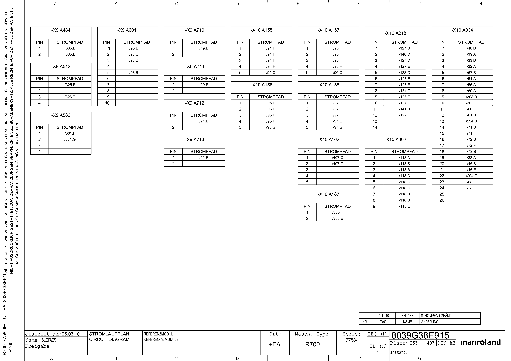

# +EA — Sheet 253 of 407 — REFERENZMODUL

**REFERENCE MODULE**

> Part of the manroland **R700** printing press IEC/UL circuit diagrams.
> Drawing class: **Stromlaufplan / Circuit diagram** (DIN A3).
> Document `+EA` covers the **Printing unit** machine section.

## At a glance

| Field | Value |
|---|---|
| Document | `+EA`  (8039G38E915) |
| Sheet | **253** of 407 |
| Section (DE) | REFERENZMODUL |
| Section (EN) | REFERENCE MODULE |
| Section type | REFERENCE_MODULE — Reference module |
| Machine type | `R700` |
| Series | `7758` |
| Created | 25.03.10 |
| Replaces | — |
| Columns used | A, B, C, D, E, F, G, H |
| Path numbers | — |
| Labels on sheet | 246 |
| Cross-refs out | 83 |
| Cross-refs in | 0 |

**Previous:** [+EA sheet 252](SHEET_0252.md) · **Next:** [+EA sheet 254](SHEET_0254.md) · **Document TOC:** [_TOC.md](_TOC.md)  (+EA) · **Master TOC:** [all sheets](../_MASTER_TOC.md)

## Sheet image (300 DPI, exact vector render)



_Rendered directly from the PDF vector layer at 300 DPI (1-bit), no OCR and no resampling. Use it to confirm anything ambiguous in the text below._

## Cross-references on this sheet

Each entry is a wire leaving this sheet. The printed token is `/sheet.column`; the link resolves to that sheet inside the same document.

| Ref | Target sheet | Col | Path | Destination on target | Target section | From col |
|---|---|---|---|---|---|---|
| `/19.E` | [+EA sheet 19](SHEET_0019.md) | E | — | STROMPFAD PIN 1 2 | SPANNUNGSVERSORGUNG: 400V, 24V | C |
| `/93.B` | [+EA sheet 93](SHEET_0093.md) | B | — | — | BLASRAHMEN | B |
| `/385.B` | [+EA sheet 385](SHEET_0385.md) | B | — | — | OPTION: ZWISCHENTROCKNER VORBEREITUNG; | A |
| `/94.F` | [+EA sheet 94](SHEET_0094.md) | F | — | — | BLASRAHMEN | E |
| `/96.F` | [+EA sheet 96](SHEET_0096.md) | F | — | — | BLASRAHMEN | F |
| `/40.D` | [+EA sheet 40](SHEET_0040.md) | D | — | — | BUSVERBINDUNGEN: STOP SICHERN | H |
| `/127.D` | [+EA sheet 127](SHEET_0127.md) | D | — | — | ZUGANGSABSICHERUNG | G |
| `/39.A` | [+EA sheet 39](SHEET_0039.md) | A | — | — | BUSVERBINDUNGEN: STOP SICHERN | H |
| `/385.B` | [+EA sheet 385](SHEET_0385.md) | B | — | — | OPTION: ZWISCHENTROCKNER VORBEREITUNG; | A |
| `/94.F` | [+EA sheet 94](SHEET_0094.md) | F | — | — | BLASRAHMEN | E |
| `/96.F` | [+EA sheet 96](SHEET_0096.md) | F | — | — | BLASRAHMEN | F |
| `/93.C` | [+EA sheet 93](SHEET_0093.md) | C | — | — | BLASRAHMEN | B |
| `/140.D` | [+EA sheet 140](SHEET_0140.md) | D | — | — | ZUGANGSABSICHERUNG | G |
| `/94.F` | [+EA sheet 94](SHEET_0094.md) | F | — | — | BLASRAHMEN | E |
| `/96.F` | [+EA sheet 96](SHEET_0096.md) | F | — | — | BLASRAHMEN | F |
| `/93.D` | [+EA sheet 93](SHEET_0093.md) | D | — | — | BLASRAHMEN | B |
| `/33.D` | [+EA sheet 33](SHEET_0033.md) | D | — | — | BUSVERBINDUNGEN: NOT AUS | H |
| `/127.D` | [+EA sheet 127](SHEET_0127.md) | D | — | — | ZUGANGSABSICHERUNG | G |
| `/32.A` | [+EA sheet 32](SHEET_0032.md) | A | — | — | BUSVERBINDUNGEN: NOT AUS | H |
| `/94.F` | [+EA sheet 94](SHEET_0094.md) | F | — | — | BLASRAHMEN | E |
| `/96.F` | [+EA sheet 96](SHEET_0096.md) | F | — | — | BLASRAHMEN | F |
| `/127.E` | [+EA sheet 127](SHEET_0127.md) | E | — | — | ZUGANGSABSICHERUNG | G |
| `/93.B` | [+EA sheet 93](SHEET_0093.md) | B | — | — | BLASRAHMEN | B |
| `/67.B` | [+EA sheet 67](SHEET_0067.md) | B | — | — | LEITSTANDSFUNKTIONEN | H |
| `/94.G` | [+EA sheet 94](SHEET_0094.md) | G | — | — | BLASRAHMEN | E |
| `/96.G` | [+EA sheet 96](SHEET_0096.md) | G | — | — | BLASRAHMEN | F |
| `/132.C` | [+EA sheet 132](SHEET_0132.md) | C | — | — | ZUGANGSABSICHERUNG | G |
| `/20.E` | [+EA sheet 20](SHEET_0020.md) | E | — | STROMPFAD PIN 1 2 | SPANNUNGSVERSORGUNG: 400V, 24V | C |
| `/54.A` | [+EA sheet 54](SHEET_0054.md) | A | — | — | MASCHINENBEDIENUNG: LAUFKOMMANDOS | H |
| `/127.E` | [+EA sheet 127](SHEET_0127.md) | E | — | — | ZUGANGSABSICHERUNG | G |
| `/55.A` | [+EA sheet 55](SHEET_0055.md) | A | — | — | MASCHINENBEDIENUNG: LAUFKOMMANDOS | H |
| `/325.E` | [+EA sheet 325](SHEET_0325.md) | E | — | — | OPTION: BOGENWEICHE | A |
| `/127.E` | [+EA sheet 127](SHEET_0127.md) | E | — | — | ZUGANGSABSICHERUNG | G |
| `/80.A` | [+EA sheet 80](SHEET_0080.md) | A | — | — | AUSLEGERSTAPELSTEUERUNG: BEDIENKOMMANDOS | H |
| `/131.F` | [+EA sheet 131](SHEET_0131.md) | F | — | — | ZUGANGSABSICHERUNG | G |
| `/127.E` | [+EA sheet 127](SHEET_0127.md) | E | — | — | ZUGANGSABSICHERUNG | G |
| `/303.B` | [+EA sheet 303](SHEET_0303.md) | B | — | — | OPTION: ZWISCHENSTAPEL / | H |
| `/326.D` | [+EA sheet 326](SHEET_0326.md) | D | — | — | OPTION: BOGENWEICHE | A |
| `/95.F` | [+EA sheet 95](SHEET_0095.md) | F | — | — | BLASRAHMEN | E |
| `/97.F` | [+EA sheet 97](SHEET_0097.md) | F | — | — | BLASRAHMEN | F |
| `/127.E` | [+EA sheet 127](SHEET_0127.md) | E | — | — | ZUGANGSABSICHERUNG | G |
| `/303.E` | [+EA sheet 303](SHEET_0303.md) | E | — | — | OPTION: ZWISCHENSTAPEL / | H |
| `/80.E` | [+EA sheet 80](SHEET_0080.md) | E | — | — | AUSLEGERSTAPELSTEUERUNG: BEDIENKOMMANDOS | H |
| `/95.F` | [+EA sheet 95](SHEET_0095.md) | F | — | — | BLASRAHMEN | E |
| `/97.F` | [+EA sheet 97](SHEET_0097.md) | F | — | — | BLASRAHMEN | F |
| `/141.B` | [+EA sheet 141](SHEET_0141.md) | B | — | — | ZUGANGSABSICHERUNG | G |
| `/21.E` | [+EA sheet 21](SHEET_0021.md) | E | — | STROMPFAD PIN 1 2 | SPANNUNGSVERSORGUNG: 400V, 24V | C |
| `/81.B` | [+EA sheet 81](SHEET_0081.md) | B | — | — | AUSLEGERSTAPELSTEUERUNG: BEDIENKOMMANDOS | H |
| `/95.F` | [+EA sheet 95](SHEET_0095.md) | F | — | — | BLASRAHMEN | E |
| `/97.F` | [+EA sheet 97](SHEET_0097.md) | F | — | — | BLASRAHMEN | F |
| `/127.E` | [+EA sheet 127](SHEET_0127.md) | E | — | — | ZUGANGSABSICHERUNG | G |
| `/95.F` | [+EA sheet 95](SHEET_0095.md) | F | — | — | BLASRAHMEN | E |
| `/97.G` | [+EA sheet 97](SHEET_0097.md) | G | — | — | BLASRAHMEN | F |
| `/294.B` | [+EA sheet 294](SHEET_0294.md) | B | — | — | OPTION: ZWISCHENSTAPEL / | H |
| `/71.B` | [+EA sheet 71](SHEET_0071.md) | B | — | — | AUSLEGERSTAPELSTEUERUNG | H |
| `/95.G` | [+EA sheet 95](SHEET_0095.md) | G | — | — | BLASRAHMEN | E |
| `/97.G` | [+EA sheet 97](SHEET_0097.md) | G | — | — | BLASRAHMEN | F |
| `/71.F` | [+EA sheet 71](SHEET_0071.md) | F | — | — | AUSLEGERSTAPELSTEUERUNG | H |
| `/361.F` | [+EA sheet 361](SHEET_0361.md) | F | — | — | OPTION: | A |
| `/72.B` | [+EA sheet 72](SHEET_0072.md) | B | — | — | AUSLEGERSTAPELSTEUERUNG | H |
| `/361.G` | [+EA sheet 361](SHEET_0361.md) | G | — | — | OPTION: | A |
| `/72.F` | [+EA sheet 72](SHEET_0072.md) | F | — | — | AUSLEGERSTAPELSTEUERUNG | H |
| `/22.E` | [+EA sheet 22](SHEET_0022.md) | E | — | STROMPFAD PIN 1 2 | SPANNUNGSVERSORGUNG: 400V, 24V | C |
| `/73.B` | [+EA sheet 73](SHEET_0073.md) | B | — | — | AUSLEGERSTAPELSTEUERUNG | H |
| `/83.A` | [+EA sheet 83](SHEET_0083.md) | A | — | — | AUSLEGERSTAPELSTEUERUNG: PROGRAMMSCHALTWERK | H |
| `/118.A` | [+EA sheet 118](SHEET_0118.md) | A | — | — | FORMATEINSTELLUNG: GREIFERÖFFNUNGSKURVE | G |
| `/407.G` | [+EA sheet 407](SHEET_0407.md) | G | — | — | OPTION: AIR STATION | F |
| `/46.B` | [+EA sheet 46](SHEET_0046.md) | B | — | — | SCHUTZ | H |
| `/118.B` | [+EA sheet 118](SHEET_0118.md) | B | — | — | FORMATEINSTELLUNG: GREIFERÖFFNUNGSKURVE | G |
| `/407.G` | [+EA sheet 407](SHEET_0407.md) | G | — | — | OPTION: AIR STATION | F |
| `/46.E` | [+EA sheet 46](SHEET_0046.md) | E | — | — | SCHUTZ | H |
| `/118.B` | [+EA sheet 118](SHEET_0118.md) | B | — | — | FORMATEINSTELLUNG: GREIFERÖFFNUNGSKURVE | G |
| `/294.E` | [+EA sheet 294](SHEET_0294.md) | E | — | — | OPTION: ZWISCHENSTAPEL / | H |
| `/118.C` | [+EA sheet 118](SHEET_0118.md) | C | — | — | FORMATEINSTELLUNG: GREIFERÖFFNUNGSKURVE | G |
| `/88.E` | [+EA sheet 88](SHEET_0088.md) | E | — | — | SAUGWALZE | H |
| `/118.C` | [+EA sheet 118](SHEET_0118.md) | C | — | — | FORMATEINSTELLUNG: GREIFERÖFFNUNGSKURVE | G |
| `/38.F` | [+EA sheet 38](SHEET_0038.md) | F | — | — | BUSVERBINDUNGEN: NOT AUS | H |
| `/118.C` | [+EA sheet 118](SHEET_0118.md) | C | — | — | FORMATEINSTELLUNG: GREIFERÖFFNUNGSKURVE | G |
| `/118.D` | [+EA sheet 118](SHEET_0118.md) | D | — | — | FORMATEINSTELLUNG: GREIFERÖFFNUNGSKURVE | G |
| `/118.D` | [+EA sheet 118](SHEET_0118.md) | D | — | — | FORMATEINSTELLUNG: GREIFERÖFFNUNGSKURVE | G |
| `/118.E` | [+EA sheet 118](SHEET_0118.md) | E | — | — | FORMATEINSTELLUNG: GREIFERÖFFNUNGSKURVE | G |
| `/360.F` | [+EA sheet 360](SHEET_0360.md) | F | — | — | OPTION: | F |
| `/360.E` | [+EA sheet 360](SHEET_0360.md) | E | — | — | OPTION: | F |

## Devices on this sheet

| Tag | Class | Class meaning (IEC) | Col | Sub | Terminal | Sign |
|---|---|---|---|---|---|---|
| `X9.A601` | — | cross-device reference | B | — | — | — |
| `X10.A155` | — | cross-device reference | D | — | — | — |
| `X10.A156` | — | cross-device reference | D | — | — | — |
| `X10.A157` | — | cross-device reference | F | — | — | — |
| `X10.A218` | — | cross-device reference | G | — | — | — |
| `X10.A334` | — | cross-device reference | H | — | — | — |
| `X10.A158` | — | cross-device reference | F | — | — | — |
| `X10.A302` | — | cross-device reference | G | — | — | — |
| `X9.A484` | — | cross-device reference | A | — | — | — |
| `X9.A582` | — | cross-device reference | A | — | — | — |
| `X9.A512` | — | cross-device reference | A | — | — | — |
| `X9.A711` | — | cross-device reference | C | — | — | — |
| `X9.A712` | — | cross-device reference | C | — | — | — |
| `X9.A710` | — | cross-device reference | C | — | — | — |
| `X9.A713` | — | cross-device reference | C | — | — | — |
| `X10.A162` | — | cross-device reference | F | — | — | — |
| `X10.A187` | — | cross-device reference | F | — | — | — |
| `NR.` | — | cross-device reference | F | — | — | — |
| `11.11.10` | — | cross-device reference | F | — | — | — |

## Potentials / nets

_No named potentials on this sheet._

## Wire-end annotations (grouped as printed)

A wire that continues elsewhere is annotated with a small cluster: the destination description, the path/line number `#NN`, and the `/sheet.column` cross reference. Each row below is one such cluster exactly as it is grouped on the drawing.

| Col | Y | Path | Cross-ref | Text on the wire |
|---|---|---|---|---|
| A | 65.5 | — | — | `X9.A484` |
| B | 65.5 | — | — | `X9.A601` |
| C | 65.5 | — | — | `X9.A710` |
| D | 65.5 | — | — | `X10.A155` |
| F | 65.5 | — | — | `X10.A157` |
| H | 65.5 | — | — | `X10.A334` |
| G | 72.6 | — | — | `X10.A218` |
| A | 94.2 | — | — | `PIN 2 1 STROMPFAD` |
| B | 94.2 | — | — | `PIN 10 2 3 4 5 6 7 8 9 1 STROMPFAD` |
| C | 94.2 | — | `/19.E` | `PIN 2 1 STROMPFAD` |
| D | 94.2 | — | — | `PIN 2 3 4 5 1 STROMPFAD` |
| E | 94.2 | — | — | `PIN 2 3 4 5 1 STROMPFAD` |
| G | 94.2 | — | — | `PIN STROMPFAD` |
| H | 94.2 | — | — | `PIN STROMPFAD` |
| F | 108.4 | — | — | `2 3 4 5 6 7 8 9 1` |
| G | 108.4 | — | — | `2 3 4 5 6 7 8 9 1` |
| A | 108.7 | — | `/385.B` | — |
| B | 108.7 | — | `/93.B` | — |
| E | 108.7 | — | `/94.F` | — |
| F | 108.7 | — | `/96.F` | — |
| G | 108.7 | — | `/127.D` | — |
| H | 108.7 | — | `/40.D` | — |
| H | 122.8 | — | `/39.A` | — |
| A | 122.9 | — | `/385.B` | — |
| B | 122.9 | — | `/93.C` | — |
| E | 122.9 | — | `/94.F` | — |
| F | 122.9 | — | `/96.F` | — |
| G | 122.9 | — | `/140.D` | — |
| E | 137.0 | — | `/94.F` | — |
| F | 137.0 | — | `/96.F` | — |
| B | 137.1 | — | `/93.D` | — |
| G | 137.1 | — | `/127.D` | — |
| H | 137.1 | — | `/33.D` | — |
| A | 150.6 | — | — | `X9.A512` |
| C | 150.6 | — | — | `X9.A711` |
| E | 151.2 | — | `/94.F` | — |
| F | 151.2 | — | `/96.F` | — |
| G | 151.2 | — | `/127.E` | — |
| H | 151.2 | — | `/32.A` | — |
| B | 165.4 | — | `/93.B` | — |
| E | 165.4 | — | `/94.G` | — |
| F | 165.4 | — | `/96.G` | — |
| G | 165.4 | — | `/132.C` | — |
| H | 165.4 | — | `/67.B` | — |
| A | 179.2 | — | — | `PIN 2 3 4 1 STROMPFAD` |
| C | 179.2 | — | `/20.E` | `PIN 2 1 STROMPFAD` |
| H | 179.5 | — | `/54.A` | — |
| G | 179.6 | — | `/127.E` | — |
| D | 193.1 | — | — | `X10.A156` |
| F | 193.1 | — | — | `X10.A158` |
| A | 193.7 | — | `/325.E` | — |
| G | 193.7 | — | `/127.E` | — |
| H | 193.7 | — | `/55.A` | — |
| G | 207.9 | — | `/131.F` | — |
| H | 207.9 | — | `/80.A` | — |
| D | 221.7 | — | — | `PIN 2 3 4 5 1 STROMPFAD` |
| E | 221.7 | — | — | `PIN 2 3 4 5 1 STROMPFAD` |
| A | 222.1 | — | `/326.D` | — |
| G | 222.1 | — | `/127.E` | — |
| H | 222.1 | — | `/303.B` | — |
| C | 235.6 | — | — | `X9.A712` |
| F | 235.9 | — | — | `10 12 13 14 11` |
| G | 235.9 | — | — | `10 12 13 14 15 16 17 18 19 20 11` |
| E | 236.2 | — | `/95.F` | — |
| F | 236.2 | — | `/97.F` | — |
| G | 236.2 | — | `/127.E` | — |
| H | 236.2 | — | `/303.E` | — |
| E | 250.4 | — | `/95.F` | — |
| F | 250.4 | — | `/97.F` | — |
| G | 250.4 | — | `/141.B` | — |
| H | 250.4 | — | `/80.E` | — |
| A | 263.9 | — | — | `X9.A582` |
| C | 264.2 | — | `/21.E` | `PIN 2 1 STROMPFAD` |
| E | 264.6 | — | `/95.F` | — |
| F | 264.6 | — | `/97.F` | — |
| G | 264.6 | — | `/127.E` | — |
| H | 264.6 | — | `/81.B` | — |
| E | 278.8 | — | `/95.F` | — |
| F | 278.8 | — | `/97.G` | — |
| H | 278.8 | — | `/294.B` | — |
| A | 292.6 | — | — | `PIN 2 3 4 1 STROMPFAD` |
| E | 292.9 | — | `/95.G` | — |
| F | 292.9 | — | `/97.G` | — |
| H | 292.9 | — | `/71.B` | — |
| A | 307.1 | — | `/361.F` | — |
| H | 307.1 | — | `/71.F` | — |
| C | 320.6 | — | — | `X9.A713` |
| F | 320.6 | — | — | `X10.A162` |
| G | 320.6 | — | — | `X10.A302` |
| A | 321.3 | — | `/361.G` | — |
| H | 321.3 | — | `/72.B` | — |
| H | 335.5 | — | `/72.F` | — |
| C | 349.3 | — | `/22.E` | `PIN 2 1 STROMPFAD` |
| E | 349.3 | — | — | `PIN 2 3 4 5 1 STROMPFAD` |
| G | 349.3 | — | — | `PIN 2 3 4 5 6 7 8 9 1 STROMPFAD` |
| H | 349.6 | — | `/73.B` | — |
| F | 363.8 | — | `/407.G` | — |
| G | 363.8 | — | `/118.A` | — |
| H | 363.8 | — | `/83.A` | — |
| F | 378.0 | — | `/407.G` | — |
| G | 378.0 | — | `/118.B` | — |
| H | 378.0 | — | `/46.B` | — |
| G | 391.8 | — | — | `22 23 24 25 26 21` |
| G | 392.1 | — | `/118.B` | — |
| H | 392.1 | — | `/46.E` | — |
| H | 406.3 | — | `/294.E` | — |
| G | 406.4 | — | `/118.C` | — |
| G | 420.5 | — | `/118.C` | — |
| H | 420.5 | — | `/88.E` | — |
| G | 434.7 | — | `/118.C` | — |
| H | 434.7 | — | `/38.F` | — |
| F | 448.2 | — | — | `X10.A187` |
| G | 448.9 | — | `/118.D` | — |
| G | 463.1 | — | `/118.D` | — |
| E | 476.8 | — | — | `PIN 2 1 STROMPFAD` |
| G | 477.2 | — | `/118.E` | — |
| F | 491.4 | — | `/360.F` | — |
| F | 505.5 | — | `/360.E` | — |
| G | 733.0 | — | — | `001 11.11.10 NHI/AES STROMPFAD GEÄND.` |
| G | 747.1 | — | — | `NR. TAG NAME ÄNDERUNG` |


## Reconstructed tables

This sheet carries tabular content (pin map / terminal assignment / index). The grid below was rebuilt from the drawing's own rule lines, so each row is exactly one physical row of the table.

### Table 1 — 14 data rows × 2 columns (at x=70.9, y=62.4) — **X9.A484**

| PIN | STROMPFAD |
|---|---|
| `1` | `/385.B` |
| `2` | `/385.B` |
|  | `X9.A512` |
| `PIN` | `STROMPFAD` |
| `1` | `/325.E` |
| `2` |  |
| `3` | `/326.D` |
| `4` |  |
|  | `X9.A582` |
| `PIN` | `STROMPFAD` |
| `1` | `/361.F` |
| `2` | `/361.G` |
| `3` |  |
| `4` |  |


### Table 2 — 10 data rows × 2 columns (at x=226.8, y=62.4) — **X9.A601**

| PIN | STROMPFAD |
|---|---|
| `1` | `/93.B` |
| `2` | `/93.C` |
| `3` | `/93.D` |
| `4` |  |
| `5` | `/93.B` |
| `6` |  |
| `7` |  |
| `8` |  |
| `9` |  |
| `10` |  |


### Table 3 — 14 data rows × 2 columns (at x=382.7, y=62.4) — **X9.A710**

| PIN | STROMPFAD |
|---|---|
| `1` | `/19.E` |
| `2` |  |
|  | `X9.A711` |
| `PIN` | `STROMPFAD` |
| `1` | `/20.E` |
| `2` |  |
|  | `X9.A712` |
| `PIN` | `STROMPFAD` |
| `1` | `/21.E` |
| `2` |  |
|  | `X9.A713` |
| `PIN` | `STROMPFAD` |
| `1` | `/22.E` |
| `2` |  |


### Table 4 — 12 data rows × 2 columns (at x=538.6, y=62.4) — **X10.A155**

| PIN | STROMPFAD |
|---|---|
| `1` | `/94.F` |
| `2` | `/94.F` |
| `3` | `/94.F` |
| `4` | `/94.F` |
| `5` | `/94.G` |
|  | `X10.A156` |
| `PIN` | `STROMPFAD` |
| `1` | `/95.F` |
| `2` | `/95.F` |
| `3` | `/95.F` |
| `4` | `/95.F` |
| `5` | `/95.G` |


### Table 5 — 23 data rows × 2 columns (at x=694.5, y=62.4) — **X10.A157**

| PIN | STROMPFAD |
|---|---|
| `1` | `/96.F` |
| `2` | `/96.F` |
| `3` | `/96.F` |
| `4` | `/96.F` |
| `5` | `/96.G` |
|  | `X10.A158` |
| `PIN` | `STROMPFAD` |
| `1` | `/97.F` |
| `2` | `/97.F` |
| `3` | `/97.F` |
| `4` | `/97.G` |
| `5` | `/97.G` |
|  | `X10.A162` |
| `PIN` | `STROMPFAD` |
| `1` | `/407.G` |
| `2` | `/407.G` |
| `3` |  |
| `4` |  |
| `5` |  |
|  | `X10.A187` |
| `PIN` | `STROMPFAD` |
| `1` | `/360.F` |
| `2` | `/360.E` |


### Table 6 — 25 data rows × 2 columns (at x=850.4, y=62.4) — **X10.A218**

| PIN | STROMPFAD |
|---|---|
| `1` | `/127.D` |
| `2` | `/140.D` |
| `3` | `/127.D` |
| `4` | `/127.E` |
| `5` | `/132.C` |
| `6` | `/127.E` |
| `7` | `/127.E` |
| `8` | `/131.F` |
| `9` | `/127.E` |
| `10` | `/127.E` |
| `11` | `/141.B` |
| `12` | `/127.E` |
| `13` |  |
| `14` |  |
|  | `X10.A302` |
| `PIN` | `STROMPFAD` |
| `1` | `/118.A` |
| `2` | `/118.B` |
| `3` | `/118.B` |
| `4` | `/118.C` |
| `5` | `/118.C` |
| `6` | `/118.C` |
| `7` | `/118.D` |
| `8` | `/118.D` |
| `9` | `/118.E` |


### Table 7 — 26 data rows × 2 columns (at x=1006.3, y=62.4) — **X10.A334**

| PIN | STROMPFAD |
|---|---|
| `1` | `/40.D` |
| `2` | `/39.A` |
| `3` | `/33.D` |
| `4` | `/32.A` |
| `5` | `/67.B` |
| `6` | `/54.A` |
| `7` | `/55.A` |
| `8` | `/80.A` |
| `9` | `/303.B` |
| `10` | `/303.E` |
| `11` | `/80.E` |
| `12` | `/81.B` |
| `13` | `/294.B` |
| `14` | `/71.B` |
| `15` | `/71.F` |
| `16` | `/72.B` |
| `17` | `/72.F` |
| `18` | `/73.B` |
| `19` | `/83.A` |
| `20` | `/46.B` |
| `21` | `/46.E` |
| `22` | `/294.E` |
| `23` | `/88.E` |
| `24` | `/38.F` |
| `25` |  |
| `26` |  |


## Notes and free text on this sheet

| Text | Col | Y (pt) |
|---|---|---|
| `PIN` | B | 94.2 |
| `STROMPFAD` | B | 94.15 |
| `PIN` | D | 94.2 |
| `STROMPFAD` | E | 94.15 |
| `PIN` | E | 94.2 |
| `STROMPFAD` | F | 94.15 |
| `PIN` | F | 94.2 |
| `STROMPFAD` | G | 94.15 |
| `PIN` | G | 94.2 |
| `STROMPFAD` | H | 94.15 |
| `PIN` | A | 94.2 |
| `STROMPFAD` | A | 94.15 |
| `PIN` | C | 179.24 |
| `STROMPFAD` | C | 179.19 |
| `TAG` | F | 747.27 |
| `NAME` | G | 747.25 |
| `ÄNDERUNG` | G | 747.31 |
| `NHI/AES` | G | 733.11 |
| `STROMPFAD GEÄND.` | G | 733.12 |

## Complete label inventory (exact text from the drawing)

Every text object inside the drawing area of this sheet, in DIN reading order (column A→H, then top→bottom). This is the authoritative list: if a string is not here it is not printed on this sheet.

| Col | Y | X | Dir | Type | Text |
|---|---|---|---|---|---|
| A | 65.5 | 119.8 | → | device ref | `X9.A484` |
| A | 94.2 | 84.0 | → | text | `PIN` |
| A | 94.2 | 132.2 | → | text | `STROMPFAD` |
| A | 108.4 | 90.0 | → | number | `1` |
| A | 108.7 | 150.4 | → | cross-reference | `/385.B` |
| A | 122.5 | 89.4 | → | number | `2` |
| A | 122.9 | 150.4 | → | cross-reference | `/385.B` |
| A | 150.5 | 119.8 | → | device ref | `X9.A512` |
| A | 179.2 | 84.0 | → | text | `PIN` |
| A | 179.2 | 132.2 | → | text | `STROMPFAD` |
| A | 193.4 | 90.0 | → | number | `1` |
| A | 193.7 | 150.5 | → | cross-reference | `/325.E` |
| A | 207.6 | 89.4 | → | number | `2` |
| A | 221.8 | 89.4 | → | number | `3` |
| A | 222.1 | 150.2 | → | cross-reference | `/326.D` |
| A | 235.9 | 89.4 | → | number | `4` |
| A | 263.9 | 119.8 | → | device ref | `X9.A582` |
| A | 292.6 | 84.0 | → | text | `PIN` |
| A | 292.6 | 132.2 | → | text | `STROMPFAD` |
| A | 306.8 | 90.0 | → | number | `1` |
| A | 307.1 | 150.7 | → | cross-reference | `/361.F` |
| A | 321.0 | 89.4 | → | number | `2` |
| A | 321.3 | 150.1 | → | cross-reference | `/361.G` |
| A | 335.1 | 89.4 | → | number | `3` |
| A | 349.3 | 89.4 | → | number | `4` |
| B | 65.5 | 273.5 | → | device ref | `X9.A601` |
| B | 94.2 | 240.0 | → | text | `PIN` |
| B | 94.2 | 288.1 | → | text | `STROMPFAD` |
| B | 108.4 | 251.7 | → | number | `1` |
| B | 108.7 | 301.6 | → | cross-reference | `/93.B` |
| B | 122.5 | 250.0 | → | number | `2` |
| B | 122.9 | 301.5 | → | cross-reference | `/93.C` |
| B | 136.7 | 250.0 | → | number | `3` |
| B | 137.1 | 301.5 | → | cross-reference | `/93.D` |
| B | 150.9 | 250.0 | → | number | `4` |
| B | 165.1 | 250.0 | → | number | `5` |
| B | 165.4 | 301.6 | → | cross-reference | `/93.B` |
| B | 179.2 | 250.0 | → | number | `6` |
| B | 193.4 | 250.0 | → | number | `7` |
| B | 207.6 | 250.0 | → | number | `8` |
| B | 221.8 | 250.0 | → | number | `9` |
| B | 235.9 | 244.6 | → | number | `10` |
| C | 65.5 | 431.6 | → | device ref | `X9.A710` |
| C | 94.2 | 395.9 | → | text | `PIN` |
| C | 94.2 | 444.0 | → | text | `STROMPFAD` |
| C | 108.4 | 401.8 | → | number | `1` |
| C | 108.7 | 464.7 | → | cross-reference | `/19.E` |
| C | 122.5 | 401.2 | → | number | `2` |
| C | 150.5 | 432.3 | → | device ref | `X9.A711` |
| C | 179.2 | 395.9 | → | text | `PIN` |
| C | 179.2 | 444.0 | → | text | `STROMPFAD` |
| C | 193.4 | 401.8 | → | number | `1` |
| C | 193.7 | 464.7 | → | cross-reference | `/20.E` |
| C | 207.6 | 401.2 | → | number | `2` |
| C | 235.6 | 431.6 | → | device ref | `X9.A712` |
| C | 264.2 | 444.0 | → | text | `STROMPFAD` |
| C | 264.3 | 395.9 | → | text | `PIN` |
| C | 278.5 | 401.8 | → | number | `1` |
| C | 278.8 | 464.7 | → | cross-reference | `/21.E` |
| C | 292.6 | 401.2 | → | number | `2` |
| C | 320.6 | 431.6 | → | device ref | `X9.A713` |
| C | 349.3 | 395.9 | → | text | `PIN` |
| C | 349.3 | 444.0 | → | text | `STROMPFAD` |
| C | 363.5 | 401.8 | → | number | `1` |
| C | 363.8 | 464.7 | → | cross-reference | `/22.E` |
| C | 377.7 | 401.2 | → | number | `2` |
| D | 65.5 | 584.5 | → | device ref | `X10.A155` |
| D | 94.2 | 551.8 | → | text | `PIN` |
| D | 108.4 | 557.7 | → | number | `1` |
| D | 122.5 | 557.1 | → | number | `2` |
| D | 136.7 | 557.1 | → | number | `3` |
| D | 150.9 | 557.1 | → | number | `4` |
| D | 165.1 | 557.1 | → | number | `5` |
| D | 193.1 | 584.5 | → | device ref | `X10.A156` |
| D | 221.8 | 551.8 | → | text | `PIN` |
| D | 235.9 | 557.7 | → | number | `1` |
| D | 250.1 | 557.1 | → | number | `2` |
| D | 264.3 | 557.1 | → | number | `3` |
| D | 278.5 | 557.1 | → | number | `4` |
| D | 292.6 | 557.1 | → | number | `5` |
| E | 94.2 | 600.0 | → | text | `STROMPFAD` |
| E | 94.2 | 707.7 | → | text | `PIN` |
| E | 108.4 | 713.6 | → | number | `1` |
| E | 108.7 | 620.8 | → | cross-reference | `/94.F` |
| E | 122.5 | 713.1 | → | number | `2` |
| E | 122.9 | 620.8 | → | cross-reference | `/94.F` |
| E | 136.7 | 713.1 | → | number | `3` |
| E | 137.0 | 620.8 | → | cross-reference | `/94.F` |
| E | 150.9 | 713.1 | → | number | `4` |
| E | 151.2 | 620.8 | → | cross-reference | `/94.F` |
| E | 165.1 | 713.1 | → | number | `5` |
| E | 165.4 | 620.2 | → | cross-reference | `/94.G` |
| E | 221.7 | 600.0 | → | text | `STROMPFAD` |
| E | 221.8 | 707.7 | → | text | `PIN` |
| E | 235.9 | 713.6 | → | number | `1` |
| E | 236.2 | 620.8 | → | cross-reference | `/95.F` |
| E | 250.1 | 713.1 | → | number | `2` |
| E | 250.4 | 620.8 | → | cross-reference | `/95.F` |
| E | 264.3 | 713.1 | → | number | `3` |
| E | 264.6 | 620.8 | → | cross-reference | `/95.F` |
| E | 278.5 | 713.1 | → | number | `4` |
| E | 278.8 | 620.8 | → | cross-reference | `/95.F` |
| E | 292.6 | 713.1 | → | number | `5` |
| E | 292.9 | 620.2 | → | cross-reference | `/95.G` |
| E | 349.3 | 707.7 | → | text | `PIN` |
| E | 363.5 | 713.6 | → | number | `1` |
| E | 377.7 | 713.1 | → | number | `2` |
| E | 391.8 | 713.1 | → | number | `3` |
| E | 406.0 | 713.1 | → | number | `4` |
| E | 420.2 | 713.1 | → | number | `5` |
| E | 476.9 | 707.7 | → | text | `PIN` |
| E | 491.0 | 713.6 | → | number | `1` |
| E | 505.2 | 713.1 | → | number | `2` |
| F | 65.5 | 740.4 | → | device ref | `X10.A157` |
| F | 94.2 | 755.9 | → | text | `STROMPFAD` |
| F | 94.2 | 863.6 | → | text | `PIN` |
| F | 108.4 | 875.3 | → | number | `1` |
| F | 108.7 | 776.7 | → | cross-reference | `/96.F` |
| F | 122.5 | 873.6 | → | number | `2` |
| F | 122.9 | 776.7 | → | cross-reference | `/96.F` |
| F | 136.7 | 873.6 | → | number | `3` |
| F | 137.0 | 776.7 | → | cross-reference | `/96.F` |
| F | 150.9 | 873.6 | → | number | `4` |
| F | 151.2 | 776.7 | → | cross-reference | `/96.F` |
| F | 165.1 | 873.6 | → | number | `5` |
| F | 165.4 | 776.1 | → | cross-reference | `/96.G` |
| F | 179.2 | 873.6 | → | number | `6` |
| F | 193.1 | 740.4 | → | device ref | `X10.A158` |
| F | 193.4 | 873.6 | → | number | `7` |
| F | 207.6 | 873.6 | → | number | `8` |
| F | 221.7 | 755.9 | → | text | `STROMPFAD` |
| F | 221.8 | 873.6 | → | number | `9` |
| F | 235.9 | 868.3 | → | number | `10` |
| F | 236.2 | 776.7 | → | cross-reference | `/97.F` |
| F | 250.1 | 870.0 | → | number | `11` |
| F | 250.4 | 776.7 | → | cross-reference | `/97.F` |
| F | 264.3 | 868.3 | → | number | `12` |
| F | 264.6 | 776.7 | → | cross-reference | `/97.F` |
| F | 278.5 | 868.3 | → | number | `13` |
| F | 278.8 | 776.1 | → | cross-reference | `/97.G` |
| F | 292.6 | 868.3 | → | number | `14` |
| F | 292.9 | 776.1 | → | cross-reference | `/97.G` |
| F | 320.6 | 740.4 | → | device ref | `X10.A162` |
| F | 349.3 | 755.9 | → | text | `STROMPFAD` |
| F | 349.3 | 863.6 | → | text | `PIN` |
| F | 363.5 | 869.5 | → | number | `1` |
| F | 363.8 | 773.7 | → | cross-reference | `/407.G` |
| F | 377.7 | 869.0 | → | number | `2` |
| F | 378.0 | 773.7 | → | cross-reference | `/407.G` |
| F | 391.8 | 869.0 | → | number | `3` |
| F | 406.0 | 869.0 | → | number | `4` |
| F | 420.2 | 869.0 | → | number | `5` |
| F | 434.4 | 869.0 | → | number | `6` |
| F | 448.2 | 740.4 | → | device ref | `X10.A187` |
| F | 448.5 | 869.0 | → | number | `7` |
| F | 462.7 | 869.0 | → | number | `8` |
| F | 476.8 | 755.9 | → | text | `STROMPFAD` |
| F | 476.9 | 869.0 | → | number | `9` |
| F | 491.4 | 774.3 | → | cross-reference | `/360.F` |
| F | 505.5 | 774.1 | → | cross-reference | `/360.E` |
| F | 733.0 | 845.2 | → | number | `001` |
| F | 733.1 | 879.0 | → | device ref | `11.11.10` |
| F | 747.1 | 844.2 | → | device ref | `NR.` |
| F | 747.3 | 885.8 | → | text | `TAG` |
| G | 72.6 | 896.3 | → | device ref | `X10.A218` |
| G | 94.2 | 911.8 | → | text | `STROMPFAD` |
| G | 94.2 | 1019.5 | → | text | `PIN` |
| G | 108.4 | 1031.2 | → | number | `1` |
| G | 108.7 | 929.8 | → | cross-reference | `/127.D` |
| G | 122.5 | 1029.5 | → | number | `2` |
| G | 122.9 | 929.8 | → | cross-reference | `/140.D` |
| G | 136.7 | 1029.5 | → | number | `3` |
| G | 137.1 | 929.8 | → | cross-reference | `/127.D` |
| G | 150.9 | 1029.5 | → | number | `4` |
| G | 151.2 | 930.0 | → | cross-reference | `/127.E` |
| G | 165.1 | 1029.5 | → | number | `5` |
| G | 165.4 | 929.8 | → | cross-reference | `/132.C` |
| G | 179.2 | 1029.5 | → | number | `6` |
| G | 179.6 | 930.0 | → | cross-reference | `/127.E` |
| G | 193.4 | 1029.5 | → | number | `7` |
| G | 193.7 | 930.0 | → | cross-reference | `/127.E` |
| G | 207.6 | 1029.5 | → | number | `8` |
| G | 207.9 | 930.2 | → | cross-reference | `/131.F` |
| G | 221.8 | 1029.5 | → | number | `9` |
| G | 222.1 | 930.0 | → | cross-reference | `/127.E` |
| G | 235.9 | 1024.2 | → | number | `10` |
| G | 236.2 | 930.0 | → | cross-reference | `/127.E` |
| G | 250.1 | 1025.9 | → | number | `11` |
| G | 250.4 | 929.9 | → | cross-reference | `/141.B` |
| G | 264.3 | 1024.2 | → | number | `12` |
| G | 264.6 | 930.0 | → | cross-reference | `/127.E` |
| G | 278.5 | 1024.2 | → | number | `13` |
| G | 292.6 | 1024.2 | → | number | `14` |
| G | 306.8 | 1024.2 | → | number | `15` |
| G | 320.6 | 896.3 | → | device ref | `X10.A302` |
| G | 321.0 | 1024.2 | → | number | `16` |
| G | 335.1 | 1024.2 | → | number | `17` |
| G | 349.3 | 911.8 | → | text | `STROMPFAD` |
| G | 349.3 | 1024.2 | → | number | `18` |
| G | 363.5 | 1024.2 | → | number | `19` |
| G | 363.8 | 929.8 | → | cross-reference | `/118.A` |
| G | 377.7 | 1024.2 | → | number | `20` |
| G | 378.0 | 929.9 | → | cross-reference | `/118.B` |
| G | 391.8 | 1025.9 | → | number | `21` |
| G | 392.2 | 929.9 | → | cross-reference | `/118.B` |
| G | 406.0 | 1024.2 | → | number | `22` |
| G | 406.4 | 929.8 | → | cross-reference | `/118.C` |
| G | 420.2 | 1024.2 | → | number | `23` |
| G | 420.5 | 929.8 | → | cross-reference | `/118.C` |
| G | 434.4 | 1024.2 | → | number | `24` |
| G | 434.7 | 929.8 | → | cross-reference | `/118.C` |
| G | 448.5 | 1024.2 | → | number | `25` |
| G | 448.9 | 929.8 | → | cross-reference | `/118.D` |
| G | 462.7 | 1024.2 | → | number | `26` |
| G | 463.0 | 929.8 | → | cross-reference | `/118.D` |
| G | 477.2 | 930.0 | → | cross-reference | `/118.E` |
| G | 733.1 | 935.4 | → | text | `NHI/AES` |
| G | 733.1 | 980.9 | → | text | `STROMPFAD GEÄND.` |
| G | 747.3 | 939.2 | → | text | `NAME` |
| G | 747.3 | 981.8 | → | text | `ÄNDERUNG` |
| H | 65.5 | 1052.2 | → | device ref | `X10.A334` |
| H | 94.2 | 1067.7 | → | text | `STROMPFAD` |
| H | 108.7 | 1088.1 | → | cross-reference | `/40.D` |
| H | 122.8 | 1088.1 | → | cross-reference | `/39.A` |
| H | 137.1 | 1088.1 | → | cross-reference | `/33.D` |
| H | 151.2 | 1088.1 | → | cross-reference | `/32.A` |
| H | 165.4 | 1088.2 | → | cross-reference | `/67.B` |
| H | 179.5 | 1088.1 | → | cross-reference | `/54.A` |
| H | 193.7 | 1088.1 | → | cross-reference | `/55.A` |
| H | 207.9 | 1088.1 | → | cross-reference | `/80.A` |
| H | 222.1 | 1085.8 | → | cross-reference | `/303.B` |
| H | 236.2 | 1086.0 | → | cross-reference | `/303.E` |
| H | 250.4 | 1088.4 | → | cross-reference | `/80.E` |
| H | 264.6 | 1088.2 | → | cross-reference | `/81.B` |
| H | 278.8 | 1085.8 | → | cross-reference | `/294.B` |
| H | 292.9 | 1088.2 | → | cross-reference | `/71.B` |
| H | 307.1 | 1088.5 | → | cross-reference | `/71.F` |
| H | 321.3 | 1088.2 | → | cross-reference | `/72.B` |
| H | 335.5 | 1088.5 | → | cross-reference | `/72.F` |
| H | 349.6 | 1088.2 | → | cross-reference | `/73.B` |
| H | 363.8 | 1088.1 | → | cross-reference | `/83.A` |
| H | 378.0 | 1088.2 | → | cross-reference | `/46.B` |
| H | 392.1 | 1088.4 | → | cross-reference | `/46.E` |
| H | 406.3 | 1086.0 | → | cross-reference | `/294.E` |
| H | 420.5 | 1088.4 | → | cross-reference | `/88.E` |
| H | 434.7 | 1088.5 | → | cross-reference | `/38.F` |

## Reading-order text block

The same content as a plain block, grouped by DIN column — convenient to paste or to match against a visual description.

```text
=== Column A ===
  65.5  119.8  devref       X9.A484
  94.2   84.0  text         PIN
  94.2  132.2  text         STROMPFAD
 108.4   90.0  numeric      1
 108.7  150.4  xref         /385.B
 122.5   89.4  numeric      2
 122.9  150.4  xref         /385.B
 150.5  119.8  devref       X9.A512
 179.2   84.0  text         PIN
 179.2  132.2  text         STROMPFAD
 193.4   90.0  numeric      1
 193.7  150.5  xref         /325.E
 207.6   89.4  numeric      2
 221.8   89.4  numeric      3
 222.1  150.2  xref         /326.D
 235.9   89.4  numeric      4
 263.9  119.8  devref       X9.A582
 292.6   84.0  text         PIN
 292.6  132.2  text         STROMPFAD
 306.8   90.0  numeric      1
 307.1  150.7  xref         /361.F
 321.0   89.4  numeric      2
 321.3  150.1  xref         /361.G
 335.1   89.4  numeric      3
 349.3   89.4  numeric      4
=== Column B ===
  65.5  273.5  devref       X9.A601
  94.2  240.0  text         PIN
  94.2  288.1  text         STROMPFAD
 108.4  251.7  numeric      1
 108.7  301.6  xref         /93.B
 122.5  250.0  numeric      2
 122.9  301.5  xref         /93.C
 136.7  250.0  numeric      3
 137.1  301.5  xref         /93.D
 150.9  250.0  numeric      4
 165.1  250.0  numeric      5
 165.4  301.6  xref         /93.B
 179.2  250.0  numeric      6
 193.4  250.0  numeric      7
 207.6  250.0  numeric      8
 221.8  250.0  numeric      9
 235.9  244.6  numeric      10
=== Column C ===
  65.5  431.6  devref       X9.A710
  94.2  395.9  text         PIN
  94.2  444.0  text         STROMPFAD
 108.4  401.8  numeric      1
 108.7  464.7  xref         /19.E
 122.5  401.2  numeric      2
 150.5  432.3  devref       X9.A711
 179.2  395.9  text         PIN
 179.2  444.0  text         STROMPFAD
 193.4  401.8  numeric      1
 193.7  464.7  xref         /20.E
 207.6  401.2  numeric      2
 235.6  431.6  devref       X9.A712
 264.2  444.0  text         STROMPFAD
 264.3  395.9  text         PIN
 278.5  401.8  numeric      1
 278.8  464.7  xref         /21.E
 292.6  401.2  numeric      2
 320.6  431.6  devref       X9.A713
 349.3  395.9  text         PIN
 349.3  444.0  text         STROMPFAD
 363.5  401.8  numeric      1
 363.8  464.7  xref         /22.E
 377.7  401.2  numeric      2
=== Column D ===
  65.5  584.5  devref       X10.A155
  94.2  551.8  text         PIN
 108.4  557.7  numeric      1
 122.5  557.1  numeric      2
 136.7  557.1  numeric      3
 150.9  557.1  numeric      4
 165.1  557.1  numeric      5
 193.1  584.5  devref       X10.A156
 221.8  551.8  text         PIN
 235.9  557.7  numeric      1
 250.1  557.1  numeric      2
 264.3  557.1  numeric      3
 278.5  557.1  numeric      4
 292.6  557.1  numeric      5
=== Column E ===
  94.2  600.0  text         STROMPFAD
  94.2  707.7  text         PIN
 108.4  713.6  numeric      1
 108.7  620.8  xref         /94.F
 122.5  713.1  numeric      2
 122.9  620.8  xref         /94.F
 136.7  713.1  numeric      3
 137.0  620.8  xref         /94.F
 150.9  713.1  numeric      4
 151.2  620.8  xref         /94.F
 165.1  713.1  numeric      5
 165.4  620.2  xref         /94.G
 221.7  600.0  text         STROMPFAD
 221.8  707.7  text         PIN
 235.9  713.6  numeric      1
 236.2  620.8  xref         /95.F
 250.1  713.1  numeric      2
 250.4  620.8  xref         /95.F
 264.3  713.1  numeric      3
 264.6  620.8  xref         /95.F
 278.5  713.1  numeric      4
 278.8  620.8  xref         /95.F
 292.6  713.1  numeric      5
 292.9  620.2  xref         /95.G
 349.3  707.7  text         PIN
 363.5  713.6  numeric      1
 377.7  713.1  numeric      2
 391.8  713.1  numeric      3
 406.0  713.1  numeric      4
 420.2  713.1  numeric      5
 476.9  707.7  text         PIN
 491.0  713.6  numeric      1
 505.2  713.1  numeric      2
=== Column F ===
  65.5  740.4  devref       X10.A157
  94.2  755.9  text         STROMPFAD
  94.2  863.6  text         PIN
 108.4  875.3  numeric      1
 108.7  776.7  xref         /96.F
 122.5  873.6  numeric      2
 122.9  776.7  xref         /96.F
 136.7  873.6  numeric      3
 137.0  776.7  xref         /96.F
 150.9  873.6  numeric      4
 151.2  776.7  xref         /96.F
 165.1  873.6  numeric      5
 165.4  776.1  xref         /96.G
 179.2  873.6  numeric      6
 193.1  740.4  devref       X10.A158
 193.4  873.6  numeric      7
 207.6  873.6  numeric      8
 221.7  755.9  text         STROMPFAD
 221.8  873.6  numeric      9
 235.9  868.3  numeric      10
 236.2  776.7  xref         /97.F
 250.1  870.0  numeric      11
 250.4  776.7  xref         /97.F
 264.3  868.3  numeric      12
 264.6  776.7  xref         /97.F
 278.5  868.3  numeric      13
 278.8  776.1  xref         /97.G
 292.6  868.3  numeric      14
 292.9  776.1  xref         /97.G
 320.6  740.4  devref       X10.A162
 349.3  755.9  text         STROMPFAD
 349.3  863.6  text         PIN
 363.5  869.5  numeric      1
 363.8  773.7  xref         /407.G
 377.7  869.0  numeric      2
 378.0  773.7  xref         /407.G
 391.8  869.0  numeric      3
 406.0  869.0  numeric      4
 420.2  869.0  numeric      5
 434.4  869.0  numeric      6
 448.2  740.4  devref       X10.A187
 448.5  869.0  numeric      7
 462.7  869.0  numeric      8
 476.8  755.9  text         STROMPFAD
 476.9  869.0  numeric      9
 491.4  774.3  xref         /360.F
 505.5  774.1  xref         /360.E
 733.0  845.2  numeric      001
 733.1  879.0  devref       11.11.10
 747.1  844.2  devref       NR.
 747.3  885.8  text         TAG
=== Column G ===
  72.6  896.3  devref       X10.A218
  94.2  911.8  text         STROMPFAD
  94.2 1019.5  text         PIN
 108.4 1031.2  numeric      1
 108.7  929.8  xref         /127.D
 122.5 1029.5  numeric      2
 122.9  929.8  xref         /140.D
 136.7 1029.5  numeric      3
 137.1  929.8  xref         /127.D
 150.9 1029.5  numeric      4
 151.2  930.0  xref         /127.E
 165.1 1029.5  numeric      5
 165.4  929.8  xref         /132.C
 179.2 1029.5  numeric      6
 179.6  930.0  xref         /127.E
 193.4 1029.5  numeric      7
 193.7  930.0  xref         /127.E
 207.6 1029.5  numeric      8
 207.9  930.2  xref         /131.F
 221.8 1029.5  numeric      9
 222.1  930.0  xref         /127.E
 235.9 1024.2  numeric      10
 236.2  930.0  xref         /127.E
 250.1 1025.9  numeric      11
 250.4  929.9  xref         /141.B
 264.3 1024.2  numeric      12
 264.6  930.0  xref         /127.E
 278.5 1024.2  numeric      13
 292.6 1024.2  numeric      14
 306.8 1024.2  numeric      15
 320.6  896.3  devref       X10.A302
 321.0 1024.2  numeric      16
 335.1 1024.2  numeric      17
 349.3  911.8  text         STROMPFAD
 349.3 1024.2  numeric      18
 363.5 1024.2  numeric      19
 363.8  929.8  xref         /118.A
 377.7 1024.2  numeric      20
 378.0  929.9  xref         /118.B
 391.8 1025.9  numeric      21
 392.2  929.9  xref         /118.B
 406.0 1024.2  numeric      22
 406.4  929.8  xref         /118.C
 420.2 1024.2  numeric      23
 420.5  929.8  xref         /118.C
 434.4 1024.2  numeric      24
 434.7  929.8  xref         /118.C
 448.5 1024.2  numeric      25
 448.9  929.8  xref         /118.D
 462.7 1024.2  numeric      26
 463.0  929.8  xref         /118.D
 477.2  930.0  xref         /118.E
 733.1  935.4  text         NHI/AES
 733.1  980.9  text         STROMPFAD GEÄND.
 747.3  939.2  text         NAME
 747.3  981.8  text         ÄNDERUNG
=== Column H ===
  65.5 1052.2  devref       X10.A334
  94.2 1067.7  text         STROMPFAD
 108.7 1088.1  xref         /40.D
 122.8 1088.1  xref         /39.A
 137.1 1088.1  xref         /33.D
 151.2 1088.1  xref         /32.A
 165.4 1088.2  xref         /67.B
 179.5 1088.1  xref         /54.A
 193.7 1088.1  xref         /55.A
 207.9 1088.1  xref         /80.A
 222.1 1085.8  xref         /303.B
 236.2 1086.0  xref         /303.E
 250.4 1088.4  xref         /80.E
 264.6 1088.2  xref         /81.B
 278.8 1085.8  xref         /294.B
 292.9 1088.2  xref         /71.B
 307.1 1088.5  xref         /71.F
 321.3 1088.2  xref         /72.B
 335.5 1088.5  xref         /72.F
 349.6 1088.2  xref         /73.B
 363.8 1088.1  xref         /83.A
 378.0 1088.2  xref         /46.B
 392.1 1088.4  xref         /46.E
 406.3 1086.0  xref         /294.E
 420.5 1088.4  xref         /88.E
 434.7 1088.5  xref         /38.F
```

---
_Generated from the PDF vector text layer; no OCR. Source: `R700_7758_IEC_UL_EA_8039G38E915_p`, sheet 253._
