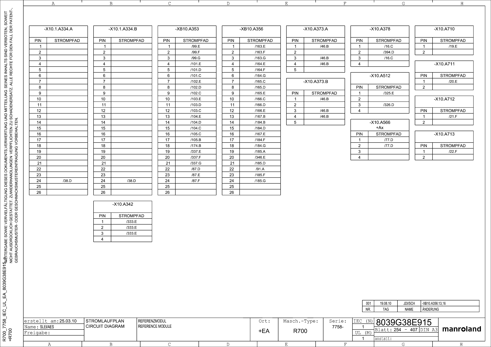

# +EA — Sheet 254 of 407 — REFERENZMODUL

**REFERENCE MODULE**

> Part of the manroland **R700** printing press IEC/UL circuit diagrams.
> Drawing class: **Stromlaufplan / Circuit diagram** (DIN A3).
> Document `+EA` covers the **Printing unit** machine section.

## At a glance

| Field | Value |
|---|---|
| Document | `+EA`  (8039G38E915) |
| Sheet | **254** of 407 |
| Section (DE) | REFERENZMODUL |
| Section (EN) | REFERENCE MODULE |
| Section type | REFERENCE_MODULE — Reference module |
| Machine type | `R700` |
| Series | `7758` |
| Created | 25.03.10 |
| Replaces | — |
| Columns used | A, B, C, D, E, F, G, H |
| Path numbers | — |
| Labels on sheet | 259 |
| Cross-refs out | 70 |
| Cross-refs in | 0 |

**Previous:** [+EA sheet 253](SHEET_0253.md) · **Next:** [+EA sheet 255](SHEET_0255.md) · **Document TOC:** [_TOC.md](_TOC.md)  (+EA) · **Master TOC:** [all sheets](../_MASTER_TOC.md)

## Sheet image (300 DPI, exact vector render)



_Rendered directly from the PDF vector layer at 300 DPI (1-bit), no OCR and no resampling. Use it to confirm anything ambiguous in the text below._

## Cross-references on this sheet

Each entry is a wire leaving this sheet. The printed token is `/sheet.column`; the link resolves to that sheet inside the same document.

| Ref | Target sheet | Col | Path | Destination on target | Target section | From col |
|---|---|---|---|---|---|---|
| `/19.E` | [+EA sheet 19](SHEET_0019.md) | E | — | STROMPFAD PIN 1 2 | SPANNUNGSVERSORGUNG: 400V, 24V | H |
| `/99.E` | [+EA sheet 99](SHEET_0099.md) | E | — | — | BOGENFÜHRUNGSELEMENT | C |
| `/46.B` | [+EA sheet 46](SHEET_0046.md) | B | — | — | SCHUTZ | F |
| `/163.E` | [+EA sheet 163](SHEET_0163.md) | E | — | — | VERLÄNGERUNG 1828,4MM | E |
| `/16.C` | [+EA sheet 16](SHEET_0016.md) | C | — | — | SPANNUNGSVERSORGUNG: 400V, 24V | G |
| `/99.F` | [+EA sheet 99](SHEET_0099.md) | F | — | — | BOGENFÜHRUNGSELEMENT | C |
| `/163.F` | [+EA sheet 163](SHEET_0163.md) | F | — | — | VERLÄNGERUNG 1828,4MM | E |
| `/394.D` | [+EA sheet 394](SHEET_0394.md) | D | — | — | OPTION: ZWISCHENTROCKNER VORBEREITUNG; | G |
| `/46.B` | [+EA sheet 46](SHEET_0046.md) | B | — | — | SCHUTZ | F |
| `/99.G` | [+EA sheet 99](SHEET_0099.md) | G | — | — | BOGENFÜHRUNGSELEMENT | C |
| `/163.G` | [+EA sheet 163](SHEET_0163.md) | G | — | — | VERLÄNGERUNG 1828,4MM | E |
| `/16.C` | [+EA sheet 16](SHEET_0016.md) | C | — | — | SPANNUNGSVERSORGUNG: 400V, 24V | G |
| `/46.B` | [+EA sheet 46](SHEET_0046.md) | B | — | — | SCHUTZ | F |
| `/101.E` | [+EA sheet 101](SHEET_0101.md) | E | — | — | BOGENFÜHRUNGSELEMENT | C |
| `/164.E` | [+EA sheet 164](SHEET_0164.md) | E | — | — | VERLÄNGERUNG 1828,4MM | E |
| `/164.F` | [+EA sheet 164](SHEET_0164.md) | F | — | — | VERLÄNGERUNG 1828,4MM | E |
| `/101.D` | [+EA sheet 101](SHEET_0101.md) | D | — | — | BOGENFÜHRUNGSELEMENT | C |
| `/20.E` | [+EA sheet 20](SHEET_0020.md) | E | — | STROMPFAD PIN 1 2 | SPANNUNGSVERSORGUNG: 400V, 24V | H |
| `/164.G` | [+EA sheet 164](SHEET_0164.md) | G | — | — | VERLÄNGERUNG 1828,4MM | E |
| `/101.C` | [+EA sheet 101](SHEET_0101.md) | C | — | — | BOGENFÜHRUNGSELEMENT | C |
| `/102.E` | [+EA sheet 102](SHEET_0102.md) | E | — | — | BOGENFÜHRUNGSELEMENT | C |
| `/165.C` | [+EA sheet 165](SHEET_0165.md) | C | — | — | VERLÄNGERUNG 1828,4MM | E |
| `/102.D` | [+EA sheet 102](SHEET_0102.md) | D | — | — | BOGENFÜHRUNGSELEMENT | C |
| `/165.D` | [+EA sheet 165](SHEET_0165.md) | D | — | — | VERLÄNGERUNG 1828,4MM | E |
| `/165.E` | [+EA sheet 165](SHEET_0165.md) | E | — | — | VERLÄNGERUNG 1828,4MM | E |
| `/325.E` | [+EA sheet 325](SHEET_0325.md) | E | — | — | OPTION: BOGENWEICHE | G |
| `/102.C` | [+EA sheet 102](SHEET_0102.md) | C | — | — | BOGENFÜHRUNGSELEMENT | C |
| `/46.B` | [+EA sheet 46](SHEET_0046.md) | B | — | — | SCHUTZ | F |
| `/103.E` | [+EA sheet 103](SHEET_0103.md) | E | — | — | BOGENFÜHRUNGSELEMENT | C |
| `/166.C` | [+EA sheet 166](SHEET_0166.md) | C | — | — | VERLÄNGERUNG 1828,4MM | E |
| `/103.D` | [+EA sheet 103](SHEET_0103.md) | D | — | — | BOGENFÜHRUNGSELEMENT | C |
| `/166.D` | [+EA sheet 166](SHEET_0166.md) | D | — | — | VERLÄNGERUNG 1828,4MM | E |
| `/326.D` | [+EA sheet 326](SHEET_0326.md) | D | — | — | OPTION: BOGENWEICHE | G |
| `/21.F` | [+EA sheet 21](SHEET_0021.md) | F | — | STROMPFAD PIN 1 2 | SPANNUNGSVERSORGUNG: 400V, 24V | H |
| `/46.B` | [+EA sheet 46](SHEET_0046.md) | B | — | — | SCHUTZ | F |
| `/166.E` | [+EA sheet 166](SHEET_0166.md) | E | — | — | VERLÄNGERUNG 1828,4MM | E |
| `/103.C` | [+EA sheet 103](SHEET_0103.md) | C | — | — | BOGENFÜHRUNGSELEMENT | C |
| `/46.B` | [+EA sheet 46](SHEET_0046.md) | B | — | — | SCHUTZ | F |
| `/104.E` | [+EA sheet 104](SHEET_0104.md) | E | — | — | BOGENFÜHRUNGSELEMENT | C |
| `/167.B` | [+EA sheet 167](SHEET_0167.md) | B | — | — | BOGENFÜHRUNGSELEMENT (BLASROHRE) | E |
| `/184.B` | [+EA sheet 184](SHEET_0184.md) | B | — | — | RESERVE | E |
| `/104.D` | [+EA sheet 104](SHEET_0104.md) | D | — | — | BOGENFÜHRUNGSELEMENT | C |
| `/104.C` | [+EA sheet 104](SHEET_0104.md) | C | — | — | BOGENFÜHRUNGSELEMENT | C |
| `/184.D` | [+EA sheet 184](SHEET_0184.md) | D | — | — | RESERVE | E |
| `/167.E` | [+EA sheet 167](SHEET_0167.md) | E | — | — | BOGENFÜHRUNGSELEMENT (BLASROHRE) | E |
| `/105.C` | [+EA sheet 105](SHEET_0105.md) | C | — | — | BOGENFÜHRUNGSELEMENT | C |
| `/105.B` | [+EA sheet 105](SHEET_0105.md) | B | — | — | BOGENFÜHRUNGSELEMENT | C |
| `/184.F` | [+EA sheet 184](SHEET_0184.md) | F | — | — | RESERVE | E |
| `/77.D` | [+EA sheet 77](SHEET_0077.md) | D | — | — | AUSLEGERSTAPELSTEUERUNG | G |
| `/22.F` | [+EA sheet 22](SHEET_0022.md) | F | — | STROMPFAD PIN 1 2 | SPANNUNGSVERSORGUNG: 400V, 24V | H |
| `/174.B` | [+EA sheet 174](SHEET_0174.md) | B | — | — | RESERVE | C |
| `/184.G` | [+EA sheet 184](SHEET_0184.md) | G | — | — | RESERVE | E |
| `/77.D` | [+EA sheet 77](SHEET_0077.md) | D | — | — | AUSLEGERSTAPELSTEUERUNG | G |
| `/337.E` | [+EA sheet 337](SHEET_0337.md) | E | — | — | OPTION: BOGENWEICHE | C |
| `/185.A` | [+EA sheet 185](SHEET_0185.md) | A | — | — | RESERVE | E |
| `/346.E` | [+EA sheet 346](SHEET_0346.md) | E | — | — | OPTION: VORBEREITUNG CO2 LÖSCHANLAGE | E |
| `/337.F` | [+EA sheet 337](SHEET_0337.md) | F | — | — | OPTION: BOGENWEICHE | C |
| `/337.G` | [+EA sheet 337](SHEET_0337.md) | G | — | — | OPTION: BOGENWEICHE | C |
| `/185.D` | [+EA sheet 185](SHEET_0185.md) | D | — | — | RESERVE | E |
| `/91.A` | [+EA sheet 91](SHEET_0091.md) | A | — | — | BLASROHRE (BLASRAHMEN) | E |
| `/87.D` | [+EA sheet 87](SHEET_0087.md) | D | — | — | SAUGWALZE | C |
| `/87.E` | [+EA sheet 87](SHEET_0087.md) | E | — | — | SAUGWALZE | C |
| `/185.F` | [+EA sheet 185](SHEET_0185.md) | F | — | — | RESERVE | E |
| `/87.F` | [+EA sheet 87](SHEET_0087.md) | F | — | — | SAUGWALZE | C |
| `/38.D` | [+EA sheet 38](SHEET_0038.md) | D | — | — | BUSVERBINDUNGEN: NOT AUS | A |
| `/38.D` | [+EA sheet 38](SHEET_0038.md) | D | — | — | BUSVERBINDUNGEN: NOT AUS | B |
| `/185.G` | [+EA sheet 185](SHEET_0185.md) | G | — | — | RESERVE | E |
| `/333.E` | [+EA sheet 333](SHEET_0333.md) | E | — | — | OPTION: BOGENWEICHE | B |
| `/333.E` | [+EA sheet 333](SHEET_0333.md) | E | — | — | OPTION: BOGENWEICHE | B |
| `/333.E` | [+EA sheet 333](SHEET_0333.md) | E | — | — | OPTION: BOGENWEICHE | B |

## Devices on this sheet

| Tag | Class | Class meaning (IEC) | Col | Sub | Terminal | Sign |
|---|---|---|---|---|---|---|
| `X10.1.A334.A` | — | cross-device reference | A | — | — | — |
| `X10.1.A334.B` | — | cross-device reference | B | — | — | — |
| `X10.A342` | — | cross-device reference | B | — | — | — |
| `XB10.A353` | — | cross-device reference | C | — | — | — |
| `XB10.A356` | — | cross-device reference | D | — | — | — |
| `X10.A373.A` | — | cross-device reference | E | — | — | — |
| `X10.A373.B` | — | cross-device reference | F | — | — | — |
| `X10.A566` | — | cross-device reference | G | — | — | — |
| `X10.A378` | — | cross-device reference | G | — | — | — |
| `X10.A512` | — | cross-device reference | G | — | — | — |
| `X10.A710` | — | cross-device reference | H | — | — | — |
| `X10.A711` | — | cross-device reference | H | — | — | — |
| `X10.A712` | — | cross-device reference | H | — | — | — |
| `X10.A713` | — | cross-device reference | H | — | — | — |
| `NR.` | — | cross-device reference | F | — | — | — |
| `19.08.10` | — | cross-device reference | G | — | — | — |

## Potentials / nets

_No named potentials on this sheet._

## Wire-end annotations (grouped as printed)

A wire that continues elsewhere is annotated with a small cluster: the destination description, the path/line number `#NN`, and the `/sheet.column` cross reference. Each row below is one such cluster exactly as it is grouped on the drawing.

| Col | Y | Path | Cross-ref | Text on the wire |
|---|---|---|---|---|
| A | 65.5 | — | — | `X10.1.A334.A` |
| B | 65.5 | — | — | `X10.1.A334.B` |
| C | 65.5 | — | — | `XB10.A353` |
| D | 65.5 | — | — | `XB10.A356` |
| E | 65.5 | — | — | `X10.A373.A` |
| G | 65.5 | — | — | `X10.A378` |
| H | 65.5 | — | — | `X10.A710` |
| A | 94.2 | — | — | `PIN STROMPFAD` |
| B | 94.2 | — | — | `PIN STROMPFAD` |
| C | 94.2 | — | — | `PIN STROMPFAD` |
| D | 94.2 | — | — | `PIN STROMPFAD` |
| E | 94.2 | — | — | `PIN 2 3 4 5 1 STROMPFAD` |
| G | 94.2 | — | — | `PIN 2 3 4 1 STROMPFAD` |
| H | 94.2 | — | `/19.E` | `PIN 2 1 STROMPFAD` |
| A | 108.4 | — | — | `2 3 4 5 6 7 8 9 1` |
| B | 108.4 | — | — | `2 3 4 5 6 7 8 9 1` |
| C | 108.4 | — | — | `2 3 4 5 6 7 8 9 1` |
| D | 108.4 | — | — | `2 3 4 5 6 7 8 9 1` |
| C | 108.7 | — | `/99.E` | — |
| E | 108.7 | — | `/163.E` | — |
| F | 108.7 | — | `/46.B` | — |
| G | 108.7 | — | `/16.C` | — |
| C | 122.9 | — | `/99.F` | — |
| E | 122.9 | — | `/163.F` | — |
| G | 122.9 | — | `/394.D` | — |
| C | 137.0 | — | `/99.G` | — |
| F | 137.0 | — | `/46.B` | — |
| E | 137.1 | — | `/163.G` | — |
| G | 137.1 | — | `/16.C` | — |
| H | 150.5 | — | — | `X10.A711` |
| C | 151.2 | — | `/101.E` | — |
| E | 151.2 | — | `/164.E` | — |
| F | 151.2 | — | `/46.B` | — |
| C | 165.4 | — | `/101.D` | — |
| E | 165.4 | — | `/164.F` | — |
| G | 178.9 | — | — | `X10.A512` |
| H | 179.2 | — | `/20.E` | `PIN 2 1 STROMPFAD` |
| C | 179.6 | — | `/101.C` | — |
| E | 179.6 | — | `/164.G` | — |
| F | 193.1 | — | — | `X10.A373.B` |
| C | 193.7 | — | `/102.E` | — |
| E | 193.8 | — | `/165.C` | — |
| G | 207.5 | — | — | `PIN 2 3 4 1 STROMPFAD` |
| C | 207.9 | — | `/102.D` | — |
| E | 207.9 | — | `/165.D` | — |
| E | 221.7 | — | — | `PIN 2 3 4 5 1 STROMPFAD` |
| C | 222.1 | — | `/102.C` | — |
| E | 222.1 | — | `/165.E` | — |
| G | 222.1 | — | `/325.E` | — |
| H | 235.6 | — | — | `X10.A712` |
| A | 235.9 | — | — | `10 12 13 14 15 16 17 18 19 20 11` |
| B | 235.9 | — | — | `10 12 13 14 15 16 17 18 19 20 11` |
| C | 235.9 | — | — | `10 12 13 14 15 16 17 18 19 20 11` |
| D | 235.9 | — | — | `10 12 13 14 15 16 17 18 19 20 11` |
| C | 236.2 | — | `/103.E` | — |
| F | 236.2 | — | `/46.B` | — |
| E | 236.3 | — | `/166.C` | — |
| C | 250.4 | — | `/103.D` | — |
| E | 250.4 | — | `/166.D` | — |
| G | 250.4 | — | `/326.D` | — |
| H | 264.2 | — | `/21.F` | `PIN 2 1 STROMPFAD` |
| C | 264.6 | — | `/103.C` | — |
| E | 264.6 | — | `/166.E` | — |
| F | 264.6 | — | `/46.B` | — |
| C | 278.8 | — | `/104.E` | — |
| E | 278.8 | — | `/167.B` | — |
| F | 278.8 | — | `/46.B` | — |
| G | 292.3 | — | — | `X10.A566` |
| E | 292.9 | — | `/184.B` | — |
| C | 293.0 | — | `/104.D` | — |
| G | 305.1 | — | — | `+Ax` |
| C | 307.1 | — | `/104.C` | — |
| E | 307.1 | — | `/184.D` | — |
| H | 320.6 | — | — | `X10.A713` |
| G | 320.9 | — | — | `PIN 2 3 4 1 STROMPFAD` |
| C | 321.3 | — | `/105.C` | — |
| E | 321.3 | — | `/167.E` | — |
| C | 335.5 | — | `/105.B` | — |
| E | 335.5 | — | `/184.F` | — |
| G | 335.5 | — | `/77.D` | — |
| H | 349.3 | — | `/22.F` | `PIN 2 1 STROMPFAD` |
| C | 349.6 | — | `/174.B` | — |
| E | 349.6 | — | `/184.G` | — |
| G | 349.6 | — | `/77.D` | — |
| C | 363.8 | — | `/337.E` | — |
| E | 363.8 | — | `/185.A` | — |
| C | 378.0 | — | `/337.F` | — |
| E | 378.0 | — | `/346.E` | — |
| A | 391.8 | — | — | `22 23 24 25 26 21` |
| B | 391.8 | — | — | `22 23 24 25 26 21` |
| C | 391.8 | — | — | `22 23 24 25 26 21` |
| D | 391.8 | — | — | `22 23 24 25 26 21` |
| C | 392.2 | — | `/337.G` | — |
| E | 392.2 | — | `/185.D` | — |
| C | 406.3 | — | `/87.D` | — |
| E | 406.3 | — | `/91.A` | — |
| C | 420.5 | — | `/87.E` | — |
| E | 420.5 | — | `/185.F` | — |
| A | 434.7 | — | `/38.D` | — |
| B | 434.7 | — | `/38.D` | — |
| C | 434.7 | — | `/87.F` | — |
| E | 434.7 | — | `/185.G` | — |
| B | 490.7 | — | — | `X10.A342` |
| B | 519.4 | — | — | `PIN 2 3 4 1 STROMPFAD` |
| B | 533.9 | — | `/333.E` | — |
| B | 548.1 | — | `/333.E` | — |
| B | 562.2 | — | `/333.E` | — |
| G | 733.0 | — | — | `001 19.08.10 JDI/SCH XB10.A356:13,16` |
| G | 747.1 | — | — | `NR. TAG NAME ÄNDERUNG` |


## Reconstructed tables

This sheet carries tabular content (pin map / terminal assignment / index). The grid below was rebuilt from the drawing's own rule lines, so each row is exactly one physical row of the table.

### Table 1 — 26 data rows × 2 columns (at x=70.9, y=62.4) — **X10.1.A334.A**

| PIN | STROMPFAD |
|---|---|
| `1` |  |
| `2` |  |
| `3` |  |
| `4` |  |
| `5` |  |
| `6` |  |
| `7` |  |
| `8` |  |
| `9` |  |
| `10` |  |
| `11` |  |
| `12` |  |
| `13` |  |
| `14` |  |
| `15` |  |
| `16` |  |
| `17` |  |
| `18` |  |
| `19` |  |
| `20` |  |
| `21` |  |
| `22` |  |
| `23` |  |
| `24` | `/38.D` |
| `25` |  |
| `26` |  |


### Table 2 — 32 data rows × 2 columns (at x=226.8, y=62.4) — **X10.1.A334.B**

| PIN | STROMPFAD |
|---|---|
| `1` |  |
| `2` |  |
| `3` |  |
| `4` |  |
| `5` |  |
| `6` |  |
| `7` |  |
| `8` |  |
| `9` |  |
| `10` |  |
| `11` |  |
| `12` |  |
| `13` |  |
| `14` |  |
| `15` |  |
| `16` |  |
| `17` |  |
| `18` |  |
| `19` |  |
| `20` |  |
| `21` |  |
| `22` |  |
| `23` |  |
| `24` | `/38.D` |
| `25` |  |
| `26` |  |
|  | `X10.A342` |
| `PIN` | `STROMPFAD` |
| `1` | `/333.E` |
| `2` | `/333.E` |
| `3` | `/333.E` |
| `4` |  |


### Table 3 — 26 data rows × 2 columns (at x=382.7, y=62.4) — **XB10.A353**

| PIN | STROMPFAD |
|---|---|
| `1` | `/99.E` |
| `2` | `/99.F` |
| `3` | `/99.G` |
| `4` | `/101.E` |
| `5` | `/101.D` |
| `6` | `/101.C` |
| `7` | `/102.E` |
| `8` | `/102.D` |
| `9` | `/102.C` |
| `10` | `/103.E` |
| `11` | `/103.D` |
| `12` | `/103.C` |
| `13` | `/104.E` |
| `14` | `/104.D` |
| `15` | `/104.C` |
| `16` | `/105.C` |
| `17` | `/105.B` |
| `18` | `/174.B` |
| `19` | `/337.E` |
| `20` | `/337.F` |
| `21` | `/337.G` |
| `22` | `/87.D` |
| `23` | `/87.E` |
| `24` | `/87.F` |
| `25` |  |
| `26` |  |


### Table 4 — 26 data rows × 2 columns (at x=538.6, y=62.4) — **XB10.A356**

| PIN | STROMPFAD |
|---|---|
| `1` | `/163.E` |
| `2` | `/163.F` |
| `3` | `/163.G` |
| `4` | `/164.E` |
| `5` | `/164.F` |
| `6` | `/164.G` |
| `7` | `/165.C` |
| `8` | `/165.D` |
| `9` | `/165.E` |
| `10` | `/166.C` |
| `11` | `/166.D` |
| `12` | `/166.E` |
| `13` | `/167.B` |
| `14` | `/184.B` |
| `15` | `/184.D` |
| `16` | `/167.E` |
| `17` | `/184.F` |
| `18` | `/184.G` |
| `19` | `/185.A` |
| `20` | `/346.E` |
| `21` | `/185.D` |
| `22` | `/91.A` |
| `23` | `/185.F` |
| `24` | `/185.G` |
| `25` |  |
| `26` |  |


### Table 5 — 12 data rows × 2 columns (at x=694.5, y=62.4) — **X10.A373.A**

| PIN | STROMPFAD |
|---|---|
| `1` | `/46.B` |
| `2` |  |
| `3` | `/46.B` |
| `4` | `/46.B` |
| `5` |  |
|  | `X10.A373.B` |
| `PIN` | `STROMPFAD` |
| `1` | `/46.B` |
| `2` |  |
| `3` | `/46.B` |
| `4` | `/46.B` |
| `5` |  |


### Table 6 — 17 data rows × 2 columns (at x=850.4, y=62.4) — **X10.A378**

| PIN | STROMPFAD |
|---|---|
| `1` | `/16.C` |
| `2` | `/394.D` |
| `3` | `/16.C` |
| `4` |  |
|  | `X10.A512` |
| `PIN` | `STROMPFAD` |
| `1` | `/325.E` |
| `2` |  |
| `3` | `/326.D` |
| `4` |  |
|  | `X10.A566` |
|  | `+Ax` |
| `PIN` | `STROMPFAD` |
| `1` | `/77.D` |
| `2` | `/77.D` |
| `3` |  |
| `4` |  |


### Table 7 — 14 data rows × 2 columns (at x=1006.3, y=62.4) — **X10.A710**

| PIN | STROMPFAD |
|---|---|
| `1` | `/19.E` |
| `2` |  |
|  | `X10.A711` |
| `PIN` | `STROMPFAD` |
| `1` | `/20.E` |
| `2` |  |
|  | `X10.A712` |
| `PIN` | `STROMPFAD` |
| `1` | `/21.F` |
| `2` |  |
|  | `X10.A713` |
| `PIN` | `STROMPFAD` |
| `1` | `/22.F` |
| `2` |  |


## Notes and free text on this sheet

| Text | Col | Y (pt) |
|---|---|---|
| `PIN` | A | 94.2 |
| `STROMPFAD` | A | 94.15 |
| `PIN` | B | 94.2 |
| `STROMPFAD` | B | 94.15 |
| `PIN` | C | 94.2 |
| `STROMPFAD` | C | 94.15 |
| `PIN` | D | 94.2 |
| `STROMPFAD` | E | 94.15 |
| `PIN` | E | 94.2 |
| `STROMPFAD` | F | 94.15 |
| `PIN` | F | 320.97 |
| `STROMPFAD` | G | 320.93 |
| `+Ax` | G | 305.06 |
| `PIN` | G | 94.2 |
| `STROMPFAD` | H | 94.15 |
| `TAG` | G | 747.27 |
| `NAME` | G | 747.25 |
| `ÄNDERUNG` | G | 747.31 |
| `JDI/SCH` | G | 733.1 |
| `XB10.A356:13,16` | H | 733.14 |

## Complete label inventory (exact text from the drawing)

Every text object inside the drawing area of this sheet, in DIN reading order (column A→H, then top→bottom). This is the authoritative list: if a string is not here it is not printed on this sheet.

| Col | Y | X | Dir | Type | Text |
|---|---|---|---|---|---|
| A | 65.5 | 107.0 | → | device ref | `X10.1.A334.A` |
| A | 94.2 | 84.0 | → | text | `PIN` |
| A | 94.2 | 132.2 | → | text | `STROMPFAD` |
| A | 108.4 | 95.8 | → | number | `1` |
| A | 122.5 | 94.1 | → | number | `2` |
| A | 136.7 | 94.1 | → | number | `3` |
| A | 150.9 | 94.1 | → | number | `4` |
| A | 165.1 | 94.1 | → | number | `5` |
| A | 179.2 | 94.1 | → | number | `6` |
| A | 193.4 | 94.1 | → | number | `7` |
| A | 207.6 | 94.1 | → | number | `8` |
| A | 221.8 | 94.1 | → | number | `9` |
| A | 235.9 | 88.7 | → | number | `10` |
| A | 250.1 | 90.4 | → | number | `11` |
| A | 264.3 | 88.7 | → | number | `12` |
| A | 278.5 | 88.7 | → | number | `13` |
| A | 292.6 | 88.7 | → | number | `14` |
| A | 306.8 | 88.7 | → | number | `15` |
| A | 321.0 | 88.7 | → | number | `16` |
| A | 335.1 | 88.7 | → | number | `17` |
| A | 349.3 | 88.7 | → | number | `18` |
| A | 363.5 | 88.7 | → | number | `19` |
| A | 377.7 | 88.7 | → | number | `20` |
| A | 391.8 | 90.4 | → | number | `21` |
| A | 406.0 | 88.7 | → | number | `22` |
| A | 420.2 | 88.7 | → | number | `23` |
| A | 434.4 | 88.7 | → | number | `24` |
| A | 434.7 | 152.6 | → | cross-reference | `/38.D` |
| A | 448.5 | 88.7 | → | number | `25` |
| A | 462.7 | 88.7 | → | number | `26` |
| B | 65.5 | 263.3 | → | device ref | `X10.1.A334.B` |
| B | 94.2 | 240.0 | → | text | `PIN` |
| B | 94.2 | 288.1 | → | text | `STROMPFAD` |
| B | 108.4 | 251.7 | → | number | `1` |
| B | 122.5 | 250.0 | → | number | `2` |
| B | 136.7 | 250.0 | → | number | `3` |
| B | 150.9 | 250.0 | → | number | `4` |
| B | 165.1 | 250.0 | → | number | `5` |
| B | 179.2 | 250.0 | → | number | `6` |
| B | 193.4 | 250.0 | → | number | `7` |
| B | 207.6 | 250.0 | → | number | `8` |
| B | 221.8 | 250.0 | → | number | `9` |
| B | 235.9 | 244.6 | → | number | `10` |
| B | 250.1 | 246.3 | → | number | `11` |
| B | 264.3 | 244.6 | → | number | `12` |
| B | 278.5 | 244.6 | → | number | `13` |
| B | 292.6 | 244.6 | → | number | `14` |
| B | 306.8 | 244.6 | → | number | `15` |
| B | 321.0 | 244.6 | → | number | `16` |
| B | 335.1 | 244.6 | → | number | `17` |
| B | 349.3 | 244.6 | → | number | `18` |
| B | 363.5 | 244.6 | → | number | `19` |
| B | 377.7 | 244.6 | → | number | `20` |
| B | 391.8 | 246.3 | → | number | `21` |
| B | 406.0 | 244.6 | → | number | `22` |
| B | 420.2 | 244.6 | → | number | `23` |
| B | 434.4 | 244.6 | → | number | `24` |
| B | 434.7 | 308.6 | → | cross-reference | `/38.D` |
| B | 448.5 | 244.6 | → | number | `25` |
| B | 462.7 | 244.6 | → | number | `26` |
| B | 490.7 | 272.7 | → | device ref | `X10.A342` |
| B | 519.4 | 240.0 | → | text | `PIN` |
| B | 519.4 | 288.1 | → | text | `STROMPFAD` |
| B | 533.6 | 245.9 | → | number | `1` |
| B | 533.9 | 306.4 | → | cross-reference | `/333.E` |
| B | 547.7 | 245.3 | → | number | `2` |
| B | 548.1 | 306.4 | → | cross-reference | `/333.E` |
| B | 561.9 | 245.3 | → | number | `3` |
| B | 562.2 | 306.4 | → | cross-reference | `/333.E` |
| B | 576.1 | 245.3 | → | number | `4` |
| C | 65.5 | 425.1 | → | device ref | `XB10.A353` |
| C | 94.2 | 395.9 | → | text | `PIN` |
| C | 94.2 | 444.0 | → | text | `STROMPFAD` |
| C | 108.4 | 407.6 | → | number | `1` |
| C | 108.7 | 464.7 | → | cross-reference | `/99.E` |
| C | 122.5 | 405.9 | → | number | `2` |
| C | 122.9 | 464.9 | → | cross-reference | `/99.F` |
| C | 136.7 | 405.9 | → | number | `3` |
| C | 137.0 | 464.3 | → | cross-reference | `/99.G` |
| C | 150.9 | 405.9 | → | number | `4` |
| C | 151.2 | 462.3 | → | cross-reference | `/101.E` |
| C | 165.1 | 405.9 | → | number | `5` |
| C | 165.4 | 462.0 | → | cross-reference | `/101.D` |
| C | 179.2 | 405.9 | → | number | `6` |
| C | 179.6 | 462.0 | → | cross-reference | `/101.C` |
| C | 193.4 | 405.9 | → | number | `7` |
| C | 193.7 | 462.3 | → | cross-reference | `/102.E` |
| C | 207.6 | 405.9 | → | number | `8` |
| C | 207.9 | 462.0 | → | cross-reference | `/102.D` |
| C | 221.8 | 405.9 | → | number | `9` |
| C | 222.1 | 462.0 | → | cross-reference | `/102.C` |
| C | 235.9 | 400.5 | → | number | `10` |
| C | 236.2 | 462.3 | → | cross-reference | `/103.E` |
| C | 250.1 | 402.2 | → | number | `11` |
| C | 250.4 | 462.0 | → | cross-reference | `/103.D` |
| C | 264.3 | 400.5 | → | number | `12` |
| C | 264.6 | 462.0 | → | cross-reference | `/103.C` |
| C | 278.5 | 400.5 | → | number | `13` |
| C | 278.8 | 462.3 | → | cross-reference | `/104.E` |
| C | 292.6 | 400.5 | → | number | `14` |
| C | 293.0 | 462.0 | → | cross-reference | `/104.D` |
| C | 306.8 | 400.5 | → | number | `15` |
| C | 307.1 | 462.0 | → | cross-reference | `/104.C` |
| C | 321.0 | 400.5 | → | number | `16` |
| C | 321.3 | 462.0 | → | cross-reference | `/105.C` |
| C | 335.1 | 400.5 | → | number | `17` |
| C | 335.5 | 462.2 | → | cross-reference | `/105.B` |
| C | 349.3 | 400.5 | → | number | `18` |
| C | 349.6 | 462.2 | → | cross-reference | `/174.B` |
| C | 363.5 | 400.5 | → | number | `19` |
| C | 363.8 | 462.3 | → | cross-reference | `/337.E` |
| C | 377.7 | 400.5 | → | number | `20` |
| C | 378.0 | 462.5 | → | cross-reference | `/337.F` |
| C | 391.8 | 402.2 | → | number | `21` |
| C | 392.2 | 461.9 | → | cross-reference | `/337.G` |
| C | 406.0 | 400.5 | → | number | `22` |
| C | 406.3 | 464.5 | → | cross-reference | `/87.D` |
| C | 420.2 | 400.5 | → | number | `23` |
| C | 420.5 | 464.7 | → | cross-reference | `/87.E` |
| C | 434.4 | 400.5 | → | number | `24` |
| C | 434.7 | 464.9 | → | cross-reference | `/87.F` |
| C | 448.5 | 400.5 | → | number | `25` |
| C | 462.7 | 400.5 | → | number | `26` |
| D | 65.5 | 581.0 | → | device ref | `XB10.A356` |
| D | 94.2 | 551.8 | → | text | `PIN` |
| D | 108.4 | 563.5 | → | number | `1` |
| D | 122.5 | 561.8 | → | number | `2` |
| D | 136.7 | 561.8 | → | number | `3` |
| D | 150.9 | 561.8 | → | number | `4` |
| D | 165.1 | 561.8 | → | number | `5` |
| D | 179.2 | 561.8 | → | number | `6` |
| D | 193.4 | 561.8 | → | number | `7` |
| D | 207.6 | 561.8 | → | number | `8` |
| D | 221.8 | 561.8 | → | number | `9` |
| D | 235.9 | 556.4 | → | number | `10` |
| D | 250.1 | 558.1 | → | number | `11` |
| D | 264.3 | 556.4 | → | number | `12` |
| D | 278.5 | 556.4 | → | number | `13` |
| D | 292.6 | 556.4 | → | number | `14` |
| D | 306.8 | 556.4 | → | number | `15` |
| D | 321.0 | 556.4 | → | number | `16` |
| D | 335.1 | 556.4 | → | number | `17` |
| D | 349.3 | 556.4 | → | number | `18` |
| D | 363.5 | 556.4 | → | number | `19` |
| D | 377.7 | 556.4 | → | number | `20` |
| D | 391.8 | 558.1 | → | number | `21` |
| D | 406.0 | 556.4 | → | number | `22` |
| D | 420.2 | 556.4 | → | number | `23` |
| D | 434.4 | 556.4 | → | number | `24` |
| D | 448.5 | 556.4 | → | number | `25` |
| D | 462.7 | 556.4 | → | number | `26` |
| E | 65.5 | 735.0 | → | device ref | `X10.A373.A` |
| E | 94.2 | 600.0 | → | text | `STROMPFAD` |
| E | 94.2 | 707.7 | → | text | `PIN` |
| E | 108.4 | 713.6 | → | number | `1` |
| E | 108.7 | 618.2 | → | cross-reference | `/163.E` |
| E | 122.5 | 713.1 | → | number | `2` |
| E | 122.9 | 618.4 | → | cross-reference | `/163.F` |
| E | 136.7 | 713.1 | → | number | `3` |
| E | 137.1 | 617.8 | → | cross-reference | `/163.G` |
| E | 150.9 | 713.1 | → | number | `4` |
| E | 151.2 | 618.2 | → | cross-reference | `/164.E` |
| E | 165.1 | 713.1 | → | number | `5` |
| E | 165.4 | 618.4 | → | cross-reference | `/164.F` |
| E | 179.6 | 617.8 | → | cross-reference | `/164.G` |
| E | 193.8 | 618.0 | → | cross-reference | `/165.C` |
| E | 207.9 | 618.0 | → | cross-reference | `/165.D` |
| E | 221.8 | 707.7 | → | text | `PIN` |
| E | 222.1 | 618.2 | → | cross-reference | `/165.E` |
| E | 235.9 | 713.6 | → | number | `1` |
| E | 236.3 | 618.0 | → | cross-reference | `/166.C` |
| E | 250.1 | 713.1 | → | number | `2` |
| E | 250.4 | 618.0 | → | cross-reference | `/166.D` |
| E | 264.3 | 713.1 | → | number | `3` |
| E | 264.6 | 618.2 | → | cross-reference | `/166.E` |
| E | 278.5 | 713.1 | → | number | `4` |
| E | 278.8 | 618.1 | → | cross-reference | `/167.B` |
| E | 292.6 | 713.1 | → | number | `5` |
| E | 292.9 | 618.1 | → | cross-reference | `/184.B` |
| E | 307.1 | 618.0 | → | cross-reference | `/184.D` |
| E | 321.3 | 618.2 | → | cross-reference | `/167.E` |
| E | 335.5 | 618.4 | → | cross-reference | `/184.F` |
| E | 349.7 | 617.8 | → | cross-reference | `/184.G` |
| E | 363.8 | 618.0 | → | cross-reference | `/185.A` |
| E | 378.0 | 618.2 | → | cross-reference | `/346.E` |
| E | 392.2 | 618.0 | → | cross-reference | `/185.D` |
| E | 406.3 | 620.4 | → | cross-reference | `/91.A` |
| E | 420.5 | 618.4 | → | cross-reference | `/185.F` |
| E | 434.7 | 617.8 | → | cross-reference | `/185.G` |
| F | 94.2 | 755.9 | → | text | `STROMPFAD` |
| F | 94.2 | 863.6 | → | text | `PIN` |
| F | 108.4 | 869.5 | → | number | `1` |
| F | 108.7 | 776.4 | → | cross-reference | `/46.B` |
| F | 122.5 | 869.0 | → | number | `2` |
| F | 136.7 | 869.0 | → | number | `3` |
| F | 137.0 | 776.4 | → | cross-reference | `/46.B` |
| F | 150.9 | 869.0 | → | number | `4` |
| F | 151.2 | 776.4 | → | cross-reference | `/46.B` |
| F | 193.1 | 735.4 | → | device ref | `X10.A373.B` |
| F | 207.6 | 863.6 | → | text | `PIN` |
| F | 221.7 | 755.9 | → | text | `STROMPFAD` |
| F | 221.8 | 869.5 | → | number | `1` |
| F | 235.9 | 869.0 | → | number | `2` |
| F | 236.2 | 776.4 | → | cross-reference | `/46.B` |
| F | 250.1 | 869.0 | → | number | `3` |
| F | 264.3 | 869.0 | → | number | `4` |
| F | 264.6 | 776.4 | → | cross-reference | `/46.B` |
| F | 278.8 | 776.4 | → | cross-reference | `/46.B` |
| F | 321.0 | 863.6 | → | text | `PIN` |
| F | 335.1 | 869.5 | → | number | `1` |
| F | 349.3 | 869.0 | → | number | `2` |
| F | 363.5 | 869.0 | → | number | `3` |
| F | 377.7 | 869.0 | → | number | `4` |
| F | 733.0 | 887.7 | → | number | `001` |
| F | 747.1 | 886.7 | → | device ref | `NR.` |
| G | 65.5 | 896.3 | → | device ref | `X10.A378` |
| G | 94.2 | 911.8 | → | text | `STROMPFAD` |
| G | 94.2 | 1019.5 | → | text | `PIN` |
| G | 108.4 | 1025.4 | → | number | `1` |
| G | 108.7 | 932.2 | → | cross-reference | `/16.C` |
| G | 122.5 | 1024.9 | → | number | `2` |
| G | 122.9 | 929.8 | → | cross-reference | `/394.D` |
| G | 137.1 | 932.2 | → | cross-reference | `/16.C` |
| G | 178.9 | 896.3 | → | device ref | `X10.A512` |
| G | 179.2 | 1019.5 | → | text | `PIN` |
| G | 193.4 | 1025.4 | → | number | `1` |
| G | 207.5 | 911.8 | → | text | `STROMPFAD` |
| G | 207.6 | 1024.9 | → | number | `2` |
| G | 222.1 | 930.0 | → | cross-reference | `/325.E` |
| G | 250.4 | 929.8 | → | cross-reference | `/326.D` |
| G | 264.3 | 1019.5 | → | text | `PIN` |
| G | 278.5 | 1025.4 | → | number | `1` |
| G | 292.3 | 896.3 | → | device ref | `X10.A566` |
| G | 292.6 | 1024.9 | → | number | `2` |
| G | 305.1 | 911.8 | → | text | `+Ax` |
| G | 320.9 | 911.8 | → | text | `STROMPFAD` |
| G | 335.5 | 932.2 | → | cross-reference | `/77.D` |
| G | 349.3 | 1019.5 | → | text | `PIN` |
| G | 349.7 | 932.2 | → | cross-reference | `/77.D` |
| G | 363.5 | 1025.4 | → | number | `1` |
| G | 377.7 | 1024.9 | → | number | `2` |
| G | 733.1 | 921.5 | → | device ref | `19.08.10` |
| G | 733.1 | 978.7 | → | text | `JDI/SCH` |
| G | 747.3 | 928.3 | → | text | `TAG` |
| G | 747.3 | 981.7 | → | text | `NAME` |
| G | 747.3 | 1024.3 | → | text | `ÄNDERUNG` |
| H | 65.5 | 1052.2 | → | device ref | `X10.A710` |
| H | 94.2 | 1067.7 | → | text | `STROMPFAD` |
| H | 108.7 | 1088.4 | → | cross-reference | `/19.E` |
| H | 150.5 | 1052.9 | → | device ref | `X10.A711` |
| H | 179.2 | 1067.7 | → | text | `STROMPFAD` |
| H | 193.7 | 1088.4 | → | cross-reference | `/20.E` |
| H | 235.6 | 1052.2 | → | device ref | `X10.A712` |
| H | 264.2 | 1067.7 | → | text | `STROMPFAD` |
| H | 278.8 | 1088.5 | → | cross-reference | `/21.F` |
| H | 320.6 | 1052.2 | → | device ref | `X10.A713` |
| H | 349.3 | 1067.7 | → | text | `STROMPFAD` |
| H | 363.8 | 1088.5 | → | cross-reference | `/22.F` |
| H | 733.1 | 1023.7 | → | text | `XB10.A356:13,16` |

## Reading-order text block

The same content as a plain block, grouped by DIN column — convenient to paste or to match against a visual description.

```text
=== Column A ===
  65.5  107.0  devref       X10.1.A334.A
  94.2   84.0  text         PIN
  94.2  132.2  text         STROMPFAD
 108.4   95.8  numeric      1
 122.5   94.1  numeric      2
 136.7   94.1  numeric      3
 150.9   94.1  numeric      4
 165.1   94.1  numeric      5
 179.2   94.1  numeric      6
 193.4   94.1  numeric      7
 207.6   94.1  numeric      8
 221.8   94.1  numeric      9
 235.9   88.7  numeric      10
 250.1   90.4  numeric      11
 264.3   88.7  numeric      12
 278.5   88.7  numeric      13
 292.6   88.7  numeric      14
 306.8   88.7  numeric      15
 321.0   88.7  numeric      16
 335.1   88.7  numeric      17
 349.3   88.7  numeric      18
 363.5   88.7  numeric      19
 377.7   88.7  numeric      20
 391.8   90.4  numeric      21
 406.0   88.7  numeric      22
 420.2   88.7  numeric      23
 434.4   88.7  numeric      24
 434.7  152.6  xref         /38.D
 448.5   88.7  numeric      25
 462.7   88.7  numeric      26
=== Column B ===
  65.5  263.3  devref       X10.1.A334.B
  94.2  240.0  text         PIN
  94.2  288.1  text         STROMPFAD
 108.4  251.7  numeric      1
 122.5  250.0  numeric      2
 136.7  250.0  numeric      3
 150.9  250.0  numeric      4
 165.1  250.0  numeric      5
 179.2  250.0  numeric      6
 193.4  250.0  numeric      7
 207.6  250.0  numeric      8
 221.8  250.0  numeric      9
 235.9  244.6  numeric      10
 250.1  246.3  numeric      11
 264.3  244.6  numeric      12
 278.5  244.6  numeric      13
 292.6  244.6  numeric      14
 306.8  244.6  numeric      15
 321.0  244.6  numeric      16
 335.1  244.6  numeric      17
 349.3  244.6  numeric      18
 363.5  244.6  numeric      19
 377.7  244.6  numeric      20
 391.8  246.3  numeric      21
 406.0  244.6  numeric      22
 420.2  244.6  numeric      23
 434.4  244.6  numeric      24
 434.7  308.6  xref         /38.D
 448.5  244.6  numeric      25
 462.7  244.6  numeric      26
 490.7  272.7  devref       X10.A342
 519.4  240.0  text         PIN
 519.4  288.1  text         STROMPFAD
 533.6  245.9  numeric      1
 533.9  306.4  xref         /333.E
 547.7  245.3  numeric      2
 548.1  306.4  xref         /333.E
 561.9  245.3  numeric      3
 562.2  306.4  xref         /333.E
 576.1  245.3  numeric      4
=== Column C ===
  65.5  425.1  devref       XB10.A353
  94.2  395.9  text         PIN
  94.2  444.0  text         STROMPFAD
 108.4  407.6  numeric      1
 108.7  464.7  xref         /99.E
 122.5  405.9  numeric      2
 122.9  464.9  xref         /99.F
 136.7  405.9  numeric      3
 137.0  464.3  xref         /99.G
 150.9  405.9  numeric      4
 151.2  462.3  xref         /101.E
 165.1  405.9  numeric      5
 165.4  462.0  xref         /101.D
 179.2  405.9  numeric      6
 179.6  462.0  xref         /101.C
 193.4  405.9  numeric      7
 193.7  462.3  xref         /102.E
 207.6  405.9  numeric      8
 207.9  462.0  xref         /102.D
 221.8  405.9  numeric      9
 222.1  462.0  xref         /102.C
 235.9  400.5  numeric      10
 236.2  462.3  xref         /103.E
 250.1  402.2  numeric      11
 250.4  462.0  xref         /103.D
 264.3  400.5  numeric      12
 264.6  462.0  xref         /103.C
 278.5  400.5  numeric      13
 278.8  462.3  xref         /104.E
 292.6  400.5  numeric      14
 293.0  462.0  xref         /104.D
 306.8  400.5  numeric      15
 307.1  462.0  xref         /104.C
 321.0  400.5  numeric      16
 321.3  462.0  xref         /105.C
 335.1  400.5  numeric      17
 335.5  462.2  xref         /105.B
 349.3  400.5  numeric      18
 349.6  462.2  xref         /174.B
 363.5  400.5  numeric      19
 363.8  462.3  xref         /337.E
 377.7  400.5  numeric      20
 378.0  462.5  xref         /337.F
 391.8  402.2  numeric      21
 392.2  461.9  xref         /337.G
 406.0  400.5  numeric      22
 406.3  464.5  xref         /87.D
 420.2  400.5  numeric      23
 420.5  464.7  xref         /87.E
 434.4  400.5  numeric      24
 434.7  464.9  xref         /87.F
 448.5  400.5  numeric      25
 462.7  400.5  numeric      26
=== Column D ===
  65.5  581.0  devref       XB10.A356
  94.2  551.8  text         PIN
 108.4  563.5  numeric      1
 122.5  561.8  numeric      2
 136.7  561.8  numeric      3
 150.9  561.8  numeric      4
 165.1  561.8  numeric      5
 179.2  561.8  numeric      6
 193.4  561.8  numeric      7
 207.6  561.8  numeric      8
 221.8  561.8  numeric      9
 235.9  556.4  numeric      10
 250.1  558.1  numeric      11
 264.3  556.4  numeric      12
 278.5  556.4  numeric      13
 292.6  556.4  numeric      14
 306.8  556.4  numeric      15
 321.0  556.4  numeric      16
 335.1  556.4  numeric      17
 349.3  556.4  numeric      18
 363.5  556.4  numeric      19
 377.7  556.4  numeric      20
 391.8  558.1  numeric      21
 406.0  556.4  numeric      22
 420.2  556.4  numeric      23
 434.4  556.4  numeric      24
 448.5  556.4  numeric      25
 462.7  556.4  numeric      26
=== Column E ===
  65.5  735.0  devref       X10.A373.A
  94.2  600.0  text         STROMPFAD
  94.2  707.7  text         PIN
 108.4  713.6  numeric      1
 108.7  618.2  xref         /163.E
 122.5  713.1  numeric      2
 122.9  618.4  xref         /163.F
 136.7  713.1  numeric      3
 137.1  617.8  xref         /163.G
 150.9  713.1  numeric      4
 151.2  618.2  xref         /164.E
 165.1  713.1  numeric      5
 165.4  618.4  xref         /164.F
 179.6  617.8  xref         /164.G
 193.8  618.0  xref         /165.C
 207.9  618.0  xref         /165.D
 221.8  707.7  text         PIN
 222.1  618.2  xref         /165.E
 235.9  713.6  numeric      1
 236.3  618.0  xref         /166.C
 250.1  713.1  numeric      2
 250.4  618.0  xref         /166.D
 264.3  713.1  numeric      3
 264.6  618.2  xref         /166.E
 278.5  713.1  numeric      4
 278.8  618.1  xref         /167.B
 292.6  713.1  numeric      5
 292.9  618.1  xref         /184.B
 307.1  618.0  xref         /184.D
 321.3  618.2  xref         /167.E
 335.5  618.4  xref         /184.F
 349.7  617.8  xref         /184.G
 363.8  618.0  xref         /185.A
 378.0  618.2  xref         /346.E
 392.2  618.0  xref         /185.D
 406.3  620.4  xref         /91.A
 420.5  618.4  xref         /185.F
 434.7  617.8  xref         /185.G
=== Column F ===
  94.2  755.9  text         STROMPFAD
  94.2  863.6  text         PIN
 108.4  869.5  numeric      1
 108.7  776.4  xref         /46.B
 122.5  869.0  numeric      2
 136.7  869.0  numeric      3
 137.0  776.4  xref         /46.B
 150.9  869.0  numeric      4
 151.2  776.4  xref         /46.B
 193.1  735.4  devref       X10.A373.B
 207.6  863.6  text         PIN
 221.7  755.9  text         STROMPFAD
 221.8  869.5  numeric      1
 235.9  869.0  numeric      2
 236.2  776.4  xref         /46.B
 250.1  869.0  numeric      3
 264.3  869.0  numeric      4
 264.6  776.4  xref         /46.B
 278.8  776.4  xref         /46.B
 321.0  863.6  text         PIN
 335.1  869.5  numeric      1
 349.3  869.0  numeric      2
 363.5  869.0  numeric      3
 377.7  869.0  numeric      4
 733.0  887.7  numeric      001
 747.1  886.7  devref       NR.
=== Column G ===
  65.5  896.3  devref       X10.A378
  94.2  911.8  text         STROMPFAD
  94.2 1019.5  text         PIN
 108.4 1025.4  numeric      1
 108.7  932.2  xref         /16.C
 122.5 1024.9  numeric      2
 122.9  929.8  xref         /394.D
 137.1  932.2  xref         /16.C
 178.9  896.3  devref       X10.A512
 179.2 1019.5  text         PIN
 193.4 1025.4  numeric      1
 207.5  911.8  text         STROMPFAD
 207.6 1024.9  numeric      2
 222.1  930.0  xref         /325.E
 250.4  929.8  xref         /326.D
 264.3 1019.5  text         PIN
 278.5 1025.4  numeric      1
 292.3  896.3  devref       X10.A566
 292.6 1024.9  numeric      2
 305.1  911.8  text         +Ax
 320.9  911.8  text         STROMPFAD
 335.5  932.2  xref         /77.D
 349.3 1019.5  text         PIN
 349.7  932.2  xref         /77.D
 363.5 1025.4  numeric      1
 377.7 1024.9  numeric      2
 733.1  921.5  devref       19.08.10
 733.1  978.7  text         JDI/SCH
 747.3  928.3  text         TAG
 747.3  981.7  text         NAME
 747.3 1024.3  text         ÄNDERUNG
=== Column H ===
  65.5 1052.2  devref       X10.A710
  94.2 1067.7  text         STROMPFAD
 108.7 1088.4  xref         /19.E
 150.5 1052.9  devref       X10.A711
 179.2 1067.7  text         STROMPFAD
 193.7 1088.4  xref         /20.E
 235.6 1052.2  devref       X10.A712
 264.2 1067.7  text         STROMPFAD
 278.8 1088.5  xref         /21.F
 320.6 1052.2  devref       X10.A713
 349.3 1067.7  text         STROMPFAD
 363.8 1088.5  xref         /22.F
 733.1 1023.7  text         XB10.A356:13,16
```

---
_Generated from the PDF vector text layer; no OCR. Source: `R700_7758_IEC_UL_EA_8039G38E915_p`, sheet 254._
