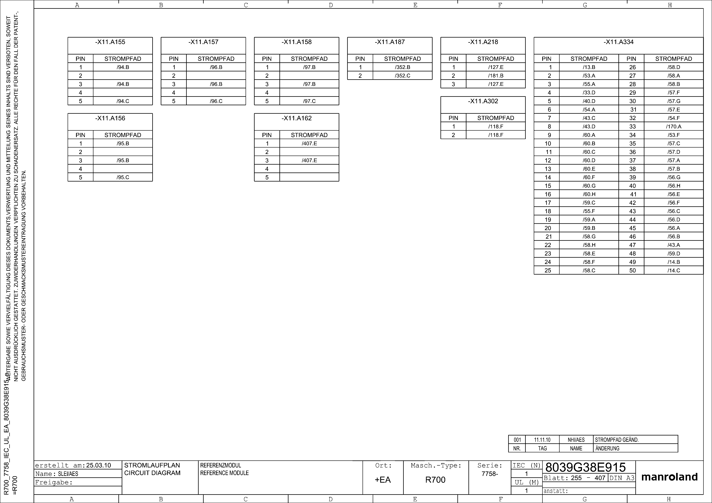

# +EA — Sheet 255 of 407 — REFERENZMODUL

**REFERENCE MODULE**

> Part of the manroland **R700** printing press IEC/UL circuit diagrams.
> Drawing class: **Stromlaufplan / Circuit diagram** (DIN A3).
> Document `+EA` covers the **Printing unit** machine section.

## At a glance

| Field | Value |
|---|---|
| Document | `+EA`  (8039G38E915) |
| Sheet | **255** of 407 |
| Section (DE) | REFERENZMODUL |
| Section (EN) | REFERENCE MODULE |
| Section type | REFERENCE_MODULE — Reference module |
| Machine type | `R700` |
| Series | `7758` |
| Created | 25.03.10 |
| Replaces | — |
| Columns used | A, B, C, D, E, F, G, H |
| Path numbers | — |
| Labels on sheet | 190 |
| Cross-refs out | 71 |
| Cross-refs in | 0 |

**Previous:** [+EA sheet 254](SHEET_0254.md) · **Next:** [+EA sheet 256](SHEET_0256.md) · **Document TOC:** [_TOC.md](_TOC.md)  (+EA) · **Master TOC:** [all sheets](../_MASTER_TOC.md)

## Sheet image (300 DPI, exact vector render)



_Rendered directly from the PDF vector layer at 300 DPI (1-bit), no OCR and no resampling. Use it to confirm anything ambiguous in the text below._

## Cross-references on this sheet

Each entry is a wire leaving this sheet. The printed token is `/sheet.column`; the link resolves to that sheet inside the same document.

| Ref | Target sheet | Col | Path | Destination on target | Target section | From col |
|---|---|---|---|---|---|---|
| `/94.B` | [+EA sheet 94](SHEET_0094.md) | B | — | — | BLASRAHMEN | B |
| `/96.B` | [+EA sheet 96](SHEET_0096.md) | B | — | — | BLASRAHMEN | C |
| `/97.B` | [+EA sheet 97](SHEET_0097.md) | B | — | — | BLASRAHMEN | D |
| `/13.B` | [+EA sheet 13](SHEET_0013.md) | B | — | — | SPANNUNGSVERSORGUNG: 400V, 24V | G |
| `/352.B` | [+EA sheet 352](SHEET_0352.md) | B | — | — | OPTION: VORBEREITUNG: PUDERABSAUGUNG | E |
| `/127.E` | [+EA sheet 127](SHEET_0127.md) | E | — | — | ZUGANGSABSICHERUNG | F |
| `/58.D` | [+EA sheet 58](SHEET_0058.md) | D | — | — | MASCHINENBEDIENUNG: BEDIENUNGKOMMANDOS | H |
| `/53.A` | [+EA sheet 53](SHEET_0053.md) | A | — | — | MASCHINENBEDIENUNG: LAUFKOMMANDOS | G |
| `/58.A` | [+EA sheet 58](SHEET_0058.md) | A | — | — | MASCHINENBEDIENUNG: BEDIENUNGKOMMANDOS | H |
| `/181.B` | [+EA sheet 181](SHEET_0181.md) | B | — | — | RESERVE | F |
| `/352.C` | [+EA sheet 352](SHEET_0352.md) | C | — | — | OPTION: VORBEREITUNG: PUDERABSAUGUNG | E |
| `/94.B` | [+EA sheet 94](SHEET_0094.md) | B | — | — | BLASRAHMEN | B |
| `/96.B` | [+EA sheet 96](SHEET_0096.md) | B | — | — | BLASRAHMEN | C |
| `/97.B` | [+EA sheet 97](SHEET_0097.md) | B | — | — | BLASRAHMEN | D |
| `/55.A` | [+EA sheet 55](SHEET_0055.md) | A | — | — | MASCHINENBEDIENUNG: LAUFKOMMANDOS | G |
| `/58.B` | [+EA sheet 58](SHEET_0058.md) | B | — | — | MASCHINENBEDIENUNG: BEDIENUNGKOMMANDOS | H |
| `/127.E` | [+EA sheet 127](SHEET_0127.md) | E | — | — | ZUGANGSABSICHERUNG | F |
| `/57.F` | [+EA sheet 57](SHEET_0057.md) | F | — | — | MASCHINENBEDIENUNG: BEDIENUNGKOMMANDOS | H |
| `/33.D` | [+EA sheet 33](SHEET_0033.md) | D | — | — | BUSVERBINDUNGEN: NOT AUS | G |
| `/57.G` | [+EA sheet 57](SHEET_0057.md) | G | — | — | MASCHINENBEDIENUNG: BEDIENUNGKOMMANDOS | H |
| `/94.C` | [+EA sheet 94](SHEET_0094.md) | C | — | — | BLASRAHMEN | B |
| `/96.C` | [+EA sheet 96](SHEET_0096.md) | C | — | — | BLASRAHMEN | C |
| `/97.C` | [+EA sheet 97](SHEET_0097.md) | C | — | — | BLASRAHMEN | D |
| `/40.D` | [+EA sheet 40](SHEET_0040.md) | D | — | — | BUSVERBINDUNGEN: STOP SICHERN | G |
| `/54.A` | [+EA sheet 54](SHEET_0054.md) | A | — | — | MASCHINENBEDIENUNG: LAUFKOMMANDOS | G |
| `/57.E` | [+EA sheet 57](SHEET_0057.md) | E | — | — | MASCHINENBEDIENUNG: BEDIENUNGKOMMANDOS | H |
| `/54.F` | [+EA sheet 54](SHEET_0054.md) | F | — | — | MASCHINENBEDIENUNG: LAUFKOMMANDOS | H |
| `/43.C` | [+EA sheet 43](SHEET_0043.md) | C | — | — | BUSVERBINDUNGEN: SIGNALSCHLEIFE | G |
| `/170.A` | [+EA sheet 170](SHEET_0170.md) | A | — | — | RESERVE | H |
| `/118.F` | [+EA sheet 118](SHEET_0118.md) | F | — | — | FORMATEINSTELLUNG: GREIFERÖFFNUNGSKURVE | F |
| `/43.D` | [+EA sheet 43](SHEET_0043.md) | D | — | — | BUSVERBINDUNGEN: SIGNALSCHLEIFE | G |
| `/60.A` | [+EA sheet 60](SHEET_0060.md) | A | — | — | MASCHINENBEDIENUNG: BEDIENUNGKOMMANDOS | G |
| `/53.F` | [+EA sheet 53](SHEET_0053.md) | F | — | — | MASCHINENBEDIENUNG: LAUFKOMMANDOS | H |
| `/118.F` | [+EA sheet 118](SHEET_0118.md) | F | — | — | FORMATEINSTELLUNG: GREIFERÖFFNUNGSKURVE | F |
| `/95.B` | [+EA sheet 95](SHEET_0095.md) | B | — | — | BLASRAHMEN | B |
| `/60.B` | [+EA sheet 60](SHEET_0060.md) | B | — | — | MASCHINENBEDIENUNG: BEDIENUNGKOMMANDOS | G |
| `/407.E` | [+EA sheet 407](SHEET_0407.md) | E | — | — | OPTION: AIR STATION | D |
| `/57.C` | [+EA sheet 57](SHEET_0057.md) | C | — | — | MASCHINENBEDIENUNG: BEDIENUNGKOMMANDOS | H |
| `/60.C` | [+EA sheet 60](SHEET_0060.md) | C | — | — | MASCHINENBEDIENUNG: BEDIENUNGKOMMANDOS | G |
| `/57.D` | [+EA sheet 57](SHEET_0057.md) | D | — | — | MASCHINENBEDIENUNG: BEDIENUNGKOMMANDOS | H |
| `/95.B` | [+EA sheet 95](SHEET_0095.md) | B | — | — | BLASRAHMEN | B |
| `/57.A` | [+EA sheet 57](SHEET_0057.md) | A | — | — | MASCHINENBEDIENUNG: BEDIENUNGKOMMANDOS | H |
| `/407.E` | [+EA sheet 407](SHEET_0407.md) | E | — | — | OPTION: AIR STATION | D |
| `/60.D` | [+EA sheet 60](SHEET_0060.md) | D | — | — | MASCHINENBEDIENUNG: BEDIENUNGKOMMANDOS | G |
| `/60.E` | [+EA sheet 60](SHEET_0060.md) | E | — | — | MASCHINENBEDIENUNG: BEDIENUNGKOMMANDOS | G |
| `/57.B` | [+EA sheet 57](SHEET_0057.md) | B | — | — | MASCHINENBEDIENUNG: BEDIENUNGKOMMANDOS | H |
| `/60.F` | [+EA sheet 60](SHEET_0060.md) | F | — | — | MASCHINENBEDIENUNG: BEDIENUNGKOMMANDOS | G |
| `/56.G` | [+EA sheet 56](SHEET_0056.md) | G | — | — | MASCHINENBEDIENUNG: BEDIENUNGKOMMANDOS | H |
| `/95.C` | [+EA sheet 95](SHEET_0095.md) | C | — | — | BLASRAHMEN | B |
| `/60.G` | [+EA sheet 60](SHEET_0060.md) | G | — | — | MASCHINENBEDIENUNG: BEDIENUNGKOMMANDOS | G |
| `/56.H` | [+EA sheet 56](SHEET_0056.md) | H | — | — | MASCHINENBEDIENUNG: BEDIENUNGKOMMANDOS | H |
| `/56.E` | [+EA sheet 56](SHEET_0056.md) | E | — | — | MASCHINENBEDIENUNG: BEDIENUNGKOMMANDOS | H |
| `/60.H` | [+EA sheet 60](SHEET_0060.md) | H | — | — | MASCHINENBEDIENUNG: BEDIENUNGKOMMANDOS | G |
| `/56.F` | [+EA sheet 56](SHEET_0056.md) | F | — | — | MASCHINENBEDIENUNG: BEDIENUNGKOMMANDOS | H |
| `/59.C` | [+EA sheet 59](SHEET_0059.md) | C | — | — | MASCHINENBEDIENUNG: BEDIENUNGKOMMANDOS | G |
| `/55.F` | [+EA sheet 55](SHEET_0055.md) | F | — | — | MASCHINENBEDIENUNG: LAUFKOMMANDOS | G |
| `/56.C` | [+EA sheet 56](SHEET_0056.md) | C | — | — | MASCHINENBEDIENUNG: BEDIENUNGKOMMANDOS | H |
| `/59.A` | [+EA sheet 59](SHEET_0059.md) | A | — | — | MASCHINENBEDIENUNG: BEDIENUNGKOMMANDOS | G |
| `/56.D` | [+EA sheet 56](SHEET_0056.md) | D | — | — | MASCHINENBEDIENUNG: BEDIENUNGKOMMANDOS | H |
| `/59.B` | [+EA sheet 59](SHEET_0059.md) | B | — | — | MASCHINENBEDIENUNG: BEDIENUNGKOMMANDOS | G |
| `/56.A` | [+EA sheet 56](SHEET_0056.md) | A | — | — | MASCHINENBEDIENUNG: BEDIENUNGKOMMANDOS | H |
| `/56.B` | [+EA sheet 56](SHEET_0056.md) | B | — | — | MASCHINENBEDIENUNG: BEDIENUNGKOMMANDOS | H |
| `/58.G` | [+EA sheet 58](SHEET_0058.md) | G | — | — | MASCHINENBEDIENUNG: BEDIENUNGKOMMANDOS | G |
| `/43.A` | [+EA sheet 43](SHEET_0043.md) | A | — | — | BUSVERBINDUNGEN: SIGNALSCHLEIFE | H |
| `/58.H` | [+EA sheet 58](SHEET_0058.md) | H | — | — | MASCHINENBEDIENUNG: BEDIENUNGKOMMANDOS | G |
| `/58.E` | [+EA sheet 58](SHEET_0058.md) | E | — | — | MASCHINENBEDIENUNG: BEDIENUNGKOMMANDOS | G |
| `/59.D` | [+EA sheet 59](SHEET_0059.md) | D | — | — | MASCHINENBEDIENUNG: BEDIENUNGKOMMANDOS | H |
| `/14.B` | [+EA sheet 14](SHEET_0014.md) | B | — | — | SPANNUNGSVERSORGUNG: 400V, 24V | H |
| `/58.F` | [+EA sheet 58](SHEET_0058.md) | F | — | — | MASCHINENBEDIENUNG: BEDIENUNGKOMMANDOS | G |
| `/58.C` | [+EA sheet 58](SHEET_0058.md) | C | — | — | MASCHINENBEDIENUNG: BEDIENUNGKOMMANDOS | G |
| `/14.C` | [+EA sheet 14](SHEET_0014.md) | C | — | — | SPANNUNGSVERSORGUNG: 400V, 24V | H |

## Devices on this sheet

| Tag | Class | Class meaning (IEC) | Col | Sub | Terminal | Sign |
|---|---|---|---|---|---|---|
| `X11.A155` | — | cross-device reference | A | — | — | — |
| `X11.A156` | — | cross-device reference | A | — | — | — |
| `X11.A157` | — | cross-device reference | B | — | — | — |
| `X11.A158` | — | cross-device reference | D | — | — | — |
| `X11.A334` | — | cross-device reference | G | — | — | — |
| `X11.A218` | — | cross-device reference | F | — | — | — |
| `X11.A302` | — | cross-device reference | F | — | — | — |
| `X11.A187` | — | cross-device reference | E | — | — | — |
| `X11.A162` | — | cross-device reference | D | — | — | — |
| `NR.` | — | cross-device reference | F | — | — | — |
| `11.11.10` | — | cross-device reference | F | — | — | — |

## Potentials / nets

_No named potentials on this sheet._

## Wire-end annotations (grouped as printed)

A wire that continues elsewhere is annotated with a small cluster: the destination description, the path/line number `#NN`, and the `/sheet.column` cross reference. Each row below is one such cluster exactly as it is grouped on the drawing.

| Col | Y | Path | Cross-ref | Text on the wire |
|---|---|---|---|---|
| A | 65.5 | — | — | `X11.A155` |
| B | 65.5 | — | — | `X11.A157` |
| D | 65.5 | — | — | `X11.A158` |
| E | 65.5 | — | — | `X11.A187` |
| F | 65.5 | — | — | `X11.A218` |
| G | 65.5 | — | — | `X11.A334` |
| A | 94.2 | — | — | `PIN 2 3 4 5 1 STROMPFAD` |
| B | 94.2 | — | — | `PIN 2 3 4 5 1 STROMPFAD` |
| D | 94.2 | — | — | `PIN 2 3 4 5 1 STROMPFAD` |
| E | 94.2 | — | — | `PIN 2 1 STROMPFAD` |
| F | 94.2 | — | — | `PIN 2 3 1 STROMPFAD` |
| G | 94.2 | — | — | `PIN STROMPFAD` |
| H | 94.2 | — | — | `PIN STROMPFAD` |
| G | 108.4 | — | — | `2 3 4 5 6 7 8 9 1` |
| H | 108.4 | — | — | `26 27 28 29 30 32 33 34 35 36 37 38 39 40 42 43 44 45 46 47 48 49 50 31 41` |
| B | 108.7 | — | `/94.B` | — |
| C | 108.7 | — | `/96.B` | — |
| D | 108.7 | — | `/97.B` | — |
| E | 108.7 | — | `/352.B` | — |
| F | 108.7 | — | `/127.E` | — |
| G | 108.7 | — | `/13.B` | — |
| H | 108.7 | — | `/58.D` | — |
| G | 122.8 | — | `/53.A` | — |
| H | 122.8 | — | `/58.A` | — |
| E | 122.9 | — | `/352.C` | — |
| F | 122.9 | — | `/181.B` | — |
| B | 137.0 | — | `/94.B` | — |
| C | 137.0 | — | `/96.B` | — |
| D | 137.0 | — | `/97.B` | — |
| F | 137.0 | — | `/127.E` | — |
| G | 137.0 | — | `/55.A` | — |
| H | 137.0 | — | `/58.B` | — |
| G | 151.2 | — | `/33.D` | — |
| H | 151.2 | — | `/57.F` | — |
| F | 164.7 | — | — | `X11.A302` |
| B | 165.4 | — | `/94.C` | — |
| C | 165.4 | — | `/96.C` | — |
| D | 165.4 | — | `/97.C` | — |
| G | 165.4 | — | `/40.D` | — |
| H | 165.4 | — | `/57.G` | — |
| G | 179.5 | — | `/54.A` | — |
| H | 179.5 | — | `/57.E` | — |
| A | 193.1 | — | — | `X11.A156` |
| D | 193.1 | — | — | `X11.A162` |
| F | 193.4 | — | — | `PIN 2 1 STROMPFAD` |
| H | 193.7 | — | `/54.F` | — |
| G | 193.8 | — | `/43.C` | — |
| F | 207.9 | — | `/118.F` | — |
| G | 207.9 | — | `/43.D` | — |
| H | 207.9 | — | `/170.A` | — |
| A | 221.7 | — | — | `PIN 2 3 4 5 1 STROMPFAD` |
| D | 221.7 | — | — | `PIN 2 3 4 5 1 STROMPFAD` |
| F | 222.1 | — | `/118.F` | — |
| G | 222.1 | — | `/60.A` | — |
| H | 222.1 | — | `/53.F` | — |
| G | 235.9 | — | — | `10 12 13 14 15 16 17 18 19 20 11` |
| B | 236.2 | — | `/95.B` | — |
| D | 236.2 | — | `/407.E` | — |
| G | 236.2 | — | `/60.B` | — |
| H | 236.3 | — | `/57.C` | — |
| G | 250.4 | — | `/60.C` | — |
| H | 250.4 | — | `/57.D` | — |
| B | 264.6 | — | `/95.B` | — |
| D | 264.6 | — | `/407.E` | — |
| G | 264.6 | — | `/60.D` | — |
| H | 264.6 | — | `/57.A` | — |
| G | 278.8 | — | `/60.E` | — |
| H | 278.8 | — | `/57.B` | — |
| G | 292.9 | — | `/60.F` | — |
| H | 292.9 | — | `/56.G` | — |
| B | 293.0 | — | `/95.C` | — |
| G | 307.1 | — | `/60.G` | — |
| H | 307.1 | — | `/56.H` | — |
| G | 321.3 | — | `/60.H` | — |
| H | 321.3 | — | `/56.E` | — |
| G | 335.5 | — | `/59.C` | — |
| H | 335.5 | — | `/56.F` | — |
| G | 349.6 | — | `/55.F` | — |
| H | 349.6 | — | `/56.C` | — |
| G | 363.8 | — | `/59.A` | — |
| H | 363.8 | — | `/56.D` | — |
| G | 378.0 | — | `/59.B` | — |
| H | 378.0 | — | `/56.A` | — |
| G | 391.8 | — | — | `22 23 24 25 21` |
| H | 392.1 | — | `/56.B` | — |
| G | 392.2 | — | `/58.G` | — |
| G | 406.3 | — | `/58.H` | — |
| H | 406.3 | — | `/43.A` | — |
| G | 420.5 | — | `/58.E` | — |
| H | 420.5 | — | `/59.D` | — |
| G | 434.7 | — | `/58.F` | — |
| H | 434.7 | — | `/14.B` | — |
| G | 448.9 | — | `/58.C` | — |
| H | 448.9 | — | `/14.C` | — |
| G | 733.0 | — | — | `001 11.11.10 NHI/AES STROMPFAD GEÄND.` |
| G | 747.1 | — | — | `NR. TAG NAME ÄNDERUNG` |


## Reconstructed tables

This sheet carries tabular content (pin map / terminal assignment / index). The grid below was rebuilt from the drawing's own rule lines, so each row is exactly one physical row of the table.

### Table 1 — 12 data rows × 2 columns (at x=113.4, y=62.4) — **X11.A155**

| PIN | STROMPFAD |
|---|---|
| `1` | `/94.B` |
| `2` |  |
| `3` | `/94.B` |
| `4` |  |
| `5` | `/94.C` |
|  | `X11.A156` |
| `PIN` | `STROMPFAD` |
| `1` | `/95.B` |
| `2` |  |
| `3` | `/95.B` |
| `4` |  |
| `5` | `/95.C` |


### Table 2 — 5 data rows × 2 columns (at x=269.3, y=62.4) — **X11.A157**

| PIN | STROMPFAD |
|---|---|
| `1` | `/96.B` |
| `2` |  |
| `3` | `/96.B` |
| `4` |  |
| `5` | `/96.C` |


### Table 3 — 12 data rows × 2 columns (at x=425.2, y=62.4) — **X11.A158**

| PIN | STROMPFAD |
|---|---|
| `1` | `/97.B` |
| `2` |  |
| `3` | `/97.B` |
| `4` |  |
| `5` | `/97.C` |
|  | `X11.A162` |
| `PIN` | `STROMPFAD` |
| `1` | `/407.E` |
| `2` |  |
| `3` | `/407.E` |
| `4` |  |
| `5` |  |


### Table 4 — 2 data rows × 2 columns (at x=581.1, y=62.4) — **X11.A187**

| PIN | STROMPFAD |
|---|---|
| `1` | `/352.B` |
| `2` | `/352.C` |


### Table 5 — 7 data rows × 2 columns (at x=737.0, y=62.4) — **X11.A218**

| PIN | STROMPFAD |
|---|---|
| `1` | `/127.E` |
| `2` | `/181.B` |
| `3` | `/127.E` |
|  | `X11.A302` |
| `PIN` | `STROMPFAD` |
| `1` | `/118.F` |
| `2` | `/118.F` |


### Table 6 — 25 data rows × 4 columns (at x=892.9, y=62.4) — **X11.A334**

| PIN | STROMPFAD | PIN | STROMPFAD |
|---|---|---|---|
| `1` | `/13.B` | `26` | `/58.D` |
| `2` | `/53.A` | `27` | `/58.A` |
| `3` | `/55.A` | `28` | `/58.B` |
| `4` | `/33.D` | `29` | `/57.F` |
| `5` | `/40.D` | `30` | `/57.G` |
| `6` | `/54.A` | `31` | `/57.E` |
| `7` | `/43.C` | `32` | `/54.F` |
| `8` | `/43.D` | `33` | `/170.A` |
| `9` | `/60.A` | `34` | `/53.F` |
| `10` | `/60.B` | `35` | `/57.C` |
| `11` | `/60.C` | `36` | `/57.D` |
| `12` | `/60.D` | `37` | `/57.A` |
| `13` | `/60.E` | `38` | `/57.B` |
| `14` | `/60.F` | `39` | `/56.G` |
| `15` | `/60.G` | `40` | `/56.H` |
| `16` | `/60.H` | `41` | `/56.E` |
| `17` | `/59.C` | `42` | `/56.F` |
| `18` | `/55.F` | `43` | `/56.C` |
| `19` | `/59.A` | `44` | `/56.D` |
| `20` | `/59.B` | `45` | `/56.A` |
| `21` | `/58.G` | `46` | `/56.B` |
| `22` | `/58.H` | `47` | `/43.A` |
| `23` | `/58.E` | `48` | `/59.D` |
| `24` | `/58.F` | `49` | `/14.B` |
| `25` | `/58.C` | `50` | `/14.C` |


## Notes and free text on this sheet

| Text | Col | Y (pt) |
|---|---|---|
| `PIN` | A | 94.2 |
| `STROMPFAD` | B | 94.15 |
| `PIN` | B | 94.2 |
| `STROMPFAD` | C | 94.15 |
| `PIN` | C | 94.2 |
| `STROMPFAD` | D | 94.15 |
| `PIN` | G | 94.2 |
| `STROMPFAD` | G | 94.15 |
| `PIN` | H | 94.2 |
| `STROMPFAD` | H | 94.15 |
| `PIN` | E | 94.2 |
| `STROMPFAD` | F | 94.15 |
| `PIN` | D | 94.2 |
| `STROMPFAD` | E | 94.15 |
| `TAG` | G | 747.27 |
| `NAME` | G | 747.25 |
| `ÄNDERUNG` | G | 747.31 |
| `NHI/AES` | G | 733.11 |
| `STROMPFAD GEÄND.` | G | 733.12 |

## Complete label inventory (exact text from the drawing)

Every text object inside the drawing area of this sheet, in DIN reading order (column A→H, then top→bottom). This is the authoritative list: if a string is not here it is not printed on this sheet.

| Col | Y | X | Dir | Type | Text |
|---|---|---|---|---|---|
| A | 65.5 | 159.3 | → | device ref | `X11.A155` |
| A | 94.2 | 126.6 | → | text | `PIN` |
| A | 108.4 | 132.5 | → | number | `1` |
| A | 122.5 | 132.0 | → | number | `2` |
| A | 136.7 | 132.0 | → | number | `3` |
| A | 150.9 | 132.0 | → | number | `4` |
| A | 165.1 | 132.0 | → | number | `5` |
| A | 193.1 | 159.3 | → | device ref | `X11.A156` |
| A | 221.8 | 126.6 | → | text | `PIN` |
| A | 235.9 | 132.5 | → | number | `1` |
| A | 250.1 | 132.0 | → | number | `2` |
| A | 264.3 | 132.0 | → | number | `3` |
| A | 278.5 | 132.0 | → | number | `4` |
| A | 292.6 | 132.0 | → | number | `5` |
| B | 65.5 | 315.2 | → | device ref | `X11.A157` |
| B | 94.2 | 174.8 | → | text | `STROMPFAD` |
| B | 94.2 | 282.5 | → | text | `PIN` |
| B | 108.4 | 288.4 | → | number | `1` |
| B | 108.7 | 195.3 | → | cross-reference | `/94.B` |
| B | 122.5 | 287.9 | → | number | `2` |
| B | 136.7 | 287.9 | → | number | `3` |
| B | 137.0 | 195.3 | → | cross-reference | `/94.B` |
| B | 150.9 | 287.9 | → | number | `4` |
| B | 165.1 | 287.9 | → | number | `5` |
| B | 165.4 | 195.2 | → | cross-reference | `/94.C` |
| B | 221.7 | 174.8 | → | text | `STROMPFAD` |
| B | 236.2 | 195.3 | → | cross-reference | `/95.B` |
| B | 264.6 | 195.3 | → | cross-reference | `/95.B` |
| B | 293.0 | 195.2 | → | cross-reference | `/95.C` |
| C | 94.2 | 330.7 | → | text | `STROMPFAD` |
| C | 94.2 | 438.4 | → | text | `PIN` |
| C | 108.4 | 444.3 | → | number | `1` |
| C | 108.7 | 351.2 | → | cross-reference | `/96.B` |
| C | 122.5 | 443.8 | → | number | `2` |
| C | 136.7 | 443.8 | → | number | `3` |
| C | 137.0 | 351.2 | → | cross-reference | `/96.B` |
| C | 150.9 | 443.8 | → | number | `4` |
| C | 165.1 | 443.8 | → | number | `5` |
| C | 165.4 | 351.1 | → | cross-reference | `/96.C` |
| C | 221.8 | 438.4 | → | text | `PIN` |
| C | 235.9 | 444.3 | → | number | `1` |
| C | 250.1 | 443.8 | → | number | `2` |
| C | 264.3 | 443.8 | → | number | `3` |
| C | 278.5 | 443.8 | → | number | `4` |
| C | 292.6 | 443.8 | → | number | `5` |
| D | 65.5 | 471.1 | → | device ref | `X11.A158` |
| D | 94.2 | 486.6 | → | text | `STROMPFAD` |
| D | 94.2 | 594.3 | → | text | `PIN` |
| D | 108.4 | 600.2 | → | number | `1` |
| D | 108.7 | 507.1 | → | cross-reference | `/97.B` |
| D | 122.5 | 599.7 | → | number | `2` |
| D | 137.0 | 507.1 | → | cross-reference | `/97.B` |
| D | 165.4 | 507.0 | → | cross-reference | `/97.C` |
| D | 193.1 | 471.1 | → | device ref | `X11.A162` |
| D | 221.7 | 486.6 | → | text | `STROMPFAD` |
| D | 236.2 | 504.9 | → | cross-reference | `/407.E` |
| D | 264.6 | 504.9 | → | cross-reference | `/407.E` |
| E | 65.5 | 627.0 | → | device ref | `X11.A187` |
| E | 94.2 | 642.5 | → | text | `STROMPFAD` |
| E | 94.2 | 750.2 | → | text | `PIN` |
| E | 108.4 | 756.1 | → | number | `1` |
| E | 108.7 | 660.6 | → | cross-reference | `/352.B` |
| E | 122.5 | 755.6 | → | number | `2` |
| E | 122.9 | 660.5 | → | cross-reference | `/352.C` |
| E | 136.7 | 755.6 | → | number | `3` |
| E | 193.4 | 750.2 | → | text | `PIN` |
| E | 207.6 | 756.1 | → | number | `1` |
| E | 221.8 | 755.6 | → | number | `2` |
| F | 65.5 | 782.9 | → | device ref | `X11.A218` |
| F | 94.2 | 798.4 | → | text | `STROMPFAD` |
| F | 108.7 | 816.7 | → | cross-reference | `/127.E` |
| F | 122.9 | 816.5 | → | cross-reference | `/181.B` |
| F | 137.0 | 816.7 | → | cross-reference | `/127.E` |
| F | 164.7 | 782.9 | → | device ref | `X11.A302` |
| F | 193.4 | 798.4 | → | text | `STROMPFAD` |
| F | 207.9 | 816.8 | → | cross-reference | `/118.F` |
| F | 222.1 | 816.8 | → | cross-reference | `/118.F` |
| F | 733.0 | 859.4 | → | number | `001` |
| F | 733.1 | 893.2 | → | device ref | `11.11.10` |
| F | 747.1 | 858.4 | → | device ref | `NR.` |
| G | 65.5 | 1009.7 | → | device ref | `X11.A334` |
| G | 94.2 | 906.1 | → | text | `PIN` |
| G | 94.2 | 954.3 | → | text | `STROMPFAD` |
| G | 108.4 | 917.9 | → | number | `1` |
| G | 108.7 | 974.8 | → | cross-reference | `/13.B` |
| G | 122.5 | 916.2 | → | number | `2` |
| G | 122.8 | 974.7 | → | cross-reference | `/53.A` |
| G | 136.7 | 916.2 | → | number | `3` |
| G | 137.0 | 974.7 | → | cross-reference | `/55.A` |
| G | 150.9 | 916.2 | → | number | `4` |
| G | 151.2 | 974.7 | → | cross-reference | `/33.D` |
| G | 165.1 | 916.2 | → | number | `5` |
| G | 165.4 | 974.7 | → | cross-reference | `/40.D` |
| G | 179.2 | 916.2 | → | number | `6` |
| G | 179.5 | 974.7 | → | cross-reference | `/54.A` |
| G | 193.4 | 916.2 | → | number | `7` |
| G | 193.7 | 974.7 | → | cross-reference | `/43.C` |
| G | 207.6 | 916.2 | → | number | `8` |
| G | 207.9 | 974.7 | → | cross-reference | `/43.D` |
| G | 221.8 | 916.2 | → | number | `9` |
| G | 222.1 | 974.7 | → | cross-reference | `/60.A` |
| G | 235.9 | 910.8 | → | number | `10` |
| G | 236.2 | 974.8 | → | cross-reference | `/60.B` |
| G | 250.1 | 912.5 | → | number | `11` |
| G | 250.4 | 974.7 | → | cross-reference | `/60.C` |
| G | 264.3 | 910.8 | → | number | `12` |
| G | 264.6 | 974.7 | → | cross-reference | `/60.D` |
| G | 278.5 | 910.8 | → | number | `13` |
| G | 278.8 | 975.0 | → | cross-reference | `/60.E` |
| G | 292.6 | 910.8 | → | number | `14` |
| G | 292.9 | 975.1 | → | cross-reference | `/60.F` |
| G | 306.8 | 910.8 | → | number | `15` |
| G | 307.1 | 974.6 | → | cross-reference | `/60.G` |
| G | 321.0 | 910.8 | → | number | `16` |
| G | 321.3 | 975.0 | → | cross-reference | `/60.H` |
| G | 335.1 | 910.8 | → | number | `17` |
| G | 335.5 | 974.7 | → | cross-reference | `/59.C` |
| G | 349.3 | 910.8 | → | number | `18` |
| G | 349.6 | 975.1 | → | cross-reference | `/55.F` |
| G | 363.5 | 910.8 | → | number | `19` |
| G | 363.8 | 974.7 | → | cross-reference | `/59.A` |
| G | 377.7 | 910.8 | → | number | `20` |
| G | 378.0 | 974.8 | → | cross-reference | `/59.B` |
| G | 391.8 | 912.5 | → | number | `21` |
| G | 392.2 | 974.6 | → | cross-reference | `/58.G` |
| G | 406.0 | 910.8 | → | number | `22` |
| G | 406.3 | 975.0 | → | cross-reference | `/58.H` |
| G | 420.2 | 910.8 | → | number | `23` |
| G | 420.5 | 975.0 | → | cross-reference | `/58.E` |
| G | 434.4 | 910.8 | → | number | `24` |
| G | 434.7 | 975.1 | → | cross-reference | `/58.F` |
| G | 448.5 | 910.8 | → | number | `25` |
| G | 448.9 | 974.7 | → | cross-reference | `/58.C` |
| G | 733.1 | 949.5 | → | text | `NHI/AES` |
| G | 733.1 | 995.1 | → | text | `STROMPFAD GEÄND.` |
| G | 747.3 | 900.0 | → | text | `TAG` |
| G | 747.3 | 953.4 | → | text | `NAME` |
| G | 747.3 | 996.0 | → | text | `ÄNDERUNG` |
| H | 94.2 | 1047.8 | → | text | `PIN` |
| H | 94.2 | 1096.0 | → | text | `STROMPFAD` |
| H | 108.4 | 1052.5 | → | number | `26` |
| H | 108.7 | 1116.4 | → | cross-reference | `/58.D` |
| H | 122.5 | 1052.5 | → | number | `27` |
| H | 122.8 | 1116.4 | → | cross-reference | `/58.A` |
| H | 136.7 | 1052.5 | → | number | `28` |
| H | 137.0 | 1116.6 | → | cross-reference | `/58.B` |
| H | 150.9 | 1052.5 | → | number | `29` |
| H | 151.2 | 1116.9 | → | cross-reference | `/57.F` |
| H | 165.1 | 1052.5 | → | number | `30` |
| H | 165.4 | 1116.3 | → | cross-reference | `/57.G` |
| H | 179.2 | 1054.2 | → | number | `31` |
| H | 179.5 | 1116.7 | → | cross-reference | `/57.E` |
| H | 193.4 | 1052.5 | → | number | `32` |
| H | 193.7 | 1116.9 | → | cross-reference | `/54.F` |
| H | 207.6 | 1052.5 | → | number | `33` |
| H | 207.9 | 1114.0 | → | cross-reference | `/170.A` |
| H | 221.8 | 1052.5 | → | number | `34` |
| H | 222.1 | 1116.9 | → | cross-reference | `/53.F` |
| H | 235.9 | 1052.5 | → | number | `35` |
| H | 236.3 | 1116.4 | → | cross-reference | `/57.C` |
| H | 250.1 | 1052.5 | → | number | `36` |
| H | 250.4 | 1116.4 | → | cross-reference | `/57.D` |
| H | 264.3 | 1052.5 | → | number | `37` |
| H | 264.6 | 1116.4 | → | cross-reference | `/57.A` |
| H | 278.5 | 1052.5 | → | number | `38` |
| H | 278.8 | 1116.6 | → | cross-reference | `/57.B` |
| H | 292.6 | 1052.5 | → | number | `39` |
| H | 292.9 | 1116.3 | → | cross-reference | `/56.G` |
| H | 306.8 | 1052.5 | → | number | `40` |
| H | 307.1 | 1116.7 | → | cross-reference | `/56.H` |
| H | 321.0 | 1054.2 | → | number | `41` |
| H | 321.3 | 1116.7 | → | cross-reference | `/56.E` |
| H | 335.1 | 1052.5 | → | number | `42` |
| H | 335.5 | 1116.9 | → | cross-reference | `/56.F` |
| H | 349.3 | 1052.5 | → | number | `43` |
| H | 349.7 | 1116.4 | → | cross-reference | `/56.C` |
| H | 363.5 | 1052.5 | → | number | `44` |
| H | 363.8 | 1116.4 | → | cross-reference | `/56.D` |
| H | 377.7 | 1052.5 | → | number | `45` |
| H | 378.0 | 1116.4 | → | cross-reference | `/56.A` |
| H | 391.8 | 1052.5 | → | number | `46` |
| H | 392.1 | 1116.6 | → | cross-reference | `/56.B` |
| H | 406.0 | 1052.5 | → | number | `47` |
| H | 406.3 | 1116.4 | → | cross-reference | `/43.A` |
| H | 420.2 | 1052.5 | → | number | `48` |
| H | 420.5 | 1116.4 | → | cross-reference | `/59.D` |
| H | 434.4 | 1052.5 | → | number | `49` |
| H | 434.7 | 1116.6 | → | cross-reference | `/14.B` |
| H | 448.5 | 1052.5 | → | number | `50` |
| H | 448.9 | 1116.4 | → | cross-reference | `/14.C` |

## Reading-order text block

The same content as a plain block, grouped by DIN column — convenient to paste or to match against a visual description.

```text
=== Column A ===
  65.5  159.3  devref       X11.A155
  94.2  126.6  text         PIN
 108.4  132.5  numeric      1
 122.5  132.0  numeric      2
 136.7  132.0  numeric      3
 150.9  132.0  numeric      4
 165.1  132.0  numeric      5
 193.1  159.3  devref       X11.A156
 221.8  126.6  text         PIN
 235.9  132.5  numeric      1
 250.1  132.0  numeric      2
 264.3  132.0  numeric      3
 278.5  132.0  numeric      4
 292.6  132.0  numeric      5
=== Column B ===
  65.5  315.2  devref       X11.A157
  94.2  174.8  text         STROMPFAD
  94.2  282.5  text         PIN
 108.4  288.4  numeric      1
 108.7  195.3  xref         /94.B
 122.5  287.9  numeric      2
 136.7  287.9  numeric      3
 137.0  195.3  xref         /94.B
 150.9  287.9  numeric      4
 165.1  287.9  numeric      5
 165.4  195.2  xref         /94.C
 221.7  174.8  text         STROMPFAD
 236.2  195.3  xref         /95.B
 264.6  195.3  xref         /95.B
 293.0  195.2  xref         /95.C
=== Column C ===
  94.2  330.7  text         STROMPFAD
  94.2  438.4  text         PIN
 108.4  444.3  numeric      1
 108.7  351.2  xref         /96.B
 122.5  443.8  numeric      2
 136.7  443.8  numeric      3
 137.0  351.2  xref         /96.B
 150.9  443.8  numeric      4
 165.1  443.8  numeric      5
 165.4  351.1  xref         /96.C
 221.8  438.4  text         PIN
 235.9  444.3  numeric      1
 250.1  443.8  numeric      2
 264.3  443.8  numeric      3
 278.5  443.8  numeric      4
 292.6  443.8  numeric      5
=== Column D ===
  65.5  471.1  devref       X11.A158
  94.2  486.6  text         STROMPFAD
  94.2  594.3  text         PIN
 108.4  600.2  numeric      1
 108.7  507.1  xref         /97.B
 122.5  599.7  numeric      2
 137.0  507.1  xref         /97.B
 165.4  507.0  xref         /97.C
 193.1  471.1  devref       X11.A162
 221.7  486.6  text         STROMPFAD
 236.2  504.9  xref         /407.E
 264.6  504.9  xref         /407.E
=== Column E ===
  65.5  627.0  devref       X11.A187
  94.2  642.5  text         STROMPFAD
  94.2  750.2  text         PIN
 108.4  756.1  numeric      1
 108.7  660.6  xref         /352.B
 122.5  755.6  numeric      2
 122.9  660.5  xref         /352.C
 136.7  755.6  numeric      3
 193.4  750.2  text         PIN
 207.6  756.1  numeric      1
 221.8  755.6  numeric      2
=== Column F ===
  65.5  782.9  devref       X11.A218
  94.2  798.4  text         STROMPFAD
 108.7  816.7  xref         /127.E
 122.9  816.5  xref         /181.B
 137.0  816.7  xref         /127.E
 164.7  782.9  devref       X11.A302
 193.4  798.4  text         STROMPFAD
 207.9  816.8  xref         /118.F
 222.1  816.8  xref         /118.F
 733.0  859.4  numeric      001
 733.1  893.2  devref       11.11.10
 747.1  858.4  devref       NR.
=== Column G ===
  65.5 1009.7  devref       X11.A334
  94.2  906.1  text         PIN
  94.2  954.3  text         STROMPFAD
 108.4  917.9  numeric      1
 108.7  974.8  xref         /13.B
 122.5  916.2  numeric      2
 122.8  974.7  xref         /53.A
 136.7  916.2  numeric      3
 137.0  974.7  xref         /55.A
 150.9  916.2  numeric      4
 151.2  974.7  xref         /33.D
 165.1  916.2  numeric      5
 165.4  974.7  xref         /40.D
 179.2  916.2  numeric      6
 179.5  974.7  xref         /54.A
 193.4  916.2  numeric      7
 193.7  974.7  xref         /43.C
 207.6  916.2  numeric      8
 207.9  974.7  xref         /43.D
 221.8  916.2  numeric      9
 222.1  974.7  xref         /60.A
 235.9  910.8  numeric      10
 236.2  974.8  xref         /60.B
 250.1  912.5  numeric      11
 250.4  974.7  xref         /60.C
 264.3  910.8  numeric      12
 264.6  974.7  xref         /60.D
 278.5  910.8  numeric      13
 278.8  975.0  xref         /60.E
 292.6  910.8  numeric      14
 292.9  975.1  xref         /60.F
 306.8  910.8  numeric      15
 307.1  974.6  xref         /60.G
 321.0  910.8  numeric      16
 321.3  975.0  xref         /60.H
 335.1  910.8  numeric      17
 335.5  974.7  xref         /59.C
 349.3  910.8  numeric      18
 349.6  975.1  xref         /55.F
 363.5  910.8  numeric      19
 363.8  974.7  xref         /59.A
 377.7  910.8  numeric      20
 378.0  974.8  xref         /59.B
 391.8  912.5  numeric      21
 392.2  974.6  xref         /58.G
 406.0  910.8  numeric      22
 406.3  975.0  xref         /58.H
 420.2  910.8  numeric      23
 420.5  975.0  xref         /58.E
 434.4  910.8  numeric      24
 434.7  975.1  xref         /58.F
 448.5  910.8  numeric      25
 448.9  974.7  xref         /58.C
 733.1  949.5  text         NHI/AES
 733.1  995.1  text         STROMPFAD GEÄND.
 747.3  900.0  text         TAG
 747.3  953.4  text         NAME
 747.3  996.0  text         ÄNDERUNG
=== Column H ===
  94.2 1047.8  text         PIN
  94.2 1096.0  text         STROMPFAD
 108.4 1052.5  numeric      26
 108.7 1116.4  xref         /58.D
 122.5 1052.5  numeric      27
 122.8 1116.4  xref         /58.A
 136.7 1052.5  numeric      28
 137.0 1116.6  xref         /58.B
 150.9 1052.5  numeric      29
 151.2 1116.9  xref         /57.F
 165.1 1052.5  numeric      30
 165.4 1116.3  xref         /57.G
 179.2 1054.2  numeric      31
 179.5 1116.7  xref         /57.E
 193.4 1052.5  numeric      32
 193.7 1116.9  xref         /54.F
 207.6 1052.5  numeric      33
 207.9 1114.0  xref         /170.A
 221.8 1052.5  numeric      34
 222.1 1116.9  xref         /53.F
 235.9 1052.5  numeric      35
 236.3 1116.4  xref         /57.C
 250.1 1052.5  numeric      36
 250.4 1116.4  xref         /57.D
 264.3 1052.5  numeric      37
 264.6 1116.4  xref         /57.A
 278.5 1052.5  numeric      38
 278.8 1116.6  xref         /57.B
 292.6 1052.5  numeric      39
 292.9 1116.3  xref         /56.G
 306.8 1052.5  numeric      40
 307.1 1116.7  xref         /56.H
 321.0 1054.2  numeric      41
 321.3 1116.7  xref         /56.E
 335.1 1052.5  numeric      42
 335.5 1116.9  xref         /56.F
 349.3 1052.5  numeric      43
 349.7 1116.4  xref         /56.C
 363.5 1052.5  numeric      44
 363.8 1116.4  xref         /56.D
 377.7 1052.5  numeric      45
 378.0 1116.4  xref         /56.A
 391.8 1052.5  numeric      46
 392.1 1116.6  xref         /56.B
 406.0 1052.5  numeric      47
 406.3 1116.4  xref         /43.A
 420.2 1052.5  numeric      48
 420.5 1116.4  xref         /59.D
 434.4 1052.5  numeric      49
 434.7 1116.6  xref         /14.B
 448.5 1052.5  numeric      50
 448.9 1116.4  xref         /14.C
```

---
_Generated from the PDF vector text layer; no OCR. Source: `R700_7758_IEC_UL_EA_8039G38E915_p`, sheet 255._
