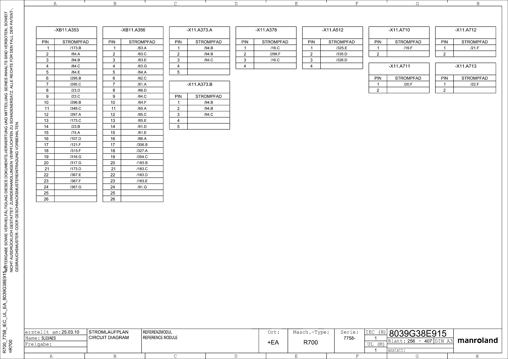

# +EA — Sheet 256 of 407 — REFERENZMODUL

**REFERENCE MODULE**

> Part of the manroland **R700** printing press IEC/UL circuit diagrams.
> Drawing class: **Stromlaufplan / Circuit diagram** (DIN A3).
> Document `+EA` covers the **Printing unit** machine section.

## At a glance

| Field | Value |
|---|---|
| Document | `+EA`  (8039G38E915) |
| Sheet | **256** of 407 |
| Section (DE) | REFERENZMODUL |
| Section (EN) | REFERENCE MODULE |
| Section type | REFERENCE_MODULE — Reference module |
| Machine type | `R700` |
| Series | `7758` |
| Created | 25.03.10 |
| Replaces | — |
| Columns used | A, B, C, D, E, F, G, H |
| Path numbers | — |
| Labels on sheet | 172 |
| Cross-refs out | 64 |
| Cross-refs in | 0 |

**Previous:** [+EA sheet 255](SHEET_0255.md) · **Next:** [+EA sheet 257](SHEET_0257.md) · **Document TOC:** [_TOC.md](_TOC.md)  (+EA) · **Master TOC:** [all sheets](../_MASTER_TOC.md)

## Sheet image (300 DPI, exact vector render)



_Rendered directly from the PDF vector layer at 300 DPI (1-bit), no OCR and no resampling. Use it to confirm anything ambiguous in the text below._

## Cross-references on this sheet

Each entry is a wire leaving this sheet. The printed token is `/sheet.column`; the link resolves to that sheet inside the same document.

| Ref | Target sheet | Col | Path | Destination on target | Target section | From col |
|---|---|---|---|---|---|---|
| `/19.F` | [+EA sheet 19](SHEET_0019.md) | F | — | STROMPFAD PIN 1 2 | SPANNUNGSVERSORGUNG: 400V, 24V | G |
| `/21.F` | [+EA sheet 21](SHEET_0021.md) | F | — | STROMPFAD PIN 1 2 | SPANNUNGSVERSORGUNG: 400V, 24V | H |
| `/63.A` | [+EA sheet 63](SHEET_0063.md) | A | — | — | MASCHINENBEDIENUNG: BEDIENUNGKOMMANDOS | B |
| `/94.B` | [+EA sheet 94](SHEET_0094.md) | B | — | — | BLASRAHMEN | D |
| `/173.B` | [+EA sheet 173](SHEET_0173.md) | B | — | — | RESERVE | A |
| `/325.E` | [+EA sheet 325](SHEET_0325.md) | E | — | — | OPTION: BOGENWEICHE | F |
| `/16.C` | [+EA sheet 16](SHEET_0016.md) | C | — | — | SPANNUNGSVERSORGUNG: 400V, 24V | E |
| `/84.A` | [+EA sheet 84](SHEET_0084.md) | A | — | — | AUSLEGERSTAPELSTEUERUNG: PROGRAMMSCHALTWERK | A |
| `/94.B` | [+EA sheet 94](SHEET_0094.md) | B | — | — | BLASRAHMEN | D |
| `/298.F` | [+EA sheet 298](SHEET_0298.md) | F | — | — | OPTION: ZWISCHENSTAPEL / | E |
| `/63.C` | [+EA sheet 63](SHEET_0063.md) | C | — | — | MASCHINENBEDIENUNG: BEDIENUNGKOMMANDOS | B |
| `/335.D` | [+EA sheet 335](SHEET_0335.md) | D | — | — | OPTION: BOGENWEICHE | F |
| `/84.B` | [+EA sheet 84](SHEET_0084.md) | B | — | — | AUSLEGERSTAPELSTEUERUNG: PROGRAMMSCHALTWERK | A |
| `/63.E` | [+EA sheet 63](SHEET_0063.md) | E | — | — | MASCHINENBEDIENUNG: BEDIENUNGKOMMANDOS | B |
| `/94.C` | [+EA sheet 94](SHEET_0094.md) | C | — | — | BLASRAHMEN | D |
| `/16.C` | [+EA sheet 16](SHEET_0016.md) | C | — | — | SPANNUNGSVERSORGUNG: 400V, 24V | E |
| `/326.D` | [+EA sheet 326](SHEET_0326.md) | D | — | — | OPTION: BOGENWEICHE | F |
| `/63.G` | [+EA sheet 63](SHEET_0063.md) | G | — | — | MASCHINENBEDIENUNG: BEDIENUNGKOMMANDOS | B |
| `/84.C` | [+EA sheet 84](SHEET_0084.md) | C | — | — | AUSLEGERSTAPELSTEUERUNG: PROGRAMMSCHALTWERK | A |
| `/84.E` | [+EA sheet 84](SHEET_0084.md) | E | — | — | AUSLEGERSTAPELSTEUERUNG: PROGRAMMSCHALTWERK | A |
| `/64.A` | [+EA sheet 64](SHEET_0064.md) | A | — | — | MASCHINENBEDIENUNG: BEDIENUNGKOMMANDOS | B |
| `/20.F` | [+EA sheet 20](SHEET_0020.md) | F | — | STROMPFAD PIN 1 2 | SPANNUNGSVERSORGUNG: 400V, 24V | G |
| `/22.F` | [+EA sheet 22](SHEET_0022.md) | F | — | STROMPFAD PIN 1 2 | SPANNUNGSVERSORGUNG: 400V, 24V | H |
| `/295.B` | [+EA sheet 295](SHEET_0295.md) | B | — | — | OPTION: ZWISCHENSTAPEL / | A |
| `/62.C` | [+EA sheet 62](SHEET_0062.md) | C | — | — | MASCHINENBEDIENUNG: BEDIENUNGKOMMANDOS | B |
| `/61.A` | [+EA sheet 61](SHEET_0061.md) | A | — | — | MASCHINENBEDIENUNG: BEDIENUNGKOMMANDOS | B |
| `/295.C` | [+EA sheet 295](SHEET_0295.md) | C | — | — | OPTION: ZWISCHENSTAPEL / | A |
| `/23.D` | [+EA sheet 23](SHEET_0023.md) | D | — | — | SPANNUNGSVERSORGUNG: 400V, 24V | A |
| `/66.D` | [+EA sheet 66](SHEET_0066.md) | D | — | — | MASCHINENBEDIENUNG: BEDIENUNGKOMMANDOS | B |
| `/23.C` | [+EA sheet 23](SHEET_0023.md) | C | — | — | SPANNUNGSVERSORGUNG: 400V, 24V | A |
| `/64.C` | [+EA sheet 64](SHEET_0064.md) | C | — | — | MASCHINENBEDIENUNG: BEDIENUNGKOMMANDOS | B |
| `/94.B` | [+EA sheet 94](SHEET_0094.md) | B | — | — | BLASRAHMEN | D |
| `/296.B` | [+EA sheet 296](SHEET_0296.md) | B | — | — | OPTION: ZWISCHENSTAPEL / | A |
| `/64.F` | [+EA sheet 64](SHEET_0064.md) | F | — | — | MASCHINENBEDIENUNG: BEDIENUNGKOMMANDOS | B |
| `/65.A` | [+EA sheet 65](SHEET_0065.md) | A | — | — | MASCHINENBEDIENUNG: BEDIENUNGKOMMANDOS | B |
| `/94.B` | [+EA sheet 94](SHEET_0094.md) | B | — | — | BLASRAHMEN | D |
| `/349.C` | [+EA sheet 349](SHEET_0349.md) | C | — | — | OPTION: VORBEREITUNG IONISATIONSANLAGE | A |
| `/297.A` | [+EA sheet 297](SHEET_0297.md) | A | — | — | OPTION: ZWISCHENSTAPEL / | A |
| `/65.C` | [+EA sheet 65](SHEET_0065.md) | C | — | — | MASCHINENBEDIENUNG: BEDIENUNGKOMMANDOS | B |
| `/94.C` | [+EA sheet 94](SHEET_0094.md) | C | — | — | BLASRAHMEN | D |
| `/65.E` | [+EA sheet 65](SHEET_0065.md) | E | — | — | MASCHINENBEDIENUNG: BEDIENUNGKOMMANDOS | B |
| `/173.C` | [+EA sheet 173](SHEET_0173.md) | C | — | — | RESERVE | A |
| `/23.B` | [+EA sheet 23](SHEET_0023.md) | B | — | — | SPANNUNGSVERSORGUNG: 400V, 24V | A |
| `/61.D` | [+EA sheet 61](SHEET_0061.md) | D | — | — | MASCHINENBEDIENUNG: BEDIENUNGKOMMANDOS | B |
| `/74.A` | [+EA sheet 74](SHEET_0074.md) | A | — | — | AUSLEGERSTAPELSTEUERUNG | A |
| `/61.E` | [+EA sheet 61](SHEET_0061.md) | E | — | — | MASCHINENBEDIENUNG: BEDIENUNGKOMMANDOS | B |
| `/66.A` | [+EA sheet 66](SHEET_0066.md) | A | — | — | MASCHINENBEDIENUNG: BEDIENUNGKOMMANDOS | B |
| `/107.D` | [+EA sheet 107](SHEET_0107.md) | D | — | — | BOGENGLÄTTER | A |
| `/306.B` | [+EA sheet 306](SHEET_0306.md) | B | — | — | OPTION: ZWISCHENSTAPEL / | B |
| `/121.F` | [+EA sheet 121](SHEET_0121.md) | F | — | — | TROCKENBESTÄUBER | A |
| `/327.A` | [+EA sheet 327](SHEET_0327.md) | A | — | — | OPTION: BOGENWEICHE | B |
| `/315.F` | [+EA sheet 315](SHEET_0315.md) | F | — | — | OPTION: LOGISTIK, AUSLEGER | A |
| `/316.G` | [+EA sheet 316](SHEET_0316.md) | G | — | — | OPTION: LOGISTIK, AUSLEGER | A |
| `/354.C` | [+EA sheet 354](SHEET_0354.md) | C | — | — | OPTION: VORBEREITUNG: PUDERABSAUGUNG | B |
| `/183.B` | [+EA sheet 183](SHEET_0183.md) | B | — | — | RESERVE | B |
| `/317.G` | [+EA sheet 317](SHEET_0317.md) | G | — | — | OPTION: LOGISTIK, AUSLEGER | A |
| `/173.D` | [+EA sheet 173](SHEET_0173.md) | D | — | — | RESERVE | A |
| `/183.C` | [+EA sheet 183](SHEET_0183.md) | C | — | — | RESERVE | B |
| `/367.E` | [+EA sheet 367](SHEET_0367.md) | E | — | — | OPTION: TROCKNER VORBEREITUNG; | A |
| `/183.D` | [+EA sheet 183](SHEET_0183.md) | D | — | — | RESERVE | B |
| `/183.E` | [+EA sheet 183](SHEET_0183.md) | E | — | — | RESERVE | B |
| `/367.F` | [+EA sheet 367](SHEET_0367.md) | F | — | — | OPTION: TROCKNER VORBEREITUNG; | A |
| `/91.G` | [+EA sheet 91](SHEET_0091.md) | G | — | — | BLASROHRE (BLASRAHMEN) | B |
| `/367.G` | [+EA sheet 367](SHEET_0367.md) | G | — | — | OPTION: TROCKNER VORBEREITUNG; | A |

## Devices on this sheet

| Tag | Class | Class meaning (IEC) | Col | Sub | Terminal | Sign |
|---|---|---|---|---|---|---|
| `X11.A373.A` | — | cross-device reference | C | — | — | — |
| `X11.A373.B` | — | cross-device reference | C | — | — | — |
| `XB11.A356` | — | cross-device reference | B | — | — | — |
| `XB11.A353` | — | cross-device reference | A | — | — | — |
| `X11.A378` | — | cross-device reference | E | — | — | — |
| `X11.A512` | — | cross-device reference | F | — | — | — |
| `X11.A711` | — | cross-device reference | G | — | — | — |
| `X11.A710` | — | cross-device reference | G | — | — | — |
| `X11.A712` | — | cross-device reference | H | — | — | — |
| `X11.A713` | — | cross-device reference | H | — | — | — |

## Potentials / nets

_No named potentials on this sheet._

## Wire-end annotations (grouped as printed)

A wire that continues elsewhere is annotated with a small cluster: the destination description, the path/line number `#NN`, and the `/sheet.column` cross reference. Each row below is one such cluster exactly as it is grouped on the drawing.

| Col | Y | Path | Cross-ref | Text on the wire |
|---|---|---|---|---|
| A | 65.5 | — | — | `XB11.A353` |
| B | 65.5 | — | — | `XB11.A356` |
| C | 65.5 | — | — | `X11.A373.A` |
| E | 65.5 | — | — | `X11.A378` |
| F | 65.5 | — | — | `X11.A512` |
| G | 65.5 | — | — | `X11.A710` |
| H | 65.5 | — | — | `X11.A712` |
| A | 94.2 | — | — | `PIN STROMPFAD` |
| B | 94.2 | — | — | `PIN STROMPFAD` |
| C | 94.2 | — | — | `PIN 2 3 4 5 1 STROMPFAD` |
| D | 94.2 | — | — | `PIN 2 3 4 1 STROMPFAD` |
| F | 94.2 | — | — | `PIN 2 3 4 1 STROMPFAD` |
| G | 94.2 | — | `/19.F` | `PIN 2 1 STROMPFAD` |
| H | 94.2 | — | `/21.F` | `PIN 2 1 STROMPFAD` |
| A | 108.4 | — | — | `2 3 4 5 6 7 8 9 1` |
| B | 108.4 | — | — | `2 3 4 5 6 7 8 9 1` |
| A | 108.7 | — | `/173.B` | — |
| B | 108.7 | — | `/63.A` | — |
| D | 108.7 | — | `/94.B` | — |
| E | 108.7 | — | `/16.C` | — |
| F | 108.7 | — | `/325.E` | — |
| A | 122.8 | — | `/84.A` | — |
| D | 122.8 | — | `/94.B` | — |
| B | 122.9 | — | `/63.C` | — |
| E | 122.9 | — | `/298.F` | — |
| F | 122.9 | — | `/335.D` | — |
| A | 137.0 | — | `/84.B` | — |
| B | 137.0 | — | `/63.E` | — |
| D | 137.1 | — | `/94.C` | — |
| E | 137.1 | — | `/16.C` | — |
| F | 137.1 | — | `/326.D` | — |
| G | 150.5 | — | — | `X11.A711` |
| H | 150.5 | — | — | `X11.A713` |
| A | 151.2 | — | `/84.C` | — |
| B | 151.2 | — | `/63.G` | — |
| A | 165.4 | — | `/84.E` | — |
| B | 165.4 | — | `/64.A` | — |
| G | 179.2 | — | `/20.F` | `PIN 2 1 STROMPFAD` |
| H | 179.2 | — | `/22.F` | `PIN 2 1 STROMPFAD` |
| A | 179.6 | — | `/295.B` | — |
| B | 179.6 | — | `/62.C` | — |
| C | 193.1 | — | — | `X11.A373.B` |
| B | 193.7 | — | `/61.A` | — |
| A | 193.8 | — | `/295.C` | — |
| A | 207.9 | — | `/23.D` | — |
| B | 207.9 | — | `/66.D` | — |
| C | 221.7 | — | — | `PIN 2 3 4 5 1 STROMPFAD` |
| A | 222.1 | — | `/23.C` | — |
| B | 222.1 | — | `/64.C` | — |
| A | 235.9 | — | — | `10 12 13 14 15 16 17 18 19 20 11` |
| B | 235.9 | — | — | `10 12 13 14 15 16 17 18 19 20 11` |
| A | 236.2 | — | `/296.B` | — |
| B | 236.2 | — | `/64.F` | — |
| D | 236.2 | — | `/94.B` | — |
| A | 250.4 | — | `/349.C` | — |
| B | 250.4 | — | `/65.A` | — |
| D | 250.4 | — | `/94.B` | — |
| A | 264.6 | — | `/297.A` | — |
| B | 264.6 | — | `/65.C` | — |
| D | 264.6 | — | `/94.C` | — |
| A | 278.8 | — | `/173.C` | — |
| B | 278.8 | — | `/65.E` | — |
| A | 292.9 | — | `/23.B` | — |
| B | 293.0 | — | `/61.D` | — |
| A | 307.1 | — | `/74.A` | — |
| B | 307.1 | — | `/61.E` | — |
| A | 321.3 | — | `/107.D` | — |
| B | 321.3 | — | `/66.A` | — |
| A | 335.5 | — | `/121.F` | — |
| B | 335.5 | — | `/306.B` | — |
| A | 349.6 | — | `/315.F` | — |
| B | 349.6 | — | `/327.A` | — |
| A | 363.8 | — | `/316.G` | — |
| B | 363.8 | — | `/354.C` | — |
| A | 378.0 | — | `/317.G` | — |
| B | 378.0 | — | `/183.B` | — |
| A | 391.8 | — | — | `22 23 24 25 26 21` |
| B | 391.8 | — | — | `22 23 24 25 26 21` |
| A | 392.2 | — | `/173.D` | — |
| B | 392.2 | — | `/183.C` | — |
| A | 406.3 | — | `/367.E` | — |
| B | 406.4 | — | `/183.D` | — |
| A | 420.5 | — | `/367.F` | — |
| B | 420.5 | — | `/183.E` | — |
| A | 434.7 | — | `/367.G` | — |
| B | 434.7 | — | `/91.G` | — |


## Reconstructed tables

This sheet carries tabular content (pin map / terminal assignment / index). The grid below was rebuilt from the drawing's own rule lines, so each row is exactly one physical row of the table.

### Table 1 — 26 data rows × 2 columns (at x=85.0, y=62.4) — **XB11.A353**

| PIN | STROMPFAD |
|---|---|
| `1` | `/173.B` |
| `2` | `/84.A` |
| `3` | `/84.B` |
| `4` | `/84.C` |
| `5` | `/84.E` |
| `6` | `/295.B` |
| `7` | `/295.C` |
| `8` | `/23.D` |
| `9` | `/23.C` |
| `10` | `/296.B` |
| `11` | `/349.C` |
| `12` | `/297.A` |
| `13` | `/173.C` |
| `14` | `/23.B` |
| `15` | `/74.A` |
| `16` | `/107.D` |
| `17` | `/121.F` |
| `18` | `/315.F` |
| `19` | `/316.G` |
| `20` | `/317.G` |
| `21` | `/173.D` |
| `22` | `/367.E` |
| `23` | `/367.F` |
| `24` | `/367.G` |
| `25` |  |
| `26` |  |


### Table 2 — 26 data rows × 2 columns (at x=240.9, y=62.4) — **XB11.A356**

| PIN | STROMPFAD |
|---|---|
| `1` | `/63.A` |
| `2` | `/63.C` |
| `3` | `/63.E` |
| `4` | `/63.G` |
| `5` | `/64.A` |
| `6` | `/62.C` |
| `7` | `/61.A` |
| `8` | `/66.D` |
| `9` | `/64.C` |
| `10` | `/64.F` |
| `11` | `/65.A` |
| `12` | `/65.C` |
| `13` | `/65.E` |
| `14` | `/61.D` |
| `15` | `/61.E` |
| `16` | `/66.A` |
| `17` | `/306.B` |
| `18` | `/327.A` |
| `19` | `/354.C` |
| `20` | `/183.B` |
| `21` | `/183.C` |
| `22` | `/183.D` |
| `23` | `/183.E` |
| `24` | `/91.G` |
| `25` |  |
| `26` |  |


### Table 3 — 12 data rows × 2 columns (at x=396.9, y=62.4) — **X11.A373.A**

| PIN | STROMPFAD |
|---|---|
| `1` | `/94.B` |
| `2` | `/94.B` |
| `3` | `/94.C` |
| `4` |  |
| `5` |  |
|  | `X11.A373.B` |
| `PIN` | `STROMPFAD` |
| `1` | `/94.B` |
| `2` | `/94.B` |
| `3` | `/94.C` |
| `4` |  |
| `5` |  |


### Table 4 — 4 data rows × 2 columns (at x=552.8, y=62.4) — **X11.A378**

| PIN | STROMPFAD |
|---|---|
| `1` | `/16.C` |
| `2` | `/298.F` |
| `3` | `/16.C` |
| `4` |  |


### Table 5 — 4 data rows × 2 columns (at x=708.7, y=62.4) — **X11.A512**

| PIN | STROMPFAD |
|---|---|
| `1` | `/325.E` |
| `2` | `/335.D` |
| `3` | `/326.D` |
| `4` |  |


### Table 6 — 6 data rows × 2 columns (at x=864.6, y=62.4) — **X11.A710**

| PIN | STROMPFAD |
|---|---|
| `1` | `/19.F` |
| `2` |  |
|  | `X11.A711` |
| `PIN` | `STROMPFAD` |
| `1` | `/20.F` |
| `2` |  |


### Table 7 — 6 data rows × 2 columns (at x=1020.5, y=62.4) — **X11.A712**

| PIN | STROMPFAD |
|---|---|
| `1` | `/21.F` |
| `2` |  |
|  | `X11.A713` |
| `PIN` | `STROMPFAD` |
| `1` | `/22.F` |
| `2` |  |


## Notes and free text on this sheet

| Text | Col | Y (pt) |
|---|---|---|
| `PIN` | C | 94.2 |
| `STROMPFAD` | D | 94.15 |
| `PIN` | B | 94.2 |
| `STROMPFAD` | B | 94.15 |
| `PIN` | A | 94.2 |
| `STROMPFAD` | A | 94.15 |
| `PIN` | D | 94.2 |
| `STROMPFAD` | E | 94.15 |
| `PIN` | E | 94.2 |
| `STROMPFAD` | F | 94.15 |
| `PIN` | F | 179.24 |
| `STROMPFAD` | G | 179.19 |
| `PIN` | G | 94.2 |
| `STROMPFAD` | H | 94.15 |

## Complete label inventory (exact text from the drawing)

Every text object inside the drawing area of this sheet, in DIN reading order (column A→H, then top→bottom). This is the authoritative list: if a string is not here it is not printed on this sheet.

| Col | Y | X | Dir | Type | Text |
|---|---|---|---|---|---|
| A | 65.5 | 127.4 | → | device ref | `XB11.A353` |
| A | 94.2 | 98.2 | → | text | `PIN` |
| A | 94.2 | 146.4 | → | text | `STROMPFAD` |
| A | 108.4 | 110.0 | → | number | `1` |
| A | 108.7 | 164.6 | → | cross-reference | `/173.B` |
| A | 122.5 | 108.3 | → | number | `2` |
| A | 122.8 | 166.8 | → | cross-reference | `/84.A` |
| A | 136.7 | 108.3 | → | number | `3` |
| A | 137.0 | 167.0 | → | cross-reference | `/84.B` |
| A | 150.9 | 108.3 | → | number | `4` |
| A | 151.2 | 166.8 | → | cross-reference | `/84.C` |
| A | 165.1 | 108.3 | → | number | `5` |
| A | 165.4 | 167.1 | → | cross-reference | `/84.E` |
| A | 179.2 | 108.3 | → | number | `6` |
| A | 179.6 | 164.6 | → | cross-reference | `/295.B` |
| A | 193.4 | 108.3 | → | number | `7` |
| A | 193.8 | 164.4 | → | cross-reference | `/295.C` |
| A | 207.6 | 108.3 | → | number | `8` |
| A | 207.9 | 166.8 | → | cross-reference | `/23.D` |
| A | 221.8 | 108.3 | → | number | `9` |
| A | 222.1 | 166.8 | → | cross-reference | `/23.C` |
| A | 235.9 | 102.9 | → | number | `10` |
| A | 236.2 | 164.6 | → | cross-reference | `/296.B` |
| A | 250.1 | 104.6 | → | number | `11` |
| A | 250.4 | 164.4 | → | cross-reference | `/349.C` |
| A | 264.3 | 102.9 | → | number | `12` |
| A | 264.6 | 164.4 | → | cross-reference | `/297.A` |
| A | 278.5 | 102.9 | → | number | `13` |
| A | 278.8 | 164.4 | → | cross-reference | `/173.C` |
| A | 292.6 | 102.9 | → | number | `14` |
| A | 292.9 | 167.0 | → | cross-reference | `/23.B` |
| A | 306.8 | 102.9 | → | number | `15` |
| A | 307.1 | 166.8 | → | cross-reference | `/74.A` |
| A | 321.0 | 102.9 | → | number | `16` |
| A | 321.3 | 164.4 | → | cross-reference | `/107.D` |
| A | 335.1 | 102.9 | → | number | `17` |
| A | 335.5 | 164.8 | → | cross-reference | `/121.F` |
| A | 349.3 | 102.9 | → | number | `18` |
| A | 349.6 | 164.8 | → | cross-reference | `/315.F` |
| A | 363.5 | 102.9 | → | number | `19` |
| A | 363.8 | 164.3 | → | cross-reference | `/316.G` |
| A | 377.7 | 102.9 | → | number | `20` |
| A | 378.0 | 164.3 | → | cross-reference | `/317.G` |
| A | 391.8 | 104.6 | → | number | `21` |
| A | 392.2 | 164.4 | → | cross-reference | `/173.D` |
| A | 406.0 | 102.9 | → | number | `22` |
| A | 406.3 | 164.7 | → | cross-reference | `/367.E` |
| A | 420.2 | 102.9 | → | number | `23` |
| A | 420.5 | 164.8 | → | cross-reference | `/367.F` |
| A | 434.4 | 102.9 | → | number | `24` |
| A | 434.7 | 164.3 | → | cross-reference | `/367.G` |
| A | 448.5 | 102.9 | → | number | `25` |
| A | 462.7 | 102.9 | → | number | `26` |
| B | 65.5 | 283.3 | → | device ref | `XB11.A356` |
| B | 94.2 | 254.1 | → | text | `PIN` |
| B | 94.2 | 302.3 | → | text | `STROMPFAD` |
| B | 108.4 | 265.9 | → | number | `1` |
| B | 108.7 | 322.7 | → | cross-reference | `/63.A` |
| B | 122.5 | 264.2 | → | number | `2` |
| B | 122.9 | 322.7 | → | cross-reference | `/63.C` |
| B | 136.7 | 264.2 | → | number | `3` |
| B | 137.0 | 323.0 | → | cross-reference | `/63.E` |
| B | 150.9 | 264.2 | → | number | `4` |
| B | 151.2 | 322.6 | → | cross-reference | `/63.G` |
| B | 165.1 | 264.2 | → | number | `5` |
| B | 165.4 | 322.7 | → | cross-reference | `/64.A` |
| B | 179.2 | 264.2 | → | number | `6` |
| B | 179.6 | 322.7 | → | cross-reference | `/62.C` |
| B | 193.4 | 264.2 | → | number | `7` |
| B | 193.7 | 322.7 | → | cross-reference | `/61.A` |
| B | 207.6 | 264.2 | → | number | `8` |
| B | 207.9 | 322.7 | → | cross-reference | `/66.D` |
| B | 221.8 | 264.2 | → | number | `9` |
| B | 222.1 | 322.7 | → | cross-reference | `/64.C` |
| B | 235.9 | 258.8 | → | number | `10` |
| B | 236.2 | 323.1 | → | cross-reference | `/64.F` |
| B | 250.1 | 260.5 | → | number | `11` |
| B | 250.4 | 322.7 | → | cross-reference | `/65.A` |
| B | 264.3 | 258.8 | → | number | `12` |
| B | 264.6 | 322.7 | → | cross-reference | `/65.C` |
| B | 278.5 | 258.8 | → | number | `13` |
| B | 278.8 | 323.0 | → | cross-reference | `/65.E` |
| B | 292.6 | 258.8 | → | number | `14` |
| B | 293.0 | 322.7 | → | cross-reference | `/61.D` |
| B | 306.8 | 258.8 | → | number | `15` |
| B | 307.1 | 323.0 | → | cross-reference | `/61.E` |
| B | 321.0 | 258.8 | → | number | `16` |
| B | 321.3 | 322.7 | → | cross-reference | `/66.A` |
| B | 335.1 | 258.8 | → | number | `17` |
| B | 335.5 | 320.5 | → | cross-reference | `/306.B` |
| B | 349.3 | 258.8 | → | number | `18` |
| B | 349.6 | 320.3 | → | cross-reference | `/327.A` |
| B | 363.5 | 258.8 | → | number | `19` |
| B | 363.8 | 320.3 | → | cross-reference | `/354.C` |
| B | 377.7 | 258.8 | → | number | `20` |
| B | 378.0 | 320.5 | → | cross-reference | `/183.B` |
| B | 391.8 | 260.5 | → | number | `21` |
| B | 392.2 | 320.3 | → | cross-reference | `/183.C` |
| B | 406.0 | 258.8 | → | number | `22` |
| B | 406.4 | 320.3 | → | cross-reference | `/183.D` |
| B | 420.2 | 258.8 | → | number | `23` |
| B | 420.5 | 320.6 | → | cross-reference | `/183.E` |
| B | 434.4 | 258.8 | → | number | `24` |
| B | 434.7 | 322.6 | → | cross-reference | `/91.G` |
| B | 448.5 | 258.8 | → | number | `25` |
| B | 462.7 | 258.8 | → | number | `26` |
| C | 65.5 | 437.4 | → | device ref | `X11.A373.A` |
| C | 94.2 | 410.0 | → | text | `PIN` |
| C | 108.4 | 416.0 | → | number | `1` |
| C | 122.5 | 415.4 | → | number | `2` |
| C | 136.7 | 415.4 | → | number | `3` |
| C | 150.9 | 415.4 | → | number | `4` |
| C | 165.1 | 415.4 | → | number | `5` |
| C | 193.1 | 437.8 | → | device ref | `X11.A373.B` |
| C | 221.8 | 410.0 | → | text | `PIN` |
| C | 235.9 | 416.0 | → | number | `1` |
| C | 250.1 | 415.4 | → | number | `2` |
| C | 264.3 | 415.4 | → | number | `3` |
| C | 278.5 | 415.4 | → | number | `4` |
| C | 292.6 | 415.4 | → | number | `5` |
| D | 94.2 | 458.2 | → | text | `STROMPFAD` |
| D | 94.2 | 565.9 | → | text | `PIN` |
| D | 108.4 | 571.9 | → | number | `1` |
| D | 108.7 | 478.8 | → | cross-reference | `/94.B` |
| D | 122.5 | 571.3 | → | number | `2` |
| D | 122.8 | 478.8 | → | cross-reference | `/94.B` |
| D | 136.7 | 571.3 | → | number | `3` |
| D | 137.1 | 478.6 | → | cross-reference | `/94.C` |
| D | 150.9 | 571.3 | → | number | `4` |
| D | 221.7 | 458.2 | → | text | `STROMPFAD` |
| D | 236.2 | 478.8 | → | cross-reference | `/94.B` |
| D | 250.4 | 478.8 | → | cross-reference | `/94.B` |
| D | 264.6 | 478.6 | → | cross-reference | `/94.C` |
| E | 65.5 | 598.7 | → | device ref | `X11.A378` |
| E | 94.2 | 614.1 | → | text | `STROMPFAD` |
| E | 94.2 | 721.8 | → | text | `PIN` |
| E | 108.4 | 727.8 | → | number | `1` |
| E | 108.7 | 634.5 | → | cross-reference | `/16.C` |
| E | 122.5 | 727.2 | → | number | `2` |
| E | 122.9 | 632.6 | → | cross-reference | `/298.F` |
| E | 136.7 | 727.2 | → | number | `3` |
| E | 137.1 | 634.5 | → | cross-reference | `/16.C` |
| E | 150.9 | 727.2 | → | number | `4` |
| F | 65.5 | 754.6 | → | device ref | `X11.A512` |
| F | 94.2 | 770.0 | → | text | `STROMPFAD` |
| F | 94.2 | 877.7 | → | text | `PIN` |
| F | 108.4 | 883.7 | → | number | `1` |
| F | 108.7 | 788.3 | → | cross-reference | `/325.E` |
| F | 122.5 | 883.1 | → | number | `2` |
| F | 122.9 | 788.0 | → | cross-reference | `/335.D` |
| F | 137.1 | 788.0 | → | cross-reference | `/326.D` |
| F | 179.2 | 877.7 | → | text | `PIN` |
| F | 193.4 | 883.7 | → | number | `1` |
| F | 207.6 | 883.1 | → | number | `2` |
| G | 65.5 | 910.5 | → | device ref | `X11.A710` |
| G | 94.2 | 925.9 | → | text | `STROMPFAD` |
| G | 94.2 | 1033.7 | → | text | `PIN` |
| G | 108.4 | 1039.6 | → | number | `1` |
| G | 108.7 | 946.8 | → | cross-reference | `/19.F` |
| G | 122.5 | 1039.0 | → | number | `2` |
| G | 150.5 | 911.2 | → | device ref | `X11.A711` |
| G | 179.2 | 925.9 | → | text | `STROMPFAD` |
| G | 179.2 | 1033.7 | → | text | `PIN` |
| G | 193.4 | 1039.6 | → | number | `1` |
| G | 193.7 | 946.8 | → | cross-reference | `/20.F` |
| G | 207.6 | 1039.0 | → | number | `2` |
| H | 65.5 | 1066.4 | → | device ref | `X11.A712` |
| H | 94.2 | 1081.8 | → | text | `STROMPFAD` |
| H | 108.7 | 1102.7 | → | cross-reference | `/21.F` |
| H | 150.5 | 1066.4 | → | device ref | `X11.A713` |
| H | 179.2 | 1081.8 | → | text | `STROMPFAD` |
| H | 193.7 | 1102.7 | → | cross-reference | `/22.F` |

## Reading-order text block

The same content as a plain block, grouped by DIN column — convenient to paste or to match against a visual description.

```text
=== Column A ===
  65.5  127.4  devref       XB11.A353
  94.2   98.2  text         PIN
  94.2  146.4  text         STROMPFAD
 108.4  110.0  numeric      1
 108.7  164.6  xref         /173.B
 122.5  108.3  numeric      2
 122.8  166.8  xref         /84.A
 136.7  108.3  numeric      3
 137.0  167.0  xref         /84.B
 150.9  108.3  numeric      4
 151.2  166.8  xref         /84.C
 165.1  108.3  numeric      5
 165.4  167.1  xref         /84.E
 179.2  108.3  numeric      6
 179.6  164.6  xref         /295.B
 193.4  108.3  numeric      7
 193.8  164.4  xref         /295.C
 207.6  108.3  numeric      8
 207.9  166.8  xref         /23.D
 221.8  108.3  numeric      9
 222.1  166.8  xref         /23.C
 235.9  102.9  numeric      10
 236.2  164.6  xref         /296.B
 250.1  104.6  numeric      11
 250.4  164.4  xref         /349.C
 264.3  102.9  numeric      12
 264.6  164.4  xref         /297.A
 278.5  102.9  numeric      13
 278.8  164.4  xref         /173.C
 292.6  102.9  numeric      14
 292.9  167.0  xref         /23.B
 306.8  102.9  numeric      15
 307.1  166.8  xref         /74.A
 321.0  102.9  numeric      16
 321.3  164.4  xref         /107.D
 335.1  102.9  numeric      17
 335.5  164.8  xref         /121.F
 349.3  102.9  numeric      18
 349.6  164.8  xref         /315.F
 363.5  102.9  numeric      19
 363.8  164.3  xref         /316.G
 377.7  102.9  numeric      20
 378.0  164.3  xref         /317.G
 391.8  104.6  numeric      21
 392.2  164.4  xref         /173.D
 406.0  102.9  numeric      22
 406.3  164.7  xref         /367.E
 420.2  102.9  numeric      23
 420.5  164.8  xref         /367.F
 434.4  102.9  numeric      24
 434.7  164.3  xref         /367.G
 448.5  102.9  numeric      25
 462.7  102.9  numeric      26
=== Column B ===
  65.5  283.3  devref       XB11.A356
  94.2  254.1  text         PIN
  94.2  302.3  text         STROMPFAD
 108.4  265.9  numeric      1
 108.7  322.7  xref         /63.A
 122.5  264.2  numeric      2
 122.9  322.7  xref         /63.C
 136.7  264.2  numeric      3
 137.0  323.0  xref         /63.E
 150.9  264.2  numeric      4
 151.2  322.6  xref         /63.G
 165.1  264.2  numeric      5
 165.4  322.7  xref         /64.A
 179.2  264.2  numeric      6
 179.6  322.7  xref         /62.C
 193.4  264.2  numeric      7
 193.7  322.7  xref         /61.A
 207.6  264.2  numeric      8
 207.9  322.7  xref         /66.D
 221.8  264.2  numeric      9
 222.1  322.7  xref         /64.C
 235.9  258.8  numeric      10
 236.2  323.1  xref         /64.F
 250.1  260.5  numeric      11
 250.4  322.7  xref         /65.A
 264.3  258.8  numeric      12
 264.6  322.7  xref         /65.C
 278.5  258.8  numeric      13
 278.8  323.0  xref         /65.E
 292.6  258.8  numeric      14
 293.0  322.7  xref         /61.D
 306.8  258.8  numeric      15
 307.1  323.0  xref         /61.E
 321.0  258.8  numeric      16
 321.3  322.7  xref         /66.A
 335.1  258.8  numeric      17
 335.5  320.5  xref         /306.B
 349.3  258.8  numeric      18
 349.6  320.3  xref         /327.A
 363.5  258.8  numeric      19
 363.8  320.3  xref         /354.C
 377.7  258.8  numeric      20
 378.0  320.5  xref         /183.B
 391.8  260.5  numeric      21
 392.2  320.3  xref         /183.C
 406.0  258.8  numeric      22
 406.4  320.3  xref         /183.D
 420.2  258.8  numeric      23
 420.5  320.6  xref         /183.E
 434.4  258.8  numeric      24
 434.7  322.6  xref         /91.G
 448.5  258.8  numeric      25
 462.7  258.8  numeric      26
=== Column C ===
  65.5  437.4  devref       X11.A373.A
  94.2  410.0  text         PIN
 108.4  416.0  numeric      1
 122.5  415.4  numeric      2
 136.7  415.4  numeric      3
 150.9  415.4  numeric      4
 165.1  415.4  numeric      5
 193.1  437.8  devref       X11.A373.B
 221.8  410.0  text         PIN
 235.9  416.0  numeric      1
 250.1  415.4  numeric      2
 264.3  415.4  numeric      3
 278.5  415.4  numeric      4
 292.6  415.4  numeric      5
=== Column D ===
  94.2  458.2  text         STROMPFAD
  94.2  565.9  text         PIN
 108.4  571.9  numeric      1
 108.7  478.8  xref         /94.B
 122.5  571.3  numeric      2
 122.8  478.8  xref         /94.B
 136.7  571.3  numeric      3
 137.1  478.6  xref         /94.C
 150.9  571.3  numeric      4
 221.7  458.2  text         STROMPFAD
 236.2  478.8  xref         /94.B
 250.4  478.8  xref         /94.B
 264.6  478.6  xref         /94.C
=== Column E ===
  65.5  598.7  devref       X11.A378
  94.2  614.1  text         STROMPFAD
  94.2  721.8  text         PIN
 108.4  727.8  numeric      1
 108.7  634.5  xref         /16.C
 122.5  727.2  numeric      2
 122.9  632.6  xref         /298.F
 136.7  727.2  numeric      3
 137.1  634.5  xref         /16.C
 150.9  727.2  numeric      4
=== Column F ===
  65.5  754.6  devref       X11.A512
  94.2  770.0  text         STROMPFAD
  94.2  877.7  text         PIN
 108.4  883.7  numeric      1
 108.7  788.3  xref         /325.E
 122.5  883.1  numeric      2
 122.9  788.0  xref         /335.D
 137.1  788.0  xref         /326.D
 179.2  877.7  text         PIN
 193.4  883.7  numeric      1
 207.6  883.1  numeric      2
=== Column G ===
  65.5  910.5  devref       X11.A710
  94.2  925.9  text         STROMPFAD
  94.2 1033.7  text         PIN
 108.4 1039.6  numeric      1
 108.7  946.8  xref         /19.F
 122.5 1039.0  numeric      2
 150.5  911.2  devref       X11.A711
 179.2  925.9  text         STROMPFAD
 179.2 1033.7  text         PIN
 193.4 1039.6  numeric      1
 193.7  946.8  xref         /20.F
 207.6 1039.0  numeric      2
=== Column H ===
  65.5 1066.4  devref       X11.A712
  94.2 1081.8  text         STROMPFAD
 108.7 1102.7  xref         /21.F
 150.5 1066.4  devref       X11.A713
 179.2 1081.8  text         STROMPFAD
 193.7 1102.7  xref         /22.F
```

---
_Generated from the PDF vector text layer; no OCR. Source: `R700_7758_IEC_UL_EA_8039G38E915_p`, sheet 256._
