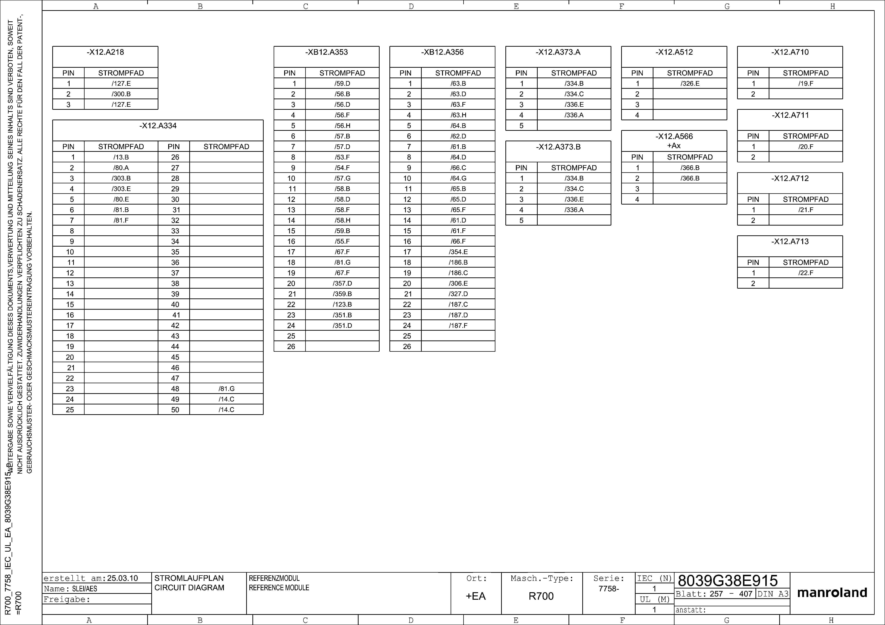

# +EA — Sheet 257 of 407 — REFERENZMODUL

**REFERENCE MODULE**

> Part of the manroland **R700** printing press IEC/UL circuit diagrams.
> Drawing class: **Stromlaufplan / Circuit diagram** (DIN A3).
> Document `+EA` covers the **Printing unit** machine section.

## At a glance

| Field | Value |
|---|---|
| Document | `+EA`  (8039G38E915) |
| Sheet | **257** of 407 |
| Section (DE) | REFERENZMODUL |
| Section (EN) | REFERENCE MODULE |
| Section type | REFERENCE_MODULE — Reference module |
| Machine type | `R700` |
| Series | `7758` |
| Created | 25.03.10 |
| Replaces | — |
| Columns used | A, B, C, D, E, F, G, H |
| Path numbers | — |
| Labels on sheet | 246 |
| Cross-refs out | 76 |
| Cross-refs in | 0 |

**Previous:** [+EA sheet 256](SHEET_0256.md) · **Next:** [+EA sheet 258](SHEET_0258.md) · **Document TOC:** [_TOC.md](_TOC.md)  (+EA) · **Master TOC:** [all sheets](../_MASTER_TOC.md)

## Sheet image (300 DPI, exact vector render)



_Rendered directly from the PDF vector layer at 300 DPI (1-bit), no OCR and no resampling. Use it to confirm anything ambiguous in the text below._

## Cross-references on this sheet

Each entry is a wire leaving this sheet. The printed token is `/sheet.column`; the link resolves to that sheet inside the same document.

| Ref | Target sheet | Col | Path | Destination on target | Target section | From col |
|---|---|---|---|---|---|---|
| `/326.E` | [+EA sheet 326](SHEET_0326.md) | E | — | STROMPFAD PIN 1 2 3 4 | OPTION: BOGENWEICHE | F |
| `/19.F` | [+EA sheet 19](SHEET_0019.md) | F | — | STROMPFAD PIN 1 2 | SPANNUNGSVERSORGUNG: 400V, 24V | H |
| `/63.B` | [+EA sheet 63](SHEET_0063.md) | B | — | — | MASCHINENBEDIENUNG: BEDIENUNGKOMMANDOS | D |
| `/127.E` | [+EA sheet 127](SHEET_0127.md) | E | — | — | ZUGANGSABSICHERUNG | A |
| `/334.B` | [+EA sheet 334](SHEET_0334.md) | B | — | — | OPTION: BOGENWEICHE | F |
| `/59.D` | [+EA sheet 59](SHEET_0059.md) | D | — | — | MASCHINENBEDIENUNG: BEDIENUNGKOMMANDOS | C |
| `/56.B` | [+EA sheet 56](SHEET_0056.md) | B | — | — | MASCHINENBEDIENUNG: BEDIENUNGKOMMANDOS | C |
| `/300.B` | [+EA sheet 300](SHEET_0300.md) | B | — | — | OPTION: ZWISCHENSTAPEL / | A |
| `/63.D` | [+EA sheet 63](SHEET_0063.md) | D | — | — | MASCHINENBEDIENUNG: BEDIENUNGKOMMANDOS | D |
| `/334.C` | [+EA sheet 334](SHEET_0334.md) | C | — | — | OPTION: BOGENWEICHE | F |
| `/63.F` | [+EA sheet 63](SHEET_0063.md) | F | — | — | MASCHINENBEDIENUNG: BEDIENUNGKOMMANDOS | D |
| `/127.E` | [+EA sheet 127](SHEET_0127.md) | E | — | — | ZUGANGSABSICHERUNG | A |
| `/336.E` | [+EA sheet 336](SHEET_0336.md) | E | — | — | OPTION: BOGENWEICHE | F |
| `/56.D` | [+EA sheet 56](SHEET_0056.md) | D | — | — | MASCHINENBEDIENUNG: BEDIENUNGKOMMANDOS | C |
| `/56.F` | [+EA sheet 56](SHEET_0056.md) | F | — | — | MASCHINENBEDIENUNG: BEDIENUNGKOMMANDOS | C |
| `/336.A` | [+EA sheet 336](SHEET_0336.md) | A | — | — | OPTION: BOGENWEICHE | F |
| `/63.H` | [+EA sheet 63](SHEET_0063.md) | H | — | — | MASCHINENBEDIENUNG: BEDIENUNGKOMMANDOS | D |
| `/64.B` | [+EA sheet 64](SHEET_0064.md) | B | — | — | MASCHINENBEDIENUNG: BEDIENUNGKOMMANDOS | D |
| `/56.H` | [+EA sheet 56](SHEET_0056.md) | H | — | — | MASCHINENBEDIENUNG: BEDIENUNGKOMMANDOS | C |
| `/20.F` | [+EA sheet 20](SHEET_0020.md) | F | — | STROMPFAD PIN 1 2 | SPANNUNGSVERSORGUNG: 400V, 24V | H |
| `/57.B` | [+EA sheet 57](SHEET_0057.md) | B | — | — | MASCHINENBEDIENUNG: BEDIENUNGKOMMANDOS | C |
| `/62.D` | [+EA sheet 62](SHEET_0062.md) | D | — | — | MASCHINENBEDIENUNG: BEDIENUNGKOMMANDOS | D |
| `/61.B` | [+EA sheet 61](SHEET_0061.md) | B | — | — | MASCHINENBEDIENUNG: BEDIENUNGKOMMANDOS | D |
| `/57.D` | [+EA sheet 57](SHEET_0057.md) | D | — | — | MASCHINENBEDIENUNG: BEDIENUNGKOMMANDOS | C |
| `/13.B` | [+EA sheet 13](SHEET_0013.md) | B | — | — | SPANNUNGSVERSORGUNG: 400V, 24V | A |
| `/53.F` | [+EA sheet 53](SHEET_0053.md) | F | — | — | MASCHINENBEDIENUNG: LAUFKOMMANDOS | C |
| `/64.D` | [+EA sheet 64](SHEET_0064.md) | D | — | — | MASCHINENBEDIENUNG: BEDIENUNGKOMMANDOS | D |
| `/80.A` | [+EA sheet 80](SHEET_0080.md) | A | — | — | AUSLEGERSTAPELSTEUERUNG: BEDIENKOMMANDOS | A |
| `/54.F` | [+EA sheet 54](SHEET_0054.md) | F | — | — | MASCHINENBEDIENUNG: LAUFKOMMANDOS | C |
| `/366.B` | [+EA sheet 366](SHEET_0366.md) | B | — | — | OPTION: TROCKNER VORBEREITUNG; | G |
| `/66.C` | [+EA sheet 66](SHEET_0066.md) | C | — | — | MASCHINENBEDIENUNG: BEDIENUNGKOMMANDOS | D |
| `/303.B` | [+EA sheet 303](SHEET_0303.md) | B | — | — | OPTION: ZWISCHENSTAPEL / | A |
| `/57.G` | [+EA sheet 57](SHEET_0057.md) | G | — | — | MASCHINENBEDIENUNG: BEDIENUNGKOMMANDOS | C |
| `/64.G` | [+EA sheet 64](SHEET_0064.md) | G | — | — | MASCHINENBEDIENUNG: BEDIENUNGKOMMANDOS | D |
| `/334.B` | [+EA sheet 334](SHEET_0334.md) | B | — | — | OPTION: BOGENWEICHE | F |
| `/366.B` | [+EA sheet 366](SHEET_0366.md) | B | — | — | OPTION: TROCKNER VORBEREITUNG; | G |
| `/58.B` | [+EA sheet 58](SHEET_0058.md) | B | — | — | MASCHINENBEDIENUNG: BEDIENUNGKOMMANDOS | C |
| `/65.B` | [+EA sheet 65](SHEET_0065.md) | B | — | — | MASCHINENBEDIENUNG: BEDIENUNGKOMMANDOS | D |
| `/303.E` | [+EA sheet 303](SHEET_0303.md) | E | — | — | OPTION: ZWISCHENSTAPEL / | A |
| `/334.C` | [+EA sheet 334](SHEET_0334.md) | C | — | — | OPTION: BOGENWEICHE | F |
| `/21.F` | [+EA sheet 21](SHEET_0021.md) | F | — | STROMPFAD PIN 1 2 | SPANNUNGSVERSORGUNG: 400V, 24V | H |
| `/80.E` | [+EA sheet 80](SHEET_0080.md) | E | — | — | AUSLEGERSTAPELSTEUERUNG: BEDIENKOMMANDOS | A |
| `/336.E` | [+EA sheet 336](SHEET_0336.md) | E | — | — | OPTION: BOGENWEICHE | F |
| `/58.D` | [+EA sheet 58](SHEET_0058.md) | D | — | — | MASCHINENBEDIENUNG: BEDIENUNGKOMMANDOS | C |
| `/65.D` | [+EA sheet 65](SHEET_0065.md) | D | — | — | MASCHINENBEDIENUNG: BEDIENUNGKOMMANDOS | D |
| `/81.B` | [+EA sheet 81](SHEET_0081.md) | B | — | — | AUSLEGERSTAPELSTEUERUNG: BEDIENKOMMANDOS | A |
| `/58.F` | [+EA sheet 58](SHEET_0058.md) | F | — | — | MASCHINENBEDIENUNG: BEDIENUNGKOMMANDOS | C |
| `/65.F` | [+EA sheet 65](SHEET_0065.md) | F | — | — | MASCHINENBEDIENUNG: BEDIENUNGKOMMANDOS | D |
| `/336.A` | [+EA sheet 336](SHEET_0336.md) | A | — | — | OPTION: BOGENWEICHE | F |
| `/81.F` | [+EA sheet 81](SHEET_0081.md) | F | — | — | AUSLEGERSTAPELSTEUERUNG: BEDIENKOMMANDOS | A |
| `/58.H` | [+EA sheet 58](SHEET_0058.md) | H | — | — | MASCHINENBEDIENUNG: BEDIENUNGKOMMANDOS | C |
| `/61.D` | [+EA sheet 61](SHEET_0061.md) | D | — | — | MASCHINENBEDIENUNG: BEDIENUNGKOMMANDOS | D |
| `/59.B` | [+EA sheet 59](SHEET_0059.md) | B | — | — | MASCHINENBEDIENUNG: BEDIENUNGKOMMANDOS | C |
| `/61.F` | [+EA sheet 61](SHEET_0061.md) | F | — | — | MASCHINENBEDIENUNG: BEDIENUNGKOMMANDOS | D |
| `/55.F` | [+EA sheet 55](SHEET_0055.md) | F | — | — | MASCHINENBEDIENUNG: LAUFKOMMANDOS | C |
| `/66.F` | [+EA sheet 66](SHEET_0066.md) | F | — | — | MASCHINENBEDIENUNG: BEDIENUNGKOMMANDOS | D |
| `/67.F` | [+EA sheet 67](SHEET_0067.md) | F | — | — | LEITSTANDSFUNKTIONEN | C |
| `/354.E` | [+EA sheet 354](SHEET_0354.md) | E | — | — | OPTION: VORBEREITUNG: PUDERABSAUGUNG | D |
| `/22.F` | [+EA sheet 22](SHEET_0022.md) | F | — | STROMPFAD PIN 1 2 | SPANNUNGSVERSORGUNG: 400V, 24V | H |
| `/186.B` | [+EA sheet 186](SHEET_0186.md) | B | — | — | RESERVE | D |
| `/81.G` | [+EA sheet 81](SHEET_0081.md) | G | — | — | AUSLEGERSTAPELSTEUERUNG: BEDIENKOMMANDOS | C |
| `/67.F` | [+EA sheet 67](SHEET_0067.md) | F | — | — | LEITSTANDSFUNKTIONEN | C |
| `/186.C` | [+EA sheet 186](SHEET_0186.md) | C | — | — | RESERVE | D |
| `/306.E` | [+EA sheet 306](SHEET_0306.md) | E | — | — | OPTION: ZWISCHENSTAPEL / | D |
| `/357.D` | [+EA sheet 357](SHEET_0357.md) | D | — | — | OPTION: AUFLAGENZÄHLER / GUTBOGENZÄHLER | C |
| `/359.B` | [+EA sheet 359](SHEET_0359.md) | B | — | — | OPTION: | C |
| `/327.D` | [+EA sheet 327](SHEET_0327.md) | D | — | — | OPTION: BOGENWEICHE | D |
| `/123.B` | [+EA sheet 123](SHEET_0123.md) | B | — | — | TROCKENBESTÄUBER | C |
| `/187.C` | [+EA sheet 187](SHEET_0187.md) | C | — | — | RESERVE | D |
| `/351.B` | [+EA sheet 351](SHEET_0351.md) | B | — | — | OPTION: VORBEREITUNG: PUDERABSAUGUNG | C |
| `/187.D` | [+EA sheet 187](SHEET_0187.md) | D | — | — | RESERVE | D |
| `/187.F` | [+EA sheet 187](SHEET_0187.md) | F | — | — | RESERVE | D |
| `/351.D` | [+EA sheet 351](SHEET_0351.md) | D | — | — | OPTION: VORBEREITUNG: PUDERABSAUGUNG | C |
| `/81.G` | [+EA sheet 81](SHEET_0081.md) | G | — | — | AUSLEGERSTAPELSTEUERUNG: BEDIENKOMMANDOS | B |
| `/14.C` | [+EA sheet 14](SHEET_0014.md) | C | — | — | SPANNUNGSVERSORGUNG: 400V, 24V | B |
| `/14.C` | [+EA sheet 14](SHEET_0014.md) | C | — | — | SPANNUNGSVERSORGUNG: 400V, 24V | B |

## Devices on this sheet

| Tag | Class | Class meaning (IEC) | Col | Sub | Terminal | Sign |
|---|---|---|---|---|---|---|
| `X12.A218` | — | cross-device reference | A | — | — | — |
| `X12.A334` | — | cross-device reference | B | — | — | — |
| `XB12.A353` | — | cross-device reference | C | — | — | — |
| `XB12.A356` | — | cross-device reference | D | — | — | — |
| `X12.A373.A` | — | cross-device reference | E | — | — | — |
| `X12.A373.B` | — | cross-device reference | E | — | — | — |
| `X12.A512` | — | cross-device reference | G | — | — | — |
| `X12.A566` | — | cross-device reference | G | — | — | — |
| `X12.A710` | — | cross-device reference | H | — | — | — |
| `X12.A711` | — | cross-device reference | H | — | — | — |
| `X12.A712` | — | cross-device reference | H | — | — | — |
| `X12.A713` | — | cross-device reference | H | — | — | — |

## Potentials / nets

_No named potentials on this sheet._

## Wire-end annotations (grouped as printed)

A wire that continues elsewhere is annotated with a small cluster: the destination description, the path/line number `#NN`, and the `/sheet.column` cross reference. Each row below is one such cluster exactly as it is grouped on the drawing.

| Col | Y | Path | Cross-ref | Text on the wire |
|---|---|---|---|---|
| A | 65.5 | — | — | `X12.A218` |
| C | 65.5 | — | — | `XB12.A353` |
| D | 65.5 | — | — | `XB12.A356` |
| E | 65.5 | — | — | `X12.A373.A` |
| G | 65.5 | — | — | `X12.A512` |
| H | 65.5 | — | — | `X12.A710` |
| A | 94.2 | — | — | `PIN 2 3 1 STROMPFAD` |
| C | 94.2 | — | — | `PIN STROMPFAD` |
| D | 94.2 | — | — | `PIN STROMPFAD` |
| E | 94.2 | — | — | `PIN 2 3 4 5 1 STROMPFAD` |
| F | 94.2 | — | `/326.E` | `PIN 2 3 4 1 STROMPFAD` |
| H | 94.2 | — | `/19.F` | `PIN 2 1 STROMPFAD` |
| C | 108.4 | — | — | `2 3 4 5 6 7 8 9 1` |
| D | 108.4 | — | — | `2 3 4 5 6 7 8 9 1` |
| A | 108.7 | — | `/127.E` | — |
| C | 108.7 | — | `/59.D` | — |
| D | 108.7 | — | `/63.B` | — |
| F | 108.7 | — | `/334.B` | — |
| C | 122.8 | — | `/56.B` | — |
| A | 122.9 | — | `/300.B` | — |
| D | 122.9 | — | `/63.D` | — |
| F | 122.9 | — | `/334.C` | — |
| A | 137.0 | — | `/127.E` | — |
| D | 137.0 | — | `/63.F` | — |
| F | 137.0 | — | `/336.E` | — |
| C | 137.1 | — | `/56.D` | — |
| H | 150.5 | — | — | `X12.A711` |
| C | 151.2 | — | `/56.F` | — |
| D | 151.2 | — | `/63.H` | — |
| F | 151.2 | — | `/336.A` | — |
| B | 164.7 | — | — | `X12.A334` |
| C | 165.4 | — | `/56.H` | — |
| D | 165.4 | — | `/64.B` | — |
| G | 178.9 | — | — | `X12.A566` |
| H | 179.2 | — | `/20.F` | `PIN 2 1 STROMPFAD` |
| C | 179.5 | — | `/57.B` | — |
| D | 179.6 | — | `/62.D` | — |
| F | 191.7 | — | — | `+Ax` |
| E | 193.1 | — | — | `X12.A373.B` |
| A | 193.4 | — | — | `PIN STROMPFAD` |
| B | 193.4 | — | — | `PIN STROMPFAD` |
| D | 193.7 | — | `/61.B` | — |
| C | 193.8 | — | `/57.D` | — |
| F | 207.5 | — | — | `PIN 2 3 4 1 STROMPFAD` |
| A | 207.6 | — | — | `2 3 4 5 6 7 8 9 1` |
| B | 207.6 | — | — | `26 27 28 29 30 32 33 34 35 36 37 38 39 40 42 43 44 45 46 47 48 49 50 31 41` |
| A | 207.9 | — | `/13.B` | — |
| C | 207.9 | — | `/53.F` | — |
| D | 207.9 | — | `/64.D` | — |
| E | 221.7 | — | — | `PIN 2 3 4 5 1 STROMPFAD` |
| A | 222.1 | — | `/80.A` | — |
| C | 222.1 | — | `/54.F` | — |
| D | 222.1 | — | `/66.C` | — |
| G | 222.1 | — | `/366.B` | — |
| H | 235.6 | — | — | `X12.A712` |
| C | 235.9 | — | — | `10 12 13 14 15 16 17 18 19 20 11` |
| D | 235.9 | — | — | `10 12 13 14 15 16 17 18 19 20 11` |
| A | 236.2 | — | `/303.B` | — |
| C | 236.2 | — | `/57.G` | — |
| D | 236.2 | — | `/64.G` | — |
| F | 236.2 | — | `/334.B` | — |
| G | 236.2 | — | `/366.B` | — |
| A | 250.4 | — | `/303.E` | — |
| C | 250.4 | — | `/58.B` | — |
| D | 250.4 | — | `/65.B` | — |
| F | 250.4 | — | `/334.C` | — |
| H | 264.2 | — | `/21.F` | `PIN 2 1 STROMPFAD` |
| A | 264.6 | — | `/80.E` | — |
| C | 264.6 | — | `/58.D` | — |
| D | 264.6 | — | `/65.D` | — |
| F | 264.6 | — | `/336.E` | — |
| A | 278.8 | — | `/81.B` | — |
| C | 278.8 | — | `/58.F` | — |
| D | 278.8 | — | `/65.F` | — |
| F | 278.8 | — | `/336.A` | — |
| A | 292.9 | — | `/81.F` | — |
| C | 293.0 | — | `/58.H` | — |
| D | 293.0 | — | `/61.D` | — |
| C | 307.1 | — | `/59.B` | — |
| D | 307.1 | — | `/61.F` | — |
| H | 320.6 | — | — | `X12.A713` |
| C | 321.3 | — | `/55.F` | — |
| D | 321.3 | — | `/66.F` | — |
| A | 335.1 | — | — | `10 12 13 14 15 16 17 18 19 20 11` |
| C | 335.5 | — | `/67.F` | — |
| D | 335.5 | — | `/354.E` | — |
| H | 349.3 | — | `/22.F` | `PIN 2 1 STROMPFAD` |
| C | 349.6 | — | `/81.G` | — |
| D | 349.6 | — | `/186.B` | — |
| C | 363.8 | — | `/67.F` | — |
| D | 363.8 | — | `/186.C` | — |
| C | 378.0 | — | `/357.D` | — |
| D | 378.0 | — | `/306.E` | — |
| C | 391.8 | — | — | `22 23 24 25 26 21` |
| D | 391.8 | — | — | `22 23 24 25 26 21` |
| C | 392.1 | — | `/359.B` | — |
| D | 392.2 | — | `/327.D` | — |
| C | 406.3 | — | `/123.B` | — |
| D | 406.4 | — | `/187.C` | — |
| C | 420.5 | — | `/351.B` | — |
| D | 420.5 | — | `/187.D` | — |
| C | 434.7 | — | `/351.D` | — |
| D | 434.7 | — | `/187.F` | — |
| A | 491.1 | — | — | `22 23 24 25 21` |
| B | 519.7 | — | `/81.G` | — |
| B | 533.9 | — | `/14.C` | — |
| B | 548.1 | — | `/14.C` | — |


## Reconstructed tables

This sheet carries tabular content (pin map / terminal assignment / index). The grid below was rebuilt from the drawing's own rule lines, so each row is exactly one physical row of the table.

### Table 1 — 30 data rows × 4 columns (at x=70.9, y=62.4) — **X12.A218**

| PIN | STROMPFAD |  |  |
|---|---|---|---|
| `1` | `/127.E` |  |  |
| `2` | `/300.B` |  |  |
| `3` | `/127.E` |  |  |
|  |  | `X12.A334` |  |
| `PIN` | `STROMPFAD` | `PIN` | `STROMPFAD` |
| `1` | `/13.B` | `26` |  |
| `2` | `/80.A` | `27` |  |
| `3` | `/303.B` | `28` |  |
| `4` | `/303.E` | `29` |  |
| `5` | `/80.E` | `30` |  |
| `6` | `/81.B` | `31` |  |
| `7` | `/81.F` | `32` |  |
| `8` |  | `33` |  |
| `9` |  | `34` |  |
| `10` |  | `35` |  |
| `11` |  | `36` |  |
| `12` |  | `37` |  |
| `13` |  | `38` |  |
| `14` |  | `39` |  |
| `15` |  | `40` |  |
| `16` |  | `41` |  |
| `17` |  | `42` |  |
| `18` |  | `43` |  |
| `19` |  | `44` |  |
| `20` |  | `45` |  |
| `21` |  | `46` |  |
| `22` |  | `47` |  |
| `23` |  | `48` | `/81.G` |
| `24` |  | `49` | `/14.C` |
| `25` |  | `50` | `/14.C` |


### Table 2 — 26 data rows × 2 columns (at x=368.5, y=62.4) — **XB12.A353**

| PIN | STROMPFAD |
|---|---|
| `1` | `/59.D` |
| `2` | `/56.B` |
| `3` | `/56.D` |
| `4` | `/56.F` |
| `5` | `/56.H` |
| `6` | `/57.B` |
| `7` | `/57.D` |
| `8` | `/53.F` |
| `9` | `/54.F` |
| `10` | `/57.G` |
| `11` | `/58.B` |
| `12` | `/58.D` |
| `13` | `/58.F` |
| `14` | `/58.H` |
| `15` | `/59.B` |
| `16` | `/55.F` |
| `17` | `/67.F` |
| `18` | `/81.G` |
| `19` | `/67.F` |
| `20` | `/357.D` |
| `21` | `/359.B` |
| `22` | `/123.B` |
| `23` | `/351.B` |
| `24` | `/351.D` |
| `25` |  |
| `26` |  |


### Table 3 — 26 data rows × 2 columns (at x=524.4, y=62.4) — **XB12.A356**

| PIN | STROMPFAD |
|---|---|
| `1` | `/63.B` |
| `2` | `/63.D` |
| `3` | `/63.F` |
| `4` | `/63.H` |
| `5` | `/64.B` |
| `6` | `/62.D` |
| `7` | `/61.B` |
| `8` | `/64.D` |
| `9` | `/66.C` |
| `10` | `/64.G` |
| `11` | `/65.B` |
| `12` | `/65.D` |
| `13` | `/65.F` |
| `14` | `/61.D` |
| `15` | `/61.F` |
| `16` | `/66.F` |
| `17` | `/354.E` |
| `18` | `/186.B` |
| `19` | `/186.C` |
| `20` | `/306.E` |
| `21` | `/327.D` |
| `22` | `/187.C` |
| `23` | `/187.D` |
| `24` | `/187.F` |
| `25` |  |
| `26` |  |


### Table 4 — 12 data rows × 2 columns (at x=680.3, y=62.4) — **X12.A373.A**

| PIN | STROMPFAD |
|---|---|
| `1` | `/334.B` |
| `2` | `/334.C` |
| `3` | `/336.E` |
| `4` | `/336.A` |
| `5` |  |
|  | `X12.A373.B` |
| `PIN` | `STROMPFAD` |
| `1` | `/334.B` |
| `2` | `/334.C` |
| `3` | `/336.E` |
| `4` | `/336.A` |
| `5` |  |


### Table 5 — 11 data rows × 2 columns (at x=836.2, y=62.4) — **X12.A512**

| PIN | STROMPFAD |
|---|---|
| `1` | `/326.E` |
| `2` |  |
| `3` |  |
| `4` |  |
|  | `X12.A566` |
|  | `+Ax` |
| `PIN` | `STROMPFAD` |
| `1` | `/366.B` |
| `2` | `/366.B` |
| `3` |  |
| `4` |  |


### Table 6 — 14 data rows × 2 columns (at x=992.1, y=62.4) — **X12.A710**

| PIN | STROMPFAD |
|---|---|
| `1` | `/19.F` |
| `2` |  |
|  | `X12.A711` |
| `PIN` | `STROMPFAD` |
| `1` | `/20.F` |
| `2` |  |
|  | `X12.A712` |
| `PIN` | `STROMPFAD` |
| `1` | `/21.F` |
| `2` |  |
|  | `X12.A713` |
| `PIN` | `STROMPFAD` |
| `1` | `/22.F` |
| `2` |  |


## Notes and free text on this sheet

| Text | Col | Y (pt) |
|---|---|---|
| `PIN` | A | 94.2 |
| `STROMPFAD` | A | 94.15 |
| `PIN` | B | 193.41 |
| `STROMPFAD` | B | 193.37 |
| `PIN` | C | 94.2 |
| `STROMPFAD` | C | 94.15 |
| `PIN` | D | 94.2 |
| `STROMPFAD` | D | 94.15 |
| `PIN` | E | 94.2 |
| `STROMPFAD` | F | 94.15 |
| `PIN` | F | 94.2 |
| `STROMPFAD` | G | 94.15 |
| `+Ax` | F | 191.68 |
| `PIN` | G | 94.2 |
| `STROMPFAD` | H | 94.15 |

## Complete label inventory (exact text from the drawing)

Every text object inside the drawing area of this sheet, in DIN reading order (column A→H, then top→bottom). This is the authoritative list: if a string is not here it is not printed on this sheet.

| Col | Y | X | Dir | Type | Text |
|---|---|---|---|---|---|
| A | 65.5 | 116.8 | → | device ref | `X12.A218` |
| A | 94.2 | 84.0 | → | text | `PIN` |
| A | 94.2 | 132.2 | → | text | `STROMPFAD` |
| A | 108.4 | 90.0 | → | number | `1` |
| A | 108.7 | 150.5 | → | cross-reference | `/127.E` |
| A | 122.5 | 89.4 | → | number | `2` |
| A | 122.9 | 150.4 | → | cross-reference | `/300.B` |
| A | 136.7 | 89.4 | → | number | `3` |
| A | 137.0 | 150.5 | → | cross-reference | `/127.E` |
| A | 193.4 | 84.0 | → | text | `PIN` |
| A | 193.4 | 132.2 | → | text | `STROMPFAD` |
| A | 207.6 | 95.8 | → | number | `1` |
| A | 207.9 | 152.8 | → | cross-reference | `/13.B` |
| A | 221.8 | 94.1 | → | number | `2` |
| A | 222.1 | 152.6 | → | cross-reference | `/80.A` |
| A | 235.9 | 94.1 | → | number | `3` |
| A | 236.2 | 150.4 | → | cross-reference | `/303.B` |
| A | 250.1 | 94.1 | → | number | `4` |
| A | 250.4 | 150.5 | → | cross-reference | `/303.E` |
| A | 264.3 | 94.1 | → | number | `5` |
| A | 264.6 | 152.9 | → | cross-reference | `/80.E` |
| A | 278.5 | 94.1 | → | number | `6` |
| A | 278.8 | 152.8 | → | cross-reference | `/81.B` |
| A | 292.6 | 94.1 | → | number | `7` |
| A | 292.9 | 153.1 | → | cross-reference | `/81.F` |
| A | 306.8 | 94.1 | → | number | `8` |
| A | 321.0 | 94.1 | → | number | `9` |
| A | 335.1 | 88.7 | → | number | `10` |
| A | 349.3 | 90.4 | → | number | `11` |
| A | 363.5 | 88.7 | → | number | `12` |
| A | 377.7 | 88.7 | → | number | `13` |
| A | 391.8 | 88.7 | → | number | `14` |
| A | 406.0 | 88.7 | → | number | `15` |
| A | 420.2 | 88.7 | → | number | `16` |
| A | 434.4 | 88.7 | → | number | `17` |
| A | 448.5 | 88.7 | → | number | `18` |
| A | 462.7 | 88.7 | → | number | `19` |
| A | 476.9 | 88.7 | → | number | `20` |
| A | 491.0 | 90.4 | → | number | `21` |
| A | 505.2 | 88.7 | → | number | `22` |
| A | 519.4 | 88.7 | → | number | `23` |
| A | 533.6 | 88.7 | → | number | `24` |
| A | 547.7 | 88.7 | → | number | `25` |
| B | 164.7 | 187.7 | → | device ref | `X12.A334` |
| B | 193.4 | 225.8 | → | text | `PIN` |
| B | 193.4 | 274.0 | → | text | `STROMPFAD` |
| B | 207.6 | 230.5 | → | number | `26` |
| B | 221.8 | 230.5 | → | number | `27` |
| B | 235.9 | 230.5 | → | number | `28` |
| B | 250.1 | 230.5 | → | number | `29` |
| B | 264.3 | 230.5 | → | number | `30` |
| B | 278.5 | 232.2 | → | number | `31` |
| B | 292.6 | 230.5 | → | number | `32` |
| B | 306.8 | 230.5 | → | number | `33` |
| B | 321.0 | 230.5 | → | number | `34` |
| B | 335.1 | 230.5 | → | number | `35` |
| B | 349.3 | 230.5 | → | number | `36` |
| B | 363.5 | 230.5 | → | number | `37` |
| B | 377.7 | 230.5 | → | number | `38` |
| B | 391.8 | 230.5 | → | number | `39` |
| B | 406.0 | 230.5 | → | number | `40` |
| B | 420.2 | 232.2 | → | number | `41` |
| B | 434.4 | 230.5 | → | number | `42` |
| B | 448.5 | 230.5 | → | number | `43` |
| B | 462.7 | 230.5 | → | number | `44` |
| B | 476.9 | 230.5 | → | number | `45` |
| B | 491.0 | 230.5 | → | number | `46` |
| B | 505.2 | 230.5 | → | number | `47` |
| B | 519.4 | 230.5 | → | number | `48` |
| B | 519.7 | 294.2 | → | cross-reference | `/81.G` |
| B | 533.6 | 230.5 | → | number | `49` |
| B | 533.9 | 294.4 | → | cross-reference | `/14.C` |
| B | 547.7 | 230.5 | → | number | `50` |
| B | 548.1 | 294.4 | → | cross-reference | `/14.C` |
| C | 65.5 | 410.9 | → | device ref | `XB12.A353` |
| C | 94.2 | 381.7 | → | text | `PIN` |
| C | 94.2 | 429.9 | → | text | `STROMPFAD` |
| C | 108.4 | 393.4 | → | number | `1` |
| C | 108.7 | 450.3 | → | cross-reference | `/59.D` |
| C | 122.5 | 391.7 | → | number | `2` |
| C | 122.8 | 450.4 | → | cross-reference | `/56.B` |
| C | 136.7 | 391.7 | → | number | `3` |
| C | 137.1 | 450.3 | → | cross-reference | `/56.D` |
| C | 150.9 | 391.7 | → | number | `4` |
| C | 151.2 | 450.7 | → | cross-reference | `/56.F` |
| C | 165.1 | 391.7 | → | number | `5` |
| C | 165.4 | 450.6 | → | cross-reference | `/56.H` |
| C | 179.2 | 391.7 | → | number | `6` |
| C | 179.5 | 450.4 | → | cross-reference | `/57.B` |
| C | 193.4 | 391.7 | → | number | `7` |
| C | 193.7 | 450.3 | → | cross-reference | `/57.D` |
| C | 207.6 | 391.7 | → | number | `8` |
| C | 207.9 | 450.7 | → | cross-reference | `/53.F` |
| C | 221.8 | 391.7 | → | number | `9` |
| C | 222.1 | 450.7 | → | cross-reference | `/54.F` |
| C | 235.9 | 386.4 | → | number | `10` |
| C | 236.3 | 450.1 | → | cross-reference | `/57.G` |
| C | 250.1 | 388.1 | → | number | `11` |
| C | 250.4 | 450.4 | → | cross-reference | `/58.B` |
| C | 264.3 | 386.4 | → | number | `12` |
| C | 264.6 | 450.3 | → | cross-reference | `/58.D` |
| C | 278.5 | 386.4 | → | number | `13` |
| C | 278.8 | 450.7 | → | cross-reference | `/58.F` |
| C | 292.6 | 386.4 | → | number | `14` |
| C | 293.0 | 450.6 | → | cross-reference | `/58.H` |
| C | 306.8 | 386.4 | → | number | `15` |
| C | 307.1 | 450.4 | → | cross-reference | `/59.B` |
| C | 321.0 | 386.4 | → | number | `16` |
| C | 321.3 | 450.7 | → | cross-reference | `/55.F` |
| C | 335.1 | 386.4 | → | number | `17` |
| C | 335.5 | 450.7 | → | cross-reference | `/67.F` |
| C | 349.3 | 386.4 | → | number | `18` |
| C | 349.6 | 450.1 | → | cross-reference | `/81.G` |
| C | 363.5 | 386.4 | → | number | `19` |
| C | 363.8 | 450.7 | → | cross-reference | `/67.F` |
| C | 377.7 | 386.4 | → | number | `20` |
| C | 378.0 | 447.9 | → | cross-reference | `/357.D` |
| C | 391.8 | 388.1 | → | number | `21` |
| C | 392.2 | 448.0 | → | cross-reference | `/359.B` |
| C | 406.0 | 386.4 | → | number | `22` |
| C | 406.3 | 448.0 | → | cross-reference | `/123.B` |
| C | 420.2 | 386.4 | → | number | `23` |
| C | 420.5 | 448.0 | → | cross-reference | `/351.B` |
| C | 434.4 | 386.4 | → | number | `24` |
| C | 434.7 | 447.9 | → | cross-reference | `/351.D` |
| C | 448.5 | 386.4 | → | number | `25` |
| C | 462.7 | 386.4 | → | number | `26` |
| D | 65.5 | 566.8 | → | device ref | `XB12.A356` |
| D | 94.2 | 537.6 | → | text | `PIN` |
| D | 94.2 | 585.8 | → | text | `STROMPFAD` |
| D | 108.4 | 549.4 | → | number | `1` |
| D | 108.7 | 606.3 | → | cross-reference | `/63.B` |
| D | 122.5 | 547.7 | → | number | `2` |
| D | 122.9 | 606.2 | → | cross-reference | `/63.D` |
| D | 136.7 | 547.7 | → | number | `3` |
| D | 137.0 | 606.6 | → | cross-reference | `/63.F` |
| D | 150.9 | 547.7 | → | number | `4` |
| D | 151.2 | 606.5 | → | cross-reference | `/63.H` |
| D | 165.1 | 547.7 | → | number | `5` |
| D | 165.4 | 606.3 | → | cross-reference | `/64.B` |
| D | 179.2 | 547.7 | → | number | `6` |
| D | 179.6 | 606.2 | → | cross-reference | `/62.D` |
| D | 193.4 | 547.7 | → | number | `7` |
| D | 193.7 | 606.3 | → | cross-reference | `/61.B` |
| D | 207.6 | 547.7 | → | number | `8` |
| D | 207.9 | 606.2 | → | cross-reference | `/64.D` |
| D | 221.8 | 547.7 | → | number | `9` |
| D | 222.1 | 606.2 | → | cross-reference | `/66.C` |
| D | 235.9 | 542.3 | → | number | `10` |
| D | 236.3 | 606.0 | → | cross-reference | `/64.G` |
| D | 250.1 | 544.0 | → | number | `11` |
| D | 250.4 | 606.3 | → | cross-reference | `/65.B` |
| D | 264.3 | 542.3 | → | number | `12` |
| D | 264.6 | 606.2 | → | cross-reference | `/65.D` |
| D | 278.5 | 542.3 | → | number | `13` |
| D | 278.8 | 606.6 | → | cross-reference | `/65.F` |
| D | 292.6 | 542.3 | → | number | `14` |
| D | 293.0 | 606.2 | → | cross-reference | `/61.D` |
| D | 306.8 | 542.3 | → | number | `15` |
| D | 307.1 | 606.6 | → | cross-reference | `/61.F` |
| D | 321.0 | 542.3 | → | number | `16` |
| D | 321.3 | 606.6 | → | cross-reference | `/66.F` |
| D | 335.1 | 542.3 | → | number | `17` |
| D | 335.5 | 604.1 | → | cross-reference | `/354.E` |
| D | 349.3 | 542.3 | → | number | `18` |
| D | 349.6 | 603.9 | → | cross-reference | `/186.B` |
| D | 363.5 | 542.3 | → | number | `19` |
| D | 363.8 | 603.8 | → | cross-reference | `/186.C` |
| D | 377.7 | 542.3 | → | number | `20` |
| D | 378.0 | 604.1 | → | cross-reference | `/306.E` |
| D | 391.8 | 544.0 | → | number | `21` |
| D | 392.2 | 603.8 | → | cross-reference | `/327.D` |
| D | 406.0 | 542.3 | → | number | `22` |
| D | 406.4 | 603.8 | → | cross-reference | `/187.C` |
| D | 420.2 | 542.3 | → | number | `23` |
| D | 420.5 | 603.8 | → | cross-reference | `/187.D` |
| D | 434.4 | 542.3 | → | number | `24` |
| D | 434.7 | 604.2 | → | cross-reference | `/187.F` |
| D | 448.5 | 542.3 | → | number | `25` |
| D | 462.7 | 542.3 | → | number | `26` |
| E | 65.5 | 720.9 | → | device ref | `X12.A373.A` |
| E | 94.2 | 693.5 | → | text | `PIN` |
| E | 108.4 | 699.4 | → | number | `1` |
| E | 122.5 | 698.9 | → | number | `2` |
| E | 136.7 | 698.9 | → | number | `3` |
| E | 150.9 | 698.9 | → | number | `4` |
| E | 165.1 | 698.9 | → | number | `5` |
| E | 193.1 | 721.3 | → | device ref | `X12.A373.B` |
| E | 221.8 | 693.5 | → | text | `PIN` |
| E | 235.9 | 699.4 | → | number | `1` |
| E | 250.1 | 698.9 | → | number | `2` |
| E | 264.3 | 698.9 | → | number | `3` |
| E | 278.5 | 698.9 | → | number | `4` |
| E | 292.6 | 698.9 | → | number | `5` |
| F | 94.2 | 741.7 | → | text | `STROMPFAD` |
| F | 94.2 | 849.4 | → | text | `PIN` |
| F | 108.4 | 855.4 | → | number | `1` |
| F | 108.7 | 759.8 | → | cross-reference | `/334.B` |
| F | 122.5 | 854.8 | → | number | `2` |
| F | 122.9 | 759.7 | → | cross-reference | `/334.C` |
| F | 136.7 | 854.8 | → | number | `3` |
| F | 137.0 | 760.0 | → | cross-reference | `/336.E` |
| F | 150.9 | 854.8 | → | number | `4` |
| F | 151.2 | 759.7 | → | cross-reference | `/336.A` |
| F | 191.7 | 897.6 | → | text | `+Ax` |
| F | 207.6 | 849.4 | → | text | `PIN` |
| F | 221.7 | 741.7 | → | text | `STROMPFAD` |
| F | 221.8 | 855.4 | → | number | `1` |
| F | 235.9 | 854.8 | → | number | `2` |
| F | 236.2 | 759.8 | → | cross-reference | `/334.B` |
| F | 250.1 | 854.8 | → | number | `3` |
| F | 250.4 | 759.7 | → | cross-reference | `/334.C` |
| F | 264.3 | 854.8 | → | number | `4` |
| F | 264.6 | 760.0 | → | cross-reference | `/336.E` |
| F | 278.8 | 759.7 | → | cross-reference | `/336.A` |
| G | 65.5 | 882.1 | → | device ref | `X12.A512` |
| G | 94.2 | 897.6 | → | text | `STROMPFAD` |
| G | 94.2 | 1005.3 | → | text | `PIN` |
| G | 108.4 | 1011.3 | → | number | `1` |
| G | 108.7 | 915.9 | → | cross-reference | `/326.E` |
| G | 122.5 | 1010.7 | → | number | `2` |
| G | 178.9 | 882.1 | → | device ref | `X12.A566` |
| G | 179.2 | 1005.3 | → | text | `PIN` |
| G | 193.4 | 1011.3 | → | number | `1` |
| G | 207.5 | 897.6 | → | text | `STROMPFAD` |
| G | 207.6 | 1010.7 | → | number | `2` |
| G | 222.1 | 915.7 | → | cross-reference | `/366.B` |
| G | 236.2 | 915.7 | → | cross-reference | `/366.B` |
| G | 264.3 | 1005.3 | → | text | `PIN` |
| G | 278.5 | 1011.3 | → | number | `1` |
| G | 292.6 | 1010.7 | → | number | `2` |
| G | 349.3 | 1005.3 | → | text | `PIN` |
| G | 363.5 | 1011.3 | → | number | `1` |
| G | 377.7 | 1010.7 | → | number | `2` |
| H | 65.5 | 1038.0 | → | device ref | `X12.A710` |
| H | 94.2 | 1053.5 | → | text | `STROMPFAD` |
| H | 108.7 | 1074.3 | → | cross-reference | `/19.F` |
| H | 150.5 | 1038.8 | → | device ref | `X12.A711` |
| H | 179.2 | 1053.5 | → | text | `STROMPFAD` |
| H | 193.7 | 1074.3 | → | cross-reference | `/20.F` |
| H | 235.6 | 1038.0 | → | device ref | `X12.A712` |
| H | 264.2 | 1053.5 | → | text | `STROMPFAD` |
| H | 278.8 | 1074.3 | → | cross-reference | `/21.F` |
| H | 320.6 | 1038.0 | → | device ref | `X12.A713` |
| H | 349.3 | 1053.5 | → | text | `STROMPFAD` |
| H | 363.8 | 1074.3 | → | cross-reference | `/22.F` |

## Reading-order text block

The same content as a plain block, grouped by DIN column — convenient to paste or to match against a visual description.

```text
=== Column A ===
  65.5  116.8  devref       X12.A218
  94.2   84.0  text         PIN
  94.2  132.2  text         STROMPFAD
 108.4   90.0  numeric      1
 108.7  150.5  xref         /127.E
 122.5   89.4  numeric      2
 122.9  150.4  xref         /300.B
 136.7   89.4  numeric      3
 137.0  150.5  xref         /127.E
 193.4   84.0  text         PIN
 193.4  132.2  text         STROMPFAD
 207.6   95.8  numeric      1
 207.9  152.8  xref         /13.B
 221.8   94.1  numeric      2
 222.1  152.6  xref         /80.A
 235.9   94.1  numeric      3
 236.2  150.4  xref         /303.B
 250.1   94.1  numeric      4
 250.4  150.5  xref         /303.E
 264.3   94.1  numeric      5
 264.6  152.9  xref         /80.E
 278.5   94.1  numeric      6
 278.8  152.8  xref         /81.B
 292.6   94.1  numeric      7
 292.9  153.1  xref         /81.F
 306.8   94.1  numeric      8
 321.0   94.1  numeric      9
 335.1   88.7  numeric      10
 349.3   90.4  numeric      11
 363.5   88.7  numeric      12
 377.7   88.7  numeric      13
 391.8   88.7  numeric      14
 406.0   88.7  numeric      15
 420.2   88.7  numeric      16
 434.4   88.7  numeric      17
 448.5   88.7  numeric      18
 462.7   88.7  numeric      19
 476.9   88.7  numeric      20
 491.0   90.4  numeric      21
 505.2   88.7  numeric      22
 519.4   88.7  numeric      23
 533.6   88.7  numeric      24
 547.7   88.7  numeric      25
=== Column B ===
 164.7  187.7  devref       X12.A334
 193.4  225.8  text         PIN
 193.4  274.0  text         STROMPFAD
 207.6  230.5  numeric      26
 221.8  230.5  numeric      27
 235.9  230.5  numeric      28
 250.1  230.5  numeric      29
 264.3  230.5  numeric      30
 278.5  232.2  numeric      31
 292.6  230.5  numeric      32
 306.8  230.5  numeric      33
 321.0  230.5  numeric      34
 335.1  230.5  numeric      35
 349.3  230.5  numeric      36
 363.5  230.5  numeric      37
 377.7  230.5  numeric      38
 391.8  230.5  numeric      39
 406.0  230.5  numeric      40
 420.2  232.2  numeric      41
 434.4  230.5  numeric      42
 448.5  230.5  numeric      43
 462.7  230.5  numeric      44
 476.9  230.5  numeric      45
 491.0  230.5  numeric      46
 505.2  230.5  numeric      47
 519.4  230.5  numeric      48
 519.7  294.2  xref         /81.G
 533.6  230.5  numeric      49
 533.9  294.4  xref         /14.C
 547.7  230.5  numeric      50
 548.1  294.4  xref         /14.C
=== Column C ===
  65.5  410.9  devref       XB12.A353
  94.2  381.7  text         PIN
  94.2  429.9  text         STROMPFAD
 108.4  393.4  numeric      1
 108.7  450.3  xref         /59.D
 122.5  391.7  numeric      2
 122.8  450.4  xref         /56.B
 136.7  391.7  numeric      3
 137.1  450.3  xref         /56.D
 150.9  391.7  numeric      4
 151.2  450.7  xref         /56.F
 165.1  391.7  numeric      5
 165.4  450.6  xref         /56.H
 179.2  391.7  numeric      6
 179.5  450.4  xref         /57.B
 193.4  391.7  numeric      7
 193.7  450.3  xref         /57.D
 207.6  391.7  numeric      8
 207.9  450.7  xref         /53.F
 221.8  391.7  numeric      9
 222.1  450.7  xref         /54.F
 235.9  386.4  numeric      10
 236.3  450.1  xref         /57.G
 250.1  388.1  numeric      11
 250.4  450.4  xref         /58.B
 264.3  386.4  numeric      12
 264.6  450.3  xref         /58.D
 278.5  386.4  numeric      13
 278.8  450.7  xref         /58.F
 292.6  386.4  numeric      14
 293.0  450.6  xref         /58.H
 306.8  386.4  numeric      15
 307.1  450.4  xref         /59.B
 321.0  386.4  numeric      16
 321.3  450.7  xref         /55.F
 335.1  386.4  numeric      17
 335.5  450.7  xref         /67.F
 349.3  386.4  numeric      18
 349.6  450.1  xref         /81.G
 363.5  386.4  numeric      19
 363.8  450.7  xref         /67.F
 377.7  386.4  numeric      20
 378.0  447.9  xref         /357.D
 391.8  388.1  numeric      21
 392.2  448.0  xref         /359.B
 406.0  386.4  numeric      22
 406.3  448.0  xref         /123.B
 420.2  386.4  numeric      23
 420.5  448.0  xref         /351.B
 434.4  386.4  numeric      24
 434.7  447.9  xref         /351.D
 448.5  386.4  numeric      25
 462.7  386.4  numeric      26
=== Column D ===
  65.5  566.8  devref       XB12.A356
  94.2  537.6  text         PIN
  94.2  585.8  text         STROMPFAD
 108.4  549.4  numeric      1
 108.7  606.3  xref         /63.B
 122.5  547.7  numeric      2
 122.9  606.2  xref         /63.D
 136.7  547.7  numeric      3
 137.0  606.6  xref         /63.F
 150.9  547.7  numeric      4
 151.2  606.5  xref         /63.H
 165.1  547.7  numeric      5
 165.4  606.3  xref         /64.B
 179.2  547.7  numeric      6
 179.6  606.2  xref         /62.D
 193.4  547.7  numeric      7
 193.7  606.3  xref         /61.B
 207.6  547.7  numeric      8
 207.9  606.2  xref         /64.D
 221.8  547.7  numeric      9
 222.1  606.2  xref         /66.C
 235.9  542.3  numeric      10
 236.3  606.0  xref         /64.G
 250.1  544.0  numeric      11
 250.4  606.3  xref         /65.B
 264.3  542.3  numeric      12
 264.6  606.2  xref         /65.D
 278.5  542.3  numeric      13
 278.8  606.6  xref         /65.F
 292.6  542.3  numeric      14
 293.0  606.2  xref         /61.D
 306.8  542.3  numeric      15
 307.1  606.6  xref         /61.F
 321.0  542.3  numeric      16
 321.3  606.6  xref         /66.F
 335.1  542.3  numeric      17
 335.5  604.1  xref         /354.E
 349.3  542.3  numeric      18
 349.6  603.9  xref         /186.B
 363.5  542.3  numeric      19
 363.8  603.8  xref         /186.C
 377.7  542.3  numeric      20
 378.0  604.1  xref         /306.E
 391.8  544.0  numeric      21
 392.2  603.8  xref         /327.D
 406.0  542.3  numeric      22
 406.4  603.8  xref         /187.C
 420.2  542.3  numeric      23
 420.5  603.8  xref         /187.D
 434.4  542.3  numeric      24
 434.7  604.2  xref         /187.F
 448.5  542.3  numeric      25
 462.7  542.3  numeric      26
=== Column E ===
  65.5  720.9  devref       X12.A373.A
  94.2  693.5  text         PIN
 108.4  699.4  numeric      1
 122.5  698.9  numeric      2
 136.7  698.9  numeric      3
 150.9  698.9  numeric      4
 165.1  698.9  numeric      5
 193.1  721.3  devref       X12.A373.B
 221.8  693.5  text         PIN
 235.9  699.4  numeric      1
 250.1  698.9  numeric      2
 264.3  698.9  numeric      3
 278.5  698.9  numeric      4
 292.6  698.9  numeric      5
=== Column F ===
  94.2  741.7  text         STROMPFAD
  94.2  849.4  text         PIN
 108.4  855.4  numeric      1
 108.7  759.8  xref         /334.B
 122.5  854.8  numeric      2
 122.9  759.7  xref         /334.C
 136.7  854.8  numeric      3
 137.0  760.0  xref         /336.E
 150.9  854.8  numeric      4
 151.2  759.7  xref         /336.A
 191.7  897.6  text         +Ax
 207.6  849.4  text         PIN
 221.7  741.7  text         STROMPFAD
 221.8  855.4  numeric      1
 235.9  854.8  numeric      2
 236.2  759.8  xref         /334.B
 250.1  854.8  numeric      3
 250.4  759.7  xref         /334.C
 264.3  854.8  numeric      4
 264.6  760.0  xref         /336.E
 278.8  759.7  xref         /336.A
=== Column G ===
  65.5  882.1  devref       X12.A512
  94.2  897.6  text         STROMPFAD
  94.2 1005.3  text         PIN
 108.4 1011.3  numeric      1
 108.7  915.9  xref         /326.E
 122.5 1010.7  numeric      2
 178.9  882.1  devref       X12.A566
 179.2 1005.3  text         PIN
 193.4 1011.3  numeric      1
 207.5  897.6  text         STROMPFAD
 207.6 1010.7  numeric      2
 222.1  915.7  xref         /366.B
 236.2  915.7  xref         /366.B
 264.3 1005.3  text         PIN
 278.5 1011.3  numeric      1
 292.6 1010.7  numeric      2
 349.3 1005.3  text         PIN
 363.5 1011.3  numeric      1
 377.7 1010.7  numeric      2
=== Column H ===
  65.5 1038.0  devref       X12.A710
  94.2 1053.5  text         STROMPFAD
 108.7 1074.3  xref         /19.F
 150.5 1038.8  devref       X12.A711
 179.2 1053.5  text         STROMPFAD
 193.7 1074.3  xref         /20.F
 235.6 1038.0  devref       X12.A712
 264.2 1053.5  text         STROMPFAD
 278.8 1074.3  xref         /21.F
 320.6 1038.0  devref       X12.A713
 349.3 1053.5  text         STROMPFAD
 363.8 1074.3  xref         /22.F
```

---
_Generated from the PDF vector text layer; no OCR. Source: `R700_7758_IEC_UL_EA_8039G38E915_p`, sheet 257._
