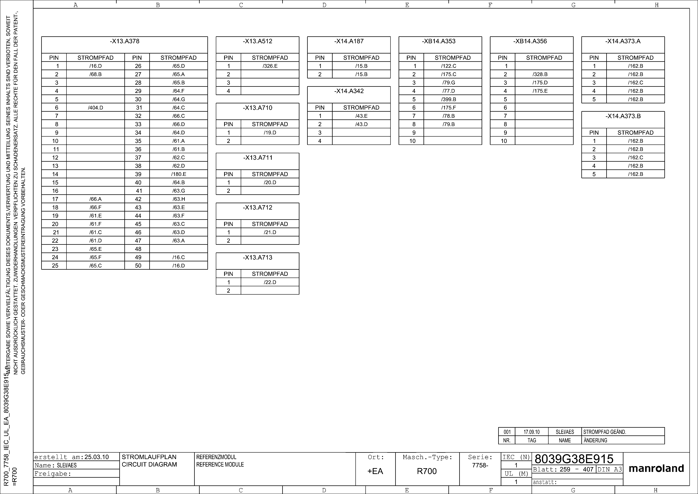

# +EA — Sheet 259 of 407 — REFERENZMODUL

**REFERENCE MODULE**

> Part of the manroland **R700** printing press IEC/UL circuit diagrams.
> Drawing class: **Stromlaufplan / Circuit diagram** (DIN A3).
> Document `+EA` covers the **Printing unit** machine section.

## At a glance

| Field | Value |
|---|---|
| Document | `+EA`  (8039G38E915) |
| Sheet | **259** of 407 |
| Section (DE) | REFERENZMODUL |
| Section (EN) | REFERENCE MODULE |
| Section type | REFERENCE_MODULE — Reference module |
| Machine type | `R700` |
| Series | `7758` |
| Created | 25.03.10 |
| Replaces | — |
| Columns used | A, B, C, D, E, F, G, H |
| Path numbers | — |
| Labels on sheet | 210 |
| Cross-refs out | 66 |
| Cross-refs in | 0 |

**Previous:** [+EA sheet 258](SHEET_0258.md) · **Next:** [+EA sheet 260](SHEET_0260.md) · **Document TOC:** [_TOC.md](_TOC.md)  (+EA) · **Master TOC:** [all sheets](../_MASTER_TOC.md)

## Sheet image (300 DPI, exact vector render)



_Rendered directly from the PDF vector layer at 300 DPI (1-bit), no OCR and no resampling. Use it to confirm anything ambiguous in the text below._

## Cross-references on this sheet

Each entry is a wire leaving this sheet. The printed token is `/sheet.column`; the link resolves to that sheet inside the same document.

| Ref | Target sheet | Col | Path | Destination on target | Target section | From col |
|---|---|---|---|---|---|---|
| `/326.E` | [+EA sheet 326](SHEET_0326.md) | E | — | STROMPFAD PIN 1 2 3 4 | OPTION: BOGENWEICHE | C |
| `/15.B` | [+EA sheet 15](SHEET_0015.md) | B | — | — | SPANNUNGSVERSORGUNG: 400V, 24V | D |
| `/162.B` | [+EA sheet 162](SHEET_0162.md) | B | — | — | VERLÄNGERUNG 1828,4MM | H |
| `/16.D` | [+EA sheet 16](SHEET_0016.md) | D | — | — | SPANNUNGSVERSORGUNG: 400V, 24V | A |
| `/65.D` | [+EA sheet 65](SHEET_0065.md) | D | — | — | MASCHINENBEDIENUNG: BEDIENUNGKOMMANDOS | B |
| `/122.C` | [+EA sheet 122](SHEET_0122.md) | C | — | — | TROCKENBESTÄUBER | F |
| `/68.B` | [+EA sheet 68](SHEET_0068.md) | B | — | — | LEITSTANDSFUNKTIONEN | A |
| `/65.A` | [+EA sheet 65](SHEET_0065.md) | A | — | — | MASCHINENBEDIENUNG: BEDIENUNGKOMMANDOS | B |
| `/15.B` | [+EA sheet 15](SHEET_0015.md) | B | — | — | SPANNUNGSVERSORGUNG: 400V, 24V | D |
| `/328.B` | [+EA sheet 328](SHEET_0328.md) | B | — | — | OPTION: BOGENWEICHE | G |
| `/162.B` | [+EA sheet 162](SHEET_0162.md) | B | — | — | VERLÄNGERUNG 1828,4MM | H |
| `/175.C` | [+EA sheet 175](SHEET_0175.md) | C | — | — | RESERVE | F |
| `/65.B` | [+EA sheet 65](SHEET_0065.md) | B | — | — | MASCHINENBEDIENUNG: BEDIENUNGKOMMANDOS | B |
| `/79.G` | [+EA sheet 79](SHEET_0079.md) | G | — | — | AUSLEGERSTAPELSTEUERUNG | F |
| `/175.D` | [+EA sheet 175](SHEET_0175.md) | D | — | — | RESERVE | G |
| `/162.C` | [+EA sheet 162](SHEET_0162.md) | C | — | — | VERLÄNGERUNG 1828,4MM | H |
| `/64.F` | [+EA sheet 64](SHEET_0064.md) | F | — | — | MASCHINENBEDIENUNG: BEDIENUNGKOMMANDOS | B |
| `/175.E` | [+EA sheet 175](SHEET_0175.md) | E | — | — | RESERVE | G |
| `/162.B` | [+EA sheet 162](SHEET_0162.md) | B | — | — | VERLÄNGERUNG 1828,4MM | H |
| `/77.D` | [+EA sheet 77](SHEET_0077.md) | D | — | — | AUSLEGERSTAPELSTEUERUNG | F |
| `/399.B` | [+EA sheet 399](SHEET_0399.md) | B | — | — | OPTION: DÜNNDRUCKEINRICHTUNG | F |
| `/162.B` | [+EA sheet 162](SHEET_0162.md) | B | — | — | VERLÄNGERUNG 1828,4MM | H |
| `/64.G` | [+EA sheet 64](SHEET_0064.md) | G | — | — | MASCHINENBEDIENUNG: BEDIENUNGKOMMANDOS | B |
| `/175.F` | [+EA sheet 175](SHEET_0175.md) | F | — | — | RESERVE | F |
| `/64.C` | [+EA sheet 64](SHEET_0064.md) | C | — | — | MASCHINENBEDIENUNG: BEDIENUNGKOMMANDOS | B |
| `/404.D` | [+EA sheet 404](SHEET_0404.md) | D | — | — | OPTION: SCHNITTSTELLE UV ENDTROCKNER | A |
| `/43.E` | [+EA sheet 43](SHEET_0043.md) | E | — | — | BUSVERBINDUNGEN: SIGNALSCHLEIFE | D |
| `/78.B` | [+EA sheet 78](SHEET_0078.md) | B | — | — | AUSLEGERSTAPELSTEUERUNG | F |
| `/66.C` | [+EA sheet 66](SHEET_0066.md) | C | — | — | MASCHINENBEDIENUNG: BEDIENUNGKOMMANDOS | B |
| `/19.D` | [+EA sheet 19](SHEET_0019.md) | D | — | STROMPFAD PIN 1 2 | SPANNUNGSVERSORGUNG: 400V, 24V | C |
| `/79.B` | [+EA sheet 79](SHEET_0079.md) | B | — | — | AUSLEGERSTAPELSTEUERUNG | F |
| `/66.D` | [+EA sheet 66](SHEET_0066.md) | D | — | — | MASCHINENBEDIENUNG: BEDIENUNGKOMMANDOS | B |
| `/43.D` | [+EA sheet 43](SHEET_0043.md) | D | — | — | BUSVERBINDUNGEN: SIGNALSCHLEIFE | D |
| `/64.D` | [+EA sheet 64](SHEET_0064.md) | D | — | — | MASCHINENBEDIENUNG: BEDIENUNGKOMMANDOS | B |
| `/61.A` | [+EA sheet 61](SHEET_0061.md) | A | — | — | MASCHINENBEDIENUNG: BEDIENUNGKOMMANDOS | B |
| `/162.B` | [+EA sheet 162](SHEET_0162.md) | B | — | — | VERLÄNGERUNG 1828,4MM | H |
| `/61.B` | [+EA sheet 61](SHEET_0061.md) | B | — | — | MASCHINENBEDIENUNG: BEDIENUNGKOMMANDOS | B |
| `/162.B` | [+EA sheet 162](SHEET_0162.md) | B | — | — | VERLÄNGERUNG 1828,4MM | H |
| `/62.C` | [+EA sheet 62](SHEET_0062.md) | C | — | — | MASCHINENBEDIENUNG: BEDIENUNGKOMMANDOS | B |
| `/162.C` | [+EA sheet 162](SHEET_0162.md) | C | — | — | VERLÄNGERUNG 1828,4MM | H |
| `/162.B` | [+EA sheet 162](SHEET_0162.md) | B | — | — | VERLÄNGERUNG 1828,4MM | H |
| `/62.D` | [+EA sheet 62](SHEET_0062.md) | D | — | — | MASCHINENBEDIENUNG: BEDIENUNGKOMMANDOS | B |
| `/20.D` | [+EA sheet 20](SHEET_0020.md) | D | — | STROMPFAD PIN 1 2 | SPANNUNGSVERSORGUNG: 400V, 24V | C |
| `/180.E` | [+EA sheet 180](SHEET_0180.md) | E | — | — | RESERVE | B |
| `/162.B` | [+EA sheet 162](SHEET_0162.md) | B | — | — | VERLÄNGERUNG 1828,4MM | H |
| `/64.B` | [+EA sheet 64](SHEET_0064.md) | B | — | — | MASCHINENBEDIENUNG: BEDIENUNGKOMMANDOS | B |
| `/63.G` | [+EA sheet 63](SHEET_0063.md) | G | — | — | MASCHINENBEDIENUNG: BEDIENUNGKOMMANDOS | B |
| `/66.A` | [+EA sheet 66](SHEET_0066.md) | A | — | — | MASCHINENBEDIENUNG: BEDIENUNGKOMMANDOS | A |
| `/63.H` | [+EA sheet 63](SHEET_0063.md) | H | — | — | MASCHINENBEDIENUNG: BEDIENUNGKOMMANDOS | B |
| `/63.E` | [+EA sheet 63](SHEET_0063.md) | E | — | — | MASCHINENBEDIENUNG: BEDIENUNGKOMMANDOS | B |
| `/66.F` | [+EA sheet 66](SHEET_0066.md) | F | — | — | MASCHINENBEDIENUNG: BEDIENUNGKOMMANDOS | A |
| `/61.E` | [+EA sheet 61](SHEET_0061.md) | E | — | — | MASCHINENBEDIENUNG: BEDIENUNGKOMMANDOS | A |
| `/63.F` | [+EA sheet 63](SHEET_0063.md) | F | — | — | MASCHINENBEDIENUNG: BEDIENUNGKOMMANDOS | B |
| `/21.D` | [+EA sheet 21](SHEET_0021.md) | D | — | STROMPFAD PIN 1 2 | SPANNUNGSVERSORGUNG: 400V, 24V | C |
| `/61.F` | [+EA sheet 61](SHEET_0061.md) | F | — | — | MASCHINENBEDIENUNG: BEDIENUNGKOMMANDOS | A |
| `/63.C` | [+EA sheet 63](SHEET_0063.md) | C | — | — | MASCHINENBEDIENUNG: BEDIENUNGKOMMANDOS | B |
| `/61.C` | [+EA sheet 61](SHEET_0061.md) | C | — | — | MASCHINENBEDIENUNG: BEDIENUNGKOMMANDOS | A |
| `/63.D` | [+EA sheet 63](SHEET_0063.md) | D | — | — | MASCHINENBEDIENUNG: BEDIENUNGKOMMANDOS | B |
| `/63.A` | [+EA sheet 63](SHEET_0063.md) | A | — | — | MASCHINENBEDIENUNG: BEDIENUNGKOMMANDOS | B |
| `/61.D` | [+EA sheet 61](SHEET_0061.md) | D | — | — | MASCHINENBEDIENUNG: BEDIENUNGKOMMANDOS | A |
| `/65.E` | [+EA sheet 65](SHEET_0065.md) | E | — | — | MASCHINENBEDIENUNG: BEDIENUNGKOMMANDOS | A |
| `/65.F` | [+EA sheet 65](SHEET_0065.md) | F | — | — | MASCHINENBEDIENUNG: BEDIENUNGKOMMANDOS | A |
| `/16.C` | [+EA sheet 16](SHEET_0016.md) | C | — | — | SPANNUNGSVERSORGUNG: 400V, 24V | B |
| `/65.C` | [+EA sheet 65](SHEET_0065.md) | C | — | — | MASCHINENBEDIENUNG: BEDIENUNGKOMMANDOS | A |
| `/16.D` | [+EA sheet 16](SHEET_0016.md) | D | — | — | SPANNUNGSVERSORGUNG: 400V, 24V | B |
| `/22.D` | [+EA sheet 22](SHEET_0022.md) | D | — | STROMPFAD PIN 1 2 | SPANNUNGSVERSORGUNG: 400V, 24V | C |

## Devices on this sheet

| Tag | Class | Class meaning (IEC) | Col | Sub | Terminal | Sign |
|---|---|---|---|---|---|---|
| `X13.A378` | — | cross-device reference | B | — | — | — |
| `X13.A512` | — | cross-device reference | C | — | — | — |
| `X14.A342` | — | cross-device reference | D | — | — | — |
| `X14.A187` | — | cross-device reference | D | — | — | — |
| `XB14.A353` | — | cross-device reference | E | — | — | — |
| `X14.A373.A` | — | cross-device reference | H | — | — | — |
| `X14.A373.B` | — | cross-device reference | H | — | — | — |
| `XB14.A356` | — | cross-device reference | F | — | — | — |
| `X13.A711` | — | cross-device reference | C | — | — | — |
| `X13.A712` | — | cross-device reference | C | — | — | — |
| `X13.A710` | — | cross-device reference | C | — | — | — |
| `X13.A713` | — | cross-device reference | C | — | — | — |
| `NR.` | — | cross-device reference | F | — | — | — |
| `17.09.10` | — | cross-device reference | F | — | — | — |

## Potentials / nets

_No named potentials on this sheet._

## Wire-end annotations (grouped as printed)

A wire that continues elsewhere is annotated with a small cluster: the destination description, the path/line number `#NN`, and the `/sheet.column` cross reference. Each row below is one such cluster exactly as it is grouped on the drawing.

| Col | Y | Path | Cross-ref | Text on the wire |
|---|---|---|---|---|
| B | 65.5 | — | — | `X13.A378` |
| C | 65.5 | — | — | `X13.A512` |
| D | 65.5 | — | — | `X14.A187` |
| E | 65.5 | — | — | `XB14.A353` |
| F | 65.5 | — | — | `XB14.A356` |
| H | 65.5 | — | — | `X14.A373.A` |
| A | 94.2 | — | — | `PIN STROMPFAD` |
| B | 94.2 | — | — | `PIN STROMPFAD` |
| C | 94.2 | — | `/326.E` | `PIN 2 3 4 1 STROMPFAD` |
| D | 94.2 | — | — | `PIN 2 1 STROMPFAD` |
| E | 94.2 | — | — | `PIN 10 2 3 4 5 6 7 8 9 1 STROMPFAD` |
| F | 94.2 | — | — | `PIN 10 2 3 4 5 6 7 8 9 1 STROMPFAD` |
| H | 94.2 | — | — | `PIN 2 3 4 5 1 STROMPFAD` |
| A | 108.4 | — | — | `2 3 4 5 6 7 8 9 1` |
| B | 108.4 | — | — | `26 27 28 29 30 32 33 34 35 36 37 38 39 40 42 43 44 45 46 47 48 49 50 31 41` |
| A | 108.7 | — | `/16.D` | — |
| B | 108.7 | — | `/65.D` | — |
| D | 108.7 | — | `/15.B` | — |
| F | 108.7 | — | `/122.C` | — |
| H | 108.7 | — | `/162.B` | — |
| A | 122.8 | — | `/68.B` | — |
| B | 122.8 | — | `/65.A` | — |
| D | 122.8 | — | `/15.B` | — |
| F | 122.9 | — | `/175.C` | — |
| G | 122.9 | — | `/328.B` | — |
| H | 122.9 | — | `/162.B` | — |
| B | 137.0 | — | `/65.B` | — |
| F | 137.0 | — | `/79.G` | — |
| G | 137.1 | — | `/175.D` | — |
| H | 137.1 | — | `/162.C` | — |
| D | 150.5 | — | — | `X14.A342` |
| B | 151.2 | — | `/64.F` | — |
| F | 151.2 | — | `/77.D` | — |
| G | 151.2 | — | `/175.E` | — |
| H | 151.2 | — | `/162.B` | — |
| B | 165.4 | — | `/64.G` | — |
| F | 165.4 | — | `/399.B` | — |
| H | 165.4 | — | `/162.B` | — |
| C | 178.9 | — | — | `X13.A710` |
| D | 179.2 | — | — | `PIN 2 3 4 1 STROMPFAD` |
| A | 179.6 | — | `/404.D` | — |
| B | 179.6 | — | `/64.C` | — |
| F | 179.6 | — | `/175.F` | — |
| H | 193.1 | — | — | `X14.A373.B` |
| D | 193.7 | — | `/43.E` | — |
| F | 193.7 | — | `/78.B` | — |
| B | 193.8 | — | `/66.C` | — |
| C | 207.5 | — | `/19.D` | `PIN 2 1 STROMPFAD` |
| B | 207.9 | — | `/66.D` | — |
| D | 207.9 | — | `/43.D` | — |
| F | 207.9 | — | `/79.B` | — |
| H | 221.7 | — | — | `PIN 2 3 4 5 1 STROMPFAD` |
| B | 222.1 | — | `/64.D` | — |
| A | 235.9 | — | — | `10 12 13 14 15 16 17 18 19 20 11` |
| B | 236.2 | — | `/61.A` | — |
| H | 236.2 | — | `/162.B` | — |
| B | 250.4 | — | `/61.B` | — |
| H | 250.4 | — | `/162.B` | — |
| C | 263.9 | — | — | `X13.A711` |
| B | 264.6 | — | `/62.C` | — |
| H | 264.6 | — | `/162.C` | — |
| B | 278.8 | — | `/62.D` | — |
| H | 278.8 | — | `/162.B` | — |
| C | 292.6 | — | `/20.D` | `PIN 2 1 STROMPFAD` |
| B | 292.9 | — | `/180.E` | — |
| H | 292.9 | — | `/162.B` | — |
| B | 307.1 | — | `/64.B` | — |
| B | 321.3 | — | `/63.G` | — |
| A | 335.4 | — | `/66.A` | — |
| B | 335.5 | — | `/63.H` | — |
| C | 349.0 | — | — | `X13.A712` |
| A | 349.6 | — | `/66.F` | — |
| B | 349.6 | — | `/63.E` | — |
| A | 363.8 | — | `/61.E` | — |
| B | 363.8 | — | `/63.F` | — |
| C | 377.6 | — | `/21.D` | `PIN 2 1 STROMPFAD` |
| A | 378.0 | — | `/61.F` | — |
| B | 378.0 | — | `/63.C` | — |
| A | 391.8 | — | — | `22 23 24 25 21` |
| A | 392.2 | — | `/61.C` | — |
| B | 392.2 | — | `/63.D` | — |
| A | 406.3 | — | `/61.D` | — |
| B | 406.3 | — | `/63.A` | — |
| A | 420.5 | — | `/65.E` | — |
| C | 434.0 | — | — | `X13.A713` |
| A | 434.7 | — | `/65.F` | — |
| B | 434.7 | — | `/16.C` | — |
| A | 448.9 | — | `/65.C` | — |
| B | 448.9 | — | `/16.D` | — |
| C | 462.7 | — | `/22.D` | `PIN 2 1 STROMPFAD` |
| G | 733.0 | — | — | `001 17.09.10 SLEI/AES STROMPFAD GEÄND.` |
| G | 747.1 | — | — | `NR. TAG NAME ÄNDERUNG` |


## Reconstructed tables

This sheet carries tabular content (pin map / terminal assignment / index). The grid below was rebuilt from the drawing's own rule lines, so each row is exactly one physical row of the table.

### Table 1 — 25 data rows × 4 columns (at x=70.9, y=62.4) — **X13.A378**

| PIN | STROMPFAD | PIN | STROMPFAD |
|---|---|---|---|
| `1` | `/16.D` | `26` | `/65.D` |
| `2` | `/68.B` | `27` | `/65.A` |
| `3` |  | `28` | `/65.B` |
| `4` |  | `29` | `/64.F` |
| `5` |  | `30` | `/64.G` |
| `6` | `/404.D` | `31` | `/64.C` |
| `7` |  | `32` | `/66.C` |
| `8` |  | `33` | `/66.D` |
| `9` |  | `34` | `/64.D` |
| `10` |  | `35` | `/61.A` |
| `11` |  | `36` | `/61.B` |
| `12` |  | `37` | `/62.C` |
| `13` |  | `38` | `/62.D` |
| `14` |  | `39` | `/180.E` |
| `15` |  | `40` | `/64.B` |
| `16` |  | `41` | `/63.G` |
| `17` | `/66.A` | `42` | `/63.H` |
| `18` | `/66.F` | `43` | `/63.E` |
| `19` | `/61.E` | `44` | `/63.F` |
| `20` | `/61.F` | `45` | `/63.C` |
| `21` | `/61.C` | `46` | `/63.D` |
| `22` | `/61.D` | `47` | `/63.A` |
| `23` | `/65.E` | `48` |  |
| `24` | `/65.F` | `49` | `/16.C` |
| `25` | `/65.C` | `50` | `/16.D` |


### Table 2 — 20 data rows × 2 columns (at x=368.5, y=62.4) — **X13.A512**

| PIN | STROMPFAD |
|---|---|
| `1` | `/326.E` |
| `2` |  |
| `3` |  |
| `4` |  |
|  | `X13.A710` |
| `PIN` | `STROMPFAD` |
| `1` | `/19.D` |
| `2` |  |
|  | `X13.A711` |
| `PIN` | `STROMPFAD` |
| `1` | `/20.D` |
| `2` |  |
|  | `X13.A712` |
| `PIN` | `STROMPFAD` |
| `1` | `/21.D` |
| `2` |  |
|  | `X13.A713` |
| `PIN` | `STROMPFAD` |
| `1` | `/22.D` |
| `2` |  |


### Table 3 — 8 data rows × 2 columns (at x=524.4, y=62.4) — **X14.A187**

| PIN | STROMPFAD |
|---|---|
| `1` | `/15.B` |
| `2` | `/15.B` |
|  | `X14.A342` |
| `PIN` | `STROMPFAD` |
| `1` | `/43.E` |
| `2` | `/43.D` |
| `3` |  |
| `4` |  |


### Table 4 — 10 data rows × 2 columns (at x=680.3, y=62.4) — **XB14.A353**

| PIN | STROMPFAD |
|---|---|
| `1` | `/122.C` |
| `2` | `/175.C` |
| `3` | `/79.G` |
| `4` | `/77.D` |
| `5` | `/399.B` |
| `6` | `/175.F` |
| `7` | `/78.B` |
| `8` | `/79.B` |
| `9` |  |
| `10` |  |


### Table 5 — 10 data rows × 2 columns (at x=836.2, y=62.4) — **XB14.A356**

| PIN | STROMPFAD |
|---|---|
| `1` |  |
| `2` | `/328.B` |
| `3` | `/175.D` |
| `4` | `/175.E` |
| `5` |  |
| `6` |  |
| `7` |  |
| `8` |  |
| `9` |  |
| `10` |  |


### Table 6 — 12 data rows × 2 columns (at x=992.1, y=62.4) — **X14.A373.A**

| PIN | STROMPFAD |
|---|---|
| `1` | `/162.B` |
| `2` | `/162.B` |
| `3` | `/162.C` |
| `4` | `/162.B` |
| `5` | `/162.B` |
|  | `X14.A373.B` |
| `PIN` | `STROMPFAD` |
| `1` | `/162.B` |
| `2` | `/162.B` |
| `3` | `/162.C` |
| `4` | `/162.B` |
| `5` | `/162.B` |


## Notes and free text on this sheet

| Text | Col | Y (pt) |
|---|---|---|
| `PIN` | A | 94.2 |
| `STROMPFAD` | A | 94.15 |
| `PIN` | B | 94.2 |
| `STROMPFAD` | B | 94.15 |
| `PIN` | C | 94.2 |
| `STROMPFAD` | C | 94.15 |
| `PIN` | D | 179.24 |
| `STROMPFAD` | D | 179.19 |
| `PIN` | E | 94.2 |
| `STROMPFAD` | F | 94.15 |
| `PIN` | G | 94.2 |
| `STROMPFAD` | H | 94.15 |
| `PIN` | F | 94.2 |
| `STROMPFAD` | G | 94.15 |
| `TAG` | G | 747.27 |
| `NAME` | G | 747.25 |
| `ÄNDERUNG` | G | 747.31 |
| `SLEI/AES` | G | 733.13 |
| `STROMPFAD GEÄND.` | G | 733.12 |

## Complete label inventory (exact text from the drawing)

Every text object inside the drawing area of this sheet, in DIN reading order (column A→H, then top→bottom). This is the authoritative list: if a string is not here it is not printed on this sheet.

| Col | Y | X | Dir | Type | Text |
|---|---|---|---|---|---|
| A | 94.2 | 84.0 | → | text | `PIN` |
| A | 94.2 | 132.2 | → | text | `STROMPFAD` |
| A | 108.4 | 95.8 | → | number | `1` |
| A | 108.7 | 152.6 | → | cross-reference | `/16.D` |
| A | 122.5 | 94.1 | → | number | `2` |
| A | 122.8 | 152.8 | → | cross-reference | `/68.B` |
| A | 136.7 | 94.1 | → | number | `3` |
| A | 150.9 | 94.1 | → | number | `4` |
| A | 165.1 | 94.1 | → | number | `5` |
| A | 179.2 | 94.1 | → | number | `6` |
| A | 179.6 | 150.2 | → | cross-reference | `/404.D` |
| A | 193.4 | 94.1 | → | number | `7` |
| A | 207.6 | 94.1 | → | number | `8` |
| A | 221.8 | 94.1 | → | number | `9` |
| A | 235.9 | 88.7 | → | number | `10` |
| A | 250.1 | 90.4 | → | number | `11` |
| A | 264.3 | 88.7 | → | number | `12` |
| A | 278.5 | 88.7 | → | number | `13` |
| A | 292.6 | 88.7 | → | number | `14` |
| A | 306.8 | 88.7 | → | number | `15` |
| A | 321.0 | 88.7 | → | number | `16` |
| A | 335.1 | 88.7 | → | number | `17` |
| A | 335.4 | 152.6 | → | cross-reference | `/66.A` |
| A | 349.3 | 88.7 | → | number | `18` |
| A | 349.6 | 153.1 | → | cross-reference | `/66.F` |
| A | 363.5 | 88.7 | → | number | `19` |
| A | 363.8 | 152.9 | → | cross-reference | `/61.E` |
| A | 377.7 | 88.7 | → | number | `20` |
| A | 378.0 | 153.1 | → | cross-reference | `/61.F` |
| A | 391.8 | 90.4 | → | number | `21` |
| A | 392.2 | 152.6 | → | cross-reference | `/61.C` |
| A | 406.0 | 88.7 | → | number | `22` |
| A | 406.3 | 152.6 | → | cross-reference | `/61.D` |
| A | 420.2 | 88.7 | → | number | `23` |
| A | 420.5 | 152.9 | → | cross-reference | `/65.E` |
| A | 434.4 | 88.7 | → | number | `24` |
| A | 434.7 | 153.1 | → | cross-reference | `/65.F` |
| A | 448.5 | 88.7 | → | number | `25` |
| A | 448.9 | 152.6 | → | cross-reference | `/65.C` |
| B | 65.5 | 187.7 | → | device ref | `X13.A378` |
| B | 94.2 | 225.8 | → | text | `PIN` |
| B | 94.2 | 274.0 | → | text | `STROMPFAD` |
| B | 108.4 | 230.5 | → | number | `26` |
| B | 108.7 | 294.4 | → | cross-reference | `/65.D` |
| B | 122.5 | 230.5 | → | number | `27` |
| B | 122.8 | 294.4 | → | cross-reference | `/65.A` |
| B | 136.7 | 230.5 | → | number | `28` |
| B | 137.0 | 294.5 | → | cross-reference | `/65.B` |
| B | 150.9 | 230.5 | → | number | `29` |
| B | 151.2 | 294.8 | → | cross-reference | `/64.F` |
| B | 165.1 | 230.5 | → | number | `30` |
| B | 165.4 | 294.2 | → | cross-reference | `/64.G` |
| B | 179.2 | 232.2 | → | number | `31` |
| B | 179.6 | 294.4 | → | cross-reference | `/64.C` |
| B | 193.4 | 230.5 | → | number | `32` |
| B | 193.7 | 294.4 | → | cross-reference | `/66.C` |
| B | 207.6 | 230.5 | → | number | `33` |
| B | 207.9 | 294.4 | → | cross-reference | `/66.D` |
| B | 221.8 | 230.5 | → | number | `34` |
| B | 222.1 | 294.4 | → | cross-reference | `/64.D` |
| B | 235.9 | 230.5 | → | number | `35` |
| B | 236.2 | 294.4 | → | cross-reference | `/61.A` |
| B | 250.1 | 230.5 | → | number | `36` |
| B | 250.4 | 294.5 | → | cross-reference | `/61.B` |
| B | 264.3 | 230.5 | → | number | `37` |
| B | 264.6 | 294.4 | → | cross-reference | `/62.C` |
| B | 278.5 | 230.5 | → | number | `38` |
| B | 278.8 | 294.4 | → | cross-reference | `/62.D` |
| B | 292.6 | 230.5 | → | number | `39` |
| B | 292.9 | 292.3 | → | cross-reference | `/180.E` |
| B | 306.8 | 230.5 | → | number | `40` |
| B | 307.1 | 294.5 | → | cross-reference | `/64.B` |
| B | 321.0 | 232.2 | → | number | `41` |
| B | 321.3 | 294.2 | → | cross-reference | `/63.G` |
| B | 335.1 | 230.5 | → | number | `42` |
| B | 335.5 | 294.7 | → | cross-reference | `/63.H` |
| B | 349.3 | 230.5 | → | number | `43` |
| B | 349.6 | 294.7 | → | cross-reference | `/63.E` |
| B | 363.5 | 230.5 | → | number | `44` |
| B | 363.8 | 294.8 | → | cross-reference | `/63.F` |
| B | 377.7 | 230.5 | → | number | `45` |
| B | 378.0 | 294.4 | → | cross-reference | `/63.C` |
| B | 391.8 | 230.5 | → | number | `46` |
| B | 392.2 | 294.4 | → | cross-reference | `/63.D` |
| B | 406.0 | 230.5 | → | number | `47` |
| B | 406.3 | 294.4 | → | cross-reference | `/63.A` |
| B | 420.2 | 230.5 | → | number | `48` |
| B | 434.4 | 230.5 | → | number | `49` |
| B | 434.7 | 294.4 | → | cross-reference | `/16.C` |
| B | 448.5 | 230.5 | → | number | `50` |
| B | 448.9 | 294.4 | → | cross-reference | `/16.D` |
| C | 65.5 | 414.4 | → | device ref | `X13.A512` |
| C | 94.2 | 381.7 | → | text | `PIN` |
| C | 94.2 | 429.9 | → | text | `STROMPFAD` |
| C | 108.4 | 387.6 | → | number | `1` |
| C | 108.7 | 448.2 | → | cross-reference | `/326.E` |
| C | 122.5 | 387.1 | → | number | `2` |
| C | 136.7 | 387.1 | → | number | `3` |
| C | 150.9 | 387.1 | → | number | `4` |
| C | 178.9 | 414.4 | → | device ref | `X13.A710` |
| C | 207.5 | 429.9 | → | text | `STROMPFAD` |
| C | 207.6 | 381.7 | → | text | `PIN` |
| C | 221.8 | 387.6 | → | number | `1` |
| C | 222.1 | 450.3 | → | cross-reference | `/19.D` |
| C | 235.9 | 387.1 | → | number | `2` |
| C | 263.9 | 415.1 | → | device ref | `X13.A711` |
| C | 292.6 | 381.7 | → | text | `PIN` |
| C | 292.6 | 429.9 | → | text | `STROMPFAD` |
| C | 306.8 | 387.6 | → | number | `1` |
| C | 307.1 | 450.3 | → | cross-reference | `/20.D` |
| C | 321.0 | 387.1 | → | number | `2` |
| C | 349.0 | 414.4 | → | device ref | `X13.A712` |
| C | 377.6 | 429.9 | → | text | `STROMPFAD` |
| C | 377.7 | 381.7 | → | text | `PIN` |
| C | 391.8 | 387.6 | → | number | `1` |
| C | 392.2 | 450.3 | → | cross-reference | `/21.D` |
| C | 406.0 | 387.1 | → | number | `2` |
| C | 434.0 | 414.4 | → | device ref | `X13.A713` |
| C | 462.7 | 381.7 | → | text | `PIN` |
| C | 462.7 | 429.9 | → | text | `STROMPFAD` |
| C | 476.9 | 387.6 | → | number | `1` |
| C | 477.2 | 450.3 | → | cross-reference | `/22.D` |
| C | 491.0 | 387.1 | → | number | `2` |
| D | 65.5 | 570.3 | → | device ref | `X14.A187` |
| D | 94.2 | 537.6 | → | text | `PIN` |
| D | 94.2 | 585.8 | → | text | `STROMPFAD` |
| D | 108.4 | 543.5 | → | number | `1` |
| D | 108.7 | 606.3 | → | cross-reference | `/15.B` |
| D | 122.5 | 543.0 | → | number | `2` |
| D | 122.8 | 606.3 | → | cross-reference | `/15.B` |
| D | 150.5 | 570.3 | → | device ref | `X14.A342` |
| D | 179.2 | 537.6 | → | text | `PIN` |
| D | 179.2 | 585.8 | → | text | `STROMPFAD` |
| D | 193.4 | 543.5 | → | number | `1` |
| D | 193.7 | 606.5 | → | cross-reference | `/43.E` |
| D | 207.6 | 543.0 | → | number | `2` |
| D | 207.9 | 606.2 | → | cross-reference | `/43.D` |
| D | 221.8 | 543.0 | → | number | `3` |
| D | 235.9 | 543.0 | → | number | `4` |
| E | 65.5 | 719.9 | → | device ref | `XB14.A353` |
| E | 94.2 | 693.5 | → | text | `PIN` |
| E | 108.4 | 705.3 | → | number | `1` |
| E | 122.5 | 703.6 | → | number | `2` |
| E | 136.7 | 703.6 | → | number | `3` |
| E | 150.9 | 703.6 | → | number | `4` |
| E | 165.1 | 703.6 | → | number | `5` |
| E | 179.2 | 703.6 | → | number | `6` |
| E | 193.4 | 703.6 | → | number | `7` |
| E | 207.6 | 703.6 | → | number | `8` |
| E | 221.8 | 703.6 | → | number | `9` |
| E | 235.9 | 698.2 | → | number | `10` |
| F | 65.5 | 875.8 | → | device ref | `XB14.A356` |
| F | 94.2 | 741.7 | → | text | `STROMPFAD` |
| F | 94.2 | 849.4 | → | text | `PIN` |
| F | 108.4 | 861.2 | → | number | `1` |
| F | 108.7 | 752.6 | → | cross-reference | `/122.C` |
| F | 122.5 | 859.5 | → | number | `2` |
| F | 122.9 | 752.6 | → | cross-reference | `/175.C` |
| F | 136.7 | 859.5 | → | number | `3` |
| F | 137.0 | 754.9 | → | cross-reference | `/79.G` |
| F | 150.9 | 859.5 | → | number | `4` |
| F | 151.2 | 755.0 | → | cross-reference | `/77.D` |
| F | 165.1 | 859.5 | → | number | `5` |
| F | 165.4 | 752.7 | → | cross-reference | `/399.B` |
| F | 179.2 | 859.5 | → | number | `6` |
| F | 179.6 | 753.0 | → | cross-reference | `/175.F` |
| F | 193.4 | 859.5 | → | number | `7` |
| F | 193.7 | 755.1 | → | cross-reference | `/78.B` |
| F | 207.6 | 859.5 | → | number | `8` |
| F | 207.9 | 755.1 | → | cross-reference | `/79.B` |
| F | 221.8 | 859.5 | → | number | `9` |
| F | 235.9 | 854.1 | → | number | `10` |
| F | 733.0 | 859.4 | → | number | `001` |
| F | 733.1 | 893.2 | → | device ref | `17.09.10` |
| F | 747.1 | 858.4 | → | device ref | `NR.` |
| G | 94.2 | 897.6 | → | text | `STROMPFAD` |
| G | 94.2 | 1005.3 | → | text | `PIN` |
| G | 108.4 | 1011.3 | → | number | `1` |
| G | 122.5 | 1010.7 | → | number | `2` |
| G | 122.9 | 908.6 | → | cross-reference | `/328.B` |
| G | 136.7 | 1010.7 | → | number | `3` |
| G | 137.1 | 908.5 | → | cross-reference | `/175.D` |
| G | 150.9 | 1010.7 | → | number | `4` |
| G | 151.2 | 908.8 | → | cross-reference | `/175.E` |
| G | 165.1 | 1010.7 | → | number | `5` |
| G | 221.8 | 1005.3 | → | text | `PIN` |
| G | 235.9 | 1011.3 | → | number | `1` |
| G | 250.1 | 1010.7 | → | number | `2` |
| G | 264.3 | 1010.7 | → | number | `3` |
| G | 278.5 | 1010.7 | → | number | `4` |
| G | 292.6 | 1010.7 | → | number | `5` |
| G | 733.1 | 948.2 | → | text | `SLEI/AES` |
| G | 733.1 | 995.1 | → | text | `STROMPFAD GEÄND.` |
| G | 747.3 | 900.0 | → | text | `TAG` |
| G | 747.3 | 953.4 | → | text | `NAME` |
| G | 747.3 | 996.0 | → | text | `ÄNDERUNG` |
| H | 65.5 | 1032.7 | → | device ref | `X14.A373.A` |
| H | 94.2 | 1053.5 | → | text | `STROMPFAD` |
| H | 108.7 | 1071.6 | → | cross-reference | `/162.B` |
| H | 122.9 | 1071.6 | → | cross-reference | `/162.B` |
| H | 137.1 | 1071.5 | → | cross-reference | `/162.C` |
| H | 151.2 | 1071.6 | → | cross-reference | `/162.B` |
| H | 165.4 | 1071.6 | → | cross-reference | `/162.B` |
| H | 193.1 | 1033.1 | → | device ref | `X14.A373.B` |
| H | 221.7 | 1053.5 | → | text | `STROMPFAD` |
| H | 236.2 | 1071.6 | → | cross-reference | `/162.B` |
| H | 250.4 | 1071.6 | → | cross-reference | `/162.B` |
| H | 264.6 | 1071.5 | → | cross-reference | `/162.C` |
| H | 278.8 | 1071.6 | → | cross-reference | `/162.B` |
| H | 292.9 | 1071.6 | → | cross-reference | `/162.B` |

## Reading-order text block

The same content as a plain block, grouped by DIN column — convenient to paste or to match against a visual description.

```text
=== Column A ===
  94.2   84.0  text         PIN
  94.2  132.2  text         STROMPFAD
 108.4   95.8  numeric      1
 108.7  152.6  xref         /16.D
 122.5   94.1  numeric      2
 122.8  152.8  xref         /68.B
 136.7   94.1  numeric      3
 150.9   94.1  numeric      4
 165.1   94.1  numeric      5
 179.2   94.1  numeric      6
 179.6  150.2  xref         /404.D
 193.4   94.1  numeric      7
 207.6   94.1  numeric      8
 221.8   94.1  numeric      9
 235.9   88.7  numeric      10
 250.1   90.4  numeric      11
 264.3   88.7  numeric      12
 278.5   88.7  numeric      13
 292.6   88.7  numeric      14
 306.8   88.7  numeric      15
 321.0   88.7  numeric      16
 335.1   88.7  numeric      17
 335.4  152.6  xref         /66.A
 349.3   88.7  numeric      18
 349.6  153.1  xref         /66.F
 363.5   88.7  numeric      19
 363.8  152.9  xref         /61.E
 377.7   88.7  numeric      20
 378.0  153.1  xref         /61.F
 391.8   90.4  numeric      21
 392.2  152.6  xref         /61.C
 406.0   88.7  numeric      22
 406.3  152.6  xref         /61.D
 420.2   88.7  numeric      23
 420.5  152.9  xref         /65.E
 434.4   88.7  numeric      24
 434.7  153.1  xref         /65.F
 448.5   88.7  numeric      25
 448.9  152.6  xref         /65.C
=== Column B ===
  65.5  187.7  devref       X13.A378
  94.2  225.8  text         PIN
  94.2  274.0  text         STROMPFAD
 108.4  230.5  numeric      26
 108.7  294.4  xref         /65.D
 122.5  230.5  numeric      27
 122.8  294.4  xref         /65.A
 136.7  230.5  numeric      28
 137.0  294.5  xref         /65.B
 150.9  230.5  numeric      29
 151.2  294.8  xref         /64.F
 165.1  230.5  numeric      30
 165.4  294.2  xref         /64.G
 179.2  232.2  numeric      31
 179.6  294.4  xref         /64.C
 193.4  230.5  numeric      32
 193.7  294.4  xref         /66.C
 207.6  230.5  numeric      33
 207.9  294.4  xref         /66.D
 221.8  230.5  numeric      34
 222.1  294.4  xref         /64.D
 235.9  230.5  numeric      35
 236.2  294.4  xref         /61.A
 250.1  230.5  numeric      36
 250.4  294.5  xref         /61.B
 264.3  230.5  numeric      37
 264.6  294.4  xref         /62.C
 278.5  230.5  numeric      38
 278.8  294.4  xref         /62.D
 292.6  230.5  numeric      39
 292.9  292.3  xref         /180.E
 306.8  230.5  numeric      40
 307.1  294.5  xref         /64.B
 321.0  232.2  numeric      41
 321.3  294.2  xref         /63.G
 335.1  230.5  numeric      42
 335.5  294.7  xref         /63.H
 349.3  230.5  numeric      43
 349.6  294.7  xref         /63.E
 363.5  230.5  numeric      44
 363.8  294.8  xref         /63.F
 377.7  230.5  numeric      45
 378.0  294.4  xref         /63.C
 391.8  230.5  numeric      46
 392.2  294.4  xref         /63.D
 406.0  230.5  numeric      47
 406.3  294.4  xref         /63.A
 420.2  230.5  numeric      48
 434.4  230.5  numeric      49
 434.7  294.4  xref         /16.C
 448.5  230.5  numeric      50
 448.9  294.4  xref         /16.D
=== Column C ===
  65.5  414.4  devref       X13.A512
  94.2  381.7  text         PIN
  94.2  429.9  text         STROMPFAD
 108.4  387.6  numeric      1
 108.7  448.2  xref         /326.E
 122.5  387.1  numeric      2
 136.7  387.1  numeric      3
 150.9  387.1  numeric      4
 178.9  414.4  devref       X13.A710
 207.5  429.9  text         STROMPFAD
 207.6  381.7  text         PIN
 221.8  387.6  numeric      1
 222.1  450.3  xref         /19.D
 235.9  387.1  numeric      2
 263.9  415.1  devref       X13.A711
 292.6  381.7  text         PIN
 292.6  429.9  text         STROMPFAD
 306.8  387.6  numeric      1
 307.1  450.3  xref         /20.D
 321.0  387.1  numeric      2
 349.0  414.4  devref       X13.A712
 377.6  429.9  text         STROMPFAD
 377.7  381.7  text         PIN
 391.8  387.6  numeric      1
 392.2  450.3  xref         /21.D
 406.0  387.1  numeric      2
 434.0  414.4  devref       X13.A713
 462.7  381.7  text         PIN
 462.7  429.9  text         STROMPFAD
 476.9  387.6  numeric      1
 477.2  450.3  xref         /22.D
 491.0  387.1  numeric      2
=== Column D ===
  65.5  570.3  devref       X14.A187
  94.2  537.6  text         PIN
  94.2  585.8  text         STROMPFAD
 108.4  543.5  numeric      1
 108.7  606.3  xref         /15.B
 122.5  543.0  numeric      2
 122.8  606.3  xref         /15.B
 150.5  570.3  devref       X14.A342
 179.2  537.6  text         PIN
 179.2  585.8  text         STROMPFAD
 193.4  543.5  numeric      1
 193.7  606.5  xref         /43.E
 207.6  543.0  numeric      2
 207.9  606.2  xref         /43.D
 221.8  543.0  numeric      3
 235.9  543.0  numeric      4
=== Column E ===
  65.5  719.9  devref       XB14.A353
  94.2  693.5  text         PIN
 108.4  705.3  numeric      1
 122.5  703.6  numeric      2
 136.7  703.6  numeric      3
 150.9  703.6  numeric      4
 165.1  703.6  numeric      5
 179.2  703.6  numeric      6
 193.4  703.6  numeric      7
 207.6  703.6  numeric      8
 221.8  703.6  numeric      9
 235.9  698.2  numeric      10
=== Column F ===
  65.5  875.8  devref       XB14.A356
  94.2  741.7  text         STROMPFAD
  94.2  849.4  text         PIN
 108.4  861.2  numeric      1
 108.7  752.6  xref         /122.C
 122.5  859.5  numeric      2
 122.9  752.6  xref         /175.C
 136.7  859.5  numeric      3
 137.0  754.9  xref         /79.G
 150.9  859.5  numeric      4
 151.2  755.0  xref         /77.D
 165.1  859.5  numeric      5
 165.4  752.7  xref         /399.B
 179.2  859.5  numeric      6
 179.6  753.0  xref         /175.F
 193.4  859.5  numeric      7
 193.7  755.1  xref         /78.B
 207.6  859.5  numeric      8
 207.9  755.1  xref         /79.B
 221.8  859.5  numeric      9
 235.9  854.1  numeric      10
 733.0  859.4  numeric      001
 733.1  893.2  devref       17.09.10
 747.1  858.4  devref       NR.
=== Column G ===
  94.2  897.6  text         STROMPFAD
  94.2 1005.3  text         PIN
 108.4 1011.3  numeric      1
 122.5 1010.7  numeric      2
 122.9  908.6  xref         /328.B
 136.7 1010.7  numeric      3
 137.1  908.5  xref         /175.D
 150.9 1010.7  numeric      4
 151.2  908.8  xref         /175.E
 165.1 1010.7  numeric      5
 221.8 1005.3  text         PIN
 235.9 1011.3  numeric      1
 250.1 1010.7  numeric      2
 264.3 1010.7  numeric      3
 278.5 1010.7  numeric      4
 292.6 1010.7  numeric      5
 733.1  948.2  text         SLEI/AES
 733.1  995.1  text         STROMPFAD GEÄND.
 747.3  900.0  text         TAG
 747.3  953.4  text         NAME
 747.3  996.0  text         ÄNDERUNG
=== Column H ===
  65.5 1032.7  devref       X14.A373.A
  94.2 1053.5  text         STROMPFAD
 108.7 1071.6  xref         /162.B
 122.9 1071.6  xref         /162.B
 137.1 1071.5  xref         /162.C
 151.2 1071.6  xref         /162.B
 165.4 1071.6  xref         /162.B
 193.1 1033.1  devref       X14.A373.B
 221.7 1053.5  text         STROMPFAD
 236.2 1071.6  xref         /162.B
 250.4 1071.6  xref         /162.B
 264.6 1071.5  xref         /162.C
 278.8 1071.6  xref         /162.B
 292.9 1071.6  xref         /162.B
```

---
_Generated from the PDF vector text layer; no OCR. Source: `R700_7758_IEC_UL_EA_8039G38E915_p`, sheet 259._
