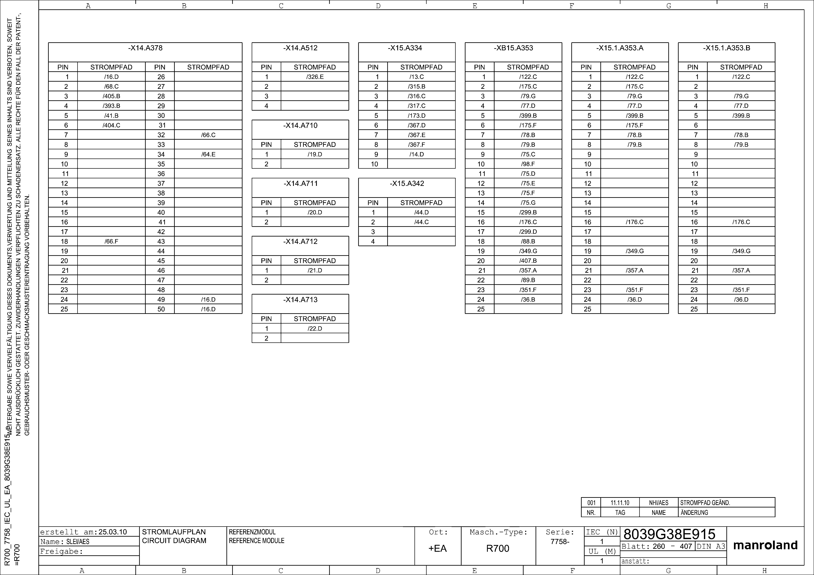

# +EA — Sheet 260 of 407 — REFERENZMODUL

**REFERENCE MODULE**

> Part of the manroland **R700** printing press IEC/UL circuit diagrams.
> Drawing class: **Stromlaufplan / Circuit diagram** (DIN A3).
> Document `+EA` covers the **Printing unit** machine section.

## At a glance

| Field | Value |
|---|---|
| Document | `+EA`  (8039G38E915) |
| Sheet | **260** of 407 |
| Section (DE) | REFERENZMODUL |
| Section (EN) | REFERENCE MODULE |
| Section type | REFERENCE_MODULE — Reference module |
| Machine type | `R700` |
| Series | `7758` |
| Created | 25.03.10 |
| Replaces | — |
| Columns used | A, B, C, D, E, F, G, H |
| Path numbers | — |
| Labels on sheet | 269 |
| Cross-refs out | 75 |
| Cross-refs in | 0 |

**Previous:** [+EA sheet 259](SHEET_0259.md) · **Next:** [+EA sheet 261](SHEET_0261.md) · **Document TOC:** [_TOC.md](_TOC.md)  (+EA) · **Master TOC:** [all sheets](../_MASTER_TOC.md)

## Sheet image (300 DPI, exact vector render)



_Rendered directly from the PDF vector layer at 300 DPI (1-bit), no OCR and no resampling. Use it to confirm anything ambiguous in the text below._

## Cross-references on this sheet

Each entry is a wire leaving this sheet. The printed token is `/sheet.column`; the link resolves to that sheet inside the same document.

| Ref | Target sheet | Col | Path | Destination on target | Target section | From col |
|---|---|---|---|---|---|---|
| `/326.E` | [+EA sheet 326](SHEET_0326.md) | E | — | STROMPFAD PIN 1 2 3 4 | OPTION: BOGENWEICHE | C |
| `/16.D` | [+EA sheet 16](SHEET_0016.md) | D | — | — | SPANNUNGSVERSORGUNG: 400V, 24V | A |
| `/13.C` | [+EA sheet 13](SHEET_0013.md) | C | — | — | SPANNUNGSVERSORGUNG: 400V, 24V | D |
| `/122.C` | [+EA sheet 122](SHEET_0122.md) | C | — | — | TROCKENBESTÄUBER | F |
| `/122.C` | [+EA sheet 122](SHEET_0122.md) | C | — | — | TROCKENBESTÄUBER | G |
| `/122.C` | [+EA sheet 122](SHEET_0122.md) | C | — | — | TROCKENBESTÄUBER | H |
| `/315.B` | [+EA sheet 315](SHEET_0315.md) | B | — | — | OPTION: LOGISTIK, AUSLEGER | D |
| `/68.C` | [+EA sheet 68](SHEET_0068.md) | C | — | — | LEITSTANDSFUNKTIONEN | A |
| `/175.C` | [+EA sheet 175](SHEET_0175.md) | C | — | — | RESERVE | F |
| `/175.C` | [+EA sheet 175](SHEET_0175.md) | C | — | — | RESERVE | G |
| `/405.B` | [+EA sheet 405](SHEET_0405.md) | B | — | — | OPTION: SCHNITTSTELLE UV ENDTROCKNER | A |
| `/79.G` | [+EA sheet 79](SHEET_0079.md) | G | — | — | AUSLEGERSTAPELSTEUERUNG | F |
| `/79.G` | [+EA sheet 79](SHEET_0079.md) | G | — | — | AUSLEGERSTAPELSTEUERUNG | G |
| `/79.G` | [+EA sheet 79](SHEET_0079.md) | G | — | — | AUSLEGERSTAPELSTEUERUNG | H |
| `/316.C` | [+EA sheet 316](SHEET_0316.md) | C | — | — | OPTION: LOGISTIK, AUSLEGER | D |
| `/393.B` | [+EA sheet 393](SHEET_0393.md) | B | — | — | OPTION: ZWISCHENTROCKNER VORBEREITUNG; | A |
| `/317.C` | [+EA sheet 317](SHEET_0317.md) | C | — | — | OPTION: LOGISTIK, AUSLEGER | D |
| `/77.D` | [+EA sheet 77](SHEET_0077.md) | D | — | — | AUSLEGERSTAPELSTEUERUNG | F |
| `/77.D` | [+EA sheet 77](SHEET_0077.md) | D | — | — | AUSLEGERSTAPELSTEUERUNG | G |
| `/77.D` | [+EA sheet 77](SHEET_0077.md) | D | — | — | AUSLEGERSTAPELSTEUERUNG | H |
| `/41.B` | [+EA sheet 41](SHEET_0041.md) | B | — | — | BUSVERBINDUNGEN: STOP SICHERN | A |
| `/399.B` | [+EA sheet 399](SHEET_0399.md) | B | — | — | OPTION: DÜNNDRUCKEINRICHTUNG | F |
| `/399.B` | [+EA sheet 399](SHEET_0399.md) | B | — | — | OPTION: DÜNNDRUCKEINRICHTUNG | G |
| `/399.B` | [+EA sheet 399](SHEET_0399.md) | B | — | — | OPTION: DÜNNDRUCKEINRICHTUNG | H |
| `/173.D` | [+EA sheet 173](SHEET_0173.md) | D | — | — | RESERVE | D |
| `/175.F` | [+EA sheet 175](SHEET_0175.md) | F | — | — | RESERVE | F |
| `/175.F` | [+EA sheet 175](SHEET_0175.md) | F | — | — | RESERVE | G |
| `/404.C` | [+EA sheet 404](SHEET_0404.md) | C | — | — | OPTION: SCHNITTSTELLE UV ENDTROCKNER | A |
| `/367.D` | [+EA sheet 367](SHEET_0367.md) | D | — | — | OPTION: TROCKNER VORBEREITUNG; | D |
| `/78.B` | [+EA sheet 78](SHEET_0078.md) | B | — | — | AUSLEGERSTAPELSTEUERUNG | F |
| `/78.B` | [+EA sheet 78](SHEET_0078.md) | B | — | — | AUSLEGERSTAPELSTEUERUNG | G |
| `/78.B` | [+EA sheet 78](SHEET_0078.md) | B | — | — | AUSLEGERSTAPELSTEUERUNG | H |
| `/367.E` | [+EA sheet 367](SHEET_0367.md) | E | — | — | OPTION: TROCKNER VORBEREITUNG; | D |
| `/66.C` | [+EA sheet 66](SHEET_0066.md) | C | — | — | MASCHINENBEDIENUNG: BEDIENUNGKOMMANDOS | B |
| `/19.D` | [+EA sheet 19](SHEET_0019.md) | D | — | STROMPFAD PIN 1 2 | SPANNUNGSVERSORGUNG: 400V, 24V | C |
| `/79.B` | [+EA sheet 79](SHEET_0079.md) | B | — | — | AUSLEGERSTAPELSTEUERUNG | F |
| `/79.B` | [+EA sheet 79](SHEET_0079.md) | B | — | — | AUSLEGERSTAPELSTEUERUNG | G |
| `/79.B` | [+EA sheet 79](SHEET_0079.md) | B | — | — | AUSLEGERSTAPELSTEUERUNG | H |
| `/367.F` | [+EA sheet 367](SHEET_0367.md) | F | — | — | OPTION: TROCKNER VORBEREITUNG; | D |
| `/64.E` | [+EA sheet 64](SHEET_0064.md) | E | — | — | MASCHINENBEDIENUNG: BEDIENUNGKOMMANDOS | B |
| `/14.D` | [+EA sheet 14](SHEET_0014.md) | D | — | — | SPANNUNGSVERSORGUNG: 400V, 24V | D |
| `/75.C` | [+EA sheet 75](SHEET_0075.md) | C | — | — | AUSLEGERSTAPELSTEUERUNG | F |
| `/98.F` | [+EA sheet 98](SHEET_0098.md) | F | — | — | BOGENFÜHRUNGSELEMENT | F |
| `/75.D` | [+EA sheet 75](SHEET_0075.md) | D | — | — | AUSLEGERSTAPELSTEUERUNG | F |
| `/75.E` | [+EA sheet 75](SHEET_0075.md) | E | — | — | AUSLEGERSTAPELSTEUERUNG | F |
| `/75.F` | [+EA sheet 75](SHEET_0075.md) | F | — | — | AUSLEGERSTAPELSTEUERUNG | F |
| `/20.D` | [+EA sheet 20](SHEET_0020.md) | D | — | STROMPFAD PIN 1 2 | SPANNUNGSVERSORGUNG: 400V, 24V | C |
| `/75.G` | [+EA sheet 75](SHEET_0075.md) | G | — | — | AUSLEGERSTAPELSTEUERUNG | F |
| `/299.B` | [+EA sheet 299](SHEET_0299.md) | B | — | — | OPTION: ZWISCHENSTAPEL / | F |
| `/44.D` | [+EA sheet 44](SHEET_0044.md) | D | — | — | BUSVERBINDUNGEN: 20 mA SCHLEIFE | D |
| `/44.C` | [+EA sheet 44](SHEET_0044.md) | C | — | — | BUSVERBINDUNGEN: 20 mA SCHLEIFE | D |
| `/176.C` | [+EA sheet 176](SHEET_0176.md) | C | — | — | RESERVE | F |
| `/176.C` | [+EA sheet 176](SHEET_0176.md) | C | — | — | RESERVE | G |
| `/176.C` | [+EA sheet 176](SHEET_0176.md) | C | — | — | RESERVE | H |
| `/299.D` | [+EA sheet 299](SHEET_0299.md) | D | — | — | OPTION: ZWISCHENSTAPEL / | F |
| `/88.B` | [+EA sheet 88](SHEET_0088.md) | B | — | — | SAUGWALZE | F |
| `/66.F` | [+EA sheet 66](SHEET_0066.md) | F | — | — | MASCHINENBEDIENUNG: BEDIENUNGKOMMANDOS | A |
| `/349.G` | [+EA sheet 349](SHEET_0349.md) | G | — | — | OPTION: VORBEREITUNG IONISATIONSANLAGE | F |
| `/349.G` | [+EA sheet 349](SHEET_0349.md) | G | — | — | OPTION: VORBEREITUNG IONISATIONSANLAGE | G |
| `/349.G` | [+EA sheet 349](SHEET_0349.md) | G | — | — | OPTION: VORBEREITUNG IONISATIONSANLAGE | H |
| `/21.D` | [+EA sheet 21](SHEET_0021.md) | D | — | STROMPFAD PIN 1 2 | SPANNUNGSVERSORGUNG: 400V, 24V | C |
| `/407.B` | [+EA sheet 407](SHEET_0407.md) | B | — | — | OPTION: AIR STATION | F |
| `/357.A` | [+EA sheet 357](SHEET_0357.md) | A | — | — | OPTION: AUFLAGENZÄHLER / GUTBOGENZÄHLER | F |
| `/357.A` | [+EA sheet 357](SHEET_0357.md) | A | — | — | OPTION: AUFLAGENZÄHLER / GUTBOGENZÄHLER | G |
| `/357.A` | [+EA sheet 357](SHEET_0357.md) | A | — | — | OPTION: AUFLAGENZÄHLER / GUTBOGENZÄHLER | H |
| `/89.B` | [+EA sheet 89](SHEET_0089.md) | B | — | — | BELEUCHTUNG | F |
| `/351.F` | [+EA sheet 351](SHEET_0351.md) | F | — | — | OPTION: VORBEREITUNG: PUDERABSAUGUNG | F |
| `/351.F` | [+EA sheet 351](SHEET_0351.md) | F | — | — | OPTION: VORBEREITUNG: PUDERABSAUGUNG | G |
| `/351.F` | [+EA sheet 351](SHEET_0351.md) | F | — | — | OPTION: VORBEREITUNG: PUDERABSAUGUNG | H |
| `/36.B` | [+EA sheet 36](SHEET_0036.md) | B | — | — | BUSVERBINDUNGEN: NOT AUS | F |
| `/16.D` | [+EA sheet 16](SHEET_0016.md) | D | — | — | SPANNUNGSVERSORGUNG: 400V, 24V | B |
| `/36.D` | [+EA sheet 36](SHEET_0036.md) | D | — | — | BUSVERBINDUNGEN: NOT AUS | G |
| `/36.D` | [+EA sheet 36](SHEET_0036.md) | D | — | — | BUSVERBINDUNGEN: NOT AUS | H |
| `/16.D` | [+EA sheet 16](SHEET_0016.md) | D | — | — | SPANNUNGSVERSORGUNG: 400V, 24V | B |
| `/22.D` | [+EA sheet 22](SHEET_0022.md) | D | — | STROMPFAD PIN 1 2 | SPANNUNGSVERSORGUNG: 400V, 24V | C |

## Devices on this sheet

| Tag | Class | Class meaning (IEC) | Col | Sub | Terminal | Sign |
|---|---|---|---|---|---|---|
| `X14.A378` | — | cross-device reference | B | — | — | — |
| `X14.A512` | — | cross-device reference | C | — | — | — |
| `X15.A334` | — | cross-device reference | D | — | — | — |
| `X15.A342` | — | cross-device reference | D | — | — | — |
| `XB15.A353` | — | cross-device reference | E | — | — | — |
| `X15.1.A353.A` | — | cross-device reference | F | — | — | — |
| `X15.1.A353.B` | — | cross-device reference | H | — | — | — |
| `X14.A711` | — | cross-device reference | C | — | — | — |
| `X14.A712` | — | cross-device reference | C | — | — | — |
| `X14.A710` | — | cross-device reference | C | — | — | — |
| `X14.A713` | — | cross-device reference | C | — | — | — |
| `NR.` | — | cross-device reference | F | — | — | — |
| `11.11.10` | — | cross-device reference | F | — | — | — |

## Potentials / nets

_No named potentials on this sheet._

## Wire-end annotations (grouped as printed)

A wire that continues elsewhere is annotated with a small cluster: the destination description, the path/line number `#NN`, and the `/sheet.column` cross reference. Each row below is one such cluster exactly as it is grouped on the drawing.

| Col | Y | Path | Cross-ref | Text on the wire |
|---|---|---|---|---|
| B | 65.5 | — | — | `X14.A378` |
| C | 65.5 | — | — | `X14.A512` |
| D | 65.5 | — | — | `X15.A334` |
| E | 65.5 | — | — | `XB15.A353` |
| F | 65.5 | — | — | `X15.1.A353.A` |
| H | 65.5 | — | — | `X15.1.A353.B` |
| A | 94.2 | — | — | `PIN STROMPFAD` |
| B | 94.2 | — | — | `PIN STROMPFAD` |
| C | 94.2 | — | `/326.E` | `PIN 2 3 4 1 STROMPFAD` |
| D | 94.2 | — | — | `PIN 10 2 3 4 5 6 7 8 9 1 STROMPFAD` |
| E | 94.2 | — | — | `PIN STROMPFAD` |
| F | 94.2 | — | — | `PIN STROMPFAD` |
| H | 94.2 | — | — | `PIN STROMPFAD` |
| A | 108.4 | — | — | `2 3 4 5 6 7 8 9 1` |
| B | 108.4 | — | — | `26 27 28 29 30 32 33 34 35 36 37 38 39 40 42 43 44 45 46 47 48 49 50 31 41` |
| E | 108.4 | — | — | `2 3 4 5 6 7 8 9 1` |
| F | 108.4 | — | — | `2 3 4 5 6 7 8 9 1` |
| G | 108.4 | — | — | `2 3 4 5 6 7 8 9 1` |
| A | 108.7 | — | `/16.D` | — |
| D | 108.7 | — | `/13.C` | — |
| F | 108.7 | — | `/122.C` | — |
| G | 108.7 | — | `/122.C` | — |
| H | 108.7 | — | `/122.C` | — |
| A | 122.9 | — | `/68.C` | — |
| D | 122.9 | — | `/315.B` | — |
| F | 122.9 | — | `/175.C` | — |
| G | 122.9 | — | `/175.C` | — |
| A | 137.0 | — | `/405.B` | — |
| F | 137.0 | — | `/79.G` | — |
| G | 137.0 | — | `/79.G` | — |
| H | 137.0 | — | `/79.G` | — |
| D | 137.1 | — | `/316.C` | — |
| A | 151.2 | — | `/393.B` | — |
| D | 151.2 | — | `/317.C` | — |
| F | 151.2 | — | `/77.D` | — |
| G | 151.2 | — | `/77.D` | — |
| H | 151.2 | — | `/77.D` | — |
| A | 165.4 | — | `/41.B` | — |
| D | 165.4 | — | `/173.D` | — |
| F | 165.4 | — | `/399.B` | — |
| G | 165.4 | — | `/399.B` | — |
| H | 165.4 | — | `/399.B` | — |
| C | 178.9 | — | — | `X14.A710` |
| A | 179.6 | — | `/404.C` | — |
| D | 179.6 | — | `/367.D` | — |
| F | 179.6 | — | `/175.F` | — |
| G | 179.6 | — | `/175.F` | — |
| D | 193.7 | — | `/367.E` | — |
| F | 193.7 | — | `/78.B` | — |
| G | 193.7 | — | `/78.B` | — |
| H | 193.7 | — | `/78.B` | — |
| B | 193.8 | — | `/66.C` | — |
| C | 207.5 | — | `/19.D` | `PIN 2 1 STROMPFAD` |
| D | 207.9 | — | `/367.F` | — |
| F | 207.9 | — | `/79.B` | — |
| G | 207.9 | — | `/79.B` | — |
| H | 207.9 | — | `/79.B` | — |
| B | 222.1 | — | `/64.E` | — |
| D | 222.1 | — | `/14.D` | — |
| F | 222.1 | — | `/75.C` | — |
| A | 235.9 | — | — | `10 12 13 14 15 16 17 18 19 20 11` |
| E | 235.9 | — | — | `10 12 13 14 15 16 17 18 19 20 11` |
| F | 235.9 | — | — | `10 12 13 14 15 16 17 18 19 20 11` |
| G | 235.9 | — | — | `10 12 13 14 15 16 17 18 19 20 11` |
| F | 236.2 | — | `/98.F` | — |
| F | 250.4 | — | `/75.D` | — |
| C | 263.9 | — | — | `X14.A711` |
| D | 263.9 | — | — | `X15.A342` |
| F | 264.6 | — | `/75.E` | — |
| F | 278.8 | — | `/75.F` | — |
| C | 292.6 | — | `/20.D` | `PIN 2 1 STROMPFAD` |
| D | 292.6 | — | — | `PIN 2 3 4 1 STROMPFAD` |
| F | 292.9 | — | `/75.G` | — |
| D | 307.1 | — | `/44.D` | — |
| F | 307.1 | — | `/299.B` | — |
| D | 321.3 | — | `/44.C` | — |
| F | 321.3 | — | `/176.C` | — |
| G | 321.3 | — | `/176.C` | — |
| H | 321.3 | — | `/176.C` | — |
| F | 335.5 | — | `/299.D` | — |
| C | 349.0 | — | — | `X14.A712` |
| A | 349.6 | — | `/66.F` | — |
| F | 349.6 | — | `/88.B` | — |
| F | 363.8 | — | `/349.G` | — |
| G | 363.8 | — | `/349.G` | — |
| H | 363.8 | — | `/349.G` | — |
| C | 377.6 | — | `/21.D` | `PIN 2 1 STROMPFAD` |
| F | 378.0 | — | `/407.B` | — |
| A | 391.8 | — | — | `22 23 24 25 21` |
| E | 391.8 | — | — | `22 23 24 25 21` |
| F | 391.8 | — | — | `22 23 24 25 21` |
| G | 391.8 | — | — | `22 23 24 25 21` |
| F | 392.1 | — | `/357.A` | — |
| G | 392.1 | — | `/357.A` | — |
| H | 392.1 | — | `/357.A` | — |
| F | 406.3 | — | `/89.B` | — |
| F | 420.5 | — | `/351.F` | — |
| G | 420.5 | — | `/351.F` | — |
| H | 420.5 | — | `/351.F` | — |
| C | 434.0 | — | — | `X14.A713` |
| B | 434.7 | — | `/16.D` | — |
| F | 434.7 | — | `/36.B` | — |
| G | 434.7 | — | `/36.D` | — |
| H | 434.7 | — | `/36.D` | — |
| B | 448.9 | — | `/16.D` | — |
| C | 462.7 | — | `/22.D` | `PIN 2 1 STROMPFAD` |
| G | 733.0 | — | — | `001 11.11.10 NHI/AES STROMPFAD GEÄND.` |
| G | 747.1 | — | — | `NR. TAG NAME ÄNDERUNG` |


## Reconstructed tables

This sheet carries tabular content (pin map / terminal assignment / index). The grid below was rebuilt from the drawing's own rule lines, so each row is exactly one physical row of the table.

### Table 1 — 25 data rows × 4 columns (at x=70.9, y=62.4) — **X14.A378**

| PIN | STROMPFAD | PIN | STROMPFAD |
|---|---|---|---|
| `1` | `/16.D` | `26` |  |
| `2` | `/68.C` | `27` |  |
| `3` | `/405.B` | `28` |  |
| `4` | `/393.B` | `29` |  |
| `5` | `/41.B` | `30` |  |
| `6` | `/404.C` | `31` |  |
| `7` |  | `32` | `/66.C` |
| `8` |  | `33` |  |
| `9` |  | `34` | `/64.E` |
| `10` |  | `35` |  |
| `11` |  | `36` |  |
| `12` |  | `37` |  |
| `13` |  | `38` |  |
| `14` |  | `39` |  |
| `15` |  | `40` |  |
| `16` |  | `41` |  |
| `17` |  | `42` |  |
| `18` | `/66.F` | `43` |  |
| `19` |  | `44` |  |
| `20` |  | `45` |  |
| `21` |  | `46` |  |
| `22` |  | `47` |  |
| `23` |  | `48` |  |
| `24` |  | `49` | `/16.D` |
| `25` |  | `50` | `/16.D` |


### Table 2 — 20 data rows × 2 columns (at x=368.5, y=62.4) — **X14.A512**

| PIN | STROMPFAD |
|---|---|
| `1` | `/326.E` |
| `2` |  |
| `3` |  |
| `4` |  |
|  | `X14.A710` |
| `PIN` | `STROMPFAD` |
| `1` | `/19.D` |
| `2` |  |
|  | `X14.A711` |
| `PIN` | `STROMPFAD` |
| `1` | `/20.D` |
| `2` |  |
|  | `X14.A712` |
| `PIN` | `STROMPFAD` |
| `1` | `/21.D` |
| `2` |  |
|  | `X14.A713` |
| `PIN` | `STROMPFAD` |
| `1` | `/22.D` |
| `2` |  |


### Table 3 — 16 data rows × 2 columns (at x=524.4, y=62.4) — **X15.A334**

| PIN | STROMPFAD |
|---|---|
| `1` | `/13.C` |
| `2` | `/315.B` |
| `3` | `/316.C` |
| `4` | `/317.C` |
| `5` | `/173.D` |
| `6` | `/367.D` |
| `7` | `/367.E` |
| `8` | `/367.F` |
| `9` | `/14.D` |
| `10` |  |
|  | `X15.A342` |
| `PIN` | `STROMPFAD` |
| `1` | `/44.D` |
| `2` | `/44.C` |
| `3` |  |
| `4` |  |


### Table 4 — 25 data rows × 2 columns (at x=680.3, y=62.4) — **XB15.A353**

| PIN | STROMPFAD |
|---|---|
| `1` | `/122.C` |
| `2` | `/175.C` |
| `3` | `/79.G` |
| `4` | `/77.D` |
| `5` | `/399.B` |
| `6` | `/175.F` |
| `7` | `/78.B` |
| `8` | `/79.B` |
| `9` | `/75.C` |
| `10` | `/98.F` |
| `11` | `/75.D` |
| `12` | `/75.E` |
| `13` | `/75.F` |
| `14` | `/75.G` |
| `15` | `/299.B` |
| `16` | `/176.C` |
| `17` | `/299.D` |
| `18` | `/88.B` |
| `19` | `/349.G` |
| `20` | `/407.B` |
| `21` | `/357.A` |
| `22` | `/89.B` |
| `23` | `/351.F` |
| `24` | `/36.B` |
| `25` |  |


### Table 5 — 25 data rows × 2 columns (at x=836.2, y=62.4) — **X15.1.A353.A**

| PIN | STROMPFAD |
|---|---|
| `1` | `/122.C` |
| `2` | `/175.C` |
| `3` | `/79.G` |
| `4` | `/77.D` |
| `5` | `/399.B` |
| `6` | `/175.F` |
| `7` | `/78.B` |
| `8` | `/79.B` |
| `9` |  |
| `10` |  |
| `11` |  |
| `12` |  |
| `13` |  |
| `14` |  |
| `15` |  |
| `16` | `/176.C` |
| `17` |  |
| `18` |  |
| `19` | `/349.G` |
| `20` |  |
| `21` | `/357.A` |
| `22` |  |
| `23` | `/351.F` |
| `24` | `/36.D` |
| `25` |  |


### Table 6 — 25 data rows × 2 columns (at x=992.1, y=62.4) — **X15.1.A353.B**

| PIN | STROMPFAD |
|---|---|
| `1` | `/122.C` |
| `2` |  |
| `3` | `/79.G` |
| `4` | `/77.D` |
| `5` | `/399.B` |
| `6` |  |
| `7` | `/78.B` |
| `8` | `/79.B` |
| `9` |  |
| `10` |  |
| `11` |  |
| `12` |  |
| `13` |  |
| `14` |  |
| `15` |  |
| `16` | `/176.C` |
| `17` |  |
| `18` |  |
| `19` | `/349.G` |
| `20` |  |
| `21` | `/357.A` |
| `22` |  |
| `23` | `/351.F` |
| `24` | `/36.D` |
| `25` |  |


## Notes and free text on this sheet

| Text | Col | Y (pt) |
|---|---|---|
| `PIN` | A | 94.2 |
| `STROMPFAD` | A | 94.15 |
| `PIN` | B | 94.2 |
| `STROMPFAD` | B | 94.15 |
| `PIN` | C | 94.2 |
| `STROMPFAD` | C | 94.15 |
| `PIN` | D | 94.2 |
| `STROMPFAD` | D | 94.15 |
| `PIN` | E | 94.2 |
| `STROMPFAD` | F | 94.15 |
| `PIN` | F | 94.2 |
| `STROMPFAD` | G | 94.15 |
| `PIN` | G | 94.2 |
| `STROMPFAD` | H | 94.15 |
| `TAG` | G | 747.27 |
| `NAME` | G | 747.25 |
| `ÄNDERUNG` | G | 747.31 |
| `NHI/AES` | G | 733.11 |
| `STROMPFAD GEÄND.` | G | 733.12 |

## Complete label inventory (exact text from the drawing)

Every text object inside the drawing area of this sheet, in DIN reading order (column A→H, then top→bottom). This is the authoritative list: if a string is not here it is not printed on this sheet.

| Col | Y | X | Dir | Type | Text |
|---|---|---|---|---|---|
| A | 94.2 | 84.0 | → | text | `PIN` |
| A | 94.2 | 132.2 | → | text | `STROMPFAD` |
| A | 108.4 | 95.8 | → | number | `1` |
| A | 108.7 | 152.6 | → | cross-reference | `/16.D` |
| A | 122.5 | 94.1 | → | number | `2` |
| A | 122.9 | 152.6 | → | cross-reference | `/68.C` |
| A | 136.7 | 94.1 | → | number | `3` |
| A | 137.0 | 150.4 | → | cross-reference | `/405.B` |
| A | 150.9 | 94.1 | → | number | `4` |
| A | 151.2 | 150.4 | → | cross-reference | `/393.B` |
| A | 165.1 | 94.1 | → | number | `5` |
| A | 165.4 | 152.8 | → | cross-reference | `/41.B` |
| A | 179.2 | 94.1 | → | number | `6` |
| A | 179.6 | 150.2 | → | cross-reference | `/404.C` |
| A | 193.4 | 94.1 | → | number | `7` |
| A | 207.6 | 94.1 | → | number | `8` |
| A | 221.8 | 94.1 | → | number | `9` |
| A | 235.9 | 88.7 | → | number | `10` |
| A | 250.1 | 90.4 | → | number | `11` |
| A | 264.3 | 88.7 | → | number | `12` |
| A | 278.5 | 88.7 | → | number | `13` |
| A | 292.6 | 88.7 | → | number | `14` |
| A | 306.8 | 88.7 | → | number | `15` |
| A | 321.0 | 88.7 | → | number | `16` |
| A | 335.1 | 88.7 | → | number | `17` |
| A | 349.3 | 88.7 | → | number | `18` |
| A | 349.6 | 153.1 | → | cross-reference | `/66.F` |
| A | 363.5 | 88.7 | → | number | `19` |
| A | 377.7 | 88.7 | → | number | `20` |
| A | 391.8 | 90.4 | → | number | `21` |
| A | 406.0 | 88.7 | → | number | `22` |
| A | 420.2 | 88.7 | → | number | `23` |
| A | 434.4 | 88.7 | → | number | `24` |
| A | 448.5 | 88.7 | → | number | `25` |
| B | 65.5 | 187.7 | → | device ref | `X14.A378` |
| B | 94.2 | 225.8 | → | text | `PIN` |
| B | 94.2 | 274.0 | → | text | `STROMPFAD` |
| B | 108.4 | 230.5 | → | number | `26` |
| B | 122.5 | 230.5 | → | number | `27` |
| B | 136.7 | 230.5 | → | number | `28` |
| B | 150.9 | 230.5 | → | number | `29` |
| B | 165.1 | 230.5 | → | number | `30` |
| B | 179.2 | 232.2 | → | number | `31` |
| B | 193.4 | 230.5 | → | number | `32` |
| B | 193.7 | 294.4 | → | cross-reference | `/66.C` |
| B | 207.6 | 230.5 | → | number | `33` |
| B | 221.8 | 230.5 | → | number | `34` |
| B | 222.1 | 294.7 | → | cross-reference | `/64.E` |
| B | 235.9 | 230.5 | → | number | `35` |
| B | 250.1 | 230.5 | → | number | `36` |
| B | 264.3 | 230.5 | → | number | `37` |
| B | 278.5 | 230.5 | → | number | `38` |
| B | 292.6 | 230.5 | → | number | `39` |
| B | 306.8 | 230.5 | → | number | `40` |
| B | 321.0 | 232.2 | → | number | `41` |
| B | 335.1 | 230.5 | → | number | `42` |
| B | 349.3 | 230.5 | → | number | `43` |
| B | 363.5 | 230.5 | → | number | `44` |
| B | 377.7 | 230.5 | → | number | `45` |
| B | 391.8 | 230.5 | → | number | `46` |
| B | 406.0 | 230.5 | → | number | `47` |
| B | 420.2 | 230.5 | → | number | `48` |
| B | 434.4 | 230.5 | → | number | `49` |
| B | 434.7 | 294.4 | → | cross-reference | `/16.D` |
| B | 448.5 | 230.5 | → | number | `50` |
| B | 448.9 | 294.4 | → | cross-reference | `/16.D` |
| C | 65.5 | 414.4 | → | device ref | `X14.A512` |
| C | 94.2 | 381.7 | → | text | `PIN` |
| C | 94.2 | 429.9 | → | text | `STROMPFAD` |
| C | 108.4 | 387.6 | → | number | `1` |
| C | 108.7 | 448.2 | → | cross-reference | `/326.E` |
| C | 122.5 | 387.1 | → | number | `2` |
| C | 136.7 | 387.1 | → | number | `3` |
| C | 150.9 | 387.1 | → | number | `4` |
| C | 178.9 | 414.4 | → | device ref | `X14.A710` |
| C | 207.5 | 429.9 | → | text | `STROMPFAD` |
| C | 207.6 | 381.7 | → | text | `PIN` |
| C | 221.8 | 387.6 | → | number | `1` |
| C | 222.1 | 450.3 | → | cross-reference | `/19.D` |
| C | 235.9 | 387.1 | → | number | `2` |
| C | 263.9 | 415.1 | → | device ref | `X14.A711` |
| C | 292.6 | 381.7 | → | text | `PIN` |
| C | 292.6 | 429.9 | → | text | `STROMPFAD` |
| C | 306.8 | 387.6 | → | number | `1` |
| C | 307.1 | 450.3 | → | cross-reference | `/20.D` |
| C | 321.0 | 387.1 | → | number | `2` |
| C | 349.0 | 414.4 | → | device ref | `X14.A712` |
| C | 377.6 | 429.9 | → | text | `STROMPFAD` |
| C | 377.7 | 381.7 | → | text | `PIN` |
| C | 391.8 | 387.6 | → | number | `1` |
| C | 392.2 | 450.3 | → | cross-reference | `/21.D` |
| C | 406.0 | 387.1 | → | number | `2` |
| C | 434.0 | 414.4 | → | device ref | `X14.A713` |
| C | 462.7 | 381.7 | → | text | `PIN` |
| C | 462.7 | 429.9 | → | text | `STROMPFAD` |
| C | 476.9 | 387.6 | → | number | `1` |
| C | 477.2 | 450.3 | → | cross-reference | `/22.D` |
| C | 491.0 | 387.1 | → | number | `2` |
| D | 65.5 | 567.5 | → | device ref | `X15.A334` |
| D | 94.2 | 537.6 | → | text | `PIN` |
| D | 94.2 | 585.8 | → | text | `STROMPFAD` |
| D | 108.4 | 549.4 | → | number | `1` |
| D | 108.7 | 599.1 | → | cross-reference | `/13.C` |
| D | 122.5 | 547.7 | → | number | `2` |
| D | 122.9 | 596.8 | → | cross-reference | `/315.B` |
| D | 136.7 | 547.7 | → | number | `3` |
| D | 137.1 | 596.7 | → | cross-reference | `/316.C` |
| D | 150.9 | 547.7 | → | number | `4` |
| D | 151.2 | 596.7 | → | cross-reference | `/317.C` |
| D | 165.1 | 547.7 | → | number | `5` |
| D | 165.4 | 596.7 | → | cross-reference | `/173.D` |
| D | 179.2 | 547.7 | → | number | `6` |
| D | 179.6 | 596.7 | → | cross-reference | `/367.D` |
| D | 193.4 | 547.7 | → | number | `7` |
| D | 193.7 | 597.0 | → | cross-reference | `/367.E` |
| D | 207.6 | 547.7 | → | number | `8` |
| D | 207.9 | 597.1 | → | cross-reference | `/367.F` |
| D | 221.8 | 547.7 | → | number | `9` |
| D | 222.1 | 599.1 | → | cross-reference | `/14.D` |
| D | 235.9 | 542.3 | → | number | `10` |
| D | 263.9 | 570.3 | → | device ref | `X15.A342` |
| D | 292.6 | 537.6 | → | text | `PIN` |
| D | 292.6 | 585.8 | → | text | `STROMPFAD` |
| D | 306.8 | 543.5 | → | number | `1` |
| D | 307.1 | 606.2 | → | cross-reference | `/44.D` |
| D | 321.0 | 543.0 | → | number | `2` |
| D | 321.3 | 606.2 | → | cross-reference | `/44.C` |
| D | 335.1 | 543.0 | → | number | `3` |
| D | 349.3 | 543.0 | → | number | `4` |
| E | 65.5 | 722.7 | → | device ref | `XB15.A353` |
| E | 94.2 | 693.5 | → | text | `PIN` |
| E | 108.4 | 705.3 | → | number | `1` |
| E | 122.5 | 703.6 | → | number | `2` |
| E | 136.7 | 703.6 | → | number | `3` |
| E | 150.9 | 703.6 | → | number | `4` |
| E | 165.1 | 703.6 | → | number | `5` |
| E | 179.2 | 703.6 | → | number | `6` |
| E | 193.4 | 703.6 | → | number | `7` |
| E | 207.6 | 703.6 | → | number | `8` |
| E | 221.8 | 703.6 | → | number | `9` |
| E | 235.9 | 698.2 | → | number | `10` |
| E | 250.1 | 699.9 | → | number | `11` |
| E | 264.3 | 698.2 | → | number | `12` |
| E | 278.5 | 698.2 | → | number | `13` |
| E | 292.6 | 698.2 | → | number | `14` |
| E | 306.8 | 698.2 | → | number | `15` |
| E | 321.0 | 698.2 | → | number | `16` |
| E | 335.1 | 698.2 | → | number | `17` |
| E | 349.3 | 698.2 | → | number | `18` |
| E | 363.5 | 698.2 | → | number | `19` |
| E | 377.7 | 698.2 | → | number | `20` |
| E | 391.8 | 699.9 | → | number | `21` |
| E | 406.0 | 698.2 | → | number | `22` |
| E | 420.2 | 698.2 | → | number | `23` |
| E | 434.4 | 698.2 | → | number | `24` |
| E | 448.5 | 698.2 | → | number | `25` |
| F | 65.5 | 872.4 | → | device ref | `X15.1.A353.A` |
| F | 94.2 | 741.7 | → | text | `STROMPFAD` |
| F | 94.2 | 849.4 | → | text | `PIN` |
| F | 108.4 | 861.2 | → | number | `1` |
| F | 108.7 | 759.7 | → | cross-reference | `/122.C` |
| F | 122.5 | 859.5 | → | number | `2` |
| F | 122.9 | 759.7 | → | cross-reference | `/175.C` |
| F | 136.7 | 859.5 | → | number | `3` |
| F | 137.0 | 762.0 | → | cross-reference | `/79.G` |
| F | 150.9 | 859.5 | → | number | `4` |
| F | 151.2 | 762.1 | → | cross-reference | `/77.D` |
| F | 165.1 | 859.5 | → | number | `5` |
| F | 165.4 | 759.8 | → | cross-reference | `/399.B` |
| F | 179.2 | 859.5 | → | number | `6` |
| F | 179.6 | 760.1 | → | cross-reference | `/175.F` |
| F | 193.4 | 859.5 | → | number | `7` |
| F | 193.7 | 762.2 | → | cross-reference | `/78.B` |
| F | 207.6 | 859.5 | → | number | `8` |
| F | 207.9 | 762.2 | → | cross-reference | `/79.B` |
| F | 221.8 | 859.5 | → | number | `9` |
| F | 222.1 | 762.1 | → | cross-reference | `/75.C` |
| F | 235.9 | 854.1 | → | number | `10` |
| F | 236.2 | 762.5 | → | cross-reference | `/98.F` |
| F | 250.1 | 855.8 | → | number | `11` |
| F | 250.4 | 762.1 | → | cross-reference | `/75.D` |
| F | 264.3 | 854.1 | → | number | `12` |
| F | 264.6 | 762.4 | → | cross-reference | `/75.E` |
| F | 278.5 | 854.1 | → | number | `13` |
| F | 278.8 | 762.5 | → | cross-reference | `/75.F` |
| F | 292.6 | 854.1 | → | number | `14` |
| F | 292.9 | 762.0 | → | cross-reference | `/75.G` |
| F | 306.8 | 854.1 | → | number | `15` |
| F | 307.1 | 759.8 | → | cross-reference | `/299.B` |
| F | 321.0 | 854.1 | → | number | `16` |
| F | 321.3 | 759.7 | → | cross-reference | `/176.C` |
| F | 335.1 | 854.1 | → | number | `17` |
| F | 335.5 | 759.7 | → | cross-reference | `/299.D` |
| F | 349.3 | 854.1 | → | number | `18` |
| F | 349.6 | 762.2 | → | cross-reference | `/88.B` |
| F | 363.5 | 854.1 | → | number | `19` |
| F | 363.8 | 759.5 | → | cross-reference | `/349.G` |
| F | 377.7 | 854.1 | → | number | `20` |
| F | 378.0 | 759.8 | → | cross-reference | `/407.B` |
| F | 391.8 | 855.8 | → | number | `21` |
| F | 392.2 | 759.7 | → | cross-reference | `/357.A` |
| F | 406.0 | 854.1 | → | number | `22` |
| F | 406.3 | 762.2 | → | cross-reference | `/89.B` |
| F | 420.2 | 854.1 | → | number | `23` |
| F | 420.5 | 760.1 | → | cross-reference | `/351.F` |
| F | 434.4 | 854.1 | → | number | `24` |
| F | 434.7 | 762.2 | → | cross-reference | `/36.B` |
| F | 448.5 | 854.1 | → | number | `25` |
| F | 733.0 | 859.4 | → | number | `001` |
| F | 733.1 | 893.2 | → | device ref | `11.11.10` |
| F | 747.1 | 858.4 | → | device ref | `NR.` |
| G | 94.2 | 897.6 | → | text | `STROMPFAD` |
| G | 94.2 | 1005.3 | → | text | `PIN` |
| G | 108.4 | 1017.1 | → | number | `1` |
| G | 108.7 | 915.6 | → | cross-reference | `/122.C` |
| G | 122.5 | 1015.4 | → | number | `2` |
| G | 122.9 | 915.6 | → | cross-reference | `/175.C` |
| G | 136.7 | 1015.4 | → | number | `3` |
| G | 137.0 | 917.9 | → | cross-reference | `/79.G` |
| G | 150.9 | 1015.4 | → | number | `4` |
| G | 151.2 | 918.0 | → | cross-reference | `/77.D` |
| G | 165.1 | 1015.4 | → | number | `5` |
| G | 165.4 | 915.7 | → | cross-reference | `/399.B` |
| G | 179.2 | 1015.4 | → | number | `6` |
| G | 179.6 | 916.0 | → | cross-reference | `/175.F` |
| G | 193.4 | 1015.4 | → | number | `7` |
| G | 193.7 | 918.1 | → | cross-reference | `/78.B` |
| G | 207.6 | 1015.4 | → | number | `8` |
| G | 207.9 | 918.1 | → | cross-reference | `/79.B` |
| G | 221.8 | 1015.4 | → | number | `9` |
| G | 235.9 | 1010.0 | → | number | `10` |
| G | 250.1 | 1011.7 | → | number | `11` |
| G | 264.3 | 1010.0 | → | number | `12` |
| G | 278.5 | 1010.0 | → | number | `13` |
| G | 292.6 | 1010.0 | → | number | `14` |
| G | 306.8 | 1010.0 | → | number | `15` |
| G | 321.0 | 1010.0 | → | number | `16` |
| G | 321.3 | 915.6 | → | cross-reference | `/176.C` |
| G | 335.1 | 1010.0 | → | number | `17` |
| G | 349.3 | 1010.0 | → | number | `18` |
| G | 363.5 | 1010.0 | → | number | `19` |
| G | 363.8 | 915.4 | → | cross-reference | `/349.G` |
| G | 377.7 | 1010.0 | → | number | `20` |
| G | 391.8 | 1011.7 | → | number | `21` |
| G | 392.2 | 915.6 | → | cross-reference | `/357.A` |
| G | 406.0 | 1010.0 | → | number | `22` |
| G | 420.2 | 1010.0 | → | number | `23` |
| G | 420.5 | 916.0 | → | cross-reference | `/351.F` |
| G | 434.4 | 1010.0 | → | number | `24` |
| G | 434.7 | 918.0 | → | cross-reference | `/36.D` |
| G | 448.5 | 1010.0 | → | number | `25` |
| G | 733.1 | 949.5 | → | text | `NHI/AES` |
| G | 733.1 | 995.1 | → | text | `STROMPFAD GEÄND.` |
| G | 747.3 | 900.0 | → | text | `TAG` |
| G | 747.3 | 953.4 | → | text | `NAME` |
| G | 747.3 | 996.0 | → | text | `ÄNDERUNG` |
| H | 65.5 | 1028.7 | → | device ref | `X15.1.A353.B` |
| H | 94.2 | 1053.5 | → | text | `STROMPFAD` |
| H | 108.7 | 1071.5 | → | cross-reference | `/122.C` |
| H | 137.0 | 1073.8 | → | cross-reference | `/79.G` |
| H | 151.2 | 1073.9 | → | cross-reference | `/77.D` |
| H | 165.4 | 1071.6 | → | cross-reference | `/399.B` |
| H | 193.7 | 1074.0 | → | cross-reference | `/78.B` |
| H | 207.9 | 1074.0 | → | cross-reference | `/79.B` |
| H | 321.3 | 1071.5 | → | cross-reference | `/176.C` |
| H | 363.8 | 1071.4 | → | cross-reference | `/349.G` |
| H | 392.2 | 1071.5 | → | cross-reference | `/357.A` |
| H | 420.5 | 1071.9 | → | cross-reference | `/351.F` |
| H | 434.7 | 1073.9 | → | cross-reference | `/36.D` |

## Reading-order text block

The same content as a plain block, grouped by DIN column — convenient to paste or to match against a visual description.

```text
=== Column A ===
  94.2   84.0  text         PIN
  94.2  132.2  text         STROMPFAD
 108.4   95.8  numeric      1
 108.7  152.6  xref         /16.D
 122.5   94.1  numeric      2
 122.9  152.6  xref         /68.C
 136.7   94.1  numeric      3
 137.0  150.4  xref         /405.B
 150.9   94.1  numeric      4
 151.2  150.4  xref         /393.B
 165.1   94.1  numeric      5
 165.4  152.8  xref         /41.B
 179.2   94.1  numeric      6
 179.6  150.2  xref         /404.C
 193.4   94.1  numeric      7
 207.6   94.1  numeric      8
 221.8   94.1  numeric      9
 235.9   88.7  numeric      10
 250.1   90.4  numeric      11
 264.3   88.7  numeric      12
 278.5   88.7  numeric      13
 292.6   88.7  numeric      14
 306.8   88.7  numeric      15
 321.0   88.7  numeric      16
 335.1   88.7  numeric      17
 349.3   88.7  numeric      18
 349.6  153.1  xref         /66.F
 363.5   88.7  numeric      19
 377.7   88.7  numeric      20
 391.8   90.4  numeric      21
 406.0   88.7  numeric      22
 420.2   88.7  numeric      23
 434.4   88.7  numeric      24
 448.5   88.7  numeric      25
=== Column B ===
  65.5  187.7  devref       X14.A378
  94.2  225.8  text         PIN
  94.2  274.0  text         STROMPFAD
 108.4  230.5  numeric      26
 122.5  230.5  numeric      27
 136.7  230.5  numeric      28
 150.9  230.5  numeric      29
 165.1  230.5  numeric      30
 179.2  232.2  numeric      31
 193.4  230.5  numeric      32
 193.7  294.4  xref         /66.C
 207.6  230.5  numeric      33
 221.8  230.5  numeric      34
 222.1  294.7  xref         /64.E
 235.9  230.5  numeric      35
 250.1  230.5  numeric      36
 264.3  230.5  numeric      37
 278.5  230.5  numeric      38
 292.6  230.5  numeric      39
 306.8  230.5  numeric      40
 321.0  232.2  numeric      41
 335.1  230.5  numeric      42
 349.3  230.5  numeric      43
 363.5  230.5  numeric      44
 377.7  230.5  numeric      45
 391.8  230.5  numeric      46
 406.0  230.5  numeric      47
 420.2  230.5  numeric      48
 434.4  230.5  numeric      49
 434.7  294.4  xref         /16.D
 448.5  230.5  numeric      50
 448.9  294.4  xref         /16.D
=== Column C ===
  65.5  414.4  devref       X14.A512
  94.2  381.7  text         PIN
  94.2  429.9  text         STROMPFAD
 108.4  387.6  numeric      1
 108.7  448.2  xref         /326.E
 122.5  387.1  numeric      2
 136.7  387.1  numeric      3
 150.9  387.1  numeric      4
 178.9  414.4  devref       X14.A710
 207.5  429.9  text         STROMPFAD
 207.6  381.7  text         PIN
 221.8  387.6  numeric      1
 222.1  450.3  xref         /19.D
 235.9  387.1  numeric      2
 263.9  415.1  devref       X14.A711
 292.6  381.7  text         PIN
 292.6  429.9  text         STROMPFAD
 306.8  387.6  numeric      1
 307.1  450.3  xref         /20.D
 321.0  387.1  numeric      2
 349.0  414.4  devref       X14.A712
 377.6  429.9  text         STROMPFAD
 377.7  381.7  text         PIN
 391.8  387.6  numeric      1
 392.2  450.3  xref         /21.D
 406.0  387.1  numeric      2
 434.0  414.4  devref       X14.A713
 462.7  381.7  text         PIN
 462.7  429.9  text         STROMPFAD
 476.9  387.6  numeric      1
 477.2  450.3  xref         /22.D
 491.0  387.1  numeric      2
=== Column D ===
  65.5  567.5  devref       X15.A334
  94.2  537.6  text         PIN
  94.2  585.8  text         STROMPFAD
 108.4  549.4  numeric      1
 108.7  599.1  xref         /13.C
 122.5  547.7  numeric      2
 122.9  596.8  xref         /315.B
 136.7  547.7  numeric      3
 137.1  596.7  xref         /316.C
 150.9  547.7  numeric      4
 151.2  596.7  xref         /317.C
 165.1  547.7  numeric      5
 165.4  596.7  xref         /173.D
 179.2  547.7  numeric      6
 179.6  596.7  xref         /367.D
 193.4  547.7  numeric      7
 193.7  597.0  xref         /367.E
 207.6  547.7  numeric      8
 207.9  597.1  xref         /367.F
 221.8  547.7  numeric      9
 222.1  599.1  xref         /14.D
 235.9  542.3  numeric      10
 263.9  570.3  devref       X15.A342
 292.6  537.6  text         PIN
 292.6  585.8  text         STROMPFAD
 306.8  543.5  numeric      1
 307.1  606.2  xref         /44.D
 321.0  543.0  numeric      2
 321.3  606.2  xref         /44.C
 335.1  543.0  numeric      3
 349.3  543.0  numeric      4
=== Column E ===
  65.5  722.7  devref       XB15.A353
  94.2  693.5  text         PIN
 108.4  705.3  numeric      1
 122.5  703.6  numeric      2
 136.7  703.6  numeric      3
 150.9  703.6  numeric      4
 165.1  703.6  numeric      5
 179.2  703.6  numeric      6
 193.4  703.6  numeric      7
 207.6  703.6  numeric      8
 221.8  703.6  numeric      9
 235.9  698.2  numeric      10
 250.1  699.9  numeric      11
 264.3  698.2  numeric      12
 278.5  698.2  numeric      13
 292.6  698.2  numeric      14
 306.8  698.2  numeric      15
 321.0  698.2  numeric      16
 335.1  698.2  numeric      17
 349.3  698.2  numeric      18
 363.5  698.2  numeric      19
 377.7  698.2  numeric      20
 391.8  699.9  numeric      21
 406.0  698.2  numeric      22
 420.2  698.2  numeric      23
 434.4  698.2  numeric      24
 448.5  698.2  numeric      25
=== Column F ===
  65.5  872.4  devref       X15.1.A353.A
  94.2  741.7  text         STROMPFAD
  94.2  849.4  text         PIN
 108.4  861.2  numeric      1
 108.7  759.7  xref         /122.C
 122.5  859.5  numeric      2
 122.9  759.7  xref         /175.C
 136.7  859.5  numeric      3
 137.0  762.0  xref         /79.G
 150.9  859.5  numeric      4
 151.2  762.1  xref         /77.D
 165.1  859.5  numeric      5
 165.4  759.8  xref         /399.B
 179.2  859.5  numeric      6
 179.6  760.1  xref         /175.F
 193.4  859.5  numeric      7
 193.7  762.2  xref         /78.B
 207.6  859.5  numeric      8
 207.9  762.2  xref         /79.B
 221.8  859.5  numeric      9
 222.1  762.1  xref         /75.C
 235.9  854.1  numeric      10
 236.2  762.5  xref         /98.F
 250.1  855.8  numeric      11
 250.4  762.1  xref         /75.D
 264.3  854.1  numeric      12
 264.6  762.4  xref         /75.E
 278.5  854.1  numeric      13
 278.8  762.5  xref         /75.F
 292.6  854.1  numeric      14
 292.9  762.0  xref         /75.G
 306.8  854.1  numeric      15
 307.1  759.8  xref         /299.B
 321.0  854.1  numeric      16
 321.3  759.7  xref         /176.C
 335.1  854.1  numeric      17
 335.5  759.7  xref         /299.D
 349.3  854.1  numeric      18
 349.6  762.2  xref         /88.B
 363.5  854.1  numeric      19
 363.8  759.5  xref         /349.G
 377.7  854.1  numeric      20
 378.0  759.8  xref         /407.B
 391.8  855.8  numeric      21
 392.2  759.7  xref         /357.A
 406.0  854.1  numeric      22
 406.3  762.2  xref         /89.B
 420.2  854.1  numeric      23
 420.5  760.1  xref         /351.F
 434.4  854.1  numeric      24
 434.7  762.2  xref         /36.B
 448.5  854.1  numeric      25
 733.0  859.4  numeric      001
 733.1  893.2  devref       11.11.10
 747.1  858.4  devref       NR.
=== Column G ===
  94.2  897.6  text         STROMPFAD
  94.2 1005.3  text         PIN
 108.4 1017.1  numeric      1
 108.7  915.6  xref         /122.C
 122.5 1015.4  numeric      2
 122.9  915.6  xref         /175.C
 136.7 1015.4  numeric      3
 137.0  917.9  xref         /79.G
 150.9 1015.4  numeric      4
 151.2  918.0  xref         /77.D
 165.1 1015.4  numeric      5
 165.4  915.7  xref         /399.B
 179.2 1015.4  numeric      6
 179.6  916.0  xref         /175.F
 193.4 1015.4  numeric      7
 193.7  918.1  xref         /78.B
 207.6 1015.4  numeric      8
 207.9  918.1  xref         /79.B
 221.8 1015.4  numeric      9
 235.9 1010.0  numeric      10
 250.1 1011.7  numeric      11
 264.3 1010.0  numeric      12
 278.5 1010.0  numeric      13
 292.6 1010.0  numeric      14
 306.8 1010.0  numeric      15
 321.0 1010.0  numeric      16
 321.3  915.6  xref         /176.C
 335.1 1010.0  numeric      17
 349.3 1010.0  numeric      18
 363.5 1010.0  numeric      19
 363.8  915.4  xref         /349.G
 377.7 1010.0  numeric      20
 391.8 1011.7  numeric      21
 392.2  915.6  xref         /357.A
 406.0 1010.0  numeric      22
 420.2 1010.0  numeric      23
 420.5  916.0  xref         /351.F
 434.4 1010.0  numeric      24
 434.7  918.0  xref         /36.D
 448.5 1010.0  numeric      25
 733.1  949.5  text         NHI/AES
 733.1  995.1  text         STROMPFAD GEÄND.
 747.3  900.0  text         TAG
 747.3  953.4  text         NAME
 747.3  996.0  text         ÄNDERUNG
=== Column H ===
  65.5 1028.7  devref       X15.1.A353.B
  94.2 1053.5  text         STROMPFAD
 108.7 1071.5  xref         /122.C
 137.0 1073.8  xref         /79.G
 151.2 1073.9  xref         /77.D
 165.4 1071.6  xref         /399.B
 193.7 1074.0  xref         /78.B
 207.9 1074.0  xref         /79.B
 321.3 1071.5  xref         /176.C
 363.8 1071.4  xref         /349.G
 392.2 1071.5  xref         /357.A
 420.5 1071.9  xref         /351.F
 434.7 1073.9  xref         /36.D
```

---
_Generated from the PDF vector text layer; no OCR. Source: `R700_7758_IEC_UL_EA_8039G38E915_p`, sheet 260._
