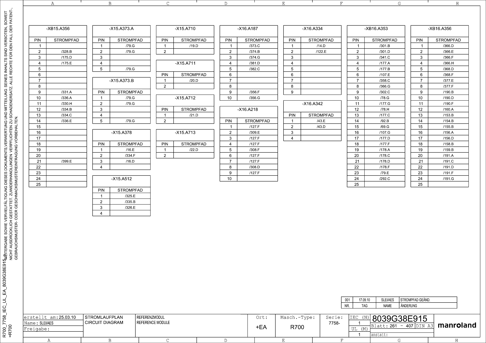

# +EA — Sheet 261 of 407 — REFERENZMODUL

**REFERENCE MODULE**

> Part of the manroland **R700** printing press IEC/UL circuit diagrams.
> Drawing class: **Stromlaufplan / Circuit diagram** (DIN A3).
> Document `+EA` covers the **Printing unit** machine section.

## At a glance

| Field | Value |
|---|---|
| Document | `+EA`  (8039G38E915) |
| Sheet | **261** of 407 |
| Section (DE) | REFERENZMODUL |
| Section (EN) | REFERENCE MODULE |
| Section type | REFERENCE_MODULE — Reference module |
| Machine type | `R700` |
| Series | `7758` |
| Created | 25.03.10 |
| Replaces | — |
| Columns used | A, B, C, D, E, F, G, H |
| Path numbers | — |
| Labels on sheet | 281 |
| Cross-refs out | 94 |
| Cross-refs in | 0 |

**Previous:** [+EA sheet 260](SHEET_0260.md) · **Next:** [+EA sheet 262](SHEET_0262.md) · **Document TOC:** [_TOC.md](_TOC.md)  (+EA) · **Master TOC:** [all sheets](../_MASTER_TOC.md)

## Sheet image (300 DPI, exact vector render)



_Rendered directly from the PDF vector layer at 300 DPI (1-bit), no OCR and no resampling. Use it to confirm anything ambiguous in the text below._

## Cross-references on this sheet

Each entry is a wire leaving this sheet. The printed token is `/sheet.column`; the link resolves to that sheet inside the same document.

| Ref | Target sheet | Col | Path | Destination on target | Target section | From col |
|---|---|---|---|---|---|---|
| `/19.D` | [+EA sheet 19](SHEET_0019.md) | D | — | STROMPFAD PIN 1 2 | SPANNUNGSVERSORGUNG: 400V, 24V | C |
| `/301.B` | [+EA sheet 301](SHEET_0301.md) | B | — | — | OPTION: ZWISCHENSTAPEL / | G |
| `/79.G` | [+EA sheet 79](SHEET_0079.md) | G | — | — | AUSLEGERSTAPELSTEUERUNG | B |
| `/14.D` | [+EA sheet 14](SHEET_0014.md) | D | — | — | SPANNUNGSVERSORGUNG: 400V, 24V | F |
| `/373.C` | [+EA sheet 373](SHEET_0373.md) | C | — | — | OPTION: ENDTROCKNER 1 VORBEREITUNG; | E |
| `/366.D` | [+EA sheet 366](SHEET_0366.md) | D | — | — | OPTION: TROCKNER VORBEREITUNG; | H |
| `/328.B` | [+EA sheet 328](SHEET_0328.md) | B | — | — | OPTION: BOGENWEICHE | A |
| `/374.B` | [+EA sheet 374](SHEET_0374.md) | B | — | — | OPTION: ENDTROCKNER 1 VORBEREITUNG; | E |
| `/122.E` | [+EA sheet 122](SHEET_0122.md) | E | — | — | TROCKENBESTÄUBER | F |
| `/366.E` | [+EA sheet 366](SHEET_0366.md) | E | — | — | OPTION: TROCKNER VORBEREITUNG; | H |
| `/79.G` | [+EA sheet 79](SHEET_0079.md) | G | — | — | AUSLEGERSTAPELSTEUERUNG | B |
| `/301.D` | [+EA sheet 301](SHEET_0301.md) | D | — | — | OPTION: ZWISCHENSTAPEL / | G |
| `/366.F` | [+EA sheet 366](SHEET_0366.md) | F | — | — | OPTION: TROCKNER VORBEREITUNG; | H |
| `/374.G` | [+EA sheet 374](SHEET_0374.md) | G | — | — | OPTION: ENDTROCKNER 1 VORBEREITUNG; | E |
| `/175.D` | [+EA sheet 175](SHEET_0175.md) | D | — | — | RESERVE | A |
| `/341.C` | [+EA sheet 341](SHEET_0341.md) | C | — | — | OPTION: BOGENWEICHE | G |
| `/175.E` | [+EA sheet 175](SHEET_0175.md) | E | — | — | RESERVE | A |
| `/177.A` | [+EA sheet 177](SHEET_0177.md) | A | — | — | RESERVE | G |
| `/381.D` | [+EA sheet 381](SHEET_0381.md) | D | — | — | OPTION: ENDTROCKNER 2 VORBEREITUNG | E |
| `/366.H` | [+EA sheet 366](SHEET_0366.md) | H | — | — | OPTION: TROCKNER VORBEREITUNG; | H |
| `/177.B` | [+EA sheet 177](SHEET_0177.md) | B | — | — | RESERVE | G |
| `/79.G` | [+EA sheet 79](SHEET_0079.md) | G | — | — | AUSLEGERSTAPELSTEUERUNG | B |
| `/382.C` | [+EA sheet 382](SHEET_0382.md) | C | — | — | OPTION: ENDTROCKNER 2 VORBEREITUNG | E |
| `/368.D` | [+EA sheet 368](SHEET_0368.md) | D | — | — | OPTION: ENDTROCKNER 1 VORBEREITUNG; | H |
| `/20.D` | [+EA sheet 20](SHEET_0020.md) | D | — | STROMPFAD PIN 1 2 | SPANNUNGSVERSORGUNG: 400V, 24V | C |
| `/107.E` | [+EA sheet 107](SHEET_0107.md) | E | — | — | BOGENGLÄTTER | G |
| `/368.F` | [+EA sheet 368](SHEET_0368.md) | F | — | — | OPTION: ENDTROCKNER 1 VORBEREITUNG; | H |
| `/377.E` | [+EA sheet 377](SHEET_0377.md) | E | — | — | OPTION: ENDTROCKNER 2 VORBEREITUNG | H |
| `/358.C` | [+EA sheet 358](SHEET_0358.md) | C | — | — | OPTION: MAKULATURBOGENZÄHLER | G |
| `/377.F` | [+EA sheet 377](SHEET_0377.md) | F | — | — | OPTION: ENDTROCKNER 2 VORBEREITUNG | H |
| `/366.G` | [+EA sheet 366](SHEET_0366.md) | G | — | — | OPTION: TROCKNER VORBEREITUNG; | G |
| `/331.A` | [+EA sheet 331](SHEET_0331.md) | A | — | — | OPTION: BOGENWEICHE | A |
| `/190.B` | [+EA sheet 190](SHEET_0190.md) | B | — | — | RESERVE | H |
| `/356.F` | [+EA sheet 356](SHEET_0356.md) | F | — | — | OPTION: VORBEREITUNG: PUDERABSAUGUNG | E |
| `/302.C` | [+EA sheet 302](SHEET_0302.md) | C | — | — | OPTION: ZWISCHENSTAPEL / | G |
| `/336.A` | [+EA sheet 336](SHEET_0336.md) | A | — | — | OPTION: BOGENWEICHE | A |
| `/79.G` | [+EA sheet 79](SHEET_0079.md) | G | — | — | AUSLEGERSTAPELSTEUERUNG | B |
| `/78.G` | [+EA sheet 78](SHEET_0078.md) | G | — | — | AUSLEGERSTAPELSTEUERUNG | G |
| `/356.G` | [+EA sheet 356](SHEET_0356.md) | G | — | — | OPTION: VORBEREITUNG: PUDERABSAUGUNG | E |
| `/190.D` | [+EA sheet 190](SHEET_0190.md) | D | — | — | RESERVE | H |
| `/79.G` | [+EA sheet 79](SHEET_0079.md) | G | — | — | AUSLEGERSTAPELSTEUERUNG | B |
| `/190.F` | [+EA sheet 190](SHEET_0190.md) | F | — | — | RESERVE | H |
| `/177.G` | [+EA sheet 177](SHEET_0177.md) | G | — | — | RESERVE | G |
| `/330.H` | [+EA sheet 330](SHEET_0330.md) | H | — | — | OPTION: BOGENWEICHE | A |
| `/21.D` | [+EA sheet 21](SHEET_0021.md) | D | — | STROMPFAD PIN 1 2 | SPANNUNGSVERSORGUNG: 400V, 24V | C |
| `/334.B` | [+EA sheet 334](SHEET_0334.md) | B | — | — | OPTION: BOGENWEICHE | A |
| `/160.A` | [+EA sheet 160](SHEET_0160.md) | A | — | — | ZUGANGSABSICHERUNG | H |
| `/78.H` | [+EA sheet 78](SHEET_0078.md) | H | — | — | AUSLEGERSTAPELSTEUERUNG | G |
| `/153.B` | [+EA sheet 153](SHEET_0153.md) | B | — | — | ZUGANGSABSICHERUNG | H |
| `/334.C` | [+EA sheet 334](SHEET_0334.md) | C | — | — | OPTION: BOGENWEICHE | A |
| `/177.C` | [+EA sheet 177](SHEET_0177.md) | C | — | — | RESERVE | G |
| `/43.E` | [+EA sheet 43](SHEET_0043.md) | E | — | — | BUSVERBINDUNGEN: SIGNALSCHLEIFE | F |
| `/92.B` | [+EA sheet 92](SHEET_0092.md) | B | — | — | BLASRAHMEN | G |
| `/336.E` | [+EA sheet 336](SHEET_0336.md) | E | — | — | OPTION: BOGENWEICHE | A |
| `/154.B` | [+EA sheet 154](SHEET_0154.md) | B | — | — | ZUGANGSABSICHERUNG | H |
| `/79.G` | [+EA sheet 79](SHEET_0079.md) | G | — | — | AUSLEGERSTAPELSTEUERUNG | B |
| `/155.B` | [+EA sheet 155](SHEET_0155.md) | B | — | — | ZUGANGSABSICHERUNG | H |
| `/127.F` | [+EA sheet 127](SHEET_0127.md) | F | — | — | ZUGANGSABSICHERUNG | E |
| `/69.G` | [+EA sheet 69](SHEET_0069.md) | G | — | — | SCHMIERUNG | G |
| `/43.D` | [+EA sheet 43](SHEET_0043.md) | D | — | — | BUSVERBINDUNGEN: SIGNALSCHLEIFE | F |
| `/309.E` | [+EA sheet 309](SHEET_0309.md) | E | — | — | OPTION: KLAPPPODEST B SEITE | E |
| `/156.A` | [+EA sheet 156](SHEET_0156.md) | A | — | — | ZUGANGSABSICHERUNG | H |
| `/107.G` | [+EA sheet 107](SHEET_0107.md) | G | — | — | BOGENGLÄTTER | G |
| `/127.F` | [+EA sheet 127](SHEET_0127.md) | F | — | — | ZUGANGSABSICHERUNG | E |
| `/177.D` | [+EA sheet 177](SHEET_0177.md) | D | — | — | RESERVE | G |
| `/156.D` | [+EA sheet 156](SHEET_0156.md) | D | — | — | ZUGANGSABSICHERUNG | H |
| `/22.D` | [+EA sheet 22](SHEET_0022.md) | D | — | STROMPFAD PIN 1 2 | SPANNUNGSVERSORGUNG: 400V, 24V | C |
| `/158.B` | [+EA sheet 158](SHEET_0158.md) | B | — | — | ZUGANGSABSICHERUNG | H |
| `/127.F` | [+EA sheet 127](SHEET_0127.md) | F | — | — | ZUGANGSABSICHERUNG | E |
| `/177.F` | [+EA sheet 177](SHEET_0177.md) | F | — | — | RESERVE | G |
| `/16.E` | [+EA sheet 16](SHEET_0016.md) | E | — | — | SPANNUNGSVERSORGUNG: 400V, 24V | B |
| `/178.A` | [+EA sheet 178](SHEET_0178.md) | A | — | — | RESERVE | G |
| `/159.B` | [+EA sheet 159](SHEET_0159.md) | B | — | — | ZUGANGSABSICHERUNG | H |
| `/308.F` | [+EA sheet 308](SHEET_0308.md) | F | — | — | OPTION: KLAPPPODEST B SEITE | E |
| `/191.A` | [+EA sheet 191](SHEET_0191.md) | A | — | — | RESERVE | H |
| `/334.F` | [+EA sheet 334](SHEET_0334.md) | F | — | — | OPTION: BOGENWEICHE | B |
| `/127.F` | [+EA sheet 127](SHEET_0127.md) | F | — | — | ZUGANGSABSICHERUNG | E |
| `/178.C` | [+EA sheet 178](SHEET_0178.md) | C | — | — | RESERVE | G |
| `/399.E` | [+EA sheet 399](SHEET_0399.md) | E | — | — | OPTION: DÜNNDRUCKEINRICHTUNG | A |
| `/127.F` | [+EA sheet 127](SHEET_0127.md) | F | — | — | ZUGANGSABSICHERUNG | E |
| `/16.D` | [+EA sheet 16](SHEET_0016.md) | D | — | — | SPANNUNGSVERSORGUNG: 400V, 24V | B |
| `/178.D` | [+EA sheet 178](SHEET_0178.md) | D | — | — | RESERVE | G |
| `/191.C` | [+EA sheet 191](SHEET_0191.md) | C | — | — | RESERVE | H |
| `/178.F` | [+EA sheet 178](SHEET_0178.md) | F | — | — | RESERVE | G |
| `/308.D` | [+EA sheet 308](SHEET_0308.md) | D | — | — | OPTION: KLAPPPODEST B SEITE | E |
| `/191.D` | [+EA sheet 191](SHEET_0191.md) | D | — | — | RESERVE | H |
| `/79.E` | [+EA sheet 79](SHEET_0079.md) | E | — | — | AUSLEGERSTAPELSTEUERUNG | G |
| `/127.F` | [+EA sheet 127](SHEET_0127.md) | F | — | — | ZUGANGSABSICHERUNG | E |
| `/191.F` | [+EA sheet 191](SHEET_0191.md) | F | — | — | RESERVE | H |
| `/191.G` | [+EA sheet 191](SHEET_0191.md) | G | — | — | RESERVE | H |
| `/292.C` | [+EA sheet 292](SHEET_0292.md) | C | — | — | OPTION: PROBEBOGENENTNAHME HALBAUTOMATISCH | G |
| `/325.E` | [+EA sheet 325](SHEET_0325.md) | E | — | — | OPTION: BOGENWEICHE | B |
| `/335.B` | [+EA sheet 335](SHEET_0335.md) | B | — | — | OPTION: BOGENWEICHE | B |
| `/326.E` | [+EA sheet 326](SHEET_0326.md) | E | — | — | OPTION: BOGENWEICHE | B |

## Devices on this sheet

| Tag | Class | Class meaning (IEC) | Col | Sub | Terminal | Sign |
|---|---|---|---|---|---|---|
| `X15.A373.A` | — | cross-device reference | B | — | — | — |
| `X15.A373.B` | — | cross-device reference | B | — | — | — |
| `XB15.A356` | — | cross-device reference | A | — | — | — |
| `XB16.A353` | — | cross-device reference | G | — | — | — |
| `X16.A334` | — | cross-device reference | F | — | — | — |
| `X16.A342` | — | cross-device reference | F | — | — | — |
| `XB16.A356` | — | cross-device reference | H | — | — | — |
| `X16.A218` | — | cross-device reference | D | — | — | — |
| `X16.A187` | — | cross-device reference | D | — | — | — |
| `X15.A378` | — | cross-device reference | B | — | — | — |
| `X15.A512` | — | cross-device reference | B | — | — | — |
| `X15.A710` | — | cross-device reference | C | — | — | — |
| `X15.A711` | — | cross-device reference | C | — | — | — |
| `X15.A712` | — | cross-device reference | C | — | — | — |
| `X15.A713` | — | cross-device reference | C | — | — | — |
| `NR.` | — | cross-device reference | F | — | — | — |
| `17.09.10` | — | cross-device reference | F | — | — | — |

## Potentials / nets

_No named potentials on this sheet._

## Wire-end annotations (grouped as printed)

A wire that continues elsewhere is annotated with a small cluster: the destination description, the path/line number `#NN`, and the `/sheet.column` cross reference. Each row below is one such cluster exactly as it is grouped on the drawing.

| Col | Y | Path | Cross-ref | Text on the wire |
|---|---|---|---|---|
| A | 65.5 | — | — | `XB15.A356` |
| B | 65.5 | — | — | `X15.A373.A` |
| C | 65.5 | — | — | `X15.A710` |
| D | 65.5 | — | — | `X16.A187` |
| F | 65.5 | — | — | `X16.A334` |
| G | 65.5 | — | — | `XB16.A353` |
| H | 65.5 | — | — | `XB16.A356` |
| A | 94.2 | — | — | `PIN STROMPFAD` |
| B | 94.2 | — | — | `PIN 2 3 4 5 1 STROMPFAD` |
| C | 94.2 | — | `/19.D` | `PIN 2 1 STROMPFAD` |
| D | 94.2 | — | — | `PIN 10 2 3 4 5 6 7 8 9 1 STROMPFAD` |
| E | 94.2 | — | — | `PIN 2 3 4 5 6 7 8 9 1 STROMPFAD` |
| G | 94.2 | — | — | `PIN STROMPFAD` |
| H | 94.2 | — | — | `PIN STROMPFAD` |
| A | 108.4 | — | — | `2 3 4 5 6 7 8 9 1` |
| F | 108.4 | — | — | `2 3 4 5 6 7 8 9 1` |
| G | 108.4 | — | — | `2 3 4 5 6 7 8 9 1` |
| B | 108.7 | — | `/79.G` | — |
| E | 108.7 | — | `/373.C` | — |
| F | 108.7 | — | `/14.D` | — |
| G | 108.7 | — | `/301.B` | — |
| H | 108.7 | — | `/366.D` | — |
| A | 122.9 | — | `/328.B` | — |
| B | 122.9 | — | `/79.G` | — |
| E | 122.9 | — | `/374.B` | — |
| F | 122.9 | — | `/122.E` | — |
| G | 122.9 | — | `/301.D` | — |
| H | 122.9 | — | `/366.E` | — |
| H | 137.0 | — | `/366.F` | — |
| A | 137.1 | — | `/175.D` | — |
| E | 137.1 | — | `/374.G` | — |
| G | 137.1 | — | `/341.C` | — |
| C | 150.5 | — | — | `X15.A711` |
| A | 151.2 | — | `/175.E` | — |
| E | 151.2 | — | `/381.D` | — |
| G | 151.2 | — | `/177.A` | — |
| H | 151.2 | — | `/366.H` | — |
| B | 165.4 | — | `/79.G` | — |
| E | 165.4 | — | `/382.C` | — |
| G | 165.4 | — | `/177.B` | — |
| H | 165.4 | — | `/368.D` | — |
| C | 179.2 | — | `/20.D` | `PIN 2 1 STROMPFAD` |
| G | 179.6 | — | `/107.E` | — |
| H | 179.6 | — | `/368.F` | — |
| B | 193.1 | — | — | `X15.A373.B` |
| H | 193.7 | — | `/377.E` | — |
| G | 193.8 | — | `/358.C` | — |
| G | 207.9 | — | `/366.G` | — |
| H | 207.9 | — | `/377.F` | — |
| B | 221.7 | — | — | `PIN 2 3 4 5 1 STROMPFAD` |
| A | 222.1 | — | `/331.A` | — |
| E | 222.1 | — | `/356.F` | — |
| G | 222.1 | — | `/302.C` | — |
| H | 222.1 | — | `/190.B` | — |
| C | 235.6 | — | — | `X15.A712` |
| A | 235.9 | — | — | `10 12 13 14 15 16 17 18 19 20 11` |
| F | 235.9 | — | — | `10 12 13 14 15 16 17 18 19 20 11` |
| G | 235.9 | — | — | `10 12 13 14 15 16 17 18 19 20 11` |
| A | 236.2 | — | `/336.A` | — |
| B | 236.2 | — | `/79.G` | — |
| G | 236.2 | — | `/78.G` | — |
| E | 236.3 | — | `/356.G` | — |
| H | 236.3 | — | `/190.D` | — |
| F | 249.8 | — | — | `X16.A342` |
| A | 250.4 | — | `/330.H` | — |
| B | 250.4 | — | `/79.G` | — |
| G | 250.4 | — | `/177.G` | — |
| H | 250.4 | — | `/190.F` | — |
| D | 263.9 | — | — | `X16.A218` |
| C | 264.2 | — | `/21.D` | `PIN 2 1 STROMPFAD` |
| A | 264.6 | — | `/334.B` | — |
| G | 264.6 | — | `/78.H` | — |
| H | 264.6 | — | `/160.A` | — |
| E | 278.4 | — | — | `PIN 2 3 4 1 STROMPFAD` |
| A | 278.8 | — | `/334.C` | — |
| G | 278.8 | — | `/177.C` | — |
| H | 278.8 | — | `/153.B` | — |
| D | 292.6 | — | — | `PIN 10 2 3 4 5 6 7 8 9 1 STROMPFAD` |
| A | 292.9 | — | `/336.E` | — |
| B | 292.9 | — | `/79.G` | — |
| F | 292.9 | — | `/43.E` | — |
| G | 292.9 | — | `/92.B` | — |
| H | 292.9 | — | `/154.B` | — |
| E | 307.1 | — | `/127.F` | — |
| F | 307.1 | — | `/43.D` | — |
| G | 307.1 | — | `/69.G` | — |
| H | 307.1 | — | `/155.B` | — |
| B | 320.6 | — | — | `X15.A378` |
| C | 320.6 | — | — | `X15.A713` |
| E | 321.3 | — | `/309.E` | — |
| G | 321.3 | — | `/107.G` | — |
| H | 321.3 | — | `/156.A` | — |
| E | 335.5 | — | `/127.F` | — |
| G | 335.5 | — | `/177.D` | — |
| H | 335.5 | — | `/156.D` | — |
| B | 349.3 | — | — | `PIN 2 3 4 1 STROMPFAD` |
| C | 349.3 | — | `/22.D` | `PIN 2 1 STROMPFAD` |
| E | 349.6 | — | `/127.F` | — |
| G | 349.6 | — | `/177.F` | — |
| H | 349.6 | — | `/158.B` | — |
| B | 363.8 | — | `/16.E` | — |
| E | 363.8 | — | `/308.F` | — |
| G | 363.8 | — | `/178.A` | — |
| H | 363.8 | — | `/159.B` | — |
| B | 378.0 | — | `/334.F` | — |
| E | 378.0 | — | `/127.F` | — |
| G | 378.0 | — | `/178.C` | — |
| H | 378.0 | — | `/191.A` | — |
| A | 391.8 | — | — | `22 23 24 25 21` |
| F | 391.8 | — | — | `22 23 24 25 21` |
| G | 391.8 | — | — | `22 23 24 25 21` |
| A | 392.1 | — | `/399.E` | — |
| B | 392.2 | — | `/16.D` | — |
| E | 392.2 | — | `/127.F` | — |
| G | 392.2 | — | `/178.D` | — |
| H | 392.2 | — | `/191.C` | — |
| G | 406.3 | — | `/178.F` | — |
| E | 406.4 | — | `/308.D` | — |
| H | 406.4 | — | `/191.D` | — |
| E | 420.5 | — | `/127.F` | — |
| G | 420.5 | — | `/79.E` | — |
| H | 420.5 | — | `/191.F` | — |
| B | 434.0 | — | — | `X15.A512` |
| G | 434.7 | — | `/292.C` | — |
| H | 434.7 | — | `/191.G` | — |
| B | 462.7 | — | — | `PIN 2 3 4 1 STROMPFAD` |
| B | 477.2 | — | `/325.E` | — |
| B | 491.4 | — | `/335.B` | — |
| B | 505.5 | — | `/326.E` | — |
| G | 733.0 | — | — | `001 17.09.10 SLEI/AES STROMPFAD GEÄND.` |
| G | 747.1 | — | — | `NR. TAG NAME ÄNDERUNG` |


## Reconstructed tables

This sheet carries tabular content (pin map / terminal assignment / index). The grid below was rebuilt from the drawing's own rule lines, so each row is exactly one physical row of the table.

### Table 1 — 25 data rows × 2 columns (at x=70.9, y=62.4) — **XB15.A356**

| PIN | STROMPFAD |
|---|---|
| `1` |  |
| `2` | `/328.B` |
| `3` | `/175.D` |
| `4` | `/175.E` |
| `5` |  |
| `6` |  |
| `7` |  |
| `8` |  |
| `9` | `/331.A` |
| `10` | `/336.A` |
| `11` | `/330.H` |
| `12` | `/334.B` |
| `13` | `/334.C` |
| `14` | `/336.E` |
| `15` |  |
| `16` |  |
| `17` |  |
| `18` |  |
| `19` |  |
| `20` |  |
| `21` | `/399.E` |
| `22` |  |
| `23` |  |
| `24` |  |
| `25` |  |


### Table 2 — 24 data rows × 2 columns (at x=226.8, y=62.4) — **X15.A373.A**

| PIN | STROMPFAD |
|---|---|
| `1` | `/79.G` |
| `2` | `/79.G` |
| `3` |  |
| `4` |  |
| `5` | `/79.G` |
|  | `X15.A373.B` |
| `PIN` | `STROMPFAD` |
| `1` | `/79.G` |
| `2` | `/79.G` |
| `3` |  |
| `4` |  |
| `5` | `/79.G` |
|  | `X15.A378` |
| `PIN` | `STROMPFAD` |
| `1` | `/16.E` |
| `2` | `/334.F` |
| `3` | `/16.D` |
| `4` |  |
|  | `X15.A512` |
| `PIN` | `STROMPFAD` |
| `1` | `/325.E` |
| `2` | `/335.B` |
| `3` | `/326.E` |
| `4` |  |


### Table 3 — 14 data rows × 2 columns (at x=382.7, y=62.4) — **X15.A710**

| PIN | STROMPFAD |
|---|---|
| `1` | `/19.D` |
| `2` |  |
|  | `X15.A711` |
| `PIN` | `STROMPFAD` |
| `1` | `/20.D` |
| `2` |  |
|  | `X15.A712` |
| `PIN` | `STROMPFAD` |
| `1` | `/21.D` |
| `2` |  |
|  | `X15.A713` |
| `PIN` | `STROMPFAD` |
| `1` | `/22.D` |
| `2` |  |


### Table 4 — 22 data rows × 2 columns (at x=538.6, y=62.4) — **X16.A187**

| PIN | STROMPFAD |
|---|---|
| `1` | `/373.C` |
| `2` | `/374.B` |
| `3` | `/374.G` |
| `4` | `/381.D` |
| `5` | `/382.C` |
| `6` |  |
| `7` |  |
| `8` |  |
| `9` | `/356.F` |
| `10` | `/356.G` |
|  | `X16.A218` |
| `PIN` | `STROMPFAD` |
| `1` | `/127.F` |
| `2` | `/309.E` |
| `3` | `/127.F` |
| `4` | `/127.F` |
| `5` | `/308.F` |
| `6` | `/127.F` |
| `7` | `/127.F` |
| `8` | `/308.D` |
| `9` | `/127.F` |
| `10` |  |


### Table 5 — 15 data rows × 2 columns (at x=694.5, y=62.4) — **X16.A334**

| PIN | STROMPFAD |
|---|---|
| `1` | `/14.D` |
| `2` | `/122.E` |
| `3` |  |
| `4` |  |
| `5` |  |
| `6` |  |
| `7` |  |
| `8` |  |
| `9` |  |
|  | `X16.A342` |
| `PIN` | `STROMPFAD` |
| `1` | `/43.E` |
| `2` | `/43.D` |
| `3` |  |
| `4` |  |


### Table 6 — 25 data rows × 2 columns (at x=850.4, y=62.4) — **XB16.A353**

| PIN | STROMPFAD |
|---|---|
| `1` | `/301.B` |
| `2` | `/301.D` |
| `3` | `/341.C` |
| `4` | `/177.A` |
| `5` | `/177.B` |
| `6` | `/107.E` |
| `7` | `/358.C` |
| `8` | `/366.G` |
| `9` | `/302.C` |
| `10` | `/78.G` |
| `11` | `/177.G` |
| `12` | `/78.H` |
| `13` | `/177.C` |
| `14` | `/92.B` |
| `15` | `/69.G` |
| `16` | `/107.G` |
| `17` | `/177.D` |
| `18` | `/177.F` |
| `19` | `/178.A` |
| `20` | `/178.C` |
| `21` | `/178.D` |
| `22` | `/178.F` |
| `23` | `/79.E` |
| `24` | `/292.C` |
| `25` |  |


### Table 7 — 25 data rows × 2 columns (at x=1006.3, y=62.4) — **XB16.A356**

| PIN | STROMPFAD |
|---|---|
| `1` | `/366.D` |
| `2` | `/366.E` |
| `3` | `/366.F` |
| `4` | `/366.H` |
| `5` | `/368.D` |
| `6` | `/368.F` |
| `7` | `/377.E` |
| `8` | `/377.F` |
| `9` | `/190.B` |
| `10` | `/190.D` |
| `11` | `/190.F` |
| `12` | `/160.A` |
| `13` | `/153.B` |
| `14` | `/154.B` |
| `15` | `/155.B` |
| `16` | `/156.A` |
| `17` | `/156.D` |
| `18` | `/158.B` |
| `19` | `/159.B` |
| `20` | `/191.A` |
| `21` | `/191.C` |
| `22` | `/191.D` |
| `23` | `/191.F` |
| `24` | `/191.G` |
| `25` |  |


## Notes and free text on this sheet

| Text | Col | Y (pt) |
|---|---|---|
| `PIN` | B | 94.2 |
| `STROMPFAD` | B | 94.15 |
| `PIN` | A | 94.2 |
| `STROMPFAD` | A | 94.15 |
| `PIN` | F | 94.2 |
| `STROMPFAD` | G | 94.15 |
| `PIN` | E | 94.2 |
| `STROMPFAD` | F | 94.15 |
| `PIN` | G | 94.2 |
| `STROMPFAD` | H | 94.15 |
| `PIN` | D | 292.62 |
| `STROMPFAD` | E | 292.58 |
| `PIN` | C | 94.2 |
| `STROMPFAD` | C | 94.15 |
| `TAG` | F | 747.27 |
| `NAME` | G | 747.25 |
| `ÄNDERUNG` | G | 747.31 |
| `SLEI/AES` | G | 733.13 |
| `STROMPFAD GEÄND.` | G | 733.12 |

## Complete label inventory (exact text from the drawing)

Every text object inside the drawing area of this sheet, in DIN reading order (column A→H, then top→bottom). This is the authoritative list: if a string is not here it is not printed on this sheet.

| Col | Y | X | Dir | Type | Text |
|---|---|---|---|---|---|
| A | 65.5 | 113.2 | → | device ref | `XB15.A356` |
| A | 94.2 | 84.0 | → | text | `PIN` |
| A | 94.2 | 132.2 | → | text | `STROMPFAD` |
| A | 108.4 | 95.8 | → | number | `1` |
| A | 122.5 | 94.1 | → | number | `2` |
| A | 122.9 | 150.4 | → | cross-reference | `/328.B` |
| A | 136.7 | 94.1 | → | number | `3` |
| A | 137.1 | 150.2 | → | cross-reference | `/175.D` |
| A | 150.9 | 94.1 | → | number | `4` |
| A | 151.2 | 150.5 | → | cross-reference | `/175.E` |
| A | 165.1 | 94.1 | → | number | `5` |
| A | 179.2 | 94.1 | → | number | `6` |
| A | 193.4 | 94.1 | → | number | `7` |
| A | 207.6 | 94.1 | → | number | `8` |
| A | 221.8 | 94.1 | → | number | `9` |
| A | 222.1 | 150.2 | → | cross-reference | `/331.A` |
| A | 235.9 | 88.7 | → | number | `10` |
| A | 236.2 | 150.2 | → | cross-reference | `/336.A` |
| A | 250.1 | 90.4 | → | number | `11` |
| A | 250.4 | 150.5 | → | cross-reference | `/330.H` |
| A | 264.3 | 88.7 | → | number | `12` |
| A | 264.6 | 150.4 | → | cross-reference | `/334.B` |
| A | 278.5 | 88.7 | → | number | `13` |
| A | 278.8 | 150.2 | → | cross-reference | `/334.C` |
| A | 292.6 | 88.7 | → | number | `14` |
| A | 292.9 | 150.5 | → | cross-reference | `/336.E` |
| A | 306.8 | 88.7 | → | number | `15` |
| A | 321.0 | 88.7 | → | number | `16` |
| A | 335.1 | 88.7 | → | number | `17` |
| A | 349.3 | 88.7 | → | number | `18` |
| A | 363.5 | 88.7 | → | number | `19` |
| A | 377.7 | 88.7 | → | number | `20` |
| A | 391.8 | 90.4 | → | number | `21` |
| A | 392.2 | 150.5 | → | cross-reference | `/399.E` |
| A | 406.0 | 88.7 | → | number | `22` |
| A | 420.2 | 88.7 | → | number | `23` |
| A | 434.4 | 88.7 | → | number | `24` |
| A | 448.5 | 88.7 | → | number | `25` |
| B | 65.5 | 267.3 | → | device ref | `X15.A373.A` |
| B | 94.2 | 240.0 | → | text | `PIN` |
| B | 94.2 | 288.1 | → | text | `STROMPFAD` |
| B | 108.4 | 245.9 | → | number | `1` |
| B | 108.7 | 308.4 | → | cross-reference | `/79.G` |
| B | 122.5 | 245.3 | → | number | `2` |
| B | 122.9 | 308.4 | → | cross-reference | `/79.G` |
| B | 136.7 | 245.3 | → | number | `3` |
| B | 150.9 | 245.3 | → | number | `4` |
| B | 165.1 | 245.3 | → | number | `5` |
| B | 165.4 | 308.4 | → | cross-reference | `/79.G` |
| B | 193.1 | 267.7 | → | device ref | `X15.A373.B` |
| B | 221.7 | 288.1 | → | text | `STROMPFAD` |
| B | 221.8 | 240.0 | → | text | `PIN` |
| B | 235.9 | 245.9 | → | number | `1` |
| B | 236.3 | 308.4 | → | cross-reference | `/79.G` |
| B | 250.1 | 245.3 | → | number | `2` |
| B | 250.4 | 308.4 | → | cross-reference | `/79.G` |
| B | 264.3 | 245.3 | → | number | `3` |
| B | 278.5 | 245.3 | → | number | `4` |
| B | 292.6 | 245.3 | → | number | `5` |
| B | 292.9 | 308.4 | → | cross-reference | `/79.G` |
| B | 320.6 | 272.7 | → | device ref | `X15.A378` |
| B | 349.3 | 240.0 | → | text | `PIN` |
| B | 349.3 | 288.1 | → | text | `STROMPFAD` |
| B | 363.5 | 245.9 | → | number | `1` |
| B | 363.8 | 308.8 | → | cross-reference | `/16.E` |
| B | 377.7 | 245.3 | → | number | `2` |
| B | 378.0 | 306.6 | → | cross-reference | `/334.F` |
| B | 391.8 | 245.3 | → | number | `3` |
| B | 392.2 | 308.6 | → | cross-reference | `/16.D` |
| B | 406.0 | 245.3 | → | number | `4` |
| B | 434.0 | 272.7 | → | device ref | `X15.A512` |
| B | 462.7 | 240.0 | → | text | `PIN` |
| B | 462.7 | 288.1 | → | text | `STROMPFAD` |
| B | 476.9 | 245.9 | → | number | `1` |
| B | 477.2 | 306.4 | → | cross-reference | `/325.E` |
| B | 491.0 | 245.3 | → | number | `2` |
| B | 491.4 | 306.3 | → | cross-reference | `/335.B` |
| B | 505.2 | 245.3 | → | number | `3` |
| B | 505.5 | 306.4 | → | cross-reference | `/326.E` |
| B | 519.4 | 245.3 | → | number | `4` |
| C | 65.5 | 428.6 | → | device ref | `X15.A710` |
| C | 94.2 | 395.9 | → | text | `PIN` |
| C | 94.2 | 444.0 | → | text | `STROMPFAD` |
| C | 108.4 | 401.8 | → | number | `1` |
| C | 108.7 | 464.5 | → | cross-reference | `/19.D` |
| C | 122.5 | 401.2 | → | number | `2` |
| C | 150.5 | 429.3 | → | device ref | `X15.A711` |
| C | 179.2 | 395.9 | → | text | `PIN` |
| C | 179.2 | 444.0 | → | text | `STROMPFAD` |
| C | 193.4 | 401.8 | → | number | `1` |
| C | 193.7 | 464.5 | → | cross-reference | `/20.D` |
| C | 207.6 | 401.2 | → | number | `2` |
| C | 235.6 | 428.6 | → | device ref | `X15.A712` |
| C | 264.2 | 444.0 | → | text | `STROMPFAD` |
| C | 264.3 | 395.9 | → | text | `PIN` |
| C | 278.5 | 401.8 | → | number | `1` |
| C | 278.8 | 464.5 | → | cross-reference | `/21.D` |
| C | 292.6 | 401.2 | → | number | `2` |
| C | 320.6 | 428.6 | → | device ref | `X15.A713` |
| C | 349.3 | 395.9 | → | text | `PIN` |
| C | 349.3 | 444.0 | → | text | `STROMPFAD` |
| C | 363.5 | 401.8 | → | number | `1` |
| C | 363.8 | 464.5 | → | cross-reference | `/22.D` |
| C | 377.7 | 401.2 | → | number | `2` |
| D | 65.5 | 581.7 | → | device ref | `X16.A187` |
| D | 94.2 | 551.8 | → | text | `PIN` |
| D | 108.4 | 563.5 | → | number | `1` |
| D | 122.5 | 561.8 | → | number | `2` |
| D | 136.7 | 561.8 | → | number | `3` |
| D | 150.9 | 561.8 | → | number | `4` |
| D | 165.1 | 561.8 | → | number | `5` |
| D | 179.2 | 561.8 | → | number | `6` |
| D | 193.4 | 561.8 | → | number | `7` |
| D | 207.6 | 561.8 | → | number | `8` |
| D | 221.8 | 561.8 | → | number | `9` |
| D | 235.9 | 556.4 | → | number | `10` |
| D | 263.9 | 581.7 | → | device ref | `X16.A218` |
| D | 292.6 | 551.8 | → | text | `PIN` |
| D | 306.8 | 563.5 | → | number | `1` |
| D | 321.0 | 561.8 | → | number | `2` |
| D | 335.1 | 561.8 | → | number | `3` |
| D | 349.3 | 561.8 | → | number | `4` |
| D | 363.5 | 561.8 | → | number | `5` |
| D | 377.7 | 561.8 | → | number | `6` |
| D | 391.8 | 561.8 | → | number | `7` |
| D | 406.0 | 561.8 | → | number | `8` |
| D | 420.2 | 561.8 | → | number | `9` |
| D | 434.4 | 556.4 | → | number | `10` |
| E | 94.2 | 600.0 | → | text | `STROMPFAD` |
| E | 94.2 | 707.7 | → | text | `PIN` |
| E | 108.4 | 713.6 | → | number | `1` |
| E | 108.7 | 610.9 | → | cross-reference | `/373.C` |
| E | 122.5 | 713.1 | → | number | `2` |
| E | 122.9 | 611.0 | → | cross-reference | `/374.B` |
| E | 136.7 | 713.1 | → | number | `3` |
| E | 137.1 | 610.7 | → | cross-reference | `/374.G` |
| E | 150.9 | 713.1 | → | number | `4` |
| E | 151.2 | 610.9 | → | cross-reference | `/381.D` |
| E | 165.1 | 713.1 | → | number | `5` |
| E | 165.4 | 610.9 | → | cross-reference | `/382.C` |
| E | 179.2 | 713.1 | → | number | `6` |
| E | 193.4 | 713.1 | → | number | `7` |
| E | 207.6 | 713.1 | → | number | `8` |
| E | 221.8 | 713.1 | → | number | `9` |
| E | 222.1 | 611.3 | → | cross-reference | `/356.F` |
| E | 236.3 | 610.7 | → | cross-reference | `/356.G` |
| E | 278.4 | 707.7 | → | text | `PIN` |
| E | 292.6 | 600.0 | → | text | `STROMPFAD` |
| E | 292.6 | 713.6 | → | number | `1` |
| E | 306.8 | 713.1 | → | number | `2` |
| E | 307.1 | 611.3 | → | cross-reference | `/127.F` |
| E | 321.0 | 713.1 | → | number | `3` |
| E | 321.3 | 611.1 | → | cross-reference | `/309.E` |
| E | 335.1 | 713.1 | → | number | `4` |
| E | 335.5 | 611.3 | → | cross-reference | `/127.F` |
| E | 349.6 | 611.3 | → | cross-reference | `/127.F` |
| E | 363.8 | 611.3 | → | cross-reference | `/308.F` |
| E | 378.0 | 611.3 | → | cross-reference | `/127.F` |
| E | 392.2 | 611.3 | → | cross-reference | `/127.F` |
| E | 406.4 | 610.9 | → | cross-reference | `/308.D` |
| E | 420.5 | 611.3 | → | cross-reference | `/127.F` |
| F | 65.5 | 740.4 | → | device ref | `X16.A334` |
| F | 94.2 | 755.9 | → | text | `STROMPFAD` |
| F | 94.2 | 863.6 | → | text | `PIN` |
| F | 108.4 | 875.3 | → | number | `1` |
| F | 108.7 | 776.3 | → | cross-reference | `/14.D` |
| F | 122.5 | 873.6 | → | number | `2` |
| F | 122.9 | 774.1 | → | cross-reference | `/122.E` |
| F | 136.7 | 873.6 | → | number | `3` |
| F | 150.9 | 873.6 | → | number | `4` |
| F | 165.1 | 873.6 | → | number | `5` |
| F | 179.2 | 873.6 | → | number | `6` |
| F | 193.4 | 873.6 | → | number | `7` |
| F | 207.6 | 873.6 | → | number | `8` |
| F | 221.8 | 873.6 | → | number | `9` |
| F | 235.9 | 868.3 | → | number | `10` |
| F | 249.8 | 740.4 | → | device ref | `X16.A342` |
| F | 250.1 | 870.0 | → | number | `11` |
| F | 264.3 | 868.3 | → | number | `12` |
| F | 278.4 | 755.9 | → | text | `STROMPFAD` |
| F | 278.5 | 868.3 | → | number | `13` |
| F | 292.6 | 868.3 | → | number | `14` |
| F | 292.9 | 776.6 | → | cross-reference | `/43.E` |
| F | 306.8 | 868.3 | → | number | `15` |
| F | 307.1 | 776.3 | → | cross-reference | `/43.D` |
| F | 321.0 | 868.3 | → | number | `16` |
| F | 335.1 | 868.3 | → | number | `17` |
| F | 349.3 | 868.3 | → | number | `18` |
| F | 363.5 | 868.3 | → | number | `19` |
| F | 377.7 | 868.3 | → | number | `20` |
| F | 391.8 | 870.0 | → | number | `21` |
| F | 406.0 | 868.3 | → | number | `22` |
| F | 420.2 | 868.3 | → | number | `23` |
| F | 434.4 | 868.3 | → | number | `24` |
| F | 448.5 | 868.3 | → | number | `25` |
| F | 733.0 | 845.2 | → | number | `001` |
| F | 733.1 | 879.0 | → | device ref | `17.09.10` |
| F | 747.1 | 844.2 | → | device ref | `NR.` |
| F | 747.3 | 885.8 | → | text | `TAG` |
| G | 65.5 | 892.8 | → | device ref | `XB16.A353` |
| G | 94.2 | 911.8 | → | text | `STROMPFAD` |
| G | 94.2 | 1019.5 | → | text | `PIN` |
| G | 108.4 | 1031.2 | → | number | `1` |
| G | 108.7 | 929.9 | → | cross-reference | `/301.B` |
| G | 122.5 | 1029.5 | → | number | `2` |
| G | 122.9 | 929.8 | → | cross-reference | `/301.D` |
| G | 136.7 | 1029.5 | → | number | `3` |
| G | 137.1 | 929.8 | → | cross-reference | `/341.C` |
| G | 150.9 | 1029.5 | → | number | `4` |
| G | 151.2 | 929.8 | → | cross-reference | `/177.A` |
| G | 165.1 | 1029.5 | → | number | `5` |
| G | 165.4 | 929.9 | → | cross-reference | `/177.B` |
| G | 179.2 | 1029.5 | → | number | `6` |
| G | 179.6 | 930.0 | → | cross-reference | `/107.E` |
| G | 193.4 | 1029.5 | → | number | `7` |
| G | 193.8 | 929.8 | → | cross-reference | `/358.C` |
| G | 207.6 | 1029.5 | → | number | `8` |
| G | 207.9 | 929.6 | → | cross-reference | `/366.G` |
| G | 221.8 | 1029.5 | → | number | `9` |
| G | 222.1 | 929.8 | → | cross-reference | `/302.C` |
| G | 235.9 | 1024.2 | → | number | `10` |
| G | 236.3 | 932.0 | → | cross-reference | `/78.G` |
| G | 250.1 | 1025.9 | → | number | `11` |
| G | 250.4 | 929.6 | → | cross-reference | `/177.G` |
| G | 264.3 | 1024.2 | → | number | `12` |
| G | 264.6 | 932.5 | → | cross-reference | `/78.H` |
| G | 278.5 | 1024.2 | → | number | `13` |
| G | 278.8 | 929.8 | → | cross-reference | `/177.C` |
| G | 292.6 | 1024.2 | → | number | `14` |
| G | 292.9 | 932.3 | → | cross-reference | `/92.B` |
| G | 306.8 | 1024.2 | → | number | `15` |
| G | 307.1 | 932.0 | → | cross-reference | `/69.G` |
| G | 321.0 | 1024.2 | → | number | `16` |
| G | 321.3 | 929.6 | → | cross-reference | `/107.G` |
| G | 335.1 | 1024.2 | → | number | `17` |
| G | 335.5 | 929.8 | → | cross-reference | `/177.D` |
| G | 349.3 | 1024.2 | → | number | `18` |
| G | 349.6 | 930.2 | → | cross-reference | `/177.F` |
| G | 363.5 | 1024.2 | → | number | `19` |
| G | 363.8 | 929.8 | → | cross-reference | `/178.A` |
| G | 377.7 | 1024.2 | → | number | `20` |
| G | 378.0 | 929.8 | → | cross-reference | `/178.C` |
| G | 391.8 | 1025.9 | → | number | `21` |
| G | 392.2 | 929.8 | → | cross-reference | `/178.D` |
| G | 406.0 | 1024.2 | → | number | `22` |
| G | 406.3 | 930.2 | → | cross-reference | `/178.F` |
| G | 420.2 | 1024.2 | → | number | `23` |
| G | 420.5 | 932.5 | → | cross-reference | `/79.E` |
| G | 434.4 | 1024.2 | → | number | `24` |
| G | 434.7 | 929.8 | → | cross-reference | `/292.C` |
| G | 448.5 | 1024.2 | → | number | `25` |
| G | 733.1 | 934.0 | → | text | `SLEI/AES` |
| G | 733.1 | 980.9 | → | text | `STROMPFAD GEÄND.` |
| G | 747.3 | 939.2 | → | text | `NAME` |
| G | 747.3 | 981.8 | → | text | `ÄNDERUNG` |
| H | 65.5 | 1048.7 | → | device ref | `XB16.A356` |
| H | 94.2 | 1067.7 | → | text | `STROMPFAD` |
| H | 108.7 | 1085.7 | → | cross-reference | `/366.D` |
| H | 122.9 | 1086.0 | → | cross-reference | `/366.E` |
| H | 137.0 | 1086.1 | → | cross-reference | `/366.F` |
| H | 151.2 | 1086.0 | → | cross-reference | `/366.H` |
| H | 165.4 | 1085.7 | → | cross-reference | `/368.D` |
| H | 179.6 | 1086.1 | → | cross-reference | `/368.F` |
| H | 193.7 | 1086.0 | → | cross-reference | `/377.E` |
| H | 207.9 | 1086.1 | → | cross-reference | `/377.F` |
| H | 222.1 | 1085.8 | → | cross-reference | `/190.B` |
| H | 236.3 | 1085.7 | → | cross-reference | `/190.D` |
| H | 250.4 | 1086.1 | → | cross-reference | `/190.F` |
| H | 264.6 | 1085.7 | → | cross-reference | `/160.A` |
| H | 278.8 | 1085.8 | → | cross-reference | `/153.B` |
| H | 292.9 | 1085.8 | → | cross-reference | `/154.B` |
| H | 307.1 | 1085.8 | → | cross-reference | `/155.B` |
| H | 321.3 | 1085.7 | → | cross-reference | `/156.A` |
| H | 335.5 | 1085.7 | → | cross-reference | `/156.D` |
| H | 349.6 | 1085.8 | → | cross-reference | `/158.B` |
| H | 363.8 | 1085.8 | → | cross-reference | `/159.B` |
| H | 378.0 | 1085.7 | → | cross-reference | `/191.A` |
| H | 392.2 | 1085.7 | → | cross-reference | `/191.C` |
| H | 406.4 | 1085.7 | → | cross-reference | `/191.D` |
| H | 420.5 | 1086.1 | → | cross-reference | `/191.F` |
| H | 434.7 | 1085.5 | → | cross-reference | `/191.G` |

## Reading-order text block

The same content as a plain block, grouped by DIN column — convenient to paste or to match against a visual description.

```text
=== Column A ===
  65.5  113.2  devref       XB15.A356
  94.2   84.0  text         PIN
  94.2  132.2  text         STROMPFAD
 108.4   95.8  numeric      1
 122.5   94.1  numeric      2
 122.9  150.4  xref         /328.B
 136.7   94.1  numeric      3
 137.1  150.2  xref         /175.D
 150.9   94.1  numeric      4
 151.2  150.5  xref         /175.E
 165.1   94.1  numeric      5
 179.2   94.1  numeric      6
 193.4   94.1  numeric      7
 207.6   94.1  numeric      8
 221.8   94.1  numeric      9
 222.1  150.2  xref         /331.A
 235.9   88.7  numeric      10
 236.2  150.2  xref         /336.A
 250.1   90.4  numeric      11
 250.4  150.5  xref         /330.H
 264.3   88.7  numeric      12
 264.6  150.4  xref         /334.B
 278.5   88.7  numeric      13
 278.8  150.2  xref         /334.C
 292.6   88.7  numeric      14
 292.9  150.5  xref         /336.E
 306.8   88.7  numeric      15
 321.0   88.7  numeric      16
 335.1   88.7  numeric      17
 349.3   88.7  numeric      18
 363.5   88.7  numeric      19
 377.7   88.7  numeric      20
 391.8   90.4  numeric      21
 392.2  150.5  xref         /399.E
 406.0   88.7  numeric      22
 420.2   88.7  numeric      23
 434.4   88.7  numeric      24
 448.5   88.7  numeric      25
=== Column B ===
  65.5  267.3  devref       X15.A373.A
  94.2  240.0  text         PIN
  94.2  288.1  text         STROMPFAD
 108.4  245.9  numeric      1
 108.7  308.4  xref         /79.G
 122.5  245.3  numeric      2
 122.9  308.4  xref         /79.G
 136.7  245.3  numeric      3
 150.9  245.3  numeric      4
 165.1  245.3  numeric      5
 165.4  308.4  xref         /79.G
 193.1  267.7  devref       X15.A373.B
 221.7  288.1  text         STROMPFAD
 221.8  240.0  text         PIN
 235.9  245.9  numeric      1
 236.3  308.4  xref         /79.G
 250.1  245.3  numeric      2
 250.4  308.4  xref         /79.G
 264.3  245.3  numeric      3
 278.5  245.3  numeric      4
 292.6  245.3  numeric      5
 292.9  308.4  xref         /79.G
 320.6  272.7  devref       X15.A378
 349.3  240.0  text         PIN
 349.3  288.1  text         STROMPFAD
 363.5  245.9  numeric      1
 363.8  308.8  xref         /16.E
 377.7  245.3  numeric      2
 378.0  306.6  xref         /334.F
 391.8  245.3  numeric      3
 392.2  308.6  xref         /16.D
 406.0  245.3  numeric      4
 434.0  272.7  devref       X15.A512
 462.7  240.0  text         PIN
 462.7  288.1  text         STROMPFAD
 476.9  245.9  numeric      1
 477.2  306.4  xref         /325.E
 491.0  245.3  numeric      2
 491.4  306.3  xref         /335.B
 505.2  245.3  numeric      3
 505.5  306.4  xref         /326.E
 519.4  245.3  numeric      4
=== Column C ===
  65.5  428.6  devref       X15.A710
  94.2  395.9  text         PIN
  94.2  444.0  text         STROMPFAD
 108.4  401.8  numeric      1
 108.7  464.5  xref         /19.D
 122.5  401.2  numeric      2
 150.5  429.3  devref       X15.A711
 179.2  395.9  text         PIN
 179.2  444.0  text         STROMPFAD
 193.4  401.8  numeric      1
 193.7  464.5  xref         /20.D
 207.6  401.2  numeric      2
 235.6  428.6  devref       X15.A712
 264.2  444.0  text         STROMPFAD
 264.3  395.9  text         PIN
 278.5  401.8  numeric      1
 278.8  464.5  xref         /21.D
 292.6  401.2  numeric      2
 320.6  428.6  devref       X15.A713
 349.3  395.9  text         PIN
 349.3  444.0  text         STROMPFAD
 363.5  401.8  numeric      1
 363.8  464.5  xref         /22.D
 377.7  401.2  numeric      2
=== Column D ===
  65.5  581.7  devref       X16.A187
  94.2  551.8  text         PIN
 108.4  563.5  numeric      1
 122.5  561.8  numeric      2
 136.7  561.8  numeric      3
 150.9  561.8  numeric      4
 165.1  561.8  numeric      5
 179.2  561.8  numeric      6
 193.4  561.8  numeric      7
 207.6  561.8  numeric      8
 221.8  561.8  numeric      9
 235.9  556.4  numeric      10
 263.9  581.7  devref       X16.A218
 292.6  551.8  text         PIN
 306.8  563.5  numeric      1
 321.0  561.8  numeric      2
 335.1  561.8  numeric      3
 349.3  561.8  numeric      4
 363.5  561.8  numeric      5
 377.7  561.8  numeric      6
 391.8  561.8  numeric      7
 406.0  561.8  numeric      8
 420.2  561.8  numeric      9
 434.4  556.4  numeric      10
=== Column E ===
  94.2  600.0  text         STROMPFAD
  94.2  707.7  text         PIN
 108.4  713.6  numeric      1
 108.7  610.9  xref         /373.C
 122.5  713.1  numeric      2
 122.9  611.0  xref         /374.B
 136.7  713.1  numeric      3
 137.1  610.7  xref         /374.G
 150.9  713.1  numeric      4
 151.2  610.9  xref         /381.D
 165.1  713.1  numeric      5
 165.4  610.9  xref         /382.C
 179.2  713.1  numeric      6
 193.4  713.1  numeric      7
 207.6  713.1  numeric      8
 221.8  713.1  numeric      9
 222.1  611.3  xref         /356.F
 236.3  610.7  xref         /356.G
 278.4  707.7  text         PIN
 292.6  600.0  text         STROMPFAD
 292.6  713.6  numeric      1
 306.8  713.1  numeric      2
 307.1  611.3  xref         /127.F
 321.0  713.1  numeric      3
 321.3  611.1  xref         /309.E
 335.1  713.1  numeric      4
 335.5  611.3  xref         /127.F
 349.6  611.3  xref         /127.F
 363.8  611.3  xref         /308.F
 378.0  611.3  xref         /127.F
 392.2  611.3  xref         /127.F
 406.4  610.9  xref         /308.D
 420.5  611.3  xref         /127.F
=== Column F ===
  65.5  740.4  devref       X16.A334
  94.2  755.9  text         STROMPFAD
  94.2  863.6  text         PIN
 108.4  875.3  numeric      1
 108.7  776.3  xref         /14.D
 122.5  873.6  numeric      2
 122.9  774.1  xref         /122.E
 136.7  873.6  numeric      3
 150.9  873.6  numeric      4
 165.1  873.6  numeric      5
 179.2  873.6  numeric      6
 193.4  873.6  numeric      7
 207.6  873.6  numeric      8
 221.8  873.6  numeric      9
 235.9  868.3  numeric      10
 249.8  740.4  devref       X16.A342
 250.1  870.0  numeric      11
 264.3  868.3  numeric      12
 278.4  755.9  text         STROMPFAD
 278.5  868.3  numeric      13
 292.6  868.3  numeric      14
 292.9  776.6  xref         /43.E
 306.8  868.3  numeric      15
 307.1  776.3  xref         /43.D
 321.0  868.3  numeric      16
 335.1  868.3  numeric      17
 349.3  868.3  numeric      18
 363.5  868.3  numeric      19
 377.7  868.3  numeric      20
 391.8  870.0  numeric      21
 406.0  868.3  numeric      22
 420.2  868.3  numeric      23
 434.4  868.3  numeric      24
 448.5  868.3  numeric      25
 733.0  845.2  numeric      001
 733.1  879.0  devref       17.09.10
 747.1  844.2  devref       NR.
 747.3  885.8  text         TAG
=== Column G ===
  65.5  892.8  devref       XB16.A353
  94.2  911.8  text         STROMPFAD
  94.2 1019.5  text         PIN
 108.4 1031.2  numeric      1
 108.7  929.9  xref         /301.B
 122.5 1029.5  numeric      2
 122.9  929.8  xref         /301.D
 136.7 1029.5  numeric      3
 137.1  929.8  xref         /341.C
 150.9 1029.5  numeric      4
 151.2  929.8  xref         /177.A
 165.1 1029.5  numeric      5
 165.4  929.9  xref         /177.B
 179.2 1029.5  numeric      6
 179.6  930.0  xref         /107.E
 193.4 1029.5  numeric      7
 193.8  929.8  xref         /358.C
 207.6 1029.5  numeric      8
 207.9  929.6  xref         /366.G
 221.8 1029.5  numeric      9
 222.1  929.8  xref         /302.C
 235.9 1024.2  numeric      10
 236.3  932.0  xref         /78.G
 250.1 1025.9  numeric      11
 250.4  929.6  xref         /177.G
 264.3 1024.2  numeric      12
 264.6  932.5  xref         /78.H
 278.5 1024.2  numeric      13
 278.8  929.8  xref         /177.C
 292.6 1024.2  numeric      14
 292.9  932.3  xref         /92.B
 306.8 1024.2  numeric      15
 307.1  932.0  xref         /69.G
 321.0 1024.2  numeric      16
 321.3  929.6  xref         /107.G
 335.1 1024.2  numeric      17
 335.5  929.8  xref         /177.D
 349.3 1024.2  numeric      18
 349.6  930.2  xref         /177.F
 363.5 1024.2  numeric      19
 363.8  929.8  xref         /178.A
 377.7 1024.2  numeric      20
 378.0  929.8  xref         /178.C
 391.8 1025.9  numeric      21
 392.2  929.8  xref         /178.D
 406.0 1024.2  numeric      22
 406.3  930.2  xref         /178.F
 420.2 1024.2  numeric      23
 420.5  932.5  xref         /79.E
 434.4 1024.2  numeric      24
 434.7  929.8  xref         /292.C
 448.5 1024.2  numeric      25
 733.1  934.0  text         SLEI/AES
 733.1  980.9  text         STROMPFAD GEÄND.
 747.3  939.2  text         NAME
 747.3  981.8  text         ÄNDERUNG
=== Column H ===
  65.5 1048.7  devref       XB16.A356
  94.2 1067.7  text         STROMPFAD
 108.7 1085.7  xref         /366.D
 122.9 1086.0  xref         /366.E
 137.0 1086.1  xref         /366.F
 151.2 1086.0  xref         /366.H
 165.4 1085.7  xref         /368.D
 179.6 1086.1  xref         /368.F
 193.7 1086.0  xref         /377.E
 207.9 1086.1  xref         /377.F
 222.1 1085.8  xref         /190.B
 236.3 1085.7  xref         /190.D
 250.4 1086.1  xref         /190.F
 264.6 1085.7  xref         /160.A
 278.8 1085.8  xref         /153.B
 292.9 1085.8  xref         /154.B
 307.1 1085.8  xref         /155.B
 321.3 1085.7  xref         /156.A
 335.5 1085.7  xref         /156.D
 349.6 1085.8  xref         /158.B
 363.8 1085.8  xref         /159.B
 378.0 1085.7  xref         /191.A
 392.2 1085.7  xref         /191.C
 406.4 1085.7  xref         /191.D
 420.5 1086.1  xref         /191.F
 434.7 1085.5  xref         /191.G
```

---
_Generated from the PDF vector text layer; no OCR. Source: `R700_7758_IEC_UL_EA_8039G38E915_p`, sheet 261._
