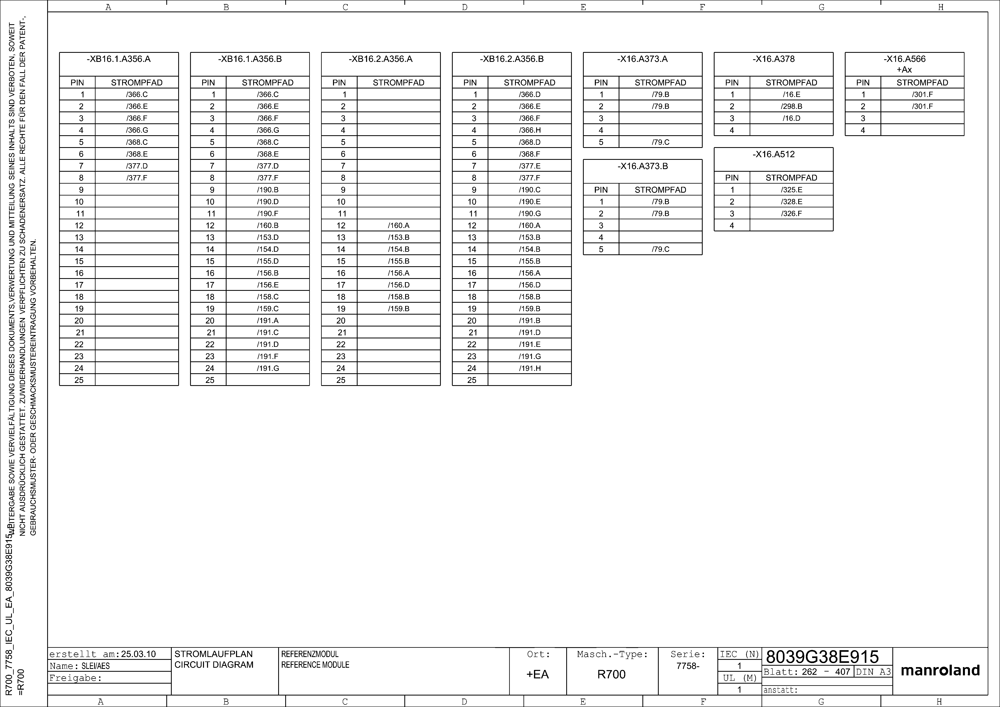

# +EA — Sheet 262 of 407 — REFERENZMODUL

**REFERENCE MODULE**

> Part of the manroland **R700** printing press IEC/UL circuit diagrams.
> Drawing class: **Stromlaufplan / Circuit diagram** (DIN A3).
> Document `+EA` covers the **Printing unit** machine section.

## At a glance

| Field | Value |
|---|---|
| Document | `+EA`  (8039G38E915) |
| Sheet | **262** of 407 |
| Section (DE) | REFERENZMODUL |
| Section (EN) | REFERENCE MODULE |
| Section type | REFERENCE_MODULE — Reference module |
| Machine type | `R700` |
| Series | `7758` |
| Created | 25.03.10 |
| Replaces | — |
| Columns used | A, B, C, D, E, F, G, H |
| Path numbers | — |
| Labels on sheet | 228 |
| Cross-refs out | 78 |
| Cross-refs in | 0 |

**Previous:** [+EA sheet 261](SHEET_0261.md) · **Next:** [+EA sheet 263](SHEET_0263.md) · **Document TOC:** [_TOC.md](_TOC.md)  (+EA) · **Master TOC:** [all sheets](../_MASTER_TOC.md)

## Sheet image (300 DPI, exact vector render)



_Rendered directly from the PDF vector layer at 300 DPI (1-bit), no OCR and no resampling. Use it to confirm anything ambiguous in the text below._

## Cross-references on this sheet

Each entry is a wire leaving this sheet. The printed token is `/sheet.column`; the link resolves to that sheet inside the same document.

| Ref | Target sheet | Col | Path | Destination on target | Target section | From col |
|---|---|---|---|---|---|---|
| `/79.B` | [+EA sheet 79](SHEET_0079.md) | B | — | — | AUSLEGERSTAPELSTEUERUNG | F |
| `/16.E` | [+EA sheet 16](SHEET_0016.md) | E | — | — | SPANNUNGSVERSORGUNG: 400V, 24V | G |
| `/301.F` | [+EA sheet 301](SHEET_0301.md) | F | — | — | OPTION: ZWISCHENSTAPEL / | H |
| `/366.C` | [+EA sheet 366](SHEET_0366.md) | C | — | — | OPTION: TROCKNER VORBEREITUNG; | A |
| `/366.C` | [+EA sheet 366](SHEET_0366.md) | C | — | — | OPTION: TROCKNER VORBEREITUNG; | B |
| `/366.D` | [+EA sheet 366](SHEET_0366.md) | D | — | — | OPTION: TROCKNER VORBEREITUNG; | E |
| `/79.B` | [+EA sheet 79](SHEET_0079.md) | B | — | — | AUSLEGERSTAPELSTEUERUNG | F |
| `/366.E` | [+EA sheet 366](SHEET_0366.md) | E | — | — | OPTION: TROCKNER VORBEREITUNG; | A |
| `/366.E` | [+EA sheet 366](SHEET_0366.md) | E | — | — | OPTION: TROCKNER VORBEREITUNG; | B |
| `/366.E` | [+EA sheet 366](SHEET_0366.md) | E | — | — | OPTION: TROCKNER VORBEREITUNG; | E |
| `/298.B` | [+EA sheet 298](SHEET_0298.md) | B | — | — | OPTION: ZWISCHENSTAPEL / | G |
| `/301.F` | [+EA sheet 301](SHEET_0301.md) | F | — | — | OPTION: ZWISCHENSTAPEL / | H |
| `/366.F` | [+EA sheet 366](SHEET_0366.md) | F | — | — | OPTION: TROCKNER VORBEREITUNG; | A |
| `/366.F` | [+EA sheet 366](SHEET_0366.md) | F | — | — | OPTION: TROCKNER VORBEREITUNG; | B |
| `/366.F` | [+EA sheet 366](SHEET_0366.md) | F | — | — | OPTION: TROCKNER VORBEREITUNG; | E |
| `/16.D` | [+EA sheet 16](SHEET_0016.md) | D | — | — | SPANNUNGSVERSORGUNG: 400V, 24V | G |
| `/366.G` | [+EA sheet 366](SHEET_0366.md) | G | — | — | OPTION: TROCKNER VORBEREITUNG; | A |
| `/366.G` | [+EA sheet 366](SHEET_0366.md) | G | — | — | OPTION: TROCKNER VORBEREITUNG; | B |
| `/366.H` | [+EA sheet 366](SHEET_0366.md) | H | — | — | OPTION: TROCKNER VORBEREITUNG; | E |
| `/79.C` | [+EA sheet 79](SHEET_0079.md) | C | — | — | AUSLEGERSTAPELSTEUERUNG | F |
| `/368.C` | [+EA sheet 368](SHEET_0368.md) | C | — | — | OPTION: ENDTROCKNER 1 VORBEREITUNG; | A |
| `/368.C` | [+EA sheet 368](SHEET_0368.md) | C | — | — | OPTION: ENDTROCKNER 1 VORBEREITUNG; | B |
| `/368.D` | [+EA sheet 368](SHEET_0368.md) | D | — | — | OPTION: ENDTROCKNER 1 VORBEREITUNG; | E |
| `/368.E` | [+EA sheet 368](SHEET_0368.md) | E | — | — | OPTION: ENDTROCKNER 1 VORBEREITUNG; | A |
| `/368.E` | [+EA sheet 368](SHEET_0368.md) | E | — | — | OPTION: ENDTROCKNER 1 VORBEREITUNG; | B |
| `/368.F` | [+EA sheet 368](SHEET_0368.md) | F | — | — | OPTION: ENDTROCKNER 1 VORBEREITUNG; | E |
| `/377.E` | [+EA sheet 377](SHEET_0377.md) | E | — | — | OPTION: ENDTROCKNER 2 VORBEREITUNG | E |
| `/377.D` | [+EA sheet 377](SHEET_0377.md) | D | — | — | OPTION: ENDTROCKNER 2 VORBEREITUNG | A |
| `/377.D` | [+EA sheet 377](SHEET_0377.md) | D | — | — | OPTION: ENDTROCKNER 2 VORBEREITUNG | B |
| `/377.F` | [+EA sheet 377](SHEET_0377.md) | F | — | — | OPTION: ENDTROCKNER 2 VORBEREITUNG | A |
| `/377.F` | [+EA sheet 377](SHEET_0377.md) | F | — | — | OPTION: ENDTROCKNER 2 VORBEREITUNG | B |
| `/377.F` | [+EA sheet 377](SHEET_0377.md) | F | — | — | OPTION: ENDTROCKNER 2 VORBEREITUNG | E |
| `/190.B` | [+EA sheet 190](SHEET_0190.md) | B | — | — | RESERVE | B |
| `/325.E` | [+EA sheet 325](SHEET_0325.md) | E | — | — | OPTION: BOGENWEICHE | G |
| `/190.C` | [+EA sheet 190](SHEET_0190.md) | C | — | — | RESERVE | E |
| `/79.B` | [+EA sheet 79](SHEET_0079.md) | B | — | — | AUSLEGERSTAPELSTEUERUNG | F |
| `/190.E` | [+EA sheet 190](SHEET_0190.md) | E | — | — | RESERVE | E |
| `/328.E` | [+EA sheet 328](SHEET_0328.md) | E | — | — | OPTION: BOGENWEICHE | G |
| `/190.D` | [+EA sheet 190](SHEET_0190.md) | D | — | — | RESERVE | B |
| `/79.B` | [+EA sheet 79](SHEET_0079.md) | B | — | — | AUSLEGERSTAPELSTEUERUNG | F |
| `/190.F` | [+EA sheet 190](SHEET_0190.md) | F | — | — | RESERVE | B |
| `/326.F` | [+EA sheet 326](SHEET_0326.md) | F | — | — | OPTION: BOGENWEICHE | G |
| `/190.G` | [+EA sheet 190](SHEET_0190.md) | G | — | — | RESERVE | E |
| `/160.B` | [+EA sheet 160](SHEET_0160.md) | B | — | — | ZUGANGSABSICHERUNG | B |
| `/160.A` | [+EA sheet 160](SHEET_0160.md) | A | — | — | ZUGANGSABSICHERUNG | C |
| `/160.A` | [+EA sheet 160](SHEET_0160.md) | A | — | — | ZUGANGSABSICHERUNG | E |
| `/153.B` | [+EA sheet 153](SHEET_0153.md) | B | — | — | ZUGANGSABSICHERUNG | C |
| `/153.B` | [+EA sheet 153](SHEET_0153.md) | B | — | — | ZUGANGSABSICHERUNG | E |
| `/153.D` | [+EA sheet 153](SHEET_0153.md) | D | — | — | ZUGANGSABSICHERUNG | B |
| `/154.B` | [+EA sheet 154](SHEET_0154.md) | B | — | — | ZUGANGSABSICHERUNG | C |
| `/154.B` | [+EA sheet 154](SHEET_0154.md) | B | — | — | ZUGANGSABSICHERUNG | E |
| `/79.C` | [+EA sheet 79](SHEET_0079.md) | C | — | — | AUSLEGERSTAPELSTEUERUNG | F |
| `/154.D` | [+EA sheet 154](SHEET_0154.md) | D | — | — | ZUGANGSABSICHERUNG | B |
| `/155.B` | [+EA sheet 155](SHEET_0155.md) | B | — | — | ZUGANGSABSICHERUNG | C |
| `/155.B` | [+EA sheet 155](SHEET_0155.md) | B | — | — | ZUGANGSABSICHERUNG | E |
| `/155.D` | [+EA sheet 155](SHEET_0155.md) | D | — | — | ZUGANGSABSICHERUNG | B |
| `/156.B` | [+EA sheet 156](SHEET_0156.md) | B | — | — | ZUGANGSABSICHERUNG | B |
| `/156.A` | [+EA sheet 156](SHEET_0156.md) | A | — | — | ZUGANGSABSICHERUNG | C |
| `/156.A` | [+EA sheet 156](SHEET_0156.md) | A | — | — | ZUGANGSABSICHERUNG | E |
| `/156.E` | [+EA sheet 156](SHEET_0156.md) | E | — | — | ZUGANGSABSICHERUNG | B |
| `/156.D` | [+EA sheet 156](SHEET_0156.md) | D | — | — | ZUGANGSABSICHERUNG | C |
| `/156.D` | [+EA sheet 156](SHEET_0156.md) | D | — | — | ZUGANGSABSICHERUNG | E |
| `/158.B` | [+EA sheet 158](SHEET_0158.md) | B | — | — | ZUGANGSABSICHERUNG | C |
| `/158.B` | [+EA sheet 158](SHEET_0158.md) | B | — | — | ZUGANGSABSICHERUNG | E |
| `/158.C` | [+EA sheet 158](SHEET_0158.md) | C | — | — | ZUGANGSABSICHERUNG | B |
| `/159.B` | [+EA sheet 159](SHEET_0159.md) | B | — | — | ZUGANGSABSICHERUNG | C |
| `/159.B` | [+EA sheet 159](SHEET_0159.md) | B | — | — | ZUGANGSABSICHERUNG | E |
| `/159.C` | [+EA sheet 159](SHEET_0159.md) | C | — | — | ZUGANGSABSICHERUNG | B |
| `/191.A` | [+EA sheet 191](SHEET_0191.md) | A | — | — | RESERVE | B |
| `/191.B` | [+EA sheet 191](SHEET_0191.md) | B | — | — | RESERVE | E |
| `/191.C` | [+EA sheet 191](SHEET_0191.md) | C | — | — | RESERVE | B |
| `/191.D` | [+EA sheet 191](SHEET_0191.md) | D | — | — | RESERVE | E |
| `/191.E` | [+EA sheet 191](SHEET_0191.md) | E | — | — | RESERVE | E |
| `/191.D` | [+EA sheet 191](SHEET_0191.md) | D | — | — | RESERVE | B |
| `/191.F` | [+EA sheet 191](SHEET_0191.md) | F | — | — | RESERVE | B |
| `/191.G` | [+EA sheet 191](SHEET_0191.md) | G | — | — | RESERVE | E |
| `/191.G` | [+EA sheet 191](SHEET_0191.md) | G | — | — | RESERVE | B |
| `/191.H` | [+EA sheet 191](SHEET_0191.md) | H | — | — | RESERVE | E |

## Devices on this sheet

| Tag | Class | Class meaning (IEC) | Col | Sub | Terminal | Sign |
|---|---|---|---|---|---|---|
| `XB16.1.A356.A` | — | cross-device reference | A | — | — | — |
| `XB16.1.A356.B` | — | cross-device reference | B | — | — | — |
| `X16.A373.A` | — | cross-device reference | E | — | — | — |
| `X16.A373.B` | — | cross-device reference | F | — | — | — |
| `X16.A378` | — | cross-device reference | G | — | — | — |
| `X16.A512` | — | cross-device reference | G | — | — | — |
| `X16.A566` | — | cross-device reference | H | — | — | — |
| `XB16.2.A356.B` | — | cross-device reference | D | — | — | — |
| `XB16.2.A356.A` | — | cross-device reference | C | — | — | — |

## Potentials / nets

_No named potentials on this sheet._

## Wire-end annotations (grouped as printed)

A wire that continues elsewhere is annotated with a small cluster: the destination description, the path/line number `#NN`, and the `/sheet.column` cross reference. Each row below is one such cluster exactly as it is grouped on the drawing.

| Col | Y | Path | Cross-ref | Text on the wire |
|---|---|---|---|---|
| A | 65.5 | — | — | `XB16.1.A356.A` |
| B | 65.5 | — | — | `XB16.1.A356.B` |
| C | 65.5 | — | — | `XB16.2.A356.A` |
| D | 65.5 | — | — | `XB16.2.A356.B` |
| E | 65.5 | — | — | `X16.A373.A` |
| G | 65.5 | — | — | `X16.A378` |
| H | 65.5 | — | — | `X16.A566` |
| H | 78.3 | — | — | `+Ax` |
| A | 94.2 | — | — | `PIN STROMPFAD` |
| B | 94.2 | — | — | `PIN STROMPFAD` |
| C | 94.2 | — | — | `PIN STROMPFAD` |
| D | 94.2 | — | — | `PIN STROMPFAD` |
| E | 94.2 | — | — | `PIN 2 3 4 5 1 STROMPFAD` |
| G | 94.2 | — | — | `PIN 2 3 4 1 STROMPFAD` |
| H | 94.2 | — | — | `PIN 2 3 4 1 STROMPFAD` |
| A | 108.4 | — | — | `2 3 4 5 6 7 8 9 1` |
| B | 108.4 | — | — | `2 3 4 5 6 7 8 9 1` |
| C | 108.4 | — | — | `2 3 4 5 6 7 8 9 1` |
| D | 108.4 | — | — | `2 3 4 5 6 7 8 9 1` |
| A | 108.7 | — | `/366.C` | — |
| B | 108.7 | — | `/366.C` | — |
| E | 108.7 | — | `/366.D` | — |
| F | 108.7 | — | `/79.B` | — |
| G | 108.7 | — | `/16.E` | — |
| H | 108.7 | — | `/301.F` | — |
| F | 122.8 | — | `/79.B` | — |
| A | 122.9 | — | `/366.E` | — |
| B | 122.9 | — | `/366.E` | — |
| E | 122.9 | — | `/366.E` | — |
| G | 122.9 | — | `/298.B` | — |
| H | 122.9 | — | `/301.F` | — |
| A | 137.0 | — | `/366.F` | — |
| B | 137.0 | — | `/366.F` | — |
| E | 137.0 | — | `/366.F` | — |
| G | 137.1 | — | `/16.D` | — |
| A | 151.2 | — | `/366.G` | — |
| B | 151.2 | — | `/366.G` | — |
| E | 151.2 | — | `/366.H` | — |
| A | 165.4 | — | `/368.C` | — |
| B | 165.4 | — | `/368.C` | — |
| E | 165.4 | — | `/368.D` | — |
| F | 165.4 | — | `/79.C` | — |
| G | 178.9 | — | — | `X16.A512` |
| A | 179.6 | — | `/368.E` | — |
| B | 179.6 | — | `/368.E` | — |
| E | 179.6 | — | `/368.F` | — |
| F | 193.1 | — | — | `X16.A373.B` |
| E | 193.7 | — | `/377.E` | — |
| A | 193.8 | — | `/377.D` | — |
| B | 193.8 | — | `/377.D` | — |
| G | 207.5 | — | — | `PIN 2 3 4 1 STROMPFAD` |
| A | 207.9 | — | `/377.F` | — |
| B | 207.9 | — | `/377.F` | — |
| E | 207.9 | — | `/377.F` | — |
| E | 221.7 | — | — | `PIN 2 3 4 5 1 STROMPFAD` |
| B | 222.1 | — | `/190.B` | — |
| E | 222.1 | — | `/190.C` | — |
| G | 222.1 | — | `/325.E` | — |
| A | 235.9 | — | — | `10 12 13 14 15 16 17 18 19 20 11` |
| B | 235.9 | — | — | `10 12 13 14 15 16 17 18 19 20 11` |
| C | 235.9 | — | — | `10 12 13 14 15 16 17 18 19 20 11` |
| D | 235.9 | — | — | `10 12 13 14 15 16 17 18 19 20 11` |
| E | 236.2 | — | `/190.E` | — |
| F | 236.2 | — | `/79.B` | — |
| G | 236.2 | — | `/328.E` | — |
| B | 236.3 | — | `/190.D` | — |
| B | 250.4 | — | `/190.F` | — |
| E | 250.4 | — | `/190.G` | — |
| F | 250.4 | — | `/79.B` | — |
| G | 250.4 | — | `/326.F` | — |
| B | 264.6 | — | `/160.B` | — |
| C | 264.6 | — | `/160.A` | — |
| E | 264.6 | — | `/160.A` | — |
| B | 278.8 | — | `/153.D` | — |
| C | 278.8 | — | `/153.B` | — |
| E | 278.8 | — | `/153.B` | — |
| C | 292.9 | — | `/154.B` | — |
| E | 292.9 | — | `/154.B` | — |
| B | 293.0 | — | `/154.D` | — |
| F | 293.0 | — | `/79.C` | — |
| B | 307.1 | — | `/155.D` | — |
| C | 307.1 | — | `/155.B` | — |
| E | 307.1 | — | `/155.B` | — |
| B | 321.3 | — | `/156.B` | — |
| C | 321.3 | — | `/156.A` | — |
| E | 321.3 | — | `/156.A` | — |
| B | 335.5 | — | `/156.E` | — |
| C | 335.5 | — | `/156.D` | — |
| E | 335.5 | — | `/156.D` | — |
| C | 349.6 | — | `/158.B` | — |
| E | 349.6 | — | `/158.B` | — |
| B | 349.7 | — | `/158.C` | — |
| B | 363.8 | — | `/159.C` | — |
| C | 363.8 | — | `/159.B` | — |
| E | 363.8 | — | `/159.B` | — |
| B | 378.0 | — | `/191.A` | — |
| E | 378.0 | — | `/191.B` | — |
| A | 391.8 | — | — | `22 23 24 25 21` |
| B | 391.8 | — | — | `22 23 24 25 21` |
| C | 391.8 | — | — | `22 23 24 25 21` |
| D | 391.8 | — | — | `22 23 24 25 21` |
| B | 392.2 | — | `/191.C` | — |
| E | 392.2 | — | `/191.D` | — |
| E | 406.3 | — | `/191.E` | — |
| B | 406.4 | — | `/191.D` | — |
| B | 420.5 | — | `/191.F` | — |
| E | 420.5 | — | `/191.G` | — |
| B | 434.7 | — | `/191.G` | — |
| E | 434.7 | — | `/191.H` | — |


## Reconstructed tables

This sheet carries tabular content (pin map / terminal assignment / index). The grid below was rebuilt from the drawing's own rule lines, so each row is exactly one physical row of the table.

### Table 1 — 25 data rows × 2 columns (at x=70.9, y=62.4) — **XB16.1.A356.A**

| PIN | STROMPFAD |
|---|---|
| `1` | `/366.C` |
| `2` | `/366.E` |
| `3` | `/366.F` |
| `4` | `/366.G` |
| `5` | `/368.C` |
| `6` | `/368.E` |
| `7` | `/377.D` |
| `8` | `/377.F` |
| `9` |  |
| `10` |  |
| `11` |  |
| `12` |  |
| `13` |  |
| `14` |  |
| `15` |  |
| `16` |  |
| `17` |  |
| `18` |  |
| `19` |  |
| `20` |  |
| `21` |  |
| `22` |  |
| `23` |  |
| `24` |  |
| `25` |  |


### Table 2 — 25 data rows × 2 columns (at x=226.8, y=62.4) — **XB16.1.A356.B**

| PIN | STROMPFAD |
|---|---|
| `1` | `/366.C` |
| `2` | `/366.E` |
| `3` | `/366.F` |
| `4` | `/366.G` |
| `5` | `/368.C` |
| `6` | `/368.E` |
| `7` | `/377.D` |
| `8` | `/377.F` |
| `9` | `/190.B` |
| `10` | `/190.D` |
| `11` | `/190.F` |
| `12` | `/160.B` |
| `13` | `/153.D` |
| `14` | `/154.D` |
| `15` | `/155.D` |
| `16` | `/156.B` |
| `17` | `/156.E` |
| `18` | `/158.C` |
| `19` | `/159.C` |
| `20` | `/191.A` |
| `21` | `/191.C` |
| `22` | `/191.D` |
| `23` | `/191.F` |
| `24` | `/191.G` |
| `25` |  |


### Table 3 — 25 data rows × 2 columns (at x=382.7, y=62.4) — **XB16.2.A356.A**

| PIN | STROMPFAD |
|---|---|
| `1` |  |
| `2` |  |
| `3` |  |
| `4` |  |
| `5` |  |
| `6` |  |
| `7` |  |
| `8` |  |
| `9` |  |
| `10` |  |
| `11` |  |
| `12` | `/160.A` |
| `13` | `/153.B` |
| `14` | `/154.B` |
| `15` | `/155.B` |
| `16` | `/156.A` |
| `17` | `/156.D` |
| `18` | `/158.B` |
| `19` | `/159.B` |
| `20` |  |
| `21` |  |
| `22` |  |
| `23` |  |
| `24` |  |
| `25` |  |


### Table 4 — 25 data rows × 2 columns (at x=538.6, y=62.4) — **XB16.2.A356.B**

| PIN | STROMPFAD |
|---|---|
| `1` | `/366.D` |
| `2` | `/366.E` |
| `3` | `/366.F` |
| `4` | `/366.H` |
| `5` | `/368.D` |
| `6` | `/368.F` |
| `7` | `/377.E` |
| `8` | `/377.F` |
| `9` | `/190.C` |
| `10` | `/190.E` |
| `11` | `/190.G` |
| `12` | `/160.A` |
| `13` | `/153.B` |
| `14` | `/154.B` |
| `15` | `/155.B` |
| `16` | `/156.A` |
| `17` | `/156.D` |
| `18` | `/158.B` |
| `19` | `/159.B` |
| `20` | `/191.B` |
| `21` | `/191.D` |
| `22` | `/191.E` |
| `23` | `/191.G` |
| `24` | `/191.H` |
| `25` |  |


### Table 5 — 12 data rows × 2 columns (at x=694.5, y=62.4) — **X16.A373.A**

| PIN | STROMPFAD |
|---|---|
| `1` | `/79.B` |
| `2` | `/79.B` |
| `3` |  |
| `4` |  |
| `5` | `/79.C` |
|  | `X16.A373.B` |
| `PIN` | `STROMPFAD` |
| `1` | `/79.B` |
| `2` | `/79.B` |
| `3` |  |
| `4` |  |
| `5` | `/79.C` |


### Table 6 — 10 data rows × 2 columns (at x=850.4, y=62.4) — **X16.A378**

| PIN | STROMPFAD |
|---|---|
| `1` | `/16.E` |
| `2` | `/298.B` |
| `3` | `/16.D` |
| `4` |  |
|  | `X16.A512` |
| `PIN` | `STROMPFAD` |
| `1` | `/325.E` |
| `2` | `/328.E` |
| `3` | `/326.F` |
| `4` |  |


### Table 7 — 4 data rows × 2 columns (at x=1006.3, y=62.4) — **X16.A566 +Ax**

| PIN | STROMPFAD |
|---|---|
| `1` | `/301.F` |
| `2` | `/301.F` |
| `3` |  |
| `4` |  |


## Notes and free text on this sheet

| Text | Col | Y (pt) |
|---|---|---|
| `PIN` | A | 94.2 |
| `STROMPFAD` | A | 94.15 |
| `PIN` | B | 94.2 |
| `STROMPFAD` | B | 94.15 |
| `PIN` | E | 94.2 |
| `STROMPFAD` | F | 94.15 |
| `PIN` | F | 94.2 |
| `STROMPFAD` | G | 94.15 |
| `PIN` | G | 94.2 |
| `STROMPFAD` | H | 94.15 |
| `+Ax` | H | 78.29 |
| `PIN` | D | 94.2 |
| `STROMPFAD` | E | 94.15 |
| `PIN` | C | 94.2 |
| `STROMPFAD` | C | 94.15 |

## Complete label inventory (exact text from the drawing)

Every text object inside the drawing area of this sheet, in DIN reading order (column A→H, then top→bottom). This is the authoritative list: if a string is not here it is not printed on this sheet.

| Col | Y | X | Dir | Type | Text |
|---|---|---|---|---|---|
| A | 65.5 | 103.5 | → | device ref | `XB16.1.A356.A` |
| A | 94.2 | 84.0 | → | text | `PIN` |
| A | 94.2 | 132.2 | → | text | `STROMPFAD` |
| A | 108.4 | 95.8 | → | number | `1` |
| A | 108.7 | 150.2 | → | cross-reference | `/366.C` |
| A | 122.5 | 94.1 | → | number | `2` |
| A | 122.9 | 150.5 | → | cross-reference | `/366.E` |
| A | 136.7 | 94.1 | → | number | `3` |
| A | 137.0 | 150.7 | → | cross-reference | `/366.F` |
| A | 150.9 | 94.1 | → | number | `4` |
| A | 151.2 | 150.1 | → | cross-reference | `/366.G` |
| A | 165.1 | 94.1 | → | number | `5` |
| A | 165.4 | 150.2 | → | cross-reference | `/368.C` |
| A | 179.2 | 94.1 | → | number | `6` |
| A | 179.6 | 150.5 | → | cross-reference | `/368.E` |
| A | 193.4 | 94.1 | → | number | `7` |
| A | 193.8 | 150.2 | → | cross-reference | `/377.D` |
| A | 207.6 | 94.1 | → | number | `8` |
| A | 207.9 | 150.7 | → | cross-reference | `/377.F` |
| A | 221.8 | 94.1 | → | number | `9` |
| A | 235.9 | 88.7 | → | number | `10` |
| A | 250.1 | 90.4 | → | number | `11` |
| A | 264.3 | 88.7 | → | number | `12` |
| A | 278.5 | 88.7 | → | number | `13` |
| A | 292.6 | 88.7 | → | number | `14` |
| A | 306.8 | 88.7 | → | number | `15` |
| A | 321.0 | 88.7 | → | number | `16` |
| A | 335.1 | 88.7 | → | number | `17` |
| A | 349.3 | 88.7 | → | number | `18` |
| A | 363.5 | 88.7 | → | number | `19` |
| A | 377.7 | 88.7 | → | number | `20` |
| A | 391.8 | 90.4 | → | number | `21` |
| A | 406.0 | 88.7 | → | number | `22` |
| A | 420.2 | 88.7 | → | number | `23` |
| A | 434.4 | 88.7 | → | number | `24` |
| A | 448.5 | 88.7 | → | number | `25` |
| B | 65.5 | 259.8 | → | device ref | `XB16.1.A356.B` |
| B | 94.2 | 240.0 | → | text | `PIN` |
| B | 94.2 | 288.1 | → | text | `STROMPFAD` |
| B | 108.4 | 251.7 | → | number | `1` |
| B | 108.7 | 306.1 | → | cross-reference | `/366.C` |
| B | 122.5 | 250.0 | → | number | `2` |
| B | 122.9 | 306.4 | → | cross-reference | `/366.E` |
| B | 136.7 | 250.0 | → | number | `3` |
| B | 137.0 | 306.6 | → | cross-reference | `/366.F` |
| B | 150.9 | 250.0 | → | number | `4` |
| B | 151.2 | 306.0 | → | cross-reference | `/366.G` |
| B | 165.1 | 250.0 | → | number | `5` |
| B | 165.4 | 306.1 | → | cross-reference | `/368.C` |
| B | 179.2 | 250.0 | → | number | `6` |
| B | 179.6 | 306.4 | → | cross-reference | `/368.E` |
| B | 193.4 | 250.0 | → | number | `7` |
| B | 193.8 | 306.1 | → | cross-reference | `/377.D` |
| B | 207.6 | 250.0 | → | number | `8` |
| B | 207.9 | 306.6 | → | cross-reference | `/377.F` |
| B | 221.8 | 250.0 | → | number | `9` |
| B | 222.1 | 306.3 | → | cross-reference | `/190.B` |
| B | 235.9 | 244.6 | → | number | `10` |
| B | 236.3 | 306.1 | → | cross-reference | `/190.D` |
| B | 250.1 | 246.3 | → | number | `11` |
| B | 250.4 | 306.6 | → | cross-reference | `/190.F` |
| B | 264.3 | 244.6 | → | number | `12` |
| B | 264.6 | 306.3 | → | cross-reference | `/160.B` |
| B | 278.5 | 244.6 | → | number | `13` |
| B | 278.8 | 306.1 | → | cross-reference | `/153.D` |
| B | 292.6 | 244.6 | → | number | `14` |
| B | 293.0 | 306.1 | → | cross-reference | `/154.D` |
| B | 306.8 | 244.6 | → | number | `15` |
| B | 307.1 | 306.1 | → | cross-reference | `/155.D` |
| B | 321.0 | 244.6 | → | number | `16` |
| B | 321.3 | 306.3 | → | cross-reference | `/156.B` |
| B | 335.1 | 244.6 | → | number | `17` |
| B | 335.5 | 306.4 | → | cross-reference | `/156.E` |
| B | 349.3 | 244.6 | → | number | `18` |
| B | 349.7 | 306.1 | → | cross-reference | `/158.C` |
| B | 363.5 | 244.6 | → | number | `19` |
| B | 363.8 | 306.1 | → | cross-reference | `/159.C` |
| B | 377.7 | 244.6 | → | number | `20` |
| B | 378.0 | 306.1 | → | cross-reference | `/191.A` |
| B | 391.8 | 246.3 | → | number | `21` |
| B | 392.2 | 306.1 | → | cross-reference | `/191.C` |
| B | 406.0 | 244.6 | → | number | `22` |
| B | 406.4 | 306.1 | → | cross-reference | `/191.D` |
| B | 420.2 | 244.6 | → | number | `23` |
| B | 420.5 | 306.6 | → | cross-reference | `/191.F` |
| B | 434.4 | 244.6 | → | number | `24` |
| B | 434.7 | 306.0 | → | cross-reference | `/191.G` |
| B | 448.5 | 244.6 | → | number | `25` |
| C | 65.5 | 415.3 | → | device ref | `XB16.2.A356.A` |
| C | 94.2 | 395.9 | → | text | `PIN` |
| C | 94.2 | 444.0 | → | text | `STROMPFAD` |
| C | 108.4 | 407.6 | → | number | `1` |
| C | 122.5 | 405.9 | → | number | `2` |
| C | 136.7 | 405.9 | → | number | `3` |
| C | 150.9 | 405.9 | → | number | `4` |
| C | 165.1 | 405.9 | → | number | `5` |
| C | 179.2 | 405.9 | → | number | `6` |
| C | 193.4 | 405.9 | → | number | `7` |
| C | 207.6 | 405.9 | → | number | `8` |
| C | 221.8 | 405.9 | → | number | `9` |
| C | 235.9 | 400.5 | → | number | `10` |
| C | 250.1 | 402.2 | → | number | `11` |
| C | 264.3 | 400.5 | → | number | `12` |
| C | 264.6 | 462.0 | → | cross-reference | `/160.A` |
| C | 278.5 | 400.5 | → | number | `13` |
| C | 278.8 | 462.2 | → | cross-reference | `/153.B` |
| C | 292.6 | 400.5 | → | number | `14` |
| C | 292.9 | 462.2 | → | cross-reference | `/154.B` |
| C | 306.8 | 400.5 | → | number | `15` |
| C | 307.1 | 462.2 | → | cross-reference | `/155.B` |
| C | 321.0 | 400.5 | → | number | `16` |
| C | 321.3 | 462.0 | → | cross-reference | `/156.A` |
| C | 335.1 | 400.5 | → | number | `17` |
| C | 335.5 | 462.0 | → | cross-reference | `/156.D` |
| C | 349.3 | 400.5 | → | number | `18` |
| C | 349.6 | 462.2 | → | cross-reference | `/158.B` |
| C | 363.5 | 400.5 | → | number | `19` |
| C | 363.8 | 462.2 | → | cross-reference | `/159.B` |
| C | 377.7 | 400.5 | → | number | `20` |
| C | 391.8 | 402.2 | → | number | `21` |
| C | 406.0 | 400.5 | → | number | `22` |
| C | 420.2 | 400.5 | → | number | `23` |
| C | 434.4 | 400.5 | → | number | `24` |
| C | 448.5 | 400.5 | → | number | `25` |
| D | 65.5 | 571.6 | → | device ref | `XB16.2.A356.B` |
| D | 94.2 | 551.8 | → | text | `PIN` |
| D | 108.4 | 563.5 | → | number | `1` |
| D | 122.5 | 561.8 | → | number | `2` |
| D | 136.7 | 561.8 | → | number | `3` |
| D | 150.9 | 561.8 | → | number | `4` |
| D | 165.1 | 561.8 | → | number | `5` |
| D | 179.2 | 561.8 | → | number | `6` |
| D | 193.4 | 561.8 | → | number | `7` |
| D | 207.6 | 561.8 | → | number | `8` |
| D | 221.8 | 561.8 | → | number | `9` |
| D | 235.9 | 556.4 | → | number | `10` |
| D | 250.1 | 558.1 | → | number | `11` |
| D | 264.3 | 556.4 | → | number | `12` |
| D | 278.5 | 556.4 | → | number | `13` |
| D | 292.6 | 556.4 | → | number | `14` |
| D | 306.8 | 556.4 | → | number | `15` |
| D | 321.0 | 556.4 | → | number | `16` |
| D | 335.1 | 556.4 | → | number | `17` |
| D | 349.3 | 556.4 | → | number | `18` |
| D | 363.5 | 556.4 | → | number | `19` |
| D | 377.7 | 556.4 | → | number | `20` |
| D | 391.8 | 558.1 | → | number | `21` |
| D | 406.0 | 556.4 | → | number | `22` |
| D | 420.2 | 556.4 | → | number | `23` |
| D | 434.4 | 556.4 | → | number | `24` |
| D | 448.5 | 556.4 | → | number | `25` |
| E | 65.5 | 735.0 | → | device ref | `X16.A373.A` |
| E | 94.2 | 600.0 | → | text | `STROMPFAD` |
| E | 94.2 | 707.7 | → | text | `PIN` |
| E | 108.4 | 713.6 | → | number | `1` |
| E | 108.7 | 618.0 | → | cross-reference | `/366.D` |
| E | 122.5 | 713.1 | → | number | `2` |
| E | 122.9 | 618.2 | → | cross-reference | `/366.E` |
| E | 136.7 | 713.1 | → | number | `3` |
| E | 137.0 | 618.4 | → | cross-reference | `/366.F` |
| E | 150.9 | 713.1 | → | number | `4` |
| E | 151.2 | 618.2 | → | cross-reference | `/366.H` |
| E | 165.1 | 713.1 | → | number | `5` |
| E | 165.4 | 618.0 | → | cross-reference | `/368.D` |
| E | 179.6 | 618.4 | → | cross-reference | `/368.F` |
| E | 193.7 | 618.2 | → | cross-reference | `/377.E` |
| E | 207.9 | 618.4 | → | cross-reference | `/377.F` |
| E | 221.8 | 707.7 | → | text | `PIN` |
| E | 222.1 | 618.0 | → | cross-reference | `/190.C` |
| E | 235.9 | 713.6 | → | number | `1` |
| E | 236.2 | 618.2 | → | cross-reference | `/190.E` |
| E | 250.1 | 713.1 | → | number | `2` |
| E | 250.4 | 617.8 | → | cross-reference | `/190.G` |
| E | 264.3 | 713.1 | → | number | `3` |
| E | 264.6 | 618.0 | → | cross-reference | `/160.A` |
| E | 278.5 | 713.1 | → | number | `4` |
| E | 278.8 | 618.1 | → | cross-reference | `/153.B` |
| E | 292.6 | 713.1 | → | number | `5` |
| E | 292.9 | 618.1 | → | cross-reference | `/154.B` |
| E | 307.1 | 618.1 | → | cross-reference | `/155.B` |
| E | 321.3 | 618.0 | → | cross-reference | `/156.A` |
| E | 335.5 | 618.0 | → | cross-reference | `/156.D` |
| E | 349.6 | 618.1 | → | cross-reference | `/158.B` |
| E | 363.8 | 618.1 | → | cross-reference | `/159.B` |
| E | 378.0 | 618.1 | → | cross-reference | `/191.B` |
| E | 392.2 | 618.0 | → | cross-reference | `/191.D` |
| E | 406.3 | 618.2 | → | cross-reference | `/191.E` |
| E | 420.5 | 617.8 | → | cross-reference | `/191.G` |
| E | 434.7 | 618.2 | → | cross-reference | `/191.H` |
| F | 94.2 | 755.9 | → | text | `STROMPFAD` |
| F | 94.2 | 863.6 | → | text | `PIN` |
| F | 108.4 | 869.5 | → | number | `1` |
| F | 108.7 | 776.4 | → | cross-reference | `/79.B` |
| F | 122.5 | 869.0 | → | number | `2` |
| F | 122.8 | 776.4 | → | cross-reference | `/79.B` |
| F | 136.7 | 869.0 | → | number | `3` |
| F | 150.9 | 869.0 | → | number | `4` |
| F | 165.4 | 776.3 | → | cross-reference | `/79.C` |
| F | 193.1 | 735.4 | → | device ref | `X16.A373.B` |
| F | 207.6 | 863.6 | → | text | `PIN` |
| F | 221.7 | 755.9 | → | text | `STROMPFAD` |
| F | 221.8 | 869.5 | → | number | `1` |
| F | 235.9 | 869.0 | → | number | `2` |
| F | 236.2 | 776.4 | → | cross-reference | `/79.B` |
| F | 250.1 | 869.0 | → | number | `3` |
| F | 250.4 | 776.4 | → | cross-reference | `/79.B` |
| F | 264.3 | 869.0 | → | number | `4` |
| F | 293.0 | 776.3 | → | cross-reference | `/79.C` |
| G | 65.5 | 896.3 | → | device ref | `X16.A378` |
| G | 94.2 | 911.8 | → | text | `STROMPFAD` |
| G | 94.2 | 1019.5 | → | text | `PIN` |
| G | 108.4 | 1025.4 | → | number | `1` |
| G | 108.7 | 932.5 | → | cross-reference | `/16.E` |
| G | 122.5 | 1024.9 | → | number | `2` |
| G | 122.9 | 929.9 | → | cross-reference | `/298.B` |
| G | 136.7 | 1024.9 | → | number | `3` |
| G | 137.1 | 932.2 | → | cross-reference | `/16.D` |
| G | 150.9 | 1024.9 | → | number | `4` |
| G | 178.9 | 896.3 | → | device ref | `X16.A512` |
| G | 207.5 | 911.8 | → | text | `STROMPFAD` |
| G | 222.1 | 930.0 | → | cross-reference | `/325.E` |
| G | 236.2 | 930.0 | → | cross-reference | `/328.E` |
| G | 250.4 | 930.2 | → | cross-reference | `/326.F` |
| H | 65.5 | 1052.2 | → | device ref | `X16.A566` |
| H | 78.3 | 1067.7 | → | text | `+Ax` |
| H | 94.2 | 1067.7 | → | text | `STROMPFAD` |
| H | 108.7 | 1086.1 | → | cross-reference | `/301.F` |
| H | 122.9 | 1086.1 | → | cross-reference | `/301.F` |

## Reading-order text block

The same content as a plain block, grouped by DIN column — convenient to paste or to match against a visual description.

```text
=== Column A ===
  65.5  103.5  devref       XB16.1.A356.A
  94.2   84.0  text         PIN
  94.2  132.2  text         STROMPFAD
 108.4   95.8  numeric      1
 108.7  150.2  xref         /366.C
 122.5   94.1  numeric      2
 122.9  150.5  xref         /366.E
 136.7   94.1  numeric      3
 137.0  150.7  xref         /366.F
 150.9   94.1  numeric      4
 151.2  150.1  xref         /366.G
 165.1   94.1  numeric      5
 165.4  150.2  xref         /368.C
 179.2   94.1  numeric      6
 179.6  150.5  xref         /368.E
 193.4   94.1  numeric      7
 193.8  150.2  xref         /377.D
 207.6   94.1  numeric      8
 207.9  150.7  xref         /377.F
 221.8   94.1  numeric      9
 235.9   88.7  numeric      10
 250.1   90.4  numeric      11
 264.3   88.7  numeric      12
 278.5   88.7  numeric      13
 292.6   88.7  numeric      14
 306.8   88.7  numeric      15
 321.0   88.7  numeric      16
 335.1   88.7  numeric      17
 349.3   88.7  numeric      18
 363.5   88.7  numeric      19
 377.7   88.7  numeric      20
 391.8   90.4  numeric      21
 406.0   88.7  numeric      22
 420.2   88.7  numeric      23
 434.4   88.7  numeric      24
 448.5   88.7  numeric      25
=== Column B ===
  65.5  259.8  devref       XB16.1.A356.B
  94.2  240.0  text         PIN
  94.2  288.1  text         STROMPFAD
 108.4  251.7  numeric      1
 108.7  306.1  xref         /366.C
 122.5  250.0  numeric      2
 122.9  306.4  xref         /366.E
 136.7  250.0  numeric      3
 137.0  306.6  xref         /366.F
 150.9  250.0  numeric      4
 151.2  306.0  xref         /366.G
 165.1  250.0  numeric      5
 165.4  306.1  xref         /368.C
 179.2  250.0  numeric      6
 179.6  306.4  xref         /368.E
 193.4  250.0  numeric      7
 193.8  306.1  xref         /377.D
 207.6  250.0  numeric      8
 207.9  306.6  xref         /377.F
 221.8  250.0  numeric      9
 222.1  306.3  xref         /190.B
 235.9  244.6  numeric      10
 236.3  306.1  xref         /190.D
 250.1  246.3  numeric      11
 250.4  306.6  xref         /190.F
 264.3  244.6  numeric      12
 264.6  306.3  xref         /160.B
 278.5  244.6  numeric      13
 278.8  306.1  xref         /153.D
 292.6  244.6  numeric      14
 293.0  306.1  xref         /154.D
 306.8  244.6  numeric      15
 307.1  306.1  xref         /155.D
 321.0  244.6  numeric      16
 321.3  306.3  xref         /156.B
 335.1  244.6  numeric      17
 335.5  306.4  xref         /156.E
 349.3  244.6  numeric      18
 349.7  306.1  xref         /158.C
 363.5  244.6  numeric      19
 363.8  306.1  xref         /159.C
 377.7  244.6  numeric      20
 378.0  306.1  xref         /191.A
 391.8  246.3  numeric      21
 392.2  306.1  xref         /191.C
 406.0  244.6  numeric      22
 406.4  306.1  xref         /191.D
 420.2  244.6  numeric      23
 420.5  306.6  xref         /191.F
 434.4  244.6  numeric      24
 434.7  306.0  xref         /191.G
 448.5  244.6  numeric      25
=== Column C ===
  65.5  415.3  devref       XB16.2.A356.A
  94.2  395.9  text         PIN
  94.2  444.0  text         STROMPFAD
 108.4  407.6  numeric      1
 122.5  405.9  numeric      2
 136.7  405.9  numeric      3
 150.9  405.9  numeric      4
 165.1  405.9  numeric      5
 179.2  405.9  numeric      6
 193.4  405.9  numeric      7
 207.6  405.9  numeric      8
 221.8  405.9  numeric      9
 235.9  400.5  numeric      10
 250.1  402.2  numeric      11
 264.3  400.5  numeric      12
 264.6  462.0  xref         /160.A
 278.5  400.5  numeric      13
 278.8  462.2  xref         /153.B
 292.6  400.5  numeric      14
 292.9  462.2  xref         /154.B
 306.8  400.5  numeric      15
 307.1  462.2  xref         /155.B
 321.0  400.5  numeric      16
 321.3  462.0  xref         /156.A
 335.1  400.5  numeric      17
 335.5  462.0  xref         /156.D
 349.3  400.5  numeric      18
 349.6  462.2  xref         /158.B
 363.5  400.5  numeric      19
 363.8  462.2  xref         /159.B
 377.7  400.5  numeric      20
 391.8  402.2  numeric      21
 406.0  400.5  numeric      22
 420.2  400.5  numeric      23
 434.4  400.5  numeric      24
 448.5  400.5  numeric      25
=== Column D ===
  65.5  571.6  devref       XB16.2.A356.B
  94.2  551.8  text         PIN
 108.4  563.5  numeric      1
 122.5  561.8  numeric      2
 136.7  561.8  numeric      3
 150.9  561.8  numeric      4
 165.1  561.8  numeric      5
 179.2  561.8  numeric      6
 193.4  561.8  numeric      7
 207.6  561.8  numeric      8
 221.8  561.8  numeric      9
 235.9  556.4  numeric      10
 250.1  558.1  numeric      11
 264.3  556.4  numeric      12
 278.5  556.4  numeric      13
 292.6  556.4  numeric      14
 306.8  556.4  numeric      15
 321.0  556.4  numeric      16
 335.1  556.4  numeric      17
 349.3  556.4  numeric      18
 363.5  556.4  numeric      19
 377.7  556.4  numeric      20
 391.8  558.1  numeric      21
 406.0  556.4  numeric      22
 420.2  556.4  numeric      23
 434.4  556.4  numeric      24
 448.5  556.4  numeric      25
=== Column E ===
  65.5  735.0  devref       X16.A373.A
  94.2  600.0  text         STROMPFAD
  94.2  707.7  text         PIN
 108.4  713.6  numeric      1
 108.7  618.0  xref         /366.D
 122.5  713.1  numeric      2
 122.9  618.2  xref         /366.E
 136.7  713.1  numeric      3
 137.0  618.4  xref         /366.F
 150.9  713.1  numeric      4
 151.2  618.2  xref         /366.H
 165.1  713.1  numeric      5
 165.4  618.0  xref         /368.D
 179.6  618.4  xref         /368.F
 193.7  618.2  xref         /377.E
 207.9  618.4  xref         /377.F
 221.8  707.7  text         PIN
 222.1  618.0  xref         /190.C
 235.9  713.6  numeric      1
 236.2  618.2  xref         /190.E
 250.1  713.1  numeric      2
 250.4  617.8  xref         /190.G
 264.3  713.1  numeric      3
 264.6  618.0  xref         /160.A
 278.5  713.1  numeric      4
 278.8  618.1  xref         /153.B
 292.6  713.1  numeric      5
 292.9  618.1  xref         /154.B
 307.1  618.1  xref         /155.B
 321.3  618.0  xref         /156.A
 335.5  618.0  xref         /156.D
 349.6  618.1  xref         /158.B
 363.8  618.1  xref         /159.B
 378.0  618.1  xref         /191.B
 392.2  618.0  xref         /191.D
 406.3  618.2  xref         /191.E
 420.5  617.8  xref         /191.G
 434.7  618.2  xref         /191.H
=== Column F ===
  94.2  755.9  text         STROMPFAD
  94.2  863.6  text         PIN
 108.4  869.5  numeric      1
 108.7  776.4  xref         /79.B
 122.5  869.0  numeric      2
 122.8  776.4  xref         /79.B
 136.7  869.0  numeric      3
 150.9  869.0  numeric      4
 165.4  776.3  xref         /79.C
 193.1  735.4  devref       X16.A373.B
 207.6  863.6  text         PIN
 221.7  755.9  text         STROMPFAD
 221.8  869.5  numeric      1
 235.9  869.0  numeric      2
 236.2  776.4  xref         /79.B
 250.1  869.0  numeric      3
 250.4  776.4  xref         /79.B
 264.3  869.0  numeric      4
 293.0  776.3  xref         /79.C
=== Column G ===
  65.5  896.3  devref       X16.A378
  94.2  911.8  text         STROMPFAD
  94.2 1019.5  text         PIN
 108.4 1025.4  numeric      1
 108.7  932.5  xref         /16.E
 122.5 1024.9  numeric      2
 122.9  929.9  xref         /298.B
 136.7 1024.9  numeric      3
 137.1  932.2  xref         /16.D
 150.9 1024.9  numeric      4
 178.9  896.3  devref       X16.A512
 207.5  911.8  text         STROMPFAD
 222.1  930.0  xref         /325.E
 236.2  930.0  xref         /328.E
 250.4  930.2  xref         /326.F
=== Column H ===
  65.5 1052.2  devref       X16.A566
  78.3 1067.7  text         +Ax
  94.2 1067.7  text         STROMPFAD
 108.7 1086.1  xref         /301.F
 122.9 1086.1  xref         /301.F
```

---
_Generated from the PDF vector text layer; no OCR. Source: `R700_7758_IEC_UL_EA_8039G38E915_p`, sheet 262._
