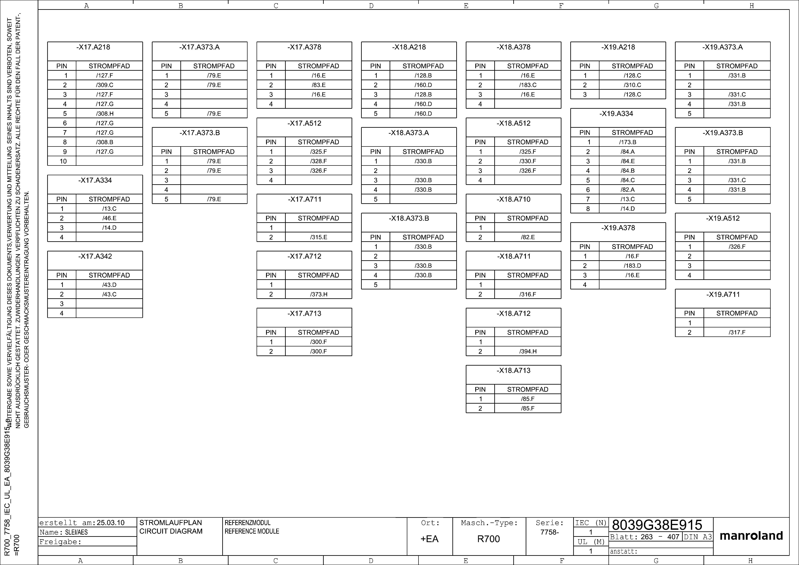

# +EA — Sheet 263 of 407 — REFERENZMODUL

**REFERENCE MODULE**

> Part of the manroland **R700** printing press IEC/UL circuit diagrams.
> Drawing class: **Stromlaufplan / Circuit diagram** (DIN A3).
> Document `+EA` covers the **Printing unit** machine section.

## At a glance

| Field | Value |
|---|---|
| Document | `+EA`  (8039G38E915) |
| Sheet | **263** of 407 |
| Section (DE) | REFERENZMODUL |
| Section (EN) | REFERENCE MODULE |
| Section type | REFERENCE_MODULE — Reference module |
| Machine type | `R700` |
| Series | `7758` |
| Created | 25.03.10 |
| Replaces | — |
| Columns used | A, B, C, D, E, F, G, H |
| Path numbers | — |
| Labels on sheet | 256 |
| Cross-refs out | 74 |
| Cross-refs in | 0 |

**Previous:** [+EA sheet 262](SHEET_0262.md) · **Next:** [+EA sheet 264](SHEET_0264.md) · **Document TOC:** [_TOC.md](_TOC.md)  (+EA) · **Master TOC:** [all sheets](../_MASTER_TOC.md)

## Sheet image (300 DPI, exact vector render)



_Rendered directly from the PDF vector layer at 300 DPI (1-bit), no OCR and no resampling. Use it to confirm anything ambiguous in the text below._

## Cross-references on this sheet

Each entry is a wire leaving this sheet. The printed token is `/sheet.column`; the link resolves to that sheet inside the same document.

| Ref | Target sheet | Col | Path | Destination on target | Target section | From col |
|---|---|---|---|---|---|---|
| `/79.E` | [+EA sheet 79](SHEET_0079.md) | E | — | — | AUSLEGERSTAPELSTEUERUNG | B |
| `/16.E` | [+EA sheet 16](SHEET_0016.md) | E | — | — | SPANNUNGSVERSORGUNG: 400V, 24V | C |
| `/16.E` | [+EA sheet 16](SHEET_0016.md) | E | — | — | SPANNUNGSVERSORGUNG: 400V, 24V | F |
| `/128.B` | [+EA sheet 128](SHEET_0128.md) | B | — | — | ZUGANGSABSICHERUNG | E |
| `/331.B` | [+EA sheet 331](SHEET_0331.md) | B | — | — | OPTION: BOGENWEICHE | H |
| `/127.F` | [+EA sheet 127](SHEET_0127.md) | F | — | — | ZUGANGSABSICHERUNG | A |
| `/128.C` | [+EA sheet 128](SHEET_0128.md) | C | — | — | ZUGANGSABSICHERUNG | G |
| `/79.E` | [+EA sheet 79](SHEET_0079.md) | E | — | — | AUSLEGERSTAPELSTEUERUNG | B |
| `/83.E` | [+EA sheet 83](SHEET_0083.md) | E | — | — | AUSLEGERSTAPELSTEUERUNG: PROGRAMMSCHALTWERK | C |
| `/309.C` | [+EA sheet 309](SHEET_0309.md) | C | — | — | OPTION: KLAPPPODEST B SEITE | A |
| `/160.D` | [+EA sheet 160](SHEET_0160.md) | D | — | — | ZUGANGSABSICHERUNG | E |
| `/183.C` | [+EA sheet 183](SHEET_0183.md) | C | — | — | RESERVE | F |
| `/310.C` | [+EA sheet 310](SHEET_0310.md) | C | — | — | OPTION: AUTOMATISCHE STAPELAUFFAHRT STOP / | G |
| `/16.E` | [+EA sheet 16](SHEET_0016.md) | E | — | — | SPANNUNGSVERSORGUNG: 400V, 24V | C |
| `/16.E` | [+EA sheet 16](SHEET_0016.md) | E | — | — | SPANNUNGSVERSORGUNG: 400V, 24V | F |
| `/127.F` | [+EA sheet 127](SHEET_0127.md) | F | — | — | ZUGANGSABSICHERUNG | A |
| `/128.B` | [+EA sheet 128](SHEET_0128.md) | B | — | — | ZUGANGSABSICHERUNG | E |
| `/128.C` | [+EA sheet 128](SHEET_0128.md) | C | — | — | ZUGANGSABSICHERUNG | G |
| `/331.C` | [+EA sheet 331](SHEET_0331.md) | C | — | — | OPTION: BOGENWEICHE | H |
| `/331.B` | [+EA sheet 331](SHEET_0331.md) | B | — | — | OPTION: BOGENWEICHE | H |
| `/127.G` | [+EA sheet 127](SHEET_0127.md) | G | — | — | ZUGANGSABSICHERUNG | A |
| `/160.D` | [+EA sheet 160](SHEET_0160.md) | D | — | — | ZUGANGSABSICHERUNG | E |
| `/79.E` | [+EA sheet 79](SHEET_0079.md) | E | — | — | AUSLEGERSTAPELSTEUERUNG | B |
| `/308.H` | [+EA sheet 308](SHEET_0308.md) | H | — | — | OPTION: KLAPPPODEST B SEITE | A |
| `/160.D` | [+EA sheet 160](SHEET_0160.md) | D | — | — | ZUGANGSABSICHERUNG | E |
| `/127.G` | [+EA sheet 127](SHEET_0127.md) | G | — | — | ZUGANGSABSICHERUNG | A |
| `/127.G` | [+EA sheet 127](SHEET_0127.md) | G | — | — | ZUGANGSABSICHERUNG | A |
| `/308.B` | [+EA sheet 308](SHEET_0308.md) | B | — | — | OPTION: KLAPPPODEST B SEITE | A |
| `/173.B` | [+EA sheet 173](SHEET_0173.md) | B | — | — | RESERVE | G |
| `/84.A` | [+EA sheet 84](SHEET_0084.md) | A | — | — | AUSLEGERSTAPELSTEUERUNG: PROGRAMMSCHALTWERK | G |
| `/325.F` | [+EA sheet 325](SHEET_0325.md) | F | — | — | OPTION: BOGENWEICHE | C |
| `/325.F` | [+EA sheet 325](SHEET_0325.md) | F | — | — | OPTION: BOGENWEICHE | F |
| `/127.G` | [+EA sheet 127](SHEET_0127.md) | G | — | — | ZUGANGSABSICHERUNG | A |
| `/79.E` | [+EA sheet 79](SHEET_0079.md) | E | — | — | AUSLEGERSTAPELSTEUERUNG | B |
| `/84.E` | [+EA sheet 84](SHEET_0084.md) | E | — | — | AUSLEGERSTAPELSTEUERUNG: PROGRAMMSCHALTWERK | G |
| `/330.B` | [+EA sheet 330](SHEET_0330.md) | B | — | — | OPTION: BOGENWEICHE | E |
| `/331.B` | [+EA sheet 331](SHEET_0331.md) | B | — | — | OPTION: BOGENWEICHE | H |
| `/328.F` | [+EA sheet 328](SHEET_0328.md) | F | — | — | OPTION: BOGENWEICHE | C |
| `/330.F` | [+EA sheet 330](SHEET_0330.md) | F | — | — | OPTION: BOGENWEICHE | F |
| `/79.E` | [+EA sheet 79](SHEET_0079.md) | E | — | — | AUSLEGERSTAPELSTEUERUNG | B |
| `/84.B` | [+EA sheet 84](SHEET_0084.md) | B | — | — | AUSLEGERSTAPELSTEUERUNG: PROGRAMMSCHALTWERK | G |
| `/326.F` | [+EA sheet 326](SHEET_0326.md) | F | — | — | OPTION: BOGENWEICHE | C |
| `/326.F` | [+EA sheet 326](SHEET_0326.md) | F | — | — | OPTION: BOGENWEICHE | F |
| `/330.B` | [+EA sheet 330](SHEET_0330.md) | B | — | — | OPTION: BOGENWEICHE | E |
| `/84.C` | [+EA sheet 84](SHEET_0084.md) | C | — | — | AUSLEGERSTAPELSTEUERUNG: PROGRAMMSCHALTWERK | G |
| `/331.C` | [+EA sheet 331](SHEET_0331.md) | C | — | — | OPTION: BOGENWEICHE | H |
| `/82.A` | [+EA sheet 82](SHEET_0082.md) | A | — | — | AUSLEGERSTAPELSTEUERUNG: PROGRAMMSCHALTWERK | G |
| `/330.B` | [+EA sheet 330](SHEET_0330.md) | B | — | — | OPTION: BOGENWEICHE | E |
| `/331.B` | [+EA sheet 331](SHEET_0331.md) | B | — | — | OPTION: BOGENWEICHE | H |
| `/79.E` | [+EA sheet 79](SHEET_0079.md) | E | — | — | AUSLEGERSTAPELSTEUERUNG | B |
| `/13.C` | [+EA sheet 13](SHEET_0013.md) | C | — | — | SPANNUNGSVERSORGUNG: 400V, 24V | G |
| `/13.C` | [+EA sheet 13](SHEET_0013.md) | C | — | — | SPANNUNGSVERSORGUNG: 400V, 24V | A |
| `/14.D` | [+EA sheet 14](SHEET_0014.md) | D | — | — | SPANNUNGSVERSORGUNG: 400V, 24V | G |
| `/46.E` | [+EA sheet 46](SHEET_0046.md) | E | — | — | SCHUTZ | A |
| `/14.D` | [+EA sheet 14](SHEET_0014.md) | D | — | — | SPANNUNGSVERSORGUNG: 400V, 24V | A |
| `/326.F` | [+EA sheet 326](SHEET_0326.md) | F | — | STROMPFAD PIN 1 2 3 4 | OPTION: BOGENWEICHE | H |
| `/82.E` | [+EA sheet 82](SHEET_0082.md) | E | — | — | AUSLEGERSTAPELSTEUERUNG: PROGRAMMSCHALTWERK | F |
| `/315.E` | [+EA sheet 315](SHEET_0315.md) | E | — | — | OPTION: LOGISTIK, AUSLEGER | C |
| `/330.B` | [+EA sheet 330](SHEET_0330.md) | B | — | — | OPTION: BOGENWEICHE | E |
| `/16.F` | [+EA sheet 16](SHEET_0016.md) | F | — | — | SPANNUNGSVERSORGUNG: 400V, 24V | G |
| `/330.B` | [+EA sheet 330](SHEET_0330.md) | B | — | — | OPTION: BOGENWEICHE | E |
| `/183.D` | [+EA sheet 183](SHEET_0183.md) | D | — | — | RESERVE | G |
| `/16.E` | [+EA sheet 16](SHEET_0016.md) | E | — | — | SPANNUNGSVERSORGUNG: 400V, 24V | G |
| `/330.B` | [+EA sheet 330](SHEET_0330.md) | B | — | — | OPTION: BOGENWEICHE | E |
| `/43.D` | [+EA sheet 43](SHEET_0043.md) | D | — | — | BUSVERBINDUNGEN: SIGNALSCHLEIFE | A |
| `/316.F` | [+EA sheet 316](SHEET_0316.md) | F | — | — | OPTION: LOGISTIK, AUSLEGER | F |
| `/43.C` | [+EA sheet 43](SHEET_0043.md) | C | — | — | BUSVERBINDUNGEN: SIGNALSCHLEIFE | A |
| `/373.H` | [+EA sheet 373](SHEET_0373.md) | H | — | — | OPTION: ENDTROCKNER 1 VORBEREITUNG; | C |
| `/317.F` | [+EA sheet 317](SHEET_0317.md) | F | — | — | OPTION: LOGISTIK, AUSLEGER | H |
| `/300.F` | [+EA sheet 300](SHEET_0300.md) | F | — | — | OPTION: ZWISCHENSTAPEL / | C |
| `/300.F` | [+EA sheet 300](SHEET_0300.md) | F | — | — | OPTION: ZWISCHENSTAPEL / | C |
| `/394.H` | [+EA sheet 394](SHEET_0394.md) | H | — | — | OPTION: ZWISCHENTROCKNER VORBEREITUNG; | F |
| `/85.F` | [+EA sheet 85](SHEET_0085.md) | F | — | — | AUSLEGERSTAPELSTEUERUNG: PROGRAMMSCHALTWERK | F |
| `/85.F` | [+EA sheet 85](SHEET_0085.md) | F | — | — | AUSLEGERSTAPELSTEUERUNG: PROGRAMMSCHALTWERK | F |

## Devices on this sheet

| Tag | Class | Class meaning (IEC) | Col | Sub | Terminal | Sign |
|---|---|---|---|---|---|---|
| `X17.A334` | — | cross-device reference | A | — | — | — |
| `X17.A342` | — | cross-device reference | A | — | — | — |
| `X17.A218` | — | cross-device reference | A | — | — | — |
| `X17.A373.A` | — | cross-device reference | B | — | — | — |
| `X17.A373.B` | — | cross-device reference | B | — | — | — |
| `X17.A378` | — | cross-device reference | C | — | — | — |
| `X17.A512` | — | cross-device reference | C | — | — | — |
| `X19.A373.A` | — | cross-device reference | H | — | — | — |
| `X19.A373.B` | — | cross-device reference | H | — | — | — |
| `X19.A512` | — | cross-device reference | H | — | — | — |
| `X19.A218` | — | cross-device reference | G | — | — | — |
| `X19.A334` | — | cross-device reference | G | — | — | — |
| `X19.A378` | — | cross-device reference | G | — | — | — |
| `X18.A378` | — | cross-device reference | F | — | — | — |
| `X18.A512` | — | cross-device reference | F | — | — | — |
| `X18.A218` | — | cross-device reference | D | — | — | — |
| `X18.A373.A` | — | cross-device reference | D | — | — | — |
| `X18.A373.B` | — | cross-device reference | D | — | — | — |
| `X17.A712` | — | cross-device reference | C | — | — | — |
| `X17.A713` | — | cross-device reference | C | — | — | — |
| `X17.A711` | — | cross-device reference | C | — | — | — |
| `X18.A710` | — | cross-device reference | F | — | — | — |
| `X18.A712` | — | cross-device reference | F | — | — | — |
| `X18.A713` | — | cross-device reference | F | — | — | — |
| `X18.A711` | — | cross-device reference | F | — | — | — |
| `X19.A711` | — | cross-device reference | H | — | — | — |

## Potentials / nets

_No named potentials on this sheet._

## Wire-end annotations (grouped as printed)

A wire that continues elsewhere is annotated with a small cluster: the destination description, the path/line number `#NN`, and the `/sheet.column` cross reference. Each row below is one such cluster exactly as it is grouped on the drawing.

| Col | Y | Path | Cross-ref | Text on the wire |
|---|---|---|---|---|
| A | 65.5 | — | — | `X17.A218` |
| B | 65.5 | — | — | `X17.A373.A` |
| C | 65.5 | — | — | `X17.A378` |
| D | 65.5 | — | — | `X18.A218` |
| F | 65.5 | — | — | `X18.A378` |
| G | 65.5 | — | — | `X19.A218` |
| H | 65.5 | — | — | `X19.A373.A` |
| A | 94.2 | — | — | `PIN 10 2 3 4 5 6 7 8 9 1 STROMPFAD` |
| B | 94.2 | — | — | `PIN 2 3 4 5 1 STROMPFAD` |
| C | 94.2 | — | — | `PIN 2 3 4 1 STROMPFAD` |
| D | 94.2 | — | — | `PIN 2 3 4 5 1 STROMPFAD` |
| E | 94.2 | — | — | `PIN 2 3 4 1 STROMPFAD` |
| G | 94.2 | — | — | `PIN 2 3 1 STROMPFAD` |
| H | 94.2 | — | — | `PIN 2 3 4 5 1 STROMPFAD` |
| A | 108.7 | — | `/127.F` | — |
| B | 108.7 | — | `/79.E` | — |
| C | 108.7 | — | `/16.E` | — |
| E | 108.7 | — | `/128.B` | — |
| F | 108.7 | — | `/16.E` | — |
| G | 108.7 | — | `/128.C` | — |
| H | 108.7 | — | `/331.B` | — |
| B | 122.8 | — | `/79.E` | — |
| C | 122.8 | — | `/83.E` | — |
| A | 122.9 | — | `/309.C` | — |
| E | 122.9 | — | `/160.D` | — |
| F | 122.9 | — | `/183.C` | — |
| G | 122.9 | — | `/310.C` | — |
| A | 137.0 | — | `/127.F` | — |
| C | 137.0 | — | `/16.E` | — |
| E | 137.0 | — | `/128.B` | — |
| F | 137.0 | — | `/16.E` | — |
| G | 137.1 | — | `/128.C` | — |
| H | 137.1 | — | `/331.C` | — |
| A | 151.2 | — | `/127.G` | — |
| E | 151.2 | — | `/160.D` | — |
| H | 151.2 | — | `/331.B` | — |
| G | 164.7 | — | — | `X19.A334` |
| A | 165.4 | — | `/308.H` | — |
| B | 165.4 | — | `/79.E` | — |
| E | 165.4 | — | `/160.D` | — |
| C | 178.9 | — | — | `X17.A512` |
| F | 178.9 | — | — | `X18.A512` |
| A | 179.6 | — | `/127.G` | — |
| B | 193.1 | — | — | `X17.A373.B` |
| D | 193.1 | — | — | `X18.A373.A` |
| H | 193.1 | — | — | `X19.A373.B` |
| G | 193.4 | — | — | `PIN 2 3 4 5 6 7 8 1 STROMPFAD` |
| A | 193.7 | — | `/127.G` | — |
| C | 207.5 | — | — | `PIN 2 3 4 1 STROMPFAD` |
| E | 207.5 | — | — | `PIN 2 3 4 1 STROMPFAD` |
| A | 207.9 | — | `/308.B` | — |
| G | 207.9 | — | `/173.B` | — |
| B | 221.7 | — | — | `PIN 2 3 4 5 1 STROMPFAD` |
| D | 221.7 | — | — | `PIN 2 3 4 5 1 STROMPFAD` |
| H | 221.7 | — | — | `PIN 2 3 4 5 1 STROMPFAD` |
| A | 222.1 | — | `/127.G` | — |
| C | 222.1 | — | `/325.F` | — |
| F | 222.1 | — | `/325.F` | — |
| G | 222.1 | — | `/84.A` | — |
| B | 236.2 | — | `/79.E` | — |
| E | 236.2 | — | `/330.B` | — |
| G | 236.2 | — | `/84.E` | — |
| H | 236.2 | — | `/331.B` | — |
| C | 236.3 | — | `/328.F` | — |
| F | 236.3 | — | `/330.F` | — |
| B | 250.4 | — | `/79.E` | — |
| C | 250.4 | — | `/326.F` | — |
| F | 250.4 | — | `/326.F` | — |
| G | 250.4 | — | `/84.B` | — |
| A | 263.9 | — | — | `X17.A334` |
| E | 264.6 | — | `/330.B` | — |
| G | 264.6 | — | `/84.C` | — |
| H | 264.6 | — | `/331.C` | — |
| E | 278.8 | — | `/330.B` | — |
| G | 278.8 | — | `/82.A` | — |
| H | 278.8 | — | `/331.B` | — |
| C | 292.3 | — | — | `X17.A711` |
| F | 292.3 | — | — | `X18.A710` |
| A | 292.6 | — | — | `PIN 2 3 4 1 STROMPFAD` |
| B | 292.9 | — | `/79.E` | — |
| G | 293.0 | — | `/13.C` | — |
| A | 307.1 | — | `/13.C` | — |
| G | 307.1 | — | `/14.D` | — |
| D | 320.6 | — | — | `X18.A373.B` |
| H | 320.6 | — | — | `X19.A512` |
| C | 320.9 | — | — | `PIN 2 1 STROMPFAD` |
| E | 320.9 | — | — | `PIN 2 1 STROMPFAD` |
| A | 321.3 | — | `/46.E` | — |
| G | 334.8 | — | — | `X19.A378` |
| A | 335.5 | — | `/14.D` | — |
| D | 349.3 | — | — | `PIN 2 3 4 5 1 STROMPFAD` |
| H | 349.3 | — | `/326.F` | `PIN 2 3 4 1 STROMPFAD` |
| C | 349.6 | — | `/315.E` | — |
| F | 349.6 | — | `/82.E` | — |
| G | 363.4 | — | — | `PIN 2 3 4 1 STROMPFAD` |
| E | 363.8 | — | `/330.B` | — |
| A | 377.3 | — | — | `X17.A342` |
| C | 377.3 | — | — | `X17.A712` |
| F | 377.3 | — | — | `X18.A711` |
| G | 378.0 | — | `/16.F` | — |
| E | 392.1 | — | `/330.B` | — |
| G | 392.2 | — | `/183.D` | — |
| A | 406.0 | — | — | `PIN 2 3 4 1 STROMPFAD` |
| C | 406.0 | — | — | `PIN 2 1 STROMPFAD` |
| E | 406.0 | — | — | `PIN 2 1 STROMPFAD` |
| E | 406.3 | — | `/330.B` | — |
| G | 406.3 | — | `/16.E` | — |
| A | 420.5 | — | `/43.D` | — |
| H | 434.0 | — | — | `X19.A711` |
| A | 434.7 | — | `/43.C` | — |
| C | 434.7 | — | `/373.H` | — |
| F | 434.7 | — | `/316.F` | — |
| C | 462.4 | — | — | `X17.A713` |
| F | 462.4 | — | — | `X18.A712` |
| H | 462.7 | — | — | `PIN 2 1 STROMPFAD` |
| C | 491.0 | — | — | `PIN 2 1 STROMPFAD` |
| E | 491.0 | — | — | `PIN 2 1 STROMPFAD` |
| H | 491.4 | — | `/317.F` | — |
| C | 505.6 | — | `/300.F` | — |
| C | 519.7 | — | `/300.F` | — |
| F | 519.7 | — | `/394.H` | — |
| F | 547.4 | — | — | `X18.A713` |
| E | 576.0 | — | — | `PIN 2 1 STROMPFAD` |
| F | 590.6 | — | `/85.F` | — |
| F | 604.8 | — | `/85.F` | — |


## Reconstructed tables

This sheet carries tabular content (pin map / terminal assignment / index). The grid below was rebuilt from the drawing's own rule lines, so each row is exactly one physical row of the table.

### Table 1 — 22 data rows × 2 columns (at x=70.9, y=62.4) — **X17.A218**

| PIN | STROMPFAD |
|---|---|
| `1` | `/127.F` |
| `2` | `/309.C` |
| `3` | `/127.F` |
| `4` | `/127.G` |
| `5` | `/308.H` |
| `6` | `/127.G` |
| `7` | `/127.G` |
| `8` | `/308.B` |
| `9` | `/127.G` |
| `10` |  |
|  | `X17.A334` |
| `PIN` | `STROMPFAD` |
| `1` | `/13.C` |
| `2` | `/46.E` |
| `3` | `/14.D` |
| `4` |  |
|  | `X17.A342` |
| `PIN` | `STROMPFAD` |
| `1` | `/43.D` |
| `2` | `/43.C` |
| `3` |  |
| `4` |  |


### Table 2 — 12 data rows × 2 columns (at x=226.8, y=62.4) — **X17.A373.A**

| PIN | STROMPFAD |
|---|---|
| `1` | `/79.E` |
| `2` | `/79.E` |
| `3` |  |
| `4` |  |
| `5` | `/79.E` |
|  | `X17.A373.B` |
| `PIN` | `STROMPFAD` |
| `1` | `/79.E` |
| `2` | `/79.E` |
| `3` |  |
| `4` |  |
| `5` | `/79.E` |


### Table 3 — 22 data rows × 2 columns (at x=382.7, y=62.4) — **X17.A378**

| PIN | STROMPFAD |
|---|---|
| `1` | `/16.E` |
| `2` | `/83.E` |
| `3` | `/16.E` |
| `4` |  |
|  | `X17.A512` |
| `PIN` | `STROMPFAD` |
| `1` | `/325.F` |
| `2` | `/328.F` |
| `3` | `/326.F` |
| `4` |  |
|  | `X17.A711` |
| `PIN` | `STROMPFAD` |
| `1` |  |
| `2` | `/315.E` |
|  | `X17.A712` |
| `PIN` | `STROMPFAD` |
| `1` |  |
| `2` | `/373.H` |
|  | `X17.A713` |
| `PIN` | `STROMPFAD` |
| `1` | `/300.F` |
| `2` | `/300.F` |


### Table 4 — 19 data rows × 2 columns (at x=538.6, y=62.4) — **X18.A218**

| PIN | STROMPFAD |
|---|---|
| `1` | `/128.B` |
| `2` | `/160.D` |
| `3` | `/128.B` |
| `4` | `/160.D` |
| `5` | `/160.D` |
|  | `X18.A373.A` |
| `PIN` | `STROMPFAD` |
| `1` | `/330.B` |
| `2` |  |
| `3` | `/330.B` |
| `4` | `/330.B` |
| `5` |  |
|  | `X18.A373.B` |
| `PIN` | `STROMPFAD` |
| `1` | `/330.B` |
| `2` |  |
| `3` | `/330.B` |
| `4` | `/330.B` |
| `5` |  |


### Table 5 — 26 data rows × 2 columns (at x=694.5, y=62.4) — **X18.A378**

| PIN | STROMPFAD |
|---|---|
| `1` | `/16.E` |
| `2` | `/183.C` |
| `3` | `/16.E` |
| `4` |  |
|  | `X18.A512` |
| `PIN` | `STROMPFAD` |
| `1` | `/325.F` |
| `2` | `/330.F` |
| `3` | `/326.F` |
| `4` |  |
|  | `X18.A710` |
| `PIN` | `STROMPFAD` |
| `1` |  |
| `2` | `/82.E` |
|  | `X18.A711` |
| `PIN` | `STROMPFAD` |
| `1` |  |
| `2` | `/316.F` |
|  | `X18.A712` |
| `PIN` | `STROMPFAD` |
| `1` |  |
| `2` | `/394.H` |
|  | `X18.A713` |
| `PIN` | `STROMPFAD` |
| `1` | `/85.F` |
| `2` | `/85.F` |


### Table 6 — 19 data rows × 2 columns (at x=850.4, y=62.4) — **X19.A218**

| PIN | STROMPFAD |
|---|---|
| `1` | `/128.C` |
| `2` | `/310.C` |
| `3` | `/128.C` |
|  | `X19.A334` |
| `PIN` | `STROMPFAD` |
| `1` | `/173.B` |
| `2` | `/84.A` |
| `3` | `/84.E` |
| `4` | `/84.B` |
| `5` | `/84.C` |
| `6` | `/82.A` |
| `7` | `/13.C` |
| `8` | `/14.D` |
|  | `X19.A378` |
| `PIN` | `STROMPFAD` |
| `1` | `/16.F` |
| `2` | `/183.D` |
| `3` | `/16.E` |
| `4` |  |


### Table 7 — 22 data rows × 2 columns (at x=1006.3, y=62.4) — **X19.A373.A**

| PIN | STROMPFAD |
|---|---|
| `1` | `/331.B` |
| `2` |  |
| `3` | `/331.C` |
| `4` | `/331.B` |
| `5` |  |
|  | `X19.A373.B` |
| `PIN` | `STROMPFAD` |
| `1` | `/331.B` |
| `2` |  |
| `3` | `/331.C` |
| `4` | `/331.B` |
| `5` |  |
|  | `X19.A512` |
| `PIN` | `STROMPFAD` |
| `1` | `/326.F` |
| `2` |  |
| `3` |  |
| `4` |  |
|  | `X19.A711` |
| `PIN` | `STROMPFAD` |
| `1` |  |
| `2` | `/317.F` |


## Notes and free text on this sheet

| Text | Col | Y (pt) |
|---|---|---|
| `PIN` | A | 292.62 |
| `STROMPFAD` | A | 292.58 |
| `PIN` | B | 94.2 |
| `STROMPFAD` | B | 94.15 |
| `PIN` | C | 94.2 |
| `STROMPFAD` | C | 94.15 |
| `PIN` | G | 94.2 |
| `STROMPFAD` | H | 94.15 |
| `PIN` | F | 94.2 |
| `STROMPFAD` | G | 94.15 |
| `PIN` | E | 94.2 |
| `STROMPFAD` | F | 94.15 |
| `PIN` | D | 94.2 |
| `STROMPFAD` | E | 94.15 |

## Complete label inventory (exact text from the drawing)

Every text object inside the drawing area of this sheet, in DIN reading order (column A→H, then top→bottom). This is the authoritative list: if a string is not here it is not printed on this sheet.

| Col | Y | X | Dir | Type | Text |
|---|---|---|---|---|---|
| A | 65.5 | 114.0 | → | device ref | `X17.A218` |
| A | 94.2 | 84.0 | → | text | `PIN` |
| A | 94.2 | 132.2 | → | text | `STROMPFAD` |
| A | 108.4 | 95.8 | → | number | `1` |
| A | 108.7 | 143.6 | → | cross-reference | `/127.F` |
| A | 122.5 | 94.1 | → | number | `2` |
| A | 122.9 | 143.1 | → | cross-reference | `/309.C` |
| A | 136.7 | 94.1 | → | number | `3` |
| A | 137.0 | 143.6 | → | cross-reference | `/127.F` |
| A | 150.9 | 94.1 | → | number | `4` |
| A | 151.2 | 143.0 | → | cross-reference | `/127.G` |
| A | 165.1 | 94.1 | → | number | `5` |
| A | 165.4 | 143.4 | → | cross-reference | `/308.H` |
| A | 179.2 | 94.1 | → | number | `6` |
| A | 179.6 | 143.0 | → | cross-reference | `/127.G` |
| A | 193.4 | 94.1 | → | number | `7` |
| A | 193.7 | 143.0 | → | cross-reference | `/127.G` |
| A | 207.6 | 94.1 | → | number | `8` |
| A | 207.9 | 143.3 | → | cross-reference | `/308.B` |
| A | 221.8 | 94.1 | → | number | `9` |
| A | 222.1 | 143.0 | → | cross-reference | `/127.G` |
| A | 235.9 | 88.7 | → | number | `10` |
| A | 263.9 | 116.8 | → | device ref | `X17.A334` |
| A | 292.6 | 84.0 | → | text | `PIN` |
| A | 292.6 | 132.2 | → | text | `STROMPFAD` |
| A | 306.8 | 90.0 | → | number | `1` |
| A | 307.1 | 152.6 | → | cross-reference | `/13.C` |
| A | 321.0 | 89.4 | → | number | `2` |
| A | 321.3 | 152.9 | → | cross-reference | `/46.E` |
| A | 335.1 | 89.4 | → | number | `3` |
| A | 335.5 | 152.6 | → | cross-reference | `/14.D` |
| A | 349.3 | 89.4 | → | number | `4` |
| A | 377.3 | 116.8 | → | device ref | `X17.A342` |
| A | 406.0 | 84.0 | → | text | `PIN` |
| A | 406.0 | 132.2 | → | text | `STROMPFAD` |
| A | 420.2 | 90.0 | → | number | `1` |
| A | 420.5 | 152.6 | → | cross-reference | `/43.D` |
| A | 434.4 | 89.4 | → | number | `2` |
| A | 434.7 | 152.6 | → | cross-reference | `/43.C` |
| A | 448.5 | 89.4 | → | number | `3` |
| A | 462.7 | 89.4 | → | number | `4` |
| B | 65.5 | 267.3 | → | device ref | `X17.A373.A` |
| B | 94.2 | 240.0 | → | text | `PIN` |
| B | 94.2 | 288.1 | → | text | `STROMPFAD` |
| B | 108.4 | 245.9 | → | number | `1` |
| B | 108.7 | 308.8 | → | cross-reference | `/79.E` |
| B | 122.5 | 245.3 | → | number | `2` |
| B | 122.8 | 308.8 | → | cross-reference | `/79.E` |
| B | 136.7 | 245.3 | → | number | `3` |
| B | 150.9 | 245.3 | → | number | `4` |
| B | 165.1 | 245.3 | → | number | `5` |
| B | 165.4 | 308.8 | → | cross-reference | `/79.E` |
| B | 193.1 | 267.7 | → | device ref | `X17.A373.B` |
| B | 221.7 | 288.1 | → | text | `STROMPFAD` |
| B | 221.8 | 240.0 | → | text | `PIN` |
| B | 235.9 | 245.9 | → | number | `1` |
| B | 236.2 | 308.8 | → | cross-reference | `/79.E` |
| B | 250.1 | 245.3 | → | number | `2` |
| B | 250.4 | 308.8 | → | cross-reference | `/79.E` |
| B | 264.3 | 245.3 | → | number | `3` |
| B | 278.5 | 245.3 | → | number | `4` |
| B | 292.6 | 245.3 | → | number | `5` |
| B | 292.9 | 308.8 | → | cross-reference | `/79.E` |
| C | 65.5 | 428.6 | → | device ref | `X17.A378` |
| C | 94.2 | 395.9 | → | text | `PIN` |
| C | 94.2 | 444.0 | → | text | `STROMPFAD` |
| C | 108.4 | 401.8 | → | number | `1` |
| C | 108.7 | 464.7 | → | cross-reference | `/16.E` |
| C | 122.5 | 401.2 | → | number | `2` |
| C | 122.8 | 464.7 | → | cross-reference | `/83.E` |
| C | 136.7 | 401.2 | → | number | `3` |
| C | 137.0 | 464.7 | → | cross-reference | `/16.E` |
| C | 150.9 | 401.2 | → | number | `4` |
| C | 178.9 | 428.6 | → | device ref | `X17.A512` |
| C | 207.5 | 444.0 | → | text | `STROMPFAD` |
| C | 207.6 | 395.9 | → | text | `PIN` |
| C | 221.8 | 401.8 | → | number | `1` |
| C | 222.1 | 462.5 | → | cross-reference | `/325.F` |
| C | 235.9 | 401.2 | → | number | `2` |
| C | 236.3 | 462.5 | → | cross-reference | `/328.F` |
| C | 250.1 | 401.2 | → | number | `3` |
| C | 250.4 | 462.5 | → | cross-reference | `/326.F` |
| C | 264.3 | 401.2 | → | number | `4` |
| C | 292.3 | 429.3 | → | device ref | `X17.A711` |
| C | 320.9 | 444.0 | → | text | `STROMPFAD` |
| C | 321.0 | 395.9 | → | text | `PIN` |
| C | 335.1 | 401.8 | → | number | `1` |
| C | 349.3 | 401.2 | → | number | `2` |
| C | 349.6 | 462.3 | → | cross-reference | `/315.E` |
| C | 377.3 | 428.6 | → | device ref | `X17.A712` |
| C | 406.0 | 395.9 | → | text | `PIN` |
| C | 406.0 | 444.0 | → | text | `STROMPFAD` |
| C | 420.2 | 401.8 | → | number | `1` |
| C | 434.4 | 401.2 | → | number | `2` |
| C | 434.7 | 462.3 | → | cross-reference | `/373.H` |
| C | 462.4 | 428.6 | → | device ref | `X17.A713` |
| C | 491.0 | 395.9 | → | text | `PIN` |
| C | 491.0 | 444.0 | → | text | `STROMPFAD` |
| C | 505.2 | 401.8 | → | number | `1` |
| C | 505.5 | 462.5 | → | cross-reference | `/300.F` |
| C | 519.4 | 401.2 | → | number | `2` |
| C | 519.7 | 462.5 | → | cross-reference | `/300.F` |
| D | 65.5 | 584.5 | → | device ref | `X18.A218` |
| D | 94.2 | 551.8 | → | text | `PIN` |
| D | 108.4 | 557.7 | → | number | `1` |
| D | 122.5 | 557.1 | → | number | `2` |
| D | 136.7 | 557.1 | → | number | `3` |
| D | 150.9 | 557.1 | → | number | `4` |
| D | 165.1 | 557.1 | → | number | `5` |
| D | 193.1 | 579.1 | → | device ref | `X18.A373.A` |
| D | 221.8 | 551.8 | → | text | `PIN` |
| D | 235.9 | 557.7 | → | number | `1` |
| D | 250.1 | 557.1 | → | number | `2` |
| D | 264.3 | 557.1 | → | number | `3` |
| D | 278.5 | 557.1 | → | number | `4` |
| D | 292.6 | 557.1 | → | number | `5` |
| D | 320.6 | 579.5 | → | device ref | `X18.A373.B` |
| D | 349.3 | 551.8 | → | text | `PIN` |
| D | 363.5 | 557.7 | → | number | `1` |
| D | 377.7 | 557.1 | → | number | `2` |
| D | 391.8 | 557.1 | → | number | `3` |
| D | 406.0 | 557.1 | → | number | `4` |
| D | 420.2 | 557.1 | → | number | `5` |
| E | 94.2 | 600.0 | → | text | `STROMPFAD` |
| E | 94.2 | 707.7 | → | text | `PIN` |
| E | 108.4 | 713.6 | → | number | `1` |
| E | 108.7 | 618.1 | → | cross-reference | `/128.B` |
| E | 122.5 | 713.1 | → | number | `2` |
| E | 122.9 | 618.0 | → | cross-reference | `/160.D` |
| E | 136.7 | 713.1 | → | number | `3` |
| E | 137.0 | 618.1 | → | cross-reference | `/128.B` |
| E | 150.9 | 713.1 | → | number | `4` |
| E | 151.2 | 618.0 | → | cross-reference | `/160.D` |
| E | 165.4 | 618.0 | → | cross-reference | `/160.D` |
| E | 207.6 | 707.7 | → | text | `PIN` |
| E | 221.7 | 600.0 | → | text | `STROMPFAD` |
| E | 221.8 | 713.6 | → | number | `1` |
| E | 235.9 | 713.1 | → | number | `2` |
| E | 236.2 | 618.1 | → | cross-reference | `/330.B` |
| E | 250.1 | 713.1 | → | number | `3` |
| E | 264.3 | 713.1 | → | number | `4` |
| E | 264.6 | 618.1 | → | cross-reference | `/330.B` |
| E | 278.8 | 618.1 | → | cross-reference | `/330.B` |
| E | 321.0 | 707.7 | → | text | `PIN` |
| E | 335.1 | 713.6 | → | number | `1` |
| E | 349.3 | 600.0 | → | text | `STROMPFAD` |
| E | 349.3 | 713.1 | → | number | `2` |
| E | 363.8 | 618.1 | → | cross-reference | `/330.B` |
| E | 392.2 | 618.1 | → | cross-reference | `/330.B` |
| E | 406.0 | 707.7 | → | text | `PIN` |
| E | 406.3 | 618.1 | → | cross-reference | `/330.B` |
| E | 420.2 | 713.6 | → | number | `1` |
| E | 434.4 | 713.1 | → | number | `2` |
| E | 491.0 | 707.7 | → | text | `PIN` |
| E | 505.2 | 713.6 | → | number | `1` |
| E | 519.4 | 713.1 | → | number | `2` |
| E | 576.1 | 707.7 | → | text | `PIN` |
| E | 590.3 | 713.6 | → | number | `1` |
| E | 604.4 | 713.1 | → | number | `2` |
| F | 65.5 | 740.4 | → | device ref | `X18.A378` |
| F | 94.2 | 755.9 | → | text | `STROMPFAD` |
| F | 94.2 | 863.6 | → | text | `PIN` |
| F | 108.4 | 869.5 | → | number | `1` |
| F | 108.7 | 776.6 | → | cross-reference | `/16.E` |
| F | 122.5 | 869.0 | → | number | `2` |
| F | 122.9 | 773.9 | → | cross-reference | `/183.C` |
| F | 136.7 | 869.0 | → | number | `3` |
| F | 137.0 | 776.6 | → | cross-reference | `/16.E` |
| F | 178.9 | 740.4 | → | device ref | `X18.A512` |
| F | 193.4 | 863.6 | → | text | `PIN` |
| F | 207.5 | 755.9 | → | text | `STROMPFAD` |
| F | 207.6 | 875.3 | → | number | `1` |
| F | 221.8 | 873.6 | → | number | `2` |
| F | 222.1 | 774.3 | → | cross-reference | `/325.F` |
| F | 235.9 | 873.6 | → | number | `3` |
| F | 236.3 | 774.3 | → | cross-reference | `/330.F` |
| F | 250.1 | 873.6 | → | number | `4` |
| F | 250.4 | 774.3 | → | cross-reference | `/326.F` |
| F | 264.3 | 873.6 | → | number | `5` |
| F | 278.5 | 873.6 | → | number | `6` |
| F | 292.3 | 740.4 | → | device ref | `X18.A710` |
| F | 292.6 | 873.6 | → | number | `7` |
| F | 306.8 | 873.6 | → | number | `8` |
| F | 320.9 | 755.9 | → | text | `STROMPFAD` |
| F | 349.6 | 776.6 | → | cross-reference | `/82.E` |
| F | 363.5 | 863.6 | → | text | `PIN` |
| F | 377.3 | 741.1 | → | device ref | `X18.A711` |
| F | 377.7 | 869.5 | → | number | `1` |
| F | 391.8 | 869.0 | → | number | `2` |
| F | 406.0 | 755.9 | → | text | `STROMPFAD` |
| F | 406.0 | 869.0 | → | number | `3` |
| F | 420.2 | 869.0 | → | number | `4` |
| F | 434.7 | 774.3 | → | cross-reference | `/316.F` |
| F | 462.4 | 740.4 | → | device ref | `X18.A712` |
| F | 491.0 | 755.9 | → | text | `STROMPFAD` |
| F | 519.7 | 774.1 | → | cross-reference | `/394.H` |
| F | 547.4 | 740.4 | → | device ref | `X18.A713` |
| F | 576.0 | 755.9 | → | text | `STROMPFAD` |
| F | 590.6 | 776.7 | → | cross-reference | `/85.F` |
| F | 604.7 | 776.7 | → | cross-reference | `/85.F` |
| G | 65.5 | 896.3 | → | device ref | `X19.A218` |
| G | 94.2 | 911.8 | → | text | `STROMPFAD` |
| G | 94.2 | 1019.5 | → | text | `PIN` |
| G | 108.4 | 1025.4 | → | number | `1` |
| G | 108.7 | 929.8 | → | cross-reference | `/128.C` |
| G | 122.5 | 1024.9 | → | number | `2` |
| G | 122.9 | 929.8 | → | cross-reference | `/310.C` |
| G | 136.7 | 1024.9 | → | number | `3` |
| G | 137.1 | 929.8 | → | cross-reference | `/128.C` |
| G | 150.9 | 1024.9 | → | number | `4` |
| G | 164.7 | 893.5 | → | device ref | `X19.A334` |
| G | 165.1 | 1024.9 | → | number | `5` |
| G | 193.4 | 911.8 | → | text | `STROMPFAD` |
| G | 207.9 | 922.8 | → | cross-reference | `/173.B` |
| G | 221.8 | 1019.5 | → | text | `PIN` |
| G | 222.1 | 925.1 | → | cross-reference | `/84.A` |
| G | 235.9 | 1025.4 | → | number | `1` |
| G | 236.2 | 925.4 | → | cross-reference | `/84.E` |
| G | 250.1 | 1024.9 | → | number | `2` |
| G | 250.4 | 925.2 | → | cross-reference | `/84.B` |
| G | 264.3 | 1024.9 | → | number | `3` |
| G | 264.6 | 925.1 | → | cross-reference | `/84.C` |
| G | 278.5 | 1024.9 | → | number | `4` |
| G | 278.8 | 925.1 | → | cross-reference | `/82.A` |
| G | 292.6 | 1024.9 | → | number | `5` |
| G | 293.0 | 925.1 | → | cross-reference | `/13.C` |
| G | 307.1 | 925.1 | → | cross-reference | `/14.D` |
| G | 334.8 | 896.3 | → | device ref | `X19.A378` |
| G | 349.3 | 1019.5 | → | text | `PIN` |
| G | 363.4 | 911.8 | → | text | `STROMPFAD` |
| G | 363.5 | 1025.4 | → | number | `1` |
| G | 377.7 | 1024.9 | → | number | `2` |
| G | 378.0 | 932.6 | → | cross-reference | `/16.F` |
| G | 391.8 | 1024.9 | → | number | `3` |
| G | 392.2 | 929.8 | → | cross-reference | `/183.D` |
| G | 406.0 | 1024.9 | → | number | `4` |
| G | 406.3 | 932.5 | → | cross-reference | `/16.E` |
| G | 462.7 | 1019.5 | → | text | `PIN` |
| G | 476.9 | 1025.4 | → | number | `1` |
| G | 491.0 | 1024.9 | → | number | `2` |
| H | 65.5 | 1046.8 | → | device ref | `X19.A373.A` |
| H | 94.2 | 1067.7 | → | text | `STROMPFAD` |
| H | 108.7 | 1085.8 | → | cross-reference | `/331.B` |
| H | 137.1 | 1085.7 | → | cross-reference | `/331.C` |
| H | 151.2 | 1085.8 | → | cross-reference | `/331.B` |
| H | 193.1 | 1047.3 | → | device ref | `X19.A373.B` |
| H | 221.7 | 1067.7 | → | text | `STROMPFAD` |
| H | 236.2 | 1085.8 | → | cross-reference | `/331.B` |
| H | 264.6 | 1085.7 | → | cross-reference | `/331.C` |
| H | 278.8 | 1085.8 | → | cross-reference | `/331.B` |
| H | 320.6 | 1052.2 | → | device ref | `X19.A512` |
| H | 349.3 | 1067.7 | → | text | `STROMPFAD` |
| H | 363.8 | 1086.1 | → | cross-reference | `/326.F` |
| H | 434.0 | 1052.9 | → | device ref | `X19.A711` |
| H | 462.7 | 1067.7 | → | text | `STROMPFAD` |
| H | 491.4 | 1086.1 | → | cross-reference | `/317.F` |

## Reading-order text block

The same content as a plain block, grouped by DIN column — convenient to paste or to match against a visual description.

```text
=== Column A ===
  65.5  114.0  devref       X17.A218
  94.2   84.0  text         PIN
  94.2  132.2  text         STROMPFAD
 108.4   95.8  numeric      1
 108.7  143.6  xref         /127.F
 122.5   94.1  numeric      2
 122.9  143.1  xref         /309.C
 136.7   94.1  numeric      3
 137.0  143.6  xref         /127.F
 150.9   94.1  numeric      4
 151.2  143.0  xref         /127.G
 165.1   94.1  numeric      5
 165.4  143.4  xref         /308.H
 179.2   94.1  numeric      6
 179.6  143.0  xref         /127.G
 193.4   94.1  numeric      7
 193.7  143.0  xref         /127.G
 207.6   94.1  numeric      8
 207.9  143.3  xref         /308.B
 221.8   94.1  numeric      9
 222.1  143.0  xref         /127.G
 235.9   88.7  numeric      10
 263.9  116.8  devref       X17.A334
 292.6   84.0  text         PIN
 292.6  132.2  text         STROMPFAD
 306.8   90.0  numeric      1
 307.1  152.6  xref         /13.C
 321.0   89.4  numeric      2
 321.3  152.9  xref         /46.E
 335.1   89.4  numeric      3
 335.5  152.6  xref         /14.D
 349.3   89.4  numeric      4
 377.3  116.8  devref       X17.A342
 406.0   84.0  text         PIN
 406.0  132.2  text         STROMPFAD
 420.2   90.0  numeric      1
 420.5  152.6  xref         /43.D
 434.4   89.4  numeric      2
 434.7  152.6  xref         /43.C
 448.5   89.4  numeric      3
 462.7   89.4  numeric      4
=== Column B ===
  65.5  267.3  devref       X17.A373.A
  94.2  240.0  text         PIN
  94.2  288.1  text         STROMPFAD
 108.4  245.9  numeric      1
 108.7  308.8  xref         /79.E
 122.5  245.3  numeric      2
 122.8  308.8  xref         /79.E
 136.7  245.3  numeric      3
 150.9  245.3  numeric      4
 165.1  245.3  numeric      5
 165.4  308.8  xref         /79.E
 193.1  267.7  devref       X17.A373.B
 221.7  288.1  text         STROMPFAD
 221.8  240.0  text         PIN
 235.9  245.9  numeric      1
 236.2  308.8  xref         /79.E
 250.1  245.3  numeric      2
 250.4  308.8  xref         /79.E
 264.3  245.3  numeric      3
 278.5  245.3  numeric      4
 292.6  245.3  numeric      5
 292.9  308.8  xref         /79.E
=== Column C ===
  65.5  428.6  devref       X17.A378
  94.2  395.9  text         PIN
  94.2  444.0  text         STROMPFAD
 108.4  401.8  numeric      1
 108.7  464.7  xref         /16.E
 122.5  401.2  numeric      2
 122.8  464.7  xref         /83.E
 136.7  401.2  numeric      3
 137.0  464.7  xref         /16.E
 150.9  401.2  numeric      4
 178.9  428.6  devref       X17.A512
 207.5  444.0  text         STROMPFAD
 207.6  395.9  text         PIN
 221.8  401.8  numeric      1
 222.1  462.5  xref         /325.F
 235.9  401.2  numeric      2
 236.3  462.5  xref         /328.F
 250.1  401.2  numeric      3
 250.4  462.5  xref         /326.F
 264.3  401.2  numeric      4
 292.3  429.3  devref       X17.A711
 320.9  444.0  text         STROMPFAD
 321.0  395.9  text         PIN
 335.1  401.8  numeric      1
 349.3  401.2  numeric      2
 349.6  462.3  xref         /315.E
 377.3  428.6  devref       X17.A712
 406.0  395.9  text         PIN
 406.0  444.0  text         STROMPFAD
 420.2  401.8  numeric      1
 434.4  401.2  numeric      2
 434.7  462.3  xref         /373.H
 462.4  428.6  devref       X17.A713
 491.0  395.9  text         PIN
 491.0  444.0  text         STROMPFAD
 505.2  401.8  numeric      1
 505.5  462.5  xref         /300.F
 519.4  401.2  numeric      2
 519.7  462.5  xref         /300.F
=== Column D ===
  65.5  584.5  devref       X18.A218
  94.2  551.8  text         PIN
 108.4  557.7  numeric      1
 122.5  557.1  numeric      2
 136.7  557.1  numeric      3
 150.9  557.1  numeric      4
 165.1  557.1  numeric      5
 193.1  579.1  devref       X18.A373.A
 221.8  551.8  text         PIN
 235.9  557.7  numeric      1
 250.1  557.1  numeric      2
 264.3  557.1  numeric      3
 278.5  557.1  numeric      4
 292.6  557.1  numeric      5
 320.6  579.5  devref       X18.A373.B
 349.3  551.8  text         PIN
 363.5  557.7  numeric      1
 377.7  557.1  numeric      2
 391.8  557.1  numeric      3
 406.0  557.1  numeric      4
 420.2  557.1  numeric      5
=== Column E ===
  94.2  600.0  text         STROMPFAD
  94.2  707.7  text         PIN
 108.4  713.6  numeric      1
 108.7  618.1  xref         /128.B
 122.5  713.1  numeric      2
 122.9  618.0  xref         /160.D
 136.7  713.1  numeric      3
 137.0  618.1  xref         /128.B
 150.9  713.1  numeric      4
 151.2  618.0  xref         /160.D
 165.4  618.0  xref         /160.D
 207.6  707.7  text         PIN
 221.7  600.0  text         STROMPFAD
 221.8  713.6  numeric      1
 235.9  713.1  numeric      2
 236.2  618.1  xref         /330.B
 250.1  713.1  numeric      3
 264.3  713.1  numeric      4
 264.6  618.1  xref         /330.B
 278.8  618.1  xref         /330.B
 321.0  707.7  text         PIN
 335.1  713.6  numeric      1
 349.3  600.0  text         STROMPFAD
 349.3  713.1  numeric      2
 363.8  618.1  xref         /330.B
 392.2  618.1  xref         /330.B
 406.0  707.7  text         PIN
 406.3  618.1  xref         /330.B
 420.2  713.6  numeric      1
 434.4  713.1  numeric      2
 491.0  707.7  text         PIN
 505.2  713.6  numeric      1
 519.4  713.1  numeric      2
 576.1  707.7  text         PIN
 590.3  713.6  numeric      1
 604.4  713.1  numeric      2
=== Column F ===
  65.5  740.4  devref       X18.A378
  94.2  755.9  text         STROMPFAD
  94.2  863.6  text         PIN
 108.4  869.5  numeric      1
 108.7  776.6  xref         /16.E
 122.5  869.0  numeric      2
 122.9  773.9  xref         /183.C
 136.7  869.0  numeric      3
 137.0  776.6  xref         /16.E
 178.9  740.4  devref       X18.A512
 193.4  863.6  text         PIN
 207.5  755.9  text         STROMPFAD
 207.6  875.3  numeric      1
 221.8  873.6  numeric      2
 222.1  774.3  xref         /325.F
 235.9  873.6  numeric      3
 236.3  774.3  xref         /330.F
 250.1  873.6  numeric      4
 250.4  774.3  xref         /326.F
 264.3  873.6  numeric      5
 278.5  873.6  numeric      6
 292.3  740.4  devref       X18.A710
 292.6  873.6  numeric      7
 306.8  873.6  numeric      8
 320.9  755.9  text         STROMPFAD
 349.6  776.6  xref         /82.E
 363.5  863.6  text         PIN
 377.3  741.1  devref       X18.A711
 377.7  869.5  numeric      1
 391.8  869.0  numeric      2
 406.0  755.9  text         STROMPFAD
 406.0  869.0  numeric      3
 420.2  869.0  numeric      4
 434.7  774.3  xref         /316.F
 462.4  740.4  devref       X18.A712
 491.0  755.9  text         STROMPFAD
 519.7  774.1  xref         /394.H
 547.4  740.4  devref       X18.A713
 576.0  755.9  text         STROMPFAD
 590.6  776.7  xref         /85.F
 604.7  776.7  xref         /85.F
=== Column G ===
  65.5  896.3  devref       X19.A218
  94.2  911.8  text         STROMPFAD
  94.2 1019.5  text         PIN
 108.4 1025.4  numeric      1
 108.7  929.8  xref         /128.C
 122.5 1024.9  numeric      2
 122.9  929.8  xref         /310.C
 136.7 1024.9  numeric      3
 137.1  929.8  xref         /128.C
 150.9 1024.9  numeric      4
 164.7  893.5  devref       X19.A334
 165.1 1024.9  numeric      5
 193.4  911.8  text         STROMPFAD
 207.9  922.8  xref         /173.B
 221.8 1019.5  text         PIN
 222.1  925.1  xref         /84.A
 235.9 1025.4  numeric      1
 236.2  925.4  xref         /84.E
 250.1 1024.9  numeric      2
 250.4  925.2  xref         /84.B
 264.3 1024.9  numeric      3
 264.6  925.1  xref         /84.C
 278.5 1024.9  numeric      4
 278.8  925.1  xref         /82.A
 292.6 1024.9  numeric      5
 293.0  925.1  xref         /13.C
 307.1  925.1  xref         /14.D
 334.8  896.3  devref       X19.A378
 349.3 1019.5  text         PIN
 363.4  911.8  text         STROMPFAD
 363.5 1025.4  numeric      1
 377.7 1024.9  numeric      2
 378.0  932.6  xref         /16.F
 391.8 1024.9  numeric      3
 392.2  929.8  xref         /183.D
 406.0 1024.9  numeric      4
 406.3  932.5  xref         /16.E
 462.7 1019.5  text         PIN
 476.9 1025.4  numeric      1
 491.0 1024.9  numeric      2
=== Column H ===
  65.5 1046.8  devref       X19.A373.A
  94.2 1067.7  text         STROMPFAD
 108.7 1085.8  xref         /331.B
 137.1 1085.7  xref         /331.C
 151.2 1085.8  xref         /331.B
 193.1 1047.3  devref       X19.A373.B
 221.7 1067.7  text         STROMPFAD
 236.2 1085.8  xref         /331.B
 264.6 1085.7  xref         /331.C
 278.8 1085.8  xref         /331.B
 320.6 1052.2  devref       X19.A512
 349.3 1067.7  text         STROMPFAD
 363.8 1086.1  xref         /326.F
 434.0 1052.9  devref       X19.A711
 462.7 1067.7  text         STROMPFAD
 491.4 1086.1  xref         /317.F
```

---
_Generated from the PDF vector text layer; no OCR. Source: `R700_7758_IEC_UL_EA_8039G38E915_p`, sheet 263._
