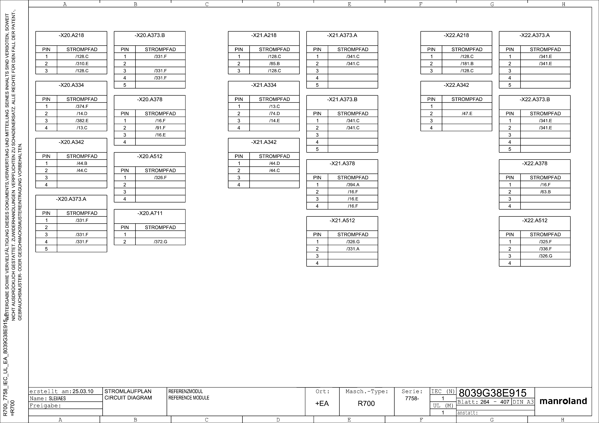

# +EA — Sheet 264 of 407 — REFERENZMODUL

**REFERENCE MODULE**

> Part of the manroland **R700** printing press IEC/UL circuit diagrams.
> Drawing class: **Stromlaufplan / Circuit diagram** (DIN A3).
> Document `+EA` covers the **Printing unit** machine section.

## At a glance

| Field | Value |
|---|---|
| Document | `+EA`  (8039G38E915) |
| Sheet | **264** of 407 |
| Section (DE) | REFERENZMODUL |
| Section (EN) | REFERENCE MODULE |
| Section type | REFERENCE_MODULE — Reference module |
| Machine type | `R700` |
| Series | `7758` |
| Created | 25.03.10 |
| Replaces | — |
| Columns used | A, B, C, D, E, F, G, H |
| Path numbers | — |
| Labels on sheet | 199 |
| Cross-refs out | 51 |
| Cross-refs in | 0 |

**Previous:** [+EA sheet 263](SHEET_0263.md) · **Next:** [+EA sheet 265](SHEET_0265.md) · **Document TOC:** [_TOC.md](_TOC.md)  (+EA) · **Master TOC:** [all sheets](../_MASTER_TOC.md)

## Sheet image (300 DPI, exact vector render)



_Rendered directly from the PDF vector layer at 300 DPI (1-bit), no OCR and no resampling. Use it to confirm anything ambiguous in the text below._

## Cross-references on this sheet

Each entry is a wire leaving this sheet. The printed token is `/sheet.column`; the link resolves to that sheet inside the same document.

| Ref | Target sheet | Col | Path | Destination on target | Target section | From col |
|---|---|---|---|---|---|---|
| `/341.E` | [+EA sheet 341](SHEET_0341.md) | E | — | — | OPTION: BOGENWEICHE | H |
| `/331.F` | [+EA sheet 331](SHEET_0331.md) | F | — | — | OPTION: BOGENWEICHE | B |
| `/128.C` | [+EA sheet 128](SHEET_0128.md) | C | — | — | ZUGANGSABSICHERUNG | A |
| `/128.C` | [+EA sheet 128](SHEET_0128.md) | C | — | — | ZUGANGSABSICHERUNG | D |
| `/341.C` | [+EA sheet 341](SHEET_0341.md) | C | — | — | OPTION: BOGENWEICHE | E |
| `/128.C` | [+EA sheet 128](SHEET_0128.md) | C | — | — | ZUGANGSABSICHERUNG | G |
| `/85.B` | [+EA sheet 85](SHEET_0085.md) | B | — | — | AUSLEGERSTAPELSTEUERUNG: PROGRAMMSCHALTWERK | D |
| `/310.E` | [+EA sheet 310](SHEET_0310.md) | E | — | — | OPTION: AUTOMATISCHE STAPELAUFFAHRT STOP / | A |
| `/181.B` | [+EA sheet 181](SHEET_0181.md) | B | — | — | RESERVE | G |
| `/341.E` | [+EA sheet 341](SHEET_0341.md) | E | — | — | OPTION: BOGENWEICHE | H |
| `/341.C` | [+EA sheet 341](SHEET_0341.md) | C | — | — | OPTION: BOGENWEICHE | E |
| `/331.F` | [+EA sheet 331](SHEET_0331.md) | F | — | — | OPTION: BOGENWEICHE | B |
| `/128.C` | [+EA sheet 128](SHEET_0128.md) | C | — | — | ZUGANGSABSICHERUNG | A |
| `/128.C` | [+EA sheet 128](SHEET_0128.md) | C | — | — | ZUGANGSABSICHERUNG | D |
| `/128.C` | [+EA sheet 128](SHEET_0128.md) | C | — | — | ZUGANGSABSICHERUNG | G |
| `/331.F` | [+EA sheet 331](SHEET_0331.md) | F | — | — | OPTION: BOGENWEICHE | B |
| `/374.F` | [+EA sheet 374](SHEET_0374.md) | F | — | — | OPTION: ENDTROCKNER 1 VORBEREITUNG; | A |
| `/13.C` | [+EA sheet 13](SHEET_0013.md) | C | — | — | SPANNUNGSVERSORGUNG: 400V, 24V | D |
| `/47.E` | [+EA sheet 47](SHEET_0047.md) | E | — | — | SCHUTZ | G |
| `/14.D` | [+EA sheet 14](SHEET_0014.md) | D | — | — | SPANNUNGSVERSORGUNG: 400V, 24V | A |
| `/74.D` | [+EA sheet 74](SHEET_0074.md) | D | — | — | AUSLEGERSTAPELSTEUERUNG | D |
| `/14.E` | [+EA sheet 14](SHEET_0014.md) | E | — | — | SPANNUNGSVERSORGUNG: 400V, 24V | D |
| `/382.E` | [+EA sheet 382](SHEET_0382.md) | E | — | — | OPTION: ENDTROCKNER 2 VORBEREITUNG | A |
| `/16.F` | [+EA sheet 16](SHEET_0016.md) | F | — | — | SPANNUNGSVERSORGUNG: 400V, 24V | B |
| `/341.E` | [+EA sheet 341](SHEET_0341.md) | E | — | — | OPTION: BOGENWEICHE | H |
| `/341.C` | [+EA sheet 341](SHEET_0341.md) | C | — | — | OPTION: BOGENWEICHE | E |
| `/91.F` | [+EA sheet 91](SHEET_0091.md) | F | — | — | BLASROHRE (BLASRAHMEN) | B |
| `/341.E` | [+EA sheet 341](SHEET_0341.md) | E | — | — | OPTION: BOGENWEICHE | H |
| `/13.C` | [+EA sheet 13](SHEET_0013.md) | C | — | — | SPANNUNGSVERSORGUNG: 400V, 24V | A |
| `/341.C` | [+EA sheet 341](SHEET_0341.md) | C | — | — | OPTION: BOGENWEICHE | E |
| `/16.E` | [+EA sheet 16](SHEET_0016.md) | E | — | — | SPANNUNGSVERSORGUNG: 400V, 24V | B |
| `/44.B` | [+EA sheet 44](SHEET_0044.md) | B | — | — | BUSVERBINDUNGEN: 20 mA SCHLEIFE | A |
| `/44.D` | [+EA sheet 44](SHEET_0044.md) | D | — | — | BUSVERBINDUNGEN: 20 mA SCHLEIFE | D |
| `/326.F` | [+EA sheet 326](SHEET_0326.md) | F | — | STROMPFAD PIN 1 2 3 4 | OPTION: BOGENWEICHE | B |
| `/44.C` | [+EA sheet 44](SHEET_0044.md) | C | — | — | BUSVERBINDUNGEN: 20 mA SCHLEIFE | A |
| `/44.C` | [+EA sheet 44](SHEET_0044.md) | C | — | — | BUSVERBINDUNGEN: 20 mA SCHLEIFE | D |
| `/16.F` | [+EA sheet 16](SHEET_0016.md) | F | — | — | SPANNUNGSVERSORGUNG: 400V, 24V | H |
| `/394.A` | [+EA sheet 394](SHEET_0394.md) | A | — | — | OPTION: ZWISCHENTROCKNER VORBEREITUNG; | E |
| `/63.B` | [+EA sheet 63](SHEET_0063.md) | B | — | — | MASCHINENBEDIENUNG: BEDIENUNGKOMMANDOS | H |
| `/16.F` | [+EA sheet 16](SHEET_0016.md) | F | — | — | SPANNUNGSVERSORGUNG: 400V, 24V | E |
| `/16.E` | [+EA sheet 16](SHEET_0016.md) | E | — | — | SPANNUNGSVERSORGUNG: 400V, 24V | E |
| `/16.F` | [+EA sheet 16](SHEET_0016.md) | F | — | — | SPANNUNGSVERSORGUNG: 400V, 24V | E |
| `/331.F` | [+EA sheet 331](SHEET_0331.md) | F | — | — | OPTION: BOGENWEICHE | A |
| `/331.F` | [+EA sheet 331](SHEET_0331.md) | F | — | — | OPTION: BOGENWEICHE | A |
| `/331.F` | [+EA sheet 331](SHEET_0331.md) | F | — | — | OPTION: BOGENWEICHE | A |
| `/325.F` | [+EA sheet 325](SHEET_0325.md) | F | — | — | OPTION: BOGENWEICHE | H |
| `/372.G` | [+EA sheet 372](SHEET_0372.md) | G | — | — | OPTION: ENDTROCKNER 1 VORBEREITUNG; | B |
| `/326.G` | [+EA sheet 326](SHEET_0326.md) | G | — | — | OPTION: BOGENWEICHE | E |
| `/331.A` | [+EA sheet 331](SHEET_0331.md) | A | — | — | OPTION: BOGENWEICHE | E |
| `/336.F` | [+EA sheet 336](SHEET_0336.md) | F | — | — | OPTION: BOGENWEICHE | H |
| `/326.G` | [+EA sheet 326](SHEET_0326.md) | G | — | — | OPTION: BOGENWEICHE | H |

## Devices on this sheet

| Tag | Class | Class meaning (IEC) | Col | Sub | Terminal | Sign |
|---|---|---|---|---|---|---|
| `X21.A373.A` | — | cross-device reference | E | — | — | — |
| `X21.A373.B` | — | cross-device reference | E | — | — | — |
| `X20.A334` | — | cross-device reference | A | — | — | — |
| `X20.A342` | — | cross-device reference | A | — | — | — |
| `X21.A334` | — | cross-device reference | D | — | — | — |
| `X22.A342` | — | cross-device reference | G | — | — | — |
| `X22.A373.A` | — | cross-device reference | H | — | — | — |
| `X22.A373.B` | — | cross-device reference | H | — | — | — |
| `X22.A378` | — | cross-device reference | H | — | — | — |
| `X20.A218` | — | cross-device reference | A | — | — | — |
| `X22.A218` | — | cross-device reference | G | — | — | — |
| `X21.A218` | — | cross-device reference | D | — | — | — |
| `X22.A512` | — | cross-device reference | H | — | — | — |
| `X21.A378` | — | cross-device reference | E | — | — | — |
| `X21.A512` | — | cross-device reference | E | — | — | — |
| `X21.A342` | — | cross-device reference | D | — | — | — |
| `X20.A373.A` | — | cross-device reference | A | — | — | — |
| `X20.A373.B` | — | cross-device reference | B | — | — | — |
| `X20.A378` | — | cross-device reference | B | — | — | — |
| `X20.A512` | — | cross-device reference | B | — | — | — |
| `X20.A711` | — | cross-device reference | B | — | — | — |

## Potentials / nets

_No named potentials on this sheet._

## Wire-end annotations (grouped as printed)

A wire that continues elsewhere is annotated with a small cluster: the destination description, the path/line number `#NN`, and the `/sheet.column` cross reference. Each row below is one such cluster exactly as it is grouped on the drawing.

| Col | Y | Path | Cross-ref | Text on the wire |
|---|---|---|---|---|
| A | 65.5 | — | — | `X20.A218` |
| B | 65.5 | — | — | `X20.A373.B` |
| D | 65.5 | — | — | `X21.A218` |
| E | 65.5 | — | — | `X21.A373.A` |
| G | 65.5 | — | — | `X22.A218` |
| H | 65.5 | — | — | `X22.A373.A` |
| A | 94.2 | — | — | `PIN 2 3 1 STROMPFAD` |
| B | 94.2 | — | — | `PIN 2 3 4 5 1 STROMPFAD` |
| D | 94.2 | — | — | `PIN 2 3 1 STROMPFAD` |
| E | 94.2 | — | — | `PIN 2 3 4 5 1 STROMPFAD` |
| F | 94.2 | — | — | `PIN 2 3 1 STROMPFAD` |
| H | 94.2 | — | — | `PIN 2 3 4 5 1 STROMPFAD` |
| A | 108.7 | — | `/128.C` | — |
| B | 108.7 | — | `/331.F` | — |
| D | 108.7 | — | `/128.C` | — |
| E | 108.7 | — | `/341.C` | — |
| G | 108.7 | — | `/128.C` | — |
| H | 108.7 | — | `/341.E` | — |
| D | 122.8 | — | `/85.B` | — |
| A | 122.9 | — | `/310.E` | — |
| E | 122.9 | — | `/341.C` | — |
| G | 122.9 | — | `/181.B` | — |
| H | 122.9 | — | `/341.E` | — |
| B | 137.0 | — | `/331.F` | — |
| A | 137.1 | — | `/128.C` | — |
| D | 137.1 | — | `/128.C` | — |
| G | 137.1 | — | `/128.C` | — |
| B | 151.2 | — | `/331.F` | — |
| A | 164.7 | — | — | `X20.A334` |
| D | 164.7 | — | — | `X21.A334` |
| G | 164.7 | — | — | `X22.A342` |
| B | 193.1 | — | — | `X20.A378` |
| E | 193.1 | — | — | `X21.A373.B` |
| H | 193.1 | — | — | `X22.A373.B` |
| A | 193.4 | — | — | `PIN 2 3 4 1 STROMPFAD` |
| D | 193.4 | — | — | `PIN 2 3 4 1 STROMPFAD` |
| F | 193.4 | — | — | `PIN 2 3 4 1 STROMPFAD` |
| A | 207.9 | — | `/374.F` | — |
| D | 207.9 | — | `/13.C` | — |
| B | 221.7 | — | — | `PIN 2 3 4 1 STROMPFAD` |
| E | 221.7 | — | — | `PIN 2 3 4 5 1 STROMPFAD` |
| H | 221.7 | — | — | `PIN 2 3 4 5 1 STROMPFAD` |
| A | 222.1 | — | `/14.D` | — |
| D | 222.1 | — | `/74.D` | — |
| G | 222.1 | — | `/47.E` | — |
| A | 236.2 | — | `/382.E` | — |
| B | 236.2 | — | `/16.F` | — |
| D | 236.2 | — | `/14.E` | — |
| H | 236.2 | — | `/341.E` | — |
| E | 236.3 | — | `/341.C` | — |
| A | 250.4 | — | `/13.C` | — |
| B | 250.4 | — | `/91.F` | — |
| E | 250.4 | — | `/341.C` | — |
| H | 250.4 | — | `/341.E` | — |
| B | 264.6 | — | `/16.E` | — |
| A | 278.1 | — | — | `X20.A342` |
| D | 278.1 | — | — | `X21.A342` |
| B | 306.4 | — | — | `X20.A512` |
| A | 306.8 | — | — | `PIN 2 3 4 1 STROMPFAD` |
| D | 306.8 | — | — | `PIN 2 3 4 1 STROMPFAD` |
| E | 320.6 | — | — | `X21.A378` |
| H | 320.6 | — | — | `X22.A378` |
| A | 321.3 | — | `/44.B` | — |
| D | 321.3 | — | `/44.D` | — |
| B | 335.1 | — | `/326.F` | `PIN 2 3 4 1 STROMPFAD` |
| A | 335.5 | — | `/44.C` | — |
| D | 335.5 | — | `/44.C` | — |
| E | 349.3 | — | — | `PIN 2 3 4 1 STROMPFAD` |
| H | 349.3 | — | — | `PIN 2 3 4 1 STROMPFAD` |
| E | 363.8 | — | `/394.A` | — |
| H | 363.8 | — | `/16.F` | — |
| E | 378.0 | — | `/16.F` | — |
| H | 378.0 | — | `/63.B` | — |
| A | 391.5 | — | — | `X20.A373.A` |
| E | 392.1 | — | `/16.E` | — |
| E | 406.3 | — | `/16.F` | — |
| B | 419.8 | — | — | `X20.A711` |
| A | 420.1 | — | — | `PIN 2 3 4 5 1 STROMPFAD` |
| E | 434.0 | — | — | `X21.A512` |
| H | 434.0 | — | — | `X22.A512` |
| A | 434.7 | — | `/331.F` | — |
| B | 448.5 | — | — | `PIN 2 1 STROMPFAD` |
| E | 462.7 | — | — | `PIN 2 3 4 1 STROMPFAD` |
| H | 462.7 | — | — | `PIN 2 3 4 1 STROMPFAD` |
| A | 463.0 | — | `/331.F` | — |
| A | 477.2 | — | `/331.F` | — |
| B | 477.2 | — | `/372.G` | — |
| E | 477.2 | — | `/326.G` | — |
| H | 477.2 | — | `/325.F` | — |
| E | 491.4 | — | `/331.A` | — |
| H | 491.4 | — | `/336.F` | — |
| H | 505.6 | — | `/326.G` | — |


## Reconstructed tables

This sheet carries tabular content (pin map / terminal assignment / index). The grid below was rebuilt from the drawing's own rule lines, so each row is exactly one physical row of the table.

### Table 1 — 22 data rows × 2 columns (at x=70.9, y=62.4) — **X20.A218**

| PIN | STROMPFAD |
|---|---|
| `1` | `/128.C` |
| `2` | `/310.E` |
| `3` | `/128.C` |
|  | `X20.A334` |
| `PIN` | `STROMPFAD` |
| `1` | `/374.F` |
| `2` | `/14.D` |
| `3` | `/382.E` |
| `4` | `/13.C` |
|  | `X20.A342` |
| `PIN` | `STROMPFAD` |
| `1` | `/44.B` |
| `2` | `/44.C` |
| `3` |  |
| `4` |  |
|  | `X20.A373.A` |
| `PIN` | `STROMPFAD` |
| `1` | `/331.F` |
| `2` |  |
| `3` | `/331.F` |
| `4` | `/331.F` |
| `5` |  |


### Table 2 — 21 data rows × 2 columns (at x=226.8, y=62.4) — **X20.A373.B**

| PIN | STROMPFAD |
|---|---|
| `1` | `/331.F` |
| `2` |  |
| `3` | `/331.F` |
| `4` | `/331.F` |
| `5` |  |
|  | `X20.A378` |
| `PIN` | `STROMPFAD` |
| `1` | `/16.F` |
| `2` | `/91.F` |
| `3` | `/16.E` |
| `4` |  |
|  | `X20.A512` |
| `PIN` | `STROMPFAD` |
| `1` | `/326.F` |
| `2` |  |
| `3` |  |
| `4` |  |
|  | `X20.A711` |
| `PIN` | `STROMPFAD` |
| `1` |  |
| `2` | `/372.G` |


### Table 3 — 15 data rows × 2 columns (at x=453.5, y=62.4) — **X21.A218**

| PIN | STROMPFAD |
|---|---|
| `1` | `/128.C` |
| `2` | `/85.B` |
| `3` | `/128.C` |
|  | `X21.A334` |
| `PIN` | `STROMPFAD` |
| `1` | `/13.C` |
| `2` | `/74.D` |
| `3` | `/14.E` |
| `4` |  |
|  | `X21.A342` |
| `PIN` | `STROMPFAD` |
| `1` | `/44.D` |
| `2` | `/44.C` |
| `3` |  |
| `4` |  |


### Table 4 — 24 data rows × 2 columns (at x=609.4, y=62.4) — **X21.A373.A**

| PIN | STROMPFAD |
|---|---|
| `1` | `/341.C` |
| `2` | `/341.C` |
| `3` |  |
| `4` |  |
| `5` |  |
|  | `X21.A373.B` |
| `PIN` | `STROMPFAD` |
| `1` | `/341.C` |
| `2` | `/341.C` |
| `3` |  |
| `4` |  |
| `5` |  |
|  | `X21.A378` |
| `PIN` | `STROMPFAD` |
| `1` | `/394.A` |
| `2` | `/16.F` |
| `3` | `/16.E` |
| `4` | `/16.F` |
|  | `X21.A512` |
| `PIN` | `STROMPFAD` |
| `1` | `/326.G` |
| `2` | `/331.A` |
| `3` |  |
| `4` |  |


### Table 5 — 9 data rows × 2 columns (at x=836.2, y=62.4) — **X22.A218**

| PIN | STROMPFAD |
|---|---|
| `1` | `/128.C` |
| `2` | `/181.B` |
| `3` | `/128.C` |
|  | `X22.A342` |
| `PIN` | `STROMPFAD` |
| `1` |  |
| `2` | `/47.E` |
| `3` |  |
| `4` |  |


### Table 6 — 24 data rows × 2 columns (at x=992.1, y=62.4) — **X22.A373.A**

| PIN | STROMPFAD |
|---|---|
| `1` | `/341.E` |
| `2` | `/341.E` |
| `3` |  |
| `4` |  |
| `5` |  |
|  | `X22.A373.B` |
| `PIN` | `STROMPFAD` |
| `1` | `/341.E` |
| `2` | `/341.E` |
| `3` |  |
| `4` |  |
| `5` |  |
|  | `X22.A378` |
| `PIN` | `STROMPFAD` |
| `1` | `/16.F` |
| `2` | `/63.B` |
| `3` |  |
| `4` |  |
|  | `X22.A512` |
| `PIN` | `STROMPFAD` |
| `1` | `/325.F` |
| `2` | `/336.F` |
| `3` | `/326.G` |
| `4` |  |


## Notes and free text on this sheet

| Text | Col | Y (pt) |
|---|---|---|
| `PIN` | E | 94.2 |
| `STROMPFAD` | E | 94.15 |
| `PIN` | A | 193.41 |
| `STROMPFAD` | A | 193.37 |
| `PIN` | C | 193.41 |
| `STROMPFAD` | D | 193.37 |
| `PIN` | F | 193.41 |
| `STROMPFAD` | G | 193.37 |
| `PIN` | G | 94.2 |
| `STROMPFAD` | H | 94.15 |
| `PIN` | B | 94.2 |
| `STROMPFAD` | B | 94.15 |

## Complete label inventory (exact text from the drawing)

Every text object inside the drawing area of this sheet, in DIN reading order (column A→H, then top→bottom). This is the authoritative list: if a string is not here it is not printed on this sheet.

| Col | Y | X | Dir | Type | Text |
|---|---|---|---|---|---|
| A | 65.5 | 116.8 | → | device ref | `X20.A218` |
| A | 94.2 | 84.0 | → | text | `PIN` |
| A | 94.2 | 132.2 | → | text | `STROMPFAD` |
| A | 108.4 | 90.0 | → | number | `1` |
| A | 108.7 | 150.2 | → | cross-reference | `/128.C` |
| A | 122.5 | 89.4 | → | number | `2` |
| A | 122.9 | 150.5 | → | cross-reference | `/310.E` |
| A | 136.7 | 89.4 | → | number | `3` |
| A | 137.1 | 150.2 | → | cross-reference | `/128.C` |
| A | 164.7 | 116.8 | → | device ref | `X20.A334` |
| A | 193.4 | 84.0 | → | text | `PIN` |
| A | 193.4 | 132.2 | → | text | `STROMPFAD` |
| A | 207.6 | 90.0 | → | number | `1` |
| A | 207.9 | 150.7 | → | cross-reference | `/374.F` |
| A | 221.8 | 89.4 | → | number | `2` |
| A | 222.1 | 152.6 | → | cross-reference | `/14.D` |
| A | 235.9 | 89.4 | → | number | `3` |
| A | 236.2 | 150.5 | → | cross-reference | `/382.E` |
| A | 250.1 | 89.4 | → | number | `4` |
| A | 250.4 | 152.6 | → | cross-reference | `/13.C` |
| A | 278.1 | 116.8 | → | device ref | `X20.A342` |
| A | 306.8 | 84.0 | → | text | `PIN` |
| A | 306.8 | 132.2 | → | text | `STROMPFAD` |
| A | 321.0 | 90.0 | → | number | `1` |
| A | 321.3 | 152.8 | → | cross-reference | `/44.B` |
| A | 335.1 | 89.4 | → | number | `2` |
| A | 335.5 | 152.6 | → | cross-reference | `/44.C` |
| A | 349.3 | 89.4 | → | number | `3` |
| A | 363.5 | 89.4 | → | number | `4` |
| A | 391.5 | 111.4 | → | device ref | `X20.A373.A` |
| A | 420.1 | 132.2 | → | text | `STROMPFAD` |
| A | 420.2 | 84.0 | → | text | `PIN` |
| A | 434.4 | 90.0 | → | number | `1` |
| A | 434.7 | 150.7 | → | cross-reference | `/331.F` |
| A | 448.5 | 89.4 | → | number | `2` |
| A | 462.7 | 89.4 | → | number | `3` |
| A | 463.0 | 150.7 | → | cross-reference | `/331.F` |
| A | 476.9 | 89.4 | → | number | `4` |
| A | 477.2 | 150.7 | → | cross-reference | `/331.F` |
| A | 491.0 | 89.4 | → | number | `5` |
| B | 65.5 | 267.7 | → | device ref | `X20.A373.B` |
| B | 94.2 | 240.0 | → | text | `PIN` |
| B | 94.2 | 288.1 | → | text | `STROMPFAD` |
| B | 108.4 | 245.9 | → | number | `1` |
| B | 108.7 | 306.6 | → | cross-reference | `/331.F` |
| B | 122.5 | 245.3 | → | number | `2` |
| B | 136.7 | 245.3 | → | number | `3` |
| B | 137.0 | 306.6 | → | cross-reference | `/331.F` |
| B | 150.9 | 245.3 | → | number | `4` |
| B | 151.2 | 306.6 | → | cross-reference | `/331.F` |
| B | 165.1 | 245.3 | → | number | `5` |
| B | 193.1 | 272.7 | → | device ref | `X20.A378` |
| B | 221.7 | 288.1 | → | text | `STROMPFAD` |
| B | 221.8 | 240.0 | → | text | `PIN` |
| B | 235.9 | 245.9 | → | number | `1` |
| B | 236.2 | 309.0 | → | cross-reference | `/16.F` |
| B | 250.1 | 245.3 | → | number | `2` |
| B | 250.4 | 309.0 | → | cross-reference | `/91.F` |
| B | 264.3 | 245.3 | → | number | `3` |
| B | 264.6 | 308.8 | → | cross-reference | `/16.E` |
| B | 278.5 | 245.3 | → | number | `4` |
| B | 306.4 | 272.7 | → | device ref | `X20.A512` |
| B | 335.1 | 240.0 | → | text | `PIN` |
| B | 335.1 | 288.1 | → | text | `STROMPFAD` |
| B | 349.3 | 245.9 | → | number | `1` |
| B | 349.6 | 306.6 | → | cross-reference | `/326.F` |
| B | 363.5 | 245.3 | → | number | `2` |
| B | 377.7 | 245.3 | → | number | `3` |
| B | 391.8 | 245.3 | → | number | `4` |
| B | 419.8 | 273.4 | → | device ref | `X20.A711` |
| B | 448.5 | 240.0 | → | text | `PIN` |
| B | 448.5 | 288.1 | → | text | `STROMPFAD` |
| B | 462.7 | 245.9 | → | number | `1` |
| B | 476.9 | 245.3 | → | number | `2` |
| B | 477.2 | 306.0 | → | cross-reference | `/372.G` |
| C | 94.2 | 466.7 | → | text | `PIN` |
| C | 108.4 | 472.7 | → | number | `1` |
| C | 122.5 | 472.1 | → | number | `2` |
| C | 136.7 | 472.1 | → | number | `3` |
| C | 193.4 | 466.7 | → | text | `PIN` |
| C | 207.6 | 472.7 | → | number | `1` |
| C | 221.8 | 472.1 | → | number | `2` |
| C | 235.9 | 472.1 | → | number | `3` |
| C | 250.1 | 472.1 | → | number | `4` |
| C | 306.8 | 466.7 | → | text | `PIN` |
| C | 321.0 | 472.7 | → | number | `1` |
| C | 335.1 | 472.1 | → | number | `2` |
| C | 349.3 | 472.1 | → | number | `3` |
| C | 363.5 | 472.1 | → | number | `4` |
| D | 65.5 | 499.5 | → | device ref | `X21.A218` |
| D | 94.2 | 514.9 | → | text | `STROMPFAD` |
| D | 108.7 | 532.9 | → | cross-reference | `/128.C` |
| D | 122.8 | 535.5 | → | cross-reference | `/85.B` |
| D | 137.1 | 532.9 | → | cross-reference | `/128.C` |
| D | 164.7 | 499.5 | → | device ref | `X21.A334` |
| D | 193.4 | 514.9 | → | text | `STROMPFAD` |
| D | 207.9 | 535.3 | → | cross-reference | `/13.C` |
| D | 222.1 | 535.3 | → | cross-reference | `/74.D` |
| D | 236.2 | 535.6 | → | cross-reference | `/14.E` |
| D | 278.1 | 499.5 | → | device ref | `X21.A342` |
| D | 306.8 | 514.9 | → | text | `STROMPFAD` |
| D | 321.3 | 535.3 | → | cross-reference | `/44.D` |
| D | 335.5 | 535.3 | → | cross-reference | `/44.C` |
| E | 65.5 | 650.0 | → | device ref | `X21.A373.A` |
| E | 94.2 | 622.6 | → | text | `PIN` |
| E | 94.2 | 670.8 | → | text | `STROMPFAD` |
| E | 108.4 | 628.6 | → | number | `1` |
| E | 108.7 | 688.8 | → | cross-reference | `/341.C` |
| E | 122.5 | 628.0 | → | number | `2` |
| E | 122.9 | 688.8 | → | cross-reference | `/341.C` |
| E | 136.7 | 628.0 | → | number | `3` |
| E | 150.9 | 628.0 | → | number | `4` |
| E | 165.1 | 628.0 | → | number | `5` |
| E | 193.1 | 650.4 | → | device ref | `X21.A373.B` |
| E | 221.7 | 670.8 | → | text | `STROMPFAD` |
| E | 221.8 | 622.6 | → | text | `PIN` |
| E | 235.9 | 628.6 | → | number | `1` |
| E | 236.3 | 688.8 | → | cross-reference | `/341.C` |
| E | 250.1 | 628.0 | → | number | `2` |
| E | 250.4 | 688.8 | → | cross-reference | `/341.C` |
| E | 264.3 | 628.0 | → | number | `3` |
| E | 278.5 | 628.0 | → | number | `4` |
| E | 292.6 | 628.0 | → | number | `5` |
| E | 320.6 | 655.4 | → | device ref | `X21.A378` |
| E | 349.3 | 622.6 | → | text | `PIN` |
| E | 349.3 | 670.8 | → | text | `STROMPFAD` |
| E | 363.5 | 628.6 | → | number | `1` |
| E | 363.8 | 688.8 | → | cross-reference | `/394.A` |
| E | 377.7 | 628.0 | → | number | `2` |
| E | 378.0 | 691.7 | → | cross-reference | `/16.F` |
| E | 391.8 | 628.0 | → | number | `3` |
| E | 392.1 | 691.5 | → | cross-reference | `/16.E` |
| E | 406.0 | 628.0 | → | number | `4` |
| E | 406.3 | 691.7 | → | cross-reference | `/16.F` |
| E | 434.0 | 655.4 | → | device ref | `X21.A512` |
| E | 462.7 | 622.6 | → | text | `PIN` |
| E | 462.7 | 670.8 | → | text | `STROMPFAD` |
| E | 476.9 | 628.6 | → | number | `1` |
| E | 477.2 | 688.7 | → | cross-reference | `/326.G` |
| E | 491.0 | 628.0 | → | number | `2` |
| E | 491.4 | 688.8 | → | cross-reference | `/331.A` |
| E | 505.2 | 628.0 | → | number | `3` |
| E | 519.4 | 628.0 | → | number | `4` |
| F | 94.2 | 849.4 | → | text | `PIN` |
| F | 108.4 | 855.4 | → | number | `1` |
| F | 122.5 | 854.8 | → | number | `2` |
| F | 136.7 | 854.8 | → | number | `3` |
| F | 193.4 | 849.4 | → | text | `PIN` |
| F | 207.6 | 855.4 | → | number | `1` |
| F | 221.8 | 854.8 | → | number | `2` |
| F | 235.9 | 854.8 | → | number | `3` |
| F | 250.1 | 854.8 | → | number | `4` |
| G | 65.5 | 882.1 | → | device ref | `X22.A218` |
| G | 94.2 | 897.6 | → | text | `STROMPFAD` |
| G | 94.2 | 1005.3 | → | text | `PIN` |
| G | 108.4 | 1011.3 | → | number | `1` |
| G | 108.7 | 915.6 | → | cross-reference | `/128.C` |
| G | 122.5 | 1010.7 | → | number | `2` |
| G | 122.9 | 915.7 | → | cross-reference | `/181.B` |
| G | 136.7 | 1010.7 | → | number | `3` |
| G | 137.1 | 915.6 | → | cross-reference | `/128.C` |
| G | 150.9 | 1010.7 | → | number | `4` |
| G | 164.7 | 882.1 | → | device ref | `X22.A342` |
| G | 165.1 | 1010.7 | → | number | `5` |
| G | 193.4 | 897.6 | → | text | `STROMPFAD` |
| G | 221.8 | 1005.3 | → | text | `PIN` |
| G | 222.1 | 918.3 | → | cross-reference | `/47.E` |
| G | 235.9 | 1011.3 | → | number | `1` |
| G | 250.1 | 1010.7 | → | number | `2` |
| G | 264.3 | 1010.7 | → | number | `3` |
| G | 278.5 | 1010.7 | → | number | `4` |
| G | 292.6 | 1010.7 | → | number | `5` |
| G | 349.3 | 1005.3 | → | text | `PIN` |
| G | 363.5 | 1011.3 | → | number | `1` |
| G | 377.7 | 1010.7 | → | number | `2` |
| G | 391.8 | 1010.7 | → | number | `3` |
| G | 406.0 | 1010.7 | → | number | `4` |
| G | 462.7 | 1005.3 | → | text | `PIN` |
| G | 476.9 | 1011.3 | → | number | `1` |
| G | 491.0 | 1010.7 | → | number | `2` |
| G | 505.2 | 1010.7 | → | number | `3` |
| G | 519.4 | 1010.7 | → | number | `4` |
| H | 65.5 | 1032.7 | → | device ref | `X22.A373.A` |
| H | 94.2 | 1053.5 | → | text | `STROMPFAD` |
| H | 108.7 | 1071.8 | → | cross-reference | `/341.E` |
| H | 122.9 | 1071.8 | → | cross-reference | `/341.E` |
| H | 193.1 | 1033.1 | → | device ref | `X22.A373.B` |
| H | 221.7 | 1053.5 | → | text | `STROMPFAD` |
| H | 236.2 | 1071.8 | → | cross-reference | `/341.E` |
| H | 250.4 | 1071.8 | → | cross-reference | `/341.E` |
| H | 320.6 | 1038.0 | → | device ref | `X22.A378` |
| H | 349.3 | 1053.5 | → | text | `STROMPFAD` |
| H | 363.8 | 1074.3 | → | cross-reference | `/16.F` |
| H | 378.0 | 1074.0 | → | cross-reference | `/63.B` |
| H | 434.0 | 1038.0 | → | device ref | `X22.A512` |
| H | 462.7 | 1053.5 | → | text | `STROMPFAD` |
| H | 477.2 | 1071.9 | → | cross-reference | `/325.F` |
| H | 491.4 | 1071.9 | → | cross-reference | `/336.F` |
| H | 505.6 | 1071.4 | → | cross-reference | `/326.G` |

## Reading-order text block

The same content as a plain block, grouped by DIN column — convenient to paste or to match against a visual description.

```text
=== Column A ===
  65.5  116.8  devref       X20.A218
  94.2   84.0  text         PIN
  94.2  132.2  text         STROMPFAD
 108.4   90.0  numeric      1
 108.7  150.2  xref         /128.C
 122.5   89.4  numeric      2
 122.9  150.5  xref         /310.E
 136.7   89.4  numeric      3
 137.1  150.2  xref         /128.C
 164.7  116.8  devref       X20.A334
 193.4   84.0  text         PIN
 193.4  132.2  text         STROMPFAD
 207.6   90.0  numeric      1
 207.9  150.7  xref         /374.F
 221.8   89.4  numeric      2
 222.1  152.6  xref         /14.D
 235.9   89.4  numeric      3
 236.2  150.5  xref         /382.E
 250.1   89.4  numeric      4
 250.4  152.6  xref         /13.C
 278.1  116.8  devref       X20.A342
 306.8   84.0  text         PIN
 306.8  132.2  text         STROMPFAD
 321.0   90.0  numeric      1
 321.3  152.8  xref         /44.B
 335.1   89.4  numeric      2
 335.5  152.6  xref         /44.C
 349.3   89.4  numeric      3
 363.5   89.4  numeric      4
 391.5  111.4  devref       X20.A373.A
 420.1  132.2  text         STROMPFAD
 420.2   84.0  text         PIN
 434.4   90.0  numeric      1
 434.7  150.7  xref         /331.F
 448.5   89.4  numeric      2
 462.7   89.4  numeric      3
 463.0  150.7  xref         /331.F
 476.9   89.4  numeric      4
 477.2  150.7  xref         /331.F
 491.0   89.4  numeric      5
=== Column B ===
  65.5  267.7  devref       X20.A373.B
  94.2  240.0  text         PIN
  94.2  288.1  text         STROMPFAD
 108.4  245.9  numeric      1
 108.7  306.6  xref         /331.F
 122.5  245.3  numeric      2
 136.7  245.3  numeric      3
 137.0  306.6  xref         /331.F
 150.9  245.3  numeric      4
 151.2  306.6  xref         /331.F
 165.1  245.3  numeric      5
 193.1  272.7  devref       X20.A378
 221.7  288.1  text         STROMPFAD
 221.8  240.0  text         PIN
 235.9  245.9  numeric      1
 236.2  309.0  xref         /16.F
 250.1  245.3  numeric      2
 250.4  309.0  xref         /91.F
 264.3  245.3  numeric      3
 264.6  308.8  xref         /16.E
 278.5  245.3  numeric      4
 306.4  272.7  devref       X20.A512
 335.1  240.0  text         PIN
 335.1  288.1  text         STROMPFAD
 349.3  245.9  numeric      1
 349.6  306.6  xref         /326.F
 363.5  245.3  numeric      2
 377.7  245.3  numeric      3
 391.8  245.3  numeric      4
 419.8  273.4  devref       X20.A711
 448.5  240.0  text         PIN
 448.5  288.1  text         STROMPFAD
 462.7  245.9  numeric      1
 476.9  245.3  numeric      2
 477.2  306.0  xref         /372.G
=== Column C ===
  94.2  466.7  text         PIN
 108.4  472.7  numeric      1
 122.5  472.1  numeric      2
 136.7  472.1  numeric      3
 193.4  466.7  text         PIN
 207.6  472.7  numeric      1
 221.8  472.1  numeric      2
 235.9  472.1  numeric      3
 250.1  472.1  numeric      4
 306.8  466.7  text         PIN
 321.0  472.7  numeric      1
 335.1  472.1  numeric      2
 349.3  472.1  numeric      3
 363.5  472.1  numeric      4
=== Column D ===
  65.5  499.5  devref       X21.A218
  94.2  514.9  text         STROMPFAD
 108.7  532.9  xref         /128.C
 122.8  535.5  xref         /85.B
 137.1  532.9  xref         /128.C
 164.7  499.5  devref       X21.A334
 193.4  514.9  text         STROMPFAD
 207.9  535.3  xref         /13.C
 222.1  535.3  xref         /74.D
 236.2  535.6  xref         /14.E
 278.1  499.5  devref       X21.A342
 306.8  514.9  text         STROMPFAD
 321.3  535.3  xref         /44.D
 335.5  535.3  xref         /44.C
=== Column E ===
  65.5  650.0  devref       X21.A373.A
  94.2  622.6  text         PIN
  94.2  670.8  text         STROMPFAD
 108.4  628.6  numeric      1
 108.7  688.8  xref         /341.C
 122.5  628.0  numeric      2
 122.9  688.8  xref         /341.C
 136.7  628.0  numeric      3
 150.9  628.0  numeric      4
 165.1  628.0  numeric      5
 193.1  650.4  devref       X21.A373.B
 221.7  670.8  text         STROMPFAD
 221.8  622.6  text         PIN
 235.9  628.6  numeric      1
 236.3  688.8  xref         /341.C
 250.1  628.0  numeric      2
 250.4  688.8  xref         /341.C
 264.3  628.0  numeric      3
 278.5  628.0  numeric      4
 292.6  628.0  numeric      5
 320.6  655.4  devref       X21.A378
 349.3  622.6  text         PIN
 349.3  670.8  text         STROMPFAD
 363.5  628.6  numeric      1
 363.8  688.8  xref         /394.A
 377.7  628.0  numeric      2
 378.0  691.7  xref         /16.F
 391.8  628.0  numeric      3
 392.1  691.5  xref         /16.E
 406.0  628.0  numeric      4
 406.3  691.7  xref         /16.F
 434.0  655.4  devref       X21.A512
 462.7  622.6  text         PIN
 462.7  670.8  text         STROMPFAD
 476.9  628.6  numeric      1
 477.2  688.7  xref         /326.G
 491.0  628.0  numeric      2
 491.4  688.8  xref         /331.A
 505.2  628.0  numeric      3
 519.4  628.0  numeric      4
=== Column F ===
  94.2  849.4  text         PIN
 108.4  855.4  numeric      1
 122.5  854.8  numeric      2
 136.7  854.8  numeric      3
 193.4  849.4  text         PIN
 207.6  855.4  numeric      1
 221.8  854.8  numeric      2
 235.9  854.8  numeric      3
 250.1  854.8  numeric      4
=== Column G ===
  65.5  882.1  devref       X22.A218
  94.2  897.6  text         STROMPFAD
  94.2 1005.3  text         PIN
 108.4 1011.3  numeric      1
 108.7  915.6  xref         /128.C
 122.5 1010.7  numeric      2
 122.9  915.7  xref         /181.B
 136.7 1010.7  numeric      3
 137.1  915.6  xref         /128.C
 150.9 1010.7  numeric      4
 164.7  882.1  devref       X22.A342
 165.1 1010.7  numeric      5
 193.4  897.6  text         STROMPFAD
 221.8 1005.3  text         PIN
 222.1  918.3  xref         /47.E
 235.9 1011.3  numeric      1
 250.1 1010.7  numeric      2
 264.3 1010.7  numeric      3
 278.5 1010.7  numeric      4
 292.6 1010.7  numeric      5
 349.3 1005.3  text         PIN
 363.5 1011.3  numeric      1
 377.7 1010.7  numeric      2
 391.8 1010.7  numeric      3
 406.0 1010.7  numeric      4
 462.7 1005.3  text         PIN
 476.9 1011.3  numeric      1
 491.0 1010.7  numeric      2
 505.2 1010.7  numeric      3
 519.4 1010.7  numeric      4
=== Column H ===
  65.5 1032.7  devref       X22.A373.A
  94.2 1053.5  text         STROMPFAD
 108.7 1071.8  xref         /341.E
 122.9 1071.8  xref         /341.E
 193.1 1033.1  devref       X22.A373.B
 221.7 1053.5  text         STROMPFAD
 236.2 1071.8  xref         /341.E
 250.4 1071.8  xref         /341.E
 320.6 1038.0  devref       X22.A378
 349.3 1053.5  text         STROMPFAD
 363.8 1074.3  xref         /16.F
 378.0 1074.0  xref         /63.B
 434.0 1038.0  devref       X22.A512
 462.7 1053.5  text         STROMPFAD
 477.2 1071.9  xref         /325.F
 491.4 1071.9  xref         /336.F
 505.6 1071.4  xref         /326.G
```

---
_Generated from the PDF vector text layer; no OCR. Source: `R700_7758_IEC_UL_EA_8039G38E915_p`, sheet 264._
