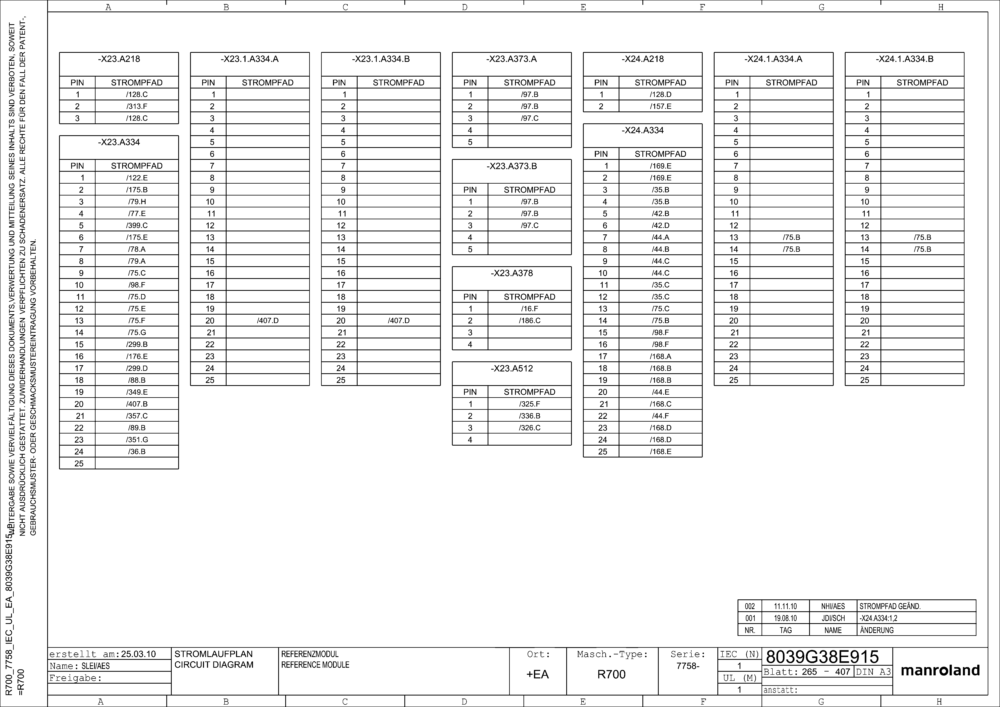

# +EA — Sheet 265 of 407 — REFERENZMODUL

**REFERENCE MODULE**

> Part of the manroland **R700** printing press IEC/UL circuit diagrams.
> Drawing class: **Stromlaufplan / Circuit diagram** (DIN A3).
> Document `+EA` covers the **Printing unit** machine section.

## At a glance

| Field | Value |
|---|---|
| Document | `+EA`  (8039G38E915) |
| Sheet | **265** of 407 |
| Section (DE) | REFERENZMODUL |
| Section (EN) | REFERENCE MODULE |
| Section type | REFERENCE_MODULE — Reference module |
| Machine type | `R700` |
| Series | `7758` |
| Created | 25.03.10 |
| Replaces | — |
| Columns used | A, B, C, D, E, F, G, H |
| Path numbers | — |
| Labels on sheet | 292 |
| Cross-refs out | 71 |
| Cross-refs in | 0 |

**Previous:** [+EA sheet 264](SHEET_0264.md) · **Next:** [+EA sheet 266](SHEET_0266.md) · **Document TOC:** [_TOC.md](_TOC.md)  (+EA) · **Master TOC:** [all sheets](../_MASTER_TOC.md)

## Sheet image (300 DPI, exact vector render)



_Rendered directly from the PDF vector layer at 300 DPI (1-bit), no OCR and no resampling. Use it to confirm anything ambiguous in the text below._

## Cross-references on this sheet

Each entry is a wire leaving this sheet. The printed token is `/sheet.column`; the link resolves to that sheet inside the same document.

| Ref | Target sheet | Col | Path | Destination on target | Target section | From col |
|---|---|---|---|---|---|---|
| `/97.B` | [+EA sheet 97](SHEET_0097.md) | B | — | — | BLASRAHMEN | E |
| `/128.C` | [+EA sheet 128](SHEET_0128.md) | C | — | — | ZUGANGSABSICHERUNG | A |
| `/128.D` | [+EA sheet 128](SHEET_0128.md) | D | — | — | ZUGANGSABSICHERUNG | F |
| `/97.B` | [+EA sheet 97](SHEET_0097.md) | B | — | — | BLASRAHMEN | E |
| `/157.E` | [+EA sheet 157](SHEET_0157.md) | E | — | — | ZUGANGSABSICHERUNG | F |
| `/313.F` | [+EA sheet 313](SHEET_0313.md) | F | — | — | OPTION: LOGISTIK, AUSLEGER | A |
| `/97.C` | [+EA sheet 97](SHEET_0097.md) | C | — | — | BLASRAHMEN | E |
| `/128.C` | [+EA sheet 128](SHEET_0128.md) | C | — | — | ZUGANGSABSICHERUNG | A |
| `/169.E` | [+EA sheet 169](SHEET_0169.md) | E | — | — | RESERVE | F |
| `/122.E` | [+EA sheet 122](SHEET_0122.md) | E | — | — | TROCKENBESTÄUBER | A |
| `/169.E` | [+EA sheet 169](SHEET_0169.md) | E | — | — | RESERVE | F |
| `/35.B` | [+EA sheet 35](SHEET_0035.md) | B | — | — | BUSVERBINDUNGEN: NOT AUS | F |
| `/175.B` | [+EA sheet 175](SHEET_0175.md) | B | — | — | RESERVE | A |
| `/97.B` | [+EA sheet 97](SHEET_0097.md) | B | — | — | BLASRAHMEN | E |
| `/35.B` | [+EA sheet 35](SHEET_0035.md) | B | — | — | BUSVERBINDUNGEN: NOT AUS | F |
| `/79.H` | [+EA sheet 79](SHEET_0079.md) | H | — | — | AUSLEGERSTAPELSTEUERUNG | A |
| `/77.E` | [+EA sheet 77](SHEET_0077.md) | E | — | — | AUSLEGERSTAPELSTEUERUNG | A |
| `/97.B` | [+EA sheet 97](SHEET_0097.md) | B | — | — | BLASRAHMEN | E |
| `/42.B` | [+EA sheet 42](SHEET_0042.md) | B | — | — | BUSVERBINDUNGEN: STOP SICHERN | F |
| `/97.C` | [+EA sheet 97](SHEET_0097.md) | C | — | — | BLASRAHMEN | E |
| `/42.D` | [+EA sheet 42](SHEET_0042.md) | D | — | — | BUSVERBINDUNGEN: STOP SICHERN | F |
| `/399.C` | [+EA sheet 399](SHEET_0399.md) | C | — | — | OPTION: DÜNNDRUCKEINRICHTUNG | A |
| `/44.A` | [+EA sheet 44](SHEET_0044.md) | A | — | — | BUSVERBINDUNGEN: 20 mA SCHLEIFE | F |
| `/75.B` | [+EA sheet 75](SHEET_0075.md) | B | — | — | AUSLEGERSTAPELSTEUERUNG | G |
| `/75.B` | [+EA sheet 75](SHEET_0075.md) | B | — | — | AUSLEGERSTAPELSTEUERUNG | H |
| `/175.E` | [+EA sheet 175](SHEET_0175.md) | E | — | — | RESERVE | A |
| `/78.A` | [+EA sheet 78](SHEET_0078.md) | A | — | — | AUSLEGERSTAPELSTEUERUNG | A |
| `/44.B` | [+EA sheet 44](SHEET_0044.md) | B | — | — | BUSVERBINDUNGEN: 20 mA SCHLEIFE | F |
| `/75.B` | [+EA sheet 75](SHEET_0075.md) | B | — | — | AUSLEGERSTAPELSTEUERUNG | G |
| `/75.B` | [+EA sheet 75](SHEET_0075.md) | B | — | — | AUSLEGERSTAPELSTEUERUNG | H |
| `/79.A` | [+EA sheet 79](SHEET_0079.md) | A | — | — | AUSLEGERSTAPELSTEUERUNG | A |
| `/44.C` | [+EA sheet 44](SHEET_0044.md) | C | — | — | BUSVERBINDUNGEN: 20 mA SCHLEIFE | F |
| `/75.C` | [+EA sheet 75](SHEET_0075.md) | C | — | — | AUSLEGERSTAPELSTEUERUNG | A |
| `/44.C` | [+EA sheet 44](SHEET_0044.md) | C | — | — | BUSVERBINDUNGEN: 20 mA SCHLEIFE | F |
| `/98.F` | [+EA sheet 98](SHEET_0098.md) | F | — | — | BOGENFÜHRUNGSELEMENT | A |
| `/35.C` | [+EA sheet 35](SHEET_0035.md) | C | — | — | BUSVERBINDUNGEN: NOT AUS | F |
| `/75.D` | [+EA sheet 75](SHEET_0075.md) | D | — | — | AUSLEGERSTAPELSTEUERUNG | A |
| `/35.C` | [+EA sheet 35](SHEET_0035.md) | C | — | — | BUSVERBINDUNGEN: NOT AUS | F |
| `/75.E` | [+EA sheet 75](SHEET_0075.md) | E | — | — | AUSLEGERSTAPELSTEUERUNG | A |
| `/16.F` | [+EA sheet 16](SHEET_0016.md) | F | — | — | SPANNUNGSVERSORGUNG: 400V, 24V | E |
| `/75.C` | [+EA sheet 75](SHEET_0075.md) | C | — | — | AUSLEGERSTAPELSTEUERUNG | F |
| `/75.B` | [+EA sheet 75](SHEET_0075.md) | B | — | — | AUSLEGERSTAPELSTEUERUNG | F |
| `/75.F` | [+EA sheet 75](SHEET_0075.md) | F | — | — | AUSLEGERSTAPELSTEUERUNG | A |
| `/407.D` | [+EA sheet 407](SHEET_0407.md) | D | — | — | OPTION: AIR STATION | B |
| `/407.D` | [+EA sheet 407](SHEET_0407.md) | D | — | — | OPTION: AIR STATION | C |
| `/186.C` | [+EA sheet 186](SHEET_0186.md) | C | — | — | RESERVE | E |
| `/98.F` | [+EA sheet 98](SHEET_0098.md) | F | — | — | BOGENFÜHRUNGSELEMENT | F |
| `/75.G` | [+EA sheet 75](SHEET_0075.md) | G | — | — | AUSLEGERSTAPELSTEUERUNG | A |
| `/98.F` | [+EA sheet 98](SHEET_0098.md) | F | — | — | BOGENFÜHRUNGSELEMENT | F |
| `/299.B` | [+EA sheet 299](SHEET_0299.md) | B | — | — | OPTION: ZWISCHENSTAPEL / | A |
| `/176.E` | [+EA sheet 176](SHEET_0176.md) | E | — | — | RESERVE | A |
| `/168.A` | [+EA sheet 168](SHEET_0168.md) | A | — | — | RESERVE | F |
| `/168.B` | [+EA sheet 168](SHEET_0168.md) | B | — | — | RESERVE | F |
| `/299.D` | [+EA sheet 299](SHEET_0299.md) | D | — | — | OPTION: ZWISCHENSTAPEL / | A |
| `/88.B` | [+EA sheet 88](SHEET_0088.md) | B | — | — | SAUGWALZE | A |
| `/168.B` | [+EA sheet 168](SHEET_0168.md) | B | — | — | RESERVE | F |
| `/44.E` | [+EA sheet 44](SHEET_0044.md) | E | — | — | BUSVERBINDUNGEN: 20 mA SCHLEIFE | F |
| `/349.E` | [+EA sheet 349](SHEET_0349.md) | E | — | — | OPTION: VORBEREITUNG IONISATIONSANLAGE | A |
| `/407.B` | [+EA sheet 407](SHEET_0407.md) | B | — | — | OPTION: AIR STATION | A |
| `/325.F` | [+EA sheet 325](SHEET_0325.md) | F | — | — | OPTION: BOGENWEICHE | E |
| `/168.C` | [+EA sheet 168](SHEET_0168.md) | C | — | — | RESERVE | F |
| `/44.F` | [+EA sheet 44](SHEET_0044.md) | F | — | — | BUSVERBINDUNGEN: 20 mA SCHLEIFE | F |
| `/336.B` | [+EA sheet 336](SHEET_0336.md) | B | — | — | OPTION: BOGENWEICHE | E |
| `/357.C` | [+EA sheet 357](SHEET_0357.md) | C | — | — | OPTION: AUFLAGENZÄHLER / GUTBOGENZÄHLER | A |
| `/89.B` | [+EA sheet 89](SHEET_0089.md) | B | — | — | BELEUCHTUNG | A |
| `/326.C` | [+EA sheet 326](SHEET_0326.md) | C | — | — | OPTION: BOGENWEICHE | E |
| `/168.D` | [+EA sheet 168](SHEET_0168.md) | D | — | — | RESERVE | F |
| `/351.G` | [+EA sheet 351](SHEET_0351.md) | G | — | — | OPTION: VORBEREITUNG: PUDERABSAUGUNG | A |
| `/168.D` | [+EA sheet 168](SHEET_0168.md) | D | — | — | RESERVE | F |
| `/36.B` | [+EA sheet 36](SHEET_0036.md) | B | — | — | BUSVERBINDUNGEN: NOT AUS | A |
| `/168.E` | [+EA sheet 168](SHEET_0168.md) | E | — | — | RESERVE | F |

## Devices on this sheet

| Tag | Class | Class meaning (IEC) | Col | Sub | Terminal | Sign |
|---|---|---|---|---|---|---|
| `X23.A218` | — | cross-device reference | A | — | — | — |
| `X24.1.A334.A` | — | cross-device reference | G | — | — | — |
| `X24.1.A334.B` | — | cross-device reference | H | — | — | — |
| `X24.A334` | — | cross-device reference | F | — | — | — |
| `X24.A218` | — | cross-device reference | F | — | — | — |
| `X23.A373.A` | — | cross-device reference | D | — | — | — |
| `X23.A373.B` | — | cross-device reference | D | — | — | — |
| `X23.A378` | — | cross-device reference | D | — | — | — |
| `X23.A512` | — | cross-device reference | D | — | — | — |
| `X23.A334` | — | cross-device reference | A | — | — | — |
| `X23.1.A334.A` | — | cross-device reference | B | — | — | — |
| `X23.1.A334.B` | — | cross-device reference | C | — | — | — |
| `NR.` | — | cross-device reference | F | — | — | — |
| `19.08.10` | — | cross-device reference | G | — | — | — |
| `11.11.10` | — | cross-device reference | G | — | — | — |

## Potentials / nets

_No named potentials on this sheet._

## Wire-end annotations (grouped as printed)

A wire that continues elsewhere is annotated with a small cluster: the destination description, the path/line number `#NN`, and the `/sheet.column` cross reference. Each row below is one such cluster exactly as it is grouped on the drawing.

| Col | Y | Path | Cross-ref | Text on the wire |
|---|---|---|---|---|
| A | 65.5 | — | — | `X23.A218` |
| B | 65.5 | — | — | `X23.1.A334.A` |
| C | 65.5 | — | — | `X23.1.A334.B` |
| D | 65.5 | — | — | `X23.A373.A` |
| F | 65.5 | — | — | `X24.A218` |
| G | 65.5 | — | — | `X24.1.A334.A` |
| H | 65.5 | — | — | `X24.1.A334.B` |
| A | 94.2 | — | — | `PIN 2 3 1 STROMPFAD` |
| B | 94.2 | — | — | `PIN STROMPFAD` |
| C | 94.2 | — | — | `PIN STROMPFAD` |
| D | 94.2 | — | — | `PIN 2 3 4 5 1 STROMPFAD` |
| E | 94.2 | — | — | `PIN 2 1 STROMPFAD` |
| G | 94.2 | — | — | `PIN STROMPFAD` |
| H | 94.2 | — | — | `PIN STROMPFAD` |
| B | 108.4 | — | — | `2 3 4 5 6 7 8 9 1` |
| C | 108.4 | — | — | `2 3 4 5 6 7 8 9 1` |
| F | 108.4 | — | — | `2 3 4 5 6 7 8 9 1` |
| G | 108.4 | — | — | `2 3 4 5 6 7 8 9 1` |
| A | 108.7 | — | `/128.C` | — |
| E | 108.7 | — | `/97.B` | — |
| F | 108.7 | — | `/128.D` | — |
| E | 122.8 | — | `/97.B` | — |
| A | 122.9 | — | `/313.F` | — |
| F | 122.9 | — | `/157.E` | — |
| A | 137.1 | — | `/128.C` | — |
| E | 137.1 | — | `/97.C` | — |
| F | 150.5 | — | — | `X24.A334` |
| A | 164.7 | — | — | `X23.A334` |
| E | 179.2 | — | — | `PIN STROMPFAD` |
| D | 193.1 | — | — | `X23.A373.B` |
| A | 193.4 | — | — | `PIN STROMPFAD` |
| E | 193.4 | — | — | `2 3 4 5 6 7 8 9 1` |
| F | 193.7 | — | `/169.E` | — |
| A | 207.6 | — | — | `2 3 4 5 6 7 8 9 1` |
| A | 207.9 | — | `/122.E` | — |
| F | 207.9 | — | `/169.E` | — |
| D | 221.7 | — | — | `PIN 2 3 4 5 1 STROMPFAD` |
| A | 222.1 | — | `/175.B` | — |
| F | 222.1 | — | `/35.B` | — |
| B | 235.9 | — | — | `10 12 13 14 15 16 17 18 19 20 11` |
| C | 235.9 | — | — | `10 12 13 14 15 16 17 18 19 20 11` |
| F | 235.9 | — | — | `10 12 13 14 15 16 17 18 19 20 11` |
| G | 235.9 | — | — | `10 12 13 14 15 16 17 18 19 20 11` |
| E | 236.2 | — | `/97.B` | — |
| F | 236.2 | — | `/35.B` | — |
| A | 236.3 | — | `/79.H` | — |
| A | 250.4 | — | `/77.E` | — |
| E | 250.4 | — | `/97.B` | — |
| F | 250.4 | — | `/42.B` | — |
| A | 264.6 | — | `/399.C` | — |
| E | 264.6 | — | `/97.C` | — |
| F | 264.6 | — | `/42.D` | — |
| A | 278.8 | — | `/175.E` | — |
| F | 278.8 | — | `/44.A` | — |
| G | 278.8 | — | `/75.B` | — |
| H | 278.8 | — | `/75.B` | — |
| A | 292.9 | — | `/78.A` | — |
| F | 292.9 | — | `/44.B` | — |
| G | 292.9 | — | `/75.B` | — |
| H | 292.9 | — | `/75.B` | — |
| A | 307.1 | — | `/79.A` | — |
| F | 307.1 | — | `/44.C` | — |
| D | 320.6 | — | — | `X23.A378` |
| E | 321.0 | — | — | `10 12 13 14 15 16 17 18 19 20 11` |
| A | 321.3 | — | `/75.C` | — |
| F | 321.3 | — | `/44.C` | — |
| A | 335.1 | — | — | `10 12 13 14 15 16 17 18 19 20 11` |
| A | 335.5 | — | `/98.F` | — |
| F | 335.5 | — | `/35.C` | — |
| D | 349.3 | — | — | `PIN 2 3 4 1 STROMPFAD` |
| A | 349.6 | — | `/75.D` | — |
| F | 349.6 | — | `/35.C` | — |
| A | 363.8 | — | `/75.E` | — |
| E | 363.8 | — | `/16.F` | — |
| F | 363.8 | — | `/75.C` | — |
| A | 378.0 | — | `/75.F` | — |
| B | 378.0 | — | `/407.D` | — |
| C | 378.0 | — | `/407.D` | — |
| E | 378.0 | — | `/186.C` | — |
| F | 378.0 | — | `/75.B` | — |
| B | 391.8 | — | — | `22 23 24 25 21` |
| C | 391.8 | — | — | `22 23 24 25 21` |
| F | 391.8 | — | — | `22 23 24 25 21` |
| G | 391.8 | — | — | `22 23 24 25 21` |
| F | 392.1 | — | `/98.F` | — |
| A | 392.2 | — | `/75.G` | — |
| A | 406.3 | — | `/299.B` | — |
| F | 406.3 | — | `/98.F` | — |
| A | 420.5 | — | `/176.E` | — |
| F | 420.5 | — | `/168.A` | — |
| D | 434.0 | — | — | `X23.A512` |
| A | 434.7 | — | `/299.D` | — |
| F | 434.7 | — | `/168.B` | — |
| A | 448.8 | — | `/88.B` | — |
| F | 448.9 | — | `/168.B` | — |
| D | 462.7 | — | — | `PIN 2 3 4 1 STROMPFAD` |
| A | 463.0 | — | `/349.E` | — |
| F | 463.0 | — | `/44.E` | — |
| E | 476.9 | — | — | `22 23 24 25 21` |
| A | 477.2 | — | `/407.B` | — |
| E | 477.2 | — | `/325.F` | — |
| F | 477.2 | — | `/168.C` | — |
| A | 491.1 | — | — | `22 23 24 25 21` |
| A | 491.4 | — | `/357.C` | — |
| E | 491.4 | — | `/336.B` | — |
| F | 491.4 | — | `/44.F` | — |
| A | 505.5 | — | `/89.B` | — |
| E | 505.6 | — | `/326.C` | — |
| F | 505.6 | — | `/168.D` | — |
| A | 519.7 | — | `/351.G` | — |
| F | 519.7 | — | `/168.D` | — |
| A | 533.9 | — | `/36.B` | — |
| F | 533.9 | — | `/168.E` | — |
| G | 718.9 | — | — | `002 11.11.10 NHI/AES STROMPFAD GEÄND.` |
| G | 733.0 | — | — | `001 19.08.10 JDI/SCH X24.A334:1,2` |
| G | 747.1 | — | — | `NR. TAG NAME ÄNDERUNG` |


## Reconstructed tables

This sheet carries tabular content (pin map / terminal assignment / index). The grid below was rebuilt from the drawing's own rule lines, so each row is exactly one physical row of the table.

### Table 1 — 30 data rows × 2 columns (at x=70.9, y=62.4) — **X23.A218**

| PIN | STROMPFAD |
|---|---|
| `1` | `/128.C` |
| `2` | `/313.F` |
| `3` | `/128.C` |
|  | `X23.A334` |
| `PIN` | `STROMPFAD` |
| `1` | `/122.E` |
| `2` | `/175.B` |
| `3` | `/79.H` |
| `4` | `/77.E` |
| `5` | `/399.C` |
| `6` | `/175.E` |
| `7` | `/78.A` |
| `8` | `/79.A` |
| `9` | `/75.C` |
| `10` | `/98.F` |
| `11` | `/75.D` |
| `12` | `/75.E` |
| `13` | `/75.F` |
| `14` | `/75.G` |
| `15` | `/299.B` |
| `16` | `/176.E` |
| `17` | `/299.D` |
| `18` | `/88.B` |
| `19` | `/349.E` |
| `20` | `/407.B` |
| `21` | `/357.C` |
| `22` | `/89.B` |
| `23` | `/351.G` |
| `24` | `/36.B` |
| `25` |  |


### Table 2 — 25 data rows × 2 columns (at x=226.8, y=62.4) — **X23.1.A334.A**

| PIN | STROMPFAD |
|---|---|
| `1` |  |
| `2` |  |
| `3` |  |
| `4` |  |
| `5` |  |
| `6` |  |
| `7` |  |
| `8` |  |
| `9` |  |
| `10` |  |
| `11` |  |
| `12` |  |
| `13` |  |
| `14` |  |
| `15` |  |
| `16` |  |
| `17` |  |
| `18` |  |
| `19` |  |
| `20` | `/407.D` |
| `21` |  |
| `22` |  |
| `23` |  |
| `24` |  |
| `25` |  |


### Table 3 — 25 data rows × 2 columns (at x=382.7, y=62.4) — **X23.1.A334.B**

| PIN | STROMPFAD |
|---|---|
| `1` |  |
| `2` |  |
| `3` |  |
| `4` |  |
| `5` |  |
| `6` |  |
| `7` |  |
| `8` |  |
| `9` |  |
| `10` |  |
| `11` |  |
| `12` |  |
| `13` |  |
| `14` |  |
| `15` |  |
| `16` |  |
| `17` |  |
| `18` |  |
| `19` |  |
| `20` | `/407.D` |
| `21` |  |
| `22` |  |
| `23` |  |
| `24` |  |
| `25` |  |


### Table 4 — 24 data rows × 2 columns (at x=538.6, y=62.4) — **X23.A373.A**

| PIN | STROMPFAD |
|---|---|
| `1` | `/97.B` |
| `2` | `/97.B` |
| `3` | `/97.C` |
| `4` |  |
| `5` |  |
|  | `X23.A373.B` |
| `PIN` | `STROMPFAD` |
| `1` | `/97.B` |
| `2` | `/97.B` |
| `3` | `/97.C` |
| `4` |  |
| `5` |  |
|  | `X23.A378` |
| `PIN` | `STROMPFAD` |
| `1` | `/16.F` |
| `2` | `/186.C` |
| `3` |  |
| `4` |  |
|  | `X23.A512` |
| `PIN` | `STROMPFAD` |
| `1` | `/325.F` |
| `2` | `/336.B` |
| `3` | `/326.C` |
| `4` |  |


### Table 5 — 29 data rows × 2 columns (at x=694.5, y=62.4) — **X24.A218**

| PIN | STROMPFAD |
|---|---|
| `1` | `/128.D` |
| `2` | `/157.E` |
|  | `X24.A334` |
| `PIN` | `STROMPFAD` |
| `1` | `/169.E` |
| `2` | `/169.E` |
| `3` | `/35.B` |
| `4` | `/35.B` |
| `5` | `/42.B` |
| `6` | `/42.D` |
| `7` | `/44.A` |
| `8` | `/44.B` |
| `9` | `/44.C` |
| `10` | `/44.C` |
| `11` | `/35.C` |
| `12` | `/35.C` |
| `13` | `/75.C` |
| `14` | `/75.B` |
| `15` | `/98.F` |
| `16` | `/98.F` |
| `17` | `/168.A` |
| `18` | `/168.B` |
| `19` | `/168.B` |
| `20` | `/44.E` |
| `21` | `/168.C` |
| `22` | `/44.F` |
| `23` | `/168.D` |
| `24` | `/168.D` |
| `25` | `/168.E` |


### Table 6 — 25 data rows × 2 columns (at x=850.4, y=62.4) — **X24.1.A334.A**

| PIN | STROMPFAD |
|---|---|
| `1` |  |
| `2` |  |
| `3` |  |
| `4` |  |
| `5` |  |
| `6` |  |
| `7` |  |
| `8` |  |
| `9` |  |
| `10` |  |
| `11` |  |
| `12` |  |
| `13` | `/75.B` |
| `14` | `/75.B` |
| `15` |  |
| `16` |  |
| `17` |  |
| `18` |  |
| `19` |  |
| `20` |  |
| `21` |  |
| `22` |  |
| `23` |  |
| `24` |  |
| `25` |  |


### Table 7 — 25 data rows × 2 columns (at x=1006.3, y=62.4) — **X24.1.A334.B**

| PIN | STROMPFAD |
|---|---|
| `1` |  |
| `2` |  |
| `3` |  |
| `4` |  |
| `5` |  |
| `6` |  |
| `7` |  |
| `8` |  |
| `9` |  |
| `10` |  |
| `11` |  |
| `12` |  |
| `13` | `/75.B` |
| `14` | `/75.B` |
| `15` |  |
| `16` |  |
| `17` |  |
| `18` |  |
| `19` |  |
| `20` |  |
| `21` |  |
| `22` |  |
| `23` |  |
| `24` |  |
| `25` |  |


## Notes and free text on this sheet

| Text | Col | Y (pt) |
|---|---|---|
| `PIN` | A | 94.2 |
| `STROMPFAD` | A | 94.15 |
| `PIN` | F | 94.2 |
| `STROMPFAD` | G | 94.15 |
| `PIN` | G | 94.2 |
| `STROMPFAD` | H | 94.15 |
| `PIN` | E | 179.24 |
| `STROMPFAD` | F | 179.19 |
| `PIN` | D | 94.2 |
| `STROMPFAD` | E | 94.15 |
| `PIN` | B | 94.2 |
| `STROMPFAD` | B | 94.15 |
| `PIN` | C | 94.2 |
| `STROMPFAD` | C | 94.15 |
| `TAG` | G | 747.27 |
| `NAME` | G | 747.25 |
| `ÄNDERUNG` | G | 747.31 |
| `JDI/SCH` | G | 733.1 |
| `X24.A334:1,2` | G | 733.14 |
| `NHI/AES` | G | 718.93 |
| `STROMPFAD GEÄND.` | H | 718.94 |

## Complete label inventory (exact text from the drawing)

Every text object inside the drawing area of this sheet, in DIN reading order (column A→H, then top→bottom). This is the authoritative list: if a string is not here it is not printed on this sheet.

| Col | Y | X | Dir | Type | Text |
|---|---|---|---|---|---|
| A | 65.5 | 116.8 | → | device ref | `X23.A218` |
| A | 94.2 | 84.0 | → | text | `PIN` |
| A | 94.2 | 132.2 | → | text | `STROMPFAD` |
| A | 108.4 | 90.0 | → | number | `1` |
| A | 108.7 | 150.2 | → | cross-reference | `/128.C` |
| A | 122.5 | 89.4 | → | number | `2` |
| A | 122.9 | 150.7 | → | cross-reference | `/313.F` |
| A | 136.7 | 89.4 | → | number | `3` |
| A | 137.1 | 150.2 | → | cross-reference | `/128.C` |
| A | 164.7 | 116.8 | → | device ref | `X23.A334` |
| A | 193.4 | 84.0 | → | text | `PIN` |
| A | 193.4 | 132.2 | → | text | `STROMPFAD` |
| A | 207.6 | 95.8 | → | number | `1` |
| A | 207.9 | 150.5 | → | cross-reference | `/122.E` |
| A | 221.8 | 94.1 | → | number | `2` |
| A | 222.1 | 150.4 | → | cross-reference | `/175.B` |
| A | 235.9 | 94.1 | → | number | `3` |
| A | 236.3 | 152.9 | → | cross-reference | `/79.H` |
| A | 250.1 | 94.1 | → | number | `4` |
| A | 250.4 | 152.9 | → | cross-reference | `/77.E` |
| A | 264.3 | 94.1 | → | number | `5` |
| A | 264.6 | 150.2 | → | cross-reference | `/399.C` |
| A | 278.5 | 94.1 | → | number | `6` |
| A | 278.8 | 150.5 | → | cross-reference | `/175.E` |
| A | 292.6 | 94.1 | → | number | `7` |
| A | 292.9 | 152.6 | → | cross-reference | `/78.A` |
| A | 306.8 | 94.1 | → | number | `8` |
| A | 307.1 | 152.6 | → | cross-reference | `/79.A` |
| A | 321.0 | 94.1 | → | number | `9` |
| A | 321.3 | 152.6 | → | cross-reference | `/75.C` |
| A | 335.1 | 88.7 | → | number | `10` |
| A | 335.5 | 153.1 | → | cross-reference | `/98.F` |
| A | 349.3 | 90.4 | → | number | `11` |
| A | 349.7 | 152.6 | → | cross-reference | `/75.D` |
| A | 363.5 | 88.7 | → | number | `12` |
| A | 363.8 | 152.9 | → | cross-reference | `/75.E` |
| A | 377.7 | 88.7 | → | number | `13` |
| A | 378.0 | 153.1 | → | cross-reference | `/75.F` |
| A | 391.8 | 88.7 | → | number | `14` |
| A | 392.2 | 152.5 | → | cross-reference | `/75.G` |
| A | 406.0 | 88.7 | → | number | `15` |
| A | 406.3 | 150.4 | → | cross-reference | `/299.B` |
| A | 420.2 | 88.7 | → | number | `16` |
| A | 420.5 | 150.5 | → | cross-reference | `/176.E` |
| A | 434.4 | 88.7 | → | number | `17` |
| A | 434.7 | 150.2 | → | cross-reference | `/299.D` |
| A | 448.5 | 88.7 | → | number | `18` |
| A | 448.8 | 152.8 | → | cross-reference | `/88.B` |
| A | 462.7 | 88.7 | → | number | `19` |
| A | 463.0 | 150.5 | → | cross-reference | `/349.E` |
| A | 476.9 | 88.7 | → | number | `20` |
| A | 477.2 | 150.4 | → | cross-reference | `/407.B` |
| A | 491.0 | 90.4 | → | number | `21` |
| A | 491.4 | 150.2 | → | cross-reference | `/357.C` |
| A | 505.2 | 88.7 | → | number | `22` |
| A | 505.5 | 152.8 | → | cross-reference | `/89.B` |
| A | 519.4 | 88.7 | → | number | `23` |
| A | 519.7 | 150.1 | → | cross-reference | `/351.G` |
| A | 533.6 | 88.7 | → | number | `24` |
| A | 533.9 | 152.8 | → | cross-reference | `/36.B` |
| A | 547.7 | 88.7 | → | number | `25` |
| B | 65.5 | 262.9 | → | device ref | `X23.1.A334.A` |
| B | 94.2 | 240.0 | → | text | `PIN` |
| B | 94.2 | 288.1 | → | text | `STROMPFAD` |
| B | 108.4 | 251.7 | → | number | `1` |
| B | 122.5 | 250.0 | → | number | `2` |
| B | 136.7 | 250.0 | → | number | `3` |
| B | 150.9 | 250.0 | → | number | `4` |
| B | 165.1 | 250.0 | → | number | `5` |
| B | 179.2 | 250.0 | → | number | `6` |
| B | 193.4 | 250.0 | → | number | `7` |
| B | 207.6 | 250.0 | → | number | `8` |
| B | 221.8 | 250.0 | → | number | `9` |
| B | 235.9 | 244.6 | → | number | `10` |
| B | 250.1 | 246.3 | → | number | `11` |
| B | 264.3 | 244.6 | → | number | `12` |
| B | 278.5 | 244.6 | → | number | `13` |
| B | 292.6 | 244.6 | → | number | `14` |
| B | 306.8 | 244.6 | → | number | `15` |
| B | 321.0 | 244.6 | → | number | `16` |
| B | 335.1 | 244.6 | → | number | `17` |
| B | 349.3 | 244.6 | → | number | `18` |
| B | 363.5 | 244.6 | → | number | `19` |
| B | 377.7 | 244.6 | → | number | `20` |
| B | 378.0 | 306.1 | → | cross-reference | `/407.D` |
| B | 391.8 | 246.3 | → | number | `21` |
| B | 406.0 | 244.6 | → | number | `22` |
| B | 420.2 | 244.6 | → | number | `23` |
| B | 434.4 | 244.6 | → | number | `24` |
| B | 448.5 | 244.6 | → | number | `25` |
| C | 65.5 | 419.2 | → | device ref | `X23.1.A334.B` |
| C | 94.2 | 395.9 | → | text | `PIN` |
| C | 94.2 | 444.0 | → | text | `STROMPFAD` |
| C | 108.4 | 407.6 | → | number | `1` |
| C | 122.5 | 405.9 | → | number | `2` |
| C | 136.7 | 405.9 | → | number | `3` |
| C | 150.9 | 405.9 | → | number | `4` |
| C | 165.1 | 405.9 | → | number | `5` |
| C | 179.2 | 405.9 | → | number | `6` |
| C | 193.4 | 405.9 | → | number | `7` |
| C | 207.6 | 405.9 | → | number | `8` |
| C | 221.8 | 405.9 | → | number | `9` |
| C | 235.9 | 400.5 | → | number | `10` |
| C | 250.1 | 402.2 | → | number | `11` |
| C | 264.3 | 400.5 | → | number | `12` |
| C | 278.5 | 400.5 | → | number | `13` |
| C | 292.6 | 400.5 | → | number | `14` |
| C | 306.8 | 400.5 | → | number | `15` |
| C | 321.0 | 400.5 | → | number | `16` |
| C | 335.1 | 400.5 | → | number | `17` |
| C | 349.3 | 400.5 | → | number | `18` |
| C | 363.5 | 400.5 | → | number | `19` |
| C | 377.7 | 400.5 | → | number | `20` |
| C | 378.0 | 462.0 | → | cross-reference | `/407.D` |
| C | 391.8 | 402.2 | → | number | `21` |
| C | 406.0 | 400.5 | → | number | `22` |
| C | 420.2 | 400.5 | → | number | `23` |
| C | 434.4 | 400.5 | → | number | `24` |
| C | 448.5 | 400.5 | → | number | `25` |
| D | 65.5 | 579.1 | → | device ref | `X23.A373.A` |
| D | 94.2 | 551.8 | → | text | `PIN` |
| D | 108.4 | 557.7 | → | number | `1` |
| D | 122.5 | 557.1 | → | number | `2` |
| D | 136.7 | 557.1 | → | number | `3` |
| D | 150.9 | 557.1 | → | number | `4` |
| D | 165.1 | 557.1 | → | number | `5` |
| D | 193.1 | 579.5 | → | device ref | `X23.A373.B` |
| D | 221.8 | 551.8 | → | text | `PIN` |
| D | 235.9 | 557.7 | → | number | `1` |
| D | 250.1 | 557.1 | → | number | `2` |
| D | 264.3 | 557.1 | → | number | `3` |
| D | 278.5 | 557.1 | → | number | `4` |
| D | 292.6 | 557.1 | → | number | `5` |
| D | 320.6 | 584.5 | → | device ref | `X23.A378` |
| D | 349.3 | 551.8 | → | text | `PIN` |
| D | 363.5 | 557.7 | → | number | `1` |
| D | 377.7 | 557.1 | → | number | `2` |
| D | 391.8 | 557.1 | → | number | `3` |
| D | 406.0 | 557.1 | → | number | `4` |
| D | 434.0 | 584.5 | → | device ref | `X23.A512` |
| D | 462.7 | 551.8 | → | text | `PIN` |
| D | 476.9 | 557.7 | → | number | `1` |
| D | 491.0 | 557.1 | → | number | `2` |
| D | 505.2 | 557.1 | → | number | `3` |
| D | 519.4 | 557.1 | → | number | `4` |
| E | 94.2 | 600.0 | → | text | `STROMPFAD` |
| E | 94.2 | 707.7 | → | text | `PIN` |
| E | 108.4 | 713.6 | → | number | `1` |
| E | 108.7 | 620.5 | → | cross-reference | `/97.B` |
| E | 122.5 | 713.1 | → | number | `2` |
| E | 122.8 | 620.5 | → | cross-reference | `/97.B` |
| E | 137.1 | 620.4 | → | cross-reference | `/97.C` |
| E | 179.2 | 707.7 | → | text | `PIN` |
| E | 193.4 | 719.4 | → | number | `1` |
| E | 207.6 | 717.7 | → | number | `2` |
| E | 221.7 | 600.0 | → | text | `STROMPFAD` |
| E | 221.8 | 717.7 | → | number | `3` |
| E | 235.9 | 717.7 | → | number | `4` |
| E | 236.2 | 620.5 | → | cross-reference | `/97.B` |
| E | 250.1 | 717.7 | → | number | `5` |
| E | 250.4 | 620.5 | → | cross-reference | `/97.B` |
| E | 264.3 | 717.7 | → | number | `6` |
| E | 264.6 | 620.4 | → | cross-reference | `/97.C` |
| E | 278.5 | 717.7 | → | number | `7` |
| E | 292.6 | 717.7 | → | number | `8` |
| E | 306.8 | 717.7 | → | number | `9` |
| E | 321.0 | 712.3 | → | number | `10` |
| E | 335.1 | 714.0 | → | number | `11` |
| E | 349.3 | 600.0 | → | text | `STROMPFAD` |
| E | 349.3 | 712.3 | → | number | `12` |
| E | 363.5 | 712.3 | → | number | `13` |
| E | 363.8 | 620.8 | → | cross-reference | `/16.F` |
| E | 377.7 | 712.3 | → | number | `14` |
| E | 378.0 | 618.0 | → | cross-reference | `/186.C` |
| E | 391.8 | 712.3 | → | number | `15` |
| E | 406.0 | 712.3 | → | number | `16` |
| E | 420.2 | 712.3 | → | number | `17` |
| E | 434.4 | 712.3 | → | number | `18` |
| E | 448.5 | 712.3 | → | number | `19` |
| E | 462.7 | 600.0 | → | text | `STROMPFAD` |
| E | 462.7 | 712.3 | → | number | `20` |
| E | 476.9 | 714.0 | → | number | `21` |
| E | 477.2 | 618.4 | → | cross-reference | `/325.F` |
| E | 491.0 | 712.3 | → | number | `22` |
| E | 491.4 | 618.1 | → | cross-reference | `/336.B` |
| E | 505.2 | 712.3 | → | number | `23` |
| E | 505.6 | 618.0 | → | cross-reference | `/326.C` |
| E | 519.4 | 712.3 | → | number | `24` |
| E | 533.6 | 712.3 | → | number | `25` |
| F | 65.5 | 740.4 | → | device ref | `X24.A218` |
| F | 94.2 | 755.9 | → | text | `STROMPFAD` |
| F | 94.2 | 863.6 | → | text | `PIN` |
| F | 108.4 | 875.3 | → | number | `1` |
| F | 108.7 | 773.9 | → | cross-reference | `/128.D` |
| F | 122.5 | 873.6 | → | number | `2` |
| F | 122.9 | 774.1 | → | cross-reference | `/157.E` |
| F | 136.7 | 873.6 | → | number | `3` |
| F | 150.5 | 740.4 | → | device ref | `X24.A334` |
| F | 150.9 | 873.6 | → | number | `4` |
| F | 165.1 | 873.6 | → | number | `5` |
| F | 179.2 | 755.9 | → | text | `STROMPFAD` |
| F | 179.2 | 873.6 | → | number | `6` |
| F | 193.4 | 873.6 | → | number | `7` |
| F | 193.7 | 774.1 | → | cross-reference | `/169.E` |
| F | 207.6 | 873.6 | → | number | `8` |
| F | 207.9 | 774.1 | → | cross-reference | `/169.E` |
| F | 221.8 | 873.6 | → | number | `9` |
| F | 222.1 | 776.4 | → | cross-reference | `/35.B` |
| F | 235.9 | 868.3 | → | number | `10` |
| F | 236.2 | 776.4 | → | cross-reference | `/35.B` |
| F | 250.1 | 870.0 | → | number | `11` |
| F | 250.4 | 776.4 | → | cross-reference | `/42.B` |
| F | 264.3 | 868.3 | → | number | `12` |
| F | 264.6 | 776.3 | → | cross-reference | `/42.D` |
| F | 278.5 | 868.3 | → | number | `13` |
| F | 278.8 | 776.3 | → | cross-reference | `/44.A` |
| F | 292.6 | 868.3 | → | number | `14` |
| F | 292.9 | 776.4 | → | cross-reference | `/44.B` |
| F | 306.8 | 868.3 | → | number | `15` |
| F | 307.1 | 776.3 | → | cross-reference | `/44.C` |
| F | 321.0 | 868.3 | → | number | `16` |
| F | 321.3 | 776.3 | → | cross-reference | `/44.C` |
| F | 335.1 | 868.3 | → | number | `17` |
| F | 335.5 | 776.3 | → | cross-reference | `/35.C` |
| F | 349.3 | 868.3 | → | number | `18` |
| F | 349.7 | 776.3 | → | cross-reference | `/35.C` |
| F | 363.5 | 868.3 | → | number | `19` |
| F | 363.8 | 776.3 | → | cross-reference | `/75.C` |
| F | 377.7 | 868.3 | → | number | `20` |
| F | 378.0 | 776.4 | → | cross-reference | `/75.B` |
| F | 391.8 | 870.0 | → | number | `21` |
| F | 392.2 | 776.7 | → | cross-reference | `/98.F` |
| F | 406.0 | 868.3 | → | number | `22` |
| F | 406.3 | 776.7 | → | cross-reference | `/98.F` |
| F | 420.2 | 868.3 | → | number | `23` |
| F | 420.5 | 773.9 | → | cross-reference | `/168.A` |
| F | 434.4 | 868.3 | → | number | `24` |
| F | 434.7 | 774.0 | → | cross-reference | `/168.B` |
| F | 448.5 | 868.3 | → | number | `25` |
| F | 448.8 | 774.0 | → | cross-reference | `/168.B` |
| F | 463.0 | 776.6 | → | cross-reference | `/44.E` |
| F | 477.2 | 773.9 | → | cross-reference | `/168.C` |
| F | 491.4 | 776.7 | → | cross-reference | `/44.F` |
| F | 505.6 | 773.9 | → | cross-reference | `/168.D` |
| F | 519.7 | 773.9 | → | cross-reference | `/168.D` |
| F | 533.9 | 774.1 | → | cross-reference | `/168.E` |
| F | 719.0 | 887.1 | → | number | `002` |
| F | 733.0 | 887.7 | → | number | `001` |
| F | 747.1 | 886.7 | → | device ref | `NR.` |
| G | 65.5 | 886.5 | → | device ref | `X24.1.A334.A` |
| G | 94.2 | 911.8 | → | text | `STROMPFAD` |
| G | 94.2 | 1019.5 | → | text | `PIN` |
| G | 108.4 | 1031.2 | → | number | `1` |
| G | 122.5 | 1029.5 | → | number | `2` |
| G | 136.7 | 1029.5 | → | number | `3` |
| G | 150.9 | 1029.5 | → | number | `4` |
| G | 165.1 | 1029.5 | → | number | `5` |
| G | 179.2 | 1029.5 | → | number | `6` |
| G | 193.4 | 1029.5 | → | number | `7` |
| G | 207.6 | 1029.5 | → | number | `8` |
| G | 221.8 | 1029.5 | → | number | `9` |
| G | 235.9 | 1024.2 | → | number | `10` |
| G | 250.1 | 1025.9 | → | number | `11` |
| G | 264.3 | 1024.2 | → | number | `12` |
| G | 278.5 | 1024.2 | → | number | `13` |
| G | 278.8 | 932.3 | → | cross-reference | `/75.B` |
| G | 292.6 | 1024.2 | → | number | `14` |
| G | 292.9 | 932.3 | → | cross-reference | `/75.B` |
| G | 306.8 | 1024.2 | → | number | `15` |
| G | 321.0 | 1024.2 | → | number | `16` |
| G | 335.1 | 1024.2 | → | number | `17` |
| G | 349.3 | 1024.2 | → | number | `18` |
| G | 363.5 | 1024.2 | → | number | `19` |
| G | 377.7 | 1024.2 | → | number | `20` |
| G | 391.8 | 1025.9 | → | number | `21` |
| G | 406.0 | 1024.2 | → | number | `22` |
| G | 420.2 | 1024.2 | → | number | `23` |
| G | 434.4 | 1024.2 | → | number | `24` |
| G | 448.5 | 1024.2 | → | number | `25` |
| G | 718.9 | 921.5 | → | device ref | `11.11.10` |
| G | 718.9 | 977.9 | → | text | `NHI/AES` |
| G | 733.1 | 921.5 | → | device ref | `19.08.10` |
| G | 733.1 | 978.7 | → | text | `JDI/SCH` |
| G | 733.1 | 1023.7 | → | text | `X24.A334:1,2` |
| G | 747.3 | 928.3 | → | text | `TAG` |
| G | 747.3 | 981.7 | → | text | `NAME` |
| G | 747.3 | 1024.3 | → | text | `ÄNDERUNG` |
| H | 65.5 | 1042.9 | → | device ref | `X24.1.A334.B` |
| H | 94.2 | 1067.7 | → | text | `STROMPFAD` |
| H | 278.8 | 1088.2 | → | cross-reference | `/75.B` |
| H | 292.9 | 1088.2 | → | cross-reference | `/75.B` |
| H | 718.9 | 1023.4 | → | text | `STROMPFAD GEÄND.` |

## Reading-order text block

The same content as a plain block, grouped by DIN column — convenient to paste or to match against a visual description.

```text
=== Column A ===
  65.5  116.8  devref       X23.A218
  94.2   84.0  text         PIN
  94.2  132.2  text         STROMPFAD
 108.4   90.0  numeric      1
 108.7  150.2  xref         /128.C
 122.5   89.4  numeric      2
 122.9  150.7  xref         /313.F
 136.7   89.4  numeric      3
 137.1  150.2  xref         /128.C
 164.7  116.8  devref       X23.A334
 193.4   84.0  text         PIN
 193.4  132.2  text         STROMPFAD
 207.6   95.8  numeric      1
 207.9  150.5  xref         /122.E
 221.8   94.1  numeric      2
 222.1  150.4  xref         /175.B
 235.9   94.1  numeric      3
 236.3  152.9  xref         /79.H
 250.1   94.1  numeric      4
 250.4  152.9  xref         /77.E
 264.3   94.1  numeric      5
 264.6  150.2  xref         /399.C
 278.5   94.1  numeric      6
 278.8  150.5  xref         /175.E
 292.6   94.1  numeric      7
 292.9  152.6  xref         /78.A
 306.8   94.1  numeric      8
 307.1  152.6  xref         /79.A
 321.0   94.1  numeric      9
 321.3  152.6  xref         /75.C
 335.1   88.7  numeric      10
 335.5  153.1  xref         /98.F
 349.3   90.4  numeric      11
 349.7  152.6  xref         /75.D
 363.5   88.7  numeric      12
 363.8  152.9  xref         /75.E
 377.7   88.7  numeric      13
 378.0  153.1  xref         /75.F
 391.8   88.7  numeric      14
 392.2  152.5  xref         /75.G
 406.0   88.7  numeric      15
 406.3  150.4  xref         /299.B
 420.2   88.7  numeric      16
 420.5  150.5  xref         /176.E
 434.4   88.7  numeric      17
 434.7  150.2  xref         /299.D
 448.5   88.7  numeric      18
 448.8  152.8  xref         /88.B
 462.7   88.7  numeric      19
 463.0  150.5  xref         /349.E
 476.9   88.7  numeric      20
 477.2  150.4  xref         /407.B
 491.0   90.4  numeric      21
 491.4  150.2  xref         /357.C
 505.2   88.7  numeric      22
 505.5  152.8  xref         /89.B
 519.4   88.7  numeric      23
 519.7  150.1  xref         /351.G
 533.6   88.7  numeric      24
 533.9  152.8  xref         /36.B
 547.7   88.7  numeric      25
=== Column B ===
  65.5  262.9  devref       X23.1.A334.A
  94.2  240.0  text         PIN
  94.2  288.1  text         STROMPFAD
 108.4  251.7  numeric      1
 122.5  250.0  numeric      2
 136.7  250.0  numeric      3
 150.9  250.0  numeric      4
 165.1  250.0  numeric      5
 179.2  250.0  numeric      6
 193.4  250.0  numeric      7
 207.6  250.0  numeric      8
 221.8  250.0  numeric      9
 235.9  244.6  numeric      10
 250.1  246.3  numeric      11
 264.3  244.6  numeric      12
 278.5  244.6  numeric      13
 292.6  244.6  numeric      14
 306.8  244.6  numeric      15
 321.0  244.6  numeric      16
 335.1  244.6  numeric      17
 349.3  244.6  numeric      18
 363.5  244.6  numeric      19
 377.7  244.6  numeric      20
 378.0  306.1  xref         /407.D
 391.8  246.3  numeric      21
 406.0  244.6  numeric      22
 420.2  244.6  numeric      23
 434.4  244.6  numeric      24
 448.5  244.6  numeric      25
=== Column C ===
  65.5  419.2  devref       X23.1.A334.B
  94.2  395.9  text         PIN
  94.2  444.0  text         STROMPFAD
 108.4  407.6  numeric      1
 122.5  405.9  numeric      2
 136.7  405.9  numeric      3
 150.9  405.9  numeric      4
 165.1  405.9  numeric      5
 179.2  405.9  numeric      6
 193.4  405.9  numeric      7
 207.6  405.9  numeric      8
 221.8  405.9  numeric      9
 235.9  400.5  numeric      10
 250.1  402.2  numeric      11
 264.3  400.5  numeric      12
 278.5  400.5  numeric      13
 292.6  400.5  numeric      14
 306.8  400.5  numeric      15
 321.0  400.5  numeric      16
 335.1  400.5  numeric      17
 349.3  400.5  numeric      18
 363.5  400.5  numeric      19
 377.7  400.5  numeric      20
 378.0  462.0  xref         /407.D
 391.8  402.2  numeric      21
 406.0  400.5  numeric      22
 420.2  400.5  numeric      23
 434.4  400.5  numeric      24
 448.5  400.5  numeric      25
=== Column D ===
  65.5  579.1  devref       X23.A373.A
  94.2  551.8  text         PIN
 108.4  557.7  numeric      1
 122.5  557.1  numeric      2
 136.7  557.1  numeric      3
 150.9  557.1  numeric      4
 165.1  557.1  numeric      5
 193.1  579.5  devref       X23.A373.B
 221.8  551.8  text         PIN
 235.9  557.7  numeric      1
 250.1  557.1  numeric      2
 264.3  557.1  numeric      3
 278.5  557.1  numeric      4
 292.6  557.1  numeric      5
 320.6  584.5  devref       X23.A378
 349.3  551.8  text         PIN
 363.5  557.7  numeric      1
 377.7  557.1  numeric      2
 391.8  557.1  numeric      3
 406.0  557.1  numeric      4
 434.0  584.5  devref       X23.A512
 462.7  551.8  text         PIN
 476.9  557.7  numeric      1
 491.0  557.1  numeric      2
 505.2  557.1  numeric      3
 519.4  557.1  numeric      4
=== Column E ===
  94.2  600.0  text         STROMPFAD
  94.2  707.7  text         PIN
 108.4  713.6  numeric      1
 108.7  620.5  xref         /97.B
 122.5  713.1  numeric      2
 122.8  620.5  xref         /97.B
 137.1  620.4  xref         /97.C
 179.2  707.7  text         PIN
 193.4  719.4  numeric      1
 207.6  717.7  numeric      2
 221.7  600.0  text         STROMPFAD
 221.8  717.7  numeric      3
 235.9  717.7  numeric      4
 236.2  620.5  xref         /97.B
 250.1  717.7  numeric      5
 250.4  620.5  xref         /97.B
 264.3  717.7  numeric      6
 264.6  620.4  xref         /97.C
 278.5  717.7  numeric      7
 292.6  717.7  numeric      8
 306.8  717.7  numeric      9
 321.0  712.3  numeric      10
 335.1  714.0  numeric      11
 349.3  600.0  text         STROMPFAD
 349.3  712.3  numeric      12
 363.5  712.3  numeric      13
 363.8  620.8  xref         /16.F
 377.7  712.3  numeric      14
 378.0  618.0  xref         /186.C
 391.8  712.3  numeric      15
 406.0  712.3  numeric      16
 420.2  712.3  numeric      17
 434.4  712.3  numeric      18
 448.5  712.3  numeric      19
 462.7  600.0  text         STROMPFAD
 462.7  712.3  numeric      20
 476.9  714.0  numeric      21
 477.2  618.4  xref         /325.F
 491.0  712.3  numeric      22
 491.4  618.1  xref         /336.B
 505.2  712.3  numeric      23
 505.6  618.0  xref         /326.C
 519.4  712.3  numeric      24
 533.6  712.3  numeric      25
=== Column F ===
  65.5  740.4  devref       X24.A218
  94.2  755.9  text         STROMPFAD
  94.2  863.6  text         PIN
 108.4  875.3  numeric      1
 108.7  773.9  xref         /128.D
 122.5  873.6  numeric      2
 122.9  774.1  xref         /157.E
 136.7  873.6  numeric      3
 150.5  740.4  devref       X24.A334
 150.9  873.6  numeric      4
 165.1  873.6  numeric      5
 179.2  755.9  text         STROMPFAD
 179.2  873.6  numeric      6
 193.4  873.6  numeric      7
 193.7  774.1  xref         /169.E
 207.6  873.6  numeric      8
 207.9  774.1  xref         /169.E
 221.8  873.6  numeric      9
 222.1  776.4  xref         /35.B
 235.9  868.3  numeric      10
 236.2  776.4  xref         /35.B
 250.1  870.0  numeric      11
 250.4  776.4  xref         /42.B
 264.3  868.3  numeric      12
 264.6  776.3  xref         /42.D
 278.5  868.3  numeric      13
 278.8  776.3  xref         /44.A
 292.6  868.3  numeric      14
 292.9  776.4  xref         /44.B
 306.8  868.3  numeric      15
 307.1  776.3  xref         /44.C
 321.0  868.3  numeric      16
 321.3  776.3  xref         /44.C
 335.1  868.3  numeric      17
 335.5  776.3  xref         /35.C
 349.3  868.3  numeric      18
 349.7  776.3  xref         /35.C
 363.5  868.3  numeric      19
 363.8  776.3  xref         /75.C
 377.7  868.3  numeric      20
 378.0  776.4  xref         /75.B
 391.8  870.0  numeric      21
 392.2  776.7  xref         /98.F
 406.0  868.3  numeric      22
 406.3  776.7  xref         /98.F
 420.2  868.3  numeric      23
 420.5  773.9  xref         /168.A
 434.4  868.3  numeric      24
 434.7  774.0  xref         /168.B
 448.5  868.3  numeric      25
 448.8  774.0  xref         /168.B
 463.0  776.6  xref         /44.E
 477.2  773.9  xref         /168.C
 491.4  776.7  xref         /44.F
 505.6  773.9  xref         /168.D
 519.7  773.9  xref         /168.D
 533.9  774.1  xref         /168.E
 719.0  887.1  numeric      002
 733.0  887.7  numeric      001
 747.1  886.7  devref       NR.
=== Column G ===
  65.5  886.5  devref       X24.1.A334.A
  94.2  911.8  text         STROMPFAD
  94.2 1019.5  text         PIN
 108.4 1031.2  numeric      1
 122.5 1029.5  numeric      2
 136.7 1029.5  numeric      3
 150.9 1029.5  numeric      4
 165.1 1029.5  numeric      5
 179.2 1029.5  numeric      6
 193.4 1029.5  numeric      7
 207.6 1029.5  numeric      8
 221.8 1029.5  numeric      9
 235.9 1024.2  numeric      10
 250.1 1025.9  numeric      11
 264.3 1024.2  numeric      12
 278.5 1024.2  numeric      13
 278.8  932.3  xref         /75.B
 292.6 1024.2  numeric      14
 292.9  932.3  xref         /75.B
 306.8 1024.2  numeric      15
 321.0 1024.2  numeric      16
 335.1 1024.2  numeric      17
 349.3 1024.2  numeric      18
 363.5 1024.2  numeric      19
 377.7 1024.2  numeric      20
 391.8 1025.9  numeric      21
 406.0 1024.2  numeric      22
 420.2 1024.2  numeric      23
 434.4 1024.2  numeric      24
 448.5 1024.2  numeric      25
 718.9  921.5  devref       11.11.10
 718.9  977.9  text         NHI/AES
 733.1  921.5  devref       19.08.10
 733.1  978.7  text         JDI/SCH
 733.1 1023.7  text         X24.A334:1,2
 747.3  928.3  text         TAG
 747.3  981.7  text         NAME
 747.3 1024.3  text         ÄNDERUNG
=== Column H ===
  65.5 1042.9  devref       X24.1.A334.B
  94.2 1067.7  text         STROMPFAD
 278.8 1088.2  xref         /75.B
 292.9 1088.2  xref         /75.B
 718.9 1023.4  text         STROMPFAD GEÄND.
```

---
_Generated from the PDF vector text layer; no OCR. Source: `R700_7758_IEC_UL_EA_8039G38E915_p`, sheet 265._
