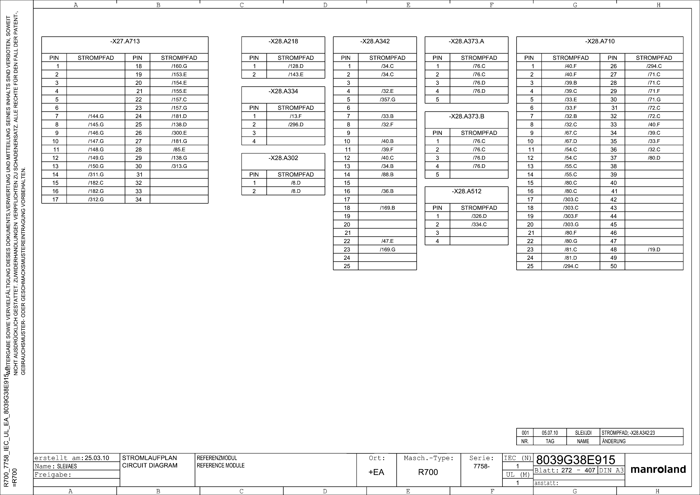

# +EA — Sheet 272 of 407 — REFERENZMODUL

**REFERENCE MODULE**

> Part of the manroland **R700** printing press IEC/UL circuit diagrams.
> Drawing class: **Stromlaufplan / Circuit diagram** (DIN A3).
> Document `+EA` covers the **Printing unit** machine section.

## At a glance

| Field | Value |
|---|---|
| Document | `+EA`  (8039G38E915) |
| Sheet | **272** of 407 |
| Section (DE) | REFERENZMODUL |
| Section (EN) | REFERENCE MODULE |
| Section type | REFERENCE_MODULE — Reference module |
| Machine type | `R700` |
| Series | `7758` |
| Created | 25.03.10 |
| Replaces | — |
| Columns used | A, B, C, D, E, F, G, H |
| Path numbers | — |
| Labels on sheet | 263 |
| Cross-refs out | 93 |
| Cross-refs in | 0 |

**Previous:** [+EA sheet 271](SHEET_0271.md) · **Next:** [+EA sheet 273](SHEET_0273.md) · **Document TOC:** [_TOC.md](_TOC.md)  (+EA) · **Master TOC:** [all sheets](../_MASTER_TOC.md)

## Sheet image (300 DPI, exact vector render)



_Rendered directly from the PDF vector layer at 300 DPI (1-bit), no OCR and no resampling. Use it to confirm anything ambiguous in the text below._

## Cross-references on this sheet

Each entry is a wire leaving this sheet. The printed token is `/sheet.column`; the link resolves to that sheet inside the same document.

| Ref | Target sheet | Col | Path | Destination on target | Target section | From col |
|---|---|---|---|---|---|---|
| `/40.F` | [+EA sheet 40](SHEET_0040.md) | F | — | — | BUSVERBINDUNGEN: STOP SICHERN | G |
| `/160.G` | [+EA sheet 160](SHEET_0160.md) | G | — | — | ZUGANGSABSICHERUNG | B |
| `/34.C` | [+EA sheet 34](SHEET_0034.md) | C | — | — | BUSVERBINDUNGEN: NOT AUS | E |
| `/76.C` | [+EA sheet 76](SHEET_0076.md) | C | — | — | AUSLEGERSTAPELSTEUERUNG | F |
| `/128.D` | [+EA sheet 128](SHEET_0128.md) | D | — | — | ZUGANGSABSICHERUNG | D |
| `/294.C` | [+EA sheet 294](SHEET_0294.md) | C | — | — | OPTION: ZWISCHENSTAPEL / | H |
| `/153.E` | [+EA sheet 153](SHEET_0153.md) | E | — | — | ZUGANGSABSICHERUNG | B |
| `/143.E` | [+EA sheet 143](SHEET_0143.md) | E | — | — | ZUGANGSABSICHERUNG | D |
| `/40.F` | [+EA sheet 40](SHEET_0040.md) | F | — | — | BUSVERBINDUNGEN: STOP SICHERN | G |
| `/34.C` | [+EA sheet 34](SHEET_0034.md) | C | — | — | BUSVERBINDUNGEN: NOT AUS | E |
| `/76.C` | [+EA sheet 76](SHEET_0076.md) | C | — | — | AUSLEGERSTAPELSTEUERUNG | F |
| `/71.C` | [+EA sheet 71](SHEET_0071.md) | C | — | — | AUSLEGERSTAPELSTEUERUNG | H |
| `/39.B` | [+EA sheet 39](SHEET_0039.md) | B | — | — | BUSVERBINDUNGEN: STOP SICHERN | G |
| `/154.E` | [+EA sheet 154](SHEET_0154.md) | E | — | — | ZUGANGSABSICHERUNG | B |
| `/76.D` | [+EA sheet 76](SHEET_0076.md) | D | — | — | AUSLEGERSTAPELSTEUERUNG | F |
| `/71.C` | [+EA sheet 71](SHEET_0071.md) | C | — | — | AUSLEGERSTAPELSTEUERUNG | H |
| `/32.E` | [+EA sheet 32](SHEET_0032.md) | E | — | — | BUSVERBINDUNGEN: NOT AUS | E |
| `/155.E` | [+EA sheet 155](SHEET_0155.md) | E | — | — | ZUGANGSABSICHERUNG | B |
| `/71.F` | [+EA sheet 71](SHEET_0071.md) | F | — | — | AUSLEGERSTAPELSTEUERUNG | H |
| `/76.D` | [+EA sheet 76](SHEET_0076.md) | D | — | — | AUSLEGERSTAPELSTEUERUNG | F |
| `/39.C` | [+EA sheet 39](SHEET_0039.md) | C | — | — | BUSVERBINDUNGEN: STOP SICHERN | G |
| `/33.E` | [+EA sheet 33](SHEET_0033.md) | E | — | — | BUSVERBINDUNGEN: NOT AUS | G |
| `/71.G` | [+EA sheet 71](SHEET_0071.md) | G | — | — | AUSLEGERSTAPELSTEUERUNG | H |
| `/357.G` | [+EA sheet 357](SHEET_0357.md) | G | — | — | OPTION: AUFLAGENZÄHLER / GUTBOGENZÄHLER | E |
| `/157.C` | [+EA sheet 157](SHEET_0157.md) | C | — | — | ZUGANGSABSICHERUNG | B |
| `/33.F` | [+EA sheet 33](SHEET_0033.md) | F | — | — | BUSVERBINDUNGEN: NOT AUS | G |
| `/157.G` | [+EA sheet 157](SHEET_0157.md) | G | — | — | ZUGANGSABSICHERUNG | B |
| `/72.C` | [+EA sheet 72](SHEET_0072.md) | C | — | — | AUSLEGERSTAPELSTEUERUNG | H |
| `/33.B` | [+EA sheet 33](SHEET_0033.md) | B | — | — | BUSVERBINDUNGEN: NOT AUS | E |
| `/32.B` | [+EA sheet 32](SHEET_0032.md) | B | — | — | BUSVERBINDUNGEN: NOT AUS | G |
| `/13.F` | [+EA sheet 13](SHEET_0013.md) | F | — | — | SPANNUNGSVERSORGUNG: 400V, 24V | D |
| `/144.G` | [+EA sheet 144](SHEET_0144.md) | G | — | — | ZUGANGSABSICHERUNG | A |
| `/181.D` | [+EA sheet 181](SHEET_0181.md) | D | — | — | RESERVE | B |
| `/72.C` | [+EA sheet 72](SHEET_0072.md) | C | — | — | AUSLEGERSTAPELSTEUERUNG | H |
| `/32.F` | [+EA sheet 32](SHEET_0032.md) | F | — | — | BUSVERBINDUNGEN: NOT AUS | E |
| `/40.F` | [+EA sheet 40](SHEET_0040.md) | F | — | — | BUSVERBINDUNGEN: STOP SICHERN | H |
| `/145.G` | [+EA sheet 145](SHEET_0145.md) | G | — | — | ZUGANGSABSICHERUNG | A |
| `/32.C` | [+EA sheet 32](SHEET_0032.md) | C | — | — | BUSVERBINDUNGEN: NOT AUS | G |
| `/138.D` | [+EA sheet 138](SHEET_0138.md) | D | — | — | ZUGANGSABSICHERUNG | B |
| `/296.D` | [+EA sheet 296](SHEET_0296.md) | D | — | — | OPTION: ZWISCHENSTAPEL / | D |
| `/300.E` | [+EA sheet 300](SHEET_0300.md) | E | — | — | OPTION: ZWISCHENSTAPEL / | B |
| `/146.G` | [+EA sheet 146](SHEET_0146.md) | G | — | — | ZUGANGSABSICHERUNG | A |
| `/67.C` | [+EA sheet 67](SHEET_0067.md) | C | — | — | LEITSTANDSFUNKTIONEN | G |
| `/39.C` | [+EA sheet 39](SHEET_0039.md) | C | — | — | BUSVERBINDUNGEN: STOP SICHERN | H |
| `/40.B` | [+EA sheet 40](SHEET_0040.md) | B | — | — | BUSVERBINDUNGEN: STOP SICHERN | E |
| `/33.F` | [+EA sheet 33](SHEET_0033.md) | F | — | — | BUSVERBINDUNGEN: NOT AUS | H |
| `/147.G` | [+EA sheet 147](SHEET_0147.md) | G | — | — | ZUGANGSABSICHERUNG | A |
| `/181.G` | [+EA sheet 181](SHEET_0181.md) | G | — | — | RESERVE | B |
| `/76.C` | [+EA sheet 76](SHEET_0076.md) | C | — | — | AUSLEGERSTAPELSTEUERUNG | F |
| `/67.D` | [+EA sheet 67](SHEET_0067.md) | D | — | — | LEITSTANDSFUNKTIONEN | G |
| `/85.E` | [+EA sheet 85](SHEET_0085.md) | E | — | — | AUSLEGERSTAPELSTEUERUNG: PROGRAMMSCHALTWERK | B |
| `/39.F` | [+EA sheet 39](SHEET_0039.md) | F | — | — | BUSVERBINDUNGEN: STOP SICHERN | E |
| `/148.G` | [+EA sheet 148](SHEET_0148.md) | G | — | — | ZUGANGSABSICHERUNG | A |
| `/76.C` | [+EA sheet 76](SHEET_0076.md) | C | — | — | AUSLEGERSTAPELSTEUERUNG | F |
| `/54.C` | [+EA sheet 54](SHEET_0054.md) | C | — | — | MASCHINENBEDIENUNG: LAUFKOMMANDOS | G |
| `/32.C` | [+EA sheet 32](SHEET_0032.md) | C | — | — | BUSVERBINDUNGEN: NOT AUS | H |
| `/149.G` | [+EA sheet 149](SHEET_0149.md) | G | — | — | ZUGANGSABSICHERUNG | A |
| `/138.G` | [+EA sheet 138](SHEET_0138.md) | G | — | — | ZUGANGSABSICHERUNG | B |
| `/40.C` | [+EA sheet 40](SHEET_0040.md) | C | — | — | BUSVERBINDUNGEN: STOP SICHERN | E |
| `/76.D` | [+EA sheet 76](SHEET_0076.md) | D | — | — | AUSLEGERSTAPELSTEUERUNG | F |
| `/54.C` | [+EA sheet 54](SHEET_0054.md) | C | — | — | MASCHINENBEDIENUNG: LAUFKOMMANDOS | G |
| `/80.D` | [+EA sheet 80](SHEET_0080.md) | D | — | — | AUSLEGERSTAPELSTEUERUNG: BEDIENKOMMANDOS | H |
| `/34.B` | [+EA sheet 34](SHEET_0034.md) | B | — | — | BUSVERBINDUNGEN: NOT AUS | E |
| `/150.G` | [+EA sheet 150](SHEET_0150.md) | G | — | — | ZUGANGSABSICHERUNG | A |
| `/313.G` | [+EA sheet 313](SHEET_0313.md) | G | — | — | OPTION: LOGISTIK, AUSLEGER | B |
| `/76.D` | [+EA sheet 76](SHEET_0076.md) | D | — | — | AUSLEGERSTAPELSTEUERUNG | F |
| `/55.C` | [+EA sheet 55](SHEET_0055.md) | C | — | — | MASCHINENBEDIENUNG: LAUFKOMMANDOS | G |
| `/88.B` | [+EA sheet 88](SHEET_0088.md) | B | — | — | SAUGWALZE | E |
| `/311.G` | [+EA sheet 311](SHEET_0311.md) | G | — | — | OPTION: AUTOMATISCHE STAPELAUFFAHRT STOP / | A |
| `/55.C` | [+EA sheet 55](SHEET_0055.md) | C | — | — | MASCHINENBEDIENUNG: LAUFKOMMANDOS | G |
| `/8.D` | [+EA sheet 8](SHEET_0008.md) | D | — | — | SPANNUNGSVERSORGUNG: 400V, 24V | D |
| `/80.C` | [+EA sheet 80](SHEET_0080.md) | C | — | — | AUSLEGERSTAPELSTEUERUNG: BEDIENKOMMANDOS | G |
| `/182.C` | [+EA sheet 182](SHEET_0182.md) | C | — | — | RESERVE | A |
| `/36.B` | [+EA sheet 36](SHEET_0036.md) | B | — | — | BUSVERBINDUNGEN: NOT AUS | E |
| `/8.D` | [+EA sheet 8](SHEET_0008.md) | D | — | — | SPANNUNGSVERSORGUNG: 400V, 24V | D |
| `/182.G` | [+EA sheet 182](SHEET_0182.md) | G | — | — | RESERVE | A |
| `/80.C` | [+EA sheet 80](SHEET_0080.md) | C | — | — | AUSLEGERSTAPELSTEUERUNG: BEDIENKOMMANDOS | G |
| `/312.G` | [+EA sheet 312](SHEET_0312.md) | G | — | — | OPTION: LOGISTIK, AUSLEGER | A |
| `/303.C` | [+EA sheet 303](SHEET_0303.md) | C | — | — | OPTION: ZWISCHENSTAPEL / | G |
| `/169.B` | [+EA sheet 169](SHEET_0169.md) | B | — | — | RESERVE | E |
| `/303.C` | [+EA sheet 303](SHEET_0303.md) | C | — | — | OPTION: ZWISCHENSTAPEL / | G |
| `/303.F` | [+EA sheet 303](SHEET_0303.md) | F | — | — | OPTION: ZWISCHENSTAPEL / | G |
| `/326.D` | [+EA sheet 326](SHEET_0326.md) | D | — | — | OPTION: BOGENWEICHE | F |
| `/303.G` | [+EA sheet 303](SHEET_0303.md) | G | — | — | OPTION: ZWISCHENSTAPEL / | G |
| `/334.C` | [+EA sheet 334](SHEET_0334.md) | C | — | — | OPTION: BOGENWEICHE | F |
| `/80.F` | [+EA sheet 80](SHEET_0080.md) | F | — | — | AUSLEGERSTAPELSTEUERUNG: BEDIENKOMMANDOS | G |
| `/47.E` | [+EA sheet 47](SHEET_0047.md) | E | — | — | SCHUTZ | E |
| `/80.G` | [+EA sheet 80](SHEET_0080.md) | G | — | — | AUSLEGERSTAPELSTEUERUNG: BEDIENKOMMANDOS | G |
| `/169.G` | [+EA sheet 169](SHEET_0169.md) | G | — | — | RESERVE | E |
| `/81.C` | [+EA sheet 81](SHEET_0081.md) | C | — | — | AUSLEGERSTAPELSTEUERUNG: BEDIENKOMMANDOS | G |
| `/19.D` | [+EA sheet 19](SHEET_0019.md) | D | — | — | SPANNUNGSVERSORGUNG: 400V, 24V | H |
| `/81.D` | [+EA sheet 81](SHEET_0081.md) | D | — | — | AUSLEGERSTAPELSTEUERUNG: BEDIENKOMMANDOS | G |
| `/294.C` | [+EA sheet 294](SHEET_0294.md) | C | — | — | OPTION: ZWISCHENSTAPEL / | G |

## Devices on this sheet

| Tag | Class | Class meaning (IEC) | Col | Sub | Terminal | Sign |
|---|---|---|---|---|---|---|
| `X28.A710` | — | cross-device reference | G | — | — | — |
| `X28.A342` | — | cross-device reference | E | — | — | — |
| `X28.A218` | — | cross-device reference | C | — | — | — |
| `X28.A334` | — | cross-device reference | C | — | — | — |
| `X28.A302` | — | cross-device reference | C | — | — | — |
| `X28.A373.A` | — | cross-device reference | F | — | — | — |
| `X28.A373.B` | — | cross-device reference | F | — | — | — |
| `X28.A512` | — | cross-device reference | F | — | — | — |
| `X27.A713` | — | cross-device reference | B | — | — | — |
| `NR.` | — | cross-device reference | F | — | — | — |
| `05.07.10` | — | cross-device reference | G | — | — | — |

## Potentials / nets

_No named potentials on this sheet._

## Wire-end annotations (grouped as printed)

A wire that continues elsewhere is annotated with a small cluster: the destination description, the path/line number `#NN`, and the `/sheet.column` cross reference. Each row below is one such cluster exactly as it is grouped on the drawing.

| Col | Y | Path | Cross-ref | Text on the wire |
|---|---|---|---|---|
| B | 65.5 | — | — | `X27.A713` |
| C | 65.5 | — | — | `X28.A218` |
| E | 65.5 | — | — | `X28.A342` |
| F | 65.5 | — | — | `X28.A373.A` |
| G | 65.5 | — | — | `X28.A710` |
| A | 94.2 | — | — | `PIN STROMPFAD` |
| B | 94.2 | — | — | `PIN 18 19 20 22 23 24 25 26 27 28 29 30 32 33 34 21 31 STROMPFAD` |
| C | 94.2 | — | — | `PIN 2 1 STROMPFAD` |
| E | 94.2 | — | — | `PIN STROMPFAD` |
| F | 94.2 | — | — | `PIN 2 3 4 5 1 STROMPFAD` |
| G | 94.2 | — | — | `PIN STROMPFAD` |
| H | 94.2 | — | — | `PIN STROMPFAD` |
| A | 108.4 | — | — | `2 3 4 5 6 7 8 9 1` |
| D | 108.4 | — | — | `2 3 4 5 6 7 8 9 1` |
| F | 108.4 | — | — | `2 3 4 5 6 7 8 9 1` |
| G | 108.4 | — | — | `26 27 28 29 30 32 33 34 35 36 37 38 39 40 42 43 44 45 46 47 48 49 50 31 41` |
| B | 108.7 | — | `/160.G` | — |
| D | 108.7 | — | `/128.D` | — |
| E | 108.7 | — | `/34.C` | — |
| F | 108.7 | — | `/76.C` | — |
| G | 108.7 | — | `/40.F` | — |
| H | 108.7 | — | `/294.C` | — |
| B | 122.9 | — | `/153.E` | — |
| D | 122.9 | — | `/143.E` | — |
| E | 122.9 | — | `/34.C` | — |
| F | 122.9 | — | `/76.C` | — |
| G | 122.9 | — | `/40.F` | — |
| H | 122.9 | — | `/71.C` | — |
| B | 137.0 | — | `/154.E` | — |
| G | 137.0 | — | `/39.B` | — |
| F | 137.1 | — | `/76.D` | — |
| H | 137.1 | — | `/71.C` | — |
| C | 150.5 | — | — | `X28.A334` |
| B | 151.2 | — | `/155.E` | — |
| E | 151.2 | — | `/32.E` | — |
| F | 151.2 | — | `/76.D` | — |
| G | 151.2 | — | `/39.C` | — |
| H | 151.2 | — | `/71.F` | — |
| B | 165.4 | — | `/157.C` | — |
| E | 165.4 | — | `/357.G` | — |
| G | 165.4 | — | `/33.E` | — |
| H | 165.4 | — | `/71.G` | — |
| C | 179.2 | — | — | `PIN 2 3 4 1 STROMPFAD` |
| B | 179.6 | — | `/157.G` | — |
| G | 179.6 | — | `/33.F` | — |
| H | 179.6 | — | `/72.C` | — |
| F | 193.1 | — | — | `X28.A373.B` |
| A | 193.7 | — | `/144.G` | — |
| D | 193.7 | — | `/13.F` | — |
| E | 193.7 | — | `/33.B` | — |
| G | 193.7 | — | `/32.B` | — |
| B | 193.8 | — | `/181.D` | — |
| H | 193.8 | — | `/72.C` | — |
| A | 207.9 | — | `/145.G` | — |
| B | 207.9 | — | `/138.D` | — |
| D | 207.9 | — | `/296.D` | — |
| E | 207.9 | — | `/32.F` | — |
| G | 207.9 | — | `/32.C` | — |
| H | 207.9 | — | `/40.F` | — |
| F | 221.7 | — | — | `PIN 2 3 4 5 1 STROMPFAD` |
| A | 222.1 | — | `/146.G` | — |
| B | 222.1 | — | `/300.E` | — |
| G | 222.1 | — | `/67.C` | — |
| H | 222.1 | — | `/39.C` | — |
| A | 235.9 | — | — | `10 12 13 14 15 16 17 11` |
| D | 235.9 | — | — | `10 12 13 14 15 16 17 18 19 20 11` |
| F | 235.9 | — | — | `10 12 13 14 15 16 17 18 19 20 11` |
| E | 236.2 | — | `/40.B` | — |
| H | 236.2 | — | `/33.F` | — |
| A | 236.3 | — | `/147.G` | — |
| B | 236.3 | — | `/181.G` | — |
| F | 236.3 | — | `/76.C` | — |
| G | 236.3 | — | `/67.D` | — |
| A | 250.4 | — | `/148.G` | — |
| B | 250.4 | — | `/85.E` | — |
| E | 250.4 | — | `/39.F` | — |
| F | 250.4 | — | `/76.C` | — |
| G | 250.4 | — | `/54.C` | — |
| H | 250.4 | — | `/32.C` | — |
| C | 263.9 | — | — | `X28.A302` |
| A | 264.6 | — | `/149.G` | — |
| B | 264.6 | — | `/138.G` | — |
| E | 264.6 | — | `/40.C` | — |
| F | 264.6 | — | `/76.D` | — |
| G | 264.6 | — | `/54.C` | — |
| H | 264.6 | — | `/80.D` | — |
| A | 278.8 | — | `/150.G` | — |
| B | 278.8 | — | `/313.G` | — |
| E | 278.8 | — | `/34.B` | — |
| F | 278.8 | — | `/76.D` | — |
| G | 278.8 | — | `/55.C` | — |
| C | 292.6 | — | — | `PIN 2 1 STROMPFAD` |
| E | 292.9 | — | `/88.B` | — |
| A | 293.0 | — | `/311.G` | — |
| G | 293.0 | — | `/55.C` | — |
| A | 307.1 | — | `/182.C` | — |
| D | 307.1 | — | `/8.D` | — |
| G | 307.1 | — | `/80.C` | — |
| F | 320.6 | — | — | `X28.A512` |
| A | 321.3 | — | `/182.G` | — |
| D | 321.3 | — | `/8.D` | — |
| E | 321.3 | — | `/36.B` | — |
| G | 321.3 | — | `/80.C` | — |
| A | 335.5 | — | `/312.G` | — |
| G | 335.5 | — | `/303.C` | — |
| F | 349.3 | — | — | `PIN 2 3 4 1 STROMPFAD` |
| E | 349.6 | — | `/169.B` | — |
| G | 349.7 | — | `/303.C` | — |
| F | 363.8 | — | `/326.D` | — |
| G | 363.8 | — | `/303.F` | — |
| F | 378.0 | — | `/334.C` | — |
| G | 378.0 | — | `/303.G` | — |
| D | 391.8 | — | — | `22 23 24 25 21` |
| F | 391.8 | — | — | `22 23 24 25 21` |
| G | 392.1 | — | `/80.F` | — |
| E | 406.3 | — | `/47.E` | — |
| G | 406.3 | — | `/80.G` | — |
| E | 420.5 | — | `/169.G` | — |
| G | 420.5 | — | `/81.C` | — |
| H | 420.5 | — | `/19.D` | — |
| G | 434.7 | — | `/81.D` | — |
| G | 448.9 | — | `/294.C` | — |
| G | 733.0 | — | — | `001 05.07.10 SLEI/JDI STROMPFAD; X28.A342:23` |
| G | 747.1 | — | — | `NR. TAG NAME ÄNDERUNG` |


## Reconstructed tables

This sheet carries tabular content (pin map / terminal assignment / index). The grid below was rebuilt from the drawing's own rule lines, so each row is exactly one physical row of the table.

### Table 1 — 17 data rows × 4 columns (at x=70.9, y=62.4) — **X27.A713**

| PIN | STROMPFAD | PIN | STROMPFAD |
|---|---|---|---|
| `1` |  | `18` | `/160.G` |
| `2` |  | `19` | `/153.E` |
| `3` |  | `20` | `/154.E` |
| `4` |  | `21` | `/155.E` |
| `5` |  | `22` | `/157.C` |
| `6` |  | `23` | `/157.G` |
| `7` | `/144.G` | `24` | `/181.D` |
| `8` | `/145.G` | `25` | `/138.D` |
| `9` | `/146.G` | `26` | `/300.E` |
| `10` | `/147.G` | `27` | `/181.G` |
| `11` | `/148.G` | `28` | `/85.E` |
| `12` | `/149.G` | `29` | `/138.G` |
| `13` | `/150.G` | `30` | `/313.G` |
| `14` | `/311.G` | `31` |  |
| `15` | `/182.C` | `32` |  |
| `16` | `/182.G` | `33` |  |
| `17` | `/312.G` | `34` |  |


### Table 2 — 12 data rows × 2 columns (at x=411.0, y=62.4) — **X28.A218**

| PIN | STROMPFAD |
|---|---|
| `1` | `/128.D` |
| `2` | `/143.E` |
|  | `X28.A334` |
| `PIN` | `STROMPFAD` |
| `1` | `/13.F` |
| `2` | `/296.D` |
| `3` |  |
| `4` |  |
|  | `X28.A302` |
| `PIN` | `STROMPFAD` |
| `1` | `/8.D` |
| `2` | `/8.D` |


### Table 3 — 25 data rows × 2 columns (at x=566.9, y=62.4) — **X28.A342**

| PIN | STROMPFAD |
|---|---|
| `1` | `/34.C` |
| `2` | `/34.C` |
| `3` |  |
| `4` | `/32.E` |
| `5` | `/357.G` |
| `6` |  |
| `7` | `/33.B` |
| `8` | `/32.F` |
| `9` |  |
| `10` | `/40.B` |
| `11` | `/39.F` |
| `12` | `/40.C` |
| `13` | `/34.B` |
| `14` | `/88.B` |
| `15` |  |
| `16` | `/36.B` |
| `17` |  |
| `18` | `/169.B` |
| `19` |  |
| `20` |  |
| `21` |  |
| `22` | `/47.E` |
| `23` | `/169.G` |
| `24` |  |
| `25` |  |


### Table 4 — 18 data rows × 2 columns (at x=722.8, y=62.4) — **X28.A373.A**

| PIN | STROMPFAD |
|---|---|
| `1` | `/76.C` |
| `2` | `/76.C` |
| `3` | `/76.D` |
| `4` | `/76.D` |
| `5` |  |
|  | `X28.A373.B` |
| `PIN` | `STROMPFAD` |
| `1` | `/76.C` |
| `2` | `/76.C` |
| `3` | `/76.D` |
| `4` | `/76.D` |
| `5` |  |
|  | `X28.A512` |
| `PIN` | `STROMPFAD` |
| `1` | `/326.D` |
| `2` | `/334.C` |
| `3` |  |
| `4` |  |


### Table 5 — 25 data rows × 4 columns (at x=878.7, y=62.4) — **X28.A710**

| PIN | STROMPFAD | PIN | STROMPFAD |
|---|---|---|---|
| `1` | `/40.F` | `26` | `/294.C` |
| `2` | `/40.F` | `27` | `/71.C` |
| `3` | `/39.B` | `28` | `/71.C` |
| `4` | `/39.C` | `29` | `/71.F` |
| `5` | `/33.E` | `30` | `/71.G` |
| `6` | `/33.F` | `31` | `/72.C` |
| `7` | `/32.B` | `32` | `/72.C` |
| `8` | `/32.C` | `33` | `/40.F` |
| `9` | `/67.C` | `34` | `/39.C` |
| `10` | `/67.D` | `35` | `/33.F` |
| `11` | `/54.C` | `36` | `/32.C` |
| `12` | `/54.C` | `37` | `/80.D` |
| `13` | `/55.C` | `38` |  |
| `14` | `/55.C` | `39` |  |
| `15` | `/80.C` | `40` |  |
| `16` | `/80.C` | `41` |  |
| `17` | `/303.C` | `42` |  |
| `18` | `/303.C` | `43` |  |
| `19` | `/303.F` | `44` |  |
| `20` | `/303.G` | `45` |  |
| `21` | `/80.F` | `46` |  |
| `22` | `/80.G` | `47` |  |
| `23` | `/81.C` | `48` | `/19.D` |
| `24` | `/81.D` | `49` |  |
| `25` | `/294.C` | `50` |  |


## Notes and free text on this sheet

| Text | Col | Y (pt) |
|---|---|---|
| `PIN` | F | 94.2 |
| `STROMPFAD` | G | 94.15 |
| `PIN` | G | 94.2 |
| `STROMPFAD` | H | 94.15 |
| `PIN` | D | 94.2 |
| `STROMPFAD` | E | 94.15 |
| `PIN` | C | 94.2 |
| `STROMPFAD` | D | 94.15 |
| `PIN` | E | 94.2 |
| `STROMPFAD` | F | 94.15 |
| `PIN` | A | 94.2 |
| `STROMPFAD` | A | 94.15 |
| `PIN` | B | 94.2 |
| `STROMPFAD` | B | 94.15 |
| `TAG` | G | 747.27 |
| `NAME` | G | 747.25 |
| `ÄNDERUNG` | G | 747.31 |
| `SLEI/JDI` | G | 733.11 |
| `STROMPFAD; X28.A342:23` | H | 733.14 |

## Complete label inventory (exact text from the drawing)

Every text object inside the drawing area of this sheet, in DIN reading order (column A→H, then top→bottom). This is the authoritative list: if a string is not here it is not printed on this sheet.

| Col | Y | X | Dir | Type | Text |
|---|---|---|---|---|---|
| A | 94.2 | 84.0 | → | text | `PIN` |
| A | 94.2 | 132.2 | → | text | `STROMPFAD` |
| A | 108.4 | 95.8 | → | number | `1` |
| A | 122.5 | 94.1 | → | number | `2` |
| A | 136.7 | 94.1 | → | number | `3` |
| A | 150.9 | 94.1 | → | number | `4` |
| A | 165.1 | 94.1 | → | number | `5` |
| A | 179.2 | 94.1 | → | number | `6` |
| A | 193.4 | 94.1 | → | number | `7` |
| A | 193.7 | 150.1 | → | cross-reference | `/144.G` |
| A | 207.6 | 94.1 | → | number | `8` |
| A | 207.9 | 150.1 | → | cross-reference | `/145.G` |
| A | 221.8 | 94.1 | → | number | `9` |
| A | 222.1 | 150.1 | → | cross-reference | `/146.G` |
| A | 235.9 | 88.7 | → | number | `10` |
| A | 236.3 | 150.1 | → | cross-reference | `/147.G` |
| A | 250.1 | 90.4 | → | number | `11` |
| A | 250.4 | 150.1 | → | cross-reference | `/148.G` |
| A | 264.3 | 88.7 | → | number | `12` |
| A | 264.6 | 150.1 | → | cross-reference | `/149.G` |
| A | 278.5 | 88.7 | → | number | `13` |
| A | 278.8 | 150.1 | → | cross-reference | `/150.G` |
| A | 292.6 | 88.7 | → | number | `14` |
| A | 293.0 | 150.1 | → | cross-reference | `/311.G` |
| A | 306.8 | 88.7 | → | number | `15` |
| A | 307.1 | 150.2 | → | cross-reference | `/182.C` |
| A | 321.0 | 88.7 | → | number | `16` |
| A | 321.3 | 150.1 | → | cross-reference | `/182.G` |
| A | 335.1 | 88.7 | → | number | `17` |
| A | 335.5 | 150.1 | → | cross-reference | `/312.G` |
| B | 65.5 | 187.7 | → | device ref | `X27.A713` |
| B | 94.2 | 225.8 | → | text | `PIN` |
| B | 94.2 | 274.0 | → | text | `STROMPFAD` |
| B | 108.4 | 230.5 | → | number | `18` |
| B | 108.7 | 291.8 | → | cross-reference | `/160.G` |
| B | 122.5 | 230.5 | → | number | `19` |
| B | 122.9 | 292.3 | → | cross-reference | `/153.E` |
| B | 136.7 | 230.5 | → | number | `20` |
| B | 137.0 | 292.3 | → | cross-reference | `/154.E` |
| B | 150.9 | 232.2 | → | number | `21` |
| B | 151.2 | 292.3 | → | cross-reference | `/155.E` |
| B | 165.1 | 230.5 | → | number | `22` |
| B | 165.4 | 292.0 | → | cross-reference | `/157.C` |
| B | 179.2 | 230.5 | → | number | `23` |
| B | 179.6 | 291.8 | → | cross-reference | `/157.G` |
| B | 193.4 | 230.5 | → | number | `24` |
| B | 193.8 | 292.0 | → | cross-reference | `/181.D` |
| B | 207.6 | 230.5 | → | number | `25` |
| B | 207.9 | 292.0 | → | cross-reference | `/138.D` |
| B | 221.8 | 230.5 | → | number | `26` |
| B | 222.1 | 292.3 | → | cross-reference | `/300.E` |
| B | 235.9 | 230.5 | → | number | `27` |
| B | 236.3 | 291.8 | → | cross-reference | `/181.G` |
| B | 250.1 | 230.5 | → | number | `28` |
| B | 250.4 | 294.7 | → | cross-reference | `/85.E` |
| B | 264.3 | 230.5 | → | number | `29` |
| B | 264.6 | 291.8 | → | cross-reference | `/138.G` |
| B | 278.5 | 230.5 | → | number | `30` |
| B | 278.8 | 291.8 | → | cross-reference | `/313.G` |
| B | 292.6 | 232.2 | → | number | `31` |
| B | 306.8 | 230.5 | → | number | `32` |
| B | 321.0 | 230.5 | → | number | `33` |
| B | 335.1 | 230.5 | → | number | `34` |
| C | 65.5 | 456.9 | → | device ref | `X28.A218` |
| C | 94.2 | 424.2 | → | text | `PIN` |
| C | 108.4 | 430.2 | → | number | `1` |
| C | 122.5 | 429.6 | → | number | `2` |
| C | 150.5 | 456.9 | → | device ref | `X28.A334` |
| C | 179.2 | 424.2 | → | text | `PIN` |
| C | 193.4 | 430.2 | → | number | `1` |
| C | 207.6 | 429.6 | → | number | `2` |
| C | 221.8 | 429.6 | → | number | `3` |
| C | 235.9 | 429.6 | → | number | `4` |
| C | 263.9 | 456.9 | → | device ref | `X28.A302` |
| C | 292.6 | 424.2 | → | text | `PIN` |
| C | 306.8 | 430.2 | → | number | `1` |
| C | 321.0 | 429.6 | → | number | `2` |
| D | 94.2 | 472.4 | → | text | `STROMPFAD` |
| D | 94.2 | 580.1 | → | text | `PIN` |
| D | 108.4 | 591.9 | → | number | `1` |
| D | 108.7 | 490.4 | → | cross-reference | `/128.D` |
| D | 122.5 | 590.2 | → | number | `2` |
| D | 122.9 | 490.7 | → | cross-reference | `/143.E` |
| D | 136.7 | 590.2 | → | number | `3` |
| D | 150.9 | 590.2 | → | number | `4` |
| D | 165.1 | 590.2 | → | number | `5` |
| D | 179.2 | 472.4 | → | text | `STROMPFAD` |
| D | 179.2 | 590.2 | → | number | `6` |
| D | 193.4 | 590.2 | → | number | `7` |
| D | 193.7 | 493.2 | → | cross-reference | `/13.F` |
| D | 207.6 | 590.2 | → | number | `8` |
| D | 207.9 | 490.4 | → | cross-reference | `/296.D` |
| D | 221.8 | 590.2 | → | number | `9` |
| D | 235.9 | 584.8 | → | number | `10` |
| D | 250.1 | 586.5 | → | number | `11` |
| D | 264.3 | 584.8 | → | number | `12` |
| D | 278.5 | 584.8 | → | number | `13` |
| D | 292.6 | 472.4 | → | text | `STROMPFAD` |
| D | 292.6 | 584.8 | → | number | `14` |
| D | 306.8 | 584.8 | → | number | `15` |
| D | 307.1 | 495.2 | → | cross-reference | `/8.D` |
| D | 321.0 | 584.8 | → | number | `16` |
| D | 321.3 | 495.2 | → | cross-reference | `/8.D` |
| D | 335.1 | 584.8 | → | number | `17` |
| D | 349.3 | 584.8 | → | number | `18` |
| D | 363.5 | 584.8 | → | number | `19` |
| D | 377.7 | 584.8 | → | number | `20` |
| D | 391.8 | 586.5 | → | number | `21` |
| D | 406.0 | 584.8 | → | number | `22` |
| D | 420.2 | 584.8 | → | number | `23` |
| D | 434.4 | 584.8 | → | number | `24` |
| D | 448.5 | 584.8 | → | number | `25` |
| E | 65.5 | 612.9 | → | device ref | `X28.A342` |
| E | 94.2 | 628.3 | → | text | `STROMPFAD` |
| E | 94.2 | 736.0 | → | text | `PIN` |
| E | 108.4 | 742.0 | → | number | `1` |
| E | 108.7 | 648.7 | → | cross-reference | `/34.C` |
| E | 122.5 | 741.4 | → | number | `2` |
| E | 122.9 | 648.7 | → | cross-reference | `/34.C` |
| E | 136.7 | 741.4 | → | number | `3` |
| E | 150.9 | 741.4 | → | number | `4` |
| E | 151.2 | 649.0 | → | cross-reference | `/32.E` |
| E | 165.1 | 741.4 | → | number | `5` |
| E | 165.4 | 646.2 | → | cross-reference | `/357.G` |
| E | 193.7 | 648.9 | → | cross-reference | `/33.B` |
| E | 207.9 | 649.1 | → | cross-reference | `/32.F` |
| E | 221.8 | 736.0 | → | text | `PIN` |
| E | 235.9 | 742.0 | → | number | `1` |
| E | 236.2 | 648.9 | → | cross-reference | `/40.B` |
| E | 250.1 | 741.4 | → | number | `2` |
| E | 250.4 | 649.1 | → | cross-reference | `/39.F` |
| E | 264.3 | 741.4 | → | number | `3` |
| E | 264.6 | 648.7 | → | cross-reference | `/40.C` |
| E | 278.5 | 741.4 | → | number | `4` |
| E | 278.8 | 648.9 | → | cross-reference | `/34.B` |
| E | 292.6 | 741.4 | → | number | `5` |
| E | 292.9 | 648.9 | → | cross-reference | `/88.B` |
| E | 321.3 | 648.9 | → | cross-reference | `/36.B` |
| E | 349.3 | 736.0 | → | text | `PIN` |
| E | 349.6 | 646.4 | → | cross-reference | `/169.B` |
| E | 363.5 | 742.0 | → | number | `1` |
| E | 377.7 | 741.4 | → | number | `2` |
| E | 391.8 | 741.4 | → | number | `3` |
| E | 406.0 | 741.4 | → | number | `4` |
| E | 406.3 | 649.0 | → | cross-reference | `/47.E` |
| E | 420.5 | 646.2 | → | cross-reference | `/169.G` |
| F | 65.5 | 763.4 | → | device ref | `X28.A373.A` |
| F | 94.2 | 784.2 | → | text | `STROMPFAD` |
| F | 94.2 | 891.9 | → | text | `PIN` |
| F | 108.4 | 903.7 | → | number | `1` |
| F | 108.7 | 804.6 | → | cross-reference | `/76.C` |
| F | 122.5 | 902.0 | → | number | `2` |
| F | 122.9 | 804.6 | → | cross-reference | `/76.C` |
| F | 136.7 | 902.0 | → | number | `3` |
| F | 137.1 | 804.6 | → | cross-reference | `/76.D` |
| F | 150.9 | 902.0 | → | number | `4` |
| F | 151.2 | 804.6 | → | cross-reference | `/76.D` |
| F | 165.1 | 902.0 | → | number | `5` |
| F | 179.2 | 902.0 | → | number | `6` |
| F | 193.1 | 763.8 | → | device ref | `X28.A373.B` |
| F | 193.4 | 902.0 | → | number | `7` |
| F | 207.6 | 902.0 | → | number | `8` |
| F | 221.7 | 784.2 | → | text | `STROMPFAD` |
| F | 221.8 | 902.0 | → | number | `9` |
| F | 235.9 | 896.6 | → | number | `10` |
| F | 236.3 | 804.6 | → | cross-reference | `/76.C` |
| F | 250.1 | 898.3 | → | number | `11` |
| F | 250.4 | 804.6 | → | cross-reference | `/76.C` |
| F | 264.3 | 896.6 | → | number | `12` |
| F | 264.6 | 804.6 | → | cross-reference | `/76.D` |
| F | 278.5 | 896.6 | → | number | `13` |
| F | 278.8 | 804.6 | → | cross-reference | `/76.D` |
| F | 292.6 | 896.6 | → | number | `14` |
| F | 306.8 | 896.6 | → | number | `15` |
| F | 320.6 | 768.8 | → | device ref | `X28.A512` |
| F | 321.0 | 896.6 | → | number | `16` |
| F | 335.1 | 896.6 | → | number | `17` |
| F | 349.3 | 784.2 | → | text | `STROMPFAD` |
| F | 349.3 | 896.6 | → | number | `18` |
| F | 363.5 | 896.6 | → | number | `19` |
| F | 363.8 | 802.2 | → | cross-reference | `/326.D` |
| F | 377.7 | 896.6 | → | number | `20` |
| F | 378.0 | 802.2 | → | cross-reference | `/334.C` |
| F | 391.8 | 898.3 | → | number | `21` |
| F | 406.0 | 896.6 | → | number | `22` |
| F | 420.2 | 896.6 | → | number | `23` |
| F | 434.4 | 896.6 | → | number | `24` |
| F | 448.5 | 896.6 | → | number | `25` |
| F | 733.0 | 887.7 | → | number | `001` |
| F | 747.1 | 886.7 | → | device ref | `NR.` |
| G | 65.5 | 995.5 | → | device ref | `X28.A710` |
| G | 94.2 | 940.1 | → | text | `STROMPFAD` |
| G | 94.2 | 1033.7 | → | text | `PIN` |
| G | 108.4 | 1038.3 | → | number | `26` |
| G | 108.7 | 960.9 | → | cross-reference | `/40.F` |
| G | 122.5 | 1038.3 | → | number | `27` |
| G | 122.9 | 960.9 | → | cross-reference | `/40.F` |
| G | 136.7 | 1038.3 | → | number | `28` |
| G | 137.0 | 960.7 | → | cross-reference | `/39.B` |
| G | 150.9 | 1038.3 | → | number | `29` |
| G | 151.2 | 960.5 | → | cross-reference | `/39.C` |
| G | 165.1 | 1038.3 | → | number | `30` |
| G | 165.4 | 960.8 | → | cross-reference | `/33.E` |
| G | 179.2 | 1040.0 | → | number | `31` |
| G | 179.6 | 960.9 | → | cross-reference | `/33.F` |
| G | 193.4 | 1038.3 | → | number | `32` |
| G | 193.7 | 960.7 | → | cross-reference | `/32.B` |
| G | 207.6 | 1038.3 | → | number | `33` |
| G | 207.9 | 960.5 | → | cross-reference | `/32.C` |
| G | 221.8 | 1038.3 | → | number | `34` |
| G | 222.1 | 960.5 | → | cross-reference | `/67.C` |
| G | 235.9 | 1038.3 | → | number | `35` |
| G | 236.3 | 960.5 | → | cross-reference | `/67.D` |
| G | 250.1 | 1038.3 | → | number | `36` |
| G | 250.4 | 960.5 | → | cross-reference | `/54.C` |
| G | 264.3 | 1038.3 | → | number | `37` |
| G | 264.6 | 960.5 | → | cross-reference | `/54.C` |
| G | 278.5 | 1038.3 | → | number | `38` |
| G | 278.8 | 960.5 | → | cross-reference | `/55.C` |
| G | 292.6 | 1038.3 | → | number | `39` |
| G | 293.0 | 960.5 | → | cross-reference | `/55.C` |
| G | 306.8 | 1038.3 | → | number | `40` |
| G | 307.1 | 960.5 | → | cross-reference | `/80.C` |
| G | 321.0 | 1040.0 | → | number | `41` |
| G | 321.3 | 960.5 | → | cross-reference | `/80.C` |
| G | 335.1 | 1038.3 | → | number | `42` |
| G | 335.5 | 958.1 | → | cross-reference | `/303.C` |
| G | 349.3 | 1038.3 | → | number | `43` |
| G | 349.7 | 958.1 | → | cross-reference | `/303.C` |
| G | 363.5 | 1038.3 | → | number | `44` |
| G | 363.8 | 958.5 | → | cross-reference | `/303.F` |
| G | 377.7 | 1038.3 | → | number | `45` |
| G | 378.0 | 958.0 | → | cross-reference | `/303.G` |
| G | 391.8 | 1038.3 | → | number | `46` |
| G | 392.2 | 960.9 | → | cross-reference | `/80.F` |
| G | 406.0 | 1038.3 | → | number | `47` |
| G | 406.3 | 960.4 | → | cross-reference | `/80.G` |
| G | 420.2 | 1038.3 | → | number | `48` |
| G | 420.5 | 960.5 | → | cross-reference | `/81.C` |
| G | 434.4 | 1038.3 | → | number | `49` |
| G | 434.7 | 960.5 | → | cross-reference | `/81.D` |
| G | 448.5 | 1038.3 | → | number | `50` |
| G | 448.9 | 958.1 | → | cross-reference | `/294.C` |
| G | 733.1 | 921.9 | → | device ref | `05.07.10` |
| G | 733.1 | 978.4 | → | text | `SLEI/JDI` |
| G | 747.3 | 928.3 | → | text | `TAG` |
| G | 747.3 | 981.7 | → | text | `NAME` |
| G | 747.3 | 1024.3 | → | text | `ÄNDERUNG` |
| H | 94.2 | 1081.8 | → | text | `STROMPFAD` |
| H | 108.7 | 1099.8 | → | cross-reference | `/294.C` |
| H | 122.9 | 1102.3 | → | cross-reference | `/71.C` |
| H | 137.1 | 1102.3 | → | cross-reference | `/71.C` |
| H | 151.2 | 1102.7 | → | cross-reference | `/71.F` |
| H | 165.4 | 1102.1 | → | cross-reference | `/71.G` |
| H | 179.6 | 1102.3 | → | cross-reference | `/72.C` |
| H | 193.7 | 1102.3 | → | cross-reference | `/72.C` |
| H | 207.9 | 1102.7 | → | cross-reference | `/40.F` |
| H | 222.1 | 1102.3 | → | cross-reference | `/39.C` |
| H | 236.2 | 1102.7 | → | cross-reference | `/33.F` |
| H | 250.4 | 1102.3 | → | cross-reference | `/32.C` |
| H | 264.6 | 1102.3 | → | cross-reference | `/80.D` |
| H | 420.5 | 1102.3 | → | cross-reference | `/19.D` |
| H | 733.1 | 1023.4 | → | text | `STROMPFAD; X28.A342:23` |

## Reading-order text block

The same content as a plain block, grouped by DIN column — convenient to paste or to match against a visual description.

```text
=== Column A ===
  94.2   84.0  text         PIN
  94.2  132.2  text         STROMPFAD
 108.4   95.8  numeric      1
 122.5   94.1  numeric      2
 136.7   94.1  numeric      3
 150.9   94.1  numeric      4
 165.1   94.1  numeric      5
 179.2   94.1  numeric      6
 193.4   94.1  numeric      7
 193.7  150.1  xref         /144.G
 207.6   94.1  numeric      8
 207.9  150.1  xref         /145.G
 221.8   94.1  numeric      9
 222.1  150.1  xref         /146.G
 235.9   88.7  numeric      10
 236.3  150.1  xref         /147.G
 250.1   90.4  numeric      11
 250.4  150.1  xref         /148.G
 264.3   88.7  numeric      12
 264.6  150.1  xref         /149.G
 278.5   88.7  numeric      13
 278.8  150.1  xref         /150.G
 292.6   88.7  numeric      14
 293.0  150.1  xref         /311.G
 306.8   88.7  numeric      15
 307.1  150.2  xref         /182.C
 321.0   88.7  numeric      16
 321.3  150.1  xref         /182.G
 335.1   88.7  numeric      17
 335.5  150.1  xref         /312.G
=== Column B ===
  65.5  187.7  devref       X27.A713
  94.2  225.8  text         PIN
  94.2  274.0  text         STROMPFAD
 108.4  230.5  numeric      18
 108.7  291.8  xref         /160.G
 122.5  230.5  numeric      19
 122.9  292.3  xref         /153.E
 136.7  230.5  numeric      20
 137.0  292.3  xref         /154.E
 150.9  232.2  numeric      21
 151.2  292.3  xref         /155.E
 165.1  230.5  numeric      22
 165.4  292.0  xref         /157.C
 179.2  230.5  numeric      23
 179.6  291.8  xref         /157.G
 193.4  230.5  numeric      24
 193.8  292.0  xref         /181.D
 207.6  230.5  numeric      25
 207.9  292.0  xref         /138.D
 221.8  230.5  numeric      26
 222.1  292.3  xref         /300.E
 235.9  230.5  numeric      27
 236.3  291.8  xref         /181.G
 250.1  230.5  numeric      28
 250.4  294.7  xref         /85.E
 264.3  230.5  numeric      29
 264.6  291.8  xref         /138.G
 278.5  230.5  numeric      30
 278.8  291.8  xref         /313.G
 292.6  232.2  numeric      31
 306.8  230.5  numeric      32
 321.0  230.5  numeric      33
 335.1  230.5  numeric      34
=== Column C ===
  65.5  456.9  devref       X28.A218
  94.2  424.2  text         PIN
 108.4  430.2  numeric      1
 122.5  429.6  numeric      2
 150.5  456.9  devref       X28.A334
 179.2  424.2  text         PIN
 193.4  430.2  numeric      1
 207.6  429.6  numeric      2
 221.8  429.6  numeric      3
 235.9  429.6  numeric      4
 263.9  456.9  devref       X28.A302
 292.6  424.2  text         PIN
 306.8  430.2  numeric      1
 321.0  429.6  numeric      2
=== Column D ===
  94.2  472.4  text         STROMPFAD
  94.2  580.1  text         PIN
 108.4  591.9  numeric      1
 108.7  490.4  xref         /128.D
 122.5  590.2  numeric      2
 122.9  490.7  xref         /143.E
 136.7  590.2  numeric      3
 150.9  590.2  numeric      4
 165.1  590.2  numeric      5
 179.2  472.4  text         STROMPFAD
 179.2  590.2  numeric      6
 193.4  590.2  numeric      7
 193.7  493.2  xref         /13.F
 207.6  590.2  numeric      8
 207.9  490.4  xref         /296.D
 221.8  590.2  numeric      9
 235.9  584.8  numeric      10
 250.1  586.5  numeric      11
 264.3  584.8  numeric      12
 278.5  584.8  numeric      13
 292.6  472.4  text         STROMPFAD
 292.6  584.8  numeric      14
 306.8  584.8  numeric      15
 307.1  495.2  xref         /8.D
 321.0  584.8  numeric      16
 321.3  495.2  xref         /8.D
 335.1  584.8  numeric      17
 349.3  584.8  numeric      18
 363.5  584.8  numeric      19
 377.7  584.8  numeric      20
 391.8  586.5  numeric      21
 406.0  584.8  numeric      22
 420.2  584.8  numeric      23
 434.4  584.8  numeric      24
 448.5  584.8  numeric      25
=== Column E ===
  65.5  612.9  devref       X28.A342
  94.2  628.3  text         STROMPFAD
  94.2  736.0  text         PIN
 108.4  742.0  numeric      1
 108.7  648.7  xref         /34.C
 122.5  741.4  numeric      2
 122.9  648.7  xref         /34.C
 136.7  741.4  numeric      3
 150.9  741.4  numeric      4
 151.2  649.0  xref         /32.E
 165.1  741.4  numeric      5
 165.4  646.2  xref         /357.G
 193.7  648.9  xref         /33.B
 207.9  649.1  xref         /32.F
 221.8  736.0  text         PIN
 235.9  742.0  numeric      1
 236.2  648.9  xref         /40.B
 250.1  741.4  numeric      2
 250.4  649.1  xref         /39.F
 264.3  741.4  numeric      3
 264.6  648.7  xref         /40.C
 278.5  741.4  numeric      4
 278.8  648.9  xref         /34.B
 292.6  741.4  numeric      5
 292.9  648.9  xref         /88.B
 321.3  648.9  xref         /36.B
 349.3  736.0  text         PIN
 349.6  646.4  xref         /169.B
 363.5  742.0  numeric      1
 377.7  741.4  numeric      2
 391.8  741.4  numeric      3
 406.0  741.4  numeric      4
 406.3  649.0  xref         /47.E
 420.5  646.2  xref         /169.G
=== Column F ===
  65.5  763.4  devref       X28.A373.A
  94.2  784.2  text         STROMPFAD
  94.2  891.9  text         PIN
 108.4  903.7  numeric      1
 108.7  804.6  xref         /76.C
 122.5  902.0  numeric      2
 122.9  804.6  xref         /76.C
 136.7  902.0  numeric      3
 137.1  804.6  xref         /76.D
 150.9  902.0  numeric      4
 151.2  804.6  xref         /76.D
 165.1  902.0  numeric      5
 179.2  902.0  numeric      6
 193.1  763.8  devref       X28.A373.B
 193.4  902.0  numeric      7
 207.6  902.0  numeric      8
 221.7  784.2  text         STROMPFAD
 221.8  902.0  numeric      9
 235.9  896.6  numeric      10
 236.3  804.6  xref         /76.C
 250.1  898.3  numeric      11
 250.4  804.6  xref         /76.C
 264.3  896.6  numeric      12
 264.6  804.6  xref         /76.D
 278.5  896.6  numeric      13
 278.8  804.6  xref         /76.D
 292.6  896.6  numeric      14
 306.8  896.6  numeric      15
 320.6  768.8  devref       X28.A512
 321.0  896.6  numeric      16
 335.1  896.6  numeric      17
 349.3  784.2  text         STROMPFAD
 349.3  896.6  numeric      18
 363.5  896.6  numeric      19
 363.8  802.2  xref         /326.D
 377.7  896.6  numeric      20
 378.0  802.2  xref         /334.C
 391.8  898.3  numeric      21
 406.0  896.6  numeric      22
 420.2  896.6  numeric      23
 434.4  896.6  numeric      24
 448.5  896.6  numeric      25
 733.0  887.7  numeric      001
 747.1  886.7  devref       NR.
=== Column G ===
  65.5  995.5  devref       X28.A710
  94.2  940.1  text         STROMPFAD
  94.2 1033.7  text         PIN
 108.4 1038.3  numeric      26
 108.7  960.9  xref         /40.F
 122.5 1038.3  numeric      27
 122.9  960.9  xref         /40.F
 136.7 1038.3  numeric      28
 137.0  960.7  xref         /39.B
 150.9 1038.3  numeric      29
 151.2  960.5  xref         /39.C
 165.1 1038.3  numeric      30
 165.4  960.8  xref         /33.E
 179.2 1040.0  numeric      31
 179.6  960.9  xref         /33.F
 193.4 1038.3  numeric      32
 193.7  960.7  xref         /32.B
 207.6 1038.3  numeric      33
 207.9  960.5  xref         /32.C
 221.8 1038.3  numeric      34
 222.1  960.5  xref         /67.C
 235.9 1038.3  numeric      35
 236.3  960.5  xref         /67.D
 250.1 1038.3  numeric      36
 250.4  960.5  xref         /54.C
 264.3 1038.3  numeric      37
 264.6  960.5  xref         /54.C
 278.5 1038.3  numeric      38
 278.8  960.5  xref         /55.C
 292.6 1038.3  numeric      39
 293.0  960.5  xref         /55.C
 306.8 1038.3  numeric      40
 307.1  960.5  xref         /80.C
 321.0 1040.0  numeric      41
 321.3  960.5  xref         /80.C
 335.1 1038.3  numeric      42
 335.5  958.1  xref         /303.C
 349.3 1038.3  numeric      43
 349.7  958.1  xref         /303.C
 363.5 1038.3  numeric      44
 363.8  958.5  xref         /303.F
 377.7 1038.3  numeric      45
 378.0  958.0  xref         /303.G
 391.8 1038.3  numeric      46
 392.2  960.9  xref         /80.F
 406.0 1038.3  numeric      47
 406.3  960.4  xref         /80.G
 420.2 1038.3  numeric      48
 420.5  960.5  xref         /81.C
 434.4 1038.3  numeric      49
 434.7  960.5  xref         /81.D
 448.5 1038.3  numeric      50
 448.9  958.1  xref         /294.C
 733.1  921.9  devref       05.07.10
 733.1  978.4  text         SLEI/JDI
 747.3  928.3  text         TAG
 747.3  981.7  text         NAME
 747.3 1024.3  text         ÄNDERUNG
=== Column H ===
  94.2 1081.8  text         STROMPFAD
 108.7 1099.8  xref         /294.C
 122.9 1102.3  xref         /71.C
 137.1 1102.3  xref         /71.C
 151.2 1102.7  xref         /71.F
 165.4 1102.1  xref         /71.G
 179.6 1102.3  xref         /72.C
 193.7 1102.3  xref         /72.C
 207.9 1102.7  xref         /40.F
 222.1 1102.3  xref         /39.C
 236.2 1102.7  xref         /33.F
 250.4 1102.3  xref         /32.C
 264.6 1102.3  xref         /80.D
 420.5 1102.3  xref         /19.D
 733.1 1023.4  text         STROMPFAD; X28.A342:23
```

---
_Generated from the PDF vector text layer; no OCR. Source: `R700_7758_IEC_UL_EA_8039G38E915_p`, sheet 272._
