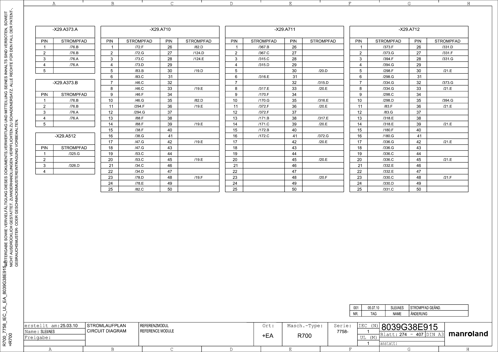

# +EA — Sheet 274 of 407 — REFERENZMODUL

**REFERENCE MODULE**

> Part of the manroland **R700** printing press IEC/UL circuit diagrams.
> Drawing class: **Stromlaufplan / Circuit diagram** (DIN A3).
> Document `+EA` covers the **Printing unit** machine section.

## At a glance

| Field | Value |
|---|---|
| Document | `+EA`  (8039G38E915) |
| Sheet | **274** of 407 |
| Section (DE) | REFERENZMODUL |
| Section (EN) | REFERENCE MODULE |
| Section type | REFERENCE_MODULE — Reference module |
| Machine type | `R700` |
| Series | `7758` |
| Created | 25.03.10 |
| Replaces | — |
| Columns used | A, B, C, D, E, F, G, H |
| Path numbers | — |
| Labels on sheet | 304 |
| Cross-refs out | 108 |
| Cross-refs in | 0 |

**Previous:** [+EA sheet 273](SHEET_0273.md) · **Next:** [+EA sheet 275](SHEET_0275.md) · **Document TOC:** [_TOC.md](_TOC.md)  (+EA) · **Master TOC:** [all sheets](../_MASTER_TOC.md)

## Sheet image (300 DPI, exact vector render)



_Rendered directly from the PDF vector layer at 300 DPI (1-bit), no OCR and no resampling. Use it to confirm anything ambiguous in the text below._

## Cross-references on this sheet

Each entry is a wire leaving this sheet. The printed token is `/sheet.column`; the link resolves to that sheet inside the same document.

| Ref | Target sheet | Col | Path | Destination on target | Target section | From col |
|---|---|---|---|---|---|---|
| `/76.B` | [+EA sheet 76](SHEET_0076.md) | B | — | — | AUSLEGERSTAPELSTEUERUNG | A |
| `/72.F` | [+EA sheet 72](SHEET_0072.md) | F | — | — | AUSLEGERSTAPELSTEUERUNG | B |
| `/367.B` | [+EA sheet 367](SHEET_0367.md) | B | — | — | OPTION: TROCKNER VORBEREITUNG; | E |
| `/373.F` | [+EA sheet 373](SHEET_0373.md) | F | — | — | OPTION: ENDTROCKNER 1 VORBEREITUNG; | G |
| `/82.D` | [+EA sheet 82](SHEET_0082.md) | D | — | — | AUSLEGERSTAPELSTEUERUNG: PROGRAMMSCHALTWERK | C |
| `/331.D` | [+EA sheet 331](SHEET_0331.md) | D | — | — | OPTION: BOGENWEICHE | H |
| `/76.B` | [+EA sheet 76](SHEET_0076.md) | B | — | — | AUSLEGERSTAPELSTEUERUNG | A |
| `/72.G` | [+EA sheet 72](SHEET_0072.md) | G | — | — | AUSLEGERSTAPELSTEUERUNG | B |
| `/331.F` | [+EA sheet 331](SHEET_0331.md) | F | — | — | OPTION: BOGENWEICHE | H |
| `/373.G` | [+EA sheet 373](SHEET_0373.md) | G | — | — | OPTION: ENDTROCKNER 1 VORBEREITUNG; | G |
| `/124.D` | [+EA sheet 124](SHEET_0124.md) | D | — | — | TROCKENBESTÄUBER | C |
| `/367.C` | [+EA sheet 367](SHEET_0367.md) | C | — | — | OPTION: TROCKNER VORBEREITUNG; | E |
| `/76.A` | [+EA sheet 76](SHEET_0076.md) | A | — | — | AUSLEGERSTAPELSTEUERUNG | A |
| `/124.E` | [+EA sheet 124](SHEET_0124.md) | E | — | — | TROCKENBESTÄUBER | C |
| `/394.F` | [+EA sheet 394](SHEET_0394.md) | F | — | — | OPTION: ZWISCHENTROCKNER VORBEREITUNG; | G |
| `/73.C` | [+EA sheet 73](SHEET_0073.md) | C | — | — | AUSLEGERSTAPELSTEUERUNG | B |
| `/331.G` | [+EA sheet 331](SHEET_0331.md) | G | — | — | OPTION: BOGENWEICHE | H |
| `/315.C` | [+EA sheet 315](SHEET_0315.md) | C | — | — | OPTION: LOGISTIK, AUSLEGER | E |
| `/76.A` | [+EA sheet 76](SHEET_0076.md) | A | — | — | AUSLEGERSTAPELSTEUERUNG | A |
| `/394.G` | [+EA sheet 394](SHEET_0394.md) | G | — | — | OPTION: ZWISCHENTROCKNER VORBEREITUNG; | G |
| `/73.D` | [+EA sheet 73](SHEET_0073.md) | D | — | — | AUSLEGERSTAPELSTEUERUNG | B |
| `/315.D` | [+EA sheet 315](SHEET_0315.md) | D | — | — | OPTION: LOGISTIK, AUSLEGER | E |
| `/83.B` | [+EA sheet 83](SHEET_0083.md) | B | — | — | AUSLEGERSTAPELSTEUERUNG: PROGRAMMSCHALTWERK | B |
| `/21.E` | [+EA sheet 21](SHEET_0021.md) | E | — | — | SPANNUNGSVERSORGUNG: 400V, 24V | H |
| `/298.F` | [+EA sheet 298](SHEET_0298.md) | F | — | — | OPTION: ZWISCHENSTAPEL / | G |
| `/19.D` | [+EA sheet 19](SHEET_0019.md) | D | — | — | SPANNUNGSVERSORGUNG: 400V, 24V | C |
| `/20.D` | [+EA sheet 20](SHEET_0020.md) | D | — | — | SPANNUNGSVERSORGUNG: 400V, 24V | F |
| `/316.E` | [+EA sheet 316](SHEET_0316.md) | E | — | — | OPTION: LOGISTIK, AUSLEGER | E |
| `/83.C` | [+EA sheet 83](SHEET_0083.md) | C | — | — | AUSLEGERSTAPELSTEUERUNG: PROGRAMMSCHALTWERK | B |
| `/298.G` | [+EA sheet 298](SHEET_0298.md) | G | — | — | OPTION: ZWISCHENSTAPEL / | G |
| `/334.G` | [+EA sheet 334](SHEET_0334.md) | G | — | — | OPTION: BOGENWEICHE | G |
| `/373.G` | [+EA sheet 373](SHEET_0373.md) | G | — | — | OPTION: ENDTROCKNER 1 VORBEREITUNG; | H |
| `/46.C` | [+EA sheet 46](SHEET_0046.md) | C | — | — | SCHUTZ | B |
| `/315.D` | [+EA sheet 315](SHEET_0315.md) | D | — | — | OPTION: LOGISTIK, AUSLEGER | F |
| `/19.E` | [+EA sheet 19](SHEET_0019.md) | E | — | — | SPANNUNGSVERSORGUNG: 400V, 24V | C |
| `/20.E` | [+EA sheet 20](SHEET_0020.md) | E | — | — | SPANNUNGSVERSORGUNG: 400V, 24V | F |
| `/21.E` | [+EA sheet 21](SHEET_0021.md) | E | — | — | SPANNUNGSVERSORGUNG: 400V, 24V | H |
| `/317.E` | [+EA sheet 317](SHEET_0317.md) | E | — | — | OPTION: LOGISTIK, AUSLEGER | E |
| `/46.C` | [+EA sheet 46](SHEET_0046.md) | C | — | — | SCHUTZ | B |
| `/334.G` | [+EA sheet 334](SHEET_0334.md) | G | — | — | OPTION: BOGENWEICHE | G |
| `/46.F` | [+EA sheet 46](SHEET_0046.md) | F | — | — | SCHUTZ | B |
| `/170.F` | [+EA sheet 170](SHEET_0170.md) | F | — | — | RESERVE | E |
| `/298.C` | [+EA sheet 298](SHEET_0298.md) | C | — | — | OPTION: ZWISCHENSTAPEL / | G |
| `/76.B` | [+EA sheet 76](SHEET_0076.md) | B | — | — | AUSLEGERSTAPELSTEUERUNG | A |
| `/46.G` | [+EA sheet 46](SHEET_0046.md) | G | — | — | SCHUTZ | B |
| `/316.E` | [+EA sheet 316](SHEET_0316.md) | E | — | — | OPTION: LOGISTIK, AUSLEGER | F |
| `/170.G` | [+EA sheet 170](SHEET_0170.md) | G | — | — | RESERVE | E |
| `/394.G` | [+EA sheet 394](SHEET_0394.md) | G | — | — | OPTION: ZWISCHENTROCKNER VORBEREITUNG; | H |
| `/82.D` | [+EA sheet 82](SHEET_0082.md) | D | — | — | AUSLEGERSTAPELSTEUERUNG: PROGRAMMSCHALTWERK | C |
| `/298.D` | [+EA sheet 298](SHEET_0298.md) | D | — | — | OPTION: ZWISCHENSTAPEL / | G |
| `/76.B` | [+EA sheet 76](SHEET_0076.md) | B | — | — | AUSLEGERSTAPELSTEUERUNG | A |
| `/19.E` | [+EA sheet 19](SHEET_0019.md) | E | — | — | SPANNUNGSVERSORGUNG: 400V, 24V | C |
| `/20.E` | [+EA sheet 20](SHEET_0020.md) | E | — | — | SPANNUNGSVERSORGUNG: 400V, 24V | F |
| `/21.E` | [+EA sheet 21](SHEET_0021.md) | E | — | — | SPANNUNGSVERSORGUNG: 400V, 24V | H |
| `/83.F` | [+EA sheet 83](SHEET_0083.md) | F | — | — | AUSLEGERSTAPELSTEUERUNG: PROGRAMMSCHALTWERK | G |
| `/294.F` | [+EA sheet 294](SHEET_0294.md) | F | — | — | OPTION: ZWISCHENSTAPEL / | B |
| `/372.F` | [+EA sheet 372](SHEET_0372.md) | F | — | — | OPTION: ENDTROCKNER 1 VORBEREITUNG; | E |
| `/76.A` | [+EA sheet 76](SHEET_0076.md) | A | — | — | AUSLEGERSTAPELSTEUERUNG | A |
| `/372.F` | [+EA sheet 372](SHEET_0372.md) | F | — | — | OPTION: ENDTROCKNER 1 VORBEREITUNG; | E |
| `/83.G` | [+EA sheet 83](SHEET_0083.md) | G | — | — | AUSLEGERSTAPELSTEUERUNG: PROGRAMMSCHALTWERK | G |
| `/294.G` | [+EA sheet 294](SHEET_0294.md) | G | — | — | OPTION: ZWISCHENSTAPEL / | B |
| `/76.A` | [+EA sheet 76](SHEET_0076.md) | A | — | — | AUSLEGERSTAPELSTEUERUNG | A |
| `/88.F` | [+EA sheet 88](SHEET_0088.md) | F | — | — | SAUGWALZE | B |
| `/171.B` | [+EA sheet 171](SHEET_0171.md) | B | — | — | RESERVE | E |
| `/317.E` | [+EA sheet 317](SHEET_0317.md) | E | — | — | OPTION: LOGISTIK, AUSLEGER | F |
| `/318.E` | [+EA sheet 318](SHEET_0318.md) | E | — | — | OPTION: LOGISTIK, AUSLEGER | G |
| `/19.E` | [+EA sheet 19](SHEET_0019.md) | E | — | — | SPANNUNGSVERSORGUNG: 400V, 24V | C |
| `/20.E` | [+EA sheet 20](SHEET_0020.md) | E | — | — | SPANNUNGSVERSORGUNG: 400V, 24V | F |
| `/21.E` | [+EA sheet 21](SHEET_0021.md) | E | — | — | SPANNUNGSVERSORGUNG: 400V, 24V | H |
| `/88.F` | [+EA sheet 88](SHEET_0088.md) | F | — | — | SAUGWALZE | B |
| `/318.E` | [+EA sheet 318](SHEET_0318.md) | E | — | — | OPTION: LOGISTIK, AUSLEGER | G |
| `/171.C` | [+EA sheet 171](SHEET_0171.md) | C | — | — | RESERVE | E |
| `/38.F` | [+EA sheet 38](SHEET_0038.md) | F | — | — | BUSVERBINDUNGEN: NOT AUS | B |
| `/172.B` | [+EA sheet 172](SHEET_0172.md) | B | — | — | RESERVE | E |
| `/180.F` | [+EA sheet 180](SHEET_0180.md) | F | — | — | RESERVE | G |
| `/38.G` | [+EA sheet 38](SHEET_0038.md) | G | — | — | BUSVERBINDUNGEN: NOT AUS | B |
| `/372.G` | [+EA sheet 372](SHEET_0372.md) | G | — | — | OPTION: ENDTROCKNER 1 VORBEREITUNG; | F |
| `/180.G` | [+EA sheet 180](SHEET_0180.md) | G | — | — | RESERVE | G |
| `/172.C` | [+EA sheet 172](SHEET_0172.md) | C | — | — | RESERVE | E |
| `/19.E` | [+EA sheet 19](SHEET_0019.md) | E | — | — | SPANNUNGSVERSORGUNG: 400V, 24V | C |
| `/20.E` | [+EA sheet 20](SHEET_0020.md) | E | — | — | SPANNUNGSVERSORGUNG: 400V, 24V | F |
| `/21.E` | [+EA sheet 21](SHEET_0021.md) | E | — | — | SPANNUNGSVERSORGUNG: 400V, 24V | H |
| `/47.G` | [+EA sheet 47](SHEET_0047.md) | G | — | — | SCHUTZ | B |
| `/336.G` | [+EA sheet 336](SHEET_0336.md) | G | — | — | OPTION: BOGENWEICHE | G |
| `/47.G` | [+EA sheet 47](SHEET_0047.md) | G | — | — | SCHUTZ | B |
| `/336.G` | [+EA sheet 336](SHEET_0336.md) | G | — | — | OPTION: BOGENWEICHE | G |
| `/325.G` | [+EA sheet 325](SHEET_0325.md) | G | — | — | OPTION: BOGENWEICHE | A |
| `/53.C` | [+EA sheet 53](SHEET_0053.md) | C | — | — | MASCHINENBEDIENUNG: LAUFKOMMANDOS | B |
| `/336.C` | [+EA sheet 336](SHEET_0336.md) | C | — | — | OPTION: BOGENWEICHE | G |
| `/19.E` | [+EA sheet 19](SHEET_0019.md) | E | — | — | SPANNUNGSVERSORGUNG: 400V, 24V | C |
| `/20.E` | [+EA sheet 20](SHEET_0020.md) | E | — | — | SPANNUNGSVERSORGUNG: 400V, 24V | F |
| `/21.E` | [+EA sheet 21](SHEET_0021.md) | E | — | — | SPANNUNGSVERSORGUNG: 400V, 24V | H |
| `/53.C` | [+EA sheet 53](SHEET_0053.md) | C | — | — | MASCHINENBEDIENUNG: LAUFKOMMANDOS | B |
| `/336.C` | [+EA sheet 336](SHEET_0336.md) | C | — | — | OPTION: BOGENWEICHE | G |
| `/332.E` | [+EA sheet 332](SHEET_0332.md) | E | — | — | OPTION: BOGENWEICHE | G |
| `/34.C` | [+EA sheet 34](SHEET_0034.md) | C | — | — | BUSVERBINDUNGEN: NOT AUS | B |
| `/326.D` | [+EA sheet 326](SHEET_0326.md) | D | — | — | OPTION: BOGENWEICHE | A |
| `/332.E` | [+EA sheet 332](SHEET_0332.md) | E | — | — | OPTION: BOGENWEICHE | G |
| `/34.D` | [+EA sheet 34](SHEET_0034.md) | D | — | — | BUSVERBINDUNGEN: NOT AUS | B |
| `/19.F` | [+EA sheet 19](SHEET_0019.md) | F | — | — | SPANNUNGSVERSORGUNG: 400V, 24V | C |
| `/20.F` | [+EA sheet 20](SHEET_0020.md) | F | — | — | SPANNUNGSVERSORGUNG: 400V, 24V | F |
| `/21.F` | [+EA sheet 21](SHEET_0021.md) | F | — | — | SPANNUNGSVERSORGUNG: 400V, 24V | H |
| `/78.D` | [+EA sheet 78](SHEET_0078.md) | D | — | — | AUSLEGERSTAPELSTEUERUNG | B |
| `/330.C` | [+EA sheet 330](SHEET_0330.md) | C | — | — | OPTION: BOGENWEICHE | G |
| `/78.E` | [+EA sheet 78](SHEET_0078.md) | E | — | — | AUSLEGERSTAPELSTEUERUNG | B |
| `/330.D` | [+EA sheet 330](SHEET_0330.md) | D | — | — | OPTION: BOGENWEICHE | G |
| `/82.C` | [+EA sheet 82](SHEET_0082.md) | C | — | — | AUSLEGERSTAPELSTEUERUNG: PROGRAMMSCHALTWERK | B |
| `/331.C` | [+EA sheet 331](SHEET_0331.md) | C | — | — | OPTION: BOGENWEICHE | G |

## Devices on this sheet

| Tag | Class | Class meaning (IEC) | Col | Sub | Terminal | Sign |
|---|---|---|---|---|---|---|
| `X29.A373.A` | — | cross-device reference | A | — | — | — |
| `X29.A373.B` | — | cross-device reference | A | — | — | — |
| `X29.A512` | — | cross-device reference | A | — | — | — |
| `X29.A710` | — | cross-device reference | C | — | — | — |
| `X29.A711` | — | cross-device reference | E | — | — | — |
| `X29.A712` | — | cross-device reference | G | — | — | — |
| `NR.` | — | cross-device reference | F | — | — | — |
| `05.07.10` | — | cross-device reference | F | — | — | — |

## Potentials / nets

_No named potentials on this sheet._

## Wire-end annotations (grouped as printed)

A wire that continues elsewhere is annotated with a small cluster: the destination description, the path/line number `#NN`, and the `/sheet.column` cross reference. Each row below is one such cluster exactly as it is grouped on the drawing.

| Col | Y | Path | Cross-ref | Text on the wire |
|---|---|---|---|---|
| A | 65.5 | — | — | `X29.A373.A` |
| C | 65.5 | — | — | `X29.A710` |
| E | 65.5 | — | — | `X29.A711` |
| G | 65.5 | — | — | `X29.A712` |
| A | 94.2 | — | — | `PIN 2 3 4 5 1 STROMPFAD` |
| B | 94.2 | — | — | `PIN STROMPFAD` |
| C | 94.2 | — | — | `PIN STROMPFAD` |
| D | 94.2 | — | — | `PIN STROMPFAD` |
| E | 94.2 | — | — | `PIN STROMPFAD` |
| F | 94.2 | — | — | `PIN STROMPFAD` |
| G | 94.2 | — | — | `PIN STROMPFAD` |
| B | 108.4 | — | — | `2 3 4 5 6 7 8 9 1` |
| C | 108.4 | — | — | `26 27 28 29 30 32 33 34 35 36 37 38 39 40 42 43 44 45 46 47 48 49 50 31 41` |
| D | 108.4 | — | — | `2 3 4 5 6 7 8 9 1` |
| E | 108.4 | — | — | `26 27 28 29 30 32 33 34 35 36 37 38 39 40 42 43 44 45 46 47 48 49 50 31 41` |
| F | 108.4 | — | — | `2 3 4 5 6 7 8 9 1` |
| G | 108.4 | — | — | `26 27 28 29 30 32 33 34 35 36 37 38 39 40 42 43 44 45 46 47 48 49 50 31 41` |
| A | 108.7 | — | `/76.B` | — |
| B | 108.7 | — | `/72.F` | — |
| C | 108.7 | — | `/82.D` | — |
| E | 108.7 | — | `/367.B` | — |
| G | 108.7 | — | `/373.F` | — |
| H | 108.7 | — | `/331.D` | — |
| A | 122.8 | — | `/76.B` | — |
| B | 122.9 | — | `/72.G` | — |
| C | 122.9 | — | `/124.D` | — |
| E | 122.9 | — | `/367.C` | — |
| G | 122.9 | — | `/373.G` | — |
| H | 122.9 | — | `/331.F` | — |
| A | 137.0 | — | `/76.A` | — |
| C | 137.0 | — | `/124.E` | — |
| G | 137.0 | — | `/394.F` | — |
| B | 137.1 | — | `/73.C` | — |
| E | 137.1 | — | `/315.C` | — |
| H | 137.1 | — | `/331.G` | — |
| A | 151.2 | — | `/76.A` | — |
| B | 151.2 | — | `/73.D` | — |
| E | 151.2 | — | `/315.D` | — |
| G | 151.2 | — | `/394.G` | — |
| B | 165.4 | — | `/83.B` | — |
| C | 165.4 | — | `/19.D` | — |
| F | 165.4 | — | `/20.D` | — |
| G | 165.4 | — | `/298.F` | — |
| H | 165.4 | — | `/21.E` | — |
| B | 179.6 | — | `/83.C` | — |
| E | 179.6 | — | `/316.E` | — |
| G | 179.6 | — | `/298.G` | — |
| A | 193.1 | — | — | `X29.A373.B` |
| G | 193.7 | — | `/334.G` | — |
| H | 193.7 | — | `/373.G` | — |
| B | 193.8 | — | `/46.C` | — |
| F | 193.8 | — | `/315.D` | — |
| B | 207.9 | — | `/46.C` | — |
| C | 207.9 | — | `/19.E` | — |
| E | 207.9 | — | `/317.E` | — |
| F | 207.9 | — | `/20.E` | — |
| G | 207.9 | — | `/334.G` | — |
| H | 207.9 | — | `/21.E` | — |
| A | 221.7 | — | — | `PIN 2 3 4 5 1 STROMPFAD` |
| B | 222.1 | — | `/46.F` | — |
| E | 222.1 | — | `/170.F` | — |
| G | 222.1 | — | `/298.C` | — |
| B | 235.9 | — | — | `10 12 13 14 15 16 17 18 19 20 11` |
| D | 235.9 | — | — | `10 12 13 14 15 16 17 18 19 20 11` |
| F | 235.9 | — | — | `10 12 13 14 15 16 17 18 19 20 11` |
| A | 236.2 | — | `/76.B` | — |
| B | 236.2 | — | `/46.G` | — |
| F | 236.2 | — | `/316.E` | — |
| C | 236.3 | — | `/82.D` | — |
| E | 236.3 | — | `/170.G` | — |
| G | 236.3 | — | `/298.D` | — |
| H | 236.3 | — | `/394.G` | — |
| A | 250.4 | — | `/76.B` | — |
| B | 250.4 | — | `/294.F` | — |
| C | 250.4 | — | `/19.E` | — |
| E | 250.4 | — | `/372.F` | — |
| F | 250.4 | — | `/20.E` | — |
| G | 250.4 | — | `/83.F` | — |
| H | 250.4 | — | `/21.E` | — |
| A | 264.6 | — | `/76.A` | — |
| B | 264.6 | — | `/294.G` | — |
| E | 264.6 | — | `/372.F` | — |
| G | 264.6 | — | `/83.G` | — |
| A | 278.8 | — | `/76.A` | — |
| B | 278.8 | — | `/88.F` | — |
| E | 278.8 | — | `/171.B` | — |
| F | 278.8 | — | `/317.E` | — |
| G | 278.8 | — | `/318.E` | — |
| B | 292.9 | — | `/88.F` | — |
| C | 292.9 | — | `/19.E` | — |
| F | 292.9 | — | `/20.E` | — |
| G | 292.9 | — | `/318.E` | — |
| H | 292.9 | — | `/21.E` | — |
| E | 293.0 | — | `/171.C` | — |
| B | 307.1 | — | `/38.F` | — |
| E | 307.1 | — | `/172.B` | — |
| G | 307.1 | — | `/180.F` | — |
| A | 320.6 | — | — | `X29.A512` |
| B | 321.3 | — | `/38.G` | — |
| E | 321.3 | — | `/172.C` | — |
| F | 321.3 | — | `/372.G` | — |
| G | 321.3 | — | `/180.G` | — |
| C | 335.4 | — | `/19.E` | — |
| F | 335.4 | — | `/20.E` | — |
| H | 335.4 | — | `/21.E` | — |
| B | 335.5 | — | `/47.G` | — |
| G | 335.5 | — | `/336.G` | — |
| A | 349.3 | — | — | `PIN 2 3 4 1 STROMPFAD` |
| B | 349.6 | — | `/47.G` | — |
| G | 349.6 | — | `/336.G` | — |
| A | 363.8 | — | `/325.G` | — |
| B | 363.8 | — | `/53.C` | — |
| G | 363.8 | — | `/336.C` | — |
| B | 378.0 | — | `/53.C` | — |
| C | 378.0 | — | `/19.E` | — |
| F | 378.0 | — | `/20.E` | — |
| G | 378.0 | — | `/336.C` | — |
| H | 378.0 | — | `/21.E` | — |
| B | 391.8 | — | — | `22 23 24 25 21` |
| D | 391.8 | — | — | `22 23 24 25 21` |
| F | 391.8 | — | — | `22 23 24 25 21` |
| G | 392.1 | — | `/332.E` | — |
| A | 392.2 | — | `/326.D` | — |
| B | 392.2 | — | `/34.C` | — |
| B | 406.3 | — | `/34.D` | — |
| G | 406.3 | — | `/332.E` | — |
| B | 420.5 | — | `/78.D` | — |
| C | 420.5 | — | `/19.F` | — |
| F | 420.5 | — | `/20.F` | — |
| G | 420.5 | — | `/330.C` | — |
| H | 420.5 | — | `/21.F` | — |
| B | 434.7 | — | `/78.E` | — |
| G | 434.7 | — | `/330.D` | — |
| B | 448.9 | — | `/82.C` | — |
| G | 448.9 | — | `/331.C` | — |
| G | 733.0 | — | — | `001 05.07.10 SLEI/AES STROMPFAD GEÄND.` |
| G | 747.1 | — | — | `NR. TAG NAME ÄNDERUNG` |


## Reconstructed tables

This sheet carries tabular content (pin map / terminal assignment / index). The grid below was rebuilt from the drawing's own rule lines, so each row is exactly one physical row of the table.

### Table 1 — 18 data rows × 2 columns (at x=85.0, y=62.4) — **X29.A373.A**

| PIN | STROMPFAD |
|---|---|
| `1` | `/76.B` |
| `2` | `/76.B` |
| `3` | `/76.A` |
| `4` | `/76.A` |
| `5` |  |
|  | `X29.A373.B` |
| `PIN` | `STROMPFAD` |
| `1` | `/76.B` |
| `2` | `/76.B` |
| `3` | `/76.A` |
| `4` | `/76.A` |
| `5` |  |
|  | `X29.A512` |
| `PIN` | `STROMPFAD` |
| `1` | `/325.G` |
| `2` |  |
| `3` | `/326.D` |
| `4` |  |


### Table 2 — 25 data rows × 4 columns (at x=240.9, y=62.4) — **X29.A710**

| PIN | STROMPFAD | PIN | STROMPFAD |
|---|---|---|---|
| `1` | `/72.F` | `26` | `/82.D` |
| `2` | `/72.G` | `27` | `/124.D` |
| `3` | `/73.C` | `28` | `/124.E` |
| `4` | `/73.D` | `29` |  |
| `5` | `/83.B` | `30` | `/19.D` |
| `6` | `/83.C` | `31` |  |
| `7` | `/46.C` | `32` |  |
| `8` | `/46.C` | `33` | `/19.E` |
| `9` | `/46.F` | `34` |  |
| `10` | `/46.G` | `35` | `/82.D` |
| `11` | `/294.F` | `36` | `/19.E` |
| `12` | `/294.G` | `37` |  |
| `13` | `/88.F` | `38` |  |
| `14` | `/88.F` | `39` | `/19.E` |
| `15` | `/38.F` | `40` |  |
| `16` | `/38.G` | `41` |  |
| `17` | `/47.G` | `42` | `/19.E` |
| `18` | `/47.G` | `43` |  |
| `19` | `/53.C` | `44` |  |
| `20` | `/53.C` | `45` | `/19.E` |
| `21` | `/34.C` | `46` |  |
| `22` | `/34.D` | `47` |  |
| `23` | `/78.D` | `48` | `/19.F` |
| `24` | `/78.E` | `49` |  |
| `25` | `/82.C` | `50` |  |


### Table 3 — 25 data rows × 4 columns (at x=538.6, y=62.4) — **X29.A711**

| PIN | STROMPFAD | PIN | STROMPFAD |
|---|---|---|---|
| `1` | `/367.B` | `26` |  |
| `2` | `/367.C` | `27` |  |
| `3` | `/315.C` | `28` |  |
| `4` | `/315.D` | `29` |  |
| `5` |  | `30` | `/20.D` |
| `6` | `/316.E` | `31` |  |
| `7` |  | `32` | `/315.D` |
| `8` | `/317.E` | `33` | `/20.E` |
| `9` | `/170.F` | `34` |  |
| `10` | `/170.G` | `35` | `/316.E` |
| `11` | `/372.F` | `36` | `/20.E` |
| `12` | `/372.F` | `37` |  |
| `13` | `/171.B` | `38` | `/317.E` |
| `14` | `/171.C` | `39` | `/20.E` |
| `15` | `/172.B` | `40` |  |
| `16` | `/172.C` | `41` | `/372.G` |
| `17` |  | `42` | `/20.E` |
| `18` |  | `43` |  |
| `19` |  | `44` |  |
| `20` |  | `45` | `/20.E` |
| `21` |  | `46` |  |
| `22` |  | `47` |  |
| `23` |  | `48` | `/20.F` |
| `24` |  | `49` |  |
| `25` |  | `50` |  |


### Table 4 — 25 data rows × 4 columns (at x=836.2, y=62.4) — **X29.A712**

| PIN | STROMPFAD | PIN | STROMPFAD |
|---|---|---|---|
| `1` | `/373.F` | `26` | `/331.D` |
| `2` | `/373.G` | `27` | `/331.F` |
| `3` | `/394.F` | `28` | `/331.G` |
| `4` | `/394.G` | `29` |  |
| `5` | `/298.F` | `30` | `/21.E` |
| `6` | `/298.G` | `31` |  |
| `7` | `/334.G` | `32` | `/373.G` |
| `8` | `/334.G` | `33` | `/21.E` |
| `9` | `/298.C` | `34` |  |
| `10` | `/298.D` | `35` | `/394.G` |
| `11` | `/83.F` | `36` | `/21.E` |
| `12` | `/83.G` | `37` |  |
| `13` | `/318.E` | `38` |  |
| `14` | `/318.E` | `39` | `/21.E` |
| `15` | `/180.F` | `40` |  |
| `16` | `/180.G` | `41` |  |
| `17` | `/336.G` | `42` | `/21.E` |
| `18` | `/336.G` | `43` |  |
| `19` | `/336.C` | `44` |  |
| `20` | `/336.C` | `45` | `/21.E` |
| `21` | `/332.E` | `46` |  |
| `22` | `/332.E` | `47` |  |
| `23` | `/330.C` | `48` | `/21.F` |
| `24` | `/330.D` | `49` |  |
| `25` | `/331.C` | `50` |  |


## Notes and free text on this sheet

| Text | Col | Y (pt) |
|---|---|---|
| `PIN` | A | 94.2 |
| `STROMPFAD` | A | 94.15 |
| `PIN` | B | 94.2 |
| `STROMPFAD` | B | 94.15 |
| `PIN` | C | 94.2 |
| `STROMPFAD` | C | 94.15 |
| `PIN` | D | 94.2 |
| `STROMPFAD` | E | 94.15 |
| `PIN` | E | 94.2 |
| `STROMPFAD` | F | 94.15 |
| `PIN` | F | 94.2 |
| `STROMPFAD` | G | 94.15 |
| `PIN` | G | 94.2 |
| `STROMPFAD` | H | 94.15 |
| `TAG` | F | 747.27 |
| `NAME` | G | 747.25 |
| `ÄNDERUNG` | G | 747.31 |
| `SLEI/AES` | G | 733.13 |
| `STROMPFAD GEÄND.` | G | 733.12 |

## Complete label inventory (exact text from the drawing)

Every text object inside the drawing area of this sheet, in DIN reading order (column A→H, then top→bottom). This is the authoritative list: if a string is not here it is not printed on this sheet.

| Col | Y | X | Dir | Type | Text |
|---|---|---|---|---|---|
| A | 65.5 | 125.6 | → | device ref | `X29.A373.A` |
| A | 94.2 | 98.2 | → | text | `PIN` |
| A | 94.2 | 146.4 | → | text | `STROMPFAD` |
| A | 108.4 | 104.2 | → | number | `1` |
| A | 108.7 | 167.0 | → | cross-reference | `/76.B` |
| A | 122.5 | 103.6 | → | number | `2` |
| A | 122.8 | 167.0 | → | cross-reference | `/76.B` |
| A | 136.7 | 103.6 | → | number | `3` |
| A | 137.0 | 166.8 | → | cross-reference | `/76.A` |
| A | 150.9 | 103.6 | → | number | `4` |
| A | 151.2 | 166.8 | → | cross-reference | `/76.A` |
| A | 165.1 | 103.6 | → | number | `5` |
| A | 193.1 | 126.0 | → | device ref | `X29.A373.B` |
| A | 221.7 | 146.4 | → | text | `STROMPFAD` |
| A | 221.8 | 98.2 | → | text | `PIN` |
| A | 235.9 | 104.2 | → | number | `1` |
| A | 236.2 | 167.0 | → | cross-reference | `/76.B` |
| A | 250.1 | 103.6 | → | number | `2` |
| A | 250.4 | 167.0 | → | cross-reference | `/76.B` |
| A | 264.3 | 103.6 | → | number | `3` |
| A | 264.6 | 166.8 | → | cross-reference | `/76.A` |
| A | 278.5 | 103.6 | → | number | `4` |
| A | 278.8 | 166.8 | → | cross-reference | `/76.A` |
| A | 292.6 | 103.6 | → | number | `5` |
| A | 320.6 | 131.0 | → | device ref | `X29.A512` |
| A | 349.3 | 98.2 | → | text | `PIN` |
| A | 349.3 | 146.4 | → | text | `STROMPFAD` |
| A | 363.5 | 104.2 | → | number | `1` |
| A | 363.8 | 164.3 | → | cross-reference | `/325.G` |
| A | 377.7 | 103.6 | → | number | `2` |
| A | 391.8 | 103.6 | → | number | `3` |
| A | 392.2 | 164.4 | → | cross-reference | `/326.D` |
| A | 406.0 | 103.6 | → | number | `4` |
| B | 94.2 | 254.1 | → | text | `PIN` |
| B | 94.2 | 302.3 | → | text | `STROMPFAD` |
| B | 108.4 | 265.9 | → | number | `1` |
| B | 108.7 | 323.1 | → | cross-reference | `/72.F` |
| B | 122.5 | 264.2 | → | number | `2` |
| B | 122.9 | 322.6 | → | cross-reference | `/72.G` |
| B | 136.7 | 264.2 | → | number | `3` |
| B | 137.1 | 322.7 | → | cross-reference | `/73.C` |
| B | 150.9 | 264.2 | → | number | `4` |
| B | 151.2 | 322.7 | → | cross-reference | `/73.D` |
| B | 165.1 | 264.2 | → | number | `5` |
| B | 165.4 | 322.9 | → | cross-reference | `/83.B` |
| B | 179.2 | 264.2 | → | number | `6` |
| B | 179.6 | 322.7 | → | cross-reference | `/83.C` |
| B | 193.4 | 264.2 | → | number | `7` |
| B | 193.7 | 322.7 | → | cross-reference | `/46.C` |
| B | 207.6 | 264.2 | → | number | `8` |
| B | 207.9 | 322.7 | → | cross-reference | `/46.C` |
| B | 221.8 | 264.2 | → | number | `9` |
| B | 222.1 | 323.1 | → | cross-reference | `/46.F` |
| B | 235.9 | 258.8 | → | number | `10` |
| B | 236.3 | 322.6 | → | cross-reference | `/46.G` |
| B | 250.1 | 260.5 | → | number | `11` |
| B | 250.4 | 320.7 | → | cross-reference | `/294.F` |
| B | 264.3 | 258.8 | → | number | `12` |
| B | 264.6 | 320.2 | → | cross-reference | `/294.G` |
| B | 278.5 | 258.8 | → | number | `13` |
| B | 278.8 | 323.1 | → | cross-reference | `/88.F` |
| B | 292.6 | 258.8 | → | number | `14` |
| B | 292.9 | 323.1 | → | cross-reference | `/88.F` |
| B | 306.8 | 258.8 | → | number | `15` |
| B | 307.1 | 323.1 | → | cross-reference | `/38.F` |
| B | 321.0 | 258.8 | → | number | `16` |
| B | 321.3 | 322.6 | → | cross-reference | `/38.G` |
| B | 335.1 | 258.8 | → | number | `17` |
| B | 335.5 | 322.6 | → | cross-reference | `/47.G` |
| B | 349.3 | 258.8 | → | number | `18` |
| B | 349.6 | 322.6 | → | cross-reference | `/47.G` |
| B | 363.5 | 258.8 | → | number | `19` |
| B | 363.8 | 322.7 | → | cross-reference | `/53.C` |
| B | 377.7 | 258.8 | → | number | `20` |
| B | 378.0 | 322.7 | → | cross-reference | `/53.C` |
| B | 391.8 | 260.5 | → | number | `21` |
| B | 392.2 | 322.7 | → | cross-reference | `/34.C` |
| B | 406.0 | 258.8 | → | number | `22` |
| B | 406.3 | 322.7 | → | cross-reference | `/34.D` |
| B | 420.2 | 258.8 | → | number | `23` |
| B | 420.5 | 322.7 | → | cross-reference | `/78.D` |
| B | 434.4 | 258.8 | → | number | `24` |
| B | 434.7 | 323.0 | → | cross-reference | `/78.E` |
| B | 448.5 | 258.8 | → | number | `25` |
| B | 448.9 | 322.7 | → | cross-reference | `/82.C` |
| C | 65.5 | 357.7 | → | device ref | `X29.A710` |
| C | 94.2 | 395.9 | → | text | `PIN` |
| C | 94.2 | 444.0 | → | text | `STROMPFAD` |
| C | 108.4 | 400.5 | → | number | `26` |
| C | 108.7 | 464.5 | → | cross-reference | `/82.D` |
| C | 122.5 | 400.5 | → | number | `27` |
| C | 122.9 | 462.0 | → | cross-reference | `/124.D` |
| C | 136.7 | 400.5 | → | number | `28` |
| C | 137.0 | 462.3 | → | cross-reference | `/124.E` |
| C | 150.9 | 400.5 | → | number | `29` |
| C | 165.1 | 400.5 | → | number | `30` |
| C | 165.4 | 464.5 | → | cross-reference | `/19.D` |
| C | 179.2 | 402.2 | → | number | `31` |
| C | 193.4 | 400.5 | → | number | `32` |
| C | 207.6 | 400.5 | → | number | `33` |
| C | 207.9 | 464.7 | → | cross-reference | `/19.E` |
| C | 221.8 | 400.5 | → | number | `34` |
| C | 235.9 | 400.5 | → | number | `35` |
| C | 236.3 | 464.5 | → | cross-reference | `/82.D` |
| C | 250.1 | 400.5 | → | number | `36` |
| C | 250.4 | 464.7 | → | cross-reference | `/19.E` |
| C | 264.3 | 400.5 | → | number | `37` |
| C | 278.5 | 400.5 | → | number | `38` |
| C | 292.6 | 400.5 | → | number | `39` |
| C | 292.9 | 464.7 | → | cross-reference | `/19.E` |
| C | 306.8 | 400.5 | → | number | `40` |
| C | 321.0 | 402.2 | → | number | `41` |
| C | 335.1 | 400.5 | → | number | `42` |
| C | 335.4 | 464.7 | → | cross-reference | `/19.E` |
| C | 349.3 | 400.5 | → | number | `43` |
| C | 363.5 | 400.5 | → | number | `44` |
| C | 377.7 | 400.5 | → | number | `45` |
| C | 378.0 | 464.7 | → | cross-reference | `/19.E` |
| C | 391.8 | 400.5 | → | number | `46` |
| C | 406.0 | 400.5 | → | number | `47` |
| C | 420.2 | 400.5 | → | number | `48` |
| C | 420.5 | 464.9 | → | cross-reference | `/19.F` |
| C | 434.4 | 400.5 | → | number | `49` |
| C | 448.5 | 400.5 | → | number | `50` |
| D | 94.2 | 551.8 | → | text | `PIN` |
| D | 108.4 | 563.5 | → | number | `1` |
| D | 122.5 | 561.8 | → | number | `2` |
| D | 136.7 | 561.8 | → | number | `3` |
| D | 150.9 | 561.8 | → | number | `4` |
| D | 165.1 | 561.8 | → | number | `5` |
| D | 179.2 | 561.8 | → | number | `6` |
| D | 193.4 | 561.8 | → | number | `7` |
| D | 207.6 | 561.8 | → | number | `8` |
| D | 221.8 | 561.8 | → | number | `9` |
| D | 235.9 | 556.4 | → | number | `10` |
| D | 250.1 | 558.1 | → | number | `11` |
| D | 264.3 | 556.4 | → | number | `12` |
| D | 278.5 | 556.4 | → | number | `13` |
| D | 292.6 | 556.4 | → | number | `14` |
| D | 306.8 | 556.4 | → | number | `15` |
| D | 321.0 | 556.4 | → | number | `16` |
| D | 335.1 | 556.4 | → | number | `17` |
| D | 349.3 | 556.4 | → | number | `18` |
| D | 363.5 | 556.4 | → | number | `19` |
| D | 377.7 | 556.4 | → | number | `20` |
| D | 391.8 | 558.1 | → | number | `21` |
| D | 406.0 | 556.4 | → | number | `22` |
| D | 420.2 | 556.4 | → | number | `23` |
| D | 434.4 | 556.4 | → | number | `24` |
| D | 448.5 | 556.4 | → | number | `25` |
| E | 65.5 | 656.1 | → | device ref | `X29.A711` |
| E | 94.2 | 600.0 | → | text | `STROMPFAD` |
| E | 94.2 | 693.5 | → | text | `PIN` |
| E | 108.4 | 698.2 | → | number | `26` |
| E | 108.7 | 618.1 | → | cross-reference | `/367.B` |
| E | 122.5 | 698.2 | → | number | `27` |
| E | 122.9 | 618.0 | → | cross-reference | `/367.C` |
| E | 136.7 | 698.2 | → | number | `28` |
| E | 137.1 | 618.0 | → | cross-reference | `/315.C` |
| E | 150.9 | 698.2 | → | number | `29` |
| E | 151.2 | 618.0 | → | cross-reference | `/315.D` |
| E | 165.1 | 698.2 | → | number | `30` |
| E | 179.2 | 699.9 | → | number | `31` |
| E | 179.6 | 618.2 | → | cross-reference | `/316.E` |
| E | 193.4 | 698.2 | → | number | `32` |
| E | 207.6 | 698.2 | → | number | `33` |
| E | 207.9 | 618.2 | → | cross-reference | `/317.E` |
| E | 221.8 | 698.2 | → | number | `34` |
| E | 222.1 | 618.4 | → | cross-reference | `/170.F` |
| E | 235.9 | 698.2 | → | number | `35` |
| E | 236.3 | 617.8 | → | cross-reference | `/170.G` |
| E | 250.1 | 698.2 | → | number | `36` |
| E | 250.4 | 618.4 | → | cross-reference | `/372.F` |
| E | 264.3 | 698.2 | → | number | `37` |
| E | 264.6 | 618.4 | → | cross-reference | `/372.F` |
| E | 278.5 | 698.2 | → | number | `38` |
| E | 278.8 | 618.1 | → | cross-reference | `/171.B` |
| E | 292.6 | 698.2 | → | number | `39` |
| E | 293.0 | 618.0 | → | cross-reference | `/171.C` |
| E | 306.8 | 698.2 | → | number | `40` |
| E | 307.1 | 618.1 | → | cross-reference | `/172.B` |
| E | 321.0 | 699.9 | → | number | `41` |
| E | 321.3 | 618.0 | → | cross-reference | `/172.C` |
| E | 335.1 | 698.2 | → | number | `42` |
| E | 349.3 | 698.2 | → | number | `43` |
| E | 363.5 | 698.2 | → | number | `44` |
| E | 377.7 | 698.2 | → | number | `45` |
| E | 391.8 | 698.2 | → | number | `46` |
| E | 406.0 | 698.2 | → | number | `47` |
| E | 420.2 | 698.2 | → | number | `48` |
| E | 434.4 | 698.2 | → | number | `49` |
| E | 448.5 | 698.2 | → | number | `50` |
| F | 94.2 | 741.7 | → | text | `STROMPFAD` |
| F | 94.2 | 849.4 | → | text | `PIN` |
| F | 108.4 | 861.2 | → | number | `1` |
| F | 122.5 | 859.5 | → | number | `2` |
| F | 136.7 | 859.5 | → | number | `3` |
| F | 150.9 | 859.5 | → | number | `4` |
| F | 165.1 | 859.5 | → | number | `5` |
| F | 165.4 | 762.1 | → | cross-reference | `/20.D` |
| F | 179.2 | 859.5 | → | number | `6` |
| F | 193.4 | 859.5 | → | number | `7` |
| F | 193.8 | 759.7 | → | cross-reference | `/315.D` |
| F | 207.6 | 859.5 | → | number | `8` |
| F | 207.9 | 762.4 | → | cross-reference | `/20.E` |
| F | 221.8 | 859.5 | → | number | `9` |
| F | 235.9 | 854.1 | → | number | `10` |
| F | 236.2 | 760.0 | → | cross-reference | `/316.E` |
| F | 250.1 | 855.8 | → | number | `11` |
| F | 250.4 | 762.4 | → | cross-reference | `/20.E` |
| F | 264.3 | 854.1 | → | number | `12` |
| F | 278.5 | 854.1 | → | number | `13` |
| F | 278.8 | 760.0 | → | cross-reference | `/317.E` |
| F | 292.6 | 854.1 | → | number | `14` |
| F | 292.9 | 762.4 | → | cross-reference | `/20.E` |
| F | 306.8 | 854.1 | → | number | `15` |
| F | 321.0 | 854.1 | → | number | `16` |
| F | 321.3 | 759.5 | → | cross-reference | `/372.G` |
| F | 335.1 | 854.1 | → | number | `17` |
| F | 335.4 | 762.4 | → | cross-reference | `/20.E` |
| F | 349.3 | 854.1 | → | number | `18` |
| F | 363.5 | 854.1 | → | number | `19` |
| F | 377.7 | 854.1 | → | number | `20` |
| F | 378.0 | 762.4 | → | cross-reference | `/20.E` |
| F | 391.8 | 855.8 | → | number | `21` |
| F | 406.0 | 854.1 | → | number | `22` |
| F | 420.2 | 854.1 | → | number | `23` |
| F | 420.5 | 762.5 | → | cross-reference | `/20.F` |
| F | 434.4 | 854.1 | → | number | `24` |
| F | 448.5 | 854.1 | → | number | `25` |
| F | 733.0 | 845.2 | → | number | `001` |
| F | 733.1 | 879.3 | → | device ref | `05.07.10` |
| F | 747.1 | 844.2 | → | device ref | `NR.` |
| F | 747.3 | 885.8 | → | text | `TAG` |
| G | 65.5 | 953.0 | → | device ref | `X29.A712` |
| G | 94.2 | 897.6 | → | text | `STROMPFAD` |
| G | 94.2 | 991.1 | → | text | `PIN` |
| G | 108.4 | 995.8 | → | number | `26` |
| G | 108.7 | 916.0 | → | cross-reference | `/373.F` |
| G | 122.5 | 995.8 | → | number | `27` |
| G | 122.9 | 915.4 | → | cross-reference | `/373.G` |
| G | 136.7 | 995.8 | → | number | `28` |
| G | 137.0 | 916.0 | → | cross-reference | `/394.F` |
| G | 150.9 | 995.8 | → | number | `29` |
| G | 151.2 | 915.4 | → | cross-reference | `/394.G` |
| G | 165.1 | 995.8 | → | number | `30` |
| G | 165.4 | 916.0 | → | cross-reference | `/298.F` |
| G | 179.2 | 997.5 | → | number | `31` |
| G | 179.6 | 915.4 | → | cross-reference | `/298.G` |
| G | 193.4 | 995.8 | → | number | `32` |
| G | 193.7 | 915.4 | → | cross-reference | `/334.G` |
| G | 207.6 | 995.8 | → | number | `33` |
| G | 207.9 | 915.4 | → | cross-reference | `/334.G` |
| G | 221.8 | 995.8 | → | number | `34` |
| G | 222.1 | 915.6 | → | cross-reference | `/298.C` |
| G | 235.9 | 995.8 | → | number | `35` |
| G | 236.3 | 915.6 | → | cross-reference | `/298.D` |
| G | 250.1 | 995.8 | → | number | `36` |
| G | 250.4 | 918.4 | → | cross-reference | `/83.F` |
| G | 264.3 | 995.8 | → | number | `37` |
| G | 264.6 | 917.9 | → | cross-reference | `/83.G` |
| G | 278.5 | 995.8 | → | number | `38` |
| G | 278.8 | 915.9 | → | cross-reference | `/318.E` |
| G | 292.6 | 995.8 | → | number | `39` |
| G | 292.9 | 915.9 | → | cross-reference | `/318.E` |
| G | 306.8 | 995.8 | → | number | `40` |
| G | 307.1 | 916.0 | → | cross-reference | `/180.F` |
| G | 321.0 | 997.5 | → | number | `41` |
| G | 321.3 | 915.4 | → | cross-reference | `/180.G` |
| G | 335.1 | 995.8 | → | number | `42` |
| G | 335.5 | 915.4 | → | cross-reference | `/336.G` |
| G | 349.3 | 995.8 | → | number | `43` |
| G | 349.7 | 915.4 | → | cross-reference | `/336.G` |
| G | 363.5 | 995.8 | → | number | `44` |
| G | 363.8 | 915.6 | → | cross-reference | `/336.C` |
| G | 377.7 | 995.8 | → | number | `45` |
| G | 378.0 | 915.6 | → | cross-reference | `/336.C` |
| G | 391.8 | 995.8 | → | number | `46` |
| G | 392.2 | 915.9 | → | cross-reference | `/332.E` |
| G | 406.0 | 995.8 | → | number | `47` |
| G | 406.3 | 915.9 | → | cross-reference | `/332.E` |
| G | 420.2 | 995.8 | → | number | `48` |
| G | 420.5 | 915.6 | → | cross-reference | `/330.C` |
| G | 434.4 | 995.8 | → | number | `49` |
| G | 434.7 | 915.6 | → | cross-reference | `/330.D` |
| G | 448.5 | 995.8 | → | number | `50` |
| G | 448.9 | 915.6 | → | cross-reference | `/331.C` |
| G | 733.1 | 934.0 | → | text | `SLEI/AES` |
| G | 733.1 | 980.9 | → | text | `STROMPFAD GEÄND.` |
| G | 747.3 | 939.2 | → | text | `NAME` |
| G | 747.3 | 981.8 | → | text | `ÄNDERUNG` |
| H | 94.2 | 1039.3 | → | text | `STROMPFAD` |
| H | 108.7 | 1057.3 | → | cross-reference | `/331.D` |
| H | 122.9 | 1057.7 | → | cross-reference | `/331.F` |
| H | 137.1 | 1057.2 | → | cross-reference | `/331.G` |
| H | 165.4 | 1060.0 | → | cross-reference | `/21.E` |
| H | 193.7 | 1057.2 | → | cross-reference | `/373.G` |
| H | 207.9 | 1060.0 | → | cross-reference | `/21.E` |
| H | 236.3 | 1057.2 | → | cross-reference | `/394.G` |
| H | 250.4 | 1060.0 | → | cross-reference | `/21.E` |
| H | 292.9 | 1060.0 | → | cross-reference | `/21.E` |
| H | 335.4 | 1060.0 | → | cross-reference | `/21.E` |
| H | 378.0 | 1060.0 | → | cross-reference | `/21.E` |
| H | 420.5 | 1060.2 | → | cross-reference | `/21.F` |

## Reading-order text block

The same content as a plain block, grouped by DIN column — convenient to paste or to match against a visual description.

```text
=== Column A ===
  65.5  125.6  devref       X29.A373.A
  94.2   98.2  text         PIN
  94.2  146.4  text         STROMPFAD
 108.4  104.2  numeric      1
 108.7  167.0  xref         /76.B
 122.5  103.6  numeric      2
 122.8  167.0  xref         /76.B
 136.7  103.6  numeric      3
 137.0  166.8  xref         /76.A
 150.9  103.6  numeric      4
 151.2  166.8  xref         /76.A
 165.1  103.6  numeric      5
 193.1  126.0  devref       X29.A373.B
 221.7  146.4  text         STROMPFAD
 221.8   98.2  text         PIN
 235.9  104.2  numeric      1
 236.2  167.0  xref         /76.B
 250.1  103.6  numeric      2
 250.4  167.0  xref         /76.B
 264.3  103.6  numeric      3
 264.6  166.8  xref         /76.A
 278.5  103.6  numeric      4
 278.8  166.8  xref         /76.A
 292.6  103.6  numeric      5
 320.6  131.0  devref       X29.A512
 349.3   98.2  text         PIN
 349.3  146.4  text         STROMPFAD
 363.5  104.2  numeric      1
 363.8  164.3  xref         /325.G
 377.7  103.6  numeric      2
 391.8  103.6  numeric      3
 392.2  164.4  xref         /326.D
 406.0  103.6  numeric      4
=== Column B ===
  94.2  254.1  text         PIN
  94.2  302.3  text         STROMPFAD
 108.4  265.9  numeric      1
 108.7  323.1  xref         /72.F
 122.5  264.2  numeric      2
 122.9  322.6  xref         /72.G
 136.7  264.2  numeric      3
 137.1  322.7  xref         /73.C
 150.9  264.2  numeric      4
 151.2  322.7  xref         /73.D
 165.1  264.2  numeric      5
 165.4  322.9  xref         /83.B
 179.2  264.2  numeric      6
 179.6  322.7  xref         /83.C
 193.4  264.2  numeric      7
 193.7  322.7  xref         /46.C
 207.6  264.2  numeric      8
 207.9  322.7  xref         /46.C
 221.8  264.2  numeric      9
 222.1  323.1  xref         /46.F
 235.9  258.8  numeric      10
 236.3  322.6  xref         /46.G
 250.1  260.5  numeric      11
 250.4  320.7  xref         /294.F
 264.3  258.8  numeric      12
 264.6  320.2  xref         /294.G
 278.5  258.8  numeric      13
 278.8  323.1  xref         /88.F
 292.6  258.8  numeric      14
 292.9  323.1  xref         /88.F
 306.8  258.8  numeric      15
 307.1  323.1  xref         /38.F
 321.0  258.8  numeric      16
 321.3  322.6  xref         /38.G
 335.1  258.8  numeric      17
 335.5  322.6  xref         /47.G
 349.3  258.8  numeric      18
 349.6  322.6  xref         /47.G
 363.5  258.8  numeric      19
 363.8  322.7  xref         /53.C
 377.7  258.8  numeric      20
 378.0  322.7  xref         /53.C
 391.8  260.5  numeric      21
 392.2  322.7  xref         /34.C
 406.0  258.8  numeric      22
 406.3  322.7  xref         /34.D
 420.2  258.8  numeric      23
 420.5  322.7  xref         /78.D
 434.4  258.8  numeric      24
 434.7  323.0  xref         /78.E
 448.5  258.8  numeric      25
 448.9  322.7  xref         /82.C
=== Column C ===
  65.5  357.7  devref       X29.A710
  94.2  395.9  text         PIN
  94.2  444.0  text         STROMPFAD
 108.4  400.5  numeric      26
 108.7  464.5  xref         /82.D
 122.5  400.5  numeric      27
 122.9  462.0  xref         /124.D
 136.7  400.5  numeric      28
 137.0  462.3  xref         /124.E
 150.9  400.5  numeric      29
 165.1  400.5  numeric      30
 165.4  464.5  xref         /19.D
 179.2  402.2  numeric      31
 193.4  400.5  numeric      32
 207.6  400.5  numeric      33
 207.9  464.7  xref         /19.E
 221.8  400.5  numeric      34
 235.9  400.5  numeric      35
 236.3  464.5  xref         /82.D
 250.1  400.5  numeric      36
 250.4  464.7  xref         /19.E
 264.3  400.5  numeric      37
 278.5  400.5  numeric      38
 292.6  400.5  numeric      39
 292.9  464.7  xref         /19.E
 306.8  400.5  numeric      40
 321.0  402.2  numeric      41
 335.1  400.5  numeric      42
 335.4  464.7  xref         /19.E
 349.3  400.5  numeric      43
 363.5  400.5  numeric      44
 377.7  400.5  numeric      45
 378.0  464.7  xref         /19.E
 391.8  400.5  numeric      46
 406.0  400.5  numeric      47
 420.2  400.5  numeric      48
 420.5  464.9  xref         /19.F
 434.4  400.5  numeric      49
 448.5  400.5  numeric      50
=== Column D ===
  94.2  551.8  text         PIN
 108.4  563.5  numeric      1
 122.5  561.8  numeric      2
 136.7  561.8  numeric      3
 150.9  561.8  numeric      4
 165.1  561.8  numeric      5
 179.2  561.8  numeric      6
 193.4  561.8  numeric      7
 207.6  561.8  numeric      8
 221.8  561.8  numeric      9
 235.9  556.4  numeric      10
 250.1  558.1  numeric      11
 264.3  556.4  numeric      12
 278.5  556.4  numeric      13
 292.6  556.4  numeric      14
 306.8  556.4  numeric      15
 321.0  556.4  numeric      16
 335.1  556.4  numeric      17
 349.3  556.4  numeric      18
 363.5  556.4  numeric      19
 377.7  556.4  numeric      20
 391.8  558.1  numeric      21
 406.0  556.4  numeric      22
 420.2  556.4  numeric      23
 434.4  556.4  numeric      24
 448.5  556.4  numeric      25
=== Column E ===
  65.5  656.1  devref       X29.A711
  94.2  600.0  text         STROMPFAD
  94.2  693.5  text         PIN
 108.4  698.2  numeric      26
 108.7  618.1  xref         /367.B
 122.5  698.2  numeric      27
 122.9  618.0  xref         /367.C
 136.7  698.2  numeric      28
 137.1  618.0  xref         /315.C
 150.9  698.2  numeric      29
 151.2  618.0  xref         /315.D
 165.1  698.2  numeric      30
 179.2  699.9  numeric      31
 179.6  618.2  xref         /316.E
 193.4  698.2  numeric      32
 207.6  698.2  numeric      33
 207.9  618.2  xref         /317.E
 221.8  698.2  numeric      34
 222.1  618.4  xref         /170.F
 235.9  698.2  numeric      35
 236.3  617.8  xref         /170.G
 250.1  698.2  numeric      36
 250.4  618.4  xref         /372.F
 264.3  698.2  numeric      37
 264.6  618.4  xref         /372.F
 278.5  698.2  numeric      38
 278.8  618.1  xref         /171.B
 292.6  698.2  numeric      39
 293.0  618.0  xref         /171.C
 306.8  698.2  numeric      40
 307.1  618.1  xref         /172.B
 321.0  699.9  numeric      41
 321.3  618.0  xref         /172.C
 335.1  698.2  numeric      42
 349.3  698.2  numeric      43
 363.5  698.2  numeric      44
 377.7  698.2  numeric      45
 391.8  698.2  numeric      46
 406.0  698.2  numeric      47
 420.2  698.2  numeric      48
 434.4  698.2  numeric      49
 448.5  698.2  numeric      50
=== Column F ===
  94.2  741.7  text         STROMPFAD
  94.2  849.4  text         PIN
 108.4  861.2  numeric      1
 122.5  859.5  numeric      2
 136.7  859.5  numeric      3
 150.9  859.5  numeric      4
 165.1  859.5  numeric      5
 165.4  762.1  xref         /20.D
 179.2  859.5  numeric      6
 193.4  859.5  numeric      7
 193.8  759.7  xref         /315.D
 207.6  859.5  numeric      8
 207.9  762.4  xref         /20.E
 221.8  859.5  numeric      9
 235.9  854.1  numeric      10
 236.2  760.0  xref         /316.E
 250.1  855.8  numeric      11
 250.4  762.4  xref         /20.E
 264.3  854.1  numeric      12
 278.5  854.1  numeric      13
 278.8  760.0  xref         /317.E
 292.6  854.1  numeric      14
 292.9  762.4  xref         /20.E
 306.8  854.1  numeric      15
 321.0  854.1  numeric      16
 321.3  759.5  xref         /372.G
 335.1  854.1  numeric      17
 335.4  762.4  xref         /20.E
 349.3  854.1  numeric      18
 363.5  854.1  numeric      19
 377.7  854.1  numeric      20
 378.0  762.4  xref         /20.E
 391.8  855.8  numeric      21
 406.0  854.1  numeric      22
 420.2  854.1  numeric      23
 420.5  762.5  xref         /20.F
 434.4  854.1  numeric      24
 448.5  854.1  numeric      25
 733.0  845.2  numeric      001
 733.1  879.3  devref       05.07.10
 747.1  844.2  devref       NR.
 747.3  885.8  text         TAG
=== Column G ===
  65.5  953.0  devref       X29.A712
  94.2  897.6  text         STROMPFAD
  94.2  991.1  text         PIN
 108.4  995.8  numeric      26
 108.7  916.0  xref         /373.F
 122.5  995.8  numeric      27
 122.9  915.4  xref         /373.G
 136.7  995.8  numeric      28
 137.0  916.0  xref         /394.F
 150.9  995.8  numeric      29
 151.2  915.4  xref         /394.G
 165.1  995.8  numeric      30
 165.4  916.0  xref         /298.F
 179.2  997.5  numeric      31
 179.6  915.4  xref         /298.G
 193.4  995.8  numeric      32
 193.7  915.4  xref         /334.G
 207.6  995.8  numeric      33
 207.9  915.4  xref         /334.G
 221.8  995.8  numeric      34
 222.1  915.6  xref         /298.C
 235.9  995.8  numeric      35
 236.3  915.6  xref         /298.D
 250.1  995.8  numeric      36
 250.4  918.4  xref         /83.F
 264.3  995.8  numeric      37
 264.6  917.9  xref         /83.G
 278.5  995.8  numeric      38
 278.8  915.9  xref         /318.E
 292.6  995.8  numeric      39
 292.9  915.9  xref         /318.E
 306.8  995.8  numeric      40
 307.1  916.0  xref         /180.F
 321.0  997.5  numeric      41
 321.3  915.4  xref         /180.G
 335.1  995.8  numeric      42
 335.5  915.4  xref         /336.G
 349.3  995.8  numeric      43
 349.7  915.4  xref         /336.G
 363.5  995.8  numeric      44
 363.8  915.6  xref         /336.C
 377.7  995.8  numeric      45
 378.0  915.6  xref         /336.C
 391.8  995.8  numeric      46
 392.2  915.9  xref         /332.E
 406.0  995.8  numeric      47
 406.3  915.9  xref         /332.E
 420.2  995.8  numeric      48
 420.5  915.6  xref         /330.C
 434.4  995.8  numeric      49
 434.7  915.6  xref         /330.D
 448.5  995.8  numeric      50
 448.9  915.6  xref         /331.C
 733.1  934.0  text         SLEI/AES
 733.1  980.9  text         STROMPFAD GEÄND.
 747.3  939.2  text         NAME
 747.3  981.8  text         ÄNDERUNG
=== Column H ===
  94.2 1039.3  text         STROMPFAD
 108.7 1057.3  xref         /331.D
 122.9 1057.7  xref         /331.F
 137.1 1057.2  xref         /331.G
 165.4 1060.0  xref         /21.E
 193.7 1057.2  xref         /373.G
 207.9 1060.0  xref         /21.E
 236.3 1057.2  xref         /394.G
 250.4 1060.0  xref         /21.E
 292.9 1060.0  xref         /21.E
 335.4 1060.0  xref         /21.E
 378.0 1060.0  xref         /21.E
 420.5 1060.2  xref         /21.F
```

---
_Generated from the PDF vector text layer; no OCR. Source: `R700_7758_IEC_UL_EA_8039G38E915_p`, sheet 274._
