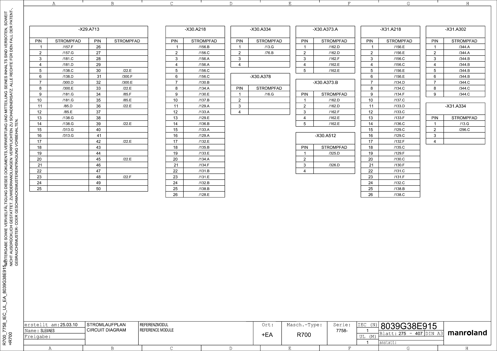

# +EA — Sheet 275 of 407 — REFERENZMODUL

**REFERENCE MODULE**

> Part of the manroland **R700** printing press IEC/UL circuit diagrams.
> Drawing class: **Stromlaufplan / Circuit diagram** (DIN A3).
> Document `+EA` covers the **Printing unit** machine section.

## At a glance

| Field | Value |
|---|---|
| Document | `+EA`  (8039G38E915) |
| Sheet | **275** of 407 |
| Section (DE) | REFERENZMODUL |
| Section (EN) | REFERENCE MODULE |
| Section type | REFERENCE_MODULE — Reference module |
| Machine type | `R700` |
| Series | `7758` |
| Created | 25.03.10 |
| Replaces | — |
| Columns used | A, B, C, D, E, F, G, H |
| Path numbers | — |
| Labels on sheet | 274 |
| Cross-refs out | 105 |
| Cross-refs in | 0 |

**Previous:** [+EA sheet 274](SHEET_0274.md) · **Next:** [+EA sheet 276](SHEET_0276.md) · **Document TOC:** [_TOC.md](_TOC.md)  (+EA) · **Master TOC:** [all sheets](../_MASTER_TOC.md)

## Sheet image (300 DPI, exact vector render)



_Rendered directly from the PDF vector layer at 300 DPI (1-bit), no OCR and no resampling. Use it to confirm anything ambiguous in the text below._

## Cross-references on this sheet

Each entry is a wire leaving this sheet. The printed token is `/sheet.column`; the link resolves to that sheet inside the same document.

| Ref | Target sheet | Col | Path | Destination on target | Target section | From col |
|---|---|---|---|---|---|---|
| `/156.B` | [+EA sheet 156](SHEET_0156.md) | B | — | — | ZUGANGSABSICHERUNG | D |
| `/156.E` | [+EA sheet 156](SHEET_0156.md) | E | — | — | ZUGANGSABSICHERUNG | G |
| `/344.A` | [+EA sheet 344](SHEET_0344.md) | A | — | — | OPTION: TELEPRESENCE | H |
| `/157.F` | [+EA sheet 157](SHEET_0157.md) | F | — | — | ZUGANGSABSICHERUNG | A |
| `/13.G` | [+EA sheet 13](SHEET_0013.md) | G | — | — | SPANNUNGSVERSORGUNG: 400V, 24V | E |
| `/162.D` | [+EA sheet 162](SHEET_0162.md) | D | — | — | VERLÄNGERUNG 1828,4MM | F |
| `/76.B` | [+EA sheet 76](SHEET_0076.md) | B | — | — | AUSLEGERSTAPELSTEUERUNG | E |
| `/156.E` | [+EA sheet 156](SHEET_0156.md) | E | — | — | ZUGANGSABSICHERUNG | G |
| `/344.A` | [+EA sheet 344](SHEET_0344.md) | A | — | — | OPTION: TELEPRESENCE | H |
| `/157.G` | [+EA sheet 157](SHEET_0157.md) | G | — | — | ZUGANGSABSICHERUNG | A |
| `/156.C` | [+EA sheet 156](SHEET_0156.md) | C | — | — | ZUGANGSABSICHERUNG | D |
| `/162.D` | [+EA sheet 162](SHEET_0162.md) | D | — | — | VERLÄNGERUNG 1828,4MM | F |
| `/156.A` | [+EA sheet 156](SHEET_0156.md) | A | — | — | ZUGANGSABSICHERUNG | D |
| `/162.F` | [+EA sheet 162](SHEET_0162.md) | F | — | — | VERLÄNGERUNG 1828,4MM | F |
| `/344.B` | [+EA sheet 344](SHEET_0344.md) | B | — | — | OPTION: TELEPRESENCE | H |
| `/181.C` | [+EA sheet 181](SHEET_0181.md) | C | — | — | RESERVE | A |
| `/156.C` | [+EA sheet 156](SHEET_0156.md) | C | — | — | ZUGANGSABSICHERUNG | G |
| `/156.A` | [+EA sheet 156](SHEET_0156.md) | A | — | — | ZUGANGSABSICHERUNG | D |
| `/162.E` | [+EA sheet 162](SHEET_0162.md) | E | — | — | VERLÄNGERUNG 1828,4MM | F |
| `/344.B` | [+EA sheet 344](SHEET_0344.md) | B | — | — | OPTION: TELEPRESENCE | H |
| `/181.D` | [+EA sheet 181](SHEET_0181.md) | D | — | — | RESERVE | A |
| `/156.C` | [+EA sheet 156](SHEET_0156.md) | C | — | — | ZUGANGSABSICHERUNG | G |
| `/22.E` | [+EA sheet 22](SHEET_0022.md) | E | — | — | SPANNUNGSVERSORGUNG: 400V, 24V | B |
| `/162.E` | [+EA sheet 162](SHEET_0162.md) | E | — | — | VERLÄNGERUNG 1828,4MM | F |
| `/156.E` | [+EA sheet 156](SHEET_0156.md) | E | — | — | ZUGANGSABSICHERUNG | G |
| `/344.B` | [+EA sheet 344](SHEET_0344.md) | B | — | — | OPTION: TELEPRESENCE | H |
| `/138.C` | [+EA sheet 138](SHEET_0138.md) | C | — | — | ZUGANGSABSICHERUNG | A |
| `/156.C` | [+EA sheet 156](SHEET_0156.md) | C | — | — | ZUGANGSABSICHERUNG | D |
| `/156.E` | [+EA sheet 156](SHEET_0156.md) | E | — | — | ZUGANGSABSICHERUNG | G |
| `/344.B` | [+EA sheet 344](SHEET_0344.md) | B | — | — | OPTION: TELEPRESENCE | H |
| `/300.F` | [+EA sheet 300](SHEET_0300.md) | F | — | — | OPTION: ZWISCHENSTAPEL / | B |
| `/138.D` | [+EA sheet 138](SHEET_0138.md) | D | — | — | ZUGANGSABSICHERUNG | A |
| `/156.C` | [+EA sheet 156](SHEET_0156.md) | C | — | — | ZUGANGSABSICHERUNG | D |
| `/300.E` | [+EA sheet 300](SHEET_0300.md) | E | — | — | OPTION: ZWISCHENSTAPEL / | B |
| `/130.B` | [+EA sheet 130](SHEET_0130.md) | B | — | — | ZUGANGSABSICHERUNG | D |
| `/300.D` | [+EA sheet 300](SHEET_0300.md) | D | — | — | OPTION: ZWISCHENSTAPEL / | A |
| `/134.D` | [+EA sheet 134](SHEET_0134.md) | D | — | — | ZUGANGSABSICHERUNG | G |
| `/344.C` | [+EA sheet 344](SHEET_0344.md) | C | — | — | OPTION: TELEPRESENCE | H |
| `/16.G` | [+EA sheet 16](SHEET_0016.md) | G | — | STROMPFAD PIN 1 2 3 4 | SPANNUNGSVERSORGUNG: 400V, 24V | D |
| `/22.E` | [+EA sheet 22](SHEET_0022.md) | E | — | — | SPANNUNGSVERSORGUNG: 400V, 24V | B |
| `/300.E` | [+EA sheet 300](SHEET_0300.md) | E | — | — | OPTION: ZWISCHENSTAPEL / | A |
| `/134.A` | [+EA sheet 134](SHEET_0134.md) | A | — | — | ZUGANGSABSICHERUNG | D |
| `/134.C` | [+EA sheet 134](SHEET_0134.md) | C | — | — | ZUGANGSABSICHERUNG | G |
| `/344.C` | [+EA sheet 344](SHEET_0344.md) | C | — | — | OPTION: TELEPRESENCE | H |
| `/85.F` | [+EA sheet 85](SHEET_0085.md) | F | — | — | AUSLEGERSTAPELSTEUERUNG: PROGRAMMSCHALTWERK | B |
| `/130.E` | [+EA sheet 130](SHEET_0130.md) | E | — | — | ZUGANGSABSICHERUNG | D |
| `/134.F` | [+EA sheet 134](SHEET_0134.md) | F | — | — | ZUGANGSABSICHERUNG | G |
| `/181.G` | [+EA sheet 181](SHEET_0181.md) | G | — | — | RESERVE | A |
| `/344.C` | [+EA sheet 344](SHEET_0344.md) | C | — | — | OPTION: TELEPRESENCE | H |
| `/85.E` | [+EA sheet 85](SHEET_0085.md) | E | — | — | AUSLEGERSTAPELSTEUERUNG: PROGRAMMSCHALTWERK | B |
| `/137.B` | [+EA sheet 137](SHEET_0137.md) | B | — | — | ZUGANGSABSICHERUNG | D |
| `/181.G` | [+EA sheet 181](SHEET_0181.md) | G | — | — | RESERVE | A |
| `/162.D` | [+EA sheet 162](SHEET_0162.md) | D | — | — | VERLÄNGERUNG 1828,4MM | F |
| `/137.C` | [+EA sheet 137](SHEET_0137.md) | C | — | — | ZUGANGSABSICHERUNG | G |
| `/22.E` | [+EA sheet 22](SHEET_0022.md) | E | — | — | SPANNUNGSVERSORGUNG: 400V, 24V | B |
| `/129.A` | [+EA sheet 129](SHEET_0129.md) | A | — | — | ZUGANGSABSICHERUNG | D |
| `/85.D` | [+EA sheet 85](SHEET_0085.md) | D | — | — | AUSLEGERSTAPELSTEUERUNG: PROGRAMMSCHALTWERK | A |
| `/162.D` | [+EA sheet 162](SHEET_0162.md) | D | — | — | VERLÄNGERUNG 1828,4MM | F |
| `/133.D` | [+EA sheet 133](SHEET_0133.md) | D | — | — | ZUGANGSABSICHERUNG | G |
| `/85.E` | [+EA sheet 85](SHEET_0085.md) | E | — | — | AUSLEGERSTAPELSTEUERUNG: PROGRAMMSCHALTWERK | A |
| `/133.A` | [+EA sheet 133](SHEET_0133.md) | A | — | — | ZUGANGSABSICHERUNG | D |
| `/162.F` | [+EA sheet 162](SHEET_0162.md) | F | — | — | VERLÄNGERUNG 1828,4MM | F |
| `/133.C` | [+EA sheet 133](SHEET_0133.md) | C | — | — | ZUGANGSABSICHERUNG | G |
| `/129.E` | [+EA sheet 129](SHEET_0129.md) | E | — | — | ZUGANGSABSICHERUNG | D |
| `/162.E` | [+EA sheet 162](SHEET_0162.md) | E | — | — | VERLÄNGERUNG 1828,4MM | F |
| `/138.G` | [+EA sheet 138](SHEET_0138.md) | G | — | — | ZUGANGSABSICHERUNG | A |
| `/133.F` | [+EA sheet 133](SHEET_0133.md) | F | — | — | ZUGANGSABSICHERUNG | G |
| `/22.E` | [+EA sheet 22](SHEET_0022.md) | E | — | — | SPANNUNGSVERSORGUNG: 400V, 24V | B |
| `/136.B` | [+EA sheet 136](SHEET_0136.md) | B | — | — | ZUGANGSABSICHERUNG | D |
| `/162.E` | [+EA sheet 162](SHEET_0162.md) | E | — | — | VERLÄNGERUNG 1828,4MM | F |
| `/13.G` | [+EA sheet 13](SHEET_0013.md) | G | — | — | SPANNUNGSVERSORGUNG: 400V, 24V | H |
| `/138.G` | [+EA sheet 138](SHEET_0138.md) | G | — | — | ZUGANGSABSICHERUNG | A |
| `/136.C` | [+EA sheet 136](SHEET_0136.md) | C | — | — | ZUGANGSABSICHERUNG | G |
| `/133.A` | [+EA sheet 133](SHEET_0133.md) | A | — | — | ZUGANGSABSICHERUNG | D |
| `/313.G` | [+EA sheet 313](SHEET_0313.md) | G | — | — | OPTION: LOGISTIK, AUSLEGER | A |
| `/129.C` | [+EA sheet 129](SHEET_0129.md) | C | — | — | ZUGANGSABSICHERUNG | G |
| `/296.C` | [+EA sheet 296](SHEET_0296.md) | C | — | — | OPTION: ZWISCHENSTAPEL / | H |
| `/129.A` | [+EA sheet 129](SHEET_0129.md) | A | — | — | ZUGANGSABSICHERUNG | D |
| `/313.G` | [+EA sheet 313](SHEET_0313.md) | G | — | — | OPTION: LOGISTIK, AUSLEGER | A |
| `/129.C` | [+EA sheet 129](SHEET_0129.md) | C | — | — | ZUGANGSABSICHERUNG | G |
| `/22.E` | [+EA sheet 22](SHEET_0022.md) | E | — | — | SPANNUNGSVERSORGUNG: 400V, 24V | B |
| `/132.E` | [+EA sheet 132](SHEET_0132.md) | E | — | — | ZUGANGSABSICHERUNG | D |
| `/132.F` | [+EA sheet 132](SHEET_0132.md) | F | — | — | ZUGANGSABSICHERUNG | G |
| `/135.B` | [+EA sheet 135](SHEET_0135.md) | B | — | — | ZUGANGSABSICHERUNG | D |
| `/135.C` | [+EA sheet 135](SHEET_0135.md) | C | — | — | ZUGANGSABSICHERUNG | G |
| `/133.E` | [+EA sheet 133](SHEET_0133.md) | E | — | — | ZUGANGSABSICHERUNG | D |
| `/129.F` | [+EA sheet 129](SHEET_0129.md) | F | — | — | ZUGANGSABSICHERUNG | G |
| `/325.D` | [+EA sheet 325](SHEET_0325.md) | D | — | — | OPTION: BOGENWEICHE | F |
| `/22.E` | [+EA sheet 22](SHEET_0022.md) | E | — | — | SPANNUNGSVERSORGUNG: 400V, 24V | B |
| `/134.A` | [+EA sheet 134](SHEET_0134.md) | A | — | — | ZUGANGSABSICHERUNG | D |
| `/130.C` | [+EA sheet 130](SHEET_0130.md) | C | — | — | ZUGANGSABSICHERUNG | G |
| `/134.F` | [+EA sheet 134](SHEET_0134.md) | F | — | — | ZUGANGSABSICHERUNG | D |
| `/130.F` | [+EA sheet 130](SHEET_0130.md) | F | — | — | ZUGANGSABSICHERUNG | G |
| `/326.D` | [+EA sheet 326](SHEET_0326.md) | D | — | — | OPTION: BOGENWEICHE | F |
| `/131.B` | [+EA sheet 131](SHEET_0131.md) | B | — | — | ZUGANGSABSICHERUNG | D |
| `/131.C` | [+EA sheet 131](SHEET_0131.md) | C | — | — | ZUGANGSABSICHERUNG | G |
| `/22.F` | [+EA sheet 22](SHEET_0022.md) | F | — | — | SPANNUNGSVERSORGUNG: 400V, 24V | B |
| `/131.E` | [+EA sheet 131](SHEET_0131.md) | E | — | — | ZUGANGSABSICHERUNG | D |
| `/131.F` | [+EA sheet 131](SHEET_0131.md) | F | — | — | ZUGANGSABSICHERUNG | G |
| `/132.B` | [+EA sheet 132](SHEET_0132.md) | B | — | — | ZUGANGSABSICHERUNG | D |
| `/132.C` | [+EA sheet 132](SHEET_0132.md) | C | — | — | ZUGANGSABSICHERUNG | G |
| `/138.B` | [+EA sheet 138](SHEET_0138.md) | B | — | — | ZUGANGSABSICHERUNG | D |
| `/138.B` | [+EA sheet 138](SHEET_0138.md) | B | — | — | ZUGANGSABSICHERUNG | G |
| `/128.E` | [+EA sheet 128](SHEET_0128.md) | E | — | — | ZUGANGSABSICHERUNG | D |
| `/138.C` | [+EA sheet 138](SHEET_0138.md) | C | — | — | ZUGANGSABSICHERUNG | G |

## Devices on this sheet

| Tag | Class | Class meaning (IEC) | Col | Sub | Terminal | Sign |
|---|---|---|---|---|---|---|
| `X30.A218` | — | cross-device reference | C | — | — | — |
| `X30.A334` | — | cross-device reference | E | — | — | — |
| `X30.A378` | — | cross-device reference | E | — | — | — |
| `X30.A373.A` | — | cross-device reference | F | — | — | — |
| `X30.A373.B` | — | cross-device reference | F | — | — | — |
| `X30.A512` | — | cross-device reference | F | — | — | — |
| `X31.A218` | — | cross-device reference | G | — | — | — |
| `X31.A302` | — | cross-device reference | H | — | — | — |
| `X31.A334` | — | cross-device reference | H | — | — | — |
| `X29.A713` | — | cross-device reference | B | — | — | — |

## Potentials / nets

_No named potentials on this sheet._

## Wire-end annotations (grouped as printed)

A wire that continues elsewhere is annotated with a small cluster: the destination description, the path/line number `#NN`, and the `/sheet.column` cross reference. Each row below is one such cluster exactly as it is grouped on the drawing.

| Col | Y | Path | Cross-ref | Text on the wire |
|---|---|---|---|---|
| B | 65.5 | — | — | `X29.A713` |
| C | 65.5 | — | — | `X30.A218` |
| E | 65.5 | — | — | `X30.A334` |
| F | 65.5 | — | — | `X30.A373.A` |
| G | 65.5 | — | — | `X31.A218` |
| H | 65.5 | — | — | `X31.A302` |
| A | 94.2 | — | — | `PIN STROMPFAD` |
| B | 94.2 | — | — | `PIN STROMPFAD` |
| C | 94.2 | — | — | `PIN STROMPFAD` |
| D | 94.2 | — | — | `PIN 2 3 4 1 STROMPFAD` |
| F | 94.2 | — | — | `PIN 2 3 4 5 1 STROMPFAD` |
| G | 94.2 | — | — | `PIN STROMPFAD` |
| H | 94.2 | — | — | `PIN 2 3 4 5 6 7 8 9 1 STROMPFAD` |
| A | 108.4 | — | — | `2 3 4 5 6 7 8 9 1` |
| B | 108.4 | — | — | `26 27 28 29 30 32 33 34 35 36 37 38 39 40 42 43 44 45 46 47 48 49 50 31 41` |
| C | 108.4 | — | — | `2 3 4 5 6 7 8 9 1` |
| F | 108.4 | — | — | `2 3 4 5 6 7 8 9 1` |
| A | 108.7 | — | `/157.F` | — |
| D | 108.7 | — | `/156.B` | — |
| E | 108.7 | — | `/13.G` | — |
| F | 108.7 | — | `/162.D` | — |
| G | 108.7 | — | `/156.E` | — |
| H | 108.7 | — | `/344.A` | — |
| E | 122.8 | — | `/76.B` | — |
| A | 122.9 | — | `/157.G` | — |
| D | 122.9 | — | `/156.C` | — |
| F | 122.9 | — | `/162.D` | — |
| G | 122.9 | — | `/156.E` | — |
| H | 122.9 | — | `/344.A` | — |
| D | 137.0 | — | `/156.A` | — |
| F | 137.0 | — | `/162.F` | — |
| H | 137.0 | — | `/344.B` | — |
| A | 137.1 | — | `/181.C` | — |
| G | 137.1 | — | `/156.C` | — |
| A | 151.2 | — | `/181.D` | — |
| D | 151.2 | — | `/156.A` | — |
| F | 151.2 | — | `/162.E` | — |
| G | 151.2 | — | `/156.C` | — |
| H | 151.2 | — | `/344.B` | — |
| A | 165.4 | — | `/138.C` | — |
| B | 165.4 | — | `/22.E` | — |
| D | 165.4 | — | `/156.C` | — |
| F | 165.4 | — | `/162.E` | — |
| G | 165.4 | — | `/156.E` | — |
| H | 165.4 | — | `/344.B` | — |
| E | 178.9 | — | — | `X30.A378` |
| A | 179.6 | — | `/138.D` | — |
| B | 179.6 | — | `/300.F` | — |
| D | 179.6 | — | `/156.C` | — |
| G | 179.6 | — | `/156.E` | — |
| H | 179.6 | — | `/344.B` | — |
| F | 193.1 | — | — | `X30.A373.B` |
| B | 193.7 | — | `/300.E` | — |
| D | 193.7 | — | `/130.B` | — |
| A | 193.8 | — | `/300.D` | — |
| G | 193.8 | — | `/134.D` | — |
| H | 193.8 | — | `/344.C` | — |
| D | 207.5 | — | `/16.G` | `PIN 2 3 4 1 STROMPFAD` |
| A | 207.9 | — | `/300.E` | — |
| B | 207.9 | — | `/22.E` | — |
| D | 207.9 | — | `/134.A` | — |
| G | 207.9 | — | `/134.C` | — |
| H | 207.9 | — | `/344.C` | — |
| F | 221.7 | — | — | `PIN 2 3 4 5 1 STROMPFAD` |
| A | 222.1 | — | `/181.G` | — |
| B | 222.1 | — | `/85.F` | — |
| D | 222.1 | — | `/130.E` | — |
| G | 222.1 | — | `/134.F` | — |
| H | 222.1 | — | `/344.C` | — |
| A | 235.9 | — | — | `10 12 13 14 15 16 17 18 19 20 11` |
| C | 235.9 | — | — | `10 12 13 14 15 16 17 18 19 20 11` |
| F | 235.9 | — | — | `10 12 13 14 15 16 17 18 19 20 11` |
| B | 236.2 | — | `/85.E` | — |
| D | 236.2 | — | `/137.B` | — |
| A | 236.3 | — | `/181.G` | — |
| F | 236.3 | — | `/162.D` | — |
| G | 236.3 | — | `/137.C` | — |
| H | 249.8 | — | — | `X31.A334` |
| A | 250.4 | — | `/85.D` | — |
| B | 250.4 | — | `/22.E` | — |
| D | 250.4 | — | `/129.A` | — |
| F | 250.4 | — | `/162.D` | — |
| G | 250.4 | — | `/133.D` | — |
| A | 264.6 | — | `/85.E` | — |
| D | 264.6 | — | `/133.A` | — |
| F | 264.6 | — | `/162.F` | — |
| G | 264.6 | — | `/133.C` | — |
| H | 278.4 | — | — | `PIN 2 3 4 1 STROMPFAD` |
| A | 278.8 | — | `/138.G` | — |
| D | 278.8 | — | `/129.E` | — |
| F | 278.8 | — | `/162.E` | — |
| G | 278.8 | — | `/133.F` | — |
| B | 292.9 | — | `/22.E` | — |
| D | 292.9 | — | `/136.B` | — |
| F | 292.9 | — | `/162.E` | — |
| H | 292.9 | — | `/13.G` | — |
| A | 293.0 | — | `/138.G` | — |
| G | 293.0 | — | `/136.C` | — |
| A | 307.1 | — | `/313.G` | — |
| D | 307.1 | — | `/133.A` | — |
| G | 307.1 | — | `/129.C` | — |
| H | 307.1 | — | `/296.C` | — |
| F | 320.6 | — | — | `X30.A512` |
| A | 321.3 | — | `/313.G` | — |
| D | 321.3 | — | `/129.A` | — |
| G | 321.3 | — | `/129.C` | — |
| B | 335.4 | — | `/22.E` | — |
| D | 335.5 | — | `/132.E` | — |
| G | 335.5 | — | `/132.F` | — |
| F | 349.3 | — | — | `PIN 2 3 4 1 STROMPFAD` |
| D | 349.6 | — | `/135.B` | — |
| G | 349.7 | — | `/135.C` | — |
| D | 363.8 | — | `/133.E` | — |
| F | 363.8 | — | `/325.D` | — |
| G | 363.8 | — | `/129.F` | — |
| B | 378.0 | — | `/22.E` | — |
| D | 378.0 | — | `/134.A` | — |
| G | 378.0 | — | `/130.C` | — |
| A | 391.8 | — | — | `22 23 24 25 21` |
| C | 391.8 | — | — | `22 23 24 25 26 21` |
| F | 391.8 | — | — | `22 23 24 25 26 21` |
| D | 392.2 | — | `/134.F` | — |
| F | 392.2 | — | `/326.D` | — |
| G | 392.2 | — | `/130.F` | — |
| D | 406.3 | — | `/131.B` | — |
| G | 406.4 | — | `/131.C` | — |
| B | 420.5 | — | `/22.F` | — |
| D | 420.5 | — | `/131.E` | — |
| G | 420.5 | — | `/131.F` | — |
| D | 434.7 | — | `/132.B` | — |
| G | 434.7 | — | `/132.C` | — |
| D | 448.9 | — | `/138.B` | — |
| G | 448.9 | — | `/138.B` | — |
| D | 463.0 | — | `/128.E` | — |
| G | 463.1 | — | `/138.C` | — |


## Reconstructed tables

This sheet carries tabular content (pin map / terminal assignment / index). The grid below was rebuilt from the drawing's own rule lines, so each row is exactly one physical row of the table.

### Table 1 — 25 data rows × 4 columns (at x=70.9, y=62.4) — **X29.A713**

| PIN | STROMPFAD | PIN | STROMPFAD |
|---|---|---|---|
| `1` | `/157.F` | `26` |  |
| `2` | `/157.G` | `27` |  |
| `3` | `/181.C` | `28` |  |
| `4` | `/181.D` | `29` |  |
| `5` | `/138.C` | `30` | `/22.E` |
| `6` | `/138.D` | `31` | `/300.F` |
| `7` | `/300.D` | `32` | `/300.E` |
| `8` | `/300.E` | `33` | `/22.E` |
| `9` | `/181.G` | `34` | `/85.F` |
| `10` | `/181.G` | `35` | `/85.E` |
| `11` | `/85.D` | `36` | `/22.E` |
| `12` | `/85.E` | `37` |  |
| `13` | `/138.G` | `38` |  |
| `14` | `/138.G` | `39` | `/22.E` |
| `15` | `/313.G` | `40` |  |
| `16` | `/313.G` | `41` |  |
| `17` |  | `42` | `/22.E` |
| `18` |  | `43` |  |
| `19` |  | `44` |  |
| `20` |  | `45` | `/22.E` |
| `21` |  | `46` |  |
| `22` |  | `47` |  |
| `23` |  | `48` | `/22.F` |
| `24` |  | `49` |  |
| `25` |  | `50` |  |


### Table 2 — 26 data rows × 2 columns (at x=396.9, y=62.4) — **X30.A218**

| PIN | STROMPFAD |
|---|---|
| `1` | `/156.B` |
| `2` | `/156.C` |
| `3` | `/156.A` |
| `4` | `/156.A` |
| `5` | `/156.C` |
| `6` | `/156.C` |
| `7` | `/130.B` |
| `8` | `/134.A` |
| `9` | `/130.E` |
| `10` | `/137.B` |
| `11` | `/129.A` |
| `12` | `/133.A` |
| `13` | `/129.E` |
| `14` | `/136.B` |
| `15` | `/133.A` |
| `16` | `/129.A` |
| `17` | `/132.E` |
| `18` | `/135.B` |
| `19` | `/133.E` |
| `20` | `/134.A` |
| `21` | `/134.F` |
| `22` | `/131.B` |
| `23` | `/131.E` |
| `24` | `/132.B` |
| `25` | `/138.B` |
| `26` | `/128.E` |


### Table 3 — 10 data rows × 2 columns (at x=552.8, y=62.4) — **X30.A334**

| PIN | STROMPFAD |
|---|---|
| `1` | `/13.G` |
| `2` | `/76.B` |
| `3` |  |
| `4` |  |
|  | `X30.A378` |
| `PIN` | `STROMPFAD` |
| `1` | `/16.G` |
| `2` |  |
| `3` |  |
| `4` |  |


### Table 4 — 18 data rows × 2 columns (at x=708.7, y=62.4) — **X30.A373.A**

| PIN | STROMPFAD |
|---|---|
| `1` | `/162.D` |
| `2` | `/162.D` |
| `3` | `/162.F` |
| `4` | `/162.E` |
| `5` | `/162.E` |
|  | `X30.A373.B` |
| `PIN` | `STROMPFAD` |
| `1` | `/162.D` |
| `2` | `/162.D` |
| `3` | `/162.F` |
| `4` | `/162.E` |
| `5` | `/162.E` |
|  | `X30.A512` |
| `PIN` | `STROMPFAD` |
| `1` | `/325.D` |
| `2` |  |
| `3` | `/326.D` |
| `4` |  |


### Table 5 — 26 data rows × 2 columns (at x=864.6, y=62.4) — **X31.A218**

| PIN | STROMPFAD |
|---|---|
| `1` | `/156.E` |
| `2` | `/156.E` |
| `3` | `/156.C` |
| `4` | `/156.C` |
| `5` | `/156.E` |
| `6` | `/156.E` |
| `7` | `/134.D` |
| `8` | `/134.C` |
| `9` | `/134.F` |
| `10` | `/137.C` |
| `11` | `/133.D` |
| `12` | `/133.C` |
| `13` | `/133.F` |
| `14` | `/136.C` |
| `15` | `/129.C` |
| `16` | `/129.C` |
| `17` | `/132.F` |
| `18` | `/135.C` |
| `19` | `/129.F` |
| `20` | `/130.C` |
| `21` | `/130.F` |
| `22` | `/131.C` |
| `23` | `/131.F` |
| `24` | `/132.C` |
| `25` | `/138.B` |
| `26` | `/138.C` |


### Table 6 — 15 data rows × 2 columns (at x=1020.5, y=62.4) — **X31.A302**

| PIN | STROMPFAD |
|---|---|
| `1` | `/344.A` |
| `2` | `/344.A` |
| `3` | `/344.B` |
| `4` | `/344.B` |
| `5` | `/344.B` |
| `6` | `/344.B` |
| `7` | `/344.C` |
| `8` | `/344.C` |
| `9` | `/344.C` |
|  | `X31.A334` |
| `PIN` | `STROMPFAD` |
| `1` | `/13.G` |
| `2` | `/296.C` |
| `3` |  |
| `4` |  |


## Notes and free text on this sheet

| Text | Col | Y (pt) |
|---|---|---|
| `PIN` | C | 94.2 |
| `STROMPFAD` | D | 94.15 |
| `PIN` | D | 94.2 |
| `STROMPFAD` | E | 94.15 |
| `PIN` | E | 94.2 |
| `STROMPFAD` | F | 94.15 |
| `PIN` | F | 94.2 |
| `STROMPFAD` | G | 94.15 |
| `PIN` | G | 94.2 |
| `STROMPFAD` | H | 94.15 |
| `PIN` | A | 94.2 |
| `STROMPFAD` | A | 94.15 |
| `PIN` | B | 94.2 |
| `STROMPFAD` | B | 94.15 |

## Complete label inventory (exact text from the drawing)

Every text object inside the drawing area of this sheet, in DIN reading order (column A→H, then top→bottom). This is the authoritative list: if a string is not here it is not printed on this sheet.

| Col | Y | X | Dir | Type | Text |
|---|---|---|---|---|---|
| A | 94.2 | 84.0 | → | text | `PIN` |
| A | 94.2 | 132.2 | → | text | `STROMPFAD` |
| A | 108.4 | 95.8 | → | number | `1` |
| A | 108.7 | 150.7 | → | cross-reference | `/157.F` |
| A | 122.5 | 94.1 | → | number | `2` |
| A | 122.9 | 150.1 | → | cross-reference | `/157.G` |
| A | 136.7 | 94.1 | → | number | `3` |
| A | 137.1 | 150.2 | → | cross-reference | `/181.C` |
| A | 150.9 | 94.1 | → | number | `4` |
| A | 151.2 | 150.2 | → | cross-reference | `/181.D` |
| A | 165.1 | 94.1 | → | number | `5` |
| A | 165.4 | 150.2 | → | cross-reference | `/138.C` |
| A | 179.2 | 94.1 | → | number | `6` |
| A | 179.6 | 150.2 | → | cross-reference | `/138.D` |
| A | 193.4 | 94.1 | → | number | `7` |
| A | 193.8 | 150.2 | → | cross-reference | `/300.D` |
| A | 207.6 | 94.1 | → | number | `8` |
| A | 207.9 | 150.5 | → | cross-reference | `/300.E` |
| A | 221.8 | 94.1 | → | number | `9` |
| A | 222.1 | 150.1 | → | cross-reference | `/181.G` |
| A | 235.9 | 88.7 | → | number | `10` |
| A | 236.3 | 150.1 | → | cross-reference | `/181.G` |
| A | 250.1 | 90.4 | → | number | `11` |
| A | 250.4 | 152.6 | → | cross-reference | `/85.D` |
| A | 264.3 | 88.7 | → | number | `12` |
| A | 264.6 | 152.9 | → | cross-reference | `/85.E` |
| A | 278.5 | 88.7 | → | number | `13` |
| A | 278.8 | 150.1 | → | cross-reference | `/138.G` |
| A | 292.6 | 88.7 | → | number | `14` |
| A | 293.0 | 150.1 | → | cross-reference | `/138.G` |
| A | 306.8 | 88.7 | → | number | `15` |
| A | 307.1 | 150.1 | → | cross-reference | `/313.G` |
| A | 321.0 | 88.7 | → | number | `16` |
| A | 321.3 | 150.1 | → | cross-reference | `/313.G` |
| A | 335.1 | 88.7 | → | number | `17` |
| A | 349.3 | 88.7 | → | number | `18` |
| A | 363.5 | 88.7 | → | number | `19` |
| A | 377.7 | 88.7 | → | number | `20` |
| A | 391.8 | 90.4 | → | number | `21` |
| A | 406.0 | 88.7 | → | number | `22` |
| A | 420.2 | 88.7 | → | number | `23` |
| A | 434.4 | 88.7 | → | number | `24` |
| A | 448.5 | 88.7 | → | number | `25` |
| B | 65.5 | 187.7 | → | device ref | `X29.A713` |
| B | 94.2 | 225.8 | → | text | `PIN` |
| B | 94.2 | 274.0 | → | text | `STROMPFAD` |
| B | 108.4 | 230.5 | → | number | `26` |
| B | 122.5 | 230.5 | → | number | `27` |
| B | 136.7 | 230.5 | → | number | `28` |
| B | 150.9 | 230.5 | → | number | `29` |
| B | 165.1 | 230.5 | → | number | `30` |
| B | 165.4 | 294.7 | → | cross-reference | `/22.E` |
| B | 179.2 | 232.2 | → | number | `31` |
| B | 179.6 | 292.4 | → | cross-reference | `/300.F` |
| B | 193.4 | 230.5 | → | number | `32` |
| B | 193.7 | 292.3 | → | cross-reference | `/300.E` |
| B | 207.6 | 230.5 | → | number | `33` |
| B | 207.9 | 294.7 | → | cross-reference | `/22.E` |
| B | 221.8 | 230.5 | → | number | `34` |
| B | 222.1 | 294.8 | → | cross-reference | `/85.F` |
| B | 235.9 | 230.5 | → | number | `35` |
| B | 236.2 | 294.7 | → | cross-reference | `/85.E` |
| B | 250.1 | 230.5 | → | number | `36` |
| B | 250.4 | 294.7 | → | cross-reference | `/22.E` |
| B | 264.3 | 230.5 | → | number | `37` |
| B | 278.5 | 230.5 | → | number | `38` |
| B | 292.6 | 230.5 | → | number | `39` |
| B | 292.9 | 294.7 | → | cross-reference | `/22.E` |
| B | 306.8 | 230.5 | → | number | `40` |
| B | 321.0 | 232.2 | → | number | `41` |
| B | 335.1 | 230.5 | → | number | `42` |
| B | 335.4 | 294.7 | → | cross-reference | `/22.E` |
| B | 349.3 | 230.5 | → | number | `43` |
| B | 363.5 | 230.5 | → | number | `44` |
| B | 377.7 | 230.5 | → | number | `45` |
| B | 378.0 | 294.7 | → | cross-reference | `/22.E` |
| B | 391.8 | 230.5 | → | number | `46` |
| B | 406.0 | 230.5 | → | number | `47` |
| B | 420.2 | 230.5 | → | number | `48` |
| B | 420.5 | 294.8 | → | cross-reference | `/22.F` |
| B | 434.4 | 230.5 | → | number | `49` |
| B | 448.5 | 230.5 | → | number | `50` |
| C | 65.5 | 442.8 | → | device ref | `X30.A218` |
| C | 94.2 | 410.0 | → | text | `PIN` |
| C | 108.4 | 421.8 | → | number | `1` |
| C | 122.5 | 420.1 | → | number | `2` |
| C | 136.7 | 420.1 | → | number | `3` |
| C | 150.9 | 420.1 | → | number | `4` |
| C | 165.1 | 420.1 | → | number | `5` |
| C | 179.2 | 420.1 | → | number | `6` |
| C | 193.4 | 420.1 | → | number | `7` |
| C | 207.6 | 420.1 | → | number | `8` |
| C | 221.8 | 420.1 | → | number | `9` |
| C | 235.9 | 414.7 | → | number | `10` |
| C | 250.1 | 416.4 | → | number | `11` |
| C | 264.3 | 414.7 | → | number | `12` |
| C | 278.5 | 414.7 | → | number | `13` |
| C | 292.6 | 414.7 | → | number | `14` |
| C | 306.8 | 414.7 | → | number | `15` |
| C | 321.0 | 414.7 | → | number | `16` |
| C | 335.1 | 414.7 | → | number | `17` |
| C | 349.3 | 414.7 | → | number | `18` |
| C | 363.5 | 414.7 | → | number | `19` |
| C | 377.7 | 414.7 | → | number | `20` |
| C | 391.8 | 416.4 | → | number | `21` |
| C | 406.0 | 414.7 | → | number | `22` |
| C | 420.2 | 414.7 | → | number | `23` |
| C | 434.4 | 414.7 | → | number | `24` |
| C | 448.5 | 414.7 | → | number | `25` |
| C | 462.7 | 414.7 | → | number | `26` |
| D | 94.2 | 458.2 | → | text | `STROMPFAD` |
| D | 94.2 | 565.9 | → | text | `PIN` |
| D | 108.4 | 571.9 | → | number | `1` |
| D | 108.7 | 476.4 | → | cross-reference | `/156.B` |
| D | 122.5 | 571.3 | → | number | `2` |
| D | 122.9 | 476.2 | → | cross-reference | `/156.C` |
| D | 136.7 | 571.3 | → | number | `3` |
| D | 137.0 | 476.2 | → | cross-reference | `/156.A` |
| D | 150.9 | 571.3 | → | number | `4` |
| D | 151.2 | 476.2 | → | cross-reference | `/156.A` |
| D | 165.4 | 476.2 | → | cross-reference | `/156.C` |
| D | 179.6 | 476.2 | → | cross-reference | `/156.C` |
| D | 193.7 | 476.4 | → | cross-reference | `/130.B` |
| D | 207.6 | 565.9 | → | text | `PIN` |
| D | 207.9 | 476.2 | → | cross-reference | `/134.A` |
| D | 221.8 | 571.9 | → | number | `1` |
| D | 222.1 | 476.5 | → | cross-reference | `/130.E` |
| D | 235.9 | 571.3 | → | number | `2` |
| D | 236.2 | 476.4 | → | cross-reference | `/137.B` |
| D | 250.1 | 571.3 | → | number | `3` |
| D | 250.4 | 476.2 | → | cross-reference | `/129.A` |
| D | 264.3 | 571.3 | → | number | `4` |
| D | 264.6 | 476.2 | → | cross-reference | `/133.A` |
| D | 278.8 | 476.5 | → | cross-reference | `/129.E` |
| D | 292.9 | 476.4 | → | cross-reference | `/136.B` |
| D | 307.1 | 476.2 | → | cross-reference | `/133.A` |
| D | 321.3 | 476.2 | → | cross-reference | `/129.A` |
| D | 335.5 | 476.5 | → | cross-reference | `/132.E` |
| D | 349.6 | 476.4 | → | cross-reference | `/135.B` |
| D | 363.8 | 476.5 | → | cross-reference | `/133.E` |
| D | 378.0 | 476.2 | → | cross-reference | `/134.A` |
| D | 392.2 | 476.6 | → | cross-reference | `/134.F` |
| D | 406.3 | 476.4 | → | cross-reference | `/131.B` |
| D | 420.5 | 476.5 | → | cross-reference | `/131.E` |
| D | 434.7 | 476.4 | → | cross-reference | `/132.B` |
| D | 448.8 | 476.4 | → | cross-reference | `/138.B` |
| D | 463.0 | 476.5 | → | cross-reference | `/128.E` |
| E | 65.5 | 598.7 | → | device ref | `X30.A334` |
| E | 94.2 | 614.1 | → | text | `STROMPFAD` |
| E | 94.2 | 721.8 | → | text | `PIN` |
| E | 108.4 | 727.8 | → | number | `1` |
| E | 108.7 | 634.4 | → | cross-reference | `/13.G` |
| E | 122.5 | 727.2 | → | number | `2` |
| E | 122.8 | 634.7 | → | cross-reference | `/76.B` |
| E | 136.7 | 727.2 | → | number | `3` |
| E | 150.9 | 727.2 | → | number | `4` |
| E | 165.1 | 727.2 | → | number | `5` |
| E | 178.9 | 598.7 | → | device ref | `X30.A378` |
| E | 207.5 | 614.1 | → | text | `STROMPFAD` |
| E | 221.8 | 721.8 | → | text | `PIN` |
| E | 222.1 | 634.4 | → | cross-reference | `/16.G` |
| E | 235.9 | 727.8 | → | number | `1` |
| E | 250.1 | 727.2 | → | number | `2` |
| E | 264.3 | 727.2 | → | number | `3` |
| E | 278.5 | 727.2 | → | number | `4` |
| E | 292.6 | 727.2 | → | number | `5` |
| E | 349.3 | 721.8 | → | text | `PIN` |
| E | 363.5 | 727.8 | → | number | `1` |
| E | 377.7 | 727.2 | → | number | `2` |
| E | 391.8 | 727.2 | → | number | `3` |
| E | 406.0 | 727.2 | → | number | `4` |
| F | 65.5 | 749.2 | → | device ref | `X30.A373.A` |
| F | 94.2 | 770.0 | → | text | `STROMPFAD` |
| F | 94.2 | 877.7 | → | text | `PIN` |
| F | 108.4 | 889.5 | → | number | `1` |
| F | 108.7 | 788.0 | → | cross-reference | `/162.D` |
| F | 122.5 | 887.8 | → | number | `2` |
| F | 122.9 | 788.0 | → | cross-reference | `/162.D` |
| F | 136.7 | 887.8 | → | number | `3` |
| F | 137.0 | 788.5 | → | cross-reference | `/162.F` |
| F | 150.9 | 887.8 | → | number | `4` |
| F | 151.2 | 788.3 | → | cross-reference | `/162.E` |
| F | 165.1 | 887.8 | → | number | `5` |
| F | 165.4 | 788.3 | → | cross-reference | `/162.E` |
| F | 179.2 | 887.8 | → | number | `6` |
| F | 193.1 | 749.6 | → | device ref | `X30.A373.B` |
| F | 193.4 | 887.8 | → | number | `7` |
| F | 207.6 | 887.8 | → | number | `8` |
| F | 221.7 | 770.0 | → | text | `STROMPFAD` |
| F | 221.8 | 887.8 | → | number | `9` |
| F | 235.9 | 882.4 | → | number | `10` |
| F | 236.3 | 788.0 | → | cross-reference | `/162.D` |
| F | 250.1 | 884.1 | → | number | `11` |
| F | 250.4 | 788.0 | → | cross-reference | `/162.D` |
| F | 264.3 | 882.4 | → | number | `12` |
| F | 264.6 | 788.5 | → | cross-reference | `/162.F` |
| F | 278.5 | 882.4 | → | number | `13` |
| F | 278.8 | 788.3 | → | cross-reference | `/162.E` |
| F | 292.6 | 882.4 | → | number | `14` |
| F | 292.9 | 788.3 | → | cross-reference | `/162.E` |
| F | 306.8 | 882.4 | → | number | `15` |
| F | 320.6 | 754.6 | → | device ref | `X30.A512` |
| F | 321.0 | 882.4 | → | number | `16` |
| F | 335.1 | 882.4 | → | number | `17` |
| F | 349.3 | 770.0 | → | text | `STROMPFAD` |
| F | 349.3 | 882.4 | → | number | `18` |
| F | 363.5 | 882.4 | → | number | `19` |
| F | 363.8 | 788.0 | → | cross-reference | `/325.D` |
| F | 377.7 | 882.4 | → | number | `20` |
| F | 391.8 | 884.1 | → | number | `21` |
| F | 392.2 | 788.0 | → | cross-reference | `/326.D` |
| F | 406.0 | 882.4 | → | number | `22` |
| F | 420.2 | 882.4 | → | number | `23` |
| F | 434.4 | 882.4 | → | number | `24` |
| F | 448.5 | 882.4 | → | number | `25` |
| F | 462.7 | 882.4 | → | number | `26` |
| G | 65.5 | 910.5 | → | device ref | `X31.A218` |
| G | 94.2 | 925.9 | → | text | `STROMPFAD` |
| G | 94.2 | 1033.7 | → | text | `PIN` |
| G | 108.4 | 1039.6 | → | number | `1` |
| G | 108.7 | 944.2 | → | cross-reference | `/156.E` |
| G | 122.5 | 1039.0 | → | number | `2` |
| G | 122.9 | 944.2 | → | cross-reference | `/156.E` |
| G | 136.7 | 1039.0 | → | number | `3` |
| G | 137.1 | 943.9 | → | cross-reference | `/156.C` |
| G | 150.9 | 1039.0 | → | number | `4` |
| G | 151.2 | 943.9 | → | cross-reference | `/156.C` |
| G | 165.1 | 1039.0 | → | number | `5` |
| G | 165.4 | 944.2 | → | cross-reference | `/156.E` |
| G | 179.2 | 1039.0 | → | number | `6` |
| G | 179.6 | 944.2 | → | cross-reference | `/156.E` |
| G | 193.4 | 1039.0 | → | number | `7` |
| G | 193.8 | 943.9 | → | cross-reference | `/134.D` |
| G | 207.6 | 1039.0 | → | number | `8` |
| G | 207.9 | 943.9 | → | cross-reference | `/134.C` |
| G | 221.8 | 1039.0 | → | number | `9` |
| G | 222.1 | 944.4 | → | cross-reference | `/134.F` |
| G | 236.3 | 943.9 | → | cross-reference | `/137.C` |
| G | 250.4 | 943.9 | → | cross-reference | `/133.D` |
| G | 264.6 | 943.9 | → | cross-reference | `/133.C` |
| G | 278.4 | 1033.7 | → | text | `PIN` |
| G | 278.8 | 944.4 | → | cross-reference | `/133.F` |
| G | 292.6 | 1039.6 | → | number | `1` |
| G | 293.0 | 943.9 | → | cross-reference | `/136.C` |
| G | 306.8 | 1039.0 | → | number | `2` |
| G | 307.1 | 943.9 | → | cross-reference | `/129.C` |
| G | 321.0 | 1039.0 | → | number | `3` |
| G | 321.3 | 943.9 | → | cross-reference | `/129.C` |
| G | 335.1 | 1039.0 | → | number | `4` |
| G | 335.5 | 944.4 | → | cross-reference | `/132.F` |
| G | 349.7 | 943.9 | → | cross-reference | `/135.C` |
| G | 363.8 | 944.4 | → | cross-reference | `/129.F` |
| G | 378.0 | 943.9 | → | cross-reference | `/130.C` |
| G | 392.2 | 944.4 | → | cross-reference | `/130.F` |
| G | 406.4 | 943.9 | → | cross-reference | `/131.C` |
| G | 420.5 | 944.4 | → | cross-reference | `/131.F` |
| G | 434.7 | 943.9 | → | cross-reference | `/132.C` |
| G | 448.8 | 944.1 | → | cross-reference | `/138.B` |
| G | 463.0 | 943.9 | → | cross-reference | `/138.C` |
| H | 65.5 | 1066.4 | → | device ref | `X31.A302` |
| H | 94.2 | 1081.8 | → | text | `STROMPFAD` |
| H | 108.7 | 1099.8 | → | cross-reference | `/344.A` |
| H | 122.9 | 1099.8 | → | cross-reference | `/344.A` |
| H | 137.0 | 1100.0 | → | cross-reference | `/344.B` |
| H | 151.2 | 1100.0 | → | cross-reference | `/344.B` |
| H | 165.4 | 1100.0 | → | cross-reference | `/344.B` |
| H | 179.6 | 1100.0 | → | cross-reference | `/344.B` |
| H | 193.8 | 1099.8 | → | cross-reference | `/344.C` |
| H | 207.9 | 1099.8 | → | cross-reference | `/344.C` |
| H | 222.1 | 1099.8 | → | cross-reference | `/344.C` |
| H | 249.8 | 1066.4 | → | device ref | `X31.A334` |
| H | 278.4 | 1081.8 | → | text | `STROMPFAD` |
| H | 292.9 | 1102.1 | → | cross-reference | `/13.G` |
| H | 307.1 | 1099.8 | → | cross-reference | `/296.C` |

## Reading-order text block

The same content as a plain block, grouped by DIN column — convenient to paste or to match against a visual description.

```text
=== Column A ===
  94.2   84.0  text         PIN
  94.2  132.2  text         STROMPFAD
 108.4   95.8  numeric      1
 108.7  150.7  xref         /157.F
 122.5   94.1  numeric      2
 122.9  150.1  xref         /157.G
 136.7   94.1  numeric      3
 137.1  150.2  xref         /181.C
 150.9   94.1  numeric      4
 151.2  150.2  xref         /181.D
 165.1   94.1  numeric      5
 165.4  150.2  xref         /138.C
 179.2   94.1  numeric      6
 179.6  150.2  xref         /138.D
 193.4   94.1  numeric      7
 193.8  150.2  xref         /300.D
 207.6   94.1  numeric      8
 207.9  150.5  xref         /300.E
 221.8   94.1  numeric      9
 222.1  150.1  xref         /181.G
 235.9   88.7  numeric      10
 236.3  150.1  xref         /181.G
 250.1   90.4  numeric      11
 250.4  152.6  xref         /85.D
 264.3   88.7  numeric      12
 264.6  152.9  xref         /85.E
 278.5   88.7  numeric      13
 278.8  150.1  xref         /138.G
 292.6   88.7  numeric      14
 293.0  150.1  xref         /138.G
 306.8   88.7  numeric      15
 307.1  150.1  xref         /313.G
 321.0   88.7  numeric      16
 321.3  150.1  xref         /313.G
 335.1   88.7  numeric      17
 349.3   88.7  numeric      18
 363.5   88.7  numeric      19
 377.7   88.7  numeric      20
 391.8   90.4  numeric      21
 406.0   88.7  numeric      22
 420.2   88.7  numeric      23
 434.4   88.7  numeric      24
 448.5   88.7  numeric      25
=== Column B ===
  65.5  187.7  devref       X29.A713
  94.2  225.8  text         PIN
  94.2  274.0  text         STROMPFAD
 108.4  230.5  numeric      26
 122.5  230.5  numeric      27
 136.7  230.5  numeric      28
 150.9  230.5  numeric      29
 165.1  230.5  numeric      30
 165.4  294.7  xref         /22.E
 179.2  232.2  numeric      31
 179.6  292.4  xref         /300.F
 193.4  230.5  numeric      32
 193.7  292.3  xref         /300.E
 207.6  230.5  numeric      33
 207.9  294.7  xref         /22.E
 221.8  230.5  numeric      34
 222.1  294.8  xref         /85.F
 235.9  230.5  numeric      35
 236.2  294.7  xref         /85.E
 250.1  230.5  numeric      36
 250.4  294.7  xref         /22.E
 264.3  230.5  numeric      37
 278.5  230.5  numeric      38
 292.6  230.5  numeric      39
 292.9  294.7  xref         /22.E
 306.8  230.5  numeric      40
 321.0  232.2  numeric      41
 335.1  230.5  numeric      42
 335.4  294.7  xref         /22.E
 349.3  230.5  numeric      43
 363.5  230.5  numeric      44
 377.7  230.5  numeric      45
 378.0  294.7  xref         /22.E
 391.8  230.5  numeric      46
 406.0  230.5  numeric      47
 420.2  230.5  numeric      48
 420.5  294.8  xref         /22.F
 434.4  230.5  numeric      49
 448.5  230.5  numeric      50
=== Column C ===
  65.5  442.8  devref       X30.A218
  94.2  410.0  text         PIN
 108.4  421.8  numeric      1
 122.5  420.1  numeric      2
 136.7  420.1  numeric      3
 150.9  420.1  numeric      4
 165.1  420.1  numeric      5
 179.2  420.1  numeric      6
 193.4  420.1  numeric      7
 207.6  420.1  numeric      8
 221.8  420.1  numeric      9
 235.9  414.7  numeric      10
 250.1  416.4  numeric      11
 264.3  414.7  numeric      12
 278.5  414.7  numeric      13
 292.6  414.7  numeric      14
 306.8  414.7  numeric      15
 321.0  414.7  numeric      16
 335.1  414.7  numeric      17
 349.3  414.7  numeric      18
 363.5  414.7  numeric      19
 377.7  414.7  numeric      20
 391.8  416.4  numeric      21
 406.0  414.7  numeric      22
 420.2  414.7  numeric      23
 434.4  414.7  numeric      24
 448.5  414.7  numeric      25
 462.7  414.7  numeric      26
=== Column D ===
  94.2  458.2  text         STROMPFAD
  94.2  565.9  text         PIN
 108.4  571.9  numeric      1
 108.7  476.4  xref         /156.B
 122.5  571.3  numeric      2
 122.9  476.2  xref         /156.C
 136.7  571.3  numeric      3
 137.0  476.2  xref         /156.A
 150.9  571.3  numeric      4
 151.2  476.2  xref         /156.A
 165.4  476.2  xref         /156.C
 179.6  476.2  xref         /156.C
 193.7  476.4  xref         /130.B
 207.6  565.9  text         PIN
 207.9  476.2  xref         /134.A
 221.8  571.9  numeric      1
 222.1  476.5  xref         /130.E
 235.9  571.3  numeric      2
 236.2  476.4  xref         /137.B
 250.1  571.3  numeric      3
 250.4  476.2  xref         /129.A
 264.3  571.3  numeric      4
 264.6  476.2  xref         /133.A
 278.8  476.5  xref         /129.E
 292.9  476.4  xref         /136.B
 307.1  476.2  xref         /133.A
 321.3  476.2  xref         /129.A
 335.5  476.5  xref         /132.E
 349.6  476.4  xref         /135.B
 363.8  476.5  xref         /133.E
 378.0  476.2  xref         /134.A
 392.2  476.6  xref         /134.F
 406.3  476.4  xref         /131.B
 420.5  476.5  xref         /131.E
 434.7  476.4  xref         /132.B
 448.8  476.4  xref         /138.B
 463.0  476.5  xref         /128.E
=== Column E ===
  65.5  598.7  devref       X30.A334
  94.2  614.1  text         STROMPFAD
  94.2  721.8  text         PIN
 108.4  727.8  numeric      1
 108.7  634.4  xref         /13.G
 122.5  727.2  numeric      2
 122.8  634.7  xref         /76.B
 136.7  727.2  numeric      3
 150.9  727.2  numeric      4
 165.1  727.2  numeric      5
 178.9  598.7  devref       X30.A378
 207.5  614.1  text         STROMPFAD
 221.8  721.8  text         PIN
 222.1  634.4  xref         /16.G
 235.9  727.8  numeric      1
 250.1  727.2  numeric      2
 264.3  727.2  numeric      3
 278.5  727.2  numeric      4
 292.6  727.2  numeric      5
 349.3  721.8  text         PIN
 363.5  727.8  numeric      1
 377.7  727.2  numeric      2
 391.8  727.2  numeric      3
 406.0  727.2  numeric      4
=== Column F ===
  65.5  749.2  devref       X30.A373.A
  94.2  770.0  text         STROMPFAD
  94.2  877.7  text         PIN
 108.4  889.5  numeric      1
 108.7  788.0  xref         /162.D
 122.5  887.8  numeric      2
 122.9  788.0  xref         /162.D
 136.7  887.8  numeric      3
 137.0  788.5  xref         /162.F
 150.9  887.8  numeric      4
 151.2  788.3  xref         /162.E
 165.1  887.8  numeric      5
 165.4  788.3  xref         /162.E
 179.2  887.8  numeric      6
 193.1  749.6  devref       X30.A373.B
 193.4  887.8  numeric      7
 207.6  887.8  numeric      8
 221.7  770.0  text         STROMPFAD
 221.8  887.8  numeric      9
 235.9  882.4  numeric      10
 236.3  788.0  xref         /162.D
 250.1  884.1  numeric      11
 250.4  788.0  xref         /162.D
 264.3  882.4  numeric      12
 264.6  788.5  xref         /162.F
 278.5  882.4  numeric      13
 278.8  788.3  xref         /162.E
 292.6  882.4  numeric      14
 292.9  788.3  xref         /162.E
 306.8  882.4  numeric      15
 320.6  754.6  devref       X30.A512
 321.0  882.4  numeric      16
 335.1  882.4  numeric      17
 349.3  770.0  text         STROMPFAD
 349.3  882.4  numeric      18
 363.5  882.4  numeric      19
 363.8  788.0  xref         /325.D
 377.7  882.4  numeric      20
 391.8  884.1  numeric      21
 392.2  788.0  xref         /326.D
 406.0  882.4  numeric      22
 420.2  882.4  numeric      23
 434.4  882.4  numeric      24
 448.5  882.4  numeric      25
 462.7  882.4  numeric      26
=== Column G ===
  65.5  910.5  devref       X31.A218
  94.2  925.9  text         STROMPFAD
  94.2 1033.7  text         PIN
 108.4 1039.6  numeric      1
 108.7  944.2  xref         /156.E
 122.5 1039.0  numeric      2
 122.9  944.2  xref         /156.E
 136.7 1039.0  numeric      3
 137.1  943.9  xref         /156.C
 150.9 1039.0  numeric      4
 151.2  943.9  xref         /156.C
 165.1 1039.0  numeric      5
 165.4  944.2  xref         /156.E
 179.2 1039.0  numeric      6
 179.6  944.2  xref         /156.E
 193.4 1039.0  numeric      7
 193.8  943.9  xref         /134.D
 207.6 1039.0  numeric      8
 207.9  943.9  xref         /134.C
 221.8 1039.0  numeric      9
 222.1  944.4  xref         /134.F
 236.3  943.9  xref         /137.C
 250.4  943.9  xref         /133.D
 264.6  943.9  xref         /133.C
 278.4 1033.7  text         PIN
 278.8  944.4  xref         /133.F
 292.6 1039.6  numeric      1
 293.0  943.9  xref         /136.C
 306.8 1039.0  numeric      2
 307.1  943.9  xref         /129.C
 321.0 1039.0  numeric      3
 321.3  943.9  xref         /129.C
 335.1 1039.0  numeric      4
 335.5  944.4  xref         /132.F
 349.7  943.9  xref         /135.C
 363.8  944.4  xref         /129.F
 378.0  943.9  xref         /130.C
 392.2  944.4  xref         /130.F
 406.4  943.9  xref         /131.C
 420.5  944.4  xref         /131.F
 434.7  943.9  xref         /132.C
 448.8  944.1  xref         /138.B
 463.0  943.9  xref         /138.C
=== Column H ===
  65.5 1066.4  devref       X31.A302
  94.2 1081.8  text         STROMPFAD
 108.7 1099.8  xref         /344.A
 122.9 1099.8  xref         /344.A
 137.0 1100.0  xref         /344.B
 151.2 1100.0  xref         /344.B
 165.4 1100.0  xref         /344.B
 179.6 1100.0  xref         /344.B
 193.8 1099.8  xref         /344.C
 207.9 1099.8  xref         /344.C
 222.1 1099.8  xref         /344.C
 249.8 1066.4  devref       X31.A334
 278.4 1081.8  text         STROMPFAD
 292.9 1102.1  xref         /13.G
 307.1 1099.8  xref         /296.C
```

---
_Generated from the PDF vector text layer; no OCR. Source: `R700_7758_IEC_UL_EA_8039G38E915_p`, sheet 275._
