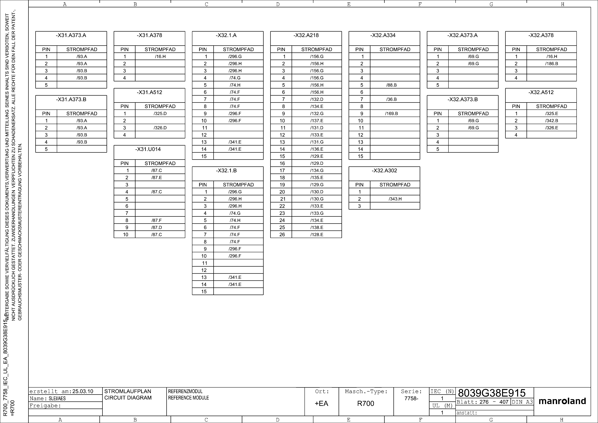

# +EA — Sheet 276 of 407 — REFERENZMODUL

**REFERENCE MODULE**

> Part of the manroland **R700** printing press IEC/UL circuit diagrams.
> Drawing class: **Stromlaufplan / Circuit diagram** (DIN A3).
> Document `+EA` covers the **Printing unit** machine section.

## At a glance

| Field | Value |
|---|---|
| Document | `+EA`  (8039G38E915) |
| Sheet | **276** of 407 |
| Section (DE) | REFERENZMODUL |
| Section (EN) | REFERENCE MODULE |
| Section type | REFERENCE_MODULE — Reference module |
| Machine type | `R700` |
| Series | `7758` |
| Created | 25.03.10 |
| Replaces | — |
| Columns used | A, B, C, D, E, F, G, H |
| Path numbers | — |
| Labels on sheet | 242 |
| Cross-refs out | 80 |
| Cross-refs in | 0 |

**Previous:** [+EA sheet 275](SHEET_0275.md) · **Next:** [+EA sheet 277](SHEET_0277.md) · **Document TOC:** [_TOC.md](_TOC.md)  (+EA) · **Master TOC:** [all sheets](../_MASTER_TOC.md)

## Sheet image (300 DPI, exact vector render)



_Rendered directly from the PDF vector layer at 300 DPI (1-bit), no OCR and no resampling. Use it to confirm anything ambiguous in the text below._

## Cross-references on this sheet

Each entry is a wire leaving this sheet. The printed token is `/sheet.column`; the link resolves to that sheet inside the same document.

| Ref | Target sheet | Col | Path | Destination on target | Target section | From col |
|---|---|---|---|---|---|---|
| `/16.H` | [+EA sheet 16](SHEET_0016.md) | H | — | STROMPFAD PIN 1 2 3 4 | SPANNUNGSVERSORGUNG: 400V, 24V | B |
| `/93.A` | [+EA sheet 93](SHEET_0093.md) | A | — | — | BLASRAHMEN | A |
| `/69.G` | [+EA sheet 69](SHEET_0069.md) | G | — | — | SCHMIERUNG | G |
| `/296.G` | [+EA sheet 296](SHEET_0296.md) | G | — | — | OPTION: ZWISCHENSTAPEL / | C |
| `/156.G` | [+EA sheet 156](SHEET_0156.md) | G | — | — | ZUGANGSABSICHERUNG | E |
| `/16.H` | [+EA sheet 16](SHEET_0016.md) | H | — | — | SPANNUNGSVERSORGUNG: 400V, 24V | H |
| `/93.A` | [+EA sheet 93](SHEET_0093.md) | A | — | — | BLASRAHMEN | A |
| `/186.B` | [+EA sheet 186](SHEET_0186.md) | B | — | — | RESERVE | H |
| `/69.G` | [+EA sheet 69](SHEET_0069.md) | G | — | — | SCHMIERUNG | G |
| `/296.H` | [+EA sheet 296](SHEET_0296.md) | H | — | — | OPTION: ZWISCHENSTAPEL / | C |
| `/156.H` | [+EA sheet 156](SHEET_0156.md) | H | — | — | ZUGANGSABSICHERUNG | E |
| `/93.B` | [+EA sheet 93](SHEET_0093.md) | B | — | — | BLASRAHMEN | A |
| `/156.G` | [+EA sheet 156](SHEET_0156.md) | G | — | — | ZUGANGSABSICHERUNG | E |
| `/296.H` | [+EA sheet 296](SHEET_0296.md) | H | — | — | OPTION: ZWISCHENSTAPEL / | C |
| `/93.B` | [+EA sheet 93](SHEET_0093.md) | B | — | — | BLASRAHMEN | A |
| `/74.G` | [+EA sheet 74](SHEET_0074.md) | G | — | — | AUSLEGERSTAPELSTEUERUNG | C |
| `/156.G` | [+EA sheet 156](SHEET_0156.md) | G | — | — | ZUGANGSABSICHERUNG | E |
| `/88.B` | [+EA sheet 88](SHEET_0088.md) | B | — | — | SAUGWALZE | F |
| `/74.H` | [+EA sheet 74](SHEET_0074.md) | H | — | — | AUSLEGERSTAPELSTEUERUNG | C |
| `/156.H` | [+EA sheet 156](SHEET_0156.md) | H | — | — | ZUGANGSABSICHERUNG | E |
| `/74.F` | [+EA sheet 74](SHEET_0074.md) | F | — | — | AUSLEGERSTAPELSTEUERUNG | C |
| `/156.H` | [+EA sheet 156](SHEET_0156.md) | H | — | — | ZUGANGSABSICHERUNG | E |
| `/36.B` | [+EA sheet 36](SHEET_0036.md) | B | — | — | BUSVERBINDUNGEN: NOT AUS | F |
| `/74.F` | [+EA sheet 74](SHEET_0074.md) | F | — | — | AUSLEGERSTAPELSTEUERUNG | C |
| `/132.D` | [+EA sheet 132](SHEET_0132.md) | D | — | — | ZUGANGSABSICHERUNG | E |
| `/74.F` | [+EA sheet 74](SHEET_0074.md) | F | — | — | AUSLEGERSTAPELSTEUERUNG | C |
| `/134.E` | [+EA sheet 134](SHEET_0134.md) | E | — | — | ZUGANGSABSICHERUNG | E |
| `/169.B` | [+EA sheet 169](SHEET_0169.md) | B | — | — | RESERVE | F |
| `/325.E` | [+EA sheet 325](SHEET_0325.md) | E | — | — | OPTION: BOGENWEICHE | H |
| `/296.F` | [+EA sheet 296](SHEET_0296.md) | F | — | — | OPTION: ZWISCHENSTAPEL / | C |
| `/132.G` | [+EA sheet 132](SHEET_0132.md) | G | — | — | ZUGANGSABSICHERUNG | E |
| `/325.D` | [+EA sheet 325](SHEET_0325.md) | D | — | — | OPTION: BOGENWEICHE | B |
| `/93.A` | [+EA sheet 93](SHEET_0093.md) | A | — | — | BLASRAHMEN | A |
| `/137.E` | [+EA sheet 137](SHEET_0137.md) | E | — | — | ZUGANGSABSICHERUNG | E |
| `/69.G` | [+EA sheet 69](SHEET_0069.md) | G | — | — | SCHMIERUNG | G |
| `/342.B` | [+EA sheet 342](SHEET_0342.md) | B | — | — | OPTION: BOGENWEICHE | H |
| `/296.F` | [+EA sheet 296](SHEET_0296.md) | F | — | — | OPTION: ZWISCHENSTAPEL / | C |
| `/93.A` | [+EA sheet 93](SHEET_0093.md) | A | — | — | BLASRAHMEN | A |
| `/326.E` | [+EA sheet 326](SHEET_0326.md) | E | — | — | OPTION: BOGENWEICHE | H |
| `/69.G` | [+EA sheet 69](SHEET_0069.md) | G | — | — | SCHMIERUNG | G |
| `/326.D` | [+EA sheet 326](SHEET_0326.md) | D | — | — | OPTION: BOGENWEICHE | B |
| `/131.D` | [+EA sheet 131](SHEET_0131.md) | D | — | — | ZUGANGSABSICHERUNG | E |
| `/93.B` | [+EA sheet 93](SHEET_0093.md) | B | — | — | BLASRAHMEN | A |
| `/133.E` | [+EA sheet 133](SHEET_0133.md) | E | — | — | ZUGANGSABSICHERUNG | E |
| `/93.B` | [+EA sheet 93](SHEET_0093.md) | B | — | — | BLASRAHMEN | A |
| `/341.E` | [+EA sheet 341](SHEET_0341.md) | E | — | — | OPTION: BOGENWEICHE | C |
| `/131.G` | [+EA sheet 131](SHEET_0131.md) | G | — | — | ZUGANGSABSICHERUNG | E |
| `/341.E` | [+EA sheet 341](SHEET_0341.md) | E | — | — | OPTION: BOGENWEICHE | C |
| `/136.E` | [+EA sheet 136](SHEET_0136.md) | E | — | — | ZUGANGSABSICHERUNG | E |
| `/129.E` | [+EA sheet 129](SHEET_0129.md) | E | — | — | ZUGANGSABSICHERUNG | E |
| `/129.D` | [+EA sheet 129](SHEET_0129.md) | D | — | — | ZUGANGSABSICHERUNG | E |
| `/87.C` | [+EA sheet 87](SHEET_0087.md) | C | — | — | SAUGWALZE | B |
| `/134.G` | [+EA sheet 134](SHEET_0134.md) | G | — | — | ZUGANGSABSICHERUNG | E |
| `/87.E` | [+EA sheet 87](SHEET_0087.md) | E | — | — | SAUGWALZE | B |
| `/135.E` | [+EA sheet 135](SHEET_0135.md) | E | — | — | ZUGANGSABSICHERUNG | E |
| `/129.G` | [+EA sheet 129](SHEET_0129.md) | G | — | — | ZUGANGSABSICHERUNG | E |
| `/87.C` | [+EA sheet 87](SHEET_0087.md) | C | — | — | SAUGWALZE | B |
| `/296.G` | [+EA sheet 296](SHEET_0296.md) | G | — | — | OPTION: ZWISCHENSTAPEL / | C |
| `/130.D` | [+EA sheet 130](SHEET_0130.md) | D | — | — | ZUGANGSABSICHERUNG | E |
| `/130.G` | [+EA sheet 130](SHEET_0130.md) | G | — | — | ZUGANGSABSICHERUNG | E |
| `/296.H` | [+EA sheet 296](SHEET_0296.md) | H | — | — | OPTION: ZWISCHENSTAPEL / | C |
| `/343.H` | [+EA sheet 343](SHEET_0343.md) | H | — | — | OPTION: TELEPRESENCE | F |
| `/133.E` | [+EA sheet 133](SHEET_0133.md) | E | — | — | ZUGANGSABSICHERUNG | E |
| `/296.H` | [+EA sheet 296](SHEET_0296.md) | H | — | — | OPTION: ZWISCHENSTAPEL / | C |
| `/74.G` | [+EA sheet 74](SHEET_0074.md) | G | — | — | AUSLEGERSTAPELSTEUERUNG | C |
| `/133.G` | [+EA sheet 133](SHEET_0133.md) | G | — | — | ZUGANGSABSICHERUNG | E |
| `/87.F` | [+EA sheet 87](SHEET_0087.md) | F | — | — | SAUGWALZE | B |
| `/134.E` | [+EA sheet 134](SHEET_0134.md) | E | — | — | ZUGANGSABSICHERUNG | E |
| `/74.H` | [+EA sheet 74](SHEET_0074.md) | H | — | — | AUSLEGERSTAPELSTEUERUNG | C |
| `/74.F` | [+EA sheet 74](SHEET_0074.md) | F | — | — | AUSLEGERSTAPELSTEUERUNG | C |
| `/138.E` | [+EA sheet 138](SHEET_0138.md) | E | — | — | ZUGANGSABSICHERUNG | E |
| `/87.D` | [+EA sheet 87](SHEET_0087.md) | D | — | — | SAUGWALZE | B |
| `/74.F` | [+EA sheet 74](SHEET_0074.md) | F | — | — | AUSLEGERSTAPELSTEUERUNG | C |
| `/128.E` | [+EA sheet 128](SHEET_0128.md) | E | — | — | ZUGANGSABSICHERUNG | E |
| `/87.C` | [+EA sheet 87](SHEET_0087.md) | C | — | — | SAUGWALZE | B |
| `/74.F` | [+EA sheet 74](SHEET_0074.md) | F | — | — | AUSLEGERSTAPELSTEUERUNG | C |
| `/296.F` | [+EA sheet 296](SHEET_0296.md) | F | — | — | OPTION: ZWISCHENSTAPEL / | C |
| `/296.F` | [+EA sheet 296](SHEET_0296.md) | F | — | — | OPTION: ZWISCHENSTAPEL / | C |
| `/341.E` | [+EA sheet 341](SHEET_0341.md) | E | — | — | OPTION: BOGENWEICHE | C |
| `/341.E` | [+EA sheet 341](SHEET_0341.md) | E | — | — | OPTION: BOGENWEICHE | C |

## Devices on this sheet

| Tag | Class | Class meaning (IEC) | Col | Sub | Terminal | Sign |
|---|---|---|---|---|---|---|
| `X32.A373.A` | — | cross-device reference | G | — | — | — |
| `X32.A373.B` | — | cross-device reference | G | — | — | — |
| `X32.A378` | — | cross-device reference | H | — | — | — |
| `X32.A512` | — | cross-device reference | H | — | — | — |
| `X32.A334` | — | cross-device reference | E | — | — | — |
| `X32.A302` | — | cross-device reference | F | — | — | — |
| `X32.A218` | — | cross-device reference | D | — | — | — |
| `X32.1.A` | — | cross-device reference | C | — | — | — |
| `X32.1.B` | — | cross-device reference | C | — | — | — |
| `X31.A378` | — | cross-device reference | B | — | — | — |
| `X31.A512` | — | cross-device reference | B | — | — | — |
| `X31.U014` | — | cross-device reference | B | — | — | — |
| `X31.A373.A` | — | cross-device reference | A | — | — | — |
| `X31.A373.B` | — | cross-device reference | A | — | — | — |

## Potentials / nets

_No named potentials on this sheet._

## Wire-end annotations (grouped as printed)

A wire that continues elsewhere is annotated with a small cluster: the destination description, the path/line number `#NN`, and the `/sheet.column` cross reference. Each row below is one such cluster exactly as it is grouped on the drawing.

| Col | Y | Path | Cross-ref | Text on the wire |
|---|---|---|---|---|
| A | 65.5 | — | — | `X31.A373.A` |
| B | 65.5 | — | — | `X31.A378` |
| C | 65.5 | — | — | `X32.1.A` |
| D | 65.5 | — | — | `X32.A218` |
| E | 65.5 | — | — | `X32.A334` |
| G | 65.5 | — | — | `X32.A373.A` |
| H | 65.5 | — | — | `X32.A378` |
| A | 94.2 | — | — | `PIN 2 3 4 5 1 STROMPFAD` |
| B | 94.2 | — | `/16.H` | `PIN 2 3 4 1 STROMPFAD` |
| C | 94.2 | — | — | `PIN 10 12 13 14 15 11 2 3 4 5 6 7 8 9 1 STROMPFAD` |
| D | 94.2 | — | — | `PIN STROMPFAD` |
| E | 94.2 | — | — | `PIN 10 12 13 14 15 11 2 3 4 5 6 7 8 9 1 STROMPFAD` |
| G | 94.2 | — | — | `PIN 2 3 4 5 1 STROMPFAD` |
| H | 94.2 | — | — | `PIN 2 3 4 1 STROMPFAD` |
| D | 108.4 | — | — | `2 3 4 5 6 7 8 9 1` |
| A | 108.7 | — | `/93.A` | — |
| C | 108.7 | — | `/296.G` | — |
| E | 108.7 | — | `/156.G` | — |
| G | 108.7 | — | `/69.G` | — |
| H | 108.7 | — | `/16.H` | — |
| A | 122.8 | — | `/93.A` | — |
| C | 122.9 | — | `/296.H` | — |
| E | 122.9 | — | `/156.H` | — |
| G | 122.9 | — | `/69.G` | — |
| H | 122.9 | — | `/186.B` | — |
| A | 137.0 | — | `/93.B` | — |
| C | 137.1 | — | `/296.H` | — |
| E | 137.1 | — | `/156.G` | — |
| A | 151.2 | — | `/93.B` | — |
| C | 151.2 | — | `/74.G` | — |
| E | 151.2 | — | `/156.G` | — |
| C | 165.4 | — | `/74.H` | — |
| E | 165.4 | — | `/156.H` | — |
| F | 165.4 | — | `/88.B` | — |
| B | 178.9 | — | — | `X31.A512` |
| H | 178.9 | — | — | `X32.A512` |
| C | 179.6 | — | `/74.F` | — |
| E | 179.6 | — | `/156.H` | — |
| A | 193.1 | — | — | `X31.A373.B` |
| G | 193.1 | — | — | `X32.A373.B` |
| C | 193.7 | — | `/74.F` | — |
| F | 193.7 | — | `/36.B` | — |
| E | 193.8 | — | `/132.D` | — |
| B | 207.5 | — | — | `PIN 2 3 4 1 STROMPFAD` |
| H | 207.5 | — | — | `PIN 2 3 4 1 STROMPFAD` |
| C | 207.9 | — | `/74.F` | — |
| E | 207.9 | — | `/134.E` | — |
| A | 221.7 | — | — | `PIN 2 3 4 5 1 STROMPFAD` |
| G | 221.7 | — | — | `PIN 2 3 4 5 1 STROMPFAD` |
| B | 222.1 | — | `/325.D` | — |
| C | 222.1 | — | `/296.F` | — |
| E | 222.1 | — | `/132.G` | — |
| F | 222.1 | — | `/169.B` | — |
| H | 222.1 | — | `/325.E` | — |
| D | 235.9 | — | — | `10 12 13 14 15 16 17 18 19 20 11` |
| A | 236.2 | — | `/93.A` | — |
| E | 236.2 | — | `/137.E` | — |
| G | 236.2 | — | `/69.G` | — |
| H | 236.2 | — | `/342.B` | — |
| C | 236.3 | — | `/296.F` | — |
| A | 250.4 | — | `/93.A` | — |
| B | 250.4 | — | `/326.D` | — |
| E | 250.4 | — | `/131.D` | — |
| G | 250.4 | — | `/69.G` | — |
| H | 250.4 | — | `/326.E` | — |
| A | 264.6 | — | `/93.B` | — |
| E | 264.6 | — | `/133.E` | — |
| A | 278.8 | — | `/93.B` | — |
| C | 278.8 | — | `/341.E` | — |
| E | 278.8 | — | `/131.G` | — |
| B | 292.3 | — | — | `X31.U014` |
| C | 292.9 | — | `/341.E` | — |
| E | 292.9 | — | `/136.E` | — |
| E | 307.1 | — | `/129.E` | — |
| B | 320.9 | — | — | `PIN 10 2 3 4 5 6 7 8 9 1 STROMPFAD` |
| E | 321.3 | — | `/129.D` | — |
| C | 334.8 | — | — | `X32.1.B` |
| F | 334.8 | — | — | `X32.A302` |
| B | 335.5 | — | `/87.C` | — |
| E | 335.5 | — | `/134.G` | — |
| B | 349.6 | — | `/87.E` | — |
| E | 349.6 | — | `/135.E` | — |
| C | 363.4 | — | — | `PIN 10 12 13 14 15 11 2 3 4 5 6 7 8 9 1 STROMPFAD` |
| E | 363.4 | — | — | `PIN 2 3 1 STROMPFAD` |
| E | 363.8 | — | `/129.G` | — |
| B | 378.0 | — | `/87.C` | — |
| C | 378.0 | — | `/296.G` | — |
| E | 378.0 | — | `/130.D` | — |
| D | 391.8 | — | — | `22 23 24 25 26 21` |
| C | 392.2 | — | `/296.H` | — |
| E | 392.2 | — | `/130.G` | — |
| F | 392.2 | — | `/343.H` | — |
| E | 406.3 | — | `/133.E` | — |
| C | 406.4 | — | `/296.H` | — |
| C | 420.5 | — | `/74.G` | — |
| E | 420.5 | — | `/133.G` | — |
| B | 434.7 | — | `/87.F` | — |
| C | 434.7 | — | `/74.H` | — |
| E | 434.7 | — | `/134.E` | — |
| C | 448.8 | — | `/74.F` | — |
| B | 448.9 | — | `/87.D` | — |
| E | 448.9 | — | `/138.E` | — |
| B | 463.0 | — | `/87.C` | — |
| C | 463.0 | — | `/74.F` | — |
| E | 463.0 | — | `/128.E` | — |
| C | 477.2 | — | `/74.F` | — |
| C | 491.4 | — | `/296.F` | — |
| C | 505.6 | — | `/296.F` | — |
| C | 548.1 | — | `/341.E` | — |
| C | 562.2 | — | `/341.E` | — |


## Reconstructed tables

This sheet carries tabular content (pin map / terminal assignment / index). The grid below was rebuilt from the drawing's own rule lines, so each row is exactly one physical row of the table.

### Table 1 — 12 data rows × 2 columns (at x=70.9, y=62.4) — **X31.A373.A**

| PIN | STROMPFAD |
|---|---|
| `1` | `/93.A` |
| `2` | `/93.A` |
| `3` | `/93.B` |
| `4` | `/93.B` |
| `5` |  |
|  | `X31.A373.B` |
| `PIN` | `STROMPFAD` |
| `1` | `/93.A` |
| `2` | `/93.A` |
| `3` | `/93.B` |
| `4` | `/93.B` |
| `5` |  |


### Table 2 — 22 data rows × 2 columns (at x=226.8, y=62.4) — **X31.A378**

| PIN | STROMPFAD |
|---|---|
| `1` | `/16.H` |
| `2` |  |
| `3` |  |
| `4` |  |
|  | `X31.A512` |
| `PIN` | `STROMPFAD` |
| `1` | `/325.D` |
| `2` |  |
| `3` | `/326.D` |
| `4` |  |
|  | `X31.U014` |
| `PIN` | `STROMPFAD` |
| `1` | `/87.C` |
| `2` | `/87.E` |
| `3` |  |
| `4` | `/87.C` |
| `5` |  |
| `6` |  |
| `7` |  |
| `8` | `/87.F` |
| `9` | `/87.D` |
| `10` | `/87.C` |


### Table 3 — 32 data rows × 2 columns (at x=382.7, y=62.4) — **X32.1.A**

| PIN | STROMPFAD |
|---|---|
| `1` | `/296.G` |
| `2` | `/296.H` |
| `3` | `/296.H` |
| `4` | `/74.G` |
| `5` | `/74.H` |
| `6` | `/74.F` |
| `7` | `/74.F` |
| `8` | `/74.F` |
| `9` | `/296.F` |
| `10` | `/296.F` |
| `11` |  |
| `12` |  |
| `13` | `/341.E` |
| `14` | `/341.E` |
| `15` |  |
|  | `X32.1.B` |
| `PIN` | `STROMPFAD` |
| `1` | `/296.G` |
| `2` | `/296.H` |
| `3` | `/296.H` |
| `4` | `/74.G` |
| `5` | `/74.H` |
| `6` | `/74.F` |
| `7` | `/74.F` |
| `8` | `/74.F` |
| `9` | `/296.F` |
| `10` | `/296.F` |
| `11` |  |
| `12` |  |
| `13` | `/341.E` |
| `14` | `/341.E` |
| `15` |  |


### Table 4 — 26 data rows × 2 columns (at x=538.6, y=62.4) — **X32.A218**

| PIN | STROMPFAD |
|---|---|
| `1` | `/156.G` |
| `2` | `/156.H` |
| `3` | `/156.G` |
| `4` | `/156.G` |
| `5` | `/156.H` |
| `6` | `/156.H` |
| `7` | `/132.D` |
| `8` | `/134.E` |
| `9` | `/132.G` |
| `10` | `/137.E` |
| `11` | `/131.D` |
| `12` | `/133.E` |
| `13` | `/131.G` |
| `14` | `/136.E` |
| `15` | `/129.E` |
| `16` | `/129.D` |
| `17` | `/134.G` |
| `18` | `/135.E` |
| `19` | `/129.G` |
| `20` | `/130.D` |
| `21` | `/130.G` |
| `22` | `/133.E` |
| `23` | `/133.G` |
| `24` | `/134.E` |
| `25` | `/138.E` |
| `26` | `/128.E` |


### Table 5 — 20 data rows × 2 columns (at x=694.5, y=62.4) — **X32.A334**

| PIN | STROMPFAD |
|---|---|
| `1` |  |
| `2` |  |
| `3` |  |
| `4` |  |
| `5` | `/88.B` |
| `6` |  |
| `7` | `/36.B` |
| `8` |  |
| `9` | `/169.B` |
| `10` |  |
| `11` |  |
| `12` |  |
| `13` |  |
| `14` |  |
| `15` |  |
|  | `X32.A302` |
| `PIN` | `STROMPFAD` |
| `1` |  |
| `2` | `/343.H` |
| `3` |  |


### Table 6 — 12 data rows × 2 columns (at x=850.4, y=62.4) — **X32.A373.A**

| PIN | STROMPFAD |
|---|---|
| `1` | `/69.G` |
| `2` | `/69.G` |
| `3` |  |
| `4` |  |
| `5` |  |
|  | `X32.A373.B` |
| `PIN` | `STROMPFAD` |
| `1` | `/69.G` |
| `2` | `/69.G` |
| `3` |  |
| `4` |  |
| `5` |  |


### Table 7 — 10 data rows × 2 columns (at x=1006.3, y=62.4) — **X32.A378**

| PIN | STROMPFAD |
|---|---|
| `1` | `/16.H` |
| `2` | `/186.B` |
| `3` |  |
| `4` |  |
|  | `X32.A512` |
| `PIN` | `STROMPFAD` |
| `1` | `/325.E` |
| `2` | `/342.B` |
| `3` | `/326.E` |
| `4` |  |


## Notes and free text on this sheet

| Text | Col | Y (pt) |
|---|---|---|
| `PIN` | F | 94.2 |
| `STROMPFAD` | G | 94.15 |
| `PIN` | G | 94.2 |
| `STROMPFAD` | H | 94.15 |
| `PIN` | E | 94.2 |
| `STROMPFAD` | F | 94.15 |
| `PIN` | D | 94.2 |
| `STROMPFAD` | E | 94.15 |
| `PIN` | C | 94.2 |
| `STROMPFAD` | C | 94.15 |
| `PIN` | B | 94.2 |
| `STROMPFAD` | B | 94.15 |
| `PIN` | A | 94.2 |
| `STROMPFAD` | A | 94.15 |

## Complete label inventory (exact text from the drawing)

Every text object inside the drawing area of this sheet, in DIN reading order (column A→H, then top→bottom). This is the authoritative list: if a string is not here it is not printed on this sheet.

| Col | Y | X | Dir | Type | Text |
|---|---|---|---|---|---|
| A | 65.5 | 111.4 | → | device ref | `X31.A373.A` |
| A | 94.2 | 84.0 | → | text | `PIN` |
| A | 94.2 | 132.2 | → | text | `STROMPFAD` |
| A | 108.4 | 90.0 | → | number | `1` |
| A | 108.7 | 152.6 | → | cross-reference | `/93.A` |
| A | 122.5 | 89.4 | → | number | `2` |
| A | 122.8 | 152.6 | → | cross-reference | `/93.A` |
| A | 136.7 | 89.4 | → | number | `3` |
| A | 137.0 | 152.8 | → | cross-reference | `/93.B` |
| A | 150.9 | 89.4 | → | number | `4` |
| A | 151.2 | 152.8 | → | cross-reference | `/93.B` |
| A | 165.1 | 89.4 | → | number | `5` |
| A | 193.1 | 111.8 | → | device ref | `X31.A373.B` |
| A | 221.7 | 132.2 | → | text | `STROMPFAD` |
| A | 221.8 | 84.0 | → | text | `PIN` |
| A | 235.9 | 90.0 | → | number | `1` |
| A | 236.2 | 152.6 | → | cross-reference | `/93.A` |
| A | 250.1 | 89.4 | → | number | `2` |
| A | 250.4 | 152.6 | → | cross-reference | `/93.A` |
| A | 264.3 | 89.4 | → | number | `3` |
| A | 264.6 | 152.8 | → | cross-reference | `/93.B` |
| A | 278.5 | 89.4 | → | number | `4` |
| A | 278.8 | 152.8 | → | cross-reference | `/93.B` |
| A | 292.6 | 89.4 | → | number | `5` |
| B | 65.5 | 272.7 | → | device ref | `X31.A378` |
| B | 94.2 | 240.0 | → | text | `PIN` |
| B | 94.2 | 288.1 | → | text | `STROMPFAD` |
| B | 108.4 | 245.9 | → | number | `1` |
| B | 108.7 | 308.8 | → | cross-reference | `/16.H` |
| B | 122.5 | 245.3 | → | number | `2` |
| B | 136.7 | 245.3 | → | number | `3` |
| B | 150.9 | 245.3 | → | number | `4` |
| B | 178.9 | 272.7 | → | device ref | `X31.A512` |
| B | 207.5 | 288.1 | → | text | `STROMPFAD` |
| B | 207.6 | 240.0 | → | text | `PIN` |
| B | 221.8 | 245.9 | → | number | `1` |
| B | 222.1 | 306.1 | → | cross-reference | `/325.D` |
| B | 235.9 | 245.3 | → | number | `2` |
| B | 250.1 | 245.3 | → | number | `3` |
| B | 250.4 | 306.1 | → | cross-reference | `/326.D` |
| B | 264.3 | 245.3 | → | number | `4` |
| B | 292.3 | 269.6 | → | device ref | `X31.U014` |
| B | 320.9 | 288.1 | → | text | `STROMPFAD` |
| B | 321.0 | 240.0 | → | text | `PIN` |
| B | 335.1 | 251.7 | → | number | `1` |
| B | 335.5 | 301.5 | → | cross-reference | `/87.C` |
| B | 349.3 | 250.0 | → | number | `2` |
| B | 349.6 | 301.7 | → | cross-reference | `/87.E` |
| B | 363.5 | 250.0 | → | number | `3` |
| B | 377.7 | 250.0 | → | number | `4` |
| B | 378.0 | 301.5 | → | cross-reference | `/87.C` |
| B | 391.8 | 250.0 | → | number | `5` |
| B | 406.0 | 250.0 | → | number | `6` |
| B | 420.2 | 250.0 | → | number | `7` |
| B | 434.4 | 250.0 | → | number | `8` |
| B | 434.7 | 301.9 | → | cross-reference | `/87.F` |
| B | 448.5 | 250.0 | → | number | `9` |
| B | 448.9 | 301.5 | → | cross-reference | `/87.D` |
| B | 462.7 | 244.6 | → | number | `10` |
| B | 463.0 | 301.5 | → | cross-reference | `/87.C` |
| C | 65.5 | 429.9 | → | device ref | `X32.1.A` |
| C | 94.2 | 395.9 | → | text | `PIN` |
| C | 94.2 | 444.0 | → | text | `STROMPFAD` |
| C | 108.4 | 407.6 | → | number | `1` |
| C | 108.7 | 454.8 | → | cross-reference | `/296.G` |
| C | 122.5 | 405.9 | → | number | `2` |
| C | 122.9 | 455.2 | → | cross-reference | `/296.H` |
| C | 136.7 | 405.9 | → | number | `3` |
| C | 137.1 | 455.2 | → | cross-reference | `/296.H` |
| C | 150.9 | 405.9 | → | number | `4` |
| C | 151.2 | 457.2 | → | cross-reference | `/74.G` |
| C | 165.1 | 405.9 | → | number | `5` |
| C | 165.4 | 457.7 | → | cross-reference | `/74.H` |
| C | 179.2 | 405.9 | → | number | `6` |
| C | 179.6 | 457.8 | → | cross-reference | `/74.F` |
| C | 193.4 | 405.9 | → | number | `7` |
| C | 193.7 | 457.8 | → | cross-reference | `/74.F` |
| C | 207.6 | 405.9 | → | number | `8` |
| C | 207.9 | 457.8 | → | cross-reference | `/74.F` |
| C | 221.8 | 405.9 | → | number | `9` |
| C | 222.1 | 455.4 | → | cross-reference | `/296.F` |
| C | 235.9 | 400.5 | → | number | `10` |
| C | 236.3 | 455.4 | → | cross-reference | `/296.F` |
| C | 250.1 | 402.2 | → | number | `11` |
| C | 264.3 | 400.5 | → | number | `12` |
| C | 278.5 | 400.5 | → | number | `13` |
| C | 278.8 | 455.2 | → | cross-reference | `/341.E` |
| C | 292.6 | 400.5 | → | number | `14` |
| C | 292.9 | 455.2 | → | cross-reference | `/341.E` |
| C | 306.8 | 400.5 | → | number | `15` |
| C | 334.8 | 430.3 | → | device ref | `X32.1.B` |
| C | 363.4 | 444.0 | → | text | `STROMPFAD` |
| C | 363.5 | 395.9 | → | text | `PIN` |
| C | 377.7 | 407.6 | → | number | `1` |
| C | 378.0 | 454.8 | → | cross-reference | `/296.G` |
| C | 391.8 | 405.9 | → | number | `2` |
| C | 392.2 | 455.2 | → | cross-reference | `/296.H` |
| C | 406.0 | 405.9 | → | number | `3` |
| C | 406.4 | 455.2 | → | cross-reference | `/296.H` |
| C | 420.2 | 405.9 | → | number | `4` |
| C | 420.5 | 457.2 | → | cross-reference | `/74.G` |
| C | 434.4 | 405.9 | → | number | `5` |
| C | 434.7 | 457.7 | → | cross-reference | `/74.H` |
| C | 448.5 | 405.9 | → | number | `6` |
| C | 448.8 | 457.8 | → | cross-reference | `/74.F` |
| C | 462.7 | 405.9 | → | number | `7` |
| C | 463.0 | 457.8 | → | cross-reference | `/74.F` |
| C | 476.9 | 405.9 | → | number | `8` |
| C | 477.2 | 457.8 | → | cross-reference | `/74.F` |
| C | 491.0 | 405.9 | → | number | `9` |
| C | 491.4 | 455.4 | → | cross-reference | `/296.F` |
| C | 505.2 | 400.5 | → | number | `10` |
| C | 505.5 | 455.4 | → | cross-reference | `/296.F` |
| C | 519.4 | 402.2 | → | number | `11` |
| C | 533.6 | 400.5 | → | number | `12` |
| C | 547.7 | 400.5 | → | number | `13` |
| C | 548.1 | 455.2 | → | cross-reference | `/341.E` |
| C | 561.9 | 400.5 | → | number | `14` |
| C | 562.2 | 455.2 | → | cross-reference | `/341.E` |
| C | 576.1 | 400.5 | → | number | `15` |
| D | 65.5 | 584.5 | → | device ref | `X32.A218` |
| D | 94.2 | 551.8 | → | text | `PIN` |
| D | 108.4 | 563.5 | → | number | `1` |
| D | 122.5 | 561.8 | → | number | `2` |
| D | 136.7 | 561.8 | → | number | `3` |
| D | 150.9 | 561.8 | → | number | `4` |
| D | 165.1 | 561.8 | → | number | `5` |
| D | 179.2 | 561.8 | → | number | `6` |
| D | 193.4 | 561.8 | → | number | `7` |
| D | 207.6 | 561.8 | → | number | `8` |
| D | 221.8 | 561.8 | → | number | `9` |
| D | 235.9 | 556.4 | → | number | `10` |
| D | 250.1 | 558.1 | → | number | `11` |
| D | 264.3 | 556.4 | → | number | `12` |
| D | 278.5 | 556.4 | → | number | `13` |
| D | 292.6 | 556.4 | → | number | `14` |
| D | 306.8 | 556.4 | → | number | `15` |
| D | 321.0 | 556.4 | → | number | `16` |
| D | 335.1 | 556.4 | → | number | `17` |
| D | 349.3 | 556.4 | → | number | `18` |
| D | 363.5 | 556.4 | → | number | `19` |
| D | 377.7 | 556.4 | → | number | `20` |
| D | 391.8 | 558.1 | → | number | `21` |
| D | 406.0 | 556.4 | → | number | `22` |
| D | 420.2 | 556.4 | → | number | `23` |
| D | 434.4 | 556.4 | → | number | `24` |
| D | 448.5 | 556.4 | → | number | `25` |
| D | 462.7 | 556.4 | → | number | `26` |
| E | 65.5 | 737.6 | → | device ref | `X32.A334` |
| E | 94.2 | 600.0 | → | text | `STROMPFAD` |
| E | 94.2 | 707.7 | → | text | `PIN` |
| E | 108.4 | 719.4 | → | number | `1` |
| E | 108.7 | 617.8 | → | cross-reference | `/156.G` |
| E | 122.5 | 717.7 | → | number | `2` |
| E | 122.9 | 618.2 | → | cross-reference | `/156.H` |
| E | 136.7 | 717.7 | → | number | `3` |
| E | 137.1 | 617.8 | → | cross-reference | `/156.G` |
| E | 150.9 | 717.7 | → | number | `4` |
| E | 151.2 | 617.8 | → | cross-reference | `/156.G` |
| E | 165.1 | 717.7 | → | number | `5` |
| E | 165.4 | 618.2 | → | cross-reference | `/156.H` |
| E | 179.2 | 717.7 | → | number | `6` |
| E | 179.6 | 618.2 | → | cross-reference | `/156.H` |
| E | 193.4 | 717.7 | → | number | `7` |
| E | 193.8 | 618.0 | → | cross-reference | `/132.D` |
| E | 207.6 | 717.7 | → | number | `8` |
| E | 207.9 | 618.2 | → | cross-reference | `/134.E` |
| E | 221.8 | 717.7 | → | number | `9` |
| E | 222.1 | 617.8 | → | cross-reference | `/132.G` |
| E | 235.9 | 712.3 | → | number | `10` |
| E | 236.2 | 618.2 | → | cross-reference | `/137.E` |
| E | 250.1 | 714.0 | → | number | `11` |
| E | 250.4 | 618.0 | → | cross-reference | `/131.D` |
| E | 264.3 | 712.3 | → | number | `12` |
| E | 264.6 | 618.2 | → | cross-reference | `/133.E` |
| E | 278.5 | 712.3 | → | number | `13` |
| E | 278.8 | 617.8 | → | cross-reference | `/131.G` |
| E | 292.6 | 712.3 | → | number | `14` |
| E | 292.9 | 618.2 | → | cross-reference | `/136.E` |
| E | 306.8 | 712.3 | → | number | `15` |
| E | 307.1 | 618.2 | → | cross-reference | `/129.E` |
| E | 321.3 | 618.0 | → | cross-reference | `/129.D` |
| E | 335.5 | 617.8 | → | cross-reference | `/134.G` |
| E | 349.6 | 618.2 | → | cross-reference | `/135.E` |
| E | 363.5 | 707.7 | → | text | `PIN` |
| E | 363.8 | 617.8 | → | cross-reference | `/129.G` |
| E | 377.7 | 713.6 | → | number | `1` |
| E | 378.0 | 618.0 | → | cross-reference | `/130.D` |
| E | 391.8 | 713.1 | → | number | `2` |
| E | 392.2 | 617.8 | → | cross-reference | `/130.G` |
| E | 406.0 | 713.1 | → | number | `3` |
| E | 406.3 | 618.2 | → | cross-reference | `/133.E` |
| E | 420.5 | 617.8 | → | cross-reference | `/133.G` |
| E | 434.7 | 618.2 | → | cross-reference | `/134.E` |
| E | 448.8 | 618.2 | → | cross-reference | `/138.E` |
| E | 463.0 | 618.2 | → | cross-reference | `/128.E` |
| F | 94.2 | 755.9 | → | text | `STROMPFAD` |
| F | 94.2 | 863.6 | → | text | `PIN` |
| F | 108.4 | 869.5 | → | number | `1` |
| F | 122.5 | 869.0 | → | number | `2` |
| F | 136.7 | 869.0 | → | number | `3` |
| F | 150.9 | 869.0 | → | number | `4` |
| F | 165.1 | 869.0 | → | number | `5` |
| F | 165.4 | 769.3 | → | cross-reference | `/88.B` |
| F | 193.7 | 769.3 | → | cross-reference | `/36.B` |
| F | 221.8 | 863.6 | → | text | `PIN` |
| F | 222.1 | 766.9 | → | cross-reference | `/169.B` |
| F | 235.9 | 869.5 | → | number | `1` |
| F | 250.1 | 869.0 | → | number | `2` |
| F | 264.3 | 869.0 | → | number | `3` |
| F | 278.5 | 869.0 | → | number | `4` |
| F | 292.6 | 869.0 | → | number | `5` |
| F | 334.8 | 740.4 | → | device ref | `X32.A302` |
| F | 363.4 | 755.9 | → | text | `STROMPFAD` |
| F | 392.2 | 774.1 | → | cross-reference | `/343.H` |
| G | 65.5 | 890.9 | → | device ref | `X32.A373.A` |
| G | 94.2 | 911.8 | → | text | `STROMPFAD` |
| G | 94.2 | 1019.5 | → | text | `PIN` |
| G | 108.4 | 1025.4 | → | number | `1` |
| G | 108.7 | 932.0 | → | cross-reference | `/69.G` |
| G | 122.5 | 1024.9 | → | number | `2` |
| G | 122.9 | 932.0 | → | cross-reference | `/69.G` |
| G | 136.7 | 1024.9 | → | number | `3` |
| G | 150.9 | 1024.9 | → | number | `4` |
| G | 193.1 | 891.4 | → | device ref | `X32.A373.B` |
| G | 207.6 | 1019.5 | → | text | `PIN` |
| G | 221.7 | 911.8 | → | text | `STROMPFAD` |
| G | 221.8 | 1025.4 | → | number | `1` |
| G | 235.9 | 1024.9 | → | number | `2` |
| G | 236.3 | 932.0 | → | cross-reference | `/69.G` |
| G | 250.1 | 1024.9 | → | number | `3` |
| G | 250.4 | 932.0 | → | cross-reference | `/69.G` |
| G | 264.3 | 1024.9 | → | number | `4` |
| H | 65.5 | 1052.2 | → | device ref | `X32.A378` |
| H | 94.2 | 1067.7 | → | text | `STROMPFAD` |
| H | 108.7 | 1088.4 | → | cross-reference | `/16.H` |
| H | 122.9 | 1085.8 | → | cross-reference | `/186.B` |
| H | 178.9 | 1052.2 | → | device ref | `X32.A512` |
| H | 207.5 | 1067.7 | → | text | `STROMPFAD` |
| H | 222.1 | 1086.0 | → | cross-reference | `/325.E` |
| H | 236.2 | 1085.8 | → | cross-reference | `/342.B` |
| H | 250.4 | 1086.0 | → | cross-reference | `/326.E` |

## Reading-order text block

The same content as a plain block, grouped by DIN column — convenient to paste or to match against a visual description.

```text
=== Column A ===
  65.5  111.4  devref       X31.A373.A
  94.2   84.0  text         PIN
  94.2  132.2  text         STROMPFAD
 108.4   90.0  numeric      1
 108.7  152.6  xref         /93.A
 122.5   89.4  numeric      2
 122.8  152.6  xref         /93.A
 136.7   89.4  numeric      3
 137.0  152.8  xref         /93.B
 150.9   89.4  numeric      4
 151.2  152.8  xref         /93.B
 165.1   89.4  numeric      5
 193.1  111.8  devref       X31.A373.B
 221.7  132.2  text         STROMPFAD
 221.8   84.0  text         PIN
 235.9   90.0  numeric      1
 236.2  152.6  xref         /93.A
 250.1   89.4  numeric      2
 250.4  152.6  xref         /93.A
 264.3   89.4  numeric      3
 264.6  152.8  xref         /93.B
 278.5   89.4  numeric      4
 278.8  152.8  xref         /93.B
 292.6   89.4  numeric      5
=== Column B ===
  65.5  272.7  devref       X31.A378
  94.2  240.0  text         PIN
  94.2  288.1  text         STROMPFAD
 108.4  245.9  numeric      1
 108.7  308.8  xref         /16.H
 122.5  245.3  numeric      2
 136.7  245.3  numeric      3
 150.9  245.3  numeric      4
 178.9  272.7  devref       X31.A512
 207.5  288.1  text         STROMPFAD
 207.6  240.0  text         PIN
 221.8  245.9  numeric      1
 222.1  306.1  xref         /325.D
 235.9  245.3  numeric      2
 250.1  245.3  numeric      3
 250.4  306.1  xref         /326.D
 264.3  245.3  numeric      4
 292.3  269.6  devref       X31.U014
 320.9  288.1  text         STROMPFAD
 321.0  240.0  text         PIN
 335.1  251.7  numeric      1
 335.5  301.5  xref         /87.C
 349.3  250.0  numeric      2
 349.6  301.7  xref         /87.E
 363.5  250.0  numeric      3
 377.7  250.0  numeric      4
 378.0  301.5  xref         /87.C
 391.8  250.0  numeric      5
 406.0  250.0  numeric      6
 420.2  250.0  numeric      7
 434.4  250.0  numeric      8
 434.7  301.9  xref         /87.F
 448.5  250.0  numeric      9
 448.9  301.5  xref         /87.D
 462.7  244.6  numeric      10
 463.0  301.5  xref         /87.C
=== Column C ===
  65.5  429.9  devref       X32.1.A
  94.2  395.9  text         PIN
  94.2  444.0  text         STROMPFAD
 108.4  407.6  numeric      1
 108.7  454.8  xref         /296.G
 122.5  405.9  numeric      2
 122.9  455.2  xref         /296.H
 136.7  405.9  numeric      3
 137.1  455.2  xref         /296.H
 150.9  405.9  numeric      4
 151.2  457.2  xref         /74.G
 165.1  405.9  numeric      5
 165.4  457.7  xref         /74.H
 179.2  405.9  numeric      6
 179.6  457.8  xref         /74.F
 193.4  405.9  numeric      7
 193.7  457.8  xref         /74.F
 207.6  405.9  numeric      8
 207.9  457.8  xref         /74.F
 221.8  405.9  numeric      9
 222.1  455.4  xref         /296.F
 235.9  400.5  numeric      10
 236.3  455.4  xref         /296.F
 250.1  402.2  numeric      11
 264.3  400.5  numeric      12
 278.5  400.5  numeric      13
 278.8  455.2  xref         /341.E
 292.6  400.5  numeric      14
 292.9  455.2  xref         /341.E
 306.8  400.5  numeric      15
 334.8  430.3  devref       X32.1.B
 363.4  444.0  text         STROMPFAD
 363.5  395.9  text         PIN
 377.7  407.6  numeric      1
 378.0  454.8  xref         /296.G
 391.8  405.9  numeric      2
 392.2  455.2  xref         /296.H
 406.0  405.9  numeric      3
 406.4  455.2  xref         /296.H
 420.2  405.9  numeric      4
 420.5  457.2  xref         /74.G
 434.4  405.9  numeric      5
 434.7  457.7  xref         /74.H
 448.5  405.9  numeric      6
 448.8  457.8  xref         /74.F
 462.7  405.9  numeric      7
 463.0  457.8  xref         /74.F
 476.9  405.9  numeric      8
 477.2  457.8  xref         /74.F
 491.0  405.9  numeric      9
 491.4  455.4  xref         /296.F
 505.2  400.5  numeric      10
 505.5  455.4  xref         /296.F
 519.4  402.2  numeric      11
 533.6  400.5  numeric      12
 547.7  400.5  numeric      13
 548.1  455.2  xref         /341.E
 561.9  400.5  numeric      14
 562.2  455.2  xref         /341.E
 576.1  400.5  numeric      15
=== Column D ===
  65.5  584.5  devref       X32.A218
  94.2  551.8  text         PIN
 108.4  563.5  numeric      1
 122.5  561.8  numeric      2
 136.7  561.8  numeric      3
 150.9  561.8  numeric      4
 165.1  561.8  numeric      5
 179.2  561.8  numeric      6
 193.4  561.8  numeric      7
 207.6  561.8  numeric      8
 221.8  561.8  numeric      9
 235.9  556.4  numeric      10
 250.1  558.1  numeric      11
 264.3  556.4  numeric      12
 278.5  556.4  numeric      13
 292.6  556.4  numeric      14
 306.8  556.4  numeric      15
 321.0  556.4  numeric      16
 335.1  556.4  numeric      17
 349.3  556.4  numeric      18
 363.5  556.4  numeric      19
 377.7  556.4  numeric      20
 391.8  558.1  numeric      21
 406.0  556.4  numeric      22
 420.2  556.4  numeric      23
 434.4  556.4  numeric      24
 448.5  556.4  numeric      25
 462.7  556.4  numeric      26
=== Column E ===
  65.5  737.6  devref       X32.A334
  94.2  600.0  text         STROMPFAD
  94.2  707.7  text         PIN
 108.4  719.4  numeric      1
 108.7  617.8  xref         /156.G
 122.5  717.7  numeric      2
 122.9  618.2  xref         /156.H
 136.7  717.7  numeric      3
 137.1  617.8  xref         /156.G
 150.9  717.7  numeric      4
 151.2  617.8  xref         /156.G
 165.1  717.7  numeric      5
 165.4  618.2  xref         /156.H
 179.2  717.7  numeric      6
 179.6  618.2  xref         /156.H
 193.4  717.7  numeric      7
 193.8  618.0  xref         /132.D
 207.6  717.7  numeric      8
 207.9  618.2  xref         /134.E
 221.8  717.7  numeric      9
 222.1  617.8  xref         /132.G
 235.9  712.3  numeric      10
 236.2  618.2  xref         /137.E
 250.1  714.0  numeric      11
 250.4  618.0  xref         /131.D
 264.3  712.3  numeric      12
 264.6  618.2  xref         /133.E
 278.5  712.3  numeric      13
 278.8  617.8  xref         /131.G
 292.6  712.3  numeric      14
 292.9  618.2  xref         /136.E
 306.8  712.3  numeric      15
 307.1  618.2  xref         /129.E
 321.3  618.0  xref         /129.D
 335.5  617.8  xref         /134.G
 349.6  618.2  xref         /135.E
 363.5  707.7  text         PIN
 363.8  617.8  xref         /129.G
 377.7  713.6  numeric      1
 378.0  618.0  xref         /130.D
 391.8  713.1  numeric      2
 392.2  617.8  xref         /130.G
 406.0  713.1  numeric      3
 406.3  618.2  xref         /133.E
 420.5  617.8  xref         /133.G
 434.7  618.2  xref         /134.E
 448.8  618.2  xref         /138.E
 463.0  618.2  xref         /128.E
=== Column F ===
  94.2  755.9  text         STROMPFAD
  94.2  863.6  text         PIN
 108.4  869.5  numeric      1
 122.5  869.0  numeric      2
 136.7  869.0  numeric      3
 150.9  869.0  numeric      4
 165.1  869.0  numeric      5
 165.4  769.3  xref         /88.B
 193.7  769.3  xref         /36.B
 221.8  863.6  text         PIN
 222.1  766.9  xref         /169.B
 235.9  869.5  numeric      1
 250.1  869.0  numeric      2
 264.3  869.0  numeric      3
 278.5  869.0  numeric      4
 292.6  869.0  numeric      5
 334.8  740.4  devref       X32.A302
 363.4  755.9  text         STROMPFAD
 392.2  774.1  xref         /343.H
=== Column G ===
  65.5  890.9  devref       X32.A373.A
  94.2  911.8  text         STROMPFAD
  94.2 1019.5  text         PIN
 108.4 1025.4  numeric      1
 108.7  932.0  xref         /69.G
 122.5 1024.9  numeric      2
 122.9  932.0  xref         /69.G
 136.7 1024.9  numeric      3
 150.9 1024.9  numeric      4
 193.1  891.4  devref       X32.A373.B
 207.6 1019.5  text         PIN
 221.7  911.8  text         STROMPFAD
 221.8 1025.4  numeric      1
 235.9 1024.9  numeric      2
 236.3  932.0  xref         /69.G
 250.1 1024.9  numeric      3
 250.4  932.0  xref         /69.G
 264.3 1024.9  numeric      4
=== Column H ===
  65.5 1052.2  devref       X32.A378
  94.2 1067.7  text         STROMPFAD
 108.7 1088.4  xref         /16.H
 122.9 1085.8  xref         /186.B
 178.9 1052.2  devref       X32.A512
 207.5 1067.7  text         STROMPFAD
 222.1 1086.0  xref         /325.E
 236.2 1085.8  xref         /342.B
 250.4 1086.0  xref         /326.E
```

---
_Generated from the PDF vector text layer; no OCR. Source: `R700_7758_IEC_UL_EA_8039G38E915_p`, sheet 276._
