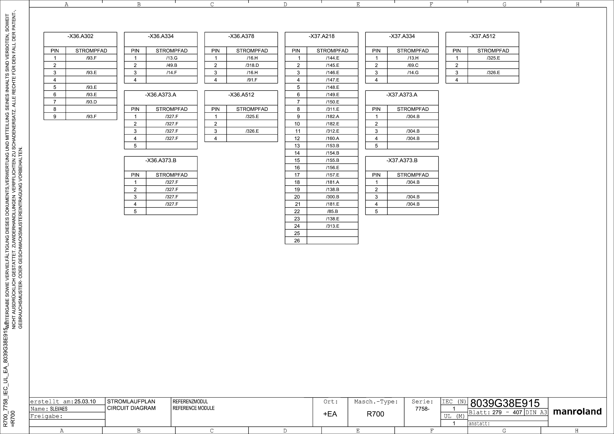

# +EA — Sheet 279 of 407 — REFERENZMODUL

**REFERENCE MODULE**

> Part of the manroland **R700** printing press IEC/UL circuit diagrams.
> Drawing class: **Stromlaufplan / Circuit diagram** (DIN A3).
> Document `+EA` covers the **Printing unit** machine section.

## At a glance

| Field | Value |
|---|---|
| Document | `+EA`  (8039G38E915) |
| Sheet | **279** of 407 |
| Section (DE) | REFERENZMODUL |
| Section (EN) | REFERENCE MODULE |
| Section type | REFERENCE_MODULE — Reference module |
| Machine type | `R700` |
| Series | `7758` |
| Created | 25.03.10 |
| Replaces | — |
| Columns used | A, B, C, D, E, F, G |
| Path numbers | — |
| Labels on sheet | 166 |
| Cross-refs out | 58 |
| Cross-refs in | 0 |

**Previous:** [+EA sheet 278](SHEET_0278.md) · **Next:** [+EA sheet 280](SHEET_0280.md) · **Document TOC:** [_TOC.md](_TOC.md)  (+EA) · **Master TOC:** [all sheets](../_MASTER_TOC.md)

## Sheet image (300 DPI, exact vector render)



_Rendered directly from the PDF vector layer at 300 DPI (1-bit), no OCR and no resampling. Use it to confirm anything ambiguous in the text below._

## Cross-references on this sheet

Each entry is a wire leaving this sheet. The printed token is `/sheet.column`; the link resolves to that sheet inside the same document.

| Ref | Target sheet | Col | Path | Destination on target | Target section | From col |
|---|---|---|---|---|---|---|
| `/93.F` | [+EA sheet 93](SHEET_0093.md) | F | — | — | BLASRAHMEN | A |
| `/144.E` | [+EA sheet 144](SHEET_0144.md) | E | — | — | ZUGANGSABSICHERUNG | E |
| `/325.E` | [+EA sheet 325](SHEET_0325.md) | E | — | — | OPTION: BOGENWEICHE | G |
| `/13.G` | [+EA sheet 13](SHEET_0013.md) | G | — | — | SPANNUNGSVERSORGUNG: 400V, 24V | B |
| `/16.H` | [+EA sheet 16](SHEET_0016.md) | H | — | — | SPANNUNGSVERSORGUNG: 400V, 24V | D |
| `/13.H` | [+EA sheet 13](SHEET_0013.md) | H | — | — | SPANNUNGSVERSORGUNG: 400V, 24V | F |
| `/49.B` | [+EA sheet 49](SHEET_0049.md) | B | — | — | SCHUTZ | B |
| `/145.E` | [+EA sheet 145](SHEET_0145.md) | E | — | — | ZUGANGSABSICHERUNG | E |
| `/69.C` | [+EA sheet 69](SHEET_0069.md) | C | — | — | SCHMIERUNG | F |
| `/318.D` | [+EA sheet 318](SHEET_0318.md) | D | — | — | OPTION: LOGISTIK, AUSLEGER | D |
| `/93.E` | [+EA sheet 93](SHEET_0093.md) | E | — | — | BLASRAHMEN | A |
| `/14.F` | [+EA sheet 14](SHEET_0014.md) | F | — | — | SPANNUNGSVERSORGUNG: 400V, 24V | B |
| `/146.E` | [+EA sheet 146](SHEET_0146.md) | E | — | — | ZUGANGSABSICHERUNG | E |
| `/14.G` | [+EA sheet 14](SHEET_0014.md) | G | — | — | SPANNUNGSVERSORGUNG: 400V, 24V | F |
| `/326.E` | [+EA sheet 326](SHEET_0326.md) | E | — | — | OPTION: BOGENWEICHE | G |
| `/16.H` | [+EA sheet 16](SHEET_0016.md) | H | — | — | SPANNUNGSVERSORGUNG: 400V, 24V | D |
| `/91.F` | [+EA sheet 91](SHEET_0091.md) | F | — | — | BLASROHRE (BLASRAHMEN) | D |
| `/147.E` | [+EA sheet 147](SHEET_0147.md) | E | — | — | ZUGANGSABSICHERUNG | E |
| `/93.E` | [+EA sheet 93](SHEET_0093.md) | E | — | — | BLASRAHMEN | A |
| `/148.E` | [+EA sheet 148](SHEET_0148.md) | E | — | — | ZUGANGSABSICHERUNG | E |
| `/93.E` | [+EA sheet 93](SHEET_0093.md) | E | — | — | BLASRAHMEN | A |
| `/149.E` | [+EA sheet 149](SHEET_0149.md) | E | — | — | ZUGANGSABSICHERUNG | E |
| `/150.E` | [+EA sheet 150](SHEET_0150.md) | E | — | — | ZUGANGSABSICHERUNG | E |
| `/93.D` | [+EA sheet 93](SHEET_0093.md) | D | — | — | BLASRAHMEN | A |
| `/311.E` | [+EA sheet 311](SHEET_0311.md) | E | — | — | OPTION: AUTOMATISCHE STAPELAUFFAHRT STOP / | E |
| `/93.F` | [+EA sheet 93](SHEET_0093.md) | F | — | — | BLASRAHMEN | A |
| `/325.E` | [+EA sheet 325](SHEET_0325.md) | E | — | — | OPTION: BOGENWEICHE | D |
| `/182.A` | [+EA sheet 182](SHEET_0182.md) | A | — | — | RESERVE | E |
| `/304.B` | [+EA sheet 304](SHEET_0304.md) | B | — | — | OPTION: ZWISCHENSTAPEL / | F |
| `/327.F` | [+EA sheet 327](SHEET_0327.md) | F | — | — | OPTION: BOGENWEICHE | B |
| `/182.E` | [+EA sheet 182](SHEET_0182.md) | E | — | — | RESERVE | E |
| `/327.F` | [+EA sheet 327](SHEET_0327.md) | F | — | — | OPTION: BOGENWEICHE | B |
| `/326.E` | [+EA sheet 326](SHEET_0326.md) | E | — | — | OPTION: BOGENWEICHE | D |
| `/312.E` | [+EA sheet 312](SHEET_0312.md) | E | — | — | OPTION: LOGISTIK, AUSLEGER | E |
| `/304.B` | [+EA sheet 304](SHEET_0304.md) | B | — | — | OPTION: ZWISCHENSTAPEL / | F |
| `/327.F` | [+EA sheet 327](SHEET_0327.md) | F | — | — | OPTION: BOGENWEICHE | B |
| `/160.A` | [+EA sheet 160](SHEET_0160.md) | A | — | — | ZUGANGSABSICHERUNG | E |
| `/304.B` | [+EA sheet 304](SHEET_0304.md) | B | — | — | OPTION: ZWISCHENSTAPEL / | F |
| `/327.F` | [+EA sheet 327](SHEET_0327.md) | F | — | — | OPTION: BOGENWEICHE | B |
| `/153.B` | [+EA sheet 153](SHEET_0153.md) | B | — | — | ZUGANGSABSICHERUNG | E |
| `/154.B` | [+EA sheet 154](SHEET_0154.md) | B | — | — | ZUGANGSABSICHERUNG | E |
| `/155.B` | [+EA sheet 155](SHEET_0155.md) | B | — | — | ZUGANGSABSICHERUNG | E |
| `/156.E` | [+EA sheet 156](SHEET_0156.md) | E | — | — | ZUGANGSABSICHERUNG | E |
| `/157.E` | [+EA sheet 157](SHEET_0157.md) | E | — | — | ZUGANGSABSICHERUNG | E |
| `/181.A` | [+EA sheet 181](SHEET_0181.md) | A | — | — | RESERVE | E |
| `/304.B` | [+EA sheet 304](SHEET_0304.md) | B | — | — | OPTION: ZWISCHENSTAPEL / | F |
| `/327.F` | [+EA sheet 327](SHEET_0327.md) | F | — | — | OPTION: BOGENWEICHE | B |
| `/138.B` | [+EA sheet 138](SHEET_0138.md) | B | — | — | ZUGANGSABSICHERUNG | E |
| `/327.F` | [+EA sheet 327](SHEET_0327.md) | F | — | — | OPTION: BOGENWEICHE | B |
| `/300.B` | [+EA sheet 300](SHEET_0300.md) | B | — | — | OPTION: ZWISCHENSTAPEL / | E |
| `/304.B` | [+EA sheet 304](SHEET_0304.md) | B | — | — | OPTION: ZWISCHENSTAPEL / | F |
| `/327.F` | [+EA sheet 327](SHEET_0327.md) | F | — | — | OPTION: BOGENWEICHE | B |
| `/181.E` | [+EA sheet 181](SHEET_0181.md) | E | — | — | RESERVE | E |
| `/304.B` | [+EA sheet 304](SHEET_0304.md) | B | — | — | OPTION: ZWISCHENSTAPEL / | F |
| `/327.F` | [+EA sheet 327](SHEET_0327.md) | F | — | — | OPTION: BOGENWEICHE | B |
| `/85.B` | [+EA sheet 85](SHEET_0085.md) | B | — | — | AUSLEGERSTAPELSTEUERUNG: PROGRAMMSCHALTWERK | E |
| `/138.E` | [+EA sheet 138](SHEET_0138.md) | E | — | — | ZUGANGSABSICHERUNG | E |
| `/313.E` | [+EA sheet 313](SHEET_0313.md) | E | — | — | OPTION: LOGISTIK, AUSLEGER | E |

## Devices on this sheet

| Tag | Class | Class meaning (IEC) | Col | Sub | Terminal | Sign |
|---|---|---|---|---|---|---|
| `X36.A302` | — | cross-device reference | A | — | — | — |
| `X36.A334` | — | cross-device reference | B | — | — | — |
| `X36.A373.A` | — | cross-device reference | B | — | — | — |
| `X36.A373.B` | — | cross-device reference | B | — | — | — |
| `X36.A378` | — | cross-device reference | C | — | — | — |
| `X36.A512` | — | cross-device reference | C | — | — | — |
| `X37.A334` | — | cross-device reference | F | — | — | — |
| `X37.A218` | — | cross-device reference | E | — | — | — |
| `X37.A373.A` | — | cross-device reference | F | — | — | — |
| `X37.A373.B` | — | cross-device reference | F | — | — | — |
| `X37.A512` | — | cross-device reference | G | — | — | — |

## Potentials / nets

_No named potentials on this sheet._

## Wire-end annotations (grouped as printed)

A wire that continues elsewhere is annotated with a small cluster: the destination description, the path/line number `#NN`, and the `/sheet.column` cross reference. Each row below is one such cluster exactly as it is grouped on the drawing.

| Col | Y | Path | Cross-ref | Text on the wire |
|---|---|---|---|---|
| A | 65.5 | — | — | `X36.A302` |
| B | 65.5 | — | — | `X36.A334` |
| C | 65.5 | — | — | `X36.A378` |
| E | 65.5 | — | — | `X37.A218` |
| F | 65.5 | — | — | `X37.A334` |
| G | 65.5 | — | — | `X37.A512` |
| A | 94.2 | — | — | `PIN 2 3 4 5 6 7 8 9 1 STROMPFAD` |
| B | 94.2 | — | — | `PIN 2 3 4 1 STROMPFAD` |
| C | 94.2 | — | — | `PIN 2 3 4 1 STROMPFAD` |
| D | 94.2 | — | — | `PIN STROMPFAD` |
| F | 94.2 | — | — | `PIN 2 3 4 1 STROMPFAD` |
| G | 94.2 | — | — | `PIN 2 3 4 1 STROMPFAD` |
| D | 108.4 | — | — | `2 3 4 5 6 7 8 9 1` |
| A | 108.7 | — | `/93.F` | — |
| B | 108.7 | — | `/13.G` | — |
| D | 108.7 | — | `/16.H` | — |
| E | 108.7 | — | `/144.E` | — |
| F | 108.7 | — | `/13.H` | — |
| G | 108.7 | — | `/325.E` | — |
| B | 122.8 | — | `/49.B` | — |
| D | 122.9 | — | `/318.D` | — |
| E | 122.9 | — | `/145.E` | — |
| F | 122.9 | — | `/69.C` | — |
| A | 137.0 | — | `/93.E` | — |
| B | 137.0 | — | `/14.F` | — |
| E | 137.0 | — | `/146.E` | — |
| F | 137.0 | — | `/14.G` | — |
| G | 137.0 | — | `/326.E` | — |
| D | 137.1 | — | `/16.H` | — |
| D | 151.2 | — | `/91.F` | — |
| E | 151.2 | — | `/147.E` | — |
| A | 165.4 | — | `/93.E` | — |
| E | 165.4 | — | `/148.E` | — |
| B | 178.9 | — | — | `X36.A373.A` |
| C | 178.9 | — | — | `X36.A512` |
| F | 178.9 | — | — | `X37.A373.A` |
| A | 179.5 | — | `/93.E` | — |
| E | 179.6 | — | `/149.E` | — |
| E | 193.7 | — | `/150.E` | — |
| A | 193.8 | — | `/93.D` | — |
| B | 207.5 | — | — | `PIN 2 3 4 5 1 STROMPFAD` |
| C | 207.5 | — | — | `PIN 2 3 4 1 STROMPFAD` |
| F | 207.5 | — | — | `PIN 2 3 4 5 1 STROMPFAD` |
| E | 207.9 | — | `/311.E` | — |
| A | 222.1 | — | `/93.F` | — |
| B | 222.1 | — | `/327.F` | — |
| D | 222.1 | — | `/325.E` | — |
| E | 222.1 | — | `/182.A` | — |
| F | 222.1 | — | `/304.B` | — |
| D | 235.9 | — | — | `10 12 13 14 15 16 17 18 19 20 11` |
| E | 236.2 | — | `/182.E` | — |
| B | 236.3 | — | `/327.F` | — |
| B | 250.4 | — | `/327.F` | — |
| D | 250.4 | — | `/326.E` | — |
| E | 250.4 | — | `/312.E` | — |
| F | 250.4 | — | `/304.B` | — |
| B | 264.6 | — | `/327.F` | — |
| E | 264.6 | — | `/160.A` | — |
| F | 264.6 | — | `/304.B` | — |
| E | 278.8 | — | `/153.B` | — |
| E | 292.9 | — | `/154.B` | — |
| B | 306.4 | — | — | `X36.A373.B` |
| F | 306.4 | — | — | `X37.A373.B` |
| E | 307.1 | — | `/155.B` | — |
| E | 321.3 | — | `/156.E` | — |
| B | 335.1 | — | — | `PIN 2 3 4 5 1 STROMPFAD` |
| F | 335.1 | — | — | `PIN 2 3 4 5 1 STROMPFAD` |
| E | 335.5 | — | `/157.E` | — |
| B | 349.6 | — | `/327.F` | — |
| E | 349.6 | — | `/181.A` | — |
| F | 349.6 | — | `/304.B` | — |
| B | 363.8 | — | `/327.F` | — |
| E | 363.8 | — | `/138.B` | — |
| B | 378.0 | — | `/327.F` | — |
| E | 378.0 | — | `/300.B` | — |
| F | 378.0 | — | `/304.B` | — |
| D | 391.8 | — | — | `22 23 24 25 26 21` |
| E | 392.1 | — | `/181.E` | — |
| F | 392.1 | — | `/304.B` | — |
| B | 392.2 | — | `/327.F` | — |
| E | 406.3 | — | `/85.B` | — |
| E | 420.5 | — | `/138.E` | — |
| E | 434.7 | — | `/313.E` | — |


## Reconstructed tables

This sheet carries tabular content (pin map / terminal assignment / index). The grid below was rebuilt from the drawing's own rule lines, so each row is exactly one physical row of the table.

### Table 1 — 9 data rows × 2 columns (at x=85.0, y=62.4) — **X36.A302**

| PIN | STROMPFAD |
|---|---|
| `1` | `/93.F` |
| `2` |  |
| `3` | `/93.E` |
| `4` |  |
| `5` | `/93.E` |
| `6` | `/93.E` |
| `7` | `/93.D` |
| `8` |  |
| `9` | `/93.F` |


### Table 2 — 18 data rows × 2 columns (at x=240.9, y=62.4) — **X36.A334**

| PIN | STROMPFAD |
|---|---|
| `1` | `/13.G` |
| `2` | `/49.B` |
| `3` | `/14.F` |
| `4` |  |
|  | `X36.A373.A` |
| `PIN` | `STROMPFAD` |
| `1` | `/327.F` |
| `2` | `/327.F` |
| `3` | `/327.F` |
| `4` | `/327.F` |
| `5` |  |
|  | `X36.A373.B` |
| `PIN` | `STROMPFAD` |
| `1` | `/327.F` |
| `2` | `/327.F` |
| `3` | `/327.F` |
| `4` | `/327.F` |
| `5` |  |


### Table 3 — 10 data rows × 2 columns (at x=396.9, y=62.4) — **X36.A378**

| PIN | STROMPFAD |
|---|---|
| `1` | `/16.H` |
| `2` | `/318.D` |
| `3` | `/16.H` |
| `4` | `/91.F` |
|  | `X36.A512` |
| `PIN` | `STROMPFAD` |
| `1` | `/325.E` |
| `2` |  |
| `3` | `/326.E` |
| `4` |  |


### Table 4 — 26 data rows × 2 columns (at x=552.8, y=62.4) — **X37.A218**

| PIN | STROMPFAD |
|---|---|
| `1` | `/144.E` |
| `2` | `/145.E` |
| `3` | `/146.E` |
| `4` | `/147.E` |
| `5` | `/148.E` |
| `6` | `/149.E` |
| `7` | `/150.E` |
| `8` | `/311.E` |
| `9` | `/182.A` |
| `10` | `/182.E` |
| `11` | `/312.E` |
| `12` | `/160.A` |
| `13` | `/153.B` |
| `14` | `/154.B` |
| `15` | `/155.B` |
| `16` | `/156.E` |
| `17` | `/157.E` |
| `18` | `/181.A` |
| `19` | `/138.B` |
| `20` | `/300.B` |
| `21` | `/181.E` |
| `22` | `/85.B` |
| `23` | `/138.E` |
| `24` | `/313.E` |
| `25` |  |
| `26` |  |


### Table 5 — 18 data rows × 2 columns (at x=708.7, y=62.4) — **X37.A334**

| PIN | STROMPFAD |
|---|---|
| `1` | `/13.H` |
| `2` | `/69.C` |
| `3` | `/14.G` |
| `4` |  |
|  | `X37.A373.A` |
| `PIN` | `STROMPFAD` |
| `1` | `/304.B` |
| `2` |  |
| `3` | `/304.B` |
| `4` | `/304.B` |
| `5` |  |
|  | `X37.A373.B` |
| `PIN` | `STROMPFAD` |
| `1` | `/304.B` |
| `2` |  |
| `3` | `/304.B` |
| `4` | `/304.B` |
| `5` |  |


### Table 6 — 4 data rows × 2 columns (at x=864.6, y=62.4) — **X37.A512**

| PIN | STROMPFAD |
|---|---|
| `1` | `/325.E` |
| `2` |  |
| `3` | `/326.E` |
| `4` |  |


## Notes and free text on this sheet

| Text | Col | Y (pt) |
|---|---|---|
| `PIN` | A | 94.2 |
| `STROMPFAD` | A | 94.15 |
| `PIN` | B | 94.2 |
| `STROMPFAD` | B | 94.15 |
| `PIN` | C | 94.2 |
| `STROMPFAD` | D | 94.15 |
| `PIN` | E | 94.2 |
| `STROMPFAD` | F | 94.15 |
| `PIN` | D | 94.2 |
| `STROMPFAD` | E | 94.15 |
| `PIN` | F | 94.2 |
| `STROMPFAD` | G | 94.15 |

## Complete label inventory (exact text from the drawing)

Every text object inside the drawing area of this sheet, in DIN reading order (column A→H, then top→bottom). This is the authoritative list: if a string is not here it is not printed on this sheet.

| Col | Y | X | Dir | Type | Text |
|---|---|---|---|---|---|
| A | 65.5 | 131.0 | → | device ref | `X36.A302` |
| A | 94.2 | 98.2 | → | text | `PIN` |
| A | 94.2 | 146.4 | → | text | `STROMPFAD` |
| A | 108.4 | 104.2 | → | number | `1` |
| A | 108.7 | 167.2 | → | cross-reference | `/93.F` |
| A | 122.5 | 103.6 | → | number | `2` |
| A | 136.7 | 103.6 | → | number | `3` |
| A | 137.0 | 167.1 | → | cross-reference | `/93.E` |
| A | 150.9 | 103.6 | → | number | `4` |
| A | 165.1 | 103.6 | → | number | `5` |
| A | 165.4 | 167.1 | → | cross-reference | `/93.E` |
| A | 179.2 | 103.6 | → | number | `6` |
| A | 179.5 | 167.1 | → | cross-reference | `/93.E` |
| A | 193.4 | 103.6 | → | number | `7` |
| A | 193.7 | 166.8 | → | cross-reference | `/93.D` |
| A | 207.6 | 103.6 | → | number | `8` |
| A | 221.8 | 103.6 | → | number | `9` |
| A | 222.1 | 167.2 | → | cross-reference | `/93.F` |
| B | 65.5 | 286.9 | → | device ref | `X36.A334` |
| B | 94.2 | 254.1 | → | text | `PIN` |
| B | 94.2 | 302.3 | → | text | `STROMPFAD` |
| B | 108.4 | 260.1 | → | number | `1` |
| B | 108.7 | 322.6 | → | cross-reference | `/13.G` |
| B | 122.5 | 259.5 | → | number | `2` |
| B | 122.8 | 322.9 | → | cross-reference | `/49.B` |
| B | 136.7 | 259.5 | → | number | `3` |
| B | 137.0 | 323.1 | → | cross-reference | `/14.F` |
| B | 150.9 | 259.5 | → | number | `4` |
| B | 178.9 | 281.5 | → | device ref | `X36.A373.A` |
| B | 207.5 | 302.3 | → | text | `STROMPFAD` |
| B | 207.6 | 254.1 | → | text | `PIN` |
| B | 221.8 | 260.1 | → | number | `1` |
| B | 222.1 | 320.7 | → | cross-reference | `/327.F` |
| B | 235.9 | 259.5 | → | number | `2` |
| B | 236.3 | 320.7 | → | cross-reference | `/327.F` |
| B | 250.1 | 259.5 | → | number | `3` |
| B | 250.4 | 320.7 | → | cross-reference | `/327.F` |
| B | 264.3 | 259.5 | → | number | `4` |
| B | 264.6 | 320.7 | → | cross-reference | `/327.F` |
| B | 278.5 | 259.5 | → | number | `5` |
| B | 306.5 | 281.9 | → | device ref | `X36.A373.B` |
| B | 335.1 | 254.1 | → | text | `PIN` |
| B | 335.1 | 302.3 | → | text | `STROMPFAD` |
| B | 349.3 | 260.1 | → | number | `1` |
| B | 349.6 | 320.7 | → | cross-reference | `/327.F` |
| B | 363.5 | 259.5 | → | number | `2` |
| B | 363.8 | 320.7 | → | cross-reference | `/327.F` |
| B | 377.7 | 259.5 | → | number | `3` |
| B | 378.0 | 320.7 | → | cross-reference | `/327.F` |
| B | 391.8 | 259.5 | → | number | `4` |
| B | 392.2 | 320.7 | → | cross-reference | `/327.F` |
| B | 406.0 | 259.5 | → | number | `5` |
| C | 65.5 | 442.8 | → | device ref | `X36.A378` |
| C | 94.2 | 410.0 | → | text | `PIN` |
| C | 108.4 | 416.0 | → | number | `1` |
| C | 122.5 | 415.4 | → | number | `2` |
| C | 136.7 | 415.4 | → | number | `3` |
| C | 150.9 | 415.4 | → | number | `4` |
| C | 178.9 | 442.8 | → | device ref | `X36.A512` |
| C | 207.6 | 410.0 | → | text | `PIN` |
| C | 221.8 | 416.0 | → | number | `1` |
| C | 235.9 | 415.4 | → | number | `2` |
| C | 250.1 | 415.4 | → | number | `3` |
| C | 264.3 | 415.4 | → | number | `4` |
| D | 94.2 | 458.2 | → | text | `STROMPFAD` |
| D | 94.2 | 565.9 | → | text | `PIN` |
| D | 108.4 | 577.7 | → | number | `1` |
| D | 108.7 | 478.9 | → | cross-reference | `/16.H` |
| D | 122.5 | 576.0 | → | number | `2` |
| D | 122.9 | 476.2 | → | cross-reference | `/318.D` |
| D | 136.7 | 576.0 | → | number | `3` |
| D | 137.1 | 478.9 | → | cross-reference | `/16.H` |
| D | 150.9 | 576.0 | → | number | `4` |
| D | 151.2 | 479.1 | → | cross-reference | `/91.F` |
| D | 165.1 | 576.0 | → | number | `5` |
| D | 179.2 | 576.0 | → | number | `6` |
| D | 193.4 | 576.0 | → | number | `7` |
| D | 207.5 | 458.2 | → | text | `STROMPFAD` |
| D | 207.6 | 576.0 | → | number | `8` |
| D | 221.8 | 576.0 | → | number | `9` |
| D | 222.1 | 476.5 | → | cross-reference | `/325.E` |
| D | 235.9 | 570.6 | → | number | `10` |
| D | 250.1 | 572.3 | → | number | `11` |
| D | 250.4 | 476.5 | → | cross-reference | `/326.E` |
| D | 264.3 | 570.6 | → | number | `12` |
| D | 278.5 | 570.6 | → | number | `13` |
| D | 292.6 | 570.6 | → | number | `14` |
| D | 306.8 | 570.6 | → | number | `15` |
| D | 321.0 | 570.6 | → | number | `16` |
| D | 335.1 | 570.6 | → | number | `17` |
| D | 349.3 | 570.6 | → | number | `18` |
| D | 363.5 | 570.6 | → | number | `19` |
| D | 377.7 | 570.6 | → | number | `20` |
| D | 391.8 | 572.3 | → | number | `21` |
| D | 406.0 | 570.6 | → | number | `22` |
| D | 420.2 | 570.6 | → | number | `23` |
| D | 434.4 | 570.6 | → | number | `24` |
| D | 448.5 | 570.6 | → | number | `25` |
| D | 462.7 | 570.6 | → | number | `26` |
| E | 65.5 | 598.7 | → | device ref | `X37.A218` |
| E | 94.2 | 614.1 | → | text | `STROMPFAD` |
| E | 94.2 | 721.8 | → | text | `PIN` |
| E | 108.4 | 727.8 | → | number | `1` |
| E | 108.7 | 632.4 | → | cross-reference | `/144.E` |
| E | 122.5 | 727.2 | → | number | `2` |
| E | 122.9 | 632.4 | → | cross-reference | `/145.E` |
| E | 136.7 | 727.2 | → | number | `3` |
| E | 137.0 | 632.4 | → | cross-reference | `/146.E` |
| E | 150.9 | 727.2 | → | number | `4` |
| E | 151.2 | 632.4 | → | cross-reference | `/147.E` |
| E | 165.4 | 632.4 | → | cross-reference | `/148.E` |
| E | 179.6 | 632.4 | → | cross-reference | `/149.E` |
| E | 193.7 | 632.4 | → | cross-reference | `/150.E` |
| E | 207.6 | 721.8 | → | text | `PIN` |
| E | 207.9 | 632.4 | → | cross-reference | `/311.E` |
| E | 221.8 | 727.8 | → | number | `1` |
| E | 222.1 | 632.1 | → | cross-reference | `/182.A` |
| E | 235.9 | 727.2 | → | number | `2` |
| E | 236.2 | 632.4 | → | cross-reference | `/182.E` |
| E | 250.1 | 727.2 | → | number | `3` |
| E | 250.4 | 632.4 | → | cross-reference | `/312.E` |
| E | 264.3 | 727.2 | → | number | `4` |
| E | 264.6 | 632.1 | → | cross-reference | `/160.A` |
| E | 278.5 | 727.2 | → | number | `5` |
| E | 278.8 | 632.3 | → | cross-reference | `/153.B` |
| E | 292.9 | 632.3 | → | cross-reference | `/154.B` |
| E | 307.1 | 632.3 | → | cross-reference | `/155.B` |
| E | 321.3 | 632.4 | → | cross-reference | `/156.E` |
| E | 335.1 | 721.8 | → | text | `PIN` |
| E | 335.5 | 632.4 | → | cross-reference | `/157.E` |
| E | 349.3 | 727.8 | → | number | `1` |
| E | 349.6 | 632.1 | → | cross-reference | `/181.A` |
| E | 363.5 | 727.2 | → | number | `2` |
| E | 363.8 | 632.3 | → | cross-reference | `/138.B` |
| E | 377.7 | 727.2 | → | number | `3` |
| E | 378.0 | 632.3 | → | cross-reference | `/300.B` |
| E | 391.8 | 727.2 | → | number | `4` |
| E | 392.2 | 632.4 | → | cross-reference | `/181.E` |
| E | 406.0 | 727.2 | → | number | `5` |
| E | 406.3 | 634.7 | → | cross-reference | `/85.B` |
| E | 420.5 | 632.4 | → | cross-reference | `/138.E` |
| E | 434.7 | 632.4 | → | cross-reference | `/313.E` |
| F | 65.5 | 754.6 | → | device ref | `X37.A334` |
| F | 94.2 | 770.0 | → | text | `STROMPFAD` |
| F | 94.2 | 877.7 | → | text | `PIN` |
| F | 108.4 | 883.7 | → | number | `1` |
| F | 108.7 | 790.7 | → | cross-reference | `/13.H` |
| F | 122.5 | 883.1 | → | number | `2` |
| F | 122.9 | 790.4 | → | cross-reference | `/69.C` |
| F | 136.7 | 883.1 | → | number | `3` |
| F | 137.0 | 790.3 | → | cross-reference | `/14.G` |
| F | 150.9 | 883.1 | → | number | `4` |
| F | 178.9 | 749.2 | → | device ref | `X37.A373.A` |
| F | 207.5 | 770.0 | → | text | `STROMPFAD` |
| F | 222.1 | 788.2 | → | cross-reference | `/304.B` |
| F | 250.4 | 788.2 | → | cross-reference | `/304.B` |
| F | 264.6 | 788.2 | → | cross-reference | `/304.B` |
| F | 306.5 | 749.6 | → | device ref | `X37.A373.B` |
| F | 335.1 | 770.0 | → | text | `STROMPFAD` |
| F | 349.6 | 788.2 | → | cross-reference | `/304.B` |
| F | 378.0 | 788.2 | → | cross-reference | `/304.B` |
| F | 392.2 | 788.2 | → | cross-reference | `/304.B` |
| G | 65.5 | 910.5 | → | device ref | `X37.A512` |
| G | 94.2 | 925.9 | → | text | `STROMPFAD` |
| G | 108.7 | 944.2 | → | cross-reference | `/325.E` |
| G | 137.0 | 944.2 | → | cross-reference | `/326.E` |

## Reading-order text block

The same content as a plain block, grouped by DIN column — convenient to paste or to match against a visual description.

```text
=== Column A ===
  65.5  131.0  devref       X36.A302
  94.2   98.2  text         PIN
  94.2  146.4  text         STROMPFAD
 108.4  104.2  numeric      1
 108.7  167.2  xref         /93.F
 122.5  103.6  numeric      2
 136.7  103.6  numeric      3
 137.0  167.1  xref         /93.E
 150.9  103.6  numeric      4
 165.1  103.6  numeric      5
 165.4  167.1  xref         /93.E
 179.2  103.6  numeric      6
 179.5  167.1  xref         /93.E
 193.4  103.6  numeric      7
 193.7  166.8  xref         /93.D
 207.6  103.6  numeric      8
 221.8  103.6  numeric      9
 222.1  167.2  xref         /93.F
=== Column B ===
  65.5  286.9  devref       X36.A334
  94.2  254.1  text         PIN
  94.2  302.3  text         STROMPFAD
 108.4  260.1  numeric      1
 108.7  322.6  xref         /13.G
 122.5  259.5  numeric      2
 122.8  322.9  xref         /49.B
 136.7  259.5  numeric      3
 137.0  323.1  xref         /14.F
 150.9  259.5  numeric      4
 178.9  281.5  devref       X36.A373.A
 207.5  302.3  text         STROMPFAD
 207.6  254.1  text         PIN
 221.8  260.1  numeric      1
 222.1  320.7  xref         /327.F
 235.9  259.5  numeric      2
 236.3  320.7  xref         /327.F
 250.1  259.5  numeric      3
 250.4  320.7  xref         /327.F
 264.3  259.5  numeric      4
 264.6  320.7  xref         /327.F
 278.5  259.5  numeric      5
 306.5  281.9  devref       X36.A373.B
 335.1  254.1  text         PIN
 335.1  302.3  text         STROMPFAD
 349.3  260.1  numeric      1
 349.6  320.7  xref         /327.F
 363.5  259.5  numeric      2
 363.8  320.7  xref         /327.F
 377.7  259.5  numeric      3
 378.0  320.7  xref         /327.F
 391.8  259.5  numeric      4
 392.2  320.7  xref         /327.F
 406.0  259.5  numeric      5
=== Column C ===
  65.5  442.8  devref       X36.A378
  94.2  410.0  text         PIN
 108.4  416.0  numeric      1
 122.5  415.4  numeric      2
 136.7  415.4  numeric      3
 150.9  415.4  numeric      4
 178.9  442.8  devref       X36.A512
 207.6  410.0  text         PIN
 221.8  416.0  numeric      1
 235.9  415.4  numeric      2
 250.1  415.4  numeric      3
 264.3  415.4  numeric      4
=== Column D ===
  94.2  458.2  text         STROMPFAD
  94.2  565.9  text         PIN
 108.4  577.7  numeric      1
 108.7  478.9  xref         /16.H
 122.5  576.0  numeric      2
 122.9  476.2  xref         /318.D
 136.7  576.0  numeric      3
 137.1  478.9  xref         /16.H
 150.9  576.0  numeric      4
 151.2  479.1  xref         /91.F
 165.1  576.0  numeric      5
 179.2  576.0  numeric      6
 193.4  576.0  numeric      7
 207.5  458.2  text         STROMPFAD
 207.6  576.0  numeric      8
 221.8  576.0  numeric      9
 222.1  476.5  xref         /325.E
 235.9  570.6  numeric      10
 250.1  572.3  numeric      11
 250.4  476.5  xref         /326.E
 264.3  570.6  numeric      12
 278.5  570.6  numeric      13
 292.6  570.6  numeric      14
 306.8  570.6  numeric      15
 321.0  570.6  numeric      16
 335.1  570.6  numeric      17
 349.3  570.6  numeric      18
 363.5  570.6  numeric      19
 377.7  570.6  numeric      20
 391.8  572.3  numeric      21
 406.0  570.6  numeric      22
 420.2  570.6  numeric      23
 434.4  570.6  numeric      24
 448.5  570.6  numeric      25
 462.7  570.6  numeric      26
=== Column E ===
  65.5  598.7  devref       X37.A218
  94.2  614.1  text         STROMPFAD
  94.2  721.8  text         PIN
 108.4  727.8  numeric      1
 108.7  632.4  xref         /144.E
 122.5  727.2  numeric      2
 122.9  632.4  xref         /145.E
 136.7  727.2  numeric      3
 137.0  632.4  xref         /146.E
 150.9  727.2  numeric      4
 151.2  632.4  xref         /147.E
 165.4  632.4  xref         /148.E
 179.6  632.4  xref         /149.E
 193.7  632.4  xref         /150.E
 207.6  721.8  text         PIN
 207.9  632.4  xref         /311.E
 221.8  727.8  numeric      1
 222.1  632.1  xref         /182.A
 235.9  727.2  numeric      2
 236.2  632.4  xref         /182.E
 250.1  727.2  numeric      3
 250.4  632.4  xref         /312.E
 264.3  727.2  numeric      4
 264.6  632.1  xref         /160.A
 278.5  727.2  numeric      5
 278.8  632.3  xref         /153.B
 292.9  632.3  xref         /154.B
 307.1  632.3  xref         /155.B
 321.3  632.4  xref         /156.E
 335.1  721.8  text         PIN
 335.5  632.4  xref         /157.E
 349.3  727.8  numeric      1
 349.6  632.1  xref         /181.A
 363.5  727.2  numeric      2
 363.8  632.3  xref         /138.B
 377.7  727.2  numeric      3
 378.0  632.3  xref         /300.B
 391.8  727.2  numeric      4
 392.2  632.4  xref         /181.E
 406.0  727.2  numeric      5
 406.3  634.7  xref         /85.B
 420.5  632.4  xref         /138.E
 434.7  632.4  xref         /313.E
=== Column F ===
  65.5  754.6  devref       X37.A334
  94.2  770.0  text         STROMPFAD
  94.2  877.7  text         PIN
 108.4  883.7  numeric      1
 108.7  790.7  xref         /13.H
 122.5  883.1  numeric      2
 122.9  790.4  xref         /69.C
 136.7  883.1  numeric      3
 137.0  790.3  xref         /14.G
 150.9  883.1  numeric      4
 178.9  749.2  devref       X37.A373.A
 207.5  770.0  text         STROMPFAD
 222.1  788.2  xref         /304.B
 250.4  788.2  xref         /304.B
 264.6  788.2  xref         /304.B
 306.5  749.6  devref       X37.A373.B
 335.1  770.0  text         STROMPFAD
 349.6  788.2  xref         /304.B
 378.0  788.2  xref         /304.B
 392.2  788.2  xref         /304.B
=== Column G ===
  65.5  910.5  devref       X37.A512
  94.2  925.9  text         STROMPFAD
 108.7  944.2  xref         /325.E
 137.0  944.2  xref         /326.E
```

---
_Generated from the PDF vector text layer; no OCR. Source: `R700_7758_IEC_UL_EA_8039G38E915_p`, sheet 279._
