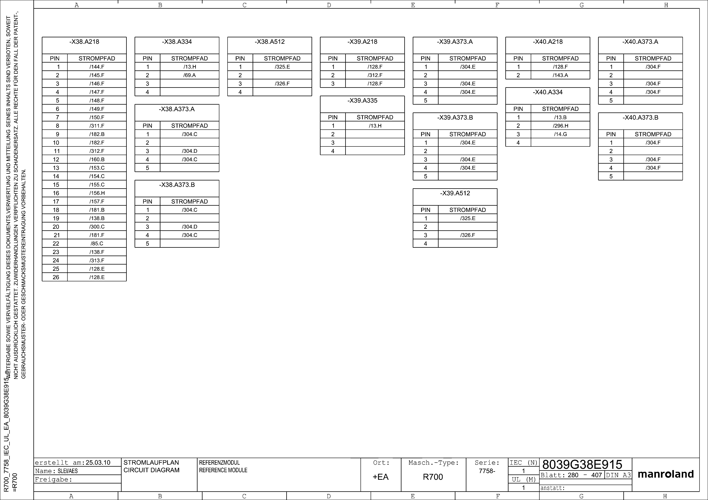

# +EA — Sheet 280 of 407 — REFERENZMODUL

**REFERENCE MODULE**

> Part of the manroland **R700** printing press IEC/UL circuit diagrams.
> Drawing class: **Stromlaufplan / Circuit diagram** (DIN A3).
> Document `+EA` covers the **Printing unit** machine section.

## At a glance

| Field | Value |
|---|---|
| Document | `+EA`  (8039G38E915) |
| Sheet | **280** of 407 |
| Section (DE) | REFERENZMODUL |
| Section (EN) | REFERENCE MODULE |
| Section type | REFERENCE_MODULE — Reference module |
| Machine type | `R700` |
| Series | `7758` |
| Created | 25.03.10 |
| Replaces | — |
| Columns used | A, B, C, D, E, F, G, H |
| Path numbers | — |
| Labels on sheet | 182 |
| Cross-refs out | 59 |
| Cross-refs in | 0 |

**Previous:** [+EA sheet 279](SHEET_0279.md) · **Next:** [+EA sheet 281](SHEET_0281.md) · **Document TOC:** [_TOC.md](_TOC.md)  (+EA) · **Master TOC:** [all sheets](../_MASTER_TOC.md)

## Sheet image (300 DPI, exact vector render)



_Rendered directly from the PDF vector layer at 300 DPI (1-bit), no OCR and no resampling. Use it to confirm anything ambiguous in the text below._

## Cross-references on this sheet

Each entry is a wire leaving this sheet. The printed token is `/sheet.column`; the link resolves to that sheet inside the same document.

| Ref | Target sheet | Col | Path | Destination on target | Target section | From col |
|---|---|---|---|---|---|---|
| `/325.E` | [+EA sheet 325](SHEET_0325.md) | E | — | — | OPTION: BOGENWEICHE | C |
| `/304.E` | [+EA sheet 304](SHEET_0304.md) | E | — | — | OPTION: ZWISCHENSTAPEL / | F |
| `/144.F` | [+EA sheet 144](SHEET_0144.md) | F | — | — | ZUGANGSABSICHERUNG | A |
| `/128.F` | [+EA sheet 128](SHEET_0128.md) | F | — | — | ZUGANGSABSICHERUNG | E |
| `/128.F` | [+EA sheet 128](SHEET_0128.md) | F | — | — | ZUGANGSABSICHERUNG | G |
| `/304.F` | [+EA sheet 304](SHEET_0304.md) | F | — | — | OPTION: ZWISCHENSTAPEL / | H |
| `/13.H` | [+EA sheet 13](SHEET_0013.md) | H | — | — | SPANNUNGSVERSORGUNG: 400V, 24V | B |
| `/69.A` | [+EA sheet 69](SHEET_0069.md) | A | — | — | SCHMIERUNG | B |
| `/143.A` | [+EA sheet 143](SHEET_0143.md) | A | — | — | ZUGANGSABSICHERUNG | G |
| `/145.F` | [+EA sheet 145](SHEET_0145.md) | F | — | — | ZUGANGSABSICHERUNG | A |
| `/312.F` | [+EA sheet 312](SHEET_0312.md) | F | — | — | OPTION: LOGISTIK, AUSLEGER | E |
| `/146.F` | [+EA sheet 146](SHEET_0146.md) | F | — | — | ZUGANGSABSICHERUNG | A |
| `/326.F` | [+EA sheet 326](SHEET_0326.md) | F | — | — | OPTION: BOGENWEICHE | C |
| `/128.F` | [+EA sheet 128](SHEET_0128.md) | F | — | — | ZUGANGSABSICHERUNG | E |
| `/304.E` | [+EA sheet 304](SHEET_0304.md) | E | — | — | OPTION: ZWISCHENSTAPEL / | F |
| `/304.F` | [+EA sheet 304](SHEET_0304.md) | F | — | — | OPTION: ZWISCHENSTAPEL / | H |
| `/304.E` | [+EA sheet 304](SHEET_0304.md) | E | — | — | OPTION: ZWISCHENSTAPEL / | F |
| `/147.F` | [+EA sheet 147](SHEET_0147.md) | F | — | — | ZUGANGSABSICHERUNG | A |
| `/304.F` | [+EA sheet 304](SHEET_0304.md) | F | — | — | OPTION: ZWISCHENSTAPEL / | H |
| `/148.F` | [+EA sheet 148](SHEET_0148.md) | F | — | — | ZUGANGSABSICHERUNG | A |
| `/149.F` | [+EA sheet 149](SHEET_0149.md) | F | — | — | ZUGANGSABSICHERUNG | A |
| `/13.H` | [+EA sheet 13](SHEET_0013.md) | H | — | STROMPFAD PIN 1 2 3 4 | SPANNUNGSVERSORGUNG: 400V, 24V | D |
| `/13.B` | [+EA sheet 13](SHEET_0013.md) | B | — | — | SPANNUNGSVERSORGUNG: 400V, 24V | G |
| `/150.F` | [+EA sheet 150](SHEET_0150.md) | F | — | — | ZUGANGSABSICHERUNG | A |
| `/311.F` | [+EA sheet 311](SHEET_0311.md) | F | — | — | OPTION: AUTOMATISCHE STAPELAUFFAHRT STOP / | A |
| `/296.H` | [+EA sheet 296](SHEET_0296.md) | H | — | — | OPTION: ZWISCHENSTAPEL / | G |
| `/182.B` | [+EA sheet 182](SHEET_0182.md) | B | — | — | RESERVE | A |
| `/14.G` | [+EA sheet 14](SHEET_0014.md) | G | — | — | SPANNUNGSVERSORGUNG: 400V, 24V | G |
| `/304.C` | [+EA sheet 304](SHEET_0304.md) | C | — | — | OPTION: ZWISCHENSTAPEL / | B |
| `/304.E` | [+EA sheet 304](SHEET_0304.md) | E | — | — | OPTION: ZWISCHENSTAPEL / | F |
| `/182.F` | [+EA sheet 182](SHEET_0182.md) | F | — | — | RESERVE | A |
| `/304.F` | [+EA sheet 304](SHEET_0304.md) | F | — | — | OPTION: ZWISCHENSTAPEL / | H |
| `/312.F` | [+EA sheet 312](SHEET_0312.md) | F | — | — | OPTION: LOGISTIK, AUSLEGER | A |
| `/304.D` | [+EA sheet 304](SHEET_0304.md) | D | — | — | OPTION: ZWISCHENSTAPEL / | B |
| `/160.B` | [+EA sheet 160](SHEET_0160.md) | B | — | — | ZUGANGSABSICHERUNG | A |
| `/304.E` | [+EA sheet 304](SHEET_0304.md) | E | — | — | OPTION: ZWISCHENSTAPEL / | F |
| `/304.F` | [+EA sheet 304](SHEET_0304.md) | F | — | — | OPTION: ZWISCHENSTAPEL / | H |
| `/304.C` | [+EA sheet 304](SHEET_0304.md) | C | — | — | OPTION: ZWISCHENSTAPEL / | B |
| `/304.E` | [+EA sheet 304](SHEET_0304.md) | E | — | — | OPTION: ZWISCHENSTAPEL / | F |
| `/304.F` | [+EA sheet 304](SHEET_0304.md) | F | — | — | OPTION: ZWISCHENSTAPEL / | H |
| `/153.C` | [+EA sheet 153](SHEET_0153.md) | C | — | — | ZUGANGSABSICHERUNG | A |
| `/154.C` | [+EA sheet 154](SHEET_0154.md) | C | — | — | ZUGANGSABSICHERUNG | A |
| `/155.C` | [+EA sheet 155](SHEET_0155.md) | C | — | — | ZUGANGSABSICHERUNG | A |
| `/156.H` | [+EA sheet 156](SHEET_0156.md) | H | — | — | ZUGANGSABSICHERUNG | A |
| `/157.F` | [+EA sheet 157](SHEET_0157.md) | F | — | — | ZUGANGSABSICHERUNG | A |
| `/181.B` | [+EA sheet 181](SHEET_0181.md) | B | — | — | RESERVE | A |
| `/304.C` | [+EA sheet 304](SHEET_0304.md) | C | — | — | OPTION: ZWISCHENSTAPEL / | B |
| `/138.B` | [+EA sheet 138](SHEET_0138.md) | B | — | — | ZUGANGSABSICHERUNG | A |
| `/325.E` | [+EA sheet 325](SHEET_0325.md) | E | — | — | OPTION: BOGENWEICHE | F |
| `/300.C` | [+EA sheet 300](SHEET_0300.md) | C | — | — | OPTION: ZWISCHENSTAPEL / | A |
| `/304.D` | [+EA sheet 304](SHEET_0304.md) | D | — | — | OPTION: ZWISCHENSTAPEL / | B |
| `/181.F` | [+EA sheet 181](SHEET_0181.md) | F | — | — | RESERVE | A |
| `/326.F` | [+EA sheet 326](SHEET_0326.md) | F | — | — | OPTION: BOGENWEICHE | F |
| `/304.C` | [+EA sheet 304](SHEET_0304.md) | C | — | — | OPTION: ZWISCHENSTAPEL / | B |
| `/85.C` | [+EA sheet 85](SHEET_0085.md) | C | — | — | AUSLEGERSTAPELSTEUERUNG: PROGRAMMSCHALTWERK | A |
| `/138.F` | [+EA sheet 138](SHEET_0138.md) | F | — | — | ZUGANGSABSICHERUNG | A |
| `/313.F` | [+EA sheet 313](SHEET_0313.md) | F | — | — | OPTION: LOGISTIK, AUSLEGER | A |
| `/128.E` | [+EA sheet 128](SHEET_0128.md) | E | — | — | ZUGANGSABSICHERUNG | A |
| `/128.E` | [+EA sheet 128](SHEET_0128.md) | E | — | — | ZUGANGSABSICHERUNG | A |

## Devices on this sheet

| Tag | Class | Class meaning (IEC) | Col | Sub | Terminal | Sign |
|---|---|---|---|---|---|---|
| `X38.A218` | — | cross-device reference | A | — | — | — |
| `X38.A334` | — | cross-device reference | B | — | — | — |
| `X38.A373.A` | — | cross-device reference | B | — | — | — |
| `X38.A373.B` | — | cross-device reference | B | — | — | — |
| `X38.A512` | — | cross-device reference | C | — | — | — |
| `X39.A218` | — | cross-device reference | D | — | — | — |
| `X39.A335` | — | cross-device reference | D | — | — | — |
| `X39.A512` | — | cross-device reference | F | — | — | — |
| `X39.A373.A` | — | cross-device reference | E | — | — | — |
| `X39.A373.B` | — | cross-device reference | F | — | — | — |
| `X40.A218` | — | cross-device reference | G | — | — | — |
| `X40.A334` | — | cross-device reference | G | — | — | — |
| `X40.A373.A` | — | cross-device reference | H | — | — | — |
| `X40.A373.B` | — | cross-device reference | H | — | — | — |

## Potentials / nets

_No named potentials on this sheet._

## Wire-end annotations (grouped as printed)

A wire that continues elsewhere is annotated with a small cluster: the destination description, the path/line number `#NN`, and the `/sheet.column` cross reference. Each row below is one such cluster exactly as it is grouped on the drawing.

| Col | Y | Path | Cross-ref | Text on the wire |
|---|---|---|---|---|
| A | 65.5 | — | — | `X38.A218` |
| B | 65.5 | — | — | `X38.A334` |
| C | 65.5 | — | — | `X38.A512` |
| D | 65.5 | — | — | `X39.A218` |
| E | 65.5 | — | — | `X39.A373.A` |
| G | 65.5 | — | — | `X40.A218` |
| H | 65.5 | — | — | `X40.A373.A` |
| A | 94.2 | — | — | `PIN STROMPFAD` |
| B | 94.2 | — | — | `PIN 2 3 4 1 STROMPFAD` |
| C | 94.2 | — | — | `PIN 2 3 4 1 STROMPFAD` |
| D | 94.2 | — | — | `PIN 2 3 1 STROMPFAD` |
| E | 94.2 | — | — | `PIN 2 3 4 5 1 STROMPFAD` |
| G | 94.2 | — | — | `PIN 2 1 STROMPFAD` |
| H | 94.2 | — | — | `PIN 2 3 4 5 1 STROMPFAD` |
| A | 108.4 | — | — | `2 3 4 5 6 7 8 9 1` |
| A | 108.7 | — | `/144.F` | — |
| B | 108.7 | — | `/13.H` | — |
| C | 108.7 | — | `/325.E` | — |
| E | 108.7 | — | `/128.F` | — |
| F | 108.7 | — | `/304.E` | — |
| G | 108.7 | — | `/128.F` | — |
| H | 108.7 | — | `/304.F` | — |
| B | 122.8 | — | `/69.A` | — |
| A | 122.9 | — | `/145.F` | — |
| E | 122.9 | — | `/312.F` | — |
| G | 122.9 | — | `/143.A` | — |
| A | 137.0 | — | `/146.F` | — |
| C | 137.0 | — | `/326.F` | — |
| E | 137.0 | — | `/128.F` | — |
| F | 137.0 | — | `/304.E` | — |
| H | 137.0 | — | `/304.F` | — |
| G | 150.5 | — | — | `X40.A334` |
| A | 151.2 | — | `/147.F` | — |
| F | 151.2 | — | `/304.E` | — |
| H | 151.2 | — | `/304.F` | — |
| D | 164.7 | — | — | `X39.A335` |
| A | 165.4 | — | `/148.F` | — |
| B | 178.9 | — | — | `X38.A373.A` |
| G | 179.2 | — | — | `PIN 2 3 4 1 STROMPFAD` |
| A | 179.6 | — | `/149.F` | — |
| F | 193.1 | — | — | `X39.A373.B` |
| H | 193.1 | — | — | `X40.A373.B` |
| D | 193.4 | — | `/13.H` | `PIN 2 3 4 1 STROMPFAD` |
| A | 193.7 | — | `/150.F` | — |
| G | 193.7 | — | `/13.B` | — |
| B | 207.5 | — | — | `PIN 2 3 4 5 1 STROMPFAD` |
| A | 207.9 | — | `/311.F` | — |
| G | 207.9 | — | `/296.H` | — |
| E | 221.7 | — | — | `PIN 2 3 4 5 1 STROMPFAD` |
| H | 221.7 | — | — | `PIN 2 3 4 5 1 STROMPFAD` |
| A | 222.1 | — | `/182.B` | — |
| B | 222.1 | — | `/304.C` | — |
| G | 222.1 | — | `/14.G` | — |
| A | 235.9 | — | — | `10 12 13 14 15 16 17 18 19 20 11` |
| F | 236.2 | — | `/304.E` | — |
| A | 236.3 | — | `/182.F` | — |
| H | 236.3 | — | `/304.F` | — |
| A | 250.4 | — | `/312.F` | — |
| B | 250.4 | — | `/304.D` | — |
| A | 264.6 | — | `/160.B` | — |
| B | 264.6 | — | `/304.C` | — |
| F | 264.6 | — | `/304.E` | — |
| H | 264.6 | — | `/304.F` | — |
| A | 278.8 | — | `/153.C` | — |
| F | 278.8 | — | `/304.E` | — |
| H | 278.8 | — | `/304.F` | — |
| A | 293.0 | — | `/154.C` | — |
| B | 306.4 | — | — | `X38.A373.B` |
| A | 307.1 | — | `/155.C` | — |
| F | 320.6 | — | — | `X39.A512` |
| A | 321.3 | — | `/156.H` | — |
| B | 335.1 | — | — | `PIN 2 3 4 5 1 STROMPFAD` |
| A | 335.5 | — | `/157.F` | — |
| E | 349.3 | — | — | `PIN 2 3 4 1 STROMPFAD` |
| A | 349.6 | — | `/181.B` | — |
| B | 349.7 | — | `/304.C` | — |
| A | 363.8 | — | `/138.B` | — |
| F | 363.8 | — | `/325.E` | — |
| A | 378.0 | — | `/300.C` | — |
| B | 378.0 | — | `/304.D` | — |
| A | 391.8 | — | — | `22 23 24 25 26 21` |
| A | 392.2 | — | `/181.F` | — |
| B | 392.2 | — | `/304.C` | — |
| F | 392.2 | — | `/326.F` | — |
| A | 406.3 | — | `/85.C` | — |
| A | 420.5 | — | `/138.F` | — |
| A | 434.7 | — | `/313.F` | — |
| A | 448.9 | — | `/128.E` | — |
| A | 463.0 | — | `/128.E` | — |


## Reconstructed tables

This sheet carries tabular content (pin map / terminal assignment / index). The grid below was rebuilt from the drawing's own rule lines, so each row is exactly one physical row of the table.

### Table 1 — 26 data rows × 2 columns (at x=70.9, y=62.4) — **X38.A218**

| PIN | STROMPFAD |
|---|---|
| `1` | `/144.F` |
| `2` | `/145.F` |
| `3` | `/146.F` |
| `4` | `/147.F` |
| `5` | `/148.F` |
| `6` | `/149.F` |
| `7` | `/150.F` |
| `8` | `/311.F` |
| `9` | `/182.B` |
| `10` | `/182.F` |
| `11` | `/312.F` |
| `12` | `/160.B` |
| `13` | `/153.C` |
| `14` | `/154.C` |
| `15` | `/155.C` |
| `16` | `/156.H` |
| `17` | `/157.F` |
| `18` | `/181.B` |
| `19` | `/138.B` |
| `20` | `/300.C` |
| `21` | `/181.F` |
| `22` | `/85.C` |
| `23` | `/138.F` |
| `24` | `/313.F` |
| `25` | `/128.E` |
| `26` | `/128.E` |


### Table 2 — 18 data rows × 2 columns (at x=226.8, y=62.4) — **X38.A334**

| PIN | STROMPFAD |
|---|---|
| `1` | `/13.H` |
| `2` | `/69.A` |
| `3` |  |
| `4` |  |
|  | `X38.A373.A` |
| `PIN` | `STROMPFAD` |
| `1` | `/304.C` |
| `2` |  |
| `3` | `/304.D` |
| `4` | `/304.C` |
| `5` |  |
|  | `X38.A373.B` |
| `PIN` | `STROMPFAD` |
| `1` | `/304.C` |
| `2` |  |
| `3` | `/304.D` |
| `4` | `/304.C` |
| `5` |  |


### Table 3 — 4 data rows × 2 columns (at x=382.7, y=62.4) — **X38.A512**

| PIN | STROMPFAD |
|---|---|
| `1` | `/325.E` |
| `2` |  |
| `3` | `/326.F` |
| `4` |  |


### Table 4 — 9 data rows × 2 columns (at x=538.6, y=62.4) — **X39.A218**

| PIN | STROMPFAD |
|---|---|
| `1` | `/128.F` |
| `2` | `/312.F` |
| `3` | `/128.F` |
|  | `X39.A335` |
| `PIN` | `STROMPFAD` |
| `1` | `/13.H` |
| `2` |  |
| `3` |  |
| `4` |  |


### Table 5 — 18 data rows × 2 columns (at x=694.5, y=62.4) — **X39.A373.A**

| PIN | STROMPFAD |
|---|---|
| `1` | `/304.E` |
| `2` |  |
| `3` | `/304.E` |
| `4` | `/304.E` |
| `5` |  |
|  | `X39.A373.B` |
| `PIN` | `STROMPFAD` |
| `1` | `/304.E` |
| `2` |  |
| `3` | `/304.E` |
| `4` | `/304.E` |
| `5` |  |
|  | `X39.A512` |
| `PIN` | `STROMPFAD` |
| `1` | `/325.E` |
| `2` |  |
| `3` | `/326.F` |
| `4` |  |


### Table 6 — 8 data rows × 2 columns (at x=850.4, y=62.4) — **X40.A218**

| PIN | STROMPFAD |
|---|---|
| `1` | `/128.F` |
| `2` | `/143.A` |
|  | `X40.A334` |
| `PIN` | `STROMPFAD` |
| `1` | `/13.B` |
| `2` | `/296.H` |
| `3` | `/14.G` |
| `4` |  |


### Table 7 — 12 data rows × 2 columns (at x=1006.3, y=62.4) — **X40.A373.A**

| PIN | STROMPFAD |
|---|---|
| `1` | `/304.F` |
| `2` |  |
| `3` | `/304.F` |
| `4` | `/304.F` |
| `5` |  |
|  | `X40.A373.B` |
| `PIN` | `STROMPFAD` |
| `1` | `/304.F` |
| `2` |  |
| `3` | `/304.F` |
| `4` | `/304.F` |
| `5` |  |


## Notes and free text on this sheet

| Text | Col | Y (pt) |
|---|---|---|
| `PIN` | A | 94.2 |
| `STROMPFAD` | A | 94.15 |
| `PIN` | B | 94.2 |
| `STROMPFAD` | B | 94.15 |
| `PIN` | C | 94.2 |
| `STROMPFAD` | C | 94.15 |
| `PIN` | D | 94.2 |
| `STROMPFAD` | E | 94.15 |
| `PIN` | E | 349.31 |
| `STROMPFAD` | F | 349.27 |
| `PIN` | F | 94.2 |
| `STROMPFAD` | G | 94.15 |
| `PIN` | G | 94.2 |
| `STROMPFAD` | H | 94.15 |

## Complete label inventory (exact text from the drawing)

Every text object inside the drawing area of this sheet, in DIN reading order (column A→H, then top→bottom). This is the authoritative list: if a string is not here it is not printed on this sheet.

| Col | Y | X | Dir | Type | Text |
|---|---|---|---|---|---|
| A | 65.5 | 116.8 | → | device ref | `X38.A218` |
| A | 94.2 | 84.0 | → | text | `PIN` |
| A | 94.2 | 132.2 | → | text | `STROMPFAD` |
| A | 108.4 | 95.8 | → | number | `1` |
| A | 108.7 | 150.7 | → | cross-reference | `/144.F` |
| A | 122.5 | 94.1 | → | number | `2` |
| A | 122.9 | 150.7 | → | cross-reference | `/145.F` |
| A | 136.7 | 94.1 | → | number | `3` |
| A | 137.0 | 150.7 | → | cross-reference | `/146.F` |
| A | 150.9 | 94.1 | → | number | `4` |
| A | 151.2 | 150.7 | → | cross-reference | `/147.F` |
| A | 165.1 | 94.1 | → | number | `5` |
| A | 165.4 | 150.7 | → | cross-reference | `/148.F` |
| A | 179.2 | 94.1 | → | number | `6` |
| A | 179.6 | 150.7 | → | cross-reference | `/149.F` |
| A | 193.4 | 94.1 | → | number | `7` |
| A | 193.7 | 150.7 | → | cross-reference | `/150.F` |
| A | 207.6 | 94.1 | → | number | `8` |
| A | 207.9 | 150.7 | → | cross-reference | `/311.F` |
| A | 221.8 | 94.1 | → | number | `9` |
| A | 222.1 | 150.4 | → | cross-reference | `/182.B` |
| A | 235.9 | 88.7 | → | number | `10` |
| A | 236.3 | 150.7 | → | cross-reference | `/182.F` |
| A | 250.1 | 90.4 | → | number | `11` |
| A | 250.4 | 150.7 | → | cross-reference | `/312.F` |
| A | 264.3 | 88.7 | → | number | `12` |
| A | 264.6 | 150.4 | → | cross-reference | `/160.B` |
| A | 278.5 | 88.7 | → | number | `13` |
| A | 278.8 | 150.2 | → | cross-reference | `/153.C` |
| A | 292.6 | 88.7 | → | number | `14` |
| A | 293.0 | 150.2 | → | cross-reference | `/154.C` |
| A | 306.8 | 88.7 | → | number | `15` |
| A | 307.1 | 150.2 | → | cross-reference | `/155.C` |
| A | 321.0 | 88.7 | → | number | `16` |
| A | 321.3 | 150.5 | → | cross-reference | `/156.H` |
| A | 335.1 | 88.7 | → | number | `17` |
| A | 335.5 | 150.7 | → | cross-reference | `/157.F` |
| A | 349.3 | 88.7 | → | number | `18` |
| A | 349.6 | 150.4 | → | cross-reference | `/181.B` |
| A | 363.5 | 88.7 | → | number | `19` |
| A | 363.8 | 150.4 | → | cross-reference | `/138.B` |
| A | 377.7 | 88.7 | → | number | `20` |
| A | 378.0 | 150.2 | → | cross-reference | `/300.C` |
| A | 391.8 | 90.4 | → | number | `21` |
| A | 392.2 | 150.7 | → | cross-reference | `/181.F` |
| A | 406.0 | 88.7 | → | number | `22` |
| A | 406.3 | 152.6 | → | cross-reference | `/85.C` |
| A | 420.2 | 88.7 | → | number | `23` |
| A | 420.5 | 150.7 | → | cross-reference | `/138.F` |
| A | 434.4 | 88.7 | → | number | `24` |
| A | 434.7 | 150.7 | → | cross-reference | `/313.F` |
| A | 448.5 | 88.7 | → | number | `25` |
| A | 448.8 | 150.5 | → | cross-reference | `/128.E` |
| A | 462.7 | 88.7 | → | number | `26` |
| A | 463.0 | 150.5 | → | cross-reference | `/128.E` |
| B | 65.5 | 272.7 | → | device ref | `X38.A334` |
| B | 94.2 | 240.0 | → | text | `PIN` |
| B | 94.2 | 288.1 | → | text | `STROMPFAD` |
| B | 108.4 | 245.9 | → | number | `1` |
| B | 108.7 | 308.8 | → | cross-reference | `/13.H` |
| B | 122.5 | 245.3 | → | number | `2` |
| B | 122.8 | 308.6 | → | cross-reference | `/69.A` |
| B | 136.7 | 245.3 | → | number | `3` |
| B | 150.9 | 245.3 | → | number | `4` |
| B | 178.9 | 267.3 | → | device ref | `X38.A373.A` |
| B | 207.5 | 288.1 | → | text | `STROMPFAD` |
| B | 207.6 | 240.0 | → | text | `PIN` |
| B | 221.8 | 245.9 | → | number | `1` |
| B | 222.1 | 306.1 | → | cross-reference | `/304.C` |
| B | 235.9 | 245.3 | → | number | `2` |
| B | 250.1 | 245.3 | → | number | `3` |
| B | 250.4 | 306.1 | → | cross-reference | `/304.D` |
| B | 264.3 | 245.3 | → | number | `4` |
| B | 264.6 | 306.1 | → | cross-reference | `/304.C` |
| B | 278.5 | 245.3 | → | number | `5` |
| B | 306.5 | 267.7 | → | device ref | `X38.A373.B` |
| B | 335.1 | 240.0 | → | text | `PIN` |
| B | 335.1 | 288.1 | → | text | `STROMPFAD` |
| B | 349.3 | 245.9 | → | number | `1` |
| B | 349.7 | 306.1 | → | cross-reference | `/304.C` |
| B | 363.5 | 245.3 | → | number | `2` |
| B | 377.7 | 245.3 | → | number | `3` |
| B | 378.0 | 306.1 | → | cross-reference | `/304.D` |
| B | 391.8 | 245.3 | → | number | `4` |
| B | 392.2 | 306.1 | → | cross-reference | `/304.C` |
| B | 406.0 | 245.3 | → | number | `5` |
| C | 65.5 | 428.6 | → | device ref | `X38.A512` |
| C | 94.2 | 395.9 | → | text | `PIN` |
| C | 94.2 | 444.0 | → | text | `STROMPFAD` |
| C | 108.4 | 401.8 | → | number | `1` |
| C | 108.7 | 462.3 | → | cross-reference | `/325.E` |
| C | 122.5 | 401.2 | → | number | `2` |
| C | 136.7 | 401.2 | → | number | `3` |
| C | 137.0 | 462.5 | → | cross-reference | `/326.F` |
| C | 150.9 | 401.2 | → | number | `4` |
| D | 65.5 | 584.5 | → | device ref | `X39.A218` |
| D | 94.2 | 551.8 | → | text | `PIN` |
| D | 108.4 | 557.7 | → | number | `1` |
| D | 122.5 | 557.1 | → | number | `2` |
| D | 136.7 | 557.1 | → | number | `3` |
| D | 164.7 | 584.5 | → | device ref | `X39.A335` |
| D | 193.4 | 551.8 | → | text | `PIN` |
| D | 207.6 | 557.7 | → | number | `1` |
| D | 221.8 | 557.1 | → | number | `2` |
| D | 235.9 | 557.1 | → | number | `3` |
| D | 250.1 | 557.1 | → | number | `4` |
| E | 65.5 | 735.0 | → | device ref | `X39.A373.A` |
| E | 94.2 | 600.0 | → | text | `STROMPFAD` |
| E | 94.2 | 707.7 | → | text | `PIN` |
| E | 108.4 | 713.6 | → | number | `1` |
| E | 108.7 | 618.4 | → | cross-reference | `/128.F` |
| E | 122.5 | 713.1 | → | number | `2` |
| E | 122.9 | 618.4 | → | cross-reference | `/312.F` |
| E | 136.7 | 713.1 | → | number | `3` |
| E | 137.0 | 618.4 | → | cross-reference | `/128.F` |
| E | 150.9 | 713.1 | → | number | `4` |
| E | 165.1 | 713.1 | → | number | `5` |
| E | 193.4 | 600.0 | → | text | `STROMPFAD` |
| E | 207.9 | 620.6 | → | cross-reference | `/13.H` |
| E | 221.8 | 707.7 | → | text | `PIN` |
| E | 235.9 | 713.6 | → | number | `1` |
| E | 250.1 | 713.1 | → | number | `2` |
| E | 264.3 | 713.1 | → | number | `3` |
| E | 278.5 | 713.1 | → | number | `4` |
| E | 292.6 | 713.1 | → | number | `5` |
| E | 349.3 | 707.7 | → | text | `PIN` |
| E | 363.5 | 713.6 | → | number | `1` |
| E | 377.7 | 713.1 | → | number | `2` |
| E | 391.8 | 713.1 | → | number | `3` |
| E | 406.0 | 713.1 | → | number | `4` |
| F | 94.2 | 755.9 | → | text | `STROMPFAD` |
| F | 94.2 | 863.6 | → | text | `PIN` |
| F | 108.4 | 869.5 | → | number | `1` |
| F | 108.7 | 774.1 | → | cross-reference | `/304.E` |
| F | 122.5 | 869.0 | → | number | `2` |
| F | 137.0 | 774.1 | → | cross-reference | `/304.E` |
| F | 151.2 | 774.1 | → | cross-reference | `/304.E` |
| F | 179.2 | 863.6 | → | text | `PIN` |
| F | 193.1 | 735.4 | → | device ref | `X39.A373.B` |
| F | 193.4 | 869.5 | → | number | `1` |
| F | 207.6 | 869.0 | → | number | `2` |
| F | 221.7 | 755.9 | → | text | `STROMPFAD` |
| F | 221.8 | 869.0 | → | number | `3` |
| F | 235.9 | 869.0 | → | number | `4` |
| F | 236.2 | 774.1 | → | cross-reference | `/304.E` |
| F | 264.6 | 774.1 | → | cross-reference | `/304.E` |
| F | 278.8 | 774.1 | → | cross-reference | `/304.E` |
| F | 320.6 | 740.4 | → | device ref | `X39.A512` |
| F | 349.3 | 755.9 | → | text | `STROMPFAD` |
| F | 363.8 | 774.1 | → | cross-reference | `/325.E` |
| F | 392.2 | 774.3 | → | cross-reference | `/326.F` |
| G | 65.5 | 896.3 | → | device ref | `X40.A218` |
| G | 94.2 | 911.8 | → | text | `STROMPFAD` |
| G | 94.2 | 1019.5 | → | text | `PIN` |
| G | 108.4 | 1025.4 | → | number | `1` |
| G | 108.7 | 930.2 | → | cross-reference | `/128.F` |
| G | 122.5 | 1024.9 | → | number | `2` |
| G | 122.9 | 929.8 | → | cross-reference | `/143.A` |
| G | 136.7 | 1024.9 | → | number | `3` |
| G | 150.5 | 896.3 | → | device ref | `X40.A334` |
| G | 150.9 | 1024.9 | → | number | `4` |
| G | 165.1 | 1024.9 | → | number | `5` |
| G | 179.2 | 911.8 | → | text | `STROMPFAD` |
| G | 193.7 | 932.3 | → | cross-reference | `/13.B` |
| G | 207.9 | 930.0 | → | cross-reference | `/296.H` |
| G | 221.8 | 1019.5 | → | text | `PIN` |
| G | 222.1 | 932.0 | → | cross-reference | `/14.G` |
| G | 235.9 | 1025.4 | → | number | `1` |
| G | 250.1 | 1024.9 | → | number | `2` |
| G | 264.3 | 1024.9 | → | number | `3` |
| G | 278.5 | 1024.9 | → | number | `4` |
| G | 292.6 | 1024.9 | → | number | `5` |
| H | 65.5 | 1046.8 | → | device ref | `X40.A373.A` |
| H | 94.2 | 1067.7 | → | text | `STROMPFAD` |
| H | 108.7 | 1086.1 | → | cross-reference | `/304.F` |
| H | 137.0 | 1086.1 | → | cross-reference | `/304.F` |
| H | 151.2 | 1086.1 | → | cross-reference | `/304.F` |
| H | 193.1 | 1047.3 | → | device ref | `X40.A373.B` |
| H | 221.7 | 1067.7 | → | text | `STROMPFAD` |
| H | 236.3 | 1086.1 | → | cross-reference | `/304.F` |
| H | 264.6 | 1086.1 | → | cross-reference | `/304.F` |
| H | 278.8 | 1086.1 | → | cross-reference | `/304.F` |

## Reading-order text block

The same content as a plain block, grouped by DIN column — convenient to paste or to match against a visual description.

```text
=== Column A ===
  65.5  116.8  devref       X38.A218
  94.2   84.0  text         PIN
  94.2  132.2  text         STROMPFAD
 108.4   95.8  numeric      1
 108.7  150.7  xref         /144.F
 122.5   94.1  numeric      2
 122.9  150.7  xref         /145.F
 136.7   94.1  numeric      3
 137.0  150.7  xref         /146.F
 150.9   94.1  numeric      4
 151.2  150.7  xref         /147.F
 165.1   94.1  numeric      5
 165.4  150.7  xref         /148.F
 179.2   94.1  numeric      6
 179.6  150.7  xref         /149.F
 193.4   94.1  numeric      7
 193.7  150.7  xref         /150.F
 207.6   94.1  numeric      8
 207.9  150.7  xref         /311.F
 221.8   94.1  numeric      9
 222.1  150.4  xref         /182.B
 235.9   88.7  numeric      10
 236.3  150.7  xref         /182.F
 250.1   90.4  numeric      11
 250.4  150.7  xref         /312.F
 264.3   88.7  numeric      12
 264.6  150.4  xref         /160.B
 278.5   88.7  numeric      13
 278.8  150.2  xref         /153.C
 292.6   88.7  numeric      14
 293.0  150.2  xref         /154.C
 306.8   88.7  numeric      15
 307.1  150.2  xref         /155.C
 321.0   88.7  numeric      16
 321.3  150.5  xref         /156.H
 335.1   88.7  numeric      17
 335.5  150.7  xref         /157.F
 349.3   88.7  numeric      18
 349.6  150.4  xref         /181.B
 363.5   88.7  numeric      19
 363.8  150.4  xref         /138.B
 377.7   88.7  numeric      20
 378.0  150.2  xref         /300.C
 391.8   90.4  numeric      21
 392.2  150.7  xref         /181.F
 406.0   88.7  numeric      22
 406.3  152.6  xref         /85.C
 420.2   88.7  numeric      23
 420.5  150.7  xref         /138.F
 434.4   88.7  numeric      24
 434.7  150.7  xref         /313.F
 448.5   88.7  numeric      25
 448.8  150.5  xref         /128.E
 462.7   88.7  numeric      26
 463.0  150.5  xref         /128.E
=== Column B ===
  65.5  272.7  devref       X38.A334
  94.2  240.0  text         PIN
  94.2  288.1  text         STROMPFAD
 108.4  245.9  numeric      1
 108.7  308.8  xref         /13.H
 122.5  245.3  numeric      2
 122.8  308.6  xref         /69.A
 136.7  245.3  numeric      3
 150.9  245.3  numeric      4
 178.9  267.3  devref       X38.A373.A
 207.5  288.1  text         STROMPFAD
 207.6  240.0  text         PIN
 221.8  245.9  numeric      1
 222.1  306.1  xref         /304.C
 235.9  245.3  numeric      2
 250.1  245.3  numeric      3
 250.4  306.1  xref         /304.D
 264.3  245.3  numeric      4
 264.6  306.1  xref         /304.C
 278.5  245.3  numeric      5
 306.5  267.7  devref       X38.A373.B
 335.1  240.0  text         PIN
 335.1  288.1  text         STROMPFAD
 349.3  245.9  numeric      1
 349.7  306.1  xref         /304.C
 363.5  245.3  numeric      2
 377.7  245.3  numeric      3
 378.0  306.1  xref         /304.D
 391.8  245.3  numeric      4
 392.2  306.1  xref         /304.C
 406.0  245.3  numeric      5
=== Column C ===
  65.5  428.6  devref       X38.A512
  94.2  395.9  text         PIN
  94.2  444.0  text         STROMPFAD
 108.4  401.8  numeric      1
 108.7  462.3  xref         /325.E
 122.5  401.2  numeric      2
 136.7  401.2  numeric      3
 137.0  462.5  xref         /326.F
 150.9  401.2  numeric      4
=== Column D ===
  65.5  584.5  devref       X39.A218
  94.2  551.8  text         PIN
 108.4  557.7  numeric      1
 122.5  557.1  numeric      2
 136.7  557.1  numeric      3
 164.7  584.5  devref       X39.A335
 193.4  551.8  text         PIN
 207.6  557.7  numeric      1
 221.8  557.1  numeric      2
 235.9  557.1  numeric      3
 250.1  557.1  numeric      4
=== Column E ===
  65.5  735.0  devref       X39.A373.A
  94.2  600.0  text         STROMPFAD
  94.2  707.7  text         PIN
 108.4  713.6  numeric      1
 108.7  618.4  xref         /128.F
 122.5  713.1  numeric      2
 122.9  618.4  xref         /312.F
 136.7  713.1  numeric      3
 137.0  618.4  xref         /128.F
 150.9  713.1  numeric      4
 165.1  713.1  numeric      5
 193.4  600.0  text         STROMPFAD
 207.9  620.6  xref         /13.H
 221.8  707.7  text         PIN
 235.9  713.6  numeric      1
 250.1  713.1  numeric      2
 264.3  713.1  numeric      3
 278.5  713.1  numeric      4
 292.6  713.1  numeric      5
 349.3  707.7  text         PIN
 363.5  713.6  numeric      1
 377.7  713.1  numeric      2
 391.8  713.1  numeric      3
 406.0  713.1  numeric      4
=== Column F ===
  94.2  755.9  text         STROMPFAD
  94.2  863.6  text         PIN
 108.4  869.5  numeric      1
 108.7  774.1  xref         /304.E
 122.5  869.0  numeric      2
 137.0  774.1  xref         /304.E
 151.2  774.1  xref         /304.E
 179.2  863.6  text         PIN
 193.1  735.4  devref       X39.A373.B
 193.4  869.5  numeric      1
 207.6  869.0  numeric      2
 221.7  755.9  text         STROMPFAD
 221.8  869.0  numeric      3
 235.9  869.0  numeric      4
 236.2  774.1  xref         /304.E
 264.6  774.1  xref         /304.E
 278.8  774.1  xref         /304.E
 320.6  740.4  devref       X39.A512
 349.3  755.9  text         STROMPFAD
 363.8  774.1  xref         /325.E
 392.2  774.3  xref         /326.F
=== Column G ===
  65.5  896.3  devref       X40.A218
  94.2  911.8  text         STROMPFAD
  94.2 1019.5  text         PIN
 108.4 1025.4  numeric      1
 108.7  930.2  xref         /128.F
 122.5 1024.9  numeric      2
 122.9  929.8  xref         /143.A
 136.7 1024.9  numeric      3
 150.5  896.3  devref       X40.A334
 150.9 1024.9  numeric      4
 165.1 1024.9  numeric      5
 179.2  911.8  text         STROMPFAD
 193.7  932.3  xref         /13.B
 207.9  930.0  xref         /296.H
 221.8 1019.5  text         PIN
 222.1  932.0  xref         /14.G
 235.9 1025.4  numeric      1
 250.1 1024.9  numeric      2
 264.3 1024.9  numeric      3
 278.5 1024.9  numeric      4
 292.6 1024.9  numeric      5
=== Column H ===
  65.5 1046.8  devref       X40.A373.A
  94.2 1067.7  text         STROMPFAD
 108.7 1086.1  xref         /304.F
 137.0 1086.1  xref         /304.F
 151.2 1086.1  xref         /304.F
 193.1 1047.3  devref       X40.A373.B
 221.7 1067.7  text         STROMPFAD
 236.3 1086.1  xref         /304.F
 264.6 1086.1  xref         /304.F
 278.8 1086.1  xref         /304.F
```

---
_Generated from the PDF vector text layer; no OCR. Source: `R700_7758_IEC_UL_EA_8039G38E915_p`, sheet 280._
