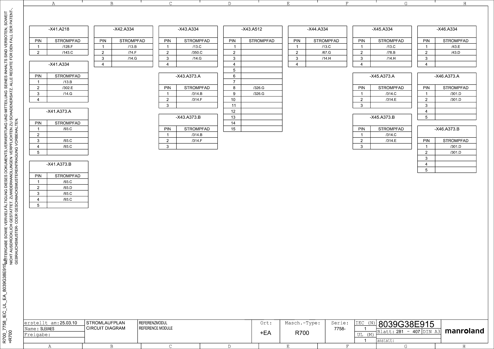

# +EA — Sheet 281 of 407 — REFERENZMODUL

**REFERENCE MODULE**

> Part of the manroland **R700** printing press IEC/UL circuit diagrams.
> Drawing class: **Stromlaufplan / Circuit diagram** (DIN A3).
> Document `+EA` covers the **Printing unit** machine section.

## At a glance

| Field | Value |
|---|---|
| Document | `+EA`  (8039G38E915) |
| Sheet | **281** of 407 |
| Section (DE) | REFERENZMODUL |
| Section (EN) | REFERENCE MODULE |
| Section type | REFERENCE_MODULE — Reference module |
| Machine type | `R700` |
| Series | `7758` |
| Created | 25.03.10 |
| Replaces | — |
| Columns used | A, B, C, D, E, F, G, H |
| Path numbers | — |
| Labels on sheet | 161 |
| Cross-refs out | 40 |
| Cross-refs in | 0 |

**Previous:** [+EA sheet 280](SHEET_0280.md) · **Next:** [+EA sheet 282](SHEET_0282.md) · **Document TOC:** [_TOC.md](_TOC.md)  (+EA) · **Master TOC:** [all sheets](../_MASTER_TOC.md)

## Sheet image (300 DPI, exact vector render)



_Rendered directly from the PDF vector layer at 300 DPI (1-bit), no OCR and no resampling. Use it to confirm anything ambiguous in the text below._

## Cross-references on this sheet

Each entry is a wire leaving this sheet. The printed token is `/sheet.column`; the link resolves to that sheet inside the same document.

| Ref | Target sheet | Col | Path | Destination on target | Target section | From col |
|---|---|---|---|---|---|---|
| `/13.B` | [+EA sheet 13](SHEET_0013.md) | B | — | — | SPANNUNGSVERSORGUNG: 400V, 24V | B |
| `/43.E` | [+EA sheet 43](SHEET_0043.md) | E | — | — | BUSVERBINDUNGEN: SIGNALSCHLEIFE | H |
| `/128.F` | [+EA sheet 128](SHEET_0128.md) | F | — | — | ZUGANGSABSICHERUNG | A |
| `/13.C` | [+EA sheet 13](SHEET_0013.md) | C | — | — | SPANNUNGSVERSORGUNG: 400V, 24V | C |
| `/13.C` | [+EA sheet 13](SHEET_0013.md) | C | — | — | SPANNUNGSVERSORGUNG: 400V, 24V | F |
| `/13.C` | [+EA sheet 13](SHEET_0013.md) | C | — | — | SPANNUNGSVERSORGUNG: 400V, 24V | G |
| `/78.B` | [+EA sheet 78](SHEET_0078.md) | B | — | — | AUSLEGERSTAPELSTEUERUNG | G |
| `/74.F` | [+EA sheet 74](SHEET_0074.md) | F | — | — | AUSLEGERSTAPELSTEUERUNG | B |
| `/67.G` | [+EA sheet 67](SHEET_0067.md) | G | — | — | LEITSTANDSFUNKTIONEN | F |
| `/43.D` | [+EA sheet 43](SHEET_0043.md) | D | — | — | BUSVERBINDUNGEN: SIGNALSCHLEIFE | H |
| `/143.C` | [+EA sheet 143](SHEET_0143.md) | C | — | — | ZUGANGSABSICHERUNG | A |
| `/350.C` | [+EA sheet 350](SHEET_0350.md) | C | — | — | OPTION: VORBEREITUNG: PUDERABSAUGUNG | C |
| `/14.G` | [+EA sheet 14](SHEET_0014.md) | G | — | — | SPANNUNGSVERSORGUNG: 400V, 24V | B |
| `/14.G` | [+EA sheet 14](SHEET_0014.md) | G | — | — | SPANNUNGSVERSORGUNG: 400V, 24V | C |
| `/14.H` | [+EA sheet 14](SHEET_0014.md) | H | — | — | SPANNUNGSVERSORGUNG: 400V, 24V | F |
| `/14.H` | [+EA sheet 14](SHEET_0014.md) | H | — | — | SPANNUNGSVERSORGUNG: 400V, 24V | G |
| `/13.B` | [+EA sheet 13](SHEET_0013.md) | B | — | — | SPANNUNGSVERSORGUNG: 400V, 24V | A |
| `/302.E` | [+EA sheet 302](SHEET_0302.md) | E | — | — | OPTION: ZWISCHENSTAPEL / | A |
| `/326.G` | [+EA sheet 326](SHEET_0326.md) | G | — | — | OPTION: BOGENWEICHE | E |
| `/314.B` | [+EA sheet 314](SHEET_0314.md) | B | — | — | OPTION: LOGISTIK, AUSLEGER | C |
| `/14.G` | [+EA sheet 14](SHEET_0014.md) | G | — | — | SPANNUNGSVERSORGUNG: 400V, 24V | A |
| `/326.G` | [+EA sheet 326](SHEET_0326.md) | G | — | — | OPTION: BOGENWEICHE | E |
| `/314.C` | [+EA sheet 314](SHEET_0314.md) | C | — | — | OPTION: LOGISTIK, AUSLEGER | G |
| `/301.D` | [+EA sheet 301](SHEET_0301.md) | D | — | — | OPTION: ZWISCHENSTAPEL / | H |
| `/314.E` | [+EA sheet 314](SHEET_0314.md) | E | — | — | OPTION: LOGISTIK, AUSLEGER | G |
| `/314.F` | [+EA sheet 314](SHEET_0314.md) | F | — | — | OPTION: LOGISTIK, AUSLEGER | C |
| `/301.D` | [+EA sheet 301](SHEET_0301.md) | D | — | — | OPTION: ZWISCHENSTAPEL / | H |
| `/93.C` | [+EA sheet 93](SHEET_0093.md) | C | — | X46.A373.B | BLASRAHMEN | E |
| `/314.B` | [+EA sheet 314](SHEET_0314.md) | B | — | — | OPTION: LOGISTIK, AUSLEGER | C |
| `/314.C` | [+EA sheet 314](SHEET_0314.md) | C | — | — | OPTION: LOGISTIK, AUSLEGER | G |
| `/314.E` | [+EA sheet 314](SHEET_0314.md) | E | — | — | OPTION: LOGISTIK, AUSLEGER | G |
| `/314.F` | [+EA sheet 314](SHEET_0314.md) | F | — | — | OPTION: LOGISTIK, AUSLEGER | C |
| `/93.C` | [+EA sheet 93](SHEET_0093.md) | C | — | — | BLASRAHMEN | A |
| `/93.C` | [+EA sheet 93](SHEET_0093.md) | C | — | — | BLASRAHMEN | A |
| `/301.D` | [+EA sheet 301](SHEET_0301.md) | D | — | — | OPTION: ZWISCHENSTAPEL / | H |
| `/301.D` | [+EA sheet 301](SHEET_0301.md) | D | — | — | OPTION: ZWISCHENSTAPEL / | H |
| `/93.C` | [+EA sheet 93](SHEET_0093.md) | C | — | — | BLASRAHMEN | A |
| `/93.D` | [+EA sheet 93](SHEET_0093.md) | D | — | — | BLASRAHMEN | A |
| `/93.C` | [+EA sheet 93](SHEET_0093.md) | C | — | — | BLASRAHMEN | A |
| `/93.C` | [+EA sheet 93](SHEET_0093.md) | C | — | — | BLASRAHMEN | A |

## Devices on this sheet

| Tag | Class | Class meaning (IEC) | Col | Sub | Terminal | Sign |
|---|---|---|---|---|---|---|
| `X41.A218` | — | cross-device reference | A | — | — | — |
| `X41.A334` | — | cross-device reference | A | — | — | — |
| `X42.A334` | — | cross-device reference | B | — | — | — |
| `X43.A334` | — | cross-device reference | C | — | — | — |
| `X43.A373.A` | — | cross-device reference | C | — | — | — |
| `X43.A373.B` | — | cross-device reference | C | — | — | — |
| `X43.A512` | — | cross-device reference | D | — | — | — |
| `X44.A334` | — | cross-device reference | F | — | — | — |
| `X45.A334` | — | cross-device reference | G | — | — | — |
| `X45.A373.A` | — | cross-device reference | G | — | — | — |
| `X45.A373.B` | — | cross-device reference | G | — | — | — |
| `X46.A334` | — | cross-device reference | H | — | — | — |
| `X46.A373.A` | — | cross-device reference | H | — | — | — |
| `X46.A373.B` | — | cross-device reference | H | — | — | — |
| `X41.A373.A` | — | cross-device reference | A | — | — | — |
| `X41.A373.B` | — | cross-device reference | A | — | — | — |

## Potentials / nets

_No named potentials on this sheet._

## Wire-end annotations (grouped as printed)

A wire that continues elsewhere is annotated with a small cluster: the destination description, the path/line number `#NN`, and the `/sheet.column` cross reference. Each row below is one such cluster exactly as it is grouped on the drawing.

| Col | Y | Path | Cross-ref | Text on the wire |
|---|---|---|---|---|
| A | 65.5 | — | — | `X41.A218` |
| B | 65.5 | — | — | `X42.A334` |
| C | 65.5 | — | — | `X43.A334` |
| D | 65.5 | — | — | `X43.A512` |
| F | 65.5 | — | — | `X44.A334` |
| G | 65.5 | — | — | `X45.A334` |
| H | 65.5 | — | — | `X46.A334` |
| A | 94.2 | — | — | `PIN 2 1 STROMPFAD` |
| B | 94.2 | — | — | `PIN 2 3 4 1 STROMPFAD` |
| C | 94.2 | — | — | `PIN 2 3 4 1 STROMPFAD` |
| D | 94.2 | — | — | `PIN 10 12 13 14 15 11 2 3 4 5 6 7 8 9 1 STROMPFAD` |
| E | 94.2 | — | — | `PIN 2 3 4 1 STROMPFAD` |
| G | 94.2 | — | — | `PIN 2 3 4 1 STROMPFAD` |
| H | 94.2 | — | — | `PIN 2 3 4 1 STROMPFAD` |
| A | 108.7 | — | `/128.F` | — |
| B | 108.7 | — | `/13.B` | — |
| C | 108.7 | — | `/13.C` | — |
| F | 108.7 | — | `/13.C` | — |
| G | 108.7 | — | `/13.C` | — |
| H | 108.7 | — | `/43.E` | — |
| G | 122.8 | — | `/78.B` | — |
| A | 122.9 | — | `/143.C` | — |
| B | 122.9 | — | `/74.F` | — |
| C | 122.9 | — | `/350.C` | — |
| F | 122.9 | — | `/67.G` | — |
| H | 122.9 | — | `/43.D` | — |
| B | 137.0 | — | `/14.G` | — |
| C | 137.0 | — | `/14.G` | — |
| F | 137.1 | — | `/14.H` | — |
| G | 137.1 | — | `/14.H` | — |
| A | 150.5 | — | — | `X41.A334` |
| C | 178.9 | — | — | `X43.A373.A` |
| G | 178.9 | — | — | `X45.A373.A` |
| H | 178.9 | — | — | `X46.A373.A` |
| A | 179.2 | — | — | `PIN 2 3 4 1 STROMPFAD` |
| A | 193.7 | — | `/13.B` | — |
| C | 207.5 | — | — | `PIN 2 3 1 STROMPFAD` |
| G | 207.5 | — | — | `PIN 2 3 1 STROMPFAD` |
| H | 207.5 | — | — | `PIN 2 3 4 5 1 STROMPFAD` |
| A | 207.9 | — | `/302.E` | — |
| E | 207.9 | — | `/326.G` | — |
| A | 222.1 | — | `/14.G` | — |
| C | 222.1 | — | `/314.B` | — |
| E | 222.1 | — | `/326.G` | — |
| G | 222.1 | — | `/314.C` | — |
| H | 222.1 | — | `/301.D` | — |
| G | 236.2 | — | `/314.E` | — |
| C | 236.3 | — | `/314.F` | — |
| H | 236.3 | — | `/301.D` | — |
| A | 263.9 | — | — | `X41.A373.A` |
| C | 278.1 | — | — | `X43.A373.B` |
| G | 278.1 | — | — | `X45.A373.B` |
| A | 292.6 | — | — | `PIN 2 3 4 5 1 STROMPFAD` |
| E | 306.4 | — | `/93.C` | `X46.A373.B` |
| C | 306.8 | — | — | `PIN 2 3 1 STROMPFAD` |
| G | 306.8 | — | — | `PIN 2 3 1 STROMPFAD` |
| C | 321.3 | — | `/314.B` | — |
| G | 321.3 | — | `/314.C` | — |
| H | 335.1 | — | — | `PIN 2 3 4 5 1 STROMPFAD` |
| A | 335.5 | — | `/93.C` | — |
| C | 335.5 | — | `/314.F` | — |
| G | 335.5 | — | `/314.E` | — |
| A | 349.6 | — | `/93.C` | — |
| H | 349.7 | — | `/301.D` | — |
| H | 363.8 | — | `/301.D` | — |
| A | 391.5 | — | — | `X41.A373.B` |
| A | 420.1 | — | — | `PIN 2 3 4 5 1 STROMPFAD` |
| A | 434.7 | — | `/93.C` | — |
| A | 448.9 | — | `/93.D` | — |
| A | 463.0 | — | `/93.C` | — |
| A | 477.2 | — | `/93.C` | — |


## Reconstructed tables

This sheet carries tabular content (pin map / terminal assignment / index). The grid below was rebuilt from the drawing's own rule lines, so each row is exactly one physical row of the table.

### Table 1 — 22 data rows × 2 columns (at x=70.9, y=62.4) — **X41.A218**

| PIN | STROMPFAD |
|---|---|
| `1` | `/128.F` |
| `2` | `/143.C` |
|  | `X41.A334` |
| `PIN` | `STROMPFAD` |
| `1` | `/13.B` |
| `2` | `/302.E` |
| `3` | `/14.G` |
| `4` |  |
|  | `X41.A373.A` |
| `PIN` | `STROMPFAD` |
| `1` | `/93.C` |
| `2` |  |
| `3` | `/93.C` |
| `4` | `/93.C` |
| `5` |  |
|  | `X41.A373.B` |
| `PIN` | `STROMPFAD` |
| `1` | `/93.C` |
| `2` | `/93.D` |
| `3` | `/93.C` |
| `4` | `/93.C` |
| `5` |  |


### Table 2 — 4 data rows × 2 columns (at x=226.8, y=62.4) — **X42.A334**

| PIN | STROMPFAD |
|---|---|
| `1` | `/13.B` |
| `2` | `/74.F` |
| `3` | `/14.G` |
| `4` |  |


### Table 3 — 14 data rows × 2 columns (at x=382.7, y=62.4) — **X43.A334**

| PIN | STROMPFAD |
|---|---|
| `1` | `/13.C` |
| `2` | `/350.C` |
| `3` | `/14.G` |
| `4` |  |
|  | `X43.A373.A` |
| `PIN` | `STROMPFAD` |
| `1` | `/314.B` |
| `2` | `/314.F` |
| `3` |  |
|  | `X43.A373.B` |
| `PIN` | `STROMPFAD` |
| `1` | `/314.B` |
| `2` | `/314.F` |
| `3` |  |


### Table 4 — 15 data rows × 2 columns (at x=538.6, y=62.4) — **X43.A512**

| PIN | STROMPFAD |
|---|---|
| `1` |  |
| `2` |  |
| `3` |  |
| `4` |  |
| `5` |  |
| `6` |  |
| `7` |  |
| `8` | `/326.G` |
| `9` | `/326.G` |
| `10` |  |
| `11` |  |
| `12` |  |
| `13` |  |
| `14` |  |
| `15` |  |


### Table 5 — 4 data rows × 2 columns (at x=694.5, y=62.4) — **X44.A334**

| PIN | STROMPFAD |
|---|---|
| `1` | `/13.C` |
| `2` | `/67.G` |
| `3` | `/14.H` |
| `4` |  |


### Table 6 — 14 data rows × 2 columns (at x=850.4, y=62.4) — **X45.A334**

| PIN | STROMPFAD |
|---|---|
| `1` | `/13.C` |
| `2` | `/78.B` |
| `3` | `/14.H` |
| `4` |  |
|  | `X45.A373.A` |
| `PIN` | `STROMPFAD` |
| `1` | `/314.C` |
| `2` | `/314.E` |
| `3` |  |
|  | `X45.A373.B` |
| `PIN` | `STROMPFAD` |
| `1` | `/314.C` |
| `2` | `/314.E` |
| `3` |  |


### Table 7 — 18 data rows × 2 columns (at x=1006.3, y=62.4) — **X46.A334**

| PIN | STROMPFAD |
|---|---|
| `1` | `/43.E` |
| `2` | `/43.D` |
| `3` |  |
| `4` |  |
|  | `X46.A373.A` |
| `PIN` | `STROMPFAD` |
| `1` | `/301.D` |
| `2` | `/301.D` |
| `3` |  |
| `4` |  |
| `5` |  |
|  | `X46.A373.B` |
| `PIN` | `STROMPFAD` |
| `1` | `/301.D` |
| `2` | `/301.D` |
| `3` |  |
| `4` |  |
| `5` |  |


## Notes and free text on this sheet

| Text | Col | Y (pt) |
|---|---|---|
| `PIN` | A | 94.2 |
| `STROMPFAD` | A | 94.15 |
| `PIN` | B | 94.2 |
| `STROMPFAD` | B | 94.15 |
| `PIN` | C | 94.2 |
| `STROMPFAD` | C | 94.15 |
| `PIN` | D | 94.2 |
| `STROMPFAD` | E | 94.15 |
| `PIN` | E | 94.2 |
| `STROMPFAD` | F | 94.15 |
| `PIN` | F | 94.2 |
| `STROMPFAD` | G | 94.15 |
| `PIN` | G | 94.2 |
| `STROMPFAD` | H | 94.15 |

## Complete label inventory (exact text from the drawing)

Every text object inside the drawing area of this sheet, in DIN reading order (column A→H, then top→bottom). This is the authoritative list: if a string is not here it is not printed on this sheet.

| Col | Y | X | Dir | Type | Text |
|---|---|---|---|---|---|
| A | 65.5 | 116.8 | → | device ref | `X41.A218` |
| A | 94.2 | 84.0 | → | text | `PIN` |
| A | 94.2 | 132.2 | → | text | `STROMPFAD` |
| A | 108.4 | 90.0 | → | number | `1` |
| A | 108.7 | 150.7 | → | cross-reference | `/128.F` |
| A | 122.5 | 89.4 | → | number | `2` |
| A | 122.9 | 150.2 | → | cross-reference | `/143.C` |
| A | 150.5 | 116.8 | → | device ref | `X41.A334` |
| A | 179.2 | 84.0 | → | text | `PIN` |
| A | 179.2 | 132.2 | → | text | `STROMPFAD` |
| A | 193.4 | 90.0 | → | number | `1` |
| A | 193.7 | 152.8 | → | cross-reference | `/13.B` |
| A | 207.6 | 89.4 | → | number | `2` |
| A | 207.9 | 150.5 | → | cross-reference | `/302.E` |
| A | 221.8 | 89.4 | → | number | `3` |
| A | 222.1 | 152.5 | → | cross-reference | `/14.G` |
| A | 235.9 | 89.4 | → | number | `4` |
| A | 263.9 | 111.4 | → | device ref | `X41.A373.A` |
| A | 292.6 | 84.0 | → | text | `PIN` |
| A | 292.6 | 132.2 | → | text | `STROMPFAD` |
| A | 306.8 | 90.0 | → | number | `1` |
| A | 307.1 | 152.6 | → | cross-reference | `/93.C` |
| A | 321.0 | 89.4 | → | number | `2` |
| A | 335.1 | 89.4 | → | number | `3` |
| A | 335.5 | 152.6 | → | cross-reference | `/93.C` |
| A | 349.3 | 89.4 | → | number | `4` |
| A | 349.7 | 152.6 | → | cross-reference | `/93.C` |
| A | 363.5 | 89.4 | → | number | `5` |
| A | 391.5 | 111.8 | → | device ref | `X41.A373.B` |
| A | 420.1 | 132.2 | → | text | `STROMPFAD` |
| A | 420.2 | 84.0 | → | text | `PIN` |
| A | 434.4 | 90.0 | → | number | `1` |
| A | 434.7 | 152.6 | → | cross-reference | `/93.C` |
| A | 448.5 | 89.4 | → | number | `2` |
| A | 448.9 | 152.6 | → | cross-reference | `/93.D` |
| A | 462.7 | 89.4 | → | number | `3` |
| A | 463.0 | 152.6 | → | cross-reference | `/93.C` |
| A | 476.9 | 89.4 | → | number | `4` |
| A | 477.2 | 152.6 | → | cross-reference | `/93.C` |
| A | 491.0 | 89.4 | → | number | `5` |
| B | 65.5 | 272.7 | → | device ref | `X42.A334` |
| B | 94.2 | 240.0 | → | text | `PIN` |
| B | 94.2 | 288.1 | → | text | `STROMPFAD` |
| B | 108.4 | 245.9 | → | number | `1` |
| B | 108.7 | 308.7 | → | cross-reference | `/13.B` |
| B | 122.5 | 245.3 | → | number | `2` |
| B | 122.9 | 309.0 | → | cross-reference | `/74.F` |
| B | 136.7 | 245.3 | → | number | `3` |
| B | 137.0 | 308.4 | → | cross-reference | `/14.G` |
| B | 150.9 | 245.3 | → | number | `4` |
| C | 65.5 | 428.6 | → | device ref | `X43.A334` |
| C | 94.2 | 395.9 | → | text | `PIN` |
| C | 94.2 | 444.0 | → | text | `STROMPFAD` |
| C | 108.4 | 401.8 | → | number | `1` |
| C | 108.7 | 464.5 | → | cross-reference | `/13.C` |
| C | 122.5 | 401.2 | → | number | `2` |
| C | 122.9 | 462.0 | → | cross-reference | `/350.C` |
| C | 136.7 | 401.2 | → | number | `3` |
| C | 137.0 | 464.3 | → | cross-reference | `/14.G` |
| C | 150.9 | 401.2 | → | number | `4` |
| C | 178.9 | 423.2 | → | device ref | `X43.A373.A` |
| C | 207.5 | 444.0 | → | text | `STROMPFAD` |
| C | 207.6 | 395.9 | → | text | `PIN` |
| C | 221.8 | 401.8 | → | number | `1` |
| C | 222.1 | 462.2 | → | cross-reference | `/314.B` |
| C | 235.9 | 401.2 | → | number | `2` |
| C | 236.3 | 462.5 | → | cross-reference | `/314.F` |
| C | 250.1 | 401.2 | → | number | `3` |
| C | 278.1 | 423.6 | → | device ref | `X43.A373.B` |
| C | 306.8 | 395.9 | → | text | `PIN` |
| C | 306.8 | 444.0 | → | text | `STROMPFAD` |
| C | 321.0 | 401.8 | → | number | `1` |
| C | 321.3 | 462.2 | → | cross-reference | `/314.B` |
| C | 335.1 | 401.2 | → | number | `2` |
| C | 335.5 | 462.5 | → | cross-reference | `/314.F` |
| C | 349.3 | 401.2 | → | number | `3` |
| D | 65.5 | 581.7 | → | device ref | `X43.A512` |
| D | 94.2 | 551.8 | → | text | `PIN` |
| D | 108.4 | 563.5 | → | number | `1` |
| D | 122.5 | 561.8 | → | number | `2` |
| D | 136.7 | 561.8 | → | number | `3` |
| D | 150.9 | 561.8 | → | number | `4` |
| D | 165.1 | 561.8 | → | number | `5` |
| D | 179.2 | 561.8 | → | number | `6` |
| D | 193.4 | 561.8 | → | number | `7` |
| D | 207.6 | 561.8 | → | number | `8` |
| D | 221.8 | 561.8 | → | number | `9` |
| D | 235.9 | 556.4 | → | number | `10` |
| D | 250.1 | 558.1 | → | number | `11` |
| D | 264.3 | 556.4 | → | number | `12` |
| D | 278.5 | 556.4 | → | number | `13` |
| D | 292.6 | 556.4 | → | number | `14` |
| D | 306.8 | 556.4 | → | number | `15` |
| E | 94.2 | 600.0 | → | text | `STROMPFAD` |
| E | 94.2 | 707.7 | → | text | `PIN` |
| E | 108.4 | 713.6 | → | number | `1` |
| E | 122.5 | 713.1 | → | number | `2` |
| E | 136.7 | 713.1 | → | number | `3` |
| E | 150.9 | 713.1 | → | number | `4` |
| E | 207.9 | 610.7 | → | cross-reference | `/326.G` |
| E | 222.1 | 610.7 | → | cross-reference | `/326.G` |
| F | 65.5 | 740.4 | → | device ref | `X44.A334` |
| F | 94.2 | 755.9 | → | text | `STROMPFAD` |
| F | 94.2 | 863.6 | → | text | `PIN` |
| F | 108.4 | 869.5 | → | number | `1` |
| F | 108.7 | 776.3 | → | cross-reference | `/13.C` |
| F | 122.5 | 869.0 | → | number | `2` |
| F | 122.9 | 776.1 | → | cross-reference | `/67.G` |
| F | 136.7 | 869.0 | → | number | `3` |
| F | 137.1 | 776.6 | → | cross-reference | `/14.H` |
| F | 150.9 | 869.0 | → | number | `4` |
| F | 207.6 | 863.6 | → | text | `PIN` |
| F | 221.8 | 869.5 | → | number | `1` |
| F | 235.9 | 869.0 | → | number | `2` |
| F | 250.1 | 869.0 | → | number | `3` |
| F | 306.8 | 863.6 | → | text | `PIN` |
| F | 321.0 | 869.5 | → | number | `1` |
| F | 335.1 | 869.0 | → | number | `2` |
| F | 349.3 | 869.0 | → | number | `3` |
| G | 65.5 | 896.3 | → | device ref | `X45.A334` |
| G | 94.2 | 911.8 | → | text | `STROMPFAD` |
| G | 94.2 | 1019.5 | → | text | `PIN` |
| G | 108.4 | 1025.4 | → | number | `1` |
| G | 108.7 | 932.2 | → | cross-reference | `/13.C` |
| G | 122.5 | 1024.9 | → | number | `2` |
| G | 122.8 | 932.3 | → | cross-reference | `/78.B` |
| G | 136.7 | 1024.9 | → | number | `3` |
| G | 137.1 | 932.5 | → | cross-reference | `/14.H` |
| G | 150.9 | 1024.9 | → | number | `4` |
| G | 178.9 | 890.9 | → | device ref | `X45.A373.A` |
| G | 207.5 | 911.8 | → | text | `STROMPFAD` |
| G | 207.6 | 1019.5 | → | text | `PIN` |
| G | 221.8 | 1025.4 | → | number | `1` |
| G | 222.1 | 929.8 | → | cross-reference | `/314.C` |
| G | 235.9 | 1024.9 | → | number | `2` |
| G | 236.2 | 930.0 | → | cross-reference | `/314.E` |
| G | 250.1 | 1024.9 | → | number | `3` |
| G | 264.3 | 1024.9 | → | number | `4` |
| G | 278.1 | 891.4 | → | device ref | `X45.A373.B` |
| G | 278.5 | 1024.9 | → | number | `5` |
| G | 306.8 | 911.8 | → | text | `STROMPFAD` |
| G | 321.3 | 929.8 | → | cross-reference | `/314.C` |
| G | 335.1 | 1019.5 | → | text | `PIN` |
| G | 335.5 | 930.0 | → | cross-reference | `/314.E` |
| G | 349.3 | 1025.4 | → | number | `1` |
| G | 363.5 | 1024.9 | → | number | `2` |
| G | 377.7 | 1024.9 | → | number | `3` |
| G | 391.8 | 1024.9 | → | number | `4` |
| G | 406.0 | 1024.9 | → | number | `5` |
| H | 65.5 | 1052.2 | → | device ref | `X46.A334` |
| H | 94.2 | 1067.7 | → | text | `STROMPFAD` |
| H | 108.7 | 1088.4 | → | cross-reference | `/43.E` |
| H | 122.9 | 1088.1 | → | cross-reference | `/43.D` |
| H | 178.9 | 1046.8 | → | device ref | `X46.A373.A` |
| H | 207.5 | 1067.7 | → | text | `STROMPFAD` |
| H | 222.1 | 1085.7 | → | cross-reference | `/301.D` |
| H | 236.3 | 1085.7 | → | cross-reference | `/301.D` |
| H | 306.5 | 1047.3 | → | device ref | `X46.A373.B` |
| H | 335.1 | 1067.7 | → | text | `STROMPFAD` |
| H | 349.7 | 1085.7 | → | cross-reference | `/301.D` |
| H | 363.8 | 1085.7 | → | cross-reference | `/301.D` |

## Reading-order text block

The same content as a plain block, grouped by DIN column — convenient to paste or to match against a visual description.

```text
=== Column A ===
  65.5  116.8  devref       X41.A218
  94.2   84.0  text         PIN
  94.2  132.2  text         STROMPFAD
 108.4   90.0  numeric      1
 108.7  150.7  xref         /128.F
 122.5   89.4  numeric      2
 122.9  150.2  xref         /143.C
 150.5  116.8  devref       X41.A334
 179.2   84.0  text         PIN
 179.2  132.2  text         STROMPFAD
 193.4   90.0  numeric      1
 193.7  152.8  xref         /13.B
 207.6   89.4  numeric      2
 207.9  150.5  xref         /302.E
 221.8   89.4  numeric      3
 222.1  152.5  xref         /14.G
 235.9   89.4  numeric      4
 263.9  111.4  devref       X41.A373.A
 292.6   84.0  text         PIN
 292.6  132.2  text         STROMPFAD
 306.8   90.0  numeric      1
 307.1  152.6  xref         /93.C
 321.0   89.4  numeric      2
 335.1   89.4  numeric      3
 335.5  152.6  xref         /93.C
 349.3   89.4  numeric      4
 349.7  152.6  xref         /93.C
 363.5   89.4  numeric      5
 391.5  111.8  devref       X41.A373.B
 420.1  132.2  text         STROMPFAD
 420.2   84.0  text         PIN
 434.4   90.0  numeric      1
 434.7  152.6  xref         /93.C
 448.5   89.4  numeric      2
 448.9  152.6  xref         /93.D
 462.7   89.4  numeric      3
 463.0  152.6  xref         /93.C
 476.9   89.4  numeric      4
 477.2  152.6  xref         /93.C
 491.0   89.4  numeric      5
=== Column B ===
  65.5  272.7  devref       X42.A334
  94.2  240.0  text         PIN
  94.2  288.1  text         STROMPFAD
 108.4  245.9  numeric      1
 108.7  308.7  xref         /13.B
 122.5  245.3  numeric      2
 122.9  309.0  xref         /74.F
 136.7  245.3  numeric      3
 137.0  308.4  xref         /14.G
 150.9  245.3  numeric      4
=== Column C ===
  65.5  428.6  devref       X43.A334
  94.2  395.9  text         PIN
  94.2  444.0  text         STROMPFAD
 108.4  401.8  numeric      1
 108.7  464.5  xref         /13.C
 122.5  401.2  numeric      2
 122.9  462.0  xref         /350.C
 136.7  401.2  numeric      3
 137.0  464.3  xref         /14.G
 150.9  401.2  numeric      4
 178.9  423.2  devref       X43.A373.A
 207.5  444.0  text         STROMPFAD
 207.6  395.9  text         PIN
 221.8  401.8  numeric      1
 222.1  462.2  xref         /314.B
 235.9  401.2  numeric      2
 236.3  462.5  xref         /314.F
 250.1  401.2  numeric      3
 278.1  423.6  devref       X43.A373.B
 306.8  395.9  text         PIN
 306.8  444.0  text         STROMPFAD
 321.0  401.8  numeric      1
 321.3  462.2  xref         /314.B
 335.1  401.2  numeric      2
 335.5  462.5  xref         /314.F
 349.3  401.2  numeric      3
=== Column D ===
  65.5  581.7  devref       X43.A512
  94.2  551.8  text         PIN
 108.4  563.5  numeric      1
 122.5  561.8  numeric      2
 136.7  561.8  numeric      3
 150.9  561.8  numeric      4
 165.1  561.8  numeric      5
 179.2  561.8  numeric      6
 193.4  561.8  numeric      7
 207.6  561.8  numeric      8
 221.8  561.8  numeric      9
 235.9  556.4  numeric      10
 250.1  558.1  numeric      11
 264.3  556.4  numeric      12
 278.5  556.4  numeric      13
 292.6  556.4  numeric      14
 306.8  556.4  numeric      15
=== Column E ===
  94.2  600.0  text         STROMPFAD
  94.2  707.7  text         PIN
 108.4  713.6  numeric      1
 122.5  713.1  numeric      2
 136.7  713.1  numeric      3
 150.9  713.1  numeric      4
 207.9  610.7  xref         /326.G
 222.1  610.7  xref         /326.G
=== Column F ===
  65.5  740.4  devref       X44.A334
  94.2  755.9  text         STROMPFAD
  94.2  863.6  text         PIN
 108.4  869.5  numeric      1
 108.7  776.3  xref         /13.C
 122.5  869.0  numeric      2
 122.9  776.1  xref         /67.G
 136.7  869.0  numeric      3
 137.1  776.6  xref         /14.H
 150.9  869.0  numeric      4
 207.6  863.6  text         PIN
 221.8  869.5  numeric      1
 235.9  869.0  numeric      2
 250.1  869.0  numeric      3
 306.8  863.6  text         PIN
 321.0  869.5  numeric      1
 335.1  869.0  numeric      2
 349.3  869.0  numeric      3
=== Column G ===
  65.5  896.3  devref       X45.A334
  94.2  911.8  text         STROMPFAD
  94.2 1019.5  text         PIN
 108.4 1025.4  numeric      1
 108.7  932.2  xref         /13.C
 122.5 1024.9  numeric      2
 122.8  932.3  xref         /78.B
 136.7 1024.9  numeric      3
 137.1  932.5  xref         /14.H
 150.9 1024.9  numeric      4
 178.9  890.9  devref       X45.A373.A
 207.5  911.8  text         STROMPFAD
 207.6 1019.5  text         PIN
 221.8 1025.4  numeric      1
 222.1  929.8  xref         /314.C
 235.9 1024.9  numeric      2
 236.2  930.0  xref         /314.E
 250.1 1024.9  numeric      3
 264.3 1024.9  numeric      4
 278.1  891.4  devref       X45.A373.B
 278.5 1024.9  numeric      5
 306.8  911.8  text         STROMPFAD
 321.3  929.8  xref         /314.C
 335.1 1019.5  text         PIN
 335.5  930.0  xref         /314.E
 349.3 1025.4  numeric      1
 363.5 1024.9  numeric      2
 377.7 1024.9  numeric      3
 391.8 1024.9  numeric      4
 406.0 1024.9  numeric      5
=== Column H ===
  65.5 1052.2  devref       X46.A334
  94.2 1067.7  text         STROMPFAD
 108.7 1088.4  xref         /43.E
 122.9 1088.1  xref         /43.D
 178.9 1046.8  devref       X46.A373.A
 207.5 1067.7  text         STROMPFAD
 222.1 1085.7  xref         /301.D
 236.3 1085.7  xref         /301.D
 306.5 1047.3  devref       X46.A373.B
 335.1 1067.7  text         STROMPFAD
 349.7 1085.7  xref         /301.D
 363.8 1085.7  xref         /301.D
```

---
_Generated from the PDF vector text layer; no OCR. Source: `R700_7758_IEC_UL_EA_8039G38E915_p`, sheet 281._
