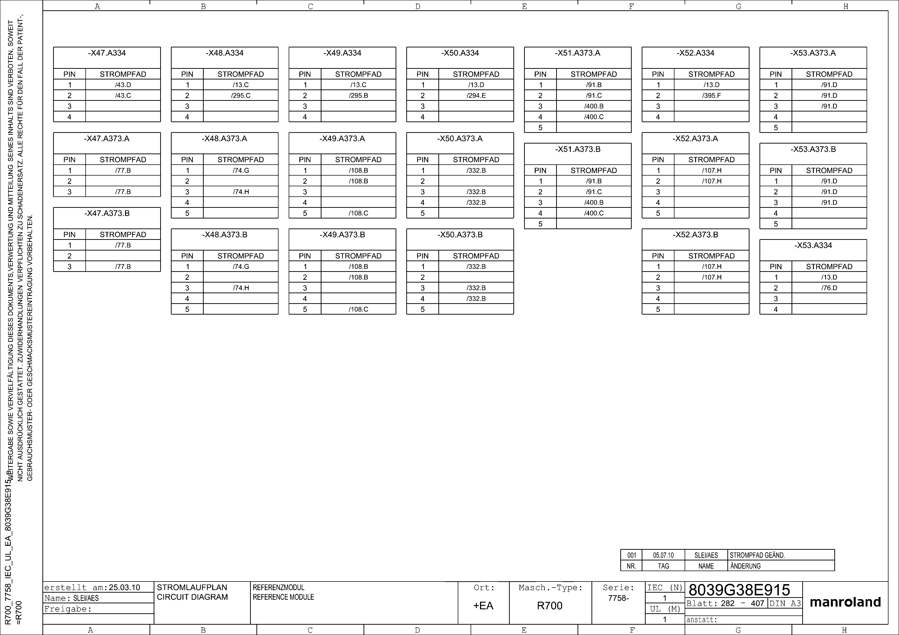

# +EA — Sheet 282 of 407 — REFERENZMODUL

**REFERENCE MODULE**

> Part of the manroland **R700** printing press IEC/UL circuit diagrams.
> Drawing class: **Stromlaufplan / Circuit diagram** (DIN A3).
> Document `+EA` covers the **Printing unit** machine section.

## At a glance

| Field | Value |
|---|---|
| Document | `+EA`  (8039G38E915) |
| Sheet | **282** of 407 |
| Section (DE) | REFERENZMODUL |
| Section (EN) | REFERENCE MODULE |
| Section type | REFERENCE_MODULE — Reference module |
| Machine type | `R700` |
| Series | `7758` |
| Created | 25.03.10 |
| Replaces | — |
| Columns used | A, B, C, D, E, F, G, H |
| Path numbers | — |
| Labels on sheet | 208 |
| Cross-refs out | 50 |
| Cross-refs in | 0 |

**Previous:** [+EA sheet 281](SHEET_0281.md) · **Next:** [+EA sheet 283](SHEET_0283.md) · **Document TOC:** [_TOC.md](_TOC.md)  (+EA) · **Master TOC:** [all sheets](../_MASTER_TOC.md)

## Sheet image (300 DPI, exact vector render)



_Rendered directly from the PDF vector layer at 300 DPI (1-bit), no OCR and no resampling. Use it to confirm anything ambiguous in the text below._

## Cross-references on this sheet

Each entry is a wire leaving this sheet. The printed token is `/sheet.column`; the link resolves to that sheet inside the same document.

| Ref | Target sheet | Col | Path | Destination on target | Target section | From col |
|---|---|---|---|---|---|---|
| `/91.B` | [+EA sheet 91](SHEET_0091.md) | B | — | — | BLASROHRE (BLASRAHMEN) | F |
| `/43.D` | [+EA sheet 43](SHEET_0043.md) | D | — | — | BUSVERBINDUNGEN: SIGNALSCHLEIFE | A |
| `/13.C` | [+EA sheet 13](SHEET_0013.md) | C | — | — | SPANNUNGSVERSORGUNG: 400V, 24V | B |
| `/13.C` | [+EA sheet 13](SHEET_0013.md) | C | — | — | SPANNUNGSVERSORGUNG: 400V, 24V | C |
| `/13.D` | [+EA sheet 13](SHEET_0013.md) | D | — | — | SPANNUNGSVERSORGUNG: 400V, 24V | E |
| `/13.D` | [+EA sheet 13](SHEET_0013.md) | D | — | — | SPANNUNGSVERSORGUNG: 400V, 24V | G |
| `/91.D` | [+EA sheet 91](SHEET_0091.md) | D | — | — | BLASROHRE (BLASRAHMEN) | H |
| `/295.B` | [+EA sheet 295](SHEET_0295.md) | B | — | — | OPTION: ZWISCHENSTAPEL / | C |
| `/294.E` | [+EA sheet 294](SHEET_0294.md) | E | — | — | OPTION: ZWISCHENSTAPEL / | E |
| `/395.F` | [+EA sheet 395](SHEET_0395.md) | F | — | — | OPTION: ZWISCHENTROCKNER VORBEREITUNG; | G |
| `/43.C` | [+EA sheet 43](SHEET_0043.md) | C | — | — | BUSVERBINDUNGEN: SIGNALSCHLEIFE | A |
| `/91.C` | [+EA sheet 91](SHEET_0091.md) | C | — | — | BLASROHRE (BLASRAHMEN) | F |
| `/91.D` | [+EA sheet 91](SHEET_0091.md) | D | — | — | BLASROHRE (BLASRAHMEN) | H |
| `/295.C` | [+EA sheet 295](SHEET_0295.md) | C | — | — | OPTION: ZWISCHENSTAPEL / | B |
| `/400.B` | [+EA sheet 400](SHEET_0400.md) | B | — | — | OPTION: DÜNNDRUCKEINRICHTUNG | F |
| `/91.D` | [+EA sheet 91](SHEET_0091.md) | D | — | — | BLASROHRE (BLASRAHMEN) | H |
| `/400.C` | [+EA sheet 400](SHEET_0400.md) | C | — | — | OPTION: DÜNNDRUCKEINRICHTUNG | F |
| `/77.B` | [+EA sheet 77](SHEET_0077.md) | B | — | — | AUSLEGERSTAPELSTEUERUNG | A |
| `/108.B` | [+EA sheet 108](SHEET_0108.md) | B | — | — | BLAS/SAUGLUFT MIT MOTORVENTILEINSTELLUNG | C |
| `/332.B` | [+EA sheet 332](SHEET_0332.md) | B | — | — | OPTION: BOGENWEICHE | E |
| `/74.G` | [+EA sheet 74](SHEET_0074.md) | G | — | — | AUSLEGERSTAPELSTEUERUNG | B |
| `/107.H` | [+EA sheet 107](SHEET_0107.md) | H | — | — | BOGENGLÄTTER | G |
| `/91.B` | [+EA sheet 91](SHEET_0091.md) | B | — | — | BLASROHRE (BLASRAHMEN) | F |
| `/108.B` | [+EA sheet 108](SHEET_0108.md) | B | — | — | BLAS/SAUGLUFT MIT MOTORVENTILEINSTELLUNG | C |
| `/107.H` | [+EA sheet 107](SHEET_0107.md) | H | — | — | BOGENGLÄTTER | G |
| `/91.D` | [+EA sheet 91](SHEET_0091.md) | D | — | — | BLASROHRE (BLASRAHMEN) | H |
| `/77.B` | [+EA sheet 77](SHEET_0077.md) | B | — | — | AUSLEGERSTAPELSTEUERUNG | A |
| `/332.B` | [+EA sheet 332](SHEET_0332.md) | B | — | — | OPTION: BOGENWEICHE | E |
| `/74.H` | [+EA sheet 74](SHEET_0074.md) | H | — | — | AUSLEGERSTAPELSTEUERUNG | B |
| `/91.C` | [+EA sheet 91](SHEET_0091.md) | C | — | — | BLASROHRE (BLASRAHMEN) | F |
| `/91.D` | [+EA sheet 91](SHEET_0091.md) | D | — | — | BLASROHRE (BLASRAHMEN) | H |
| `/332.B` | [+EA sheet 332](SHEET_0332.md) | B | — | — | OPTION: BOGENWEICHE | E |
| `/400.B` | [+EA sheet 400](SHEET_0400.md) | B | — | — | OPTION: DÜNNDRUCKEINRICHTUNG | F |
| `/91.D` | [+EA sheet 91](SHEET_0091.md) | D | — | — | BLASROHRE (BLASRAHMEN) | H |
| `/108.C` | [+EA sheet 108](SHEET_0108.md) | C | — | — | BLAS/SAUGLUFT MIT MOTORVENTILEINSTELLUNG | C |
| `/400.C` | [+EA sheet 400](SHEET_0400.md) | C | — | — | OPTION: DÜNNDRUCKEINRICHTUNG | F |
| `/77.B` | [+EA sheet 77](SHEET_0077.md) | B | — | — | AUSLEGERSTAPELSTEUERUNG | A |
| `/77.B` | [+EA sheet 77](SHEET_0077.md) | B | — | — | AUSLEGERSTAPELSTEUERUNG | A |
| `/108.B` | [+EA sheet 108](SHEET_0108.md) | B | — | — | BLAS/SAUGLUFT MIT MOTORVENTILEINSTELLUNG | C |
| `/332.B` | [+EA sheet 332](SHEET_0332.md) | B | — | — | OPTION: BOGENWEICHE | E |
| `/74.G` | [+EA sheet 74](SHEET_0074.md) | G | — | — | AUSLEGERSTAPELSTEUERUNG | B |
| `/107.H` | [+EA sheet 107](SHEET_0107.md) | H | — | — | BOGENGLÄTTER | G |
| `/108.B` | [+EA sheet 108](SHEET_0108.md) | B | — | — | BLAS/SAUGLUFT MIT MOTORVENTILEINSTELLUNG | C |
| `/107.H` | [+EA sheet 107](SHEET_0107.md) | H | — | — | BOGENGLÄTTER | G |
| `/13.D` | [+EA sheet 13](SHEET_0013.md) | D | — | — | SPANNUNGSVERSORGUNG: 400V, 24V | H |
| `/332.B` | [+EA sheet 332](SHEET_0332.md) | B | — | — | OPTION: BOGENWEICHE | E |
| `/74.H` | [+EA sheet 74](SHEET_0074.md) | H | — | — | AUSLEGERSTAPELSTEUERUNG | B |
| `/76.D` | [+EA sheet 76](SHEET_0076.md) | D | — | — | AUSLEGERSTAPELSTEUERUNG | H |
| `/332.B` | [+EA sheet 332](SHEET_0332.md) | B | — | — | OPTION: BOGENWEICHE | E |
| `/108.C` | [+EA sheet 108](SHEET_0108.md) | C | — | — | BLAS/SAUGLUFT MIT MOTORVENTILEINSTELLUNG | C |

## Devices on this sheet

| Tag | Class | Class meaning (IEC) | Col | Sub | Terminal | Sign |
|---|---|---|---|---|---|---|
| `X47.A334` | — | cross-device reference | A | — | — | — |
| `X47.A373.A` | — | cross-device reference | A | — | — | — |
| `X47.A373.B` | — | cross-device reference | A | — | — | — |
| `X50.A334` | — | cross-device reference | D | — | — | — |
| `X50.A373.A` | — | cross-device reference | D | — | — | — |
| `X50.A373.B` | — | cross-device reference | D | — | — | — |
| `X48.A373.A` | — | cross-device reference | B | — | — | — |
| `X48.A334` | — | cross-device reference | B | — | — | — |
| `X48.A373.B` | — | cross-device reference | B | — | — | — |
| `X49.A334` | — | cross-device reference | C | — | — | — |
| `X49.A373.A` | — | cross-device reference | C | — | — | — |
| `X49.A373.B` | — | cross-device reference | C | — | — | — |
| `X51.A373.A` | — | cross-device reference | E | — | — | — |
| `X51.A373.B` | — | cross-device reference | F | — | — | — |
| `X53.A334` | — | cross-device reference | H | — | — | — |
| `X53.A373.A` | — | cross-device reference | H | — | — | — |
| `X53.A373.B` | — | cross-device reference | H | — | — | — |
| `X52.A334` | — | cross-device reference | G | — | — | — |
| `X52.A373.A` | — | cross-device reference | G | — | — | — |
| `X52.A373.B` | — | cross-device reference | G | — | — | — |
| `NR.` | — | cross-device reference | F | — | — | — |
| `05.07.10` | — | cross-device reference | F | — | — | — |

## Potentials / nets

_No named potentials on this sheet._

## Wire-end annotations (grouped as printed)

A wire that continues elsewhere is annotated with a small cluster: the destination description, the path/line number `#NN`, and the `/sheet.column` cross reference. Each row below is one such cluster exactly as it is grouped on the drawing.

| Col | Y | Path | Cross-ref | Text on the wire |
|---|---|---|---|---|
| A | 65.5 | — | — | `X47.A334` |
| B | 65.5 | — | — | `X48.A334` |
| C | 65.5 | — | — | `X49.A334` |
| D | 65.5 | — | — | `X50.A334` |
| E | 65.5 | — | — | `X51.A373.A` |
| G | 65.5 | — | — | `X52.A334` |
| H | 65.5 | — | — | `X53.A373.A` |
| A | 94.2 | — | — | `PIN 2 3 4 1 STROMPFAD` |
| B | 94.2 | — | — | `PIN 2 3 4 1 STROMPFAD` |
| C | 94.2 | — | — | `PIN 2 3 4 1 STROMPFAD` |
| D | 94.2 | — | — | `PIN 2 3 4 1 STROMPFAD` |
| E | 94.2 | — | — | `PIN 2 3 4 5 1 STROMPFAD` |
| G | 94.2 | — | — | `PIN 2 3 4 1 STROMPFAD` |
| H | 94.2 | — | — | `PIN 2 3 4 5 1 STROMPFAD` |
| A | 108.7 | — | `/43.D` | — |
| B | 108.7 | — | `/13.C` | — |
| C | 108.7 | — | `/13.C` | — |
| E | 108.7 | — | `/13.D` | — |
| F | 108.7 | — | `/91.B` | — |
| G | 108.7 | — | `/13.D` | — |
| H | 108.7 | — | `/91.D` | — |
| A | 122.9 | — | `/43.C` | — |
| B | 122.9 | — | `/295.C` | — |
| C | 122.9 | — | `/295.B` | — |
| E | 122.9 | — | `/294.E` | — |
| F | 122.9 | — | `/91.C` | — |
| G | 122.9 | — | `/395.F` | — |
| H | 122.9 | — | `/91.D` | — |
| F | 137.0 | — | `/400.B` | — |
| H | 137.1 | — | `/91.D` | — |
| F | 151.2 | — | `/400.C` | — |
| A | 178.9 | — | — | `X47.A373.A` |
| B | 178.9 | — | — | `X48.A373.A` |
| C | 178.9 | — | — | `X49.A373.A` |
| D | 178.9 | — | — | `X50.A373.A` |
| G | 178.9 | — | — | `X52.A373.A` |
| F | 193.1 | — | — | `X51.A373.B` |
| H | 193.1 | — | — | `X53.A373.B` |
| A | 207.5 | — | — | `PIN 2 3 1 STROMPFAD` |
| B | 207.5 | — | — | `PIN 2 3 4 5 1 STROMPFAD` |
| C | 207.5 | — | — | `PIN 2 3 4 5 1 STROMPFAD` |
| D | 207.5 | — | — | `PIN 2 3 4 5 1 STROMPFAD` |
| G | 207.5 | — | — | `PIN 2 3 4 5 1 STROMPFAD` |
| E | 221.7 | — | — | `PIN 2 3 4 5 1 STROMPFAD` |
| H | 221.7 | — | — | `PIN 2 3 4 5 1 STROMPFAD` |
| A | 222.1 | — | `/77.B` | — |
| B | 222.1 | — | `/74.G` | — |
| C | 222.1 | — | `/108.B` | — |
| E | 222.1 | — | `/332.B` | — |
| G | 222.1 | — | `/107.H` | — |
| C | 236.2 | — | `/108.B` | — |
| F | 236.2 | — | `/91.B` | — |
| G | 236.3 | — | `/107.H` | — |
| H | 236.3 | — | `/91.D` | — |
| A | 250.4 | — | `/77.B` | — |
| B | 250.4 | — | `/74.H` | — |
| E | 250.4 | — | `/332.B` | — |
| F | 250.4 | — | `/91.C` | — |
| H | 250.4 | — | `/91.D` | — |
| E | 264.6 | — | `/332.B` | — |
| F | 264.6 | — | `/400.B` | — |
| H | 264.6 | — | `/91.D` | — |
| A | 278.1 | — | — | `X47.A373.B` |
| C | 278.8 | — | `/108.C` | — |
| F | 278.8 | — | `/400.C` | — |
| B | 306.4 | — | — | `X48.A373.B` |
| C | 306.4 | — | — | `X49.A373.B` |
| D | 306.4 | — | — | `X50.A373.B` |
| G | 306.4 | — | — | `X52.A373.B` |
| A | 306.8 | — | — | `PIN 2 3 1 STROMPFAD` |
| H | 320.6 | — | — | `X53.A334` |
| A | 321.3 | — | `/77.B` | — |
| B | 335.1 | — | — | `PIN 2 3 4 5 1 STROMPFAD` |
| C | 335.1 | — | — | `PIN 2 3 4 5 1 STROMPFAD` |
| D | 335.1 | — | — | `PIN 2 3 4 5 1 STROMPFAD` |
| G | 335.1 | — | — | `PIN 2 3 4 5 1 STROMPFAD` |
| H | 349.3 | — | — | `PIN 2 3 4 1 STROMPFAD` |
| A | 349.6 | — | `/77.B` | — |
| B | 349.6 | — | `/74.G` | — |
| C | 349.6 | — | `/108.B` | — |
| E | 349.6 | — | `/332.B` | — |
| G | 349.7 | — | `/107.H` | — |
| C | 363.8 | — | `/108.B` | — |
| G | 363.8 | — | `/107.H` | — |
| H | 363.8 | — | `/13.D` | — |
| B | 378.0 | — | `/74.H` | — |
| E | 378.0 | — | `/332.B` | — |
| H | 378.0 | — | `/76.D` | — |
| E | 392.1 | — | `/332.B` | — |
| C | 406.4 | — | `/108.C` | — |
| G | 733.0 | — | — | `001 05.07.10 SLEI/AES STROMPFAD GEÄND.` |
| G | 747.1 | — | — | `NR. TAG NAME ÄNDERUNG` |


## Reconstructed tables

This sheet carries tabular content (pin map / terminal assignment / index). The grid below was rebuilt from the drawing's own rule lines, so each row is exactly one physical row of the table.

### Table 1 — 14 data rows × 2 columns (at x=70.9, y=62.4) — **X47.A334**

| PIN | STROMPFAD |
|---|---|
| `1` | `/43.D` |
| `2` | `/43.C` |
| `3` |  |
| `4` |  |
|  | `X47.A373.A` |
| `PIN` | `STROMPFAD` |
| `1` | `/77.B` |
| `2` |  |
| `3` | `/77.B` |
|  | `X47.A373.B` |
| `PIN` | `STROMPFAD` |
| `1` | `/77.B` |
| `2` |  |
| `3` | `/77.B` |


### Table 2 — 18 data rows × 2 columns (at x=226.8, y=62.4) — **X48.A334**

| PIN | STROMPFAD |
|---|---|
| `1` | `/13.C` |
| `2` | `/295.C` |
| `3` |  |
| `4` |  |
|  | `X48.A373.A` |
| `PIN` | `STROMPFAD` |
| `1` | `/74.G` |
| `2` |  |
| `3` | `/74.H` |
| `4` |  |
| `5` |  |
|  | `X48.A373.B` |
| `PIN` | `STROMPFAD` |
| `1` | `/74.G` |
| `2` |  |
| `3` | `/74.H` |
| `4` |  |
| `5` |  |


### Table 3 — 18 data rows × 2 columns (at x=382.7, y=62.4) — **X49.A334**

| PIN | STROMPFAD |
|---|---|
| `1` | `/13.C` |
| `2` | `/295.B` |
| `3` |  |
| `4` |  |
|  | `X49.A373.A` |
| `PIN` | `STROMPFAD` |
| `1` | `/108.B` |
| `2` | `/108.B` |
| `3` |  |
| `4` |  |
| `5` | `/108.C` |
|  | `X49.A373.B` |
| `PIN` | `STROMPFAD` |
| `1` | `/108.B` |
| `2` | `/108.B` |
| `3` |  |
| `4` |  |
| `5` | `/108.C` |


### Table 4 — 18 data rows × 2 columns (at x=538.6, y=62.4) — **X50.A334**

| PIN | STROMPFAD |
|---|---|
| `1` | `/13.D` |
| `2` | `/294.E` |
| `3` |  |
| `4` |  |
|  | `X50.A373.A` |
| `PIN` | `STROMPFAD` |
| `1` | `/332.B` |
| `2` |  |
| `3` | `/332.B` |
| `4` | `/332.B` |
| `5` |  |
|  | `X50.A373.B` |
| `PIN` | `STROMPFAD` |
| `1` | `/332.B` |
| `2` |  |
| `3` | `/332.B` |
| `4` | `/332.B` |
| `5` |  |


### Table 5 — 12 data rows × 2 columns (at x=694.5, y=62.4) — **X51.A373.A**

| PIN | STROMPFAD |
|---|---|
| `1` | `/91.B` |
| `2` | `/91.C` |
| `3` | `/400.B` |
| `4` | `/400.C` |
| `5` |  |
|  | `X51.A373.B` |
| `PIN` | `STROMPFAD` |
| `1` | `/91.B` |
| `2` | `/91.C` |
| `3` | `/400.B` |
| `4` | `/400.C` |
| `5` |  |


### Table 6 — 18 data rows × 2 columns (at x=850.4, y=62.4) — **X52.A334**

| PIN | STROMPFAD |
|---|---|
| `1` | `/13.D` |
| `2` | `/395.F` |
| `3` |  |
| `4` |  |
|  | `X52.A373.A` |
| `PIN` | `STROMPFAD` |
| `1` | `/107.H` |
| `2` | `/107.H` |
| `3` |  |
| `4` |  |
| `5` |  |
|  | `X52.A373.B` |
| `PIN` | `STROMPFAD` |
| `1` | `/107.H` |
| `2` | `/107.H` |
| `3` |  |
| `4` |  |
| `5` |  |


### Table 7 — 18 data rows × 2 columns (at x=1006.3, y=62.4) — **X53.A373.A**

| PIN | STROMPFAD |
|---|---|
| `1` | `/91.D` |
| `2` | `/91.D` |
| `3` | `/91.D` |
| `4` |  |
| `5` |  |
|  | `X53.A373.B` |
| `PIN` | `STROMPFAD` |
| `1` | `/91.D` |
| `2` | `/91.D` |
| `3` | `/91.D` |
| `4` |  |
| `5` |  |
|  | `X53.A334` |
| `PIN` | `STROMPFAD` |
| `1` | `/13.D` |
| `2` | `/76.D` |
| `3` |  |
| `4` |  |


## Notes and free text on this sheet

| Text | Col | Y (pt) |
|---|---|---|
| `PIN` | A | 94.2 |
| `STROMPFAD` | A | 94.15 |
| `PIN` | D | 94.2 |
| `STROMPFAD` | E | 94.15 |
| `PIN` | B | 207.58 |
| `STROMPFAD` | B | 207.54 |
| `PIN` | C | 94.2 |
| `STROMPFAD` | C | 94.15 |
| `PIN` | E | 94.2 |
| `STROMPFAD` | F | 94.15 |
| `PIN` | G | 349.31 |
| `STROMPFAD` | H | 349.27 |
| `PIN` | F | 94.2 |
| `STROMPFAD` | G | 94.15 |
| `TAG` | F | 747.27 |
| `NAME` | G | 747.25 |
| `ÄNDERUNG` | G | 747.31 |
| `SLEI/AES` | G | 733.13 |
| `STROMPFAD GEÄND.` | G | 733.12 |

## Complete label inventory (exact text from the drawing)

Every text object inside the drawing area of this sheet, in DIN reading order (column A→H, then top→bottom). This is the authoritative list: if a string is not here it is not printed on this sheet.

| Col | Y | X | Dir | Type | Text |
|---|---|---|---|---|---|
| A | 65.5 | 116.8 | → | device ref | `X47.A334` |
| A | 94.2 | 84.0 | → | text | `PIN` |
| A | 94.2 | 132.2 | → | text | `STROMPFAD` |
| A | 108.4 | 90.0 | → | number | `1` |
| A | 108.7 | 152.6 | → | cross-reference | `/43.D` |
| A | 122.5 | 89.4 | → | number | `2` |
| A | 122.9 | 152.6 | → | cross-reference | `/43.C` |
| A | 136.7 | 89.4 | → | number | `3` |
| A | 150.9 | 89.4 | → | number | `4` |
| A | 178.9 | 111.4 | → | device ref | `X47.A373.A` |
| A | 207.5 | 132.2 | → | text | `STROMPFAD` |
| A | 207.6 | 84.0 | → | text | `PIN` |
| A | 221.8 | 90.0 | → | number | `1` |
| A | 222.1 | 152.8 | → | cross-reference | `/77.B` |
| A | 235.9 | 89.4 | → | number | `2` |
| A | 250.1 | 89.4 | → | number | `3` |
| A | 250.4 | 152.8 | → | cross-reference | `/77.B` |
| A | 278.1 | 111.8 | → | device ref | `X47.A373.B` |
| A | 306.8 | 84.0 | → | text | `PIN` |
| A | 306.8 | 132.2 | → | text | `STROMPFAD` |
| A | 321.0 | 90.0 | → | number | `1` |
| A | 321.3 | 152.8 | → | cross-reference | `/77.B` |
| A | 335.1 | 89.4 | → | number | `2` |
| A | 349.3 | 89.4 | → | number | `3` |
| A | 349.6 | 152.8 | → | cross-reference | `/77.B` |
| B | 65.5 | 272.7 | → | device ref | `X48.A334` |
| B | 94.2 | 240.0 | → | text | `PIN` |
| B | 94.2 | 288.1 | → | text | `STROMPFAD` |
| B | 108.4 | 245.9 | → | number | `1` |
| B | 108.7 | 308.6 | → | cross-reference | `/13.C` |
| B | 122.5 | 245.3 | → | number | `2` |
| B | 122.9 | 306.1 | → | cross-reference | `/295.C` |
| B | 136.7 | 245.3 | → | number | `3` |
| B | 150.9 | 245.3 | → | number | `4` |
| B | 178.9 | 267.3 | → | device ref | `X48.A373.A` |
| B | 207.5 | 288.1 | → | text | `STROMPFAD` |
| B | 207.6 | 240.0 | → | text | `PIN` |
| B | 221.8 | 245.9 | → | number | `1` |
| B | 222.1 | 308.4 | → | cross-reference | `/74.G` |
| B | 235.9 | 245.3 | → | number | `2` |
| B | 250.1 | 245.3 | → | number | `3` |
| B | 250.4 | 308.8 | → | cross-reference | `/74.H` |
| B | 264.3 | 245.3 | → | number | `4` |
| B | 278.5 | 245.3 | → | number | `5` |
| B | 306.5 | 267.7 | → | device ref | `X48.A373.B` |
| B | 335.1 | 240.0 | → | text | `PIN` |
| B | 335.1 | 288.1 | → | text | `STROMPFAD` |
| B | 349.3 | 245.9 | → | number | `1` |
| B | 349.6 | 308.4 | → | cross-reference | `/74.G` |
| B | 363.5 | 245.3 | → | number | `2` |
| B | 377.7 | 245.3 | → | number | `3` |
| B | 378.0 | 308.8 | → | cross-reference | `/74.H` |
| B | 391.8 | 245.3 | → | number | `4` |
| B | 406.0 | 245.3 | → | number | `5` |
| C | 65.5 | 428.6 | → | device ref | `X49.A334` |
| C | 94.2 | 395.9 | → | text | `PIN` |
| C | 94.2 | 444.0 | → | text | `STROMPFAD` |
| C | 108.4 | 401.8 | → | number | `1` |
| C | 108.7 | 464.5 | → | cross-reference | `/13.C` |
| C | 122.5 | 401.2 | → | number | `2` |
| C | 122.9 | 462.2 | → | cross-reference | `/295.B` |
| C | 136.7 | 401.2 | → | number | `3` |
| C | 150.9 | 401.2 | → | number | `4` |
| C | 178.9 | 423.2 | → | device ref | `X49.A373.A` |
| C | 207.5 | 444.0 | → | text | `STROMPFAD` |
| C | 207.6 | 395.9 | → | text | `PIN` |
| C | 221.8 | 401.8 | → | number | `1` |
| C | 222.1 | 462.2 | → | cross-reference | `/108.B` |
| C | 235.9 | 401.2 | → | number | `2` |
| C | 236.2 | 462.2 | → | cross-reference | `/108.B` |
| C | 250.1 | 401.2 | → | number | `3` |
| C | 264.3 | 401.2 | → | number | `4` |
| C | 278.5 | 401.2 | → | number | `5` |
| C | 278.8 | 462.0 | → | cross-reference | `/108.C` |
| C | 306.5 | 423.6 | → | device ref | `X49.A373.B` |
| C | 335.1 | 395.9 | → | text | `PIN` |
| C | 335.1 | 444.0 | → | text | `STROMPFAD` |
| C | 349.3 | 401.8 | → | number | `1` |
| C | 349.6 | 462.2 | → | cross-reference | `/108.B` |
| C | 363.5 | 401.2 | → | number | `2` |
| C | 363.8 | 462.2 | → | cross-reference | `/108.B` |
| C | 377.7 | 401.2 | → | number | `3` |
| C | 391.8 | 401.2 | → | number | `4` |
| C | 406.0 | 401.2 | → | number | `5` |
| C | 406.4 | 462.0 | → | cross-reference | `/108.C` |
| D | 65.5 | 584.5 | → | device ref | `X50.A334` |
| D | 94.2 | 551.8 | → | text | `PIN` |
| D | 108.4 | 557.7 | → | number | `1` |
| D | 122.5 | 557.1 | → | number | `2` |
| D | 136.7 | 557.1 | → | number | `3` |
| D | 150.9 | 557.1 | → | number | `4` |
| D | 178.9 | 579.1 | → | device ref | `X50.A373.A` |
| D | 207.6 | 551.8 | → | text | `PIN` |
| D | 221.8 | 557.7 | → | number | `1` |
| D | 235.9 | 557.1 | → | number | `2` |
| D | 250.1 | 557.1 | → | number | `3` |
| D | 264.3 | 557.1 | → | number | `4` |
| D | 278.5 | 557.1 | → | number | `5` |
| D | 306.5 | 579.5 | → | device ref | `X50.A373.B` |
| D | 335.1 | 551.8 | → | text | `PIN` |
| D | 349.3 | 557.7 | → | number | `1` |
| D | 363.5 | 557.1 | → | number | `2` |
| D | 377.7 | 557.1 | → | number | `3` |
| D | 391.8 | 557.1 | → | number | `4` |
| D | 406.0 | 557.1 | → | number | `5` |
| E | 65.5 | 735.0 | → | device ref | `X51.A373.A` |
| E | 94.2 | 600.0 | → | text | `STROMPFAD` |
| E | 94.2 | 707.7 | → | text | `PIN` |
| E | 108.4 | 713.6 | → | number | `1` |
| E | 108.7 | 620.4 | → | cross-reference | `/13.D` |
| E | 122.5 | 713.1 | → | number | `2` |
| E | 122.9 | 618.2 | → | cross-reference | `/294.E` |
| E | 136.7 | 713.1 | → | number | `3` |
| E | 150.9 | 713.1 | → | number | `4` |
| E | 165.1 | 713.1 | → | number | `5` |
| E | 207.5 | 600.0 | → | text | `STROMPFAD` |
| E | 221.8 | 707.7 | → | text | `PIN` |
| E | 222.1 | 618.1 | → | cross-reference | `/332.B` |
| E | 235.9 | 713.6 | → | number | `1` |
| E | 250.1 | 713.1 | → | number | `2` |
| E | 250.4 | 618.1 | → | cross-reference | `/332.B` |
| E | 264.3 | 713.1 | → | number | `3` |
| E | 264.6 | 618.1 | → | cross-reference | `/332.B` |
| E | 278.5 | 713.1 | → | number | `4` |
| E | 292.6 | 713.1 | → | number | `5` |
| E | 335.1 | 600.0 | → | text | `STROMPFAD` |
| E | 349.6 | 618.1 | → | cross-reference | `/332.B` |
| E | 378.0 | 618.1 | → | cross-reference | `/332.B` |
| E | 392.2 | 618.1 | → | cross-reference | `/332.B` |
| F | 94.2 | 755.9 | → | text | `STROMPFAD` |
| F | 94.2 | 863.6 | → | text | `PIN` |
| F | 108.4 | 869.5 | → | number | `1` |
| F | 108.7 | 776.4 | → | cross-reference | `/91.B` |
| F | 122.5 | 869.0 | → | number | `2` |
| F | 122.9 | 776.3 | → | cross-reference | `/91.C` |
| F | 136.7 | 869.0 | → | number | `3` |
| F | 137.0 | 774.0 | → | cross-reference | `/400.B` |
| F | 150.9 | 869.0 | → | number | `4` |
| F | 151.2 | 773.9 | → | cross-reference | `/400.C` |
| F | 193.1 | 735.4 | → | device ref | `X51.A373.B` |
| F | 207.6 | 863.6 | → | text | `PIN` |
| F | 221.7 | 755.9 | → | text | `STROMPFAD` |
| F | 221.8 | 869.5 | → | number | `1` |
| F | 235.9 | 869.0 | → | number | `2` |
| F | 236.2 | 776.4 | → | cross-reference | `/91.B` |
| F | 250.1 | 869.0 | → | number | `3` |
| F | 250.4 | 776.3 | → | cross-reference | `/91.C` |
| F | 264.3 | 869.0 | → | number | `4` |
| F | 264.6 | 774.0 | → | cross-reference | `/400.B` |
| F | 278.5 | 869.0 | → | number | `5` |
| F | 278.8 | 773.9 | → | cross-reference | `/400.C` |
| F | 335.1 | 863.6 | → | text | `PIN` |
| F | 349.3 | 869.5 | → | number | `1` |
| F | 363.5 | 869.0 | → | number | `2` |
| F | 377.7 | 869.0 | → | number | `3` |
| F | 391.8 | 869.0 | → | number | `4` |
| F | 406.0 | 869.0 | → | number | `5` |
| F | 733.0 | 831.0 | → | number | `001` |
| F | 733.1 | 865.2 | → | device ref | `05.07.10` |
| F | 747.1 | 830.0 | → | device ref | `NR.` |
| F | 747.3 | 871.6 | → | text | `TAG` |
| G | 65.5 | 896.3 | → | device ref | `X52.A334` |
| G | 94.2 | 911.8 | → | text | `STROMPFAD` |
| G | 94.2 | 1019.5 | → | text | `PIN` |
| G | 108.4 | 1025.4 | → | number | `1` |
| G | 108.7 | 932.2 | → | cross-reference | `/13.D` |
| G | 122.5 | 1024.9 | → | number | `2` |
| G | 122.9 | 930.2 | → | cross-reference | `/395.F` |
| G | 136.7 | 1024.9 | → | number | `3` |
| G | 150.9 | 1024.9 | → | number | `4` |
| G | 165.1 | 1024.9 | → | number | `5` |
| G | 178.9 | 890.9 | → | device ref | `X52.A373.A` |
| G | 207.5 | 911.8 | → | text | `STROMPFAD` |
| G | 221.8 | 1019.5 | → | text | `PIN` |
| G | 222.1 | 930.0 | → | cross-reference | `/107.H` |
| G | 235.9 | 1025.4 | → | number | `1` |
| G | 236.3 | 930.0 | → | cross-reference | `/107.H` |
| G | 250.1 | 1024.9 | → | number | `2` |
| G | 264.3 | 1024.9 | → | number | `3` |
| G | 278.5 | 1024.9 | → | number | `4` |
| G | 292.6 | 1024.9 | → | number | `5` |
| G | 306.5 | 891.4 | → | device ref | `X52.A373.B` |
| G | 335.1 | 911.8 | → | text | `STROMPFAD` |
| G | 349.3 | 1019.5 | → | text | `PIN` |
| G | 349.7 | 930.0 | → | cross-reference | `/107.H` |
| G | 363.5 | 1025.4 | → | number | `1` |
| G | 363.8 | 930.0 | → | cross-reference | `/107.H` |
| G | 377.7 | 1024.9 | → | number | `2` |
| G | 391.8 | 1024.9 | → | number | `3` |
| G | 406.0 | 1024.9 | → | number | `4` |
| G | 733.1 | 919.9 | → | text | `SLEI/AES` |
| G | 733.1 | 966.8 | → | text | `STROMPFAD GEÄND.` |
| G | 747.3 | 925.0 | → | text | `NAME` |
| G | 747.3 | 967.6 | → | text | `ÄNDERUNG` |
| H | 65.5 | 1046.8 | → | device ref | `X53.A373.A` |
| H | 94.2 | 1067.7 | → | text | `STROMPFAD` |
| H | 108.7 | 1088.1 | → | cross-reference | `/91.D` |
| H | 122.9 | 1088.1 | → | cross-reference | `/91.D` |
| H | 137.1 | 1088.1 | → | cross-reference | `/91.D` |
| H | 193.1 | 1047.3 | → | device ref | `X53.A373.B` |
| H | 221.7 | 1067.7 | → | text | `STROMPFAD` |
| H | 236.3 | 1088.1 | → | cross-reference | `/91.D` |
| H | 250.4 | 1088.1 | → | cross-reference | `/91.D` |
| H | 264.6 | 1088.1 | → | cross-reference | `/91.D` |
| H | 320.6 | 1052.2 | → | device ref | `X53.A334` |
| H | 349.3 | 1067.7 | → | text | `STROMPFAD` |
| H | 363.8 | 1088.1 | → | cross-reference | `/13.D` |
| H | 378.0 | 1088.1 | → | cross-reference | `/76.D` |

## Reading-order text block

The same content as a plain block, grouped by DIN column — convenient to paste or to match against a visual description.

```text
=== Column A ===
  65.5  116.8  devref       X47.A334
  94.2   84.0  text         PIN
  94.2  132.2  text         STROMPFAD
 108.4   90.0  numeric      1
 108.7  152.6  xref         /43.D
 122.5   89.4  numeric      2
 122.9  152.6  xref         /43.C
 136.7   89.4  numeric      3
 150.9   89.4  numeric      4
 178.9  111.4  devref       X47.A373.A
 207.5  132.2  text         STROMPFAD
 207.6   84.0  text         PIN
 221.8   90.0  numeric      1
 222.1  152.8  xref         /77.B
 235.9   89.4  numeric      2
 250.1   89.4  numeric      3
 250.4  152.8  xref         /77.B
 278.1  111.8  devref       X47.A373.B
 306.8   84.0  text         PIN
 306.8  132.2  text         STROMPFAD
 321.0   90.0  numeric      1
 321.3  152.8  xref         /77.B
 335.1   89.4  numeric      2
 349.3   89.4  numeric      3
 349.6  152.8  xref         /77.B
=== Column B ===
  65.5  272.7  devref       X48.A334
  94.2  240.0  text         PIN
  94.2  288.1  text         STROMPFAD
 108.4  245.9  numeric      1
 108.7  308.6  xref         /13.C
 122.5  245.3  numeric      2
 122.9  306.1  xref         /295.C
 136.7  245.3  numeric      3
 150.9  245.3  numeric      4
 178.9  267.3  devref       X48.A373.A
 207.5  288.1  text         STROMPFAD
 207.6  240.0  text         PIN
 221.8  245.9  numeric      1
 222.1  308.4  xref         /74.G
 235.9  245.3  numeric      2
 250.1  245.3  numeric      3
 250.4  308.8  xref         /74.H
 264.3  245.3  numeric      4
 278.5  245.3  numeric      5
 306.5  267.7  devref       X48.A373.B
 335.1  240.0  text         PIN
 335.1  288.1  text         STROMPFAD
 349.3  245.9  numeric      1
 349.6  308.4  xref         /74.G
 363.5  245.3  numeric      2
 377.7  245.3  numeric      3
 378.0  308.8  xref         /74.H
 391.8  245.3  numeric      4
 406.0  245.3  numeric      5
=== Column C ===
  65.5  428.6  devref       X49.A334
  94.2  395.9  text         PIN
  94.2  444.0  text         STROMPFAD
 108.4  401.8  numeric      1
 108.7  464.5  xref         /13.C
 122.5  401.2  numeric      2
 122.9  462.2  xref         /295.B
 136.7  401.2  numeric      3
 150.9  401.2  numeric      4
 178.9  423.2  devref       X49.A373.A
 207.5  444.0  text         STROMPFAD
 207.6  395.9  text         PIN
 221.8  401.8  numeric      1
 222.1  462.2  xref         /108.B
 235.9  401.2  numeric      2
 236.2  462.2  xref         /108.B
 250.1  401.2  numeric      3
 264.3  401.2  numeric      4
 278.5  401.2  numeric      5
 278.8  462.0  xref         /108.C
 306.5  423.6  devref       X49.A373.B
 335.1  395.9  text         PIN
 335.1  444.0  text         STROMPFAD
 349.3  401.8  numeric      1
 349.6  462.2  xref         /108.B
 363.5  401.2  numeric      2
 363.8  462.2  xref         /108.B
 377.7  401.2  numeric      3
 391.8  401.2  numeric      4
 406.0  401.2  numeric      5
 406.4  462.0  xref         /108.C
=== Column D ===
  65.5  584.5  devref       X50.A334
  94.2  551.8  text         PIN
 108.4  557.7  numeric      1
 122.5  557.1  numeric      2
 136.7  557.1  numeric      3
 150.9  557.1  numeric      4
 178.9  579.1  devref       X50.A373.A
 207.6  551.8  text         PIN
 221.8  557.7  numeric      1
 235.9  557.1  numeric      2
 250.1  557.1  numeric      3
 264.3  557.1  numeric      4
 278.5  557.1  numeric      5
 306.5  579.5  devref       X50.A373.B
 335.1  551.8  text         PIN
 349.3  557.7  numeric      1
 363.5  557.1  numeric      2
 377.7  557.1  numeric      3
 391.8  557.1  numeric      4
 406.0  557.1  numeric      5
=== Column E ===
  65.5  735.0  devref       X51.A373.A
  94.2  600.0  text         STROMPFAD
  94.2  707.7  text         PIN
 108.4  713.6  numeric      1
 108.7  620.4  xref         /13.D
 122.5  713.1  numeric      2
 122.9  618.2  xref         /294.E
 136.7  713.1  numeric      3
 150.9  713.1  numeric      4
 165.1  713.1  numeric      5
 207.5  600.0  text         STROMPFAD
 221.8  707.7  text         PIN
 222.1  618.1  xref         /332.B
 235.9  713.6  numeric      1
 250.1  713.1  numeric      2
 250.4  618.1  xref         /332.B
 264.3  713.1  numeric      3
 264.6  618.1  xref         /332.B
 278.5  713.1  numeric      4
 292.6  713.1  numeric      5
 335.1  600.0  text         STROMPFAD
 349.6  618.1  xref         /332.B
 378.0  618.1  xref         /332.B
 392.2  618.1  xref         /332.B
=== Column F ===
  94.2  755.9  text         STROMPFAD
  94.2  863.6  text         PIN
 108.4  869.5  numeric      1
 108.7  776.4  xref         /91.B
 122.5  869.0  numeric      2
 122.9  776.3  xref         /91.C
 136.7  869.0  numeric      3
 137.0  774.0  xref         /400.B
 150.9  869.0  numeric      4
 151.2  773.9  xref         /400.C
 193.1  735.4  devref       X51.A373.B
 207.6  863.6  text         PIN
 221.7  755.9  text         STROMPFAD
 221.8  869.5  numeric      1
 235.9  869.0  numeric      2
 236.2  776.4  xref         /91.B
 250.1  869.0  numeric      3
 250.4  776.3  xref         /91.C
 264.3  869.0  numeric      4
 264.6  774.0  xref         /400.B
 278.5  869.0  numeric      5
 278.8  773.9  xref         /400.C
 335.1  863.6  text         PIN
 349.3  869.5  numeric      1
 363.5  869.0  numeric      2
 377.7  869.0  numeric      3
 391.8  869.0  numeric      4
 406.0  869.0  numeric      5
 733.0  831.0  numeric      001
 733.1  865.2  devref       05.07.10
 747.1  830.0  devref       NR.
 747.3  871.6  text         TAG
=== Column G ===
  65.5  896.3  devref       X52.A334
  94.2  911.8  text         STROMPFAD
  94.2 1019.5  text         PIN
 108.4 1025.4  numeric      1
 108.7  932.2  xref         /13.D
 122.5 1024.9  numeric      2
 122.9  930.2  xref         /395.F
 136.7 1024.9  numeric      3
 150.9 1024.9  numeric      4
 165.1 1024.9  numeric      5
 178.9  890.9  devref       X52.A373.A
 207.5  911.8  text         STROMPFAD
 221.8 1019.5  text         PIN
 222.1  930.0  xref         /107.H
 235.9 1025.4  numeric      1
 236.3  930.0  xref         /107.H
 250.1 1024.9  numeric      2
 264.3 1024.9  numeric      3
 278.5 1024.9  numeric      4
 292.6 1024.9  numeric      5
 306.5  891.4  devref       X52.A373.B
 335.1  911.8  text         STROMPFAD
 349.3 1019.5  text         PIN
 349.7  930.0  xref         /107.H
 363.5 1025.4  numeric      1
 363.8  930.0  xref         /107.H
 377.7 1024.9  numeric      2
 391.8 1024.9  numeric      3
 406.0 1024.9  numeric      4
 733.1  919.9  text         SLEI/AES
 733.1  966.8  text         STROMPFAD GEÄND.
 747.3  925.0  text         NAME
 747.3  967.6  text         ÄNDERUNG
=== Column H ===
  65.5 1046.8  devref       X53.A373.A
  94.2 1067.7  text         STROMPFAD
 108.7 1088.1  xref         /91.D
 122.9 1088.1  xref         /91.D
 137.1 1088.1  xref         /91.D
 193.1 1047.3  devref       X53.A373.B
 221.7 1067.7  text         STROMPFAD
 236.3 1088.1  xref         /91.D
 250.4 1088.1  xref         /91.D
 264.6 1088.1  xref         /91.D
 320.6 1052.2  devref       X53.A334
 349.3 1067.7  text         STROMPFAD
 363.8 1088.1  xref         /13.D
 378.0 1088.1  xref         /76.D
```

---
_Generated from the PDF vector text layer; no OCR. Source: `R700_7758_IEC_UL_EA_8039G38E915_p`, sheet 282._
