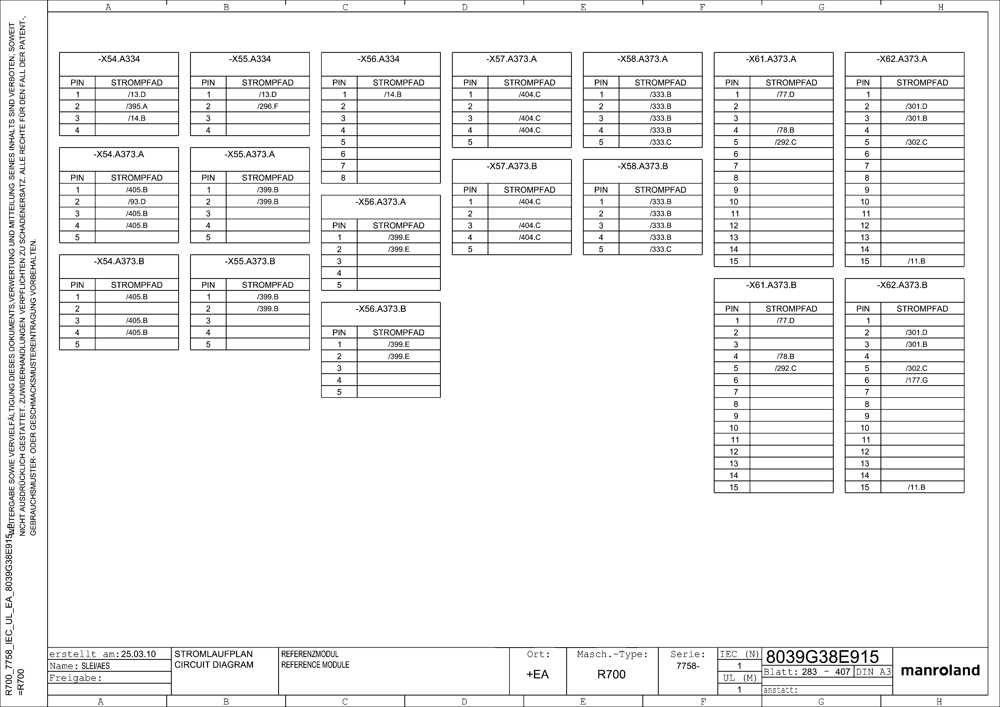

# +EA — Sheet 283 of 407 — REFERENZMODUL

**REFERENCE MODULE**

> Part of the manroland **R700** printing press IEC/UL circuit diagrams.
> Drawing class: **Stromlaufplan / Circuit diagram** (DIN A3).
> Document `+EA` covers the **Printing unit** machine section.

## At a glance

| Field | Value |
|---|---|
| Document | `+EA`  (8039G38E915) |
| Sheet | **283** of 407 |
| Section (DE) | REFERENZMODUL |
| Section (EN) | REFERENCE MODULE |
| Section type | REFERENCE_MODULE — Reference module |
| Machine type | `R700` |
| Series | `7758` |
| Created | 25.03.10 |
| Replaces | — |
| Columns used | A, B, C, D, E, F, G, H |
| Path numbers | — |
| Labels on sheet | 229 |
| Cross-refs out | 52 |
| Cross-refs in | 0 |

**Previous:** [+EA sheet 282](SHEET_0282.md) · **Next:** [+EA sheet 284](SHEET_0284.md) · **Document TOC:** [_TOC.md](_TOC.md)  (+EA) · **Master TOC:** [all sheets](../_MASTER_TOC.md)

## Sheet image (300 DPI, exact vector render)



_Rendered directly from the PDF vector layer at 300 DPI (1-bit), no OCR and no resampling. Use it to confirm anything ambiguous in the text below._

## Cross-references on this sheet

Each entry is a wire leaving this sheet. The printed token is `/sheet.column`; the link resolves to that sheet inside the same document.

| Ref | Target sheet | Col | Path | Destination on target | Target section | From col |
|---|---|---|---|---|---|---|
| `/14.B` | [+EA sheet 14](SHEET_0014.md) | B | — | STROMPFAD PIN 1 2 3 4 5 6 7 8 | SPANNUNGSVERSORGUNG: 400V, 24V | C |
| `/333.B` | [+EA sheet 333](SHEET_0333.md) | B | — | — | OPTION: BOGENWEICHE | F |
| `/13.D` | [+EA sheet 13](SHEET_0013.md) | D | — | — | SPANNUNGSVERSORGUNG: 400V, 24V | A |
| `/13.D` | [+EA sheet 13](SHEET_0013.md) | D | — | — | SPANNUNGSVERSORGUNG: 400V, 24V | B |
| `/77.D` | [+EA sheet 77](SHEET_0077.md) | D | — | — | AUSLEGERSTAPELSTEUERUNG | G |
| `/404.C` | [+EA sheet 404](SHEET_0404.md) | C | — | — | OPTION: SCHNITTSTELLE UV ENDTROCKNER | E |
| `/395.A` | [+EA sheet 395](SHEET_0395.md) | A | — | — | OPTION: ZWISCHENTROCKNER VORBEREITUNG; | A |
| `/333.B` | [+EA sheet 333](SHEET_0333.md) | B | — | — | OPTION: BOGENWEICHE | F |
| `/296.F` | [+EA sheet 296](SHEET_0296.md) | F | — | — | OPTION: ZWISCHENSTAPEL / | B |
| `/301.D` | [+EA sheet 301](SHEET_0301.md) | D | — | — | OPTION: ZWISCHENSTAPEL / | H |
| `/14.B` | [+EA sheet 14](SHEET_0014.md) | B | — | — | SPANNUNGSVERSORGUNG: 400V, 24V | A |
| `/333.B` | [+EA sheet 333](SHEET_0333.md) | B | — | — | OPTION: BOGENWEICHE | F |
| `/301.B` | [+EA sheet 301](SHEET_0301.md) | B | — | — | OPTION: ZWISCHENSTAPEL / | H |
| `/404.C` | [+EA sheet 404](SHEET_0404.md) | C | — | — | OPTION: SCHNITTSTELLE UV ENDTROCKNER | E |
| `/78.B` | [+EA sheet 78](SHEET_0078.md) | B | — | — | AUSLEGERSTAPELSTEUERUNG | G |
| `/333.B` | [+EA sheet 333](SHEET_0333.md) | B | — | — | OPTION: BOGENWEICHE | F |
| `/404.C` | [+EA sheet 404](SHEET_0404.md) | C | — | — | OPTION: SCHNITTSTELLE UV ENDTROCKNER | E |
| `/333.C` | [+EA sheet 333](SHEET_0333.md) | C | — | — | OPTION: BOGENWEICHE | F |
| `/292.C` | [+EA sheet 292](SHEET_0292.md) | C | — | — | OPTION: PROBEBOGENENTNAHME HALBAUTOMATISCH | G |
| `/302.C` | [+EA sheet 302](SHEET_0302.md) | C | — | — | OPTION: ZWISCHENSTAPEL / | H |
| `/405.B` | [+EA sheet 405](SHEET_0405.md) | B | — | — | OPTION: SCHNITTSTELLE UV ENDTROCKNER | A |
| `/399.B` | [+EA sheet 399](SHEET_0399.md) | B | — | — | OPTION: DÜNNDRUCKEINRICHTUNG | B |
| `/399.B` | [+EA sheet 399](SHEET_0399.md) | B | — | — | OPTION: DÜNNDRUCKEINRICHTUNG | B |
| `/333.B` | [+EA sheet 333](SHEET_0333.md) | B | — | — | OPTION: BOGENWEICHE | F |
| `/93.D` | [+EA sheet 93](SHEET_0093.md) | D | — | — | BLASRAHMEN | A |
| `/404.C` | [+EA sheet 404](SHEET_0404.md) | C | — | — | OPTION: SCHNITTSTELLE UV ENDTROCKNER | E |
| `/405.B` | [+EA sheet 405](SHEET_0405.md) | B | — | — | OPTION: SCHNITTSTELLE UV ENDTROCKNER | A |
| `/333.B` | [+EA sheet 333](SHEET_0333.md) | B | — | — | OPTION: BOGENWEICHE | F |
| `/405.B` | [+EA sheet 405](SHEET_0405.md) | B | — | — | OPTION: SCHNITTSTELLE UV ENDTROCKNER | A |
| `/333.B` | [+EA sheet 333](SHEET_0333.md) | B | — | — | OPTION: BOGENWEICHE | F |
| `/404.C` | [+EA sheet 404](SHEET_0404.md) | C | — | — | OPTION: SCHNITTSTELLE UV ENDTROCKNER | E |
| `/399.E` | [+EA sheet 399](SHEET_0399.md) | E | — | — | OPTION: DÜNNDRUCKEINRICHTUNG | C |
| `/333.B` | [+EA sheet 333](SHEET_0333.md) | B | — | — | OPTION: BOGENWEICHE | F |
| `/404.C` | [+EA sheet 404](SHEET_0404.md) | C | — | — | OPTION: SCHNITTSTELLE UV ENDTROCKNER | E |
| `/399.E` | [+EA sheet 399](SHEET_0399.md) | E | — | — | OPTION: DÜNNDRUCKEINRICHTUNG | C |
| `/333.C` | [+EA sheet 333](SHEET_0333.md) | C | — | — | OPTION: BOGENWEICHE | F |
| `/11.B` | [+EA sheet 11](SHEET_0011.md) | B | — | — | SPANNUNGSVERSORGUNG: 400V, 24V | H |
| `/405.B` | [+EA sheet 405](SHEET_0405.md) | B | — | — | OPTION: SCHNITTSTELLE UV ENDTROCKNER | A |
| `/399.B` | [+EA sheet 399](SHEET_0399.md) | B | — | — | OPTION: DÜNNDRUCKEINRICHTUNG | B |
| `/399.B` | [+EA sheet 399](SHEET_0399.md) | B | — | — | OPTION: DÜNNDRUCKEINRICHTUNG | B |
| `/405.B` | [+EA sheet 405](SHEET_0405.md) | B | — | — | OPTION: SCHNITTSTELLE UV ENDTROCKNER | A |
| `/77.D` | [+EA sheet 77](SHEET_0077.md) | D | — | — | AUSLEGERSTAPELSTEUERUNG | G |
| `/405.B` | [+EA sheet 405](SHEET_0405.md) | B | — | — | OPTION: SCHNITTSTELLE UV ENDTROCKNER | A |
| `/301.D` | [+EA sheet 301](SHEET_0301.md) | D | — | — | OPTION: ZWISCHENSTAPEL / | H |
| `/399.E` | [+EA sheet 399](SHEET_0399.md) | E | — | — | OPTION: DÜNNDRUCKEINRICHTUNG | C |
| `/301.B` | [+EA sheet 301](SHEET_0301.md) | B | — | — | OPTION: ZWISCHENSTAPEL / | H |
| `/78.B` | [+EA sheet 78](SHEET_0078.md) | B | — | — | AUSLEGERSTAPELSTEUERUNG | G |
| `/399.E` | [+EA sheet 399](SHEET_0399.md) | E | — | — | OPTION: DÜNNDRUCKEINRICHTUNG | C |
| `/292.C` | [+EA sheet 292](SHEET_0292.md) | C | — | — | OPTION: PROBEBOGENENTNAHME HALBAUTOMATISCH | G |
| `/302.C` | [+EA sheet 302](SHEET_0302.md) | C | — | — | OPTION: ZWISCHENSTAPEL / | H |
| `/177.G` | [+EA sheet 177](SHEET_0177.md) | G | — | — | RESERVE | H |
| `/11.B` | [+EA sheet 11](SHEET_0011.md) | B | — | — | SPANNUNGSVERSORGUNG: 400V, 24V | H |

## Devices on this sheet

| Tag | Class | Class meaning (IEC) | Col | Sub | Terminal | Sign |
|---|---|---|---|---|---|---|
| `X55.A334` | — | cross-device reference | B | — | — | — |
| `X62.A373.A` | — | cross-device reference | H | — | — | — |
| `X56.A334` | — | cross-device reference | C | — | — | — |
| `X55.A373.A` | — | cross-device reference | B | — | — | — |
| `X55.A373.B` | — | cross-device reference | B | — | — | — |
| `X56.A373.A` | — | cross-device reference | C | — | — | — |
| `X56.A373.B` | — | cross-device reference | C | — | — | — |
| `X62.A373.B` | — | cross-device reference | H | — | — | — |
| `X61.A373.A` | — | cross-device reference | G | — | — | — |
| `X58.A373.A` | — | cross-device reference | E | — | — | — |
| `X58.A373.B` | — | cross-device reference | F | — | — | — |
| `X61.A373.B` | — | cross-device reference | G | — | — | — |
| `X57.A373.A` | — | cross-device reference | D | — | — | — |
| `X57.A373.B` | — | cross-device reference | D | — | — | — |
| `X54.A334` | — | cross-device reference | A | — | — | — |
| `X54.A373.A` | — | cross-device reference | A | — | — | — |
| `X54.A373.B` | — | cross-device reference | A | — | — | — |

## Potentials / nets

_No named potentials on this sheet._

## Wire-end annotations (grouped as printed)

A wire that continues elsewhere is annotated with a small cluster: the destination description, the path/line number `#NN`, and the `/sheet.column` cross reference. Each row below is one such cluster exactly as it is grouped on the drawing.

| Col | Y | Path | Cross-ref | Text on the wire |
|---|---|---|---|---|
| A | 65.5 | — | — | `X54.A334` |
| B | 65.5 | — | — | `X55.A334` |
| C | 65.5 | — | — | `X56.A334` |
| D | 65.5 | — | — | `X57.A373.A` |
| E | 65.5 | — | — | `X58.A373.A` |
| G | 65.5 | — | — | `X61.A373.A` |
| H | 65.5 | — | — | `X62.A373.A` |
| A | 94.2 | — | — | `PIN 2 3 4 1 STROMPFAD` |
| B | 94.2 | — | — | `PIN 2 3 4 1 STROMPFAD` |
| C | 94.2 | — | `/14.B` | `PIN 2 3 4 5 6 7 8 1 STROMPFAD` |
| D | 94.2 | — | — | `PIN 2 3 4 5 1 STROMPFAD` |
| E | 94.2 | — | — | `PIN 2 3 4 5 1 STROMPFAD` |
| G | 94.2 | — | — | `PIN 10 12 13 14 15 11 2 3 4 5 6 7 8 9 1 STROMPFAD` |
| H | 94.2 | — | — | `PIN 10 12 13 14 15 11 2 3 4 5 6 7 8 9 1 STROMPFAD` |
| A | 108.7 | — | `/13.D` | — |
| B | 108.7 | — | `/13.D` | — |
| E | 108.7 | — | `/404.C` | — |
| F | 108.7 | — | `/333.B` | — |
| G | 108.7 | — | `/77.D` | — |
| A | 122.9 | — | `/395.A` | — |
| B | 122.9 | — | `/296.F` | — |
| F | 122.9 | — | `/333.B` | — |
| H | 122.9 | — | `/301.D` | — |
| A | 137.0 | — | `/14.B` | — |
| F | 137.0 | — | `/333.B` | — |
| H | 137.0 | — | `/301.B` | — |
| E | 137.1 | — | `/404.C` | — |
| E | 151.2 | — | `/404.C` | — |
| F | 151.2 | — | `/333.B` | — |
| G | 151.2 | — | `/78.B` | — |
| F | 165.4 | — | `/333.C` | — |
| G | 165.4 | — | `/292.C` | — |
| H | 165.4 | — | `/302.C` | — |
| A | 178.9 | — | — | `X54.A373.A` |
| B | 178.9 | — | — | `X55.A373.A` |
| D | 193.1 | — | — | `X57.A373.B` |
| F | 193.1 | — | — | `X58.A373.B` |
| A | 207.5 | — | — | `PIN 2 3 4 5 1 STROMPFAD` |
| B | 207.5 | — | — | `PIN 2 3 4 5 1 STROMPFAD` |
| D | 221.7 | — | — | `PIN 2 3 4 5 1 STROMPFAD` |
| E | 221.7 | — | — | `PIN 2 3 4 5 1 STROMPFAD` |
| A | 222.1 | — | `/405.B` | — |
| B | 222.1 | — | `/399.B` | — |
| C | 235.6 | — | — | `X56.A373.A` |
| B | 236.2 | — | `/399.B` | — |
| F | 236.2 | — | `/333.B` | — |
| A | 236.3 | — | `/93.D` | — |
| E | 236.3 | — | `/404.C` | — |
| A | 250.4 | — | `/405.B` | — |
| F | 250.4 | — | `/333.B` | — |
| C | 264.2 | — | — | `PIN 2 3 4 5 1 STROMPFAD` |
| A | 264.6 | — | `/405.B` | — |
| E | 264.6 | — | `/404.C` | — |
| F | 264.6 | — | `/333.B` | — |
| C | 278.8 | — | `/399.E` | — |
| E | 278.8 | — | `/404.C` | — |
| F | 278.8 | — | `/333.B` | — |
| C | 292.9 | — | `/399.E` | — |
| F | 293.0 | — | `/333.C` | — |
| A | 306.4 | — | — | `X54.A373.B` |
| B | 306.4 | — | — | `X55.A373.B` |
| H | 307.1 | — | `/11.B` | — |
| G | 334.8 | — | — | `X61.A373.B` |
| H | 334.8 | — | — | `X62.A373.B` |
| A | 335.1 | — | — | `PIN 2 3 4 5 1 STROMPFAD` |
| B | 335.1 | — | — | `PIN 2 3 4 5 1 STROMPFAD` |
| A | 349.6 | — | `/405.B` | — |
| B | 349.6 | — | `/399.B` | — |
| C | 363.1 | — | — | `X56.A373.B` |
| G | 363.4 | — | — | `PIN 10 12 13 14 15 11 2 3 4 5 6 7 8 9 1 STROMPFAD` |
| H | 363.4 | — | — | `PIN 10 12 13 14 15 11 2 3 4 5 6 7 8 9 1 STROMPFAD` |
| B | 363.8 | — | `/399.B` | — |
| A | 378.0 | — | `/405.B` | — |
| G | 378.0 | — | `/77.D` | — |
| C | 391.8 | — | — | `PIN 2 3 4 5 1 STROMPFAD` |
| A | 392.1 | — | `/405.B` | — |
| H | 392.2 | — | `/301.D` | — |
| C | 406.3 | — | `/399.E` | — |
| H | 406.3 | — | `/301.B` | — |
| C | 420.5 | — | `/399.E` | — |
| G | 420.5 | — | `/78.B` | — |
| G | 434.7 | — | `/292.C` | — |
| H | 434.7 | — | `/302.C` | — |
| H | 448.9 | — | `/177.G` | — |
| H | 576.4 | — | `/11.B` | — |


## Reconstructed tables

This sheet carries tabular content (pin map / terminal assignment / index). The grid below was rebuilt from the drawing's own rule lines, so each row is exactly one physical row of the table.

### Table 1 — 18 data rows × 2 columns (at x=70.9, y=62.4) — **X54.A334**

| PIN | STROMPFAD |
|---|---|
| `1` | `/13.D` |
| `2` | `/395.A` |
| `3` | `/14.B` |
| `4` |  |
|  | `X54.A373.A` |
| `PIN` | `STROMPFAD` |
| `1` | `/405.B` |
| `2` | `/93.D` |
| `3` | `/405.B` |
| `4` | `/405.B` |
| `5` |  |
|  | `X54.A373.B` |
| `PIN` | `STROMPFAD` |
| `1` | `/405.B` |
| `2` |  |
| `3` | `/405.B` |
| `4` | `/405.B` |
| `5` |  |


### Table 2 — 18 data rows × 2 columns (at x=226.8, y=62.4) — **X55.A334**

| PIN | STROMPFAD |
|---|---|
| `1` | `/13.D` |
| `2` | `/296.F` |
| `3` |  |
| `4` |  |
|  | `X55.A373.A` |
| `PIN` | `STROMPFAD` |
| `1` | `/399.B` |
| `2` | `/399.B` |
| `3` |  |
| `4` |  |
| `5` |  |
|  | `X55.A373.B` |
| `PIN` | `STROMPFAD` |
| `1` | `/399.B` |
| `2` | `/399.B` |
| `3` |  |
| `4` |  |
| `5` |  |


### Table 3 — 22 data rows × 2 columns (at x=382.7, y=62.4) — **X56.A334**

| PIN | STROMPFAD |
|---|---|
| `1` | `/14.B` |
| `2` |  |
| `3` |  |
| `4` |  |
| `5` |  |
| `6` |  |
| `7` |  |
| `8` |  |
|  | `X56.A373.A` |
| `PIN` | `STROMPFAD` |
| `1` | `/399.E` |
| `2` | `/399.E` |
| `3` |  |
| `4` |  |
| `5` |  |
|  | `X56.A373.B` |
| `PIN` | `STROMPFAD` |
| `1` | `/399.E` |
| `2` | `/399.E` |
| `3` |  |
| `4` |  |
| `5` |  |


### Table 4 — 12 data rows × 2 columns (at x=538.6, y=62.4) — **X57.A373.A**

| PIN | STROMPFAD |
|---|---|
| `1` | `/404.C` |
| `2` |  |
| `3` | `/404.C` |
| `4` | `/404.C` |
| `5` |  |
|  | `X57.A373.B` |
| `PIN` | `STROMPFAD` |
| `1` | `/404.C` |
| `2` |  |
| `3` | `/404.C` |
| `4` | `/404.C` |
| `5` |  |


### Table 5 — 12 data rows × 2 columns (at x=694.5, y=62.4) — **X58.A373.A**

| PIN | STROMPFAD |
|---|---|
| `1` | `/333.B` |
| `2` | `/333.B` |
| `3` | `/333.B` |
| `4` | `/333.B` |
| `5` | `/333.C` |
|  | `X58.A373.B` |
| `PIN` | `STROMPFAD` |
| `1` | `/333.B` |
| `2` | `/333.B` |
| `3` | `/333.B` |
| `4` | `/333.B` |
| `5` | `/333.C` |


### Table 6 — 32 data rows × 2 columns (at x=850.4, y=62.4) — **X61.A373.A**

| PIN | STROMPFAD |
|---|---|
| `1` | `/77.D` |
| `2` |  |
| `3` |  |
| `4` | `/78.B` |
| `5` | `/292.C` |
| `6` |  |
| `7` |  |
| `8` |  |
| `9` |  |
| `10` |  |
| `11` |  |
| `12` |  |
| `13` |  |
| `14` |  |
| `15` |  |
|  | `X61.A373.B` |
| `PIN` | `STROMPFAD` |
| `1` | `/77.D` |
| `2` |  |
| `3` |  |
| `4` | `/78.B` |
| `5` | `/292.C` |
| `6` |  |
| `7` |  |
| `8` |  |
| `9` |  |
| `10` |  |
| `11` |  |
| `12` |  |
| `13` |  |
| `14` |  |
| `15` |  |


### Table 7 — 32 data rows × 2 columns (at x=1006.3, y=62.4) — **X62.A373.A**

| PIN | STROMPFAD |
|---|---|
| `1` |  |
| `2` | `/301.D` |
| `3` | `/301.B` |
| `4` |  |
| `5` | `/302.C` |
| `6` |  |
| `7` |  |
| `8` |  |
| `9` |  |
| `10` |  |
| `11` |  |
| `12` |  |
| `13` |  |
| `14` |  |
| `15` | `/11.B` |
|  | `X62.A373.B` |
| `PIN` | `STROMPFAD` |
| `1` |  |
| `2` | `/301.D` |
| `3` | `/301.B` |
| `4` |  |
| `5` | `/302.C` |
| `6` | `/177.G` |
| `7` |  |
| `8` |  |
| `9` |  |
| `10` |  |
| `11` |  |
| `12` |  |
| `13` |  |
| `14` |  |
| `15` | `/11.B` |


## Notes and free text on this sheet

| Text | Col | Y (pt) |
|---|---|---|
| `PIN` | B | 94.2 |
| `STROMPFAD` | B | 94.15 |
| `PIN` | G | 94.2 |
| `STROMPFAD` | H | 94.15 |
| `PIN` | C | 94.2 |
| `STROMPFAD` | C | 94.15 |
| `PIN` | F | 94.2 |
| `STROMPFAD` | G | 94.15 |
| `PIN` | E | 94.2 |
| `STROMPFAD` | F | 94.15 |
| `PIN` | D | 94.2 |
| `STROMPFAD` | E | 94.15 |
| `PIN` | A | 94.2 |
| `STROMPFAD` | A | 94.15 |

## Complete label inventory (exact text from the drawing)

Every text object inside the drawing area of this sheet, in DIN reading order (column A→H, then top→bottom). This is the authoritative list: if a string is not here it is not printed on this sheet.

| Col | Y | X | Dir | Type | Text |
|---|---|---|---|---|---|
| A | 65.5 | 116.8 | → | device ref | `X54.A334` |
| A | 94.2 | 84.0 | → | text | `PIN` |
| A | 94.2 | 132.2 | → | text | `STROMPFAD` |
| A | 108.4 | 90.0 | → | number | `1` |
| A | 108.7 | 152.6 | → | cross-reference | `/13.D` |
| A | 122.5 | 89.4 | → | number | `2` |
| A | 122.9 | 150.2 | → | cross-reference | `/395.A` |
| A | 136.7 | 89.4 | → | number | `3` |
| A | 137.0 | 152.8 | → | cross-reference | `/14.B` |
| A | 150.9 | 89.4 | → | number | `4` |
| A | 178.9 | 111.4 | → | device ref | `X54.A373.A` |
| A | 207.5 | 132.2 | → | text | `STROMPFAD` |
| A | 207.6 | 84.0 | → | text | `PIN` |
| A | 221.8 | 90.0 | → | number | `1` |
| A | 222.1 | 150.4 | → | cross-reference | `/405.B` |
| A | 235.9 | 89.4 | → | number | `2` |
| A | 236.3 | 152.6 | → | cross-reference | `/93.D` |
| A | 250.1 | 89.4 | → | number | `3` |
| A | 250.4 | 150.4 | → | cross-reference | `/405.B` |
| A | 264.3 | 89.4 | → | number | `4` |
| A | 264.6 | 150.4 | → | cross-reference | `/405.B` |
| A | 278.5 | 89.4 | → | number | `5` |
| A | 306.5 | 111.8 | → | device ref | `X54.A373.B` |
| A | 335.1 | 84.0 | → | text | `PIN` |
| A | 335.1 | 132.2 | → | text | `STROMPFAD` |
| A | 349.3 | 90.0 | → | number | `1` |
| A | 349.6 | 150.4 | → | cross-reference | `/405.B` |
| A | 363.5 | 89.4 | → | number | `2` |
| A | 377.7 | 89.4 | → | number | `3` |
| A | 378.0 | 150.4 | → | cross-reference | `/405.B` |
| A | 391.8 | 89.4 | → | number | `4` |
| A | 392.2 | 150.4 | → | cross-reference | `/405.B` |
| A | 406.0 | 89.4 | → | number | `5` |
| B | 65.5 | 272.7 | → | device ref | `X55.A334` |
| B | 94.2 | 240.0 | → | text | `PIN` |
| B | 94.2 | 288.1 | → | text | `STROMPFAD` |
| B | 108.4 | 245.9 | → | number | `1` |
| B | 108.7 | 308.6 | → | cross-reference | `/13.D` |
| B | 122.5 | 245.3 | → | number | `2` |
| B | 122.9 | 306.6 | → | cross-reference | `/296.F` |
| B | 136.7 | 245.3 | → | number | `3` |
| B | 150.9 | 245.3 | → | number | `4` |
| B | 178.9 | 267.3 | → | device ref | `X55.A373.A` |
| B | 207.5 | 288.1 | → | text | `STROMPFAD` |
| B | 207.6 | 240.0 | → | text | `PIN` |
| B | 221.8 | 245.9 | → | number | `1` |
| B | 222.1 | 306.3 | → | cross-reference | `/399.B` |
| B | 235.9 | 245.3 | → | number | `2` |
| B | 236.2 | 306.3 | → | cross-reference | `/399.B` |
| B | 250.1 | 245.3 | → | number | `3` |
| B | 264.3 | 245.3 | → | number | `4` |
| B | 278.5 | 245.3 | → | number | `5` |
| B | 306.5 | 267.7 | → | device ref | `X55.A373.B` |
| B | 335.1 | 240.0 | → | text | `PIN` |
| B | 335.1 | 288.1 | → | text | `STROMPFAD` |
| B | 349.3 | 245.9 | → | number | `1` |
| B | 349.6 | 306.3 | → | cross-reference | `/399.B` |
| B | 363.5 | 245.3 | → | number | `2` |
| B | 363.8 | 306.3 | → | cross-reference | `/399.B` |
| B | 377.7 | 245.3 | → | number | `3` |
| B | 391.8 | 245.3 | → | number | `4` |
| B | 406.0 | 245.3 | → | number | `5` |
| C | 65.5 | 425.8 | → | device ref | `X56.A334` |
| C | 94.2 | 395.9 | → | text | `PIN` |
| C | 94.2 | 444.0 | → | text | `STROMPFAD` |
| C | 108.4 | 407.6 | → | number | `1` |
| C | 108.7 | 457.5 | → | cross-reference | `/14.B` |
| C | 122.5 | 405.9 | → | number | `2` |
| C | 136.7 | 405.9 | → | number | `3` |
| C | 150.9 | 405.9 | → | number | `4` |
| C | 165.1 | 405.9 | → | number | `5` |
| C | 179.2 | 405.9 | → | number | `6` |
| C | 193.4 | 405.9 | → | number | `7` |
| C | 207.6 | 405.9 | → | number | `8` |
| C | 235.6 | 423.2 | → | device ref | `X56.A373.A` |
| C | 264.2 | 444.0 | → | text | `STROMPFAD` |
| C | 264.3 | 395.9 | → | text | `PIN` |
| C | 278.5 | 401.8 | → | number | `1` |
| C | 278.8 | 462.3 | → | cross-reference | `/399.E` |
| C | 292.6 | 401.2 | → | number | `2` |
| C | 292.9 | 462.3 | → | cross-reference | `/399.E` |
| C | 306.8 | 401.2 | → | number | `3` |
| C | 321.0 | 401.2 | → | number | `4` |
| C | 335.1 | 401.2 | → | number | `5` |
| C | 363.1 | 423.6 | → | device ref | `X56.A373.B` |
| C | 391.8 | 395.9 | → | text | `PIN` |
| C | 391.8 | 444.0 | → | text | `STROMPFAD` |
| C | 406.0 | 401.8 | → | number | `1` |
| C | 406.3 | 462.3 | → | cross-reference | `/399.E` |
| C | 420.2 | 401.2 | → | number | `2` |
| C | 420.5 | 462.3 | → | cross-reference | `/399.E` |
| C | 434.4 | 401.2 | → | number | `3` |
| C | 448.5 | 401.2 | → | number | `4` |
| C | 462.7 | 401.2 | → | number | `5` |
| D | 65.5 | 579.1 | → | device ref | `X57.A373.A` |
| D | 94.2 | 551.8 | → | text | `PIN` |
| D | 108.4 | 557.7 | → | number | `1` |
| D | 122.5 | 557.1 | → | number | `2` |
| D | 136.7 | 557.1 | → | number | `3` |
| D | 150.9 | 557.1 | → | number | `4` |
| D | 165.1 | 557.1 | → | number | `5` |
| D | 193.1 | 579.5 | → | device ref | `X57.A373.B` |
| D | 221.8 | 551.8 | → | text | `PIN` |
| D | 235.9 | 557.7 | → | number | `1` |
| D | 250.1 | 557.1 | → | number | `2` |
| D | 264.3 | 557.1 | → | number | `3` |
| D | 278.5 | 557.1 | → | number | `4` |
| D | 292.6 | 557.1 | → | number | `5` |
| E | 65.5 | 735.0 | → | device ref | `X58.A373.A` |
| E | 94.2 | 600.0 | → | text | `STROMPFAD` |
| E | 94.2 | 707.7 | → | text | `PIN` |
| E | 108.4 | 713.6 | → | number | `1` |
| E | 108.7 | 618.0 | → | cross-reference | `/404.C` |
| E | 122.5 | 713.1 | → | number | `2` |
| E | 136.7 | 713.1 | → | number | `3` |
| E | 137.1 | 618.0 | → | cross-reference | `/404.C` |
| E | 150.9 | 713.1 | → | number | `4` |
| E | 151.2 | 618.0 | → | cross-reference | `/404.C` |
| E | 165.1 | 713.1 | → | number | `5` |
| E | 221.7 | 600.0 | → | text | `STROMPFAD` |
| E | 221.8 | 707.7 | → | text | `PIN` |
| E | 235.9 | 713.6 | → | number | `1` |
| E | 236.3 | 618.0 | → | cross-reference | `/404.C` |
| E | 250.1 | 713.1 | → | number | `2` |
| E | 264.3 | 713.1 | → | number | `3` |
| E | 264.6 | 618.0 | → | cross-reference | `/404.C` |
| E | 278.5 | 713.1 | → | number | `4` |
| E | 278.8 | 618.0 | → | cross-reference | `/404.C` |
| E | 292.6 | 713.1 | → | number | `5` |
| F | 94.2 | 755.9 | → | text | `STROMPFAD` |
| F | 94.2 | 863.6 | → | text | `PIN` |
| F | 108.4 | 875.3 | → | number | `1` |
| F | 108.7 | 774.0 | → | cross-reference | `/333.B` |
| F | 122.5 | 873.6 | → | number | `2` |
| F | 122.9 | 774.0 | → | cross-reference | `/333.B` |
| F | 136.7 | 873.6 | → | number | `3` |
| F | 137.0 | 774.0 | → | cross-reference | `/333.B` |
| F | 150.9 | 873.6 | → | number | `4` |
| F | 151.2 | 774.0 | → | cross-reference | `/333.B` |
| F | 165.1 | 873.6 | → | number | `5` |
| F | 165.4 | 773.9 | → | cross-reference | `/333.C` |
| F | 179.2 | 873.6 | → | number | `6` |
| F | 193.1 | 735.4 | → | device ref | `X58.A373.B` |
| F | 193.4 | 873.6 | → | number | `7` |
| F | 207.6 | 873.6 | → | number | `8` |
| F | 221.7 | 755.9 | → | text | `STROMPFAD` |
| F | 221.8 | 873.6 | → | number | `9` |
| F | 235.9 | 868.3 | → | number | `10` |
| F | 236.2 | 774.0 | → | cross-reference | `/333.B` |
| F | 250.1 | 870.0 | → | number | `11` |
| F | 250.4 | 774.0 | → | cross-reference | `/333.B` |
| F | 264.3 | 868.3 | → | number | `12` |
| F | 264.6 | 774.0 | → | cross-reference | `/333.B` |
| F | 278.5 | 868.3 | → | number | `13` |
| F | 278.8 | 774.0 | → | cross-reference | `/333.B` |
| F | 292.6 | 868.3 | → | number | `14` |
| F | 293.0 | 773.9 | → | cross-reference | `/333.C` |
| F | 306.8 | 868.3 | → | number | `15` |
| F | 363.5 | 863.6 | → | text | `PIN` |
| F | 377.7 | 875.3 | → | number | `1` |
| F | 391.8 | 873.6 | → | number | `2` |
| F | 406.0 | 873.6 | → | number | `3` |
| F | 420.2 | 873.6 | → | number | `4` |
| F | 434.4 | 873.6 | → | number | `5` |
| F | 448.5 | 873.6 | → | number | `6` |
| F | 462.7 | 873.6 | → | number | `7` |
| F | 476.9 | 873.6 | → | number | `8` |
| F | 491.0 | 873.6 | → | number | `9` |
| F | 505.2 | 868.3 | → | number | `10` |
| F | 519.4 | 870.0 | → | number | `11` |
| F | 533.6 | 868.3 | → | number | `12` |
| F | 547.7 | 868.3 | → | number | `13` |
| F | 561.9 | 868.3 | → | number | `14` |
| F | 576.1 | 868.3 | → | number | `15` |
| G | 65.5 | 888.1 | → | device ref | `X61.A373.A` |
| G | 94.2 | 911.8 | → | text | `STROMPFAD` |
| G | 94.2 | 1019.5 | → | text | `PIN` |
| G | 108.4 | 1031.2 | → | number | `1` |
| G | 108.7 | 925.1 | → | cross-reference | `/77.D` |
| G | 122.5 | 1029.5 | → | number | `2` |
| G | 136.7 | 1029.5 | → | number | `3` |
| G | 150.9 | 1029.5 | → | number | `4` |
| G | 151.2 | 925.2 | → | cross-reference | `/78.B` |
| G | 165.1 | 1029.5 | → | number | `5` |
| G | 165.4 | 922.7 | → | cross-reference | `/292.C` |
| G | 179.2 | 1029.5 | → | number | `6` |
| G | 193.4 | 1029.5 | → | number | `7` |
| G | 207.6 | 1029.5 | → | number | `8` |
| G | 221.8 | 1029.5 | → | number | `9` |
| G | 235.9 | 1024.2 | → | number | `10` |
| G | 250.1 | 1025.9 | → | number | `11` |
| G | 264.3 | 1024.2 | → | number | `12` |
| G | 278.5 | 1024.2 | → | number | `13` |
| G | 292.6 | 1024.2 | → | number | `14` |
| G | 306.8 | 1024.2 | → | number | `15` |
| G | 334.8 | 888.5 | → | device ref | `X61.A373.B` |
| G | 363.4 | 911.8 | → | text | `STROMPFAD` |
| G | 363.5 | 1019.5 | → | text | `PIN` |
| G | 377.7 | 1031.2 | → | number | `1` |
| G | 378.0 | 925.1 | → | cross-reference | `/77.D` |
| G | 391.8 | 1029.5 | → | number | `2` |
| G | 406.0 | 1029.5 | → | number | `3` |
| G | 420.2 | 1029.5 | → | number | `4` |
| G | 420.5 | 925.2 | → | cross-reference | `/78.B` |
| G | 434.4 | 1029.5 | → | number | `5` |
| G | 434.7 | 922.7 | → | cross-reference | `/292.C` |
| G | 448.5 | 1029.5 | → | number | `6` |
| G | 462.7 | 1029.5 | → | number | `7` |
| G | 476.9 | 1029.5 | → | number | `8` |
| G | 491.0 | 1029.5 | → | number | `9` |
| G | 505.2 | 1024.2 | → | number | `10` |
| G | 519.4 | 1025.9 | → | number | `11` |
| G | 533.6 | 1024.2 | → | number | `12` |
| G | 547.7 | 1024.2 | → | number | `13` |
| G | 561.9 | 1024.2 | → | number | `14` |
| G | 576.1 | 1024.2 | → | number | `15` |
| H | 65.5 | 1044.0 | → | device ref | `X62.A373.A` |
| H | 94.2 | 1067.7 | → | text | `STROMPFAD` |
| H | 122.9 | 1078.6 | → | cross-reference | `/301.D` |
| H | 137.0 | 1078.7 | → | cross-reference | `/301.B` |
| H | 165.4 | 1078.6 | → | cross-reference | `/302.C` |
| H | 307.1 | 1081.1 | → | cross-reference | `/11.B` |
| H | 334.8 | 1044.4 | → | device ref | `X62.A373.B` |
| H | 363.4 | 1067.7 | → | text | `STROMPFAD` |
| H | 392.2 | 1078.6 | → | cross-reference | `/301.D` |
| H | 406.3 | 1078.7 | → | cross-reference | `/301.B` |
| H | 434.7 | 1078.6 | → | cross-reference | `/302.C` |
| H | 448.9 | 1078.4 | → | cross-reference | `/177.G` |
| H | 576.4 | 1081.1 | → | cross-reference | `/11.B` |

## Reading-order text block

The same content as a plain block, grouped by DIN column — convenient to paste or to match against a visual description.

```text
=== Column A ===
  65.5  116.8  devref       X54.A334
  94.2   84.0  text         PIN
  94.2  132.2  text         STROMPFAD
 108.4   90.0  numeric      1
 108.7  152.6  xref         /13.D
 122.5   89.4  numeric      2
 122.9  150.2  xref         /395.A
 136.7   89.4  numeric      3
 137.0  152.8  xref         /14.B
 150.9   89.4  numeric      4
 178.9  111.4  devref       X54.A373.A
 207.5  132.2  text         STROMPFAD
 207.6   84.0  text         PIN
 221.8   90.0  numeric      1
 222.1  150.4  xref         /405.B
 235.9   89.4  numeric      2
 236.3  152.6  xref         /93.D
 250.1   89.4  numeric      3
 250.4  150.4  xref         /405.B
 264.3   89.4  numeric      4
 264.6  150.4  xref         /405.B
 278.5   89.4  numeric      5
 306.5  111.8  devref       X54.A373.B
 335.1   84.0  text         PIN
 335.1  132.2  text         STROMPFAD
 349.3   90.0  numeric      1
 349.6  150.4  xref         /405.B
 363.5   89.4  numeric      2
 377.7   89.4  numeric      3
 378.0  150.4  xref         /405.B
 391.8   89.4  numeric      4
 392.2  150.4  xref         /405.B
 406.0   89.4  numeric      5
=== Column B ===
  65.5  272.7  devref       X55.A334
  94.2  240.0  text         PIN
  94.2  288.1  text         STROMPFAD
 108.4  245.9  numeric      1
 108.7  308.6  xref         /13.D
 122.5  245.3  numeric      2
 122.9  306.6  xref         /296.F
 136.7  245.3  numeric      3
 150.9  245.3  numeric      4
 178.9  267.3  devref       X55.A373.A
 207.5  288.1  text         STROMPFAD
 207.6  240.0  text         PIN
 221.8  245.9  numeric      1
 222.1  306.3  xref         /399.B
 235.9  245.3  numeric      2
 236.2  306.3  xref         /399.B
 250.1  245.3  numeric      3
 264.3  245.3  numeric      4
 278.5  245.3  numeric      5
 306.5  267.7  devref       X55.A373.B
 335.1  240.0  text         PIN
 335.1  288.1  text         STROMPFAD
 349.3  245.9  numeric      1
 349.6  306.3  xref         /399.B
 363.5  245.3  numeric      2
 363.8  306.3  xref         /399.B
 377.7  245.3  numeric      3
 391.8  245.3  numeric      4
 406.0  245.3  numeric      5
=== Column C ===
  65.5  425.8  devref       X56.A334
  94.2  395.9  text         PIN
  94.2  444.0  text         STROMPFAD
 108.4  407.6  numeric      1
 108.7  457.5  xref         /14.B
 122.5  405.9  numeric      2
 136.7  405.9  numeric      3
 150.9  405.9  numeric      4
 165.1  405.9  numeric      5
 179.2  405.9  numeric      6
 193.4  405.9  numeric      7
 207.6  405.9  numeric      8
 235.6  423.2  devref       X56.A373.A
 264.2  444.0  text         STROMPFAD
 264.3  395.9  text         PIN
 278.5  401.8  numeric      1
 278.8  462.3  xref         /399.E
 292.6  401.2  numeric      2
 292.9  462.3  xref         /399.E
 306.8  401.2  numeric      3
 321.0  401.2  numeric      4
 335.1  401.2  numeric      5
 363.1  423.6  devref       X56.A373.B
 391.8  395.9  text         PIN
 391.8  444.0  text         STROMPFAD
 406.0  401.8  numeric      1
 406.3  462.3  xref         /399.E
 420.2  401.2  numeric      2
 420.5  462.3  xref         /399.E
 434.4  401.2  numeric      3
 448.5  401.2  numeric      4
 462.7  401.2  numeric      5
=== Column D ===
  65.5  579.1  devref       X57.A373.A
  94.2  551.8  text         PIN
 108.4  557.7  numeric      1
 122.5  557.1  numeric      2
 136.7  557.1  numeric      3
 150.9  557.1  numeric      4
 165.1  557.1  numeric      5
 193.1  579.5  devref       X57.A373.B
 221.8  551.8  text         PIN
 235.9  557.7  numeric      1
 250.1  557.1  numeric      2
 264.3  557.1  numeric      3
 278.5  557.1  numeric      4
 292.6  557.1  numeric      5
=== Column E ===
  65.5  735.0  devref       X58.A373.A
  94.2  600.0  text         STROMPFAD
  94.2  707.7  text         PIN
 108.4  713.6  numeric      1
 108.7  618.0  xref         /404.C
 122.5  713.1  numeric      2
 136.7  713.1  numeric      3
 137.1  618.0  xref         /404.C
 150.9  713.1  numeric      4
 151.2  618.0  xref         /404.C
 165.1  713.1  numeric      5
 221.7  600.0  text         STROMPFAD
 221.8  707.7  text         PIN
 235.9  713.6  numeric      1
 236.3  618.0  xref         /404.C
 250.1  713.1  numeric      2
 264.3  713.1  numeric      3
 264.6  618.0  xref         /404.C
 278.5  713.1  numeric      4
 278.8  618.0  xref         /404.C
 292.6  713.1  numeric      5
=== Column F ===
  94.2  755.9  text         STROMPFAD
  94.2  863.6  text         PIN
 108.4  875.3  numeric      1
 108.7  774.0  xref         /333.B
 122.5  873.6  numeric      2
 122.9  774.0  xref         /333.B
 136.7  873.6  numeric      3
 137.0  774.0  xref         /333.B
 150.9  873.6  numeric      4
 151.2  774.0  xref         /333.B
 165.1  873.6  numeric      5
 165.4  773.9  xref         /333.C
 179.2  873.6  numeric      6
 193.1  735.4  devref       X58.A373.B
 193.4  873.6  numeric      7
 207.6  873.6  numeric      8
 221.7  755.9  text         STROMPFAD
 221.8  873.6  numeric      9
 235.9  868.3  numeric      10
 236.2  774.0  xref         /333.B
 250.1  870.0  numeric      11
 250.4  774.0  xref         /333.B
 264.3  868.3  numeric      12
 264.6  774.0  xref         /333.B
 278.5  868.3  numeric      13
 278.8  774.0  xref         /333.B
 292.6  868.3  numeric      14
 293.0  773.9  xref         /333.C
 306.8  868.3  numeric      15
 363.5  863.6  text         PIN
 377.7  875.3  numeric      1
 391.8  873.6  numeric      2
 406.0  873.6  numeric      3
 420.2  873.6  numeric      4
 434.4  873.6  numeric      5
 448.5  873.6  numeric      6
 462.7  873.6  numeric      7
 476.9  873.6  numeric      8
 491.0  873.6  numeric      9
 505.2  868.3  numeric      10
 519.4  870.0  numeric      11
 533.6  868.3  numeric      12
 547.7  868.3  numeric      13
 561.9  868.3  numeric      14
 576.1  868.3  numeric      15
=== Column G ===
  65.5  888.1  devref       X61.A373.A
  94.2  911.8  text         STROMPFAD
  94.2 1019.5  text         PIN
 108.4 1031.2  numeric      1
 108.7  925.1  xref         /77.D
 122.5 1029.5  numeric      2
 136.7 1029.5  numeric      3
 150.9 1029.5  numeric      4
 151.2  925.2  xref         /78.B
 165.1 1029.5  numeric      5
 165.4  922.7  xref         /292.C
 179.2 1029.5  numeric      6
 193.4 1029.5  numeric      7
 207.6 1029.5  numeric      8
 221.8 1029.5  numeric      9
 235.9 1024.2  numeric      10
 250.1 1025.9  numeric      11
 264.3 1024.2  numeric      12
 278.5 1024.2  numeric      13
 292.6 1024.2  numeric      14
 306.8 1024.2  numeric      15
 334.8  888.5  devref       X61.A373.B
 363.4  911.8  text         STROMPFAD
 363.5 1019.5  text         PIN
 377.7 1031.2  numeric      1
 378.0  925.1  xref         /77.D
 391.8 1029.5  numeric      2
 406.0 1029.5  numeric      3
 420.2 1029.5  numeric      4
 420.5  925.2  xref         /78.B
 434.4 1029.5  numeric      5
 434.7  922.7  xref         /292.C
 448.5 1029.5  numeric      6
 462.7 1029.5  numeric      7
 476.9 1029.5  numeric      8
 491.0 1029.5  numeric      9
 505.2 1024.2  numeric      10
 519.4 1025.9  numeric      11
 533.6 1024.2  numeric      12
 547.7 1024.2  numeric      13
 561.9 1024.2  numeric      14
 576.1 1024.2  numeric      15
=== Column H ===
  65.5 1044.0  devref       X62.A373.A
  94.2 1067.7  text         STROMPFAD
 122.9 1078.6  xref         /301.D
 137.0 1078.7  xref         /301.B
 165.4 1078.6  xref         /302.C
 307.1 1081.1  xref         /11.B
 334.8 1044.4  devref       X62.A373.B
 363.4 1067.7  text         STROMPFAD
 392.2 1078.6  xref         /301.D
 406.3 1078.7  xref         /301.B
 434.7 1078.6  xref         /302.C
 448.9 1078.4  xref         /177.G
 576.4 1081.1  xref         /11.B
```

---
_Generated from the PDF vector text layer; no OCR. Source: `R700_7758_IEC_UL_EA_8039G38E915_p`, sheet 283._
