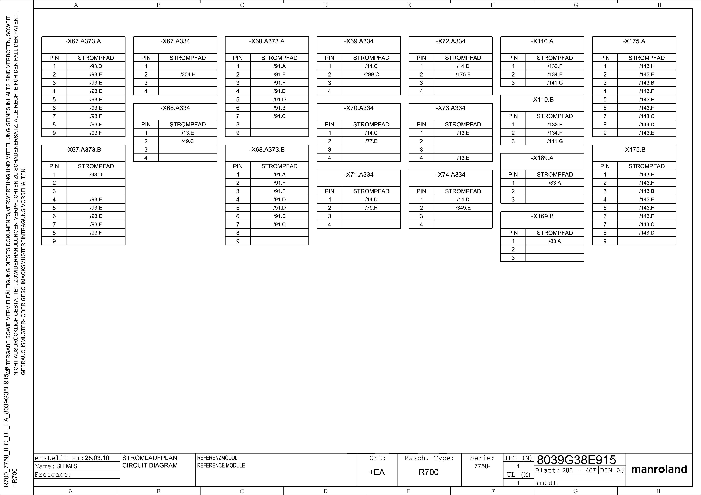

# +EA — Sheet 285 of 407 — REFERENZMODUL

**REFERENCE MODULE**

> Part of the manroland **R700** printing press IEC/UL circuit diagrams.
> Drawing class: **Stromlaufplan / Circuit diagram** (DIN A3).
> Document `+EA` covers the **Printing unit** machine section.

## At a glance

| Field | Value |
|---|---|
| Document | `+EA`  (8039G38E915) |
| Sheet | **285** of 407 |
| Section (DE) | REFERENZMODUL |
| Section (EN) | REFERENCE MODULE |
| Section type | REFERENCE_MODULE — Reference module |
| Machine type | `R700` |
| Series | `7758` |
| Created | 25.03.10 |
| Replaces | — |
| Columns used | A, B, C, D, E, F, G, H |
| Path numbers | — |
| Labels on sheet | 221 |
| Cross-refs out | 69 |
| Cross-refs in | 0 |

**Previous:** [+EA sheet 284](SHEET_0284.md) · **Next:** [+EA sheet 286](SHEET_0286.md) · **Document TOC:** [_TOC.md](_TOC.md)  (+EA) · **Master TOC:** [all sheets](../_MASTER_TOC.md)

## Sheet image (300 DPI, exact vector render)



_Rendered directly from the PDF vector layer at 300 DPI (1-bit), no OCR and no resampling. Use it to confirm anything ambiguous in the text below._

## Cross-references on this sheet

Each entry is a wire leaving this sheet. The printed token is `/sheet.column`; the link resolves to that sheet inside the same document.

| Ref | Target sheet | Col | Path | Destination on target | Target section | From col |
|---|---|---|---|---|---|---|
| `/91.A` | [+EA sheet 91](SHEET_0091.md) | A | — | — | BLASROHRE (BLASRAHMEN) | C |
| `/133.F` | [+EA sheet 133](SHEET_0133.md) | F | — | — | ZUGANGSABSICHERUNG | G |
| `/93.D` | [+EA sheet 93](SHEET_0093.md) | D | — | — | BLASRAHMEN | A |
| `/14.C` | [+EA sheet 14](SHEET_0014.md) | C | — | — | SPANNUNGSVERSORGUNG: 400V, 24V | E |
| `/14.D` | [+EA sheet 14](SHEET_0014.md) | D | — | — | SPANNUNGSVERSORGUNG: 400V, 24V | F |
| `/143.H` | [+EA sheet 143](SHEET_0143.md) | H | — | — | ZUGANGSABSICHERUNG | H |
| `/93.E` | [+EA sheet 93](SHEET_0093.md) | E | — | — | BLASRAHMEN | A |
| `/91.F` | [+EA sheet 91](SHEET_0091.md) | F | — | — | BLASROHRE (BLASRAHMEN) | C |
| `/175.B` | [+EA sheet 175](SHEET_0175.md) | B | — | — | RESERVE | F |
| `/134.E` | [+EA sheet 134](SHEET_0134.md) | E | — | — | ZUGANGSABSICHERUNG | G |
| `/143.F` | [+EA sheet 143](SHEET_0143.md) | F | — | — | ZUGANGSABSICHERUNG | H |
| `/304.H` | [+EA sheet 304](SHEET_0304.md) | H | — | — | OPTION: ZWISCHENSTAPEL / | B |
| `/299.C` | [+EA sheet 299](SHEET_0299.md) | C | — | — | OPTION: ZWISCHENSTAPEL / | E |
| `/93.E` | [+EA sheet 93](SHEET_0093.md) | E | — | — | BLASRAHMEN | A |
| `/91.F` | [+EA sheet 91](SHEET_0091.md) | F | — | — | BLASROHRE (BLASRAHMEN) | C |
| `/143.B` | [+EA sheet 143](SHEET_0143.md) | B | — | — | ZUGANGSABSICHERUNG | H |
| `/141.G` | [+EA sheet 141](SHEET_0141.md) | G | — | — | ZUGANGSABSICHERUNG | G |
| `/93.E` | [+EA sheet 93](SHEET_0093.md) | E | — | — | BLASRAHMEN | A |
| `/143.F` | [+EA sheet 143](SHEET_0143.md) | F | — | — | ZUGANGSABSICHERUNG | H |
| `/91.D` | [+EA sheet 91](SHEET_0091.md) | D | — | — | BLASROHRE (BLASRAHMEN) | C |
| `/93.E` | [+EA sheet 93](SHEET_0093.md) | E | — | — | BLASRAHMEN | A |
| `/143.F` | [+EA sheet 143](SHEET_0143.md) | F | — | — | ZUGANGSABSICHERUNG | H |
| `/91.D` | [+EA sheet 91](SHEET_0091.md) | D | — | — | BLASROHRE (BLASRAHMEN) | C |
| `/93.E` | [+EA sheet 93](SHEET_0093.md) | E | — | — | BLASRAHMEN | A |
| `/91.B` | [+EA sheet 91](SHEET_0091.md) | B | — | — | BLASROHRE (BLASRAHMEN) | C |
| `/143.F` | [+EA sheet 143](SHEET_0143.md) | F | — | — | ZUGANGSABSICHERUNG | H |
| `/93.F` | [+EA sheet 93](SHEET_0093.md) | F | — | — | BLASRAHMEN | A |
| `/91.C` | [+EA sheet 91](SHEET_0091.md) | C | — | — | BLASROHRE (BLASRAHMEN) | C |
| `/143.C` | [+EA sheet 143](SHEET_0143.md) | C | — | — | ZUGANGSABSICHERUNG | H |
| `/93.F` | [+EA sheet 93](SHEET_0093.md) | F | — | — | BLASRAHMEN | A |
| `/133.E` | [+EA sheet 133](SHEET_0133.md) | E | — | — | ZUGANGSABSICHERUNG | G |
| `/143.D` | [+EA sheet 143](SHEET_0143.md) | D | — | — | ZUGANGSABSICHERUNG | H |
| `/13.E` | [+EA sheet 13](SHEET_0013.md) | E | — | — | SPANNUNGSVERSORGUNG: 400V, 24V | B |
| `/13.E` | [+EA sheet 13](SHEET_0013.md) | E | — | — | SPANNUNGSVERSORGUNG: 400V, 24V | F |
| `/93.F` | [+EA sheet 93](SHEET_0093.md) | F | — | — | BLASRAHMEN | A |
| `/143.E` | [+EA sheet 143](SHEET_0143.md) | E | — | — | ZUGANGSABSICHERUNG | H |
| `/134.F` | [+EA sheet 134](SHEET_0134.md) | F | — | — | ZUGANGSABSICHERUNG | G |
| `/14.C` | [+EA sheet 14](SHEET_0014.md) | C | — | — | SPANNUNGSVERSORGUNG: 400V, 24V | E |
| `/77.E` | [+EA sheet 77](SHEET_0077.md) | E | — | — | AUSLEGERSTAPELSTEUERUNG | E |
| `/141.G` | [+EA sheet 141](SHEET_0141.md) | G | — | — | ZUGANGSABSICHERUNG | G |
| `/49.C` | [+EA sheet 49](SHEET_0049.md) | C | — | — | SCHUTZ | B |
| `/13.E` | [+EA sheet 13](SHEET_0013.md) | E | — | — | SPANNUNGSVERSORGUNG: 400V, 24V | F |
| `/83.A` | [+EA sheet 83](SHEET_0083.md) | A | — | STROMPFAD PIN 1 2 3 | AUSLEGERSTAPELSTEUERUNG: PROGRAMMSCHALTWERK | G |
| `/91.A` | [+EA sheet 91](SHEET_0091.md) | A | — | — | BLASROHRE (BLASRAHMEN) | C |
| `/93.D` | [+EA sheet 93](SHEET_0093.md) | D | — | — | BLASRAHMEN | A |
| `/143.H` | [+EA sheet 143](SHEET_0143.md) | H | — | — | ZUGANGSABSICHERUNG | H |
| `/91.F` | [+EA sheet 91](SHEET_0091.md) | F | — | — | BLASROHRE (BLASRAHMEN) | C |
| `/143.F` | [+EA sheet 143](SHEET_0143.md) | F | — | — | ZUGANGSABSICHERUNG | H |
| `/91.F` | [+EA sheet 91](SHEET_0091.md) | F | — | — | BLASROHRE (BLASRAHMEN) | C |
| `/143.B` | [+EA sheet 143](SHEET_0143.md) | B | — | — | ZUGANGSABSICHERUNG | H |
| `/93.E` | [+EA sheet 93](SHEET_0093.md) | E | — | — | BLASRAHMEN | A |
| `/143.F` | [+EA sheet 143](SHEET_0143.md) | F | — | — | ZUGANGSABSICHERUNG | H |
| `/91.D` | [+EA sheet 91](SHEET_0091.md) | D | — | — | BLASROHRE (BLASRAHMEN) | C |
| `/14.D` | [+EA sheet 14](SHEET_0014.md) | D | — | — | SPANNUNGSVERSORGUNG: 400V, 24V | E |
| `/14.D` | [+EA sheet 14](SHEET_0014.md) | D | — | — | SPANNUNGSVERSORGUNG: 400V, 24V | F |
| `/93.E` | [+EA sheet 93](SHEET_0093.md) | E | — | — | BLASRAHMEN | A |
| `/349.E` | [+EA sheet 349](SHEET_0349.md) | E | — | — | OPTION: VORBEREITUNG IONISATIONSANLAGE | F |
| `/143.F` | [+EA sheet 143](SHEET_0143.md) | F | — | — | ZUGANGSABSICHERUNG | H |
| `/91.D` | [+EA sheet 91](SHEET_0091.md) | D | — | — | BLASROHRE (BLASRAHMEN) | C |
| `/79.H` | [+EA sheet 79](SHEET_0079.md) | H | — | — | AUSLEGERSTAPELSTEUERUNG | E |
| `/93.E` | [+EA sheet 93](SHEET_0093.md) | E | — | — | BLASRAHMEN | A |
| `/91.B` | [+EA sheet 91](SHEET_0091.md) | B | — | — | BLASROHRE (BLASRAHMEN) | C |
| `/143.F` | [+EA sheet 143](SHEET_0143.md) | F | — | — | ZUGANGSABSICHERUNG | H |
| `/93.F` | [+EA sheet 93](SHEET_0093.md) | F | — | — | BLASRAHMEN | A |
| `/91.C` | [+EA sheet 91](SHEET_0091.md) | C | — | — | BLASROHRE (BLASRAHMEN) | C |
| `/143.C` | [+EA sheet 143](SHEET_0143.md) | C | — | — | ZUGANGSABSICHERUNG | H |
| `/83.A` | [+EA sheet 83](SHEET_0083.md) | A | — | STROMPFAD PIN 1 2 3 | AUSLEGERSTAPELSTEUERUNG: PROGRAMMSCHALTWERK | G |
| `/93.F` | [+EA sheet 93](SHEET_0093.md) | F | — | — | BLASRAHMEN | A |
| `/143.D` | [+EA sheet 143](SHEET_0143.md) | D | — | — | ZUGANGSABSICHERUNG | H |

## Devices on this sheet

| Tag | Class | Class meaning (IEC) | Col | Sub | Terminal | Sign |
|---|---|---|---|---|---|---|
| `X67.A373.A` | — | cross-device reference | A | — | — | — |
| `X67.A373.B` | — | cross-device reference | A | — | — | — |
| `X67.A334` | — | cross-device reference | B | — | — | — |
| `X68.A334` | — | cross-device reference | B | — | — | — |
| `X110.A` | — | cross-device reference | G | — | — | — |
| `X110.B` | — | cross-device reference | G | — | — | — |
| `X73.A334` | — | cross-device reference | F | — | — | — |
| `X74.A334` | — | cross-device reference | F | — | — | — |
| `X72.A334` | — | cross-device reference | F | — | — | — |
| `X70.A334` | — | cross-device reference | D | — | — | — |
| `X71.A334` | — | cross-device reference | D | — | — | — |
| `X69.A334` | — | cross-device reference | D | — | — | — |
| `X68.A373.A` | — | cross-device reference | C | — | — | — |
| `X68.A373.B` | — | cross-device reference | C | — | — | — |
| `X169.A` | — | cross-device reference | G | — | — | — |
| `X169.B` | — | cross-device reference | G | — | — | — |
| `X175.A` | — | cross-device reference | H | — | — | — |
| `X175.B` | — | cross-device reference | H | — | — | — |

## Potentials / nets

_No named potentials on this sheet._

## Wire-end annotations (grouped as printed)

A wire that continues elsewhere is annotated with a small cluster: the destination description, the path/line number `#NN`, and the `/sheet.column` cross reference. Each row below is one such cluster exactly as it is grouped on the drawing.

| Col | Y | Path | Cross-ref | Text on the wire |
|---|---|---|---|---|
| A | 65.5 | — | — | `X67.A373.A` |
| B | 65.5 | — | — | `X67.A334` |
| C | 65.5 | — | — | `X68.A373.A` |
| D | 65.5 | — | — | `X69.A334` |
| F | 65.5 | — | — | `X72.A334` |
| G | 65.5 | — | — | `X110.A` |
| H | 65.5 | — | — | `X175.A` |
| A | 94.2 | — | — | `PIN 2 3 4 5 6 7 8 9 1 STROMPFAD` |
| B | 94.2 | — | — | `PIN 2 3 4 1 STROMPFAD` |
| C | 94.2 | — | — | `PIN 2 3 4 5 6 7 8 9 1 STROMPFAD` |
| D | 94.2 | — | — | `PIN 2 3 4 1 STROMPFAD` |
| E | 94.2 | — | — | `PIN 2 3 4 1 STROMPFAD` |
| G | 94.2 | — | — | `PIN 2 3 1 STROMPFAD` |
| H | 94.2 | — | — | `PIN 2 3 4 5 6 7 8 9 1 STROMPFAD` |
| A | 108.7 | — | `/93.D` | — |
| C | 108.7 | — | `/91.A` | — |
| E | 108.7 | — | `/14.C` | — |
| F | 108.7 | — | `/14.D` | — |
| G | 108.7 | — | `/133.F` | — |
| H | 108.7 | — | `/143.H` | — |
| A | 122.8 | — | `/93.E` | — |
| B | 122.9 | — | `/304.H` | — |
| C | 122.9 | — | `/91.F` | — |
| E | 122.9 | — | `/299.C` | — |
| F | 122.9 | — | `/175.B` | — |
| G | 122.9 | — | `/134.E` | — |
| H | 122.9 | — | `/143.F` | — |
| A | 137.0 | — | `/93.E` | — |
| C | 137.0 | — | `/91.F` | — |
| H | 137.0 | — | `/143.B` | — |
| G | 137.1 | — | `/141.G` | — |
| A | 151.2 | — | `/93.E` | — |
| C | 151.2 | — | `/91.D` | — |
| H | 151.2 | — | `/143.F` | — |
| G | 164.7 | — | — | `X110.B` |
| A | 165.4 | — | `/93.E` | — |
| C | 165.4 | — | `/91.D` | — |
| H | 165.4 | — | `/143.F` | — |
| B | 178.9 | — | — | `X68.A334` |
| D | 178.9 | — | — | `X70.A334` |
| F | 178.9 | — | — | `X73.A334` |
| A | 179.5 | — | `/93.E` | — |
| C | 179.5 | — | `/91.B` | — |
| H | 179.6 | — | `/143.F` | — |
| G | 193.4 | — | — | `PIN 2 3 1 STROMPFAD` |
| A | 193.7 | — | `/93.F` | — |
| C | 193.8 | — | `/91.C` | — |
| H | 193.8 | — | `/143.C` | — |
| B | 207.5 | — | — | `PIN 2 3 4 1 STROMPFAD` |
| D | 207.5 | — | — | `PIN 2 3 4 1 STROMPFAD` |
| E | 207.5 | — | — | `PIN 2 3 4 1 STROMPFAD` |
| A | 207.9 | — | `/93.F` | — |
| G | 207.9 | — | `/133.E` | — |
| H | 207.9 | — | `/143.D` | — |
| A | 222.1 | — | `/93.F` | — |
| B | 222.1 | — | `/13.E` | — |
| E | 222.1 | — | `/14.C` | — |
| F | 222.1 | — | `/13.E` | — |
| G | 222.1 | — | `/134.F` | — |
| H | 222.1 | — | `/143.E` | — |
| E | 236.2 | — | `/77.E` | — |
| B | 236.3 | — | `/49.C` | — |
| G | 236.3 | — | `/141.G` | — |
| A | 249.8 | — | — | `X67.A373.B` |
| C | 249.8 | — | — | `X68.A373.B` |
| H | 249.8 | — | — | `X175.B` |
| G | 263.9 | — | — | `X169.A` |
| F | 264.6 | — | `/13.E` | — |
| A | 278.4 | — | — | `PIN 2 3 4 5 6 7 8 9 1 STROMPFAD` |
| C | 278.4 | — | — | `PIN 2 3 4 5 6 7 8 9 1 STROMPFAD` |
| H | 278.4 | — | — | `PIN 2 3 4 5 6 7 8 9 1 STROMPFAD` |
| D | 292.3 | — | — | `X71.A334` |
| F | 292.3 | — | — | `X74.A334` |
| G | 292.6 | — | `/83.A` | `PIN 2 3 1 STROMPFAD` |
| C | 292.9 | — | `/91.A` | — |
| A | 293.0 | — | `/93.D` | — |
| H | 293.0 | — | `/143.H` | — |
| C | 307.1 | — | `/91.F` | — |
| H | 307.1 | — | `/143.F` | — |
| D | 320.9 | — | — | `PIN 2 3 4 1 STROMPFAD` |
| E | 320.9 | — | — | `PIN 2 3 4 1 STROMPFAD` |
| C | 321.3 | — | `/91.F` | — |
| H | 321.3 | — | `/143.B` | — |
| A | 335.4 | — | `/93.E` | — |
| C | 335.5 | — | `/91.D` | — |
| E | 335.5 | — | `/14.D` | — |
| F | 335.5 | — | `/14.D` | — |
| H | 335.5 | — | `/143.F` | — |
| A | 349.6 | — | `/93.E` | — |
| C | 349.6 | — | `/91.D` | — |
| E | 349.6 | — | `/79.H` | — |
| F | 349.6 | — | `/349.E` | — |
| H | 349.6 | — | `/143.F` | — |
| G | 363.1 | — | — | `X169.B` |
| A | 363.8 | — | `/93.E` | — |
| C | 363.8 | — | `/91.B` | — |
| H | 363.8 | — | `/143.F` | — |
| A | 378.0 | — | `/93.F` | — |
| C | 378.0 | — | `/91.C` | — |
| H | 378.0 | — | `/143.C` | — |
| G | 391.8 | — | `/83.A` | `PIN 2 3 1 STROMPFAD` |
| A | 392.1 | — | `/93.F` | — |
| H | 392.2 | — | `/143.D` | — |


## Reconstructed tables

This sheet carries tabular content (pin map / terminal assignment / index). The grid below was rebuilt from the drawing's own rule lines, so each row is exactly one physical row of the table.

### Table 1 — 20 data rows × 2 columns (at x=70.9, y=62.4) — **X67.A373.A**

| PIN | STROMPFAD |
|---|---|
| `1` | `/93.D` |
| `2` | `/93.E` |
| `3` | `/93.E` |
| `4` | `/93.E` |
| `5` | `/93.E` |
| `6` | `/93.E` |
| `7` | `/93.F` |
| `8` | `/93.F` |
| `9` | `/93.F` |
|  | `X67.A373.B` |
| `PIN` | `STROMPFAD` |
| `1` | `/93.D` |
| `2` |  |
| `3` |  |
| `4` | `/93.E` |
| `5` | `/93.E` |
| `6` | `/93.E` |
| `7` | `/93.F` |
| `8` | `/93.F` |
| `9` |  |


### Table 2 — 10 data rows × 2 columns (at x=226.8, y=62.4) — **X67.A334**

| PIN | STROMPFAD |
|---|---|
| `1` |  |
| `2` | `/304.H` |
| `3` |  |
| `4` |  |
|  | `X68.A334` |
| `PIN` | `STROMPFAD` |
| `1` | `/13.E` |
| `2` | `/49.C` |
| `3` |  |
| `4` |  |


### Table 3 — 20 data rows × 2 columns (at x=382.7, y=62.4) — **X68.A373.A**

| PIN | STROMPFAD |
|---|---|
| `1` | `/91.A` |
| `2` | `/91.F` |
| `3` | `/91.F` |
| `4` | `/91.D` |
| `5` | `/91.D` |
| `6` | `/91.B` |
| `7` | `/91.C` |
| `8` |  |
| `9` |  |
|  | `X68.A373.B` |
| `PIN` | `STROMPFAD` |
| `1` | `/91.A` |
| `2` | `/91.F` |
| `3` | `/91.F` |
| `4` | `/91.D` |
| `5` | `/91.D` |
| `6` | `/91.B` |
| `7` | `/91.C` |
| `8` |  |
| `9` |  |


### Table 4 — 16 data rows × 2 columns (at x=538.6, y=62.4) — **X69.A334**

| PIN | STROMPFAD |
|---|---|
| `1` | `/14.C` |
| `2` | `/299.C` |
| `3` |  |
| `4` |  |
|  | `X70.A334` |
| `PIN` | `STROMPFAD` |
| `1` | `/14.C` |
| `2` | `/77.E` |
| `3` |  |
| `4` |  |
|  | `X71.A334` |
| `PIN` | `STROMPFAD` |
| `1` | `/14.D` |
| `2` | `/79.H` |
| `3` |  |
| `4` |  |


### Table 5 — 16 data rows × 2 columns (at x=694.5, y=62.4) — **X72.A334**

| PIN | STROMPFAD |
|---|---|
| `1` | `/14.D` |
| `2` | `/175.B` |
| `3` |  |
| `4` |  |
|  | `X73.A334` |
| `PIN` | `STROMPFAD` |
| `1` | `/13.E` |
| `2` |  |
| `3` |  |
| `4` | `/13.E` |
|  | `X74.A334` |
| `PIN` | `STROMPFAD` |
| `1` | `/14.D` |
| `2` | `/349.E` |
| `3` |  |
| `4` |  |


### Table 6 — 18 data rows × 2 columns (at x=850.4, y=62.4) — **X110.A**

| PIN | STROMPFAD |
|---|---|
| `1` | `/133.F` |
| `2` | `/134.E` |
| `3` | `/141.G` |
|  | `X110.B` |
| `PIN` | `STROMPFAD` |
| `1` | `/133.E` |
| `2` | `/134.F` |
| `3` | `/141.G` |
|  | `X169.A` |
| `PIN` | `STROMPFAD` |
| `1` | `/83.A` |
| `2` |  |
| `3` |  |
|  | `X169.B` |
| `PIN` | `STROMPFAD` |
| `1` | `/83.A` |
| `2` |  |
| `3` |  |


### Table 7 — 20 data rows × 2 columns (at x=1006.3, y=62.4) — **X175.A**

| PIN | STROMPFAD |
|---|---|
| `1` | `/143.H` |
| `2` | `/143.F` |
| `3` | `/143.B` |
| `4` | `/143.F` |
| `5` | `/143.F` |
| `6` | `/143.F` |
| `7` | `/143.C` |
| `8` | `/143.D` |
| `9` | `/143.E` |
|  | `X175.B` |
| `PIN` | `STROMPFAD` |
| `1` | `/143.H` |
| `2` | `/143.F` |
| `3` | `/143.B` |
| `4` | `/143.F` |
| `5` | `/143.F` |
| `6` | `/143.F` |
| `7` | `/143.C` |
| `8` | `/143.D` |
| `9` |  |


## Notes and free text on this sheet

| Text | Col | Y (pt) |
|---|---|---|
| `PIN` | A | 94.2 |
| `STROMPFAD` | A | 94.15 |
| `PIN` | B | 94.2 |
| `STROMPFAD` | B | 94.15 |
| `PIN` | F | 94.2 |
| `STROMPFAD` | G | 94.15 |
| `PIN` | E | 207.58 |
| `STROMPFAD` | F | 207.54 |
| `PIN` | D | 207.58 |
| `STROMPFAD` | E | 207.54 |
| `PIN` | C | 94.2 |
| `STROMPFAD` | C | 94.15 |
| `PIN` | G | 94.2 |
| `STROMPFAD` | H | 94.15 |

## Complete label inventory (exact text from the drawing)

Every text object inside the drawing area of this sheet, in DIN reading order (column A→H, then top→bottom). This is the authoritative list: if a string is not here it is not printed on this sheet.

| Col | Y | X | Dir | Type | Text |
|---|---|---|---|---|---|
| A | 65.5 | 111.4 | → | device ref | `X67.A373.A` |
| A | 94.2 | 84.0 | → | text | `PIN` |
| A | 94.2 | 132.2 | → | text | `STROMPFAD` |
| A | 108.4 | 90.0 | → | number | `1` |
| A | 108.7 | 152.6 | → | cross-reference | `/93.D` |
| A | 122.5 | 89.4 | → | number | `2` |
| A | 122.8 | 152.9 | → | cross-reference | `/93.E` |
| A | 136.7 | 89.4 | → | number | `3` |
| A | 137.0 | 152.9 | → | cross-reference | `/93.E` |
| A | 150.9 | 89.4 | → | number | `4` |
| A | 151.2 | 152.9 | → | cross-reference | `/93.E` |
| A | 165.1 | 89.4 | → | number | `5` |
| A | 165.4 | 152.9 | → | cross-reference | `/93.E` |
| A | 179.2 | 89.4 | → | number | `6` |
| A | 179.5 | 152.9 | → | cross-reference | `/93.E` |
| A | 193.4 | 89.4 | → | number | `7` |
| A | 193.7 | 153.1 | → | cross-reference | `/93.F` |
| A | 207.6 | 89.4 | → | number | `8` |
| A | 207.9 | 153.1 | → | cross-reference | `/93.F` |
| A | 221.8 | 89.4 | → | number | `9` |
| A | 222.1 | 153.1 | → | cross-reference | `/93.F` |
| A | 249.8 | 111.8 | → | device ref | `X67.A373.B` |
| A | 278.4 | 84.0 | → | text | `PIN` |
| A | 278.4 | 132.2 | → | text | `STROMPFAD` |
| A | 292.6 | 90.0 | → | number | `1` |
| A | 293.0 | 152.6 | → | cross-reference | `/93.D` |
| A | 306.8 | 89.4 | → | number | `2` |
| A | 321.0 | 89.4 | → | number | `3` |
| A | 335.1 | 89.4 | → | number | `4` |
| A | 335.4 | 152.9 | → | cross-reference | `/93.E` |
| A | 349.3 | 89.4 | → | number | `5` |
| A | 349.6 | 152.9 | → | cross-reference | `/93.E` |
| A | 363.5 | 89.4 | → | number | `6` |
| A | 363.8 | 152.9 | → | cross-reference | `/93.E` |
| A | 377.7 | 89.4 | → | number | `7` |
| A | 378.0 | 153.1 | → | cross-reference | `/93.F` |
| A | 391.8 | 89.4 | → | number | `8` |
| A | 392.2 | 153.1 | → | cross-reference | `/93.F` |
| A | 406.0 | 89.4 | → | number | `9` |
| B | 65.5 | 272.7 | → | device ref | `X67.A334` |
| B | 94.2 | 240.0 | → | text | `PIN` |
| B | 94.2 | 288.1 | → | text | `STROMPFAD` |
| B | 108.4 | 245.9 | → | number | `1` |
| B | 122.5 | 245.3 | → | number | `2` |
| B | 122.9 | 306.4 | → | cross-reference | `/304.H` |
| B | 136.7 | 245.3 | → | number | `3` |
| B | 150.9 | 245.3 | → | number | `4` |
| B | 178.9 | 272.7 | → | device ref | `X68.A334` |
| B | 207.5 | 288.1 | → | text | `STROMPFAD` |
| B | 207.6 | 240.0 | → | text | `PIN` |
| B | 221.8 | 245.9 | → | number | `1` |
| B | 222.1 | 308.8 | → | cross-reference | `/13.E` |
| B | 235.9 | 245.3 | → | number | `2` |
| B | 236.3 | 308.6 | → | cross-reference | `/49.C` |
| B | 250.1 | 245.3 | → | number | `3` |
| B | 264.3 | 245.3 | → | number | `4` |
| C | 65.5 | 423.2 | → | device ref | `X68.A373.A` |
| C | 94.2 | 395.9 | → | text | `PIN` |
| C | 94.2 | 444.0 | → | text | `STROMPFAD` |
| C | 108.4 | 401.8 | → | number | `1` |
| C | 108.7 | 464.5 | → | cross-reference | `/91.A` |
| C | 122.5 | 401.2 | → | number | `2` |
| C | 122.9 | 464.9 | → | cross-reference | `/91.F` |
| C | 136.7 | 401.2 | → | number | `3` |
| C | 137.0 | 464.9 | → | cross-reference | `/91.F` |
| C | 150.9 | 401.2 | → | number | `4` |
| C | 151.2 | 464.5 | → | cross-reference | `/91.D` |
| C | 165.1 | 401.2 | → | number | `5` |
| C | 165.4 | 464.5 | → | cross-reference | `/91.D` |
| C | 179.2 | 401.2 | → | number | `6` |
| C | 179.5 | 464.6 | → | cross-reference | `/91.B` |
| C | 193.4 | 401.2 | → | number | `7` |
| C | 193.7 | 464.5 | → | cross-reference | `/91.C` |
| C | 207.6 | 401.2 | → | number | `8` |
| C | 221.8 | 401.2 | → | number | `9` |
| C | 249.8 | 423.6 | → | device ref | `X68.A373.B` |
| C | 278.4 | 395.9 | → | text | `PIN` |
| C | 278.4 | 444.0 | → | text | `STROMPFAD` |
| C | 292.6 | 401.8 | → | number | `1` |
| C | 292.9 | 464.5 | → | cross-reference | `/91.A` |
| C | 306.8 | 401.2 | → | number | `2` |
| C | 307.1 | 464.9 | → | cross-reference | `/91.F` |
| C | 321.0 | 401.2 | → | number | `3` |
| C | 321.3 | 464.9 | → | cross-reference | `/91.F` |
| C | 335.1 | 401.2 | → | number | `4` |
| C | 335.5 | 464.5 | → | cross-reference | `/91.D` |
| C | 349.3 | 401.2 | → | number | `5` |
| C | 349.7 | 464.5 | → | cross-reference | `/91.D` |
| C | 363.5 | 401.2 | → | number | `6` |
| C | 363.8 | 464.6 | → | cross-reference | `/91.B` |
| C | 377.7 | 401.2 | → | number | `7` |
| C | 378.0 | 464.5 | → | cross-reference | `/91.C` |
| C | 391.8 | 401.2 | → | number | `8` |
| C | 406.0 | 401.2 | → | number | `9` |
| D | 65.5 | 584.5 | → | device ref | `X69.A334` |
| D | 94.2 | 551.8 | → | text | `PIN` |
| D | 108.4 | 557.7 | → | number | `1` |
| D | 122.5 | 557.1 | → | number | `2` |
| D | 136.7 | 557.1 | → | number | `3` |
| D | 150.9 | 557.1 | → | number | `4` |
| D | 178.9 | 584.5 | → | device ref | `X70.A334` |
| D | 207.6 | 551.8 | → | text | `PIN` |
| D | 221.8 | 557.7 | → | number | `1` |
| D | 235.9 | 557.1 | → | number | `2` |
| D | 250.1 | 557.1 | → | number | `3` |
| D | 264.3 | 557.1 | → | number | `4` |
| D | 292.3 | 584.5 | → | device ref | `X71.A334` |
| D | 321.0 | 551.8 | → | text | `PIN` |
| D | 335.1 | 557.7 | → | number | `1` |
| D | 349.3 | 557.1 | → | number | `2` |
| D | 363.5 | 557.1 | → | number | `3` |
| D | 377.7 | 557.1 | → | number | `4` |
| E | 94.2 | 600.0 | → | text | `STROMPFAD` |
| E | 94.2 | 707.7 | → | text | `PIN` |
| E | 108.4 | 713.6 | → | number | `1` |
| E | 108.7 | 620.4 | → | cross-reference | `/14.C` |
| E | 122.5 | 713.1 | → | number | `2` |
| E | 122.9 | 618.0 | → | cross-reference | `/299.C` |
| E | 136.7 | 713.1 | → | number | `3` |
| E | 150.9 | 713.1 | → | number | `4` |
| E | 207.5 | 600.0 | → | text | `STROMPFAD` |
| E | 207.6 | 707.7 | → | text | `PIN` |
| E | 221.8 | 713.6 | → | number | `1` |
| E | 222.1 | 620.4 | → | cross-reference | `/14.C` |
| E | 235.9 | 713.1 | → | number | `2` |
| E | 236.2 | 620.6 | → | cross-reference | `/77.E` |
| E | 250.1 | 713.1 | → | number | `3` |
| E | 264.3 | 713.1 | → | number | `4` |
| E | 320.9 | 600.0 | → | text | `STROMPFAD` |
| E | 321.0 | 707.7 | → | text | `PIN` |
| E | 335.1 | 713.6 | → | number | `1` |
| E | 335.5 | 620.4 | → | cross-reference | `/14.D` |
| E | 349.3 | 713.1 | → | number | `2` |
| E | 349.7 | 620.6 | → | cross-reference | `/79.H` |
| E | 363.5 | 713.1 | → | number | `3` |
| E | 377.7 | 713.1 | → | number | `4` |
| F | 65.5 | 740.4 | → | device ref | `X72.A334` |
| F | 94.2 | 755.9 | → | text | `STROMPFAD` |
| F | 94.2 | 863.6 | → | text | `PIN` |
| F | 108.4 | 869.5 | → | number | `1` |
| F | 108.7 | 776.3 | → | cross-reference | `/14.D` |
| F | 122.5 | 869.0 | → | number | `2` |
| F | 122.9 | 774.0 | → | cross-reference | `/175.B` |
| F | 136.7 | 869.0 | → | number | `3` |
| F | 178.9 | 740.4 | → | device ref | `X73.A334` |
| F | 193.4 | 863.6 | → | text | `PIN` |
| F | 207.5 | 755.9 | → | text | `STROMPFAD` |
| F | 207.6 | 869.5 | → | number | `1` |
| F | 221.8 | 869.0 | → | number | `2` |
| F | 222.1 | 776.6 | → | cross-reference | `/13.E` |
| F | 235.9 | 869.0 | → | number | `3` |
| F | 264.6 | 776.6 | → | cross-reference | `/13.E` |
| F | 292.3 | 740.4 | → | device ref | `X74.A334` |
| F | 292.6 | 863.6 | → | text | `PIN` |
| F | 306.8 | 869.5 | → | number | `1` |
| F | 320.9 | 755.9 | → | text | `STROMPFAD` |
| F | 321.0 | 869.0 | → | number | `2` |
| F | 335.1 | 869.0 | → | number | `3` |
| F | 335.5 | 776.3 | → | cross-reference | `/14.D` |
| F | 349.6 | 774.1 | → | cross-reference | `/349.E` |
| F | 391.8 | 863.6 | → | text | `PIN` |
| F | 406.0 | 869.5 | → | number | `1` |
| F | 420.2 | 869.0 | → | number | `2` |
| F | 434.4 | 869.0 | → | number | `3` |
| G | 65.5 | 901.8 | → | device ref | `X110.A` |
| G | 94.2 | 911.8 | → | text | `STROMPFAD` |
| G | 94.2 | 1019.5 | → | text | `PIN` |
| G | 108.4 | 1025.4 | → | number | `1` |
| G | 108.7 | 930.2 | → | cross-reference | `/133.F` |
| G | 122.5 | 1024.9 | → | number | `2` |
| G | 122.9 | 930.0 | → | cross-reference | `/134.E` |
| G | 136.7 | 1024.9 | → | number | `3` |
| G | 137.1 | 929.6 | → | cross-reference | `/141.G` |
| G | 150.9 | 1024.9 | → | number | `4` |
| G | 164.7 | 902.3 | → | device ref | `X110.B` |
| G | 165.1 | 1024.9 | → | number | `5` |
| G | 179.2 | 1024.9 | → | number | `6` |
| G | 193.4 | 911.8 | → | text | `STROMPFAD` |
| G | 193.4 | 1024.9 | → | number | `7` |
| G | 207.6 | 1024.9 | → | number | `8` |
| G | 207.9 | 930.0 | → | cross-reference | `/133.E` |
| G | 221.8 | 1024.9 | → | number | `9` |
| G | 222.1 | 930.2 | → | cross-reference | `/134.F` |
| G | 236.3 | 929.6 | → | cross-reference | `/141.G` |
| G | 263.9 | 901.8 | → | device ref | `X169.A` |
| G | 278.4 | 1019.5 | → | text | `PIN` |
| G | 292.6 | 911.8 | → | text | `STROMPFAD` |
| G | 292.6 | 1025.4 | → | number | `1` |
| G | 306.8 | 1024.9 | → | number | `2` |
| G | 307.1 | 932.2 | → | cross-reference | `/83.A` |
| G | 321.0 | 1024.9 | → | number | `3` |
| G | 335.1 | 1024.9 | → | number | `4` |
| G | 349.3 | 1024.9 | → | number | `5` |
| G | 363.1 | 902.3 | → | device ref | `X169.B` |
| G | 363.5 | 1024.9 | → | number | `6` |
| G | 377.7 | 1024.9 | → | number | `7` |
| G | 391.8 | 911.8 | → | text | `STROMPFAD` |
| G | 391.8 | 1024.9 | → | number | `8` |
| G | 406.0 | 1024.9 | → | number | `9` |
| G | 406.3 | 932.2 | → | cross-reference | `/83.A` |
| H | 65.5 | 1057.7 | → | device ref | `X175.A` |
| H | 94.2 | 1067.7 | → | text | `STROMPFAD` |
| H | 108.7 | 1086.0 | → | cross-reference | `/143.H` |
| H | 122.9 | 1086.1 | → | cross-reference | `/143.F` |
| H | 137.0 | 1085.8 | → | cross-reference | `/143.B` |
| H | 151.2 | 1086.1 | → | cross-reference | `/143.F` |
| H | 165.4 | 1086.1 | → | cross-reference | `/143.F` |
| H | 179.6 | 1086.1 | → | cross-reference | `/143.F` |
| H | 193.8 | 1085.7 | → | cross-reference | `/143.C` |
| H | 207.9 | 1085.7 | → | cross-reference | `/143.D` |
| H | 222.1 | 1086.0 | → | cross-reference | `/143.E` |
| H | 249.8 | 1058.2 | → | device ref | `X175.B` |
| H | 278.4 | 1067.7 | → | text | `STROMPFAD` |
| H | 293.0 | 1086.0 | → | cross-reference | `/143.H` |
| H | 307.1 | 1086.1 | → | cross-reference | `/143.F` |
| H | 321.3 | 1085.8 | → | cross-reference | `/143.B` |
| H | 335.5 | 1086.1 | → | cross-reference | `/143.F` |
| H | 349.6 | 1086.1 | → | cross-reference | `/143.F` |
| H | 363.8 | 1086.1 | → | cross-reference | `/143.F` |
| H | 378.0 | 1085.7 | → | cross-reference | `/143.C` |
| H | 392.2 | 1085.7 | → | cross-reference | `/143.D` |

## Reading-order text block

The same content as a plain block, grouped by DIN column — convenient to paste or to match against a visual description.

```text
=== Column A ===
  65.5  111.4  devref       X67.A373.A
  94.2   84.0  text         PIN
  94.2  132.2  text         STROMPFAD
 108.4   90.0  numeric      1
 108.7  152.6  xref         /93.D
 122.5   89.4  numeric      2
 122.8  152.9  xref         /93.E
 136.7   89.4  numeric      3
 137.0  152.9  xref         /93.E
 150.9   89.4  numeric      4
 151.2  152.9  xref         /93.E
 165.1   89.4  numeric      5
 165.4  152.9  xref         /93.E
 179.2   89.4  numeric      6
 179.5  152.9  xref         /93.E
 193.4   89.4  numeric      7
 193.7  153.1  xref         /93.F
 207.6   89.4  numeric      8
 207.9  153.1  xref         /93.F
 221.8   89.4  numeric      9
 222.1  153.1  xref         /93.F
 249.8  111.8  devref       X67.A373.B
 278.4   84.0  text         PIN
 278.4  132.2  text         STROMPFAD
 292.6   90.0  numeric      1
 293.0  152.6  xref         /93.D
 306.8   89.4  numeric      2
 321.0   89.4  numeric      3
 335.1   89.4  numeric      4
 335.4  152.9  xref         /93.E
 349.3   89.4  numeric      5
 349.6  152.9  xref         /93.E
 363.5   89.4  numeric      6
 363.8  152.9  xref         /93.E
 377.7   89.4  numeric      7
 378.0  153.1  xref         /93.F
 391.8   89.4  numeric      8
 392.2  153.1  xref         /93.F
 406.0   89.4  numeric      9
=== Column B ===
  65.5  272.7  devref       X67.A334
  94.2  240.0  text         PIN
  94.2  288.1  text         STROMPFAD
 108.4  245.9  numeric      1
 122.5  245.3  numeric      2
 122.9  306.4  xref         /304.H
 136.7  245.3  numeric      3
 150.9  245.3  numeric      4
 178.9  272.7  devref       X68.A334
 207.5  288.1  text         STROMPFAD
 207.6  240.0  text         PIN
 221.8  245.9  numeric      1
 222.1  308.8  xref         /13.E
 235.9  245.3  numeric      2
 236.3  308.6  xref         /49.C
 250.1  245.3  numeric      3
 264.3  245.3  numeric      4
=== Column C ===
  65.5  423.2  devref       X68.A373.A
  94.2  395.9  text         PIN
  94.2  444.0  text         STROMPFAD
 108.4  401.8  numeric      1
 108.7  464.5  xref         /91.A
 122.5  401.2  numeric      2
 122.9  464.9  xref         /91.F
 136.7  401.2  numeric      3
 137.0  464.9  xref         /91.F
 150.9  401.2  numeric      4
 151.2  464.5  xref         /91.D
 165.1  401.2  numeric      5
 165.4  464.5  xref         /91.D
 179.2  401.2  numeric      6
 179.5  464.6  xref         /91.B
 193.4  401.2  numeric      7
 193.7  464.5  xref         /91.C
 207.6  401.2  numeric      8
 221.8  401.2  numeric      9
 249.8  423.6  devref       X68.A373.B
 278.4  395.9  text         PIN
 278.4  444.0  text         STROMPFAD
 292.6  401.8  numeric      1
 292.9  464.5  xref         /91.A
 306.8  401.2  numeric      2
 307.1  464.9  xref         /91.F
 321.0  401.2  numeric      3
 321.3  464.9  xref         /91.F
 335.1  401.2  numeric      4
 335.5  464.5  xref         /91.D
 349.3  401.2  numeric      5
 349.7  464.5  xref         /91.D
 363.5  401.2  numeric      6
 363.8  464.6  xref         /91.B
 377.7  401.2  numeric      7
 378.0  464.5  xref         /91.C
 391.8  401.2  numeric      8
 406.0  401.2  numeric      9
=== Column D ===
  65.5  584.5  devref       X69.A334
  94.2  551.8  text         PIN
 108.4  557.7  numeric      1
 122.5  557.1  numeric      2
 136.7  557.1  numeric      3
 150.9  557.1  numeric      4
 178.9  584.5  devref       X70.A334
 207.6  551.8  text         PIN
 221.8  557.7  numeric      1
 235.9  557.1  numeric      2
 250.1  557.1  numeric      3
 264.3  557.1  numeric      4
 292.3  584.5  devref       X71.A334
 321.0  551.8  text         PIN
 335.1  557.7  numeric      1
 349.3  557.1  numeric      2
 363.5  557.1  numeric      3
 377.7  557.1  numeric      4
=== Column E ===
  94.2  600.0  text         STROMPFAD
  94.2  707.7  text         PIN
 108.4  713.6  numeric      1
 108.7  620.4  xref         /14.C
 122.5  713.1  numeric      2
 122.9  618.0  xref         /299.C
 136.7  713.1  numeric      3
 150.9  713.1  numeric      4
 207.5  600.0  text         STROMPFAD
 207.6  707.7  text         PIN
 221.8  713.6  numeric      1
 222.1  620.4  xref         /14.C
 235.9  713.1  numeric      2
 236.2  620.6  xref         /77.E
 250.1  713.1  numeric      3
 264.3  713.1  numeric      4
 320.9  600.0  text         STROMPFAD
 321.0  707.7  text         PIN
 335.1  713.6  numeric      1
 335.5  620.4  xref         /14.D
 349.3  713.1  numeric      2
 349.7  620.6  xref         /79.H
 363.5  713.1  numeric      3
 377.7  713.1  numeric      4
=== Column F ===
  65.5  740.4  devref       X72.A334
  94.2  755.9  text         STROMPFAD
  94.2  863.6  text         PIN
 108.4  869.5  numeric      1
 108.7  776.3  xref         /14.D
 122.5  869.0  numeric      2
 122.9  774.0  xref         /175.B
 136.7  869.0  numeric      3
 178.9  740.4  devref       X73.A334
 193.4  863.6  text         PIN
 207.5  755.9  text         STROMPFAD
 207.6  869.5  numeric      1
 221.8  869.0  numeric      2
 222.1  776.6  xref         /13.E
 235.9  869.0  numeric      3
 264.6  776.6  xref         /13.E
 292.3  740.4  devref       X74.A334
 292.6  863.6  text         PIN
 306.8  869.5  numeric      1
 320.9  755.9  text         STROMPFAD
 321.0  869.0  numeric      2
 335.1  869.0  numeric      3
 335.5  776.3  xref         /14.D
 349.6  774.1  xref         /349.E
 391.8  863.6  text         PIN
 406.0  869.5  numeric      1
 420.2  869.0  numeric      2
 434.4  869.0  numeric      3
=== Column G ===
  65.5  901.8  devref       X110.A
  94.2  911.8  text         STROMPFAD
  94.2 1019.5  text         PIN
 108.4 1025.4  numeric      1
 108.7  930.2  xref         /133.F
 122.5 1024.9  numeric      2
 122.9  930.0  xref         /134.E
 136.7 1024.9  numeric      3
 137.1  929.6  xref         /141.G
 150.9 1024.9  numeric      4
 164.7  902.3  devref       X110.B
 165.1 1024.9  numeric      5
 179.2 1024.9  numeric      6
 193.4  911.8  text         STROMPFAD
 193.4 1024.9  numeric      7
 207.6 1024.9  numeric      8
 207.9  930.0  xref         /133.E
 221.8 1024.9  numeric      9
 222.1  930.2  xref         /134.F
 236.3  929.6  xref         /141.G
 263.9  901.8  devref       X169.A
 278.4 1019.5  text         PIN
 292.6  911.8  text         STROMPFAD
 292.6 1025.4  numeric      1
 306.8 1024.9  numeric      2
 307.1  932.2  xref         /83.A
 321.0 1024.9  numeric      3
 335.1 1024.9  numeric      4
 349.3 1024.9  numeric      5
 363.1  902.3  devref       X169.B
 363.5 1024.9  numeric      6
 377.7 1024.9  numeric      7
 391.8  911.8  text         STROMPFAD
 391.8 1024.9  numeric      8
 406.0 1024.9  numeric      9
 406.3  932.2  xref         /83.A
=== Column H ===
  65.5 1057.7  devref       X175.A
  94.2 1067.7  text         STROMPFAD
 108.7 1086.0  xref         /143.H
 122.9 1086.1  xref         /143.F
 137.0 1085.8  xref         /143.B
 151.2 1086.1  xref         /143.F
 165.4 1086.1  xref         /143.F
 179.6 1086.1  xref         /143.F
 193.8 1085.7  xref         /143.C
 207.9 1085.7  xref         /143.D
 222.1 1086.0  xref         /143.E
 249.8 1058.2  devref       X175.B
 278.4 1067.7  text         STROMPFAD
 293.0 1086.0  xref         /143.H
 307.1 1086.1  xref         /143.F
 321.3 1085.8  xref         /143.B
 335.5 1086.1  xref         /143.F
 349.6 1086.1  xref         /143.F
 363.8 1086.1  xref         /143.F
 378.0 1085.7  xref         /143.C
 392.2 1085.7  xref         /143.D
```

---
_Generated from the PDF vector text layer; no OCR. Source: `R700_7758_IEC_UL_EA_8039G38E915_p`, sheet 285._
