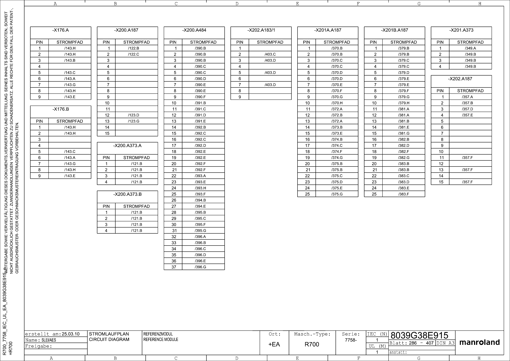

# +EA — Sheet 286 of 407 — REFERENZMODUL

**REFERENCE MODULE**

> Part of the manroland **R700** printing press IEC/UL circuit diagrams.
> Drawing class: **Stromlaufplan / Circuit diagram** (DIN A3).
> Document `+EA` covers the **Printing unit** machine section.

## At a glance

| Field | Value |
|---|---|
| Document | `+EA`  (8039G38E915) |
| Sheet | **286** of 407 |
| Section (DE) | REFERENZMODUL |
| Section (EN) | REFERENCE MODULE |
| Section type | REFERENCE_MODULE — Reference module |
| Machine type | `R700` |
| Series | `7758` |
| Created | 25.03.10 |
| Replaces | — |
| Columns used | A, B, C, D, E, F, G, H |
| Path numbers | — |
| Labels on sheet | 318 |
| Cross-refs out | 129 |
| Cross-refs in | 0 |

**Previous:** [+EA sheet 285](SHEET_0285.md) · **Next:** [+EA sheet 287](SHEET_0287.md) · **Document TOC:** [_TOC.md](_TOC.md)  (+EA) · **Master TOC:** [all sheets](../_MASTER_TOC.md)

## Sheet image (300 DPI, exact vector render)



_Rendered directly from the PDF vector layer at 300 DPI (1-bit), no OCR and no resampling. Use it to confirm anything ambiguous in the text below._

## Cross-references on this sheet

Each entry is a wire leaving this sheet. The printed token is `/sheet.column`; the link resolves to that sheet inside the same document.

| Ref | Target sheet | Col | Path | Destination on target | Target section | From col |
|---|---|---|---|---|---|---|
| `/122.B` | [+EA sheet 122](SHEET_0122.md) | B | — | — | TROCKENBESTÄUBER | B |
| `/390.B` | [+EA sheet 390](SHEET_0390.md) | B | — | — | OPTION: ZWISCHENTROCKNER VORBEREITUNG; | C |
| `/370.B` | [+EA sheet 370](SHEET_0370.md) | B | — | — | OPTION: ENDTROCKNER 1 VORBEREITUNG; | F |
| `/379.B` | [+EA sheet 379](SHEET_0379.md) | B | — | — | OPTION: ENDTROCKNER 2 VORBEREITUNG | G |
| `/349.A` | [+EA sheet 349](SHEET_0349.md) | A | — | — | OPTION: VORBEREITUNG IONISATIONSANLAGE | H |
| `/143.H` | [+EA sheet 143](SHEET_0143.md) | H | — | — | ZUGANGSABSICHERUNG | A |
| `/390.B` | [+EA sheet 390](SHEET_0390.md) | B | — | — | OPTION: ZWISCHENTROCKNER VORBEREITUNG; | C |
| `/370.B` | [+EA sheet 370](SHEET_0370.md) | B | — | — | OPTION: ENDTROCKNER 1 VORBEREITUNG; | F |
| `/379.B` | [+EA sheet 379](SHEET_0379.md) | B | — | — | OPTION: ENDTROCKNER 2 VORBEREITUNG | G |
| `/349.B` | [+EA sheet 349](SHEET_0349.md) | B | — | — | OPTION: VORBEREITUNG IONISATIONSANLAGE | H |
| `/143.H` | [+EA sheet 143](SHEET_0143.md) | H | — | — | ZUGANGSABSICHERUNG | A |
| `/122.C` | [+EA sheet 122](SHEET_0122.md) | C | — | — | TROCKENBESTÄUBER | B |
| `/403.C` | [+EA sheet 403](SHEET_0403.md) | C | — | — | OPTION: FREMDGERÄTE ANBINDUNG ÜBER | E |
| `/143.B` | [+EA sheet 143](SHEET_0143.md) | B | — | — | ZUGANGSABSICHERUNG | A |
| `/390.B` | [+EA sheet 390](SHEET_0390.md) | B | — | — | OPTION: ZWISCHENTROCKNER VORBEREITUNG; | C |
| `/349.B` | [+EA sheet 349](SHEET_0349.md) | B | — | — | OPTION: VORBEREITUNG IONISATIONSANLAGE | H |
| `/403.D` | [+EA sheet 403](SHEET_0403.md) | D | — | — | OPTION: FREMDGERÄTE ANBINDUNG ÜBER | E |
| `/370.C` | [+EA sheet 370](SHEET_0370.md) | C | — | — | OPTION: ENDTROCKNER 1 VORBEREITUNG; | F |
| `/379.C` | [+EA sheet 379](SHEET_0379.md) | C | — | — | OPTION: ENDTROCKNER 2 VORBEREITUNG | G |
| `/349.B` | [+EA sheet 349](SHEET_0349.md) | B | — | — | OPTION: VORBEREITUNG IONISATIONSANLAGE | H |
| `/390.C` | [+EA sheet 390](SHEET_0390.md) | C | — | — | OPTION: ZWISCHENTROCKNER VORBEREITUNG; | C |
| `/370.C` | [+EA sheet 370](SHEET_0370.md) | C | — | — | OPTION: ENDTROCKNER 1 VORBEREITUNG; | F |
| `/379.C` | [+EA sheet 379](SHEET_0379.md) | C | — | — | OPTION: ENDTROCKNER 2 VORBEREITUNG | G |
| `/143.C` | [+EA sheet 143](SHEET_0143.md) | C | — | — | ZUGANGSABSICHERUNG | A |
| `/390.C` | [+EA sheet 390](SHEET_0390.md) | C | — | — | OPTION: ZWISCHENTROCKNER VORBEREITUNG; | C |
| `/403.D` | [+EA sheet 403](SHEET_0403.md) | D | — | — | OPTION: FREMDGERÄTE ANBINDUNG ÜBER | E |
| `/370.D` | [+EA sheet 370](SHEET_0370.md) | D | — | — | OPTION: ENDTROCKNER 1 VORBEREITUNG; | F |
| `/379.D` | [+EA sheet 379](SHEET_0379.md) | D | — | — | OPTION: ENDTROCKNER 2 VORBEREITUNG | G |
| `/143.A` | [+EA sheet 143](SHEET_0143.md) | A | — | — | ZUGANGSABSICHERUNG | A |
| `/379.E` | [+EA sheet 379](SHEET_0379.md) | E | — | — | OPTION: ENDTROCKNER 2 VORBEREITUNG | G |
| `/390.D` | [+EA sheet 390](SHEET_0390.md) | D | — | — | OPTION: ZWISCHENTROCKNER VORBEREITUNG; | C |
| `/370.D` | [+EA sheet 370](SHEET_0370.md) | D | — | — | OPTION: ENDTROCKNER 1 VORBEREITUNG; | F |
| `/390.E` | [+EA sheet 390](SHEET_0390.md) | E | — | — | OPTION: ZWISCHENTROCKNER VORBEREITUNG; | C |
| `/370.E` | [+EA sheet 370](SHEET_0370.md) | E | — | — | OPTION: ENDTROCKNER 1 VORBEREITUNG; | F |
| `/379.E` | [+EA sheet 379](SHEET_0379.md) | E | — | — | OPTION: ENDTROCKNER 2 VORBEREITUNG | G |
| `/143.G` | [+EA sheet 143](SHEET_0143.md) | G | — | — | ZUGANGSABSICHERUNG | A |
| `/403.D` | [+EA sheet 403](SHEET_0403.md) | D | — | — | OPTION: FREMDGERÄTE ANBINDUNG ÜBER | E |
| `/390.E` | [+EA sheet 390](SHEET_0390.md) | E | — | — | OPTION: ZWISCHENTROCKNER VORBEREITUNG; | C |
| `/370.F` | [+EA sheet 370](SHEET_0370.md) | F | — | — | OPTION: ENDTROCKNER 1 VORBEREITUNG; | F |
| `/379.F` | [+EA sheet 379](SHEET_0379.md) | F | — | — | OPTION: ENDTROCKNER 2 VORBEREITUNG | G |
| `/143.H` | [+EA sheet 143](SHEET_0143.md) | H | — | — | ZUGANGSABSICHERUNG | A |
| `/143.E` | [+EA sheet 143](SHEET_0143.md) | E | — | — | ZUGANGSABSICHERUNG | A |
| `/357.A` | [+EA sheet 357](SHEET_0357.md) | A | — | — | OPTION: AUFLAGENZÄHLER / GUTBOGENZÄHLER | H |
| `/390.F` | [+EA sheet 390](SHEET_0390.md) | F | — | — | OPTION: ZWISCHENTROCKNER VORBEREITUNG; | C |
| `/370.G` | [+EA sheet 370](SHEET_0370.md) | G | — | — | OPTION: ENDTROCKNER 1 VORBEREITUNG; | F |
| `/379.G` | [+EA sheet 379](SHEET_0379.md) | G | — | — | OPTION: ENDTROCKNER 2 VORBEREITUNG | G |
| `/391.B` | [+EA sheet 391](SHEET_0391.md) | B | — | — | OPTION: ZWISCHENTROCKNER VORBEREITUNG; | C |
| `/357.B` | [+EA sheet 357](SHEET_0357.md) | B | — | — | OPTION: AUFLAGENZÄHLER / GUTBOGENZÄHLER | H |
| `/370.H` | [+EA sheet 370](SHEET_0370.md) | H | — | — | OPTION: ENDTROCKNER 1 VORBEREITUNG; | F |
| `/379.H` | [+EA sheet 379](SHEET_0379.md) | H | — | — | OPTION: ENDTROCKNER 2 VORBEREITUNG | G |
| `/372.A` | [+EA sheet 372](SHEET_0372.md) | A | — | — | OPTION: ENDTROCKNER 1 VORBEREITUNG; | F |
| `/381.A` | [+EA sheet 381](SHEET_0381.md) | A | — | — | OPTION: ENDTROCKNER 2 VORBEREITUNG | G |
| `/391.C` | [+EA sheet 391](SHEET_0391.md) | C | — | — | OPTION: ZWISCHENTROCKNER VORBEREITUNG; | C |
| `/357.D` | [+EA sheet 357](SHEET_0357.md) | D | — | — | OPTION: AUFLAGENZÄHLER / GUTBOGENZÄHLER | H |
| `/372.B` | [+EA sheet 372](SHEET_0372.md) | B | — | — | OPTION: ENDTROCKNER 1 VORBEREITUNG; | F |
| `/381.A` | [+EA sheet 381](SHEET_0381.md) | A | — | — | OPTION: ENDTROCKNER 2 VORBEREITUNG | G |
| `/357.E` | [+EA sheet 357](SHEET_0357.md) | E | — | — | OPTION: AUFLAGENZÄHLER / GUTBOGENZÄHLER | H |
| `/123.D` | [+EA sheet 123](SHEET_0123.md) | D | — | — | TROCKENBESTÄUBER | B |
| `/391.D` | [+EA sheet 391](SHEET_0391.md) | D | — | — | OPTION: ZWISCHENTROCKNER VORBEREITUNG; | C |
| `/391.E` | [+EA sheet 391](SHEET_0391.md) | E | — | — | OPTION: ZWISCHENTROCKNER VORBEREITUNG; | C |
| `/372.A` | [+EA sheet 372](SHEET_0372.md) | A | — | — | OPTION: ENDTROCKNER 1 VORBEREITUNG; | F |
| `/381.B` | [+EA sheet 381](SHEET_0381.md) | B | — | — | OPTION: ENDTROCKNER 2 VORBEREITUNG | G |
| `/123.G` | [+EA sheet 123](SHEET_0123.md) | G | — | — | TROCKENBESTÄUBER | B |
| `/392.B` | [+EA sheet 392](SHEET_0392.md) | B | — | — | OPTION: ZWISCHENTROCKNER VORBEREITUNG; | C |
| `/373.B` | [+EA sheet 373](SHEET_0373.md) | B | — | — | OPTION: ENDTROCKNER 1 VORBEREITUNG; | F |
| `/381.E` | [+EA sheet 381](SHEET_0381.md) | E | — | — | OPTION: ENDTROCKNER 2 VORBEREITUNG | G |
| `/143.H` | [+EA sheet 143](SHEET_0143.md) | H | — | — | ZUGANGSABSICHERUNG | A |
| `/373.E` | [+EA sheet 373](SHEET_0373.md) | E | — | — | OPTION: ENDTROCKNER 1 VORBEREITUNG; | F |
| `/381.G` | [+EA sheet 381](SHEET_0381.md) | G | — | — | OPTION: ENDTROCKNER 2 VORBEREITUNG | G |
| `/143.H` | [+EA sheet 143](SHEET_0143.md) | H | — | — | ZUGANGSABSICHERUNG | A |
| `/392.C` | [+EA sheet 392](SHEET_0392.md) | C | — | — | OPTION: ZWISCHENTROCKNER VORBEREITUNG; | C |
| `/374.B` | [+EA sheet 374](SHEET_0374.md) | B | — | — | OPTION: ENDTROCKNER 1 VORBEREITUNG; | F |
| `/382.B` | [+EA sheet 382](SHEET_0382.md) | B | — | — | OPTION: ENDTROCKNER 2 VORBEREITUNG | G |
| `/392.C` | [+EA sheet 392](SHEET_0392.md) | C | — | — | OPTION: ZWISCHENTROCKNER VORBEREITUNG; | C |
| `/392.D` | [+EA sheet 392](SHEET_0392.md) | D | — | — | OPTION: ZWISCHENTROCKNER VORBEREITUNG; | C |
| `/374.C` | [+EA sheet 374](SHEET_0374.md) | C | — | — | OPTION: ENDTROCKNER 1 VORBEREITUNG; | F |
| `/382.D` | [+EA sheet 382](SHEET_0382.md) | D | — | — | OPTION: ENDTROCKNER 2 VORBEREITUNG | G |
| `/392.E` | [+EA sheet 392](SHEET_0392.md) | E | — | — | OPTION: ZWISCHENTROCKNER VORBEREITUNG; | C |
| `/374.F` | [+EA sheet 374](SHEET_0374.md) | F | — | — | OPTION: ENDTROCKNER 1 VORBEREITUNG; | F |
| `/382.F` | [+EA sheet 382](SHEET_0382.md) | F | — | — | OPTION: ENDTROCKNER 2 VORBEREITUNG | G |
| `/143.C` | [+EA sheet 143](SHEET_0143.md) | C | — | — | ZUGANGSABSICHERUNG | A |
| `/143.A` | [+EA sheet 143](SHEET_0143.md) | A | — | — | ZUGANGSABSICHERUNG | A |
| `/392.E` | [+EA sheet 392](SHEET_0392.md) | E | — | — | OPTION: ZWISCHENTROCKNER VORBEREITUNG; | C |
| `/374.G` | [+EA sheet 374](SHEET_0374.md) | G | — | — | OPTION: ENDTROCKNER 1 VORBEREITUNG; | F |
| `/382.G` | [+EA sheet 382](SHEET_0382.md) | G | — | — | OPTION: ENDTROCKNER 2 VORBEREITUNG | G |
| `/357.F` | [+EA sheet 357](SHEET_0357.md) | F | — | — | OPTION: AUFLAGENZÄHLER / GUTBOGENZÄHLER | H |
| `/121.B` | [+EA sheet 121](SHEET_0121.md) | B | — | — | TROCKENBESTÄUBER | B |
| `/375.B` | [+EA sheet 375](SHEET_0375.md) | B | — | — | OPTION: ENDTROCKNER 1 VORBEREITUNG; | F |
| `/383.B` | [+EA sheet 383](SHEET_0383.md) | B | — | — | OPTION: ENDTROCKNER 2 VORBEREITUNG | G |
| `/392.F` | [+EA sheet 392](SHEET_0392.md) | F | — | — | OPTION: ZWISCHENTROCKNER VORBEREITUNG; | C |
| `/143.G` | [+EA sheet 143](SHEET_0143.md) | G | — | — | ZUGANGSABSICHERUNG | A |
| `/121.B` | [+EA sheet 121](SHEET_0121.md) | B | — | — | TROCKENBESTÄUBER | B |
| `/375.B` | [+EA sheet 375](SHEET_0375.md) | B | — | — | OPTION: ENDTROCKNER 1 VORBEREITUNG; | F |
| `/383.B` | [+EA sheet 383](SHEET_0383.md) | B | — | — | OPTION: ENDTROCKNER 2 VORBEREITUNG | G |
| `/392.F` | [+EA sheet 392](SHEET_0392.md) | F | — | — | OPTION: ZWISCHENTROCKNER VORBEREITUNG; | C |
| `/357.F` | [+EA sheet 357](SHEET_0357.md) | F | — | — | OPTION: AUFLAGENZÄHLER / GUTBOGENZÄHLER | H |
| `/143.H` | [+EA sheet 143](SHEET_0143.md) | H | — | — | ZUGANGSABSICHERUNG | A |
| `/143.E` | [+EA sheet 143](SHEET_0143.md) | E | — | — | ZUGANGSABSICHERUNG | A |
| `/121.B` | [+EA sheet 121](SHEET_0121.md) | B | — | — | TROCKENBESTÄUBER | B |
| `/393.A` | [+EA sheet 393](SHEET_0393.md) | A | — | — | OPTION: ZWISCHENTROCKNER VORBEREITUNG; | C |
| `/375.C` | [+EA sheet 375](SHEET_0375.md) | C | — | — | OPTION: ENDTROCKNER 1 VORBEREITUNG; | F |
| `/383.C` | [+EA sheet 383](SHEET_0383.md) | C | — | — | OPTION: ENDTROCKNER 2 VORBEREITUNG | G |
| `/121.B` | [+EA sheet 121](SHEET_0121.md) | B | — | — | TROCKENBESTÄUBER | B |
| `/393.E` | [+EA sheet 393](SHEET_0393.md) | E | — | — | OPTION: ZWISCHENTROCKNER VORBEREITUNG; | C |
| `/357.F` | [+EA sheet 357](SHEET_0357.md) | F | — | — | OPTION: AUFLAGENZÄHLER / GUTBOGENZÄHLER | H |
| `/375.D` | [+EA sheet 375](SHEET_0375.md) | D | — | — | OPTION: ENDTROCKNER 1 VORBEREITUNG; | F |
| `/383.D` | [+EA sheet 383](SHEET_0383.md) | D | — | — | OPTION: ENDTROCKNER 2 VORBEREITUNG | G |
| `/375.E` | [+EA sheet 375](SHEET_0375.md) | E | — | — | OPTION: ENDTROCKNER 1 VORBEREITUNG; | F |
| `/383.E` | [+EA sheet 383](SHEET_0383.md) | E | — | — | OPTION: ENDTROCKNER 2 VORBEREITUNG | G |
| `/393.H` | [+EA sheet 393](SHEET_0393.md) | H | — | — | OPTION: ZWISCHENTROCKNER VORBEREITUNG; | C |
| `/393.F` | [+EA sheet 393](SHEET_0393.md) | F | — | — | OPTION: ZWISCHENTROCKNER VORBEREITUNG; | C |
| `/375.G` | [+EA sheet 375](SHEET_0375.md) | G | — | — | OPTION: ENDTROCKNER 1 VORBEREITUNG; | F |
| `/383.F` | [+EA sheet 383](SHEET_0383.md) | F | — | — | OPTION: ENDTROCKNER 2 VORBEREITUNG | G |
| `/394.B` | [+EA sheet 394](SHEET_0394.md) | B | — | — | OPTION: ZWISCHENTROCKNER VORBEREITUNG; | C |
| `/394.E` | [+EA sheet 394](SHEET_0394.md) | E | — | — | OPTION: ZWISCHENTROCKNER VORBEREITUNG; | C |
| `/121.B` | [+EA sheet 121](SHEET_0121.md) | B | — | — | TROCKENBESTÄUBER | B |
| `/395.B` | [+EA sheet 395](SHEET_0395.md) | B | — | — | OPTION: ZWISCHENTROCKNER VORBEREITUNG; | C |
| `/121.B` | [+EA sheet 121](SHEET_0121.md) | B | — | — | TROCKENBESTÄUBER | B |
| `/395.C` | [+EA sheet 395](SHEET_0395.md) | C | — | — | OPTION: ZWISCHENTROCKNER VORBEREITUNG; | C |
| `/121.B` | [+EA sheet 121](SHEET_0121.md) | B | — | — | TROCKENBESTÄUBER | B |
| `/395.F` | [+EA sheet 395](SHEET_0395.md) | F | — | — | OPTION: ZWISCHENTROCKNER VORBEREITUNG; | C |
| `/121.B` | [+EA sheet 121](SHEET_0121.md) | B | — | — | TROCKENBESTÄUBER | B |
| `/395.G` | [+EA sheet 395](SHEET_0395.md) | G | — | — | OPTION: ZWISCHENTROCKNER VORBEREITUNG; | C |
| `/396.A` | [+EA sheet 396](SHEET_0396.md) | A | — | — | OPTION: ZWISCHENTROCKNER VORBEREITUNG; | C |
| `/396.B` | [+EA sheet 396](SHEET_0396.md) | B | — | — | OPTION: ZWISCHENTROCKNER VORBEREITUNG; | C |
| `/396.C` | [+EA sheet 396](SHEET_0396.md) | C | — | — | OPTION: ZWISCHENTROCKNER VORBEREITUNG; | C |
| `/396.D` | [+EA sheet 396](SHEET_0396.md) | D | — | — | OPTION: ZWISCHENTROCKNER VORBEREITUNG; | C |
| `/396.E` | [+EA sheet 396](SHEET_0396.md) | E | — | — | OPTION: ZWISCHENTROCKNER VORBEREITUNG; | C |
| `/396.G` | [+EA sheet 396](SHEET_0396.md) | G | — | — | OPTION: ZWISCHENTROCKNER VORBEREITUNG; | C |

## Devices on this sheet

| Tag | Class | Class meaning (IEC) | Col | Sub | Terminal | Sign |
|---|---|---|---|---|---|---|
| `X201.A373` | — | cross-device reference | H | — | — | — |
| `X202.A187` | — | cross-device reference | H | — | — | — |
| `X201A.A187` | — | cross-device reference | F | — | — | — |
| `X201B.A187` | — | cross-device reference | G | — | — | — |
| `X200.A187` | — | cross-device reference | B | — | — | — |
| `X176.A` | — | cross-device reference | A | — | — | — |
| `X176.B` | — | cross-device reference | A | — | — | — |
| `X200.A373.A` | — | cross-device reference | B | — | — | — |
| `X200.A373.B` | — | cross-device reference | B | — | — | — |
| `X200.A484` | — | cross-device reference | C | — | — | — |

## Potentials / nets

_No named potentials on this sheet._

## Wire-end annotations (grouped as printed)

A wire that continues elsewhere is annotated with a small cluster: the destination description, the path/line number `#NN`, and the `/sheet.column` cross reference. Each row below is one such cluster exactly as it is grouped on the drawing.

| Col | Y | Path | Cross-ref | Text on the wire |
|---|---|---|---|---|
| A | 65.5 | — | — | `X176.A` |
| B | 65.5 | — | — | `X200.A187` |
| C | 65.5 | — | — | `X200.A484` |
| D | 65.5 | — | — | `X202.A183/1` |
| F | 65.5 | — | — | `X201A.A187` |
| G | 65.5 | — | — | `X201B.A187` |
| H | 65.5 | — | — | `X201.A373` |
| A | 94.2 | — | — | `PIN 2 3 4 5 6 7 8 9 1 STROMPFAD` |
| B | 94.2 | — | — | `PIN 10 12 13 14 15 11 2 3 4 5 6 7 8 9 1 STROMPFAD` |
| C | 94.2 | — | — | `PIN STROMPFAD` |
| D | 94.2 | — | — | `PIN 2 3 4 5 6 7 8 9 1 STROMPFAD` |
| E | 94.2 | — | — | `PIN STROMPFAD` |
| G | 94.2 | — | — | `PIN STROMPFAD` |
| H | 94.2 | — | — | `PIN 2 3 4 1 STROMPFAD` |
| C | 108.4 | — | — | `2 3 4 5 6 7 8 9 1` |
| E | 108.4 | — | — | `2 3 4 5 6 7 8 9 1` |
| F | 108.4 | — | — | `2 3 4 5 6 7 8 9 1` |
| A | 108.7 | — | `/143.H` | — |
| B | 108.7 | — | `/122.B` | — |
| C | 108.7 | — | `/390.B` | — |
| F | 108.7 | — | `/370.B` | — |
| G | 108.7 | — | `/379.B` | — |
| H | 108.7 | — | `/349.A` | — |
| A | 122.9 | — | `/143.H` | — |
| B | 122.9 | — | `/122.C` | — |
| C | 122.9 | — | `/390.B` | — |
| E | 122.9 | — | `/403.C` | — |
| F | 122.9 | — | `/370.B` | — |
| G | 122.9 | — | `/379.B` | — |
| H | 122.9 | — | `/349.B` | — |
| A | 137.0 | — | `/143.B` | — |
| C | 137.0 | — | `/390.B` | — |
| H | 137.0 | — | `/349.B` | — |
| E | 137.1 | — | `/403.D` | — |
| F | 137.1 | — | `/370.C` | — |
| G | 137.1 | — | `/379.C` | — |
| C | 151.2 | — | `/390.C` | — |
| F | 151.2 | — | `/370.C` | — |
| G | 151.2 | — | `/379.C` | — |
| H | 151.2 | — | `/349.B` | — |
| A | 165.4 | — | `/143.C` | — |
| C | 165.4 | — | `/390.C` | — |
| E | 165.4 | — | `/403.D` | — |
| F | 165.4 | — | `/370.D` | — |
| G | 165.4 | — | `/379.D` | — |
| H | 178.9 | — | — | `X202.A187` |
| A | 179.6 | — | `/143.A` | — |
| C | 179.6 | — | `/390.D` | — |
| F | 179.6 | — | `/370.D` | — |
| G | 179.6 | — | `/379.E` | — |
| A | 193.7 | — | `/143.G` | — |
| C | 193.7 | — | `/390.E` | — |
| F | 193.7 | — | `/370.E` | — |
| G | 193.7 | — | `/379.E` | — |
| E | 193.8 | — | `/403.D` | — |
| H | 207.5 | — | — | `PIN 10 12 13 14 15 11 2 3 4 5 6 7 8 9 1 STROMPFAD` |
| A | 207.9 | — | `/143.H` | — |
| C | 207.9 | — | `/390.E` | — |
| F | 207.9 | — | `/370.F` | — |
| G | 207.9 | — | `/379.F` | — |
| A | 222.1 | — | `/143.E` | — |
| C | 222.1 | — | `/390.F` | — |
| F | 222.1 | — | `/370.G` | — |
| G | 222.1 | — | `/379.G` | — |
| H | 222.1 | — | `/357.A` | — |
| C | 235.9 | — | — | `10 12 13 14 15 16 17 11` |
| E | 235.9 | — | — | `10 12 13 14 15 16 17 18 19 20 11` |
| F | 235.9 | — | — | `10 12 13 14 15 16 17 18 19 20 11` |
| C | 236.2 | — | `/391.B` | — |
| H | 236.2 | — | `/357.B` | — |
| F | 236.3 | — | `/370.H` | — |
| G | 236.3 | — | `/379.H` | — |
| A | 249.8 | — | — | `X176.B` |
| C | 250.4 | — | `/391.C` | — |
| F | 250.4 | — | `/372.A` | — |
| G | 250.4 | — | `/381.A` | — |
| H | 250.4 | — | `/357.D` | — |
| B | 264.6 | — | `/123.D` | — |
| C | 264.6 | — | `/391.D` | — |
| F | 264.6 | — | `/372.B` | — |
| G | 264.6 | — | `/381.A` | — |
| H | 264.6 | — | `/357.E` | — |
| A | 278.4 | — | — | `PIN 2 3 4 5 6 7 8 9 1 STROMPFAD` |
| B | 278.8 | — | `/123.G` | — |
| C | 278.8 | — | `/391.E` | — |
| F | 278.8 | — | `/372.A` | — |
| G | 278.8 | — | `/381.B` | — |
| C | 292.9 | — | `/392.B` | — |
| F | 292.9 | — | `/373.B` | — |
| G | 292.9 | — | `/381.E` | — |
| A | 293.0 | — | `/143.H` | — |
| A | 307.1 | — | `/143.H` | — |
| C | 307.1 | — | `/392.C` | — |
| F | 307.1 | — | `/373.E` | — |
| G | 307.1 | — | `/381.G` | — |
| C | 321.3 | — | `/392.C` | — |
| F | 321.3 | — | `/374.B` | — |
| G | 321.3 | — | `/382.B` | — |
| B | 334.8 | — | — | `X200.A373.A` |
| C | 335.5 | — | `/392.D` | — |
| F | 335.5 | — | `/374.C` | — |
| G | 335.5 | — | `/382.D` | — |
| C | 349.3 | — | — | `18 19 20 22 23 24 25 26 27 28 29 30 32 33 34 35 36 37 21 31` |
| C | 349.6 | — | `/392.E` | — |
| F | 349.6 | — | `/374.F` | — |
| G | 349.6 | — | `/382.F` | — |
| A | 349.7 | — | `/143.C` | — |
| B | 363.4 | — | — | `PIN 2 3 4 1 STROMPFAD` |
| A | 363.8 | — | `/143.A` | — |
| C | 363.8 | — | `/392.E` | — |
| F | 363.8 | — | `/374.G` | — |
| G | 363.8 | — | `/382.G` | — |
| H | 363.8 | — | `/357.F` | — |
| A | 378.0 | — | `/143.G` | — |
| B | 378.0 | — | `/121.B` | — |
| C | 378.0 | — | `/392.F` | — |
| F | 378.0 | — | `/375.B` | — |
| G | 378.0 | — | `/383.B` | — |
| E | 391.8 | — | — | `22 23 24 25 21` |
| F | 391.8 | — | — | `22 23 24 25 21` |
| B | 392.1 | — | `/121.B` | — |
| F | 392.1 | — | `/375.B` | — |
| G | 392.1 | — | `/383.B` | — |
| A | 392.2 | — | `/143.H` | — |
| C | 392.2 | — | `/392.F` | — |
| H | 392.2 | — | `/357.F` | — |
| A | 406.3 | — | `/143.E` | — |
| B | 406.3 | — | `/121.B` | — |
| C | 406.3 | — | `/393.A` | — |
| F | 406.4 | — | `/375.C` | — |
| G | 406.4 | — | `/383.C` | — |
| B | 420.5 | — | `/121.B` | — |
| C | 420.5 | — | `/393.E` | — |
| F | 420.5 | — | `/375.D` | — |
| G | 420.5 | — | `/383.D` | — |
| H | 420.5 | — | `/357.F` | — |
| C | 434.7 | — | `/393.H` | — |
| F | 434.7 | — | `/375.E` | — |
| G | 434.7 | — | `/383.E` | — |
| B | 448.2 | — | — | `X200.A373.B` |
| C | 448.9 | — | `/393.F` | — |
| F | 448.9 | — | `/375.G` | — |
| G | 448.9 | — | `/383.F` | — |
| C | 463.0 | — | `/394.B` | — |
| B | 476.8 | — | — | `PIN 2 3 4 1 STROMPFAD` |
| C | 477.2 | — | `/394.E` | — |
| B | 491.4 | — | `/121.B` | — |
| C | 491.4 | — | `/395.B` | — |
| B | 505.5 | — | `/121.B` | — |
| C | 505.6 | — | `/395.C` | — |
| B | 519.7 | — | `/121.B` | — |
| C | 519.7 | — | `/395.F` | — |
| B | 533.9 | — | `/121.B` | — |
| C | 533.9 | — | `/395.G` | — |
| C | 548.1 | — | `/396.A` | — |
| C | 562.2 | — | `/396.B` | — |
| C | 576.4 | — | `/396.C` | — |
| C | 590.6 | — | `/396.D` | — |
| C | 604.8 | — | `/396.E` | — |
| C | 618.9 | — | `/396.G` | — |


## Reconstructed tables

This sheet carries tabular content (pin map / terminal assignment / index). The grid below was rebuilt from the drawing's own rule lines, so each row is exactly one physical row of the table.

### Table 1 — 20 data rows × 2 columns (at x=70.9, y=62.4) — **X176.A**

| PIN | STROMPFAD |
|---|---|
| `1` | `/143.H` |
| `2` | `/143.H` |
| `3` | `/143.B` |
| `4` |  |
| `5` | `/143.C` |
| `6` | `/143.A` |
| `7` | `/143.G` |
| `8` | `/143.H` |
| `9` | `/143.E` |
|  | `X176.B` |
| `PIN` | `STROMPFAD` |
| `1` | `/143.H` |
| `2` | `/143.H` |
| `3` |  |
| `4` |  |
| `5` | `/143.C` |
| `6` | `/143.A` |
| `7` | `/143.G` |
| `8` | `/143.H` |
| `9` | `/143.E` |


### Table 2 — 27 data rows × 2 columns (at x=226.8, y=62.4) — **X200.A187**

| PIN | STROMPFAD |
|---|---|
| `1` | `/122.B` |
| `2` | `/122.C` |
| `3` |  |
| `4` |  |
| `5` |  |
| `6` |  |
| `7` |  |
| `8` |  |
| `9` |  |
| `10` |  |
| `11` |  |
| `12` | `/123.D` |
| `13` | `/123.G` |
| `14` |  |
| `15` |  |
|  | `X200.A373.A` |
| `PIN` | `STROMPFAD` |
| `1` | `/121.B` |
| `2` | `/121.B` |
| `3` | `/121.B` |
| `4` | `/121.B` |
|  | `X200.A373.B` |
| `PIN` | `STROMPFAD` |
| `1` | `/121.B` |
| `2` | `/121.B` |
| `3` | `/121.B` |
| `4` | `/121.B` |


### Table 3 — 37 data rows × 2 columns (at x=382.7, y=62.4) — **X200.A484**

| PIN | STROMPFAD |
|---|---|
| `1` | `/390.B` |
| `2` | `/390.B` |
| `3` | `/390.B` |
| `4` | `/390.C` |
| `5` | `/390.C` |
| `6` | `/390.D` |
| `7` | `/390.E` |
| `8` | `/390.E` |
| `9` | `/390.F` |
| `10` | `/391.B` |
| `11` | `/391.C` |
| `12` | `/391.D` |
| `13` | `/391.E` |
| `14` | `/392.B` |
| `15` | `/392.C` |
| `16` | `/392.C` |
| `17` | `/392.D` |
| `18` | `/392.E` |
| `19` | `/392.E` |
| `20` | `/392.F` |
| `21` | `/392.F` |
| `22` | `/393.A` |
| `23` | `/393.E` |
| `24` | `/393.H` |
| `25` | `/393.F` |
| `26` | `/394.B` |
| `27` | `/394.E` |
| `28` | `/395.B` |
| `29` | `/395.C` |
| `30` | `/395.F` |
| `31` | `/395.G` |
| `32` | `/396.A` |
| `33` | `/396.B` |
| `34` | `/396.C` |
| `35` | `/396.D` |
| `36` | `/396.E` |
| `37` | `/396.G` |


### Table 4 — 9 data rows × 2 columns (at x=538.6, y=62.4) — **X202.A183/1**

| PIN | STROMPFAD |
|---|---|
| `1` |  |
| `2` | `/403.C` |
| `3` | `/403.D` |
| `4` |  |
| `5` | `/403.D` |
| `6` |  |
| `7` | `/403.D` |
| `8` |  |
| `9` |  |


### Table 5 — 25 data rows × 2 columns (at x=694.5, y=62.4) — **X201A.A187**

| PIN | STROMPFAD |
|---|---|
| `1` | `/370.B` |
| `2` | `/370.B` |
| `3` | `/370.C` |
| `4` | `/370.C` |
| `5` | `/370.D` |
| `6` | `/370.D` |
| `7` | `/370.E` |
| `8` | `/370.F` |
| `9` | `/370.G` |
| `10` | `/370.H` |
| `11` | `/372.A` |
| `12` | `/372.B` |
| `13` | `/372.A` |
| `14` | `/373.B` |
| `15` | `/373.E` |
| `16` | `/374.B` |
| `17` | `/374.C` |
| `18` | `/374.F` |
| `19` | `/374.G` |
| `20` | `/375.B` |
| `21` | `/375.B` |
| `22` | `/375.C` |
| `23` | `/375.D` |
| `24` | `/375.E` |
| `25` | `/375.G` |


### Table 6 — 25 data rows × 2 columns (at x=850.4, y=62.4) — **X201B.A187**

| PIN | STROMPFAD |
|---|---|
| `1` | `/379.B` |
| `2` | `/379.B` |
| `3` | `/379.C` |
| `4` | `/379.C` |
| `5` | `/379.D` |
| `6` | `/379.E` |
| `7` | `/379.E` |
| `8` | `/379.F` |
| `9` | `/379.G` |
| `10` | `/379.H` |
| `11` | `/381.A` |
| `12` | `/381.A` |
| `13` | `/381.B` |
| `14` | `/381.E` |
| `15` | `/381.G` |
| `16` | `/382.B` |
| `17` | `/382.D` |
| `18` | `/382.F` |
| `19` | `/382.G` |
| `20` | `/383.B` |
| `21` | `/383.B` |
| `22` | `/383.C` |
| `23` | `/383.D` |
| `24` | `/383.E` |
| `25` | `/383.F` |


### Table 7 — 21 data rows × 2 columns (at x=1006.3, y=62.4) — **X201.A373**

| PIN | STROMPFAD |
|---|---|
| `1` | `/349.A` |
| `2` | `/349.B` |
| `3` | `/349.B` |
| `4` | `/349.B` |
|  | `X202.A187` |
| `PIN` | `STROMPFAD` |
| `1` | `/357.A` |
| `2` | `/357.B` |
| `3` | `/357.D` |
| `4` | `/357.E` |
| `5` |  |
| `6` |  |
| `7` |  |
| `8` |  |
| `9` |  |
| `10` |  |
| `11` | `/357.F` |
| `12` |  |
| `13` | `/357.F` |
| `14` |  |
| `15` | `/357.F` |


## Notes and free text on this sheet

| Text | Col | Y (pt) |
|---|---|---|
| `PIN` | G | 94.2 |
| `STROMPFAD` | H | 94.15 |
| `PIN` | E | 94.2 |
| `STROMPFAD` | F | 94.15 |
| `PIN` | F | 94.2 |
| `STROMPFAD` | G | 94.15 |
| `PIN` | B | 94.2 |
| `STROMPFAD` | B | 94.15 |
| `PIN` | A | 94.2 |
| `STROMPFAD` | A | 94.15 |
| `PIN` | C | 94.2 |
| `STROMPFAD` | C | 94.15 |
| `PIN` | D | 94.2 |
| `STROMPFAD` | E | 94.15 |
| `X202.A183/1` | D | 65.5 |

## Complete label inventory (exact text from the drawing)

Every text object inside the drawing area of this sheet, in DIN reading order (column A→H, then top→bottom). This is the authoritative list: if a string is not here it is not printed on this sheet.

| Col | Y | X | Dir | Type | Text |
|---|---|---|---|---|---|
| A | 65.5 | 122.3 | → | device ref | `X176.A` |
| A | 94.2 | 84.0 | → | text | `PIN` |
| A | 94.2 | 132.2 | → | text | `STROMPFAD` |
| A | 108.4 | 90.0 | → | number | `1` |
| A | 108.7 | 150.5 | → | cross-reference | `/143.H` |
| A | 122.5 | 89.4 | → | number | `2` |
| A | 122.9 | 150.5 | → | cross-reference | `/143.H` |
| A | 136.7 | 89.4 | → | number | `3` |
| A | 137.0 | 150.4 | → | cross-reference | `/143.B` |
| A | 150.9 | 89.4 | → | number | `4` |
| A | 165.1 | 89.4 | → | number | `5` |
| A | 165.4 | 150.2 | → | cross-reference | `/143.C` |
| A | 179.2 | 89.4 | → | number | `6` |
| A | 179.6 | 150.2 | → | cross-reference | `/143.A` |
| A | 193.4 | 89.4 | → | number | `7` |
| A | 193.7 | 150.1 | → | cross-reference | `/143.G` |
| A | 207.6 | 89.4 | → | number | `8` |
| A | 207.9 | 150.5 | → | cross-reference | `/143.H` |
| A | 221.8 | 89.4 | → | number | `9` |
| A | 222.1 | 150.5 | → | cross-reference | `/143.E` |
| A | 249.8 | 122.7 | → | device ref | `X176.B` |
| A | 278.4 | 84.0 | → | text | `PIN` |
| A | 278.4 | 132.2 | → | text | `STROMPFAD` |
| A | 292.6 | 90.0 | → | number | `1` |
| A | 293.0 | 150.5 | → | cross-reference | `/143.H` |
| A | 306.8 | 89.4 | → | number | `2` |
| A | 307.1 | 150.5 | → | cross-reference | `/143.H` |
| A | 321.0 | 89.4 | → | number | `3` |
| A | 335.1 | 89.4 | → | number | `4` |
| A | 349.3 | 89.4 | → | number | `5` |
| A | 349.7 | 150.2 | → | cross-reference | `/143.C` |
| A | 363.5 | 89.4 | → | number | `6` |
| A | 363.8 | 150.2 | → | cross-reference | `/143.A` |
| A | 377.7 | 89.4 | → | number | `7` |
| A | 378.0 | 150.1 | → | cross-reference | `/143.G` |
| A | 391.8 | 89.4 | → | number | `8` |
| A | 392.2 | 150.5 | → | cross-reference | `/143.H` |
| A | 406.0 | 89.4 | → | number | `9` |
| A | 406.3 | 150.5 | → | cross-reference | `/143.E` |
| B | 65.5 | 266.9 | → | device ref | `X200.A187` |
| B | 94.2 | 240.0 | → | text | `PIN` |
| B | 94.2 | 288.1 | → | text | `STROMPFAD` |
| B | 108.4 | 251.7 | → | number | `1` |
| B | 108.7 | 299.2 | → | cross-reference | `/122.B` |
| B | 122.5 | 250.0 | → | number | `2` |
| B | 122.9 | 299.1 | → | cross-reference | `/122.C` |
| B | 136.7 | 250.0 | → | number | `3` |
| B | 150.9 | 250.0 | → | number | `4` |
| B | 165.1 | 250.0 | → | number | `5` |
| B | 179.2 | 250.0 | → | number | `6` |
| B | 193.4 | 250.0 | → | number | `7` |
| B | 207.6 | 250.0 | → | number | `8` |
| B | 221.8 | 250.0 | → | number | `9` |
| B | 235.9 | 244.6 | → | number | `10` |
| B | 250.1 | 246.3 | → | number | `11` |
| B | 264.3 | 244.6 | → | number | `12` |
| B | 264.6 | 299.1 | → | cross-reference | `/123.D` |
| B | 278.5 | 244.6 | → | number | `13` |
| B | 278.8 | 298.9 | → | cross-reference | `/123.G` |
| B | 292.6 | 244.6 | → | number | `14` |
| B | 306.8 | 244.6 | → | number | `15` |
| B | 334.8 | 264.3 | → | device ref | `X200.A373.A` |
| B | 363.4 | 288.1 | → | text | `STROMPFAD` |
| B | 363.5 | 240.0 | → | text | `PIN` |
| B | 377.7 | 245.9 | → | number | `1` |
| B | 378.0 | 306.3 | → | cross-reference | `/121.B` |
| B | 391.8 | 245.3 | → | number | `2` |
| B | 392.2 | 306.3 | → | cross-reference | `/121.B` |
| B | 406.0 | 245.3 | → | number | `3` |
| B | 406.3 | 306.3 | → | cross-reference | `/121.B` |
| B | 420.2 | 245.3 | → | number | `4` |
| B | 420.5 | 306.3 | → | cross-reference | `/121.B` |
| B | 448.2 | 264.8 | → | device ref | `X200.A373.B` |
| B | 476.8 | 288.1 | → | text | `STROMPFAD` |
| B | 476.9 | 240.0 | → | text | `PIN` |
| B | 491.0 | 245.9 | → | number | `1` |
| B | 491.4 | 306.3 | → | cross-reference | `/121.B` |
| B | 505.2 | 245.3 | → | number | `2` |
| B | 505.5 | 306.3 | → | cross-reference | `/121.B` |
| B | 519.4 | 245.3 | → | number | `3` |
| B | 519.7 | 306.3 | → | cross-reference | `/121.B` |
| B | 533.6 | 245.3 | → | number | `4` |
| B | 533.9 | 306.3 | → | cross-reference | `/121.B` |
| C | 65.5 | 425.6 | → | device ref | `X200.A484` |
| C | 94.2 | 395.9 | → | text | `PIN` |
| C | 94.2 | 444.0 | → | text | `STROMPFAD` |
| C | 108.4 | 407.6 | → | number | `1` |
| C | 108.7 | 455.1 | → | cross-reference | `/390.B` |
| C | 122.5 | 405.9 | → | number | `2` |
| C | 122.9 | 455.1 | → | cross-reference | `/390.B` |
| C | 136.7 | 405.9 | → | number | `3` |
| C | 137.0 | 455.1 | → | cross-reference | `/390.B` |
| C | 150.9 | 405.9 | → | number | `4` |
| C | 151.2 | 455.0 | → | cross-reference | `/390.C` |
| C | 165.1 | 405.9 | → | number | `5` |
| C | 165.4 | 455.0 | → | cross-reference | `/390.C` |
| C | 179.2 | 405.9 | → | number | `6` |
| C | 179.6 | 455.0 | → | cross-reference | `/390.D` |
| C | 193.4 | 405.9 | → | number | `7` |
| C | 193.7 | 455.2 | → | cross-reference | `/390.E` |
| C | 207.6 | 405.9 | → | number | `8` |
| C | 207.9 | 455.2 | → | cross-reference | `/390.E` |
| C | 221.8 | 405.9 | → | number | `9` |
| C | 222.1 | 455.4 | → | cross-reference | `/390.F` |
| C | 235.9 | 400.5 | → | number | `10` |
| C | 236.2 | 455.1 | → | cross-reference | `/391.B` |
| C | 250.1 | 402.2 | → | number | `11` |
| C | 250.4 | 455.0 | → | cross-reference | `/391.C` |
| C | 264.3 | 400.5 | → | number | `12` |
| C | 264.6 | 455.0 | → | cross-reference | `/391.D` |
| C | 278.5 | 400.5 | → | number | `13` |
| C | 278.8 | 455.2 | → | cross-reference | `/391.E` |
| C | 292.6 | 400.5 | → | number | `14` |
| C | 292.9 | 455.1 | → | cross-reference | `/392.B` |
| C | 306.8 | 400.5 | → | number | `15` |
| C | 307.1 | 455.0 | → | cross-reference | `/392.C` |
| C | 321.0 | 400.5 | → | number | `16` |
| C | 321.3 | 455.0 | → | cross-reference | `/392.C` |
| C | 335.1 | 400.5 | → | number | `17` |
| C | 335.5 | 455.0 | → | cross-reference | `/392.D` |
| C | 349.3 | 400.5 | → | number | `18` |
| C | 349.6 | 455.2 | → | cross-reference | `/392.E` |
| C | 363.5 | 400.5 | → | number | `19` |
| C | 363.8 | 455.2 | → | cross-reference | `/392.E` |
| C | 377.7 | 400.5 | → | number | `20` |
| C | 378.0 | 455.4 | → | cross-reference | `/392.F` |
| C | 391.8 | 402.2 | → | number | `21` |
| C | 392.2 | 455.4 | → | cross-reference | `/392.F` |
| C | 406.0 | 400.5 | → | number | `22` |
| C | 406.3 | 455.0 | → | cross-reference | `/393.A` |
| C | 420.2 | 400.5 | → | number | `23` |
| C | 420.5 | 455.2 | → | cross-reference | `/393.E` |
| C | 434.4 | 400.5 | → | number | `24` |
| C | 434.7 | 455.2 | → | cross-reference | `/393.H` |
| C | 448.5 | 400.5 | → | number | `25` |
| C | 448.9 | 455.4 | → | cross-reference | `/393.F` |
| C | 462.7 | 400.5 | → | number | `26` |
| C | 463.0 | 455.1 | → | cross-reference | `/394.B` |
| C | 476.9 | 400.5 | → | number | `27` |
| C | 477.2 | 455.2 | → | cross-reference | `/394.E` |
| C | 491.0 | 400.5 | → | number | `28` |
| C | 491.4 | 455.1 | → | cross-reference | `/395.B` |
| C | 505.2 | 400.5 | → | number | `29` |
| C | 505.6 | 455.0 | → | cross-reference | `/395.C` |
| C | 519.4 | 400.5 | → | number | `30` |
| C | 519.7 | 455.4 | → | cross-reference | `/395.F` |
| C | 533.6 | 402.2 | → | number | `31` |
| C | 533.9 | 454.8 | → | cross-reference | `/395.G` |
| C | 547.7 | 400.5 | → | number | `32` |
| C | 548.1 | 455.0 | → | cross-reference | `/396.A` |
| C | 561.9 | 400.5 | → | number | `33` |
| C | 562.2 | 455.1 | → | cross-reference | `/396.B` |
| C | 576.1 | 400.5 | → | number | `34` |
| C | 576.4 | 455.0 | → | cross-reference | `/396.C` |
| C | 590.3 | 400.5 | → | number | `35` |
| C | 590.6 | 455.0 | → | cross-reference | `/396.D` |
| C | 604.4 | 400.5 | → | number | `36` |
| C | 604.8 | 455.2 | → | cross-reference | `/396.E` |
| C | 618.6 | 400.5 | → | number | `37` |
| C | 618.9 | 454.8 | → | cross-reference | `/396.G` |
| D | 65.5 | 577.8 | → | text | `X202.A183/1` |
| D | 94.2 | 551.8 | → | text | `PIN` |
| D | 108.4 | 557.7 | → | number | `1` |
| D | 122.5 | 557.1 | → | number | `2` |
| D | 136.7 | 557.1 | → | number | `3` |
| D | 150.9 | 557.1 | → | number | `4` |
| D | 165.1 | 557.1 | → | number | `5` |
| D | 179.2 | 557.1 | → | number | `6` |
| D | 193.4 | 557.1 | → | number | `7` |
| D | 207.6 | 557.1 | → | number | `8` |
| D | 221.8 | 557.1 | → | number | `9` |
| E | 94.2 | 600.0 | → | text | `STROMPFAD` |
| E | 94.2 | 707.7 | → | text | `PIN` |
| E | 108.4 | 719.4 | → | number | `1` |
| E | 122.5 | 717.7 | → | number | `2` |
| E | 122.9 | 618.0 | → | cross-reference | `/403.C` |
| E | 136.7 | 717.7 | → | number | `3` |
| E | 137.1 | 618.0 | → | cross-reference | `/403.D` |
| E | 150.9 | 717.7 | → | number | `4` |
| E | 165.1 | 717.7 | → | number | `5` |
| E | 165.4 | 618.0 | → | cross-reference | `/403.D` |
| E | 179.2 | 717.7 | → | number | `6` |
| E | 193.4 | 717.7 | → | number | `7` |
| E | 193.8 | 618.0 | → | cross-reference | `/403.D` |
| E | 207.6 | 717.7 | → | number | `8` |
| E | 221.8 | 717.7 | → | number | `9` |
| E | 235.9 | 712.3 | → | number | `10` |
| E | 250.1 | 714.0 | → | number | `11` |
| E | 264.3 | 712.3 | → | number | `12` |
| E | 278.5 | 712.3 | → | number | `13` |
| E | 292.6 | 712.3 | → | number | `14` |
| E | 306.8 | 712.3 | → | number | `15` |
| E | 321.0 | 712.3 | → | number | `16` |
| E | 335.1 | 712.3 | → | number | `17` |
| E | 349.3 | 712.3 | → | number | `18` |
| E | 363.5 | 712.3 | → | number | `19` |
| E | 377.7 | 712.3 | → | number | `20` |
| E | 391.8 | 714.0 | → | number | `21` |
| E | 406.0 | 712.3 | → | number | `22` |
| E | 420.2 | 712.3 | → | number | `23` |
| E | 434.4 | 712.3 | → | number | `24` |
| E | 448.5 | 712.3 | → | number | `25` |
| F | 65.5 | 733.9 | → | device ref | `X201A.A187` |
| F | 94.2 | 755.9 | → | text | `STROMPFAD` |
| F | 94.2 | 863.6 | → | text | `PIN` |
| F | 108.4 | 875.3 | → | number | `1` |
| F | 108.7 | 774.0 | → | cross-reference | `/370.B` |
| F | 122.5 | 873.6 | → | number | `2` |
| F | 122.9 | 774.0 | → | cross-reference | `/370.B` |
| F | 136.7 | 873.6 | → | number | `3` |
| F | 137.1 | 773.9 | → | cross-reference | `/370.C` |
| F | 150.9 | 873.6 | → | number | `4` |
| F | 151.2 | 773.9 | → | cross-reference | `/370.C` |
| F | 165.1 | 873.6 | → | number | `5` |
| F | 165.4 | 773.9 | → | cross-reference | `/370.D` |
| F | 179.2 | 873.6 | → | number | `6` |
| F | 179.6 | 773.9 | → | cross-reference | `/370.D` |
| F | 193.4 | 873.6 | → | number | `7` |
| F | 193.7 | 774.1 | → | cross-reference | `/370.E` |
| F | 207.6 | 873.6 | → | number | `8` |
| F | 207.9 | 774.3 | → | cross-reference | `/370.F` |
| F | 221.8 | 873.6 | → | number | `9` |
| F | 222.1 | 773.7 | → | cross-reference | `/370.G` |
| F | 235.9 | 868.3 | → | number | `10` |
| F | 236.3 | 774.1 | → | cross-reference | `/370.H` |
| F | 250.1 | 870.0 | → | number | `11` |
| F | 250.4 | 773.9 | → | cross-reference | `/372.A` |
| F | 264.3 | 868.3 | → | number | `12` |
| F | 264.6 | 774.0 | → | cross-reference | `/372.B` |
| F | 278.5 | 868.3 | → | number | `13` |
| F | 278.8 | 773.9 | → | cross-reference | `/372.A` |
| F | 292.6 | 868.3 | → | number | `14` |
| F | 292.9 | 774.0 | → | cross-reference | `/373.B` |
| F | 306.8 | 868.3 | → | number | `15` |
| F | 307.1 | 774.1 | → | cross-reference | `/373.E` |
| F | 321.0 | 868.3 | → | number | `16` |
| F | 321.3 | 774.0 | → | cross-reference | `/374.B` |
| F | 335.1 | 868.3 | → | number | `17` |
| F | 335.5 | 773.9 | → | cross-reference | `/374.C` |
| F | 349.3 | 868.3 | → | number | `18` |
| F | 349.6 | 774.3 | → | cross-reference | `/374.F` |
| F | 363.5 | 868.3 | → | number | `19` |
| F | 363.8 | 773.7 | → | cross-reference | `/374.G` |
| F | 377.7 | 868.3 | → | number | `20` |
| F | 378.0 | 774.0 | → | cross-reference | `/375.B` |
| F | 391.8 | 870.0 | → | number | `21` |
| F | 392.2 | 774.0 | → | cross-reference | `/375.B` |
| F | 406.0 | 868.3 | → | number | `22` |
| F | 406.4 | 773.9 | → | cross-reference | `/375.C` |
| F | 420.2 | 868.3 | → | number | `23` |
| F | 420.5 | 773.9 | → | cross-reference | `/375.D` |
| F | 434.4 | 868.3 | → | number | `24` |
| F | 434.7 | 774.1 | → | cross-reference | `/375.E` |
| F | 448.5 | 868.3 | → | number | `25` |
| F | 448.9 | 773.7 | → | cross-reference | `/375.G` |
| G | 65.5 | 889.8 | → | device ref | `X201B.A187` |
| G | 94.2 | 911.8 | → | text | `STROMPFAD` |
| G | 94.2 | 1019.5 | → | text | `PIN` |
| G | 108.4 | 1025.4 | → | number | `1` |
| G | 108.7 | 929.9 | → | cross-reference | `/379.B` |
| G | 122.5 | 1024.9 | → | number | `2` |
| G | 122.9 | 929.9 | → | cross-reference | `/379.B` |
| G | 136.7 | 1024.9 | → | number | `3` |
| G | 137.1 | 929.8 | → | cross-reference | `/379.C` |
| G | 150.9 | 1024.9 | → | number | `4` |
| G | 151.2 | 929.8 | → | cross-reference | `/379.C` |
| G | 165.4 | 929.8 | → | cross-reference | `/379.D` |
| G | 179.6 | 930.0 | → | cross-reference | `/379.E` |
| G | 193.7 | 930.0 | → | cross-reference | `/379.E` |
| G | 207.6 | 1019.5 | → | text | `PIN` |
| G | 207.9 | 930.2 | → | cross-reference | `/379.F` |
| G | 221.8 | 1031.2 | → | number | `1` |
| G | 222.1 | 929.6 | → | cross-reference | `/379.G` |
| G | 235.9 | 1029.5 | → | number | `2` |
| G | 236.3 | 930.0 | → | cross-reference | `/379.H` |
| G | 250.1 | 1029.5 | → | number | `3` |
| G | 250.4 | 929.8 | → | cross-reference | `/381.A` |
| G | 264.3 | 1029.5 | → | number | `4` |
| G | 264.6 | 929.8 | → | cross-reference | `/381.A` |
| G | 278.5 | 1029.5 | → | number | `5` |
| G | 278.8 | 929.9 | → | cross-reference | `/381.B` |
| G | 292.6 | 1029.5 | → | number | `6` |
| G | 292.9 | 930.0 | → | cross-reference | `/381.E` |
| G | 306.8 | 1029.5 | → | number | `7` |
| G | 307.1 | 929.6 | → | cross-reference | `/381.G` |
| G | 321.0 | 1029.5 | → | number | `8` |
| G | 321.3 | 929.9 | → | cross-reference | `/382.B` |
| G | 335.1 | 1029.5 | → | number | `9` |
| G | 335.5 | 929.8 | → | cross-reference | `/382.D` |
| G | 349.3 | 1024.2 | → | number | `10` |
| G | 349.6 | 930.2 | → | cross-reference | `/382.F` |
| G | 363.5 | 1025.9 | → | number | `11` |
| G | 363.8 | 929.6 | → | cross-reference | `/382.G` |
| G | 377.7 | 1024.2 | → | number | `12` |
| G | 378.0 | 929.9 | → | cross-reference | `/383.B` |
| G | 391.8 | 1024.2 | → | number | `13` |
| G | 392.2 | 929.9 | → | cross-reference | `/383.B` |
| G | 406.0 | 1024.2 | → | number | `14` |
| G | 406.4 | 929.8 | → | cross-reference | `/383.C` |
| G | 420.2 | 1024.2 | → | number | `15` |
| G | 420.5 | 929.8 | → | cross-reference | `/383.D` |
| G | 434.7 | 930.0 | → | cross-reference | `/383.E` |
| G | 448.9 | 930.2 | → | cross-reference | `/383.F` |
| H | 65.5 | 1049.2 | → | device ref | `X201.A373` |
| H | 94.2 | 1067.7 | → | text | `STROMPFAD` |
| H | 108.7 | 1085.7 | → | cross-reference | `/349.A` |
| H | 122.9 | 1085.8 | → | cross-reference | `/349.B` |
| H | 137.0 | 1085.8 | → | cross-reference | `/349.B` |
| H | 151.2 | 1085.8 | → | cross-reference | `/349.B` |
| H | 178.9 | 1046.4 | → | device ref | `X202.A187` |
| H | 207.5 | 1067.7 | → | text | `STROMPFAD` |
| H | 222.1 | 1078.6 | → | cross-reference | `/357.A` |
| H | 236.2 | 1078.7 | → | cross-reference | `/357.B` |
| H | 250.4 | 1078.6 | → | cross-reference | `/357.D` |
| H | 264.6 | 1078.9 | → | cross-reference | `/357.E` |
| H | 363.8 | 1079.0 | → | cross-reference | `/357.F` |
| H | 392.2 | 1079.0 | → | cross-reference | `/357.F` |
| H | 420.5 | 1079.0 | → | cross-reference | `/357.F` |

## Reading-order text block

The same content as a plain block, grouped by DIN column — convenient to paste or to match against a visual description.

```text
=== Column A ===
  65.5  122.3  devref       X176.A
  94.2   84.0  text         PIN
  94.2  132.2  text         STROMPFAD
 108.4   90.0  numeric      1
 108.7  150.5  xref         /143.H
 122.5   89.4  numeric      2
 122.9  150.5  xref         /143.H
 136.7   89.4  numeric      3
 137.0  150.4  xref         /143.B
 150.9   89.4  numeric      4
 165.1   89.4  numeric      5
 165.4  150.2  xref         /143.C
 179.2   89.4  numeric      6
 179.6  150.2  xref         /143.A
 193.4   89.4  numeric      7
 193.7  150.1  xref         /143.G
 207.6   89.4  numeric      8
 207.9  150.5  xref         /143.H
 221.8   89.4  numeric      9
 222.1  150.5  xref         /143.E
 249.8  122.7  devref       X176.B
 278.4   84.0  text         PIN
 278.4  132.2  text         STROMPFAD
 292.6   90.0  numeric      1
 293.0  150.5  xref         /143.H
 306.8   89.4  numeric      2
 307.1  150.5  xref         /143.H
 321.0   89.4  numeric      3
 335.1   89.4  numeric      4
 349.3   89.4  numeric      5
 349.7  150.2  xref         /143.C
 363.5   89.4  numeric      6
 363.8  150.2  xref         /143.A
 377.7   89.4  numeric      7
 378.0  150.1  xref         /143.G
 391.8   89.4  numeric      8
 392.2  150.5  xref         /143.H
 406.0   89.4  numeric      9
 406.3  150.5  xref         /143.E
=== Column B ===
  65.5  266.9  devref       X200.A187
  94.2  240.0  text         PIN
  94.2  288.1  text         STROMPFAD
 108.4  251.7  numeric      1
 108.7  299.2  xref         /122.B
 122.5  250.0  numeric      2
 122.9  299.1  xref         /122.C
 136.7  250.0  numeric      3
 150.9  250.0  numeric      4
 165.1  250.0  numeric      5
 179.2  250.0  numeric      6
 193.4  250.0  numeric      7
 207.6  250.0  numeric      8
 221.8  250.0  numeric      9
 235.9  244.6  numeric      10
 250.1  246.3  numeric      11
 264.3  244.6  numeric      12
 264.6  299.1  xref         /123.D
 278.5  244.6  numeric      13
 278.8  298.9  xref         /123.G
 292.6  244.6  numeric      14
 306.8  244.6  numeric      15
 334.8  264.3  devref       X200.A373.A
 363.4  288.1  text         STROMPFAD
 363.5  240.0  text         PIN
 377.7  245.9  numeric      1
 378.0  306.3  xref         /121.B
 391.8  245.3  numeric      2
 392.2  306.3  xref         /121.B
 406.0  245.3  numeric      3
 406.3  306.3  xref         /121.B
 420.2  245.3  numeric      4
 420.5  306.3  xref         /121.B
 448.2  264.8  devref       X200.A373.B
 476.8  288.1  text         STROMPFAD
 476.9  240.0  text         PIN
 491.0  245.9  numeric      1
 491.4  306.3  xref         /121.B
 505.2  245.3  numeric      2
 505.5  306.3  xref         /121.B
 519.4  245.3  numeric      3
 519.7  306.3  xref         /121.B
 533.6  245.3  numeric      4
 533.9  306.3  xref         /121.B
=== Column C ===
  65.5  425.6  devref       X200.A484
  94.2  395.9  text         PIN
  94.2  444.0  text         STROMPFAD
 108.4  407.6  numeric      1
 108.7  455.1  xref         /390.B
 122.5  405.9  numeric      2
 122.9  455.1  xref         /390.B
 136.7  405.9  numeric      3
 137.0  455.1  xref         /390.B
 150.9  405.9  numeric      4
 151.2  455.0  xref         /390.C
 165.1  405.9  numeric      5
 165.4  455.0  xref         /390.C
 179.2  405.9  numeric      6
 179.6  455.0  xref         /390.D
 193.4  405.9  numeric      7
 193.7  455.2  xref         /390.E
 207.6  405.9  numeric      8
 207.9  455.2  xref         /390.E
 221.8  405.9  numeric      9
 222.1  455.4  xref         /390.F
 235.9  400.5  numeric      10
 236.2  455.1  xref         /391.B
 250.1  402.2  numeric      11
 250.4  455.0  xref         /391.C
 264.3  400.5  numeric      12
 264.6  455.0  xref         /391.D
 278.5  400.5  numeric      13
 278.8  455.2  xref         /391.E
 292.6  400.5  numeric      14
 292.9  455.1  xref         /392.B
 306.8  400.5  numeric      15
 307.1  455.0  xref         /392.C
 321.0  400.5  numeric      16
 321.3  455.0  xref         /392.C
 335.1  400.5  numeric      17
 335.5  455.0  xref         /392.D
 349.3  400.5  numeric      18
 349.6  455.2  xref         /392.E
 363.5  400.5  numeric      19
 363.8  455.2  xref         /392.E
 377.7  400.5  numeric      20
 378.0  455.4  xref         /392.F
 391.8  402.2  numeric      21
 392.2  455.4  xref         /392.F
 406.0  400.5  numeric      22
 406.3  455.0  xref         /393.A
 420.2  400.5  numeric      23
 420.5  455.2  xref         /393.E
 434.4  400.5  numeric      24
 434.7  455.2  xref         /393.H
 448.5  400.5  numeric      25
 448.9  455.4  xref         /393.F
 462.7  400.5  numeric      26
 463.0  455.1  xref         /394.B
 476.9  400.5  numeric      27
 477.2  455.2  xref         /394.E
 491.0  400.5  numeric      28
 491.4  455.1  xref         /395.B
 505.2  400.5  numeric      29
 505.6  455.0  xref         /395.C
 519.4  400.5  numeric      30
 519.7  455.4  xref         /395.F
 533.6  402.2  numeric      31
 533.9  454.8  xref         /395.G
 547.7  400.5  numeric      32
 548.1  455.0  xref         /396.A
 561.9  400.5  numeric      33
 562.2  455.1  xref         /396.B
 576.1  400.5  numeric      34
 576.4  455.0  xref         /396.C
 590.3  400.5  numeric      35
 590.6  455.0  xref         /396.D
 604.4  400.5  numeric      36
 604.8  455.2  xref         /396.E
 618.6  400.5  numeric      37
 618.9  454.8  xref         /396.G
=== Column D ===
  65.5  577.8  text         X202.A183/1
  94.2  551.8  text         PIN
 108.4  557.7  numeric      1
 122.5  557.1  numeric      2
 136.7  557.1  numeric      3
 150.9  557.1  numeric      4
 165.1  557.1  numeric      5
 179.2  557.1  numeric      6
 193.4  557.1  numeric      7
 207.6  557.1  numeric      8
 221.8  557.1  numeric      9
=== Column E ===
  94.2  600.0  text         STROMPFAD
  94.2  707.7  text         PIN
 108.4  719.4  numeric      1
 122.5  717.7  numeric      2
 122.9  618.0  xref         /403.C
 136.7  717.7  numeric      3
 137.1  618.0  xref         /403.D
 150.9  717.7  numeric      4
 165.1  717.7  numeric      5
 165.4  618.0  xref         /403.D
 179.2  717.7  numeric      6
 193.4  717.7  numeric      7
 193.8  618.0  xref         /403.D
 207.6  717.7  numeric      8
 221.8  717.7  numeric      9
 235.9  712.3  numeric      10
 250.1  714.0  numeric      11
 264.3  712.3  numeric      12
 278.5  712.3  numeric      13
 292.6  712.3  numeric      14
 306.8  712.3  numeric      15
 321.0  712.3  numeric      16
 335.1  712.3  numeric      17
 349.3  712.3  numeric      18
 363.5  712.3  numeric      19
 377.7  712.3  numeric      20
 391.8  714.0  numeric      21
 406.0  712.3  numeric      22
 420.2  712.3  numeric      23
 434.4  712.3  numeric      24
 448.5  712.3  numeric      25
=== Column F ===
  65.5  733.9  devref       X201A.A187
  94.2  755.9  text         STROMPFAD
  94.2  863.6  text         PIN
 108.4  875.3  numeric      1
 108.7  774.0  xref         /370.B
 122.5  873.6  numeric      2
 122.9  774.0  xref         /370.B
 136.7  873.6  numeric      3
 137.1  773.9  xref         /370.C
 150.9  873.6  numeric      4
 151.2  773.9  xref         /370.C
 165.1  873.6  numeric      5
 165.4  773.9  xref         /370.D
 179.2  873.6  numeric      6
 179.6  773.9  xref         /370.D
 193.4  873.6  numeric      7
 193.7  774.1  xref         /370.E
 207.6  873.6  numeric      8
 207.9  774.3  xref         /370.F
 221.8  873.6  numeric      9
 222.1  773.7  xref         /370.G
 235.9  868.3  numeric      10
 236.3  774.1  xref         /370.H
 250.1  870.0  numeric      11
 250.4  773.9  xref         /372.A
 264.3  868.3  numeric      12
 264.6  774.0  xref         /372.B
 278.5  868.3  numeric      13
 278.8  773.9  xref         /372.A
 292.6  868.3  numeric      14
 292.9  774.0  xref         /373.B
 306.8  868.3  numeric      15
 307.1  774.1  xref         /373.E
 321.0  868.3  numeric      16
 321.3  774.0  xref         /374.B
 335.1  868.3  numeric      17
 335.5  773.9  xref         /374.C
 349.3  868.3  numeric      18
 349.6  774.3  xref         /374.F
 363.5  868.3  numeric      19
 363.8  773.7  xref         /374.G
 377.7  868.3  numeric      20
 378.0  774.0  xref         /375.B
 391.8  870.0  numeric      21
 392.2  774.0  xref         /375.B
 406.0  868.3  numeric      22
 406.4  773.9  xref         /375.C
 420.2  868.3  numeric      23
 420.5  773.9  xref         /375.D
 434.4  868.3  numeric      24
 434.7  774.1  xref         /375.E
 448.5  868.3  numeric      25
 448.9  773.7  xref         /375.G
=== Column G ===
  65.5  889.8  devref       X201B.A187
  94.2  911.8  text         STROMPFAD
  94.2 1019.5  text         PIN
 108.4 1025.4  numeric      1
 108.7  929.9  xref         /379.B
 122.5 1024.9  numeric      2
 122.9  929.9  xref         /379.B
 136.7 1024.9  numeric      3
 137.1  929.8  xref         /379.C
 150.9 1024.9  numeric      4
 151.2  929.8  xref         /379.C
 165.4  929.8  xref         /379.D
 179.6  930.0  xref         /379.E
 193.7  930.0  xref         /379.E
 207.6 1019.5  text         PIN
 207.9  930.2  xref         /379.F
 221.8 1031.2  numeric      1
 222.1  929.6  xref         /379.G
 235.9 1029.5  numeric      2
 236.3  930.0  xref         /379.H
 250.1 1029.5  numeric      3
 250.4  929.8  xref         /381.A
 264.3 1029.5  numeric      4
 264.6  929.8  xref         /381.A
 278.5 1029.5  numeric      5
 278.8  929.9  xref         /381.B
 292.6 1029.5  numeric      6
 292.9  930.0  xref         /381.E
 306.8 1029.5  numeric      7
 307.1  929.6  xref         /381.G
 321.0 1029.5  numeric      8
 321.3  929.9  xref         /382.B
 335.1 1029.5  numeric      9
 335.5  929.8  xref         /382.D
 349.3 1024.2  numeric      10
 349.6  930.2  xref         /382.F
 363.5 1025.9  numeric      11
 363.8  929.6  xref         /382.G
 377.7 1024.2  numeric      12
 378.0  929.9  xref         /383.B
 391.8 1024.2  numeric      13
 392.2  929.9  xref         /383.B
 406.0 1024.2  numeric      14
 406.4  929.8  xref         /383.C
 420.2 1024.2  numeric      15
 420.5  929.8  xref         /383.D
 434.7  930.0  xref         /383.E
 448.9  930.2  xref         /383.F
=== Column H ===
  65.5 1049.2  devref       X201.A373
  94.2 1067.7  text         STROMPFAD
 108.7 1085.7  xref         /349.A
 122.9 1085.8  xref         /349.B
 137.0 1085.8  xref         /349.B
 151.2 1085.8  xref         /349.B
 178.9 1046.4  devref       X202.A187
 207.5 1067.7  text         STROMPFAD
 222.1 1078.6  xref         /357.A
 236.2 1078.7  xref         /357.B
 250.4 1078.6  xref         /357.D
 264.6 1078.9  xref         /357.E
 363.8 1079.0  xref         /357.F
 392.2 1079.0  xref         /357.F
 420.5 1079.0  xref         /357.F
```

---
_Generated from the PDF vector text layer; no OCR. Source: `R700_7758_IEC_UL_EA_8039G38E915_p`, sheet 286._
