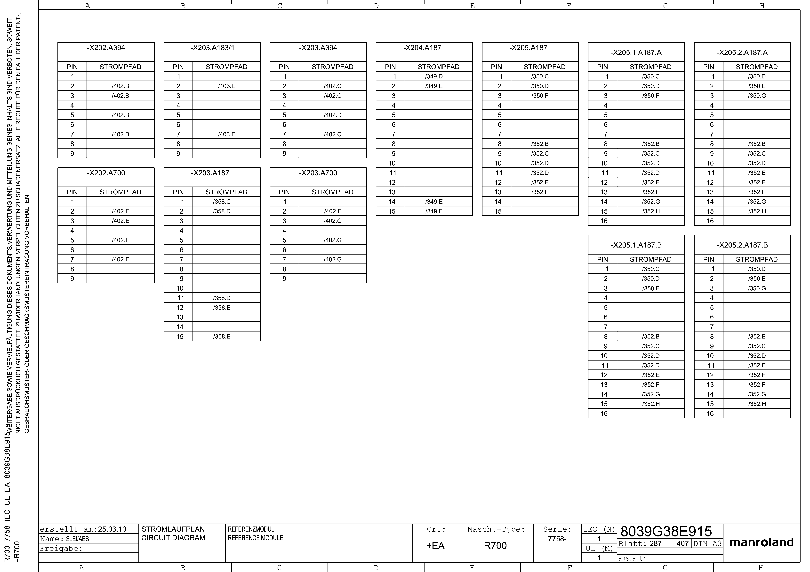

# +EA — Sheet 287 of 407 — REFERENZMODUL

**REFERENCE MODULE**

> Part of the manroland **R700** printing press IEC/UL circuit diagrams.
> Drawing class: **Stromlaufplan / Circuit diagram** (DIN A3).
> Document `+EA` covers the **Printing unit** machine section.

## At a glance

| Field | Value |
|---|---|
| Document | `+EA`  (8039G38E915) |
| Sheet | **287** of 407 |
| Section (DE) | REFERENZMODUL |
| Section (EN) | REFERENCE MODULE |
| Section type | REFERENCE_MODULE — Reference module |
| Machine type | `R700` |
| Series | `7758` |
| Created | 25.03.10 |
| Replaces | — |
| Columns used | A, B, C, D, E, F, G, H |
| Path numbers | — |
| Labels on sheet | 270 |
| Cross-refs out | 80 |
| Cross-refs in | 0 |

**Previous:** [+EA sheet 286](SHEET_0286.md) · **Next:** [+EA sheet 288](SHEET_0288.md) · **Document TOC:** [_TOC.md](_TOC.md)  (+EA) · **Master TOC:** [all sheets](../_MASTER_TOC.md)

## Sheet image (300 DPI, exact vector render)



_Rendered directly from the PDF vector layer at 300 DPI (1-bit), no OCR and no resampling. Use it to confirm anything ambiguous in the text below._

## Cross-references on this sheet

Each entry is a wire leaving this sheet. The printed token is `/sheet.column`; the link resolves to that sheet inside the same document.

| Ref | Target sheet | Col | Path | Destination on target | Target section | From col |
|---|---|---|---|---|---|---|
| `/349.D` | [+EA sheet 349](SHEET_0349.md) | D | — | — | OPTION: VORBEREITUNG IONISATIONSANLAGE | E |
| `/350.C` | [+EA sheet 350](SHEET_0350.md) | C | — | — | OPTION: VORBEREITUNG: PUDERABSAUGUNG | F |
| `/350.C` | [+EA sheet 350](SHEET_0350.md) | C | — | — | OPTION: VORBEREITUNG: PUDERABSAUGUNG | G |
| `/350.D` | [+EA sheet 350](SHEET_0350.md) | D | — | — | OPTION: VORBEREITUNG: PUDERABSAUGUNG | H |
| `/402.B` | [+EA sheet 402](SHEET_0402.md) | B | — | — | OPTION: FREMDGERÄTE ANBINDUNG ÜBER | A |
| `/403.E` | [+EA sheet 403](SHEET_0403.md) | E | — | — | OPTION: FREMDGERÄTE ANBINDUNG ÜBER | B |
| `/349.E` | [+EA sheet 349](SHEET_0349.md) | E | — | — | OPTION: VORBEREITUNG IONISATIONSANLAGE | E |
| `/350.E` | [+EA sheet 350](SHEET_0350.md) | E | — | — | OPTION: VORBEREITUNG: PUDERABSAUGUNG | H |
| `/402.C` | [+EA sheet 402](SHEET_0402.md) | C | — | — | OPTION: FREMDGERÄTE ANBINDUNG ÜBER | D |
| `/350.D` | [+EA sheet 350](SHEET_0350.md) | D | — | — | OPTION: VORBEREITUNG: PUDERABSAUGUNG | F |
| `/350.D` | [+EA sheet 350](SHEET_0350.md) | D | — | — | OPTION: VORBEREITUNG: PUDERABSAUGUNG | G |
| `/402.B` | [+EA sheet 402](SHEET_0402.md) | B | — | — | OPTION: FREMDGERÄTE ANBINDUNG ÜBER | A |
| `/350.F` | [+EA sheet 350](SHEET_0350.md) | F | — | — | OPTION: VORBEREITUNG: PUDERABSAUGUNG | F |
| `/350.F` | [+EA sheet 350](SHEET_0350.md) | F | — | — | OPTION: VORBEREITUNG: PUDERABSAUGUNG | G |
| `/350.G` | [+EA sheet 350](SHEET_0350.md) | G | — | — | OPTION: VORBEREITUNG: PUDERABSAUGUNG | H |
| `/402.C` | [+EA sheet 402](SHEET_0402.md) | C | — | — | OPTION: FREMDGERÄTE ANBINDUNG ÜBER | D |
| `/402.B` | [+EA sheet 402](SHEET_0402.md) | B | — | — | OPTION: FREMDGERÄTE ANBINDUNG ÜBER | A |
| `/402.D` | [+EA sheet 402](SHEET_0402.md) | D | — | — | OPTION: FREMDGERÄTE ANBINDUNG ÜBER | D |
| `/402.B` | [+EA sheet 402](SHEET_0402.md) | B | — | — | OPTION: FREMDGERÄTE ANBINDUNG ÜBER | A |
| `/403.E` | [+EA sheet 403](SHEET_0403.md) | E | — | — | OPTION: FREMDGERÄTE ANBINDUNG ÜBER | B |
| `/402.C` | [+EA sheet 402](SHEET_0402.md) | C | — | — | OPTION: FREMDGERÄTE ANBINDUNG ÜBER | D |
| `/352.B` | [+EA sheet 352](SHEET_0352.md) | B | — | — | OPTION: VORBEREITUNG: PUDERABSAUGUNG | F |
| `/352.B` | [+EA sheet 352](SHEET_0352.md) | B | — | — | OPTION: VORBEREITUNG: PUDERABSAUGUNG | G |
| `/352.B` | [+EA sheet 352](SHEET_0352.md) | B | — | — | OPTION: VORBEREITUNG: PUDERABSAUGUNG | H |
| `/352.C` | [+EA sheet 352](SHEET_0352.md) | C | — | — | OPTION: VORBEREITUNG: PUDERABSAUGUNG | F |
| `/352.C` | [+EA sheet 352](SHEET_0352.md) | C | — | — | OPTION: VORBEREITUNG: PUDERABSAUGUNG | G |
| `/352.C` | [+EA sheet 352](SHEET_0352.md) | C | — | — | OPTION: VORBEREITUNG: PUDERABSAUGUNG | H |
| `/352.D` | [+EA sheet 352](SHEET_0352.md) | D | — | — | OPTION: VORBEREITUNG: PUDERABSAUGUNG | F |
| `/352.D` | [+EA sheet 352](SHEET_0352.md) | D | — | — | OPTION: VORBEREITUNG: PUDERABSAUGUNG | G |
| `/352.D` | [+EA sheet 352](SHEET_0352.md) | D | — | — | OPTION: VORBEREITUNG: PUDERABSAUGUNG | H |
| `/352.E` | [+EA sheet 352](SHEET_0352.md) | E | — | — | OPTION: VORBEREITUNG: PUDERABSAUGUNG | H |
| `/352.D` | [+EA sheet 352](SHEET_0352.md) | D | — | — | OPTION: VORBEREITUNG: PUDERABSAUGUNG | F |
| `/352.D` | [+EA sheet 352](SHEET_0352.md) | D | — | — | OPTION: VORBEREITUNG: PUDERABSAUGUNG | G |
| `/352.E` | [+EA sheet 352](SHEET_0352.md) | E | — | — | OPTION: VORBEREITUNG: PUDERABSAUGUNG | F |
| `/352.E` | [+EA sheet 352](SHEET_0352.md) | E | — | — | OPTION: VORBEREITUNG: PUDERABSAUGUNG | G |
| `/352.F` | [+EA sheet 352](SHEET_0352.md) | F | — | — | OPTION: VORBEREITUNG: PUDERABSAUGUNG | H |
| `/352.F` | [+EA sheet 352](SHEET_0352.md) | F | — | — | OPTION: VORBEREITUNG: PUDERABSAUGUNG | F |
| `/352.F` | [+EA sheet 352](SHEET_0352.md) | F | — | — | OPTION: VORBEREITUNG: PUDERABSAUGUNG | G |
| `/352.F` | [+EA sheet 352](SHEET_0352.md) | F | — | — | OPTION: VORBEREITUNG: PUDERABSAUGUNG | H |
| `/349.E` | [+EA sheet 349](SHEET_0349.md) | E | — | — | OPTION: VORBEREITUNG IONISATIONSANLAGE | E |
| `/352.G` | [+EA sheet 352](SHEET_0352.md) | G | — | — | OPTION: VORBEREITUNG: PUDERABSAUGUNG | G |
| `/352.G` | [+EA sheet 352](SHEET_0352.md) | G | — | — | OPTION: VORBEREITUNG: PUDERABSAUGUNG | H |
| `/358.C` | [+EA sheet 358](SHEET_0358.md) | C | — | — | OPTION: MAKULATURBOGENZÄHLER | B |
| `/402.E` | [+EA sheet 402](SHEET_0402.md) | E | — | — | OPTION: FREMDGERÄTE ANBINDUNG ÜBER | A |
| `/402.F` | [+EA sheet 402](SHEET_0402.md) | F | — | — | OPTION: FREMDGERÄTE ANBINDUNG ÜBER | D |
| `/349.F` | [+EA sheet 349](SHEET_0349.md) | F | — | — | OPTION: VORBEREITUNG IONISATIONSANLAGE | E |
| `/358.D` | [+EA sheet 358](SHEET_0358.md) | D | — | — | OPTION: MAKULATURBOGENZÄHLER | B |
| `/352.H` | [+EA sheet 352](SHEET_0352.md) | H | — | — | OPTION: VORBEREITUNG: PUDERABSAUGUNG | G |
| `/352.H` | [+EA sheet 352](SHEET_0352.md) | H | — | — | OPTION: VORBEREITUNG: PUDERABSAUGUNG | H |
| `/402.E` | [+EA sheet 402](SHEET_0402.md) | E | — | — | OPTION: FREMDGERÄTE ANBINDUNG ÜBER | A |
| `/402.G` | [+EA sheet 402](SHEET_0402.md) | G | — | — | OPTION: FREMDGERÄTE ANBINDUNG ÜBER | D |
| `/402.E` | [+EA sheet 402](SHEET_0402.md) | E | — | — | OPTION: FREMDGERÄTE ANBINDUNG ÜBER | A |
| `/402.G` | [+EA sheet 402](SHEET_0402.md) | G | — | — | OPTION: FREMDGERÄTE ANBINDUNG ÜBER | D |
| `/402.E` | [+EA sheet 402](SHEET_0402.md) | E | — | — | OPTION: FREMDGERÄTE ANBINDUNG ÜBER | A |
| `/402.G` | [+EA sheet 402](SHEET_0402.md) | G | — | — | OPTION: FREMDGERÄTE ANBINDUNG ÜBER | D |
| `/350.C` | [+EA sheet 350](SHEET_0350.md) | C | — | — | OPTION: VORBEREITUNG: PUDERABSAUGUNG | G |
| `/350.D` | [+EA sheet 350](SHEET_0350.md) | D | — | — | OPTION: VORBEREITUNG: PUDERABSAUGUNG | H |
| `/350.E` | [+EA sheet 350](SHEET_0350.md) | E | — | — | OPTION: VORBEREITUNG: PUDERABSAUGUNG | H |
| `/350.D` | [+EA sheet 350](SHEET_0350.md) | D | — | — | OPTION: VORBEREITUNG: PUDERABSAUGUNG | G |
| `/350.F` | [+EA sheet 350](SHEET_0350.md) | F | — | — | OPTION: VORBEREITUNG: PUDERABSAUGUNG | G |
| `/350.G` | [+EA sheet 350](SHEET_0350.md) | G | — | — | OPTION: VORBEREITUNG: PUDERABSAUGUNG | H |
| `/358.D` | [+EA sheet 358](SHEET_0358.md) | D | — | — | OPTION: MAKULATURBOGENZÄHLER | B |
| `/358.E` | [+EA sheet 358](SHEET_0358.md) | E | — | — | OPTION: MAKULATURBOGENZÄHLER | B |
| `/358.E` | [+EA sheet 358](SHEET_0358.md) | E | — | — | OPTION: MAKULATURBOGENZÄHLER | B |
| `/352.B` | [+EA sheet 352](SHEET_0352.md) | B | — | — | OPTION: VORBEREITUNG: PUDERABSAUGUNG | G |
| `/352.B` | [+EA sheet 352](SHEET_0352.md) | B | — | — | OPTION: VORBEREITUNG: PUDERABSAUGUNG | H |
| `/352.C` | [+EA sheet 352](SHEET_0352.md) | C | — | — | OPTION: VORBEREITUNG: PUDERABSAUGUNG | G |
| `/352.C` | [+EA sheet 352](SHEET_0352.md) | C | — | — | OPTION: VORBEREITUNG: PUDERABSAUGUNG | H |
| `/352.D` | [+EA sheet 352](SHEET_0352.md) | D | — | — | OPTION: VORBEREITUNG: PUDERABSAUGUNG | G |
| `/352.D` | [+EA sheet 352](SHEET_0352.md) | D | — | — | OPTION: VORBEREITUNG: PUDERABSAUGUNG | H |
| `/352.E` | [+EA sheet 352](SHEET_0352.md) | E | — | — | OPTION: VORBEREITUNG: PUDERABSAUGUNG | H |
| `/352.D` | [+EA sheet 352](SHEET_0352.md) | D | — | — | OPTION: VORBEREITUNG: PUDERABSAUGUNG | G |
| `/352.E` | [+EA sheet 352](SHEET_0352.md) | E | — | — | OPTION: VORBEREITUNG: PUDERABSAUGUNG | G |
| `/352.F` | [+EA sheet 352](SHEET_0352.md) | F | — | — | OPTION: VORBEREITUNG: PUDERABSAUGUNG | H |
| `/352.F` | [+EA sheet 352](SHEET_0352.md) | F | — | — | OPTION: VORBEREITUNG: PUDERABSAUGUNG | G |
| `/352.F` | [+EA sheet 352](SHEET_0352.md) | F | — | — | OPTION: VORBEREITUNG: PUDERABSAUGUNG | H |
| `/352.G` | [+EA sheet 352](SHEET_0352.md) | G | — | — | OPTION: VORBEREITUNG: PUDERABSAUGUNG | G |
| `/352.G` | [+EA sheet 352](SHEET_0352.md) | G | — | — | OPTION: VORBEREITUNG: PUDERABSAUGUNG | H |
| `/352.H` | [+EA sheet 352](SHEET_0352.md) | H | — | — | OPTION: VORBEREITUNG: PUDERABSAUGUNG | G |
| `/352.H` | [+EA sheet 352](SHEET_0352.md) | H | — | — | OPTION: VORBEREITUNG: PUDERABSAUGUNG | H |

## Devices on this sheet

| Tag | Class | Class meaning (IEC) | Col | Sub | Terminal | Sign |
|---|---|---|---|---|---|---|
| `X202.A394` | — | cross-device reference | A | — | — | — |
| `X202.A700` | — | cross-device reference | A | — | — | — |
| `X205.2.A187.A` | — | cross-device reference | H | — | — | — |
| `X204.A187` | — | cross-device reference | D | — | — | — |
| `X205.2.A187.B` | — | cross-device reference | H | — | — | — |
| `X205.1.A187.A` | — | cross-device reference | G | — | — | — |
| `X205.1.A187.B` | — | cross-device reference | G | — | — | — |
| `X205.A187` | — | cross-device reference | F | — | — | — |
| `X203.A394` | — | cross-device reference | C | — | — | — |
| `X203.A700` | — | cross-device reference | C | — | — | — |
| `X203.A187` | — | cross-device reference | B | — | — | — |

## Potentials / nets

_No named potentials on this sheet._

## Wire-end annotations (grouped as printed)

A wire that continues elsewhere is annotated with a small cluster: the destination description, the path/line number `#NN`, and the `/sheet.column` cross reference. Each row below is one such cluster exactly as it is grouped on the drawing.

| Col | Y | Path | Cross-ref | Text on the wire |
|---|---|---|---|---|
| A | 65.5 | — | — | `X202.A394` |
| B | 65.5 | — | — | `X203.A183/1` |
| C | 65.5 | — | — | `X203.A394` |
| D | 65.5 | — | — | `X204.A187` |
| F | 65.5 | — | — | `X205.A187` |
| G | 72.6 | — | — | `X205.1.A187.A` |
| H | 72.6 | — | — | `X205.2.A187.A` |
| A | 94.2 | — | — | `PIN 2 3 4 5 6 7 8 9 1 STROMPFAD` |
| B | 94.2 | — | — | `PIN 2 3 4 5 6 7 8 9 1 STROMPFAD` |
| C | 94.2 | — | — | `PIN 2 3 4 5 6 7 8 9 1 STROMPFAD` |
| D | 94.2 | — | — | `PIN 10 12 13 14 15 11 2 3 4 5 6 7 8 9 1 STROMPFAD` |
| F | 94.2 | — | — | `PIN 10 12 13 14 15 11 2 3 4 5 6 7 8 9 1 STROMPFAD` |
| G | 94.2 | — | — | `PIN STROMPFAD` |
| H | 94.2 | — | — | `PIN STROMPFAD` |
| F | 108.4 | — | — | `2 3 4 5 6 7 8 9 1` |
| G | 108.4 | — | — | `2 3 4 5 6 7 8 9 1` |
| E | 108.7 | — | `/349.D` | — |
| F | 108.7 | — | `/350.C` | — |
| G | 108.7 | — | `/350.C` | — |
| H | 108.7 | — | `/350.D` | — |
| A | 122.9 | — | `/402.B` | — |
| B | 122.9 | — | `/403.E` | — |
| D | 122.9 | — | `/402.C` | — |
| E | 122.9 | — | `/349.E` | — |
| F | 122.9 | — | `/350.D` | — |
| G | 122.9 | — | `/350.D` | — |
| H | 122.9 | — | `/350.E` | — |
| A | 137.0 | — | `/402.B` | — |
| F | 137.0 | — | `/350.F` | — |
| G | 137.0 | — | `/350.F` | — |
| D | 137.1 | — | `/402.C` | — |
| H | 137.1 | — | `/350.G` | — |
| A | 165.4 | — | `/402.B` | — |
| D | 165.4 | — | `/402.D` | — |
| A | 193.7 | — | `/402.B` | — |
| B | 193.7 | — | `/403.E` | — |
| D | 193.8 | — | `/402.C` | — |
| F | 207.9 | — | `/352.B` | — |
| G | 207.9 | — | `/352.B` | — |
| H | 207.9 | — | `/352.B` | — |
| F | 222.1 | — | `/352.C` | — |
| G | 222.1 | — | `/352.C` | — |
| H | 222.1 | — | `/352.C` | — |
| F | 235.9 | — | — | `10 12 13 14 15 16 11` |
| G | 235.9 | — | — | `10 12 13 14 15 16 11` |
| F | 236.3 | — | `/352.D` | — |
| G | 236.3 | — | `/352.D` | — |
| H | 236.3 | — | `/352.D` | — |
| A | 249.8 | — | — | `X202.A700` |
| B | 249.8 | — | — | `X203.A187` |
| C | 249.8 | — | — | `X203.A700` |
| F | 250.4 | — | `/352.D` | — |
| G | 250.4 | — | `/352.D` | — |
| H | 250.4 | — | `/352.E` | — |
| F | 264.6 | — | `/352.E` | — |
| G | 264.6 | — | `/352.E` | — |
| H | 264.6 | — | `/352.F` | — |
| A | 278.4 | — | — | `PIN 2 3 4 5 6 7 8 9 1 STROMPFAD` |
| B | 278.4 | — | — | `PIN 10 12 13 14 15 11 2 3 4 5 6 7 8 9 1 STROMPFAD` |
| C | 278.4 | — | — | `PIN 2 3 4 5 6 7 8 9 1 STROMPFAD` |
| F | 278.8 | — | `/352.F` | — |
| G | 278.8 | — | `/352.F` | — |
| H | 278.8 | — | `/352.F` | — |
| E | 292.9 | — | `/349.E` | — |
| B | 293.0 | — | `/358.C` | — |
| G | 293.0 | — | `/352.G` | — |
| H | 293.0 | — | `/352.G` | — |
| A | 307.1 | — | `/402.E` | — |
| B | 307.1 | — | `/358.D` | — |
| D | 307.1 | — | `/402.F` | — |
| E | 307.1 | — | `/349.F` | — |
| G | 307.1 | — | `/352.H` | — |
| H | 307.1 | — | `/352.H` | — |
| A | 321.3 | — | `/402.E` | — |
| D | 321.3 | — | `/402.G` | — |
| A | 349.6 | — | `/402.E` | — |
| D | 349.6 | — | `/402.G` | — |
| G | 356.1 | — | — | `X205.1.A187.B` |
| H | 356.1 | — | — | `X205.2.A187.B` |
| G | 377.6 | — | — | `PIN STROMPFAD` |
| H | 377.6 | — | — | `PIN STROMPFAD` |
| A | 378.0 | — | `/402.E` | — |
| D | 378.0 | — | `/402.G` | — |
| F | 391.8 | — | — | `2 3 4 5 6 7 8 9 1` |
| G | 391.8 | — | — | `2 3 4 5 6 7 8 9 1` |
| G | 392.2 | — | `/350.C` | — |
| H | 392.2 | — | `/350.D` | — |
| H | 406.3 | — | `/350.E` | — |
| G | 406.4 | — | `/350.D` | — |
| G | 420.5 | — | `/350.F` | — |
| H | 420.5 | — | `/350.G` | — |
| B | 434.7 | — | `/358.D` | — |
| B | 448.9 | — | `/358.E` | — |
| B | 491.4 | — | `/358.E` | — |
| G | 491.4 | — | `/352.B` | — |
| H | 491.4 | — | `/352.B` | — |
| G | 505.6 | — | `/352.C` | — |
| H | 505.6 | — | `/352.C` | — |
| F | 519.4 | — | — | `10 12 13 14 15 16 11` |
| G | 519.4 | — | — | `10 12 13 14 15 16 11` |
| G | 519.7 | — | `/352.D` | — |
| H | 519.7 | — | `/352.D` | — |
| G | 533.9 | — | `/352.D` | — |
| H | 533.9 | — | `/352.E` | — |
| G | 548.1 | — | `/352.E` | — |
| H | 548.1 | — | `/352.F` | — |
| G | 562.2 | — | `/352.F` | — |
| H | 562.2 | — | `/352.F` | — |
| G | 576.4 | — | `/352.G` | — |
| H | 576.4 | — | `/352.G` | — |
| G | 590.6 | — | `/352.H` | — |
| H | 590.6 | — | `/352.H` | — |


## Reconstructed tables

This sheet carries tabular content (pin map / terminal assignment / index). The grid below was rebuilt from the drawing's own rule lines, so each row is exactly one physical row of the table.

### Table 1 — 20 data rows × 2 columns (at x=85.0, y=62.4) — **X202.A394**

| PIN | STROMPFAD |
|---|---|
| `1` |  |
| `2` | `/402.B` |
| `3` | `/402.B` |
| `4` |  |
| `5` | `/402.B` |
| `6` |  |
| `7` | `/402.B` |
| `8` |  |
| `9` |  |
|  | `X202.A700` |
| `PIN` | `STROMPFAD` |
| `1` |  |
| `2` | `/402.E` |
| `3` | `/402.E` |
| `4` |  |
| `5` | `/402.E` |
| `6` |  |
| `7` | `/402.E` |
| `8` |  |
| `9` |  |


### Table 2 — 26 data rows × 2 columns (at x=240.9, y=62.4) — **X203.A183/1**

| PIN | STROMPFAD |
|---|---|
| `1` |  |
| `2` | `/403.E` |
| `3` |  |
| `4` |  |
| `5` |  |
| `6` |  |
| `7` | `/403.E` |
| `8` |  |
| `9` |  |
|  | `X203.A187` |
| `PIN` | `STROMPFAD` |
| `1` | `/358.C` |
| `2` | `/358.D` |
| `3` |  |
| `4` |  |
| `5` |  |
| `6` |  |
| `7` |  |
| `8` |  |
| `9` |  |
| `10` |  |
| `11` | `/358.D` |
| `12` | `/358.E` |
| `13` |  |
| `14` |  |
| `15` | `/358.E` |


### Table 3 — 20 data rows × 2 columns (at x=396.9, y=62.4) — **X203.A394**

| PIN | STROMPFAD |
|---|---|
| `1` |  |
| `2` | `/402.C` |
| `3` | `/402.C` |
| `4` |  |
| `5` | `/402.D` |
| `6` |  |
| `7` | `/402.C` |
| `8` |  |
| `9` |  |
|  | `X203.A700` |
| `PIN` | `STROMPFAD` |
| `1` |  |
| `2` | `/402.F` |
| `3` | `/402.G` |
| `4` |  |
| `5` | `/402.G` |
| `6` |  |
| `7` | `/402.G` |
| `8` |  |
| `9` |  |


### Table 4 — 15 data rows × 2 columns (at x=552.8, y=62.4) — **X204.A187**

| PIN | STROMPFAD |
|---|---|
| `1` | `/349.D` |
| `2` | `/349.E` |
| `3` |  |
| `4` |  |
| `5` |  |
| `6` |  |
| `7` |  |
| `8` |  |
| `9` |  |
| `10` |  |
| `11` |  |
| `12` |  |
| `13` |  |
| `14` | `/349.E` |
| `15` | `/349.F` |


### Table 5 — 15 data rows × 2 columns (at x=708.7, y=62.4) — **X205.A187**

| PIN | STROMPFAD |
|---|---|
| `1` | `/350.C` |
| `2` | `/350.D` |
| `3` | `/350.F` |
| `4` |  |
| `5` |  |
| `6` |  |
| `7` |  |
| `8` | `/352.B` |
| `9` | `/352.C` |
| `10` | `/352.D` |
| `11` | `/352.D` |
| `12` | `/352.E` |
| `13` | `/352.F` |
| `14` |  |
| `15` |  |


### Table 6 — 34 data rows × 2 columns (at x=864.6, y=62.4) — **X205.1.A187.A**

| PIN | STROMPFAD |
|---|---|
| `1` | `/350.C` |
| `2` | `/350.D` |
| `3` | `/350.F` |
| `4` |  |
| `5` |  |
| `6` |  |
| `7` |  |
| `8` | `/352.B` |
| `9` | `/352.C` |
| `10` | `/352.D` |
| `11` | `/352.D` |
| `12` | `/352.E` |
| `13` | `/352.F` |
| `14` | `/352.G` |
| `15` | `/352.H` |
| `16` |  |
|  | `X205.1.A187.B` |
| `PIN` | `STROMPFAD` |
| `1` | `/350.C` |
| `2` | `/350.D` |
| `3` | `/350.F` |
| `4` |  |
| `5` |  |
| `6` |  |
| `7` |  |
| `8` | `/352.B` |
| `9` | `/352.C` |
| `10` | `/352.D` |
| `11` | `/352.D` |
| `12` | `/352.E` |
| `13` | `/352.F` |
| `14` | `/352.G` |
| `15` | `/352.H` |
| `16` |  |


### Table 7 — 34 data rows × 2 columns (at x=1020.5, y=62.4) — **X205.2.A187.A**

| PIN | STROMPFAD |
|---|---|
| `1` | `/350.D` |
| `2` | `/350.E` |
| `3` | `/350.G` |
| `4` |  |
| `5` |  |
| `6` |  |
| `7` |  |
| `8` | `/352.B` |
| `9` | `/352.C` |
| `10` | `/352.D` |
| `11` | `/352.E` |
| `12` | `/352.F` |
| `13` | `/352.F` |
| `14` | `/352.G` |
| `15` | `/352.H` |
| `16` |  |
|  | `X205.2.A187.B` |
| `PIN` | `STROMPFAD` |
| `1` | `/350.D` |
| `2` | `/350.E` |
| `3` | `/350.G` |
| `4` |  |
| `5` |  |
| `6` |  |
| `7` |  |
| `8` | `/352.B` |
| `9` | `/352.C` |
| `10` | `/352.D` |
| `11` | `/352.E` |
| `12` | `/352.F` |
| `13` | `/352.F` |
| `14` | `/352.G` |
| `15` | `/352.H` |
| `16` |  |


## Notes and free text on this sheet

| Text | Col | Y (pt) |
|---|---|---|
| `PIN` | A | 94.2 |
| `STROMPFAD` | A | 94.15 |
| `PIN` | G | 94.2 |
| `STROMPFAD` | H | 94.15 |
| `PIN` | D | 94.2 |
| `STROMPFAD` | E | 94.15 |
| `PIN` | F | 94.2 |
| `STROMPFAD` | G | 94.15 |
| `PIN` | E | 94.2 |
| `STROMPFAD` | F | 94.15 |
| `PIN` | C | 94.2 |
| `STROMPFAD` | D | 94.15 |
| `PIN` | B | 94.2 |
| `STROMPFAD` | B | 94.15 |
| `X203.A183/1` | B | 65.5 |

## Complete label inventory (exact text from the drawing)

Every text object inside the drawing area of this sheet, in DIN reading order (column A→H, then top→bottom). This is the authoritative list: if a string is not here it is not printed on this sheet.

| Col | Y | X | Dir | Type | Text |
|---|---|---|---|---|---|
| A | 65.5 | 128.0 | → | device ref | `X202.A394` |
| A | 94.2 | 98.2 | → | text | `PIN` |
| A | 94.2 | 146.4 | → | text | `STROMPFAD` |
| A | 108.4 | 104.2 | → | number | `1` |
| A | 122.5 | 103.6 | → | number | `2` |
| A | 122.9 | 164.6 | → | cross-reference | `/402.B` |
| A | 136.7 | 103.6 | → | number | `3` |
| A | 137.0 | 164.6 | → | cross-reference | `/402.B` |
| A | 150.9 | 103.6 | → | number | `4` |
| A | 165.1 | 103.6 | → | number | `5` |
| A | 165.4 | 164.6 | → | cross-reference | `/402.B` |
| A | 179.2 | 103.6 | → | number | `6` |
| A | 193.4 | 103.6 | → | number | `7` |
| A | 193.7 | 164.6 | → | cross-reference | `/402.B` |
| A | 207.6 | 103.6 | → | number | `8` |
| A | 221.8 | 103.6 | → | number | `9` |
| A | 249.7 | 128.0 | → | device ref | `X202.A700` |
| A | 278.4 | 98.2 | → | text | `PIN` |
| A | 278.4 | 146.4 | → | text | `STROMPFAD` |
| A | 292.6 | 104.2 | → | number | `1` |
| A | 306.8 | 103.6 | → | number | `2` |
| A | 307.1 | 164.7 | → | cross-reference | `/402.E` |
| A | 321.0 | 103.6 | → | number | `3` |
| A | 321.3 | 164.7 | → | cross-reference | `/402.E` |
| A | 335.1 | 103.6 | → | number | `4` |
| A | 349.3 | 103.6 | → | number | `5` |
| A | 349.6 | 164.7 | → | cross-reference | `/402.E` |
| A | 363.5 | 103.6 | → | number | `6` |
| A | 377.7 | 103.6 | → | number | `7` |
| A | 378.0 | 164.7 | → | cross-reference | `/402.E` |
| A | 391.8 | 103.6 | → | number | `8` |
| A | 406.0 | 103.6 | → | number | `9` |
| B | 65.5 | 280.2 | → | text | `X203.A183/1` |
| B | 94.2 | 254.1 | → | text | `PIN` |
| B | 94.2 | 302.3 | → | text | `STROMPFAD` |
| B | 108.4 | 260.1 | → | number | `1` |
| B | 122.5 | 259.5 | → | number | `2` |
| B | 122.9 | 320.6 | → | cross-reference | `/403.E` |
| B | 136.7 | 259.5 | → | number | `3` |
| B | 150.9 | 259.5 | → | number | `4` |
| B | 165.1 | 259.5 | → | number | `5` |
| B | 179.2 | 259.5 | → | number | `6` |
| B | 193.4 | 259.5 | → | number | `7` |
| B | 193.7 | 320.6 | → | cross-reference | `/403.E` |
| B | 207.6 | 259.5 | → | number | `8` |
| B | 221.8 | 259.5 | → | number | `9` |
| B | 249.7 | 281.1 | → | device ref | `X203.A187` |
| B | 278.4 | 254.1 | → | text | `PIN` |
| B | 278.4 | 302.3 | → | text | `STROMPFAD` |
| B | 292.6 | 265.9 | → | number | `1` |
| B | 293.0 | 313.2 | → | cross-reference | `/358.C` |
| B | 306.8 | 264.2 | → | number | `2` |
| B | 307.1 | 313.2 | → | cross-reference | `/358.D` |
| B | 321.0 | 264.2 | → | number | `3` |
| B | 335.1 | 264.2 | → | number | `4` |
| B | 349.3 | 264.2 | → | number | `5` |
| B | 363.5 | 264.2 | → | number | `6` |
| B | 377.7 | 264.2 | → | number | `7` |
| B | 391.8 | 264.2 | → | number | `8` |
| B | 406.0 | 264.2 | → | number | `9` |
| B | 420.2 | 258.8 | → | number | `10` |
| B | 434.4 | 260.5 | → | number | `11` |
| B | 434.7 | 313.2 | → | cross-reference | `/358.D` |
| B | 448.5 | 258.8 | → | number | `12` |
| B | 448.8 | 313.5 | → | cross-reference | `/358.E` |
| B | 462.7 | 258.8 | → | number | `13` |
| B | 476.9 | 258.8 | → | number | `14` |
| B | 491.0 | 258.8 | → | number | `15` |
| B | 491.4 | 313.5 | → | cross-reference | `/358.E` |
| C | 65.5 | 439.8 | → | device ref | `X203.A394` |
| C | 94.2 | 410.0 | → | text | `PIN` |
| C | 108.4 | 416.0 | → | number | `1` |
| C | 122.5 | 415.4 | → | number | `2` |
| C | 136.7 | 415.4 | → | number | `3` |
| C | 150.9 | 415.4 | → | number | `4` |
| C | 165.1 | 415.4 | → | number | `5` |
| C | 179.2 | 415.4 | → | number | `6` |
| C | 193.4 | 415.4 | → | number | `7` |
| C | 207.6 | 415.4 | → | number | `8` |
| C | 221.8 | 415.4 | → | number | `9` |
| C | 249.7 | 439.8 | → | device ref | `X203.A700` |
| C | 278.4 | 410.0 | → | text | `PIN` |
| C | 292.6 | 416.0 | → | number | `1` |
| C | 306.8 | 415.4 | → | number | `2` |
| C | 321.0 | 415.4 | → | number | `3` |
| C | 335.1 | 415.4 | → | number | `4` |
| C | 349.3 | 415.4 | → | number | `5` |
| C | 363.5 | 415.4 | → | number | `6` |
| C | 377.7 | 415.4 | → | number | `7` |
| C | 391.8 | 415.4 | → | number | `8` |
| C | 406.0 | 415.4 | → | number | `9` |
| D | 65.5 | 592.9 | → | device ref | `X204.A187` |
| D | 94.2 | 458.2 | → | text | `STROMPFAD` |
| D | 94.2 | 565.9 | → | text | `PIN` |
| D | 108.4 | 577.7 | → | number | `1` |
| D | 122.5 | 576.0 | → | number | `2` |
| D | 122.9 | 476.2 | → | cross-reference | `/402.C` |
| D | 136.7 | 576.0 | → | number | `3` |
| D | 137.1 | 476.2 | → | cross-reference | `/402.C` |
| D | 150.9 | 576.0 | → | number | `4` |
| D | 165.1 | 576.0 | → | number | `5` |
| D | 165.4 | 476.2 | → | cross-reference | `/402.D` |
| D | 179.2 | 576.0 | → | number | `6` |
| D | 193.4 | 576.0 | → | number | `7` |
| D | 193.8 | 476.2 | → | cross-reference | `/402.C` |
| D | 207.6 | 576.0 | → | number | `8` |
| D | 221.8 | 576.0 | → | number | `9` |
| D | 235.9 | 570.6 | → | number | `10` |
| D | 250.1 | 572.3 | → | number | `11` |
| D | 264.3 | 570.6 | → | number | `12` |
| D | 278.4 | 458.2 | → | text | `STROMPFAD` |
| D | 278.5 | 570.6 | → | number | `13` |
| D | 292.6 | 570.6 | → | number | `14` |
| D | 306.8 | 570.6 | → | number | `15` |
| D | 307.1 | 476.6 | → | cross-reference | `/402.F` |
| D | 321.3 | 476.1 | → | cross-reference | `/402.G` |
| D | 349.7 | 476.1 | → | cross-reference | `/402.G` |
| D | 378.0 | 476.1 | → | cross-reference | `/402.G` |
| E | 94.2 | 614.1 | → | text | `STROMPFAD` |
| E | 94.2 | 721.8 | → | text | `PIN` |
| E | 108.4 | 733.6 | → | number | `1` |
| E | 108.7 | 625.0 | → | cross-reference | `/349.D` |
| E | 122.5 | 731.9 | → | number | `2` |
| E | 122.9 | 625.3 | → | cross-reference | `/349.E` |
| E | 136.7 | 731.9 | → | number | `3` |
| E | 150.9 | 731.9 | → | number | `4` |
| E | 165.1 | 731.9 | → | number | `5` |
| E | 179.2 | 731.9 | → | number | `6` |
| E | 193.4 | 731.9 | → | number | `7` |
| E | 207.6 | 731.9 | → | number | `8` |
| E | 221.8 | 731.9 | → | number | `9` |
| E | 235.9 | 726.5 | → | number | `10` |
| E | 250.1 | 728.2 | → | number | `11` |
| E | 264.3 | 726.5 | → | number | `12` |
| E | 278.5 | 726.5 | → | number | `13` |
| E | 292.6 | 726.5 | → | number | `14` |
| E | 292.9 | 625.3 | → | cross-reference | `/349.E` |
| E | 306.8 | 726.5 | → | number | `15` |
| E | 307.1 | 625.5 | → | cross-reference | `/349.F` |
| F | 65.5 | 748.8 | → | device ref | `X205.A187` |
| F | 94.2 | 770.0 | → | text | `STROMPFAD` |
| F | 94.2 | 877.7 | → | text | `PIN` |
| F | 108.4 | 889.5 | → | number | `1` |
| F | 108.7 | 780.9 | → | cross-reference | `/350.C` |
| F | 122.5 | 887.8 | → | number | `2` |
| F | 122.9 | 780.9 | → | cross-reference | `/350.D` |
| F | 136.7 | 887.8 | → | number | `3` |
| F | 137.0 | 781.4 | → | cross-reference | `/350.F` |
| F | 150.9 | 887.8 | → | number | `4` |
| F | 165.1 | 887.8 | → | number | `5` |
| F | 179.2 | 887.8 | → | number | `6` |
| F | 193.4 | 887.8 | → | number | `7` |
| F | 207.6 | 887.8 | → | number | `8` |
| F | 207.9 | 781.1 | → | cross-reference | `/352.B` |
| F | 221.8 | 887.8 | → | number | `9` |
| F | 222.1 | 780.9 | → | cross-reference | `/352.C` |
| F | 235.9 | 882.4 | → | number | `10` |
| F | 236.3 | 780.9 | → | cross-reference | `/352.D` |
| F | 250.1 | 884.1 | → | number | `11` |
| F | 250.4 | 780.9 | → | cross-reference | `/352.D` |
| F | 264.3 | 882.4 | → | number | `12` |
| F | 264.6 | 781.2 | → | cross-reference | `/352.E` |
| F | 278.5 | 882.4 | → | number | `13` |
| F | 278.8 | 781.4 | → | cross-reference | `/352.F` |
| F | 292.6 | 882.4 | → | number | `14` |
| F | 306.8 | 882.4 | → | number | `15` |
| F | 321.0 | 882.4 | → | number | `16` |
| F | 377.7 | 877.7 | → | text | `PIN` |
| F | 391.8 | 889.5 | → | number | `1` |
| F | 406.0 | 887.8 | → | number | `2` |
| F | 420.2 | 887.8 | → | number | `3` |
| F | 434.4 | 887.8 | → | number | `4` |
| F | 448.5 | 887.8 | → | number | `5` |
| F | 462.7 | 887.8 | → | number | `6` |
| F | 476.9 | 887.8 | → | number | `7` |
| F | 491.0 | 887.8 | → | number | `8` |
| F | 505.2 | 887.8 | → | number | `9` |
| F | 519.4 | 882.4 | → | number | `10` |
| F | 533.6 | 884.1 | → | number | `11` |
| F | 547.7 | 882.4 | → | number | `12` |
| F | 561.9 | 882.4 | → | number | `13` |
| F | 576.1 | 882.4 | → | number | `14` |
| F | 590.3 | 882.4 | → | number | `15` |
| F | 604.4 | 882.4 | → | number | `16` |
| G | 72.6 | 897.7 | → | device ref | `X205.1.A187.A` |
| G | 94.2 | 925.9 | → | text | `STROMPFAD` |
| G | 94.2 | 1033.7 | → | text | `PIN` |
| G | 108.4 | 1045.4 | → | number | `1` |
| G | 108.7 | 943.9 | → | cross-reference | `/350.C` |
| G | 122.5 | 1043.7 | → | number | `2` |
| G | 122.9 | 943.9 | → | cross-reference | `/350.D` |
| G | 136.7 | 1043.7 | → | number | `3` |
| G | 137.0 | 944.4 | → | cross-reference | `/350.F` |
| G | 150.9 | 1043.7 | → | number | `4` |
| G | 165.1 | 1043.7 | → | number | `5` |
| G | 179.2 | 1043.7 | → | number | `6` |
| G | 193.4 | 1043.7 | → | number | `7` |
| G | 207.6 | 1043.7 | → | number | `8` |
| G | 207.9 | 944.1 | → | cross-reference | `/352.B` |
| G | 221.8 | 1043.7 | → | number | `9` |
| G | 222.1 | 943.9 | → | cross-reference | `/352.C` |
| G | 235.9 | 1038.3 | → | number | `10` |
| G | 236.3 | 943.9 | → | cross-reference | `/352.D` |
| G | 250.1 | 1040.0 | → | number | `11` |
| G | 250.4 | 943.9 | → | cross-reference | `/352.D` |
| G | 264.3 | 1038.3 | → | number | `12` |
| G | 264.6 | 944.2 | → | cross-reference | `/352.E` |
| G | 278.5 | 1038.3 | → | number | `13` |
| G | 278.8 | 944.4 | → | cross-reference | `/352.F` |
| G | 292.6 | 1038.3 | → | number | `14` |
| G | 293.0 | 943.8 | → | cross-reference | `/352.G` |
| G | 306.8 | 1038.3 | → | number | `15` |
| G | 307.1 | 944.2 | → | cross-reference | `/352.H` |
| G | 321.0 | 1038.3 | → | number | `16` |
| G | 356.1 | 898.2 | → | device ref | `X205.1.A187.B` |
| G | 377.6 | 925.9 | → | text | `STROMPFAD` |
| G | 377.7 | 1033.7 | → | text | `PIN` |
| G | 391.8 | 1045.4 | → | number | `1` |
| G | 392.2 | 943.9 | → | cross-reference | `/350.C` |
| G | 406.0 | 1043.7 | → | number | `2` |
| G | 406.4 | 943.9 | → | cross-reference | `/350.D` |
| G | 420.2 | 1043.7 | → | number | `3` |
| G | 420.5 | 944.4 | → | cross-reference | `/350.F` |
| G | 434.4 | 1043.7 | → | number | `4` |
| G | 448.5 | 1043.7 | → | number | `5` |
| G | 462.7 | 1043.7 | → | number | `6` |
| G | 476.9 | 1043.7 | → | number | `7` |
| G | 491.0 | 1043.7 | → | number | `8` |
| G | 491.4 | 944.1 | → | cross-reference | `/352.B` |
| G | 505.2 | 1043.7 | → | number | `9` |
| G | 505.6 | 943.9 | → | cross-reference | `/352.C` |
| G | 519.4 | 1038.3 | → | number | `10` |
| G | 519.7 | 943.9 | → | cross-reference | `/352.D` |
| G | 533.6 | 1040.0 | → | number | `11` |
| G | 533.9 | 943.9 | → | cross-reference | `/352.D` |
| G | 547.7 | 1038.3 | → | number | `12` |
| G | 548.1 | 944.2 | → | cross-reference | `/352.E` |
| G | 561.9 | 1038.3 | → | number | `13` |
| G | 562.2 | 944.4 | → | cross-reference | `/352.F` |
| G | 576.1 | 1038.3 | → | number | `14` |
| G | 576.4 | 943.8 | → | cross-reference | `/352.G` |
| G | 590.3 | 1038.3 | → | number | `15` |
| G | 590.6 | 944.2 | → | cross-reference | `/352.H` |
| G | 604.4 | 1038.3 | → | number | `16` |
| H | 72.6 | 1053.6 | → | device ref | `X205.2.A187.A` |
| H | 94.2 | 1081.8 | → | text | `STROMPFAD` |
| H | 108.7 | 1099.8 | → | cross-reference | `/350.D` |
| H | 122.9 | 1100.1 | → | cross-reference | `/350.E` |
| H | 137.1 | 1099.7 | → | cross-reference | `/350.G` |
| H | 207.9 | 1100.0 | → | cross-reference | `/352.B` |
| H | 222.1 | 1099.8 | → | cross-reference | `/352.C` |
| H | 236.3 | 1099.8 | → | cross-reference | `/352.D` |
| H | 250.4 | 1100.1 | → | cross-reference | `/352.E` |
| H | 264.6 | 1100.3 | → | cross-reference | `/352.F` |
| H | 278.8 | 1100.3 | → | cross-reference | `/352.F` |
| H | 293.0 | 1099.7 | → | cross-reference | `/352.G` |
| H | 307.1 | 1100.1 | → | cross-reference | `/352.H` |
| H | 356.1 | 1054.1 | → | device ref | `X205.2.A187.B` |
| H | 377.6 | 1081.8 | → | text | `STROMPFAD` |
| H | 392.2 | 1099.8 | → | cross-reference | `/350.D` |
| H | 406.3 | 1100.1 | → | cross-reference | `/350.E` |
| H | 420.5 | 1099.7 | → | cross-reference | `/350.G` |
| H | 491.4 | 1100.0 | → | cross-reference | `/352.B` |
| H | 505.6 | 1099.8 | → | cross-reference | `/352.C` |
| H | 519.7 | 1099.8 | → | cross-reference | `/352.D` |
| H | 533.9 | 1100.1 | → | cross-reference | `/352.E` |
| H | 548.1 | 1100.3 | → | cross-reference | `/352.F` |
| H | 562.2 | 1100.3 | → | cross-reference | `/352.F` |
| H | 576.4 | 1099.7 | → | cross-reference | `/352.G` |
| H | 590.6 | 1100.1 | → | cross-reference | `/352.H` |

## Reading-order text block

The same content as a plain block, grouped by DIN column — convenient to paste or to match against a visual description.

```text
=== Column A ===
  65.5  128.0  devref       X202.A394
  94.2   98.2  text         PIN
  94.2  146.4  text         STROMPFAD
 108.4  104.2  numeric      1
 122.5  103.6  numeric      2
 122.9  164.6  xref         /402.B
 136.7  103.6  numeric      3
 137.0  164.6  xref         /402.B
 150.9  103.6  numeric      4
 165.1  103.6  numeric      5
 165.4  164.6  xref         /402.B
 179.2  103.6  numeric      6
 193.4  103.6  numeric      7
 193.7  164.6  xref         /402.B
 207.6  103.6  numeric      8
 221.8  103.6  numeric      9
 249.7  128.0  devref       X202.A700
 278.4   98.2  text         PIN
 278.4  146.4  text         STROMPFAD
 292.6  104.2  numeric      1
 306.8  103.6  numeric      2
 307.1  164.7  xref         /402.E
 321.0  103.6  numeric      3
 321.3  164.7  xref         /402.E
 335.1  103.6  numeric      4
 349.3  103.6  numeric      5
 349.6  164.7  xref         /402.E
 363.5  103.6  numeric      6
 377.7  103.6  numeric      7
 378.0  164.7  xref         /402.E
 391.8  103.6  numeric      8
 406.0  103.6  numeric      9
=== Column B ===
  65.5  280.2  text         X203.A183/1
  94.2  254.1  text         PIN
  94.2  302.3  text         STROMPFAD
 108.4  260.1  numeric      1
 122.5  259.5  numeric      2
 122.9  320.6  xref         /403.E
 136.7  259.5  numeric      3
 150.9  259.5  numeric      4
 165.1  259.5  numeric      5
 179.2  259.5  numeric      6
 193.4  259.5  numeric      7
 193.7  320.6  xref         /403.E
 207.6  259.5  numeric      8
 221.8  259.5  numeric      9
 249.7  281.1  devref       X203.A187
 278.4  254.1  text         PIN
 278.4  302.3  text         STROMPFAD
 292.6  265.9  numeric      1
 293.0  313.2  xref         /358.C
 306.8  264.2  numeric      2
 307.1  313.2  xref         /358.D
 321.0  264.2  numeric      3
 335.1  264.2  numeric      4
 349.3  264.2  numeric      5
 363.5  264.2  numeric      6
 377.7  264.2  numeric      7
 391.8  264.2  numeric      8
 406.0  264.2  numeric      9
 420.2  258.8  numeric      10
 434.4  260.5  numeric      11
 434.7  313.2  xref         /358.D
 448.5  258.8  numeric      12
 448.8  313.5  xref         /358.E
 462.7  258.8  numeric      13
 476.9  258.8  numeric      14
 491.0  258.8  numeric      15
 491.4  313.5  xref         /358.E
=== Column C ===
  65.5  439.8  devref       X203.A394
  94.2  410.0  text         PIN
 108.4  416.0  numeric      1
 122.5  415.4  numeric      2
 136.7  415.4  numeric      3
 150.9  415.4  numeric      4
 165.1  415.4  numeric      5
 179.2  415.4  numeric      6
 193.4  415.4  numeric      7
 207.6  415.4  numeric      8
 221.8  415.4  numeric      9
 249.7  439.8  devref       X203.A700
 278.4  410.0  text         PIN
 292.6  416.0  numeric      1
 306.8  415.4  numeric      2
 321.0  415.4  numeric      3
 335.1  415.4  numeric      4
 349.3  415.4  numeric      5
 363.5  415.4  numeric      6
 377.7  415.4  numeric      7
 391.8  415.4  numeric      8
 406.0  415.4  numeric      9
=== Column D ===
  65.5  592.9  devref       X204.A187
  94.2  458.2  text         STROMPFAD
  94.2  565.9  text         PIN
 108.4  577.7  numeric      1
 122.5  576.0  numeric      2
 122.9  476.2  xref         /402.C
 136.7  576.0  numeric      3
 137.1  476.2  xref         /402.C
 150.9  576.0  numeric      4
 165.1  576.0  numeric      5
 165.4  476.2  xref         /402.D
 179.2  576.0  numeric      6
 193.4  576.0  numeric      7
 193.8  476.2  xref         /402.C
 207.6  576.0  numeric      8
 221.8  576.0  numeric      9
 235.9  570.6  numeric      10
 250.1  572.3  numeric      11
 264.3  570.6  numeric      12
 278.4  458.2  text         STROMPFAD
 278.5  570.6  numeric      13
 292.6  570.6  numeric      14
 306.8  570.6  numeric      15
 307.1  476.6  xref         /402.F
 321.3  476.1  xref         /402.G
 349.7  476.1  xref         /402.G
 378.0  476.1  xref         /402.G
=== Column E ===
  94.2  614.1  text         STROMPFAD
  94.2  721.8  text         PIN
 108.4  733.6  numeric      1
 108.7  625.0  xref         /349.D
 122.5  731.9  numeric      2
 122.9  625.3  xref         /349.E
 136.7  731.9  numeric      3
 150.9  731.9  numeric      4
 165.1  731.9  numeric      5
 179.2  731.9  numeric      6
 193.4  731.9  numeric      7
 207.6  731.9  numeric      8
 221.8  731.9  numeric      9
 235.9  726.5  numeric      10
 250.1  728.2  numeric      11
 264.3  726.5  numeric      12
 278.5  726.5  numeric      13
 292.6  726.5  numeric      14
 292.9  625.3  xref         /349.E
 306.8  726.5  numeric      15
 307.1  625.5  xref         /349.F
=== Column F ===
  65.5  748.8  devref       X205.A187
  94.2  770.0  text         STROMPFAD
  94.2  877.7  text         PIN
 108.4  889.5  numeric      1
 108.7  780.9  xref         /350.C
 122.5  887.8  numeric      2
 122.9  780.9  xref         /350.D
 136.7  887.8  numeric      3
 137.0  781.4  xref         /350.F
 150.9  887.8  numeric      4
 165.1  887.8  numeric      5
 179.2  887.8  numeric      6
 193.4  887.8  numeric      7
 207.6  887.8  numeric      8
 207.9  781.1  xref         /352.B
 221.8  887.8  numeric      9
 222.1  780.9  xref         /352.C
 235.9  882.4  numeric      10
 236.3  780.9  xref         /352.D
 250.1  884.1  numeric      11
 250.4  780.9  xref         /352.D
 264.3  882.4  numeric      12
 264.6  781.2  xref         /352.E
 278.5  882.4  numeric      13
 278.8  781.4  xref         /352.F
 292.6  882.4  numeric      14
 306.8  882.4  numeric      15
 321.0  882.4  numeric      16
 377.7  877.7  text         PIN
 391.8  889.5  numeric      1
 406.0  887.8  numeric      2
 420.2  887.8  numeric      3
 434.4  887.8  numeric      4
 448.5  887.8  numeric      5
 462.7  887.8  numeric      6
 476.9  887.8  numeric      7
 491.0  887.8  numeric      8
 505.2  887.8  numeric      9
 519.4  882.4  numeric      10
 533.6  884.1  numeric      11
 547.7  882.4  numeric      12
 561.9  882.4  numeric      13
 576.1  882.4  numeric      14
 590.3  882.4  numeric      15
 604.4  882.4  numeric      16
=== Column G ===
  72.6  897.7  devref       X205.1.A187.A
  94.2  925.9  text         STROMPFAD
  94.2 1033.7  text         PIN
 108.4 1045.4  numeric      1
 108.7  943.9  xref         /350.C
 122.5 1043.7  numeric      2
 122.9  943.9  xref         /350.D
 136.7 1043.7  numeric      3
 137.0  944.4  xref         /350.F
 150.9 1043.7  numeric      4
 165.1 1043.7  numeric      5
 179.2 1043.7  numeric      6
 193.4 1043.7  numeric      7
 207.6 1043.7  numeric      8
 207.9  944.1  xref         /352.B
 221.8 1043.7  numeric      9
 222.1  943.9  xref         /352.C
 235.9 1038.3  numeric      10
 236.3  943.9  xref         /352.D
 250.1 1040.0  numeric      11
 250.4  943.9  xref         /352.D
 264.3 1038.3  numeric      12
 264.6  944.2  xref         /352.E
 278.5 1038.3  numeric      13
 278.8  944.4  xref         /352.F
 292.6 1038.3  numeric      14
 293.0  943.8  xref         /352.G
 306.8 1038.3  numeric      15
 307.1  944.2  xref         /352.H
 321.0 1038.3  numeric      16
 356.1  898.2  devref       X205.1.A187.B
 377.6  925.9  text         STROMPFAD
 377.7 1033.7  text         PIN
 391.8 1045.4  numeric      1
 392.2  943.9  xref         /350.C
 406.0 1043.7  numeric      2
 406.4  943.9  xref         /350.D
 420.2 1043.7  numeric      3
 420.5  944.4  xref         /350.F
 434.4 1043.7  numeric      4
 448.5 1043.7  numeric      5
 462.7 1043.7  numeric      6
 476.9 1043.7  numeric      7
 491.0 1043.7  numeric      8
 491.4  944.1  xref         /352.B
 505.2 1043.7  numeric      9
 505.6  943.9  xref         /352.C
 519.4 1038.3  numeric      10
 519.7  943.9  xref         /352.D
 533.6 1040.0  numeric      11
 533.9  943.9  xref         /352.D
 547.7 1038.3  numeric      12
 548.1  944.2  xref         /352.E
 561.9 1038.3  numeric      13
 562.2  944.4  xref         /352.F
 576.1 1038.3  numeric      14
 576.4  943.8  xref         /352.G
 590.3 1038.3  numeric      15
 590.6  944.2  xref         /352.H
 604.4 1038.3  numeric      16
=== Column H ===
  72.6 1053.6  devref       X205.2.A187.A
  94.2 1081.8  text         STROMPFAD
 108.7 1099.8  xref         /350.D
 122.9 1100.1  xref         /350.E
 137.1 1099.7  xref         /350.G
 207.9 1100.0  xref         /352.B
 222.1 1099.8  xref         /352.C
 236.3 1099.8  xref         /352.D
 250.4 1100.1  xref         /352.E
 264.6 1100.3  xref         /352.F
 278.8 1100.3  xref         /352.F
 293.0 1099.7  xref         /352.G
 307.1 1100.1  xref         /352.H
 356.1 1054.1  devref       X205.2.A187.B
 377.6 1081.8  text         STROMPFAD
 392.2 1099.8  xref         /350.D
 406.3 1100.1  xref         /350.E
 420.5 1099.7  xref         /350.G
 491.4 1100.0  xref         /352.B
 505.6 1099.8  xref         /352.C
 519.7 1099.8  xref         /352.D
 533.9 1100.1  xref         /352.E
 548.1 1100.3  xref         /352.F
 562.2 1100.3  xref         /352.F
 576.4 1099.7  xref         /352.G
 590.6 1100.1  xref         /352.H
```

---
_Generated from the PDF vector text layer; no OCR. Source: `R700_7758_IEC_UL_EA_8039G38E915_p`, sheet 287._
