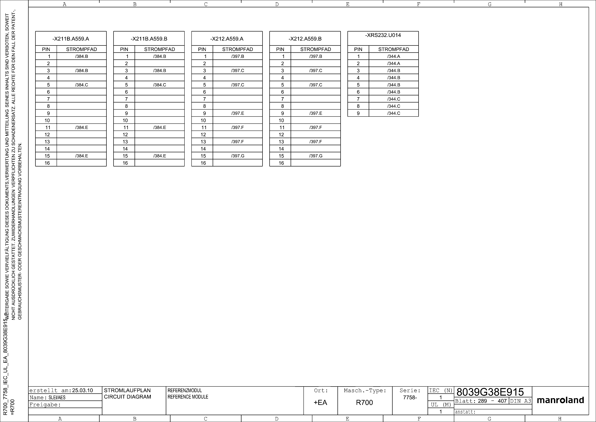

# +EA — Sheet 289 of 407 — REFERENZMODUL

**REFERENCE MODULE**

> Part of the manroland **R700** printing press IEC/UL circuit diagrams.
> Drawing class: **Stromlaufplan / Circuit diagram** (DIN A3).
> Document `+EA` covers the **Printing unit** machine section.

## At a glance

| Field | Value |
|---|---|
| Document | `+EA`  (8039G38E915) |
| Sheet | **289** of 407 |
| Section (DE) | REFERENZMODUL |
| Section (EN) | REFERENCE MODULE |
| Section type | REFERENCE_MODULE — Reference module |
| Machine type | `R700` |
| Series | `7758` |
| Created | 25.03.10 |
| Replaces | — |
| Columns used | A, B, C, D, E, F |
| Path numbers | — |
| Labels on sheet | 121 |
| Cross-refs out | 33 |
| Cross-refs in | 0 |

**Previous:** [+EA sheet 288](SHEET_0288.md) · **Next:** [+EA sheet 290](SHEET_0290.md) · **Document TOC:** [_TOC.md](_TOC.md)  (+EA) · **Master TOC:** [all sheets](../_MASTER_TOC.md)

## Sheet image (300 DPI, exact vector render)



_Rendered directly from the PDF vector layer at 300 DPI (1-bit), no OCR and no resampling. Use it to confirm anything ambiguous in the text below._

## Cross-references on this sheet

Each entry is a wire leaving this sheet. The printed token is `/sheet.column`; the link resolves to that sheet inside the same document.

| Ref | Target sheet | Col | Path | Destination on target | Target section | From col |
|---|---|---|---|---|---|---|
| `/384.B` | [+EA sheet 384](SHEET_0384.md) | B | — | — | OPTION: ENDTROCKNER 2 VORBEREITUNG | A |
| `/384.B` | [+EA sheet 384](SHEET_0384.md) | B | — | — | OPTION: ENDTROCKNER 2 VORBEREITUNG | B |
| `/397.B` | [+EA sheet 397](SHEET_0397.md) | B | — | — | OPTION: ZWISCHENTROCKNER VORBEREITUNG; | C |
| `/397.B` | [+EA sheet 397](SHEET_0397.md) | B | — | — | OPTION: ZWISCHENTROCKNER VORBEREITUNG; | E |
| `/344.A` | [+EA sheet 344](SHEET_0344.md) | A | — | — | OPTION: TELEPRESENCE | F |
| `/344.A` | [+EA sheet 344](SHEET_0344.md) | A | — | — | OPTION: TELEPRESENCE | F |
| `/384.B` | [+EA sheet 384](SHEET_0384.md) | B | — | — | OPTION: ENDTROCKNER 2 VORBEREITUNG | A |
| `/384.B` | [+EA sheet 384](SHEET_0384.md) | B | — | — | OPTION: ENDTROCKNER 2 VORBEREITUNG | B |
| `/344.B` | [+EA sheet 344](SHEET_0344.md) | B | — | — | OPTION: TELEPRESENCE | F |
| `/397.C` | [+EA sheet 397](SHEET_0397.md) | C | — | — | OPTION: ZWISCHENTROCKNER VORBEREITUNG; | C |
| `/397.C` | [+EA sheet 397](SHEET_0397.md) | C | — | — | OPTION: ZWISCHENTROCKNER VORBEREITUNG; | E |
| `/344.B` | [+EA sheet 344](SHEET_0344.md) | B | — | — | OPTION: TELEPRESENCE | F |
| `/344.B` | [+EA sheet 344](SHEET_0344.md) | B | — | — | OPTION: TELEPRESENCE | F |
| `/384.C` | [+EA sheet 384](SHEET_0384.md) | C | — | — | OPTION: ENDTROCKNER 2 VORBEREITUNG | A |
| `/384.C` | [+EA sheet 384](SHEET_0384.md) | C | — | — | OPTION: ENDTROCKNER 2 VORBEREITUNG | B |
| `/397.C` | [+EA sheet 397](SHEET_0397.md) | C | — | — | OPTION: ZWISCHENTROCKNER VORBEREITUNG; | C |
| `/397.C` | [+EA sheet 397](SHEET_0397.md) | C | — | — | OPTION: ZWISCHENTROCKNER VORBEREITUNG; | E |
| `/344.B` | [+EA sheet 344](SHEET_0344.md) | B | — | — | OPTION: TELEPRESENCE | F |
| `/344.C` | [+EA sheet 344](SHEET_0344.md) | C | — | — | OPTION: TELEPRESENCE | F |
| `/344.C` | [+EA sheet 344](SHEET_0344.md) | C | — | — | OPTION: TELEPRESENCE | F |
| `/397.E` | [+EA sheet 397](SHEET_0397.md) | E | — | — | OPTION: ZWISCHENTROCKNER VORBEREITUNG; | C |
| `/397.E` | [+EA sheet 397](SHEET_0397.md) | E | — | — | OPTION: ZWISCHENTROCKNER VORBEREITUNG; | E |
| `/344.C` | [+EA sheet 344](SHEET_0344.md) | C | — | — | OPTION: TELEPRESENCE | F |
| `/384.E` | [+EA sheet 384](SHEET_0384.md) | E | — | — | OPTION: ENDTROCKNER 2 VORBEREITUNG | A |
| `/384.E` | [+EA sheet 384](SHEET_0384.md) | E | — | — | OPTION: ENDTROCKNER 2 VORBEREITUNG | B |
| `/397.F` | [+EA sheet 397](SHEET_0397.md) | F | — | — | OPTION: ZWISCHENTROCKNER VORBEREITUNG; | C |
| `/397.F` | [+EA sheet 397](SHEET_0397.md) | F | — | — | OPTION: ZWISCHENTROCKNER VORBEREITUNG; | E |
| `/397.F` | [+EA sheet 397](SHEET_0397.md) | F | — | — | OPTION: ZWISCHENTROCKNER VORBEREITUNG; | C |
| `/397.F` | [+EA sheet 397](SHEET_0397.md) | F | — | — | OPTION: ZWISCHENTROCKNER VORBEREITUNG; | E |
| `/384.E` | [+EA sheet 384](SHEET_0384.md) | E | — | — | OPTION: ENDTROCKNER 2 VORBEREITUNG | A |
| `/384.E` | [+EA sheet 384](SHEET_0384.md) | E | — | — | OPTION: ENDTROCKNER 2 VORBEREITUNG | B |
| `/397.G` | [+EA sheet 397](SHEET_0397.md) | G | — | — | OPTION: ZWISCHENTROCKNER VORBEREITUNG; | C |
| `/397.G` | [+EA sheet 397](SHEET_0397.md) | G | — | — | OPTION: ZWISCHENTROCKNER VORBEREITUNG; | E |

## Devices on this sheet

| Tag | Class | Class meaning (IEC) | Col | Sub | Terminal | Sign |
|---|---|---|---|---|---|---|
| `X211B.A559.A` | — | cross-device reference | A | — | — | — |
| `X211B.A559.B` | — | cross-device reference | B | — | — | — |
| `X212.A559.A` | — | cross-device reference | C | — | — | — |
| `X212.A559.B` | — | cross-device reference | D | — | — | — |
| `XRS232.U014` | — | cross-device reference | F | — | — | — |

## Potentials / nets

_No named potentials on this sheet._

## Wire-end annotations (grouped as printed)

A wire that continues elsewhere is annotated with a small cluster: the destination description, the path/line number `#NN`, and the `/sheet.column` cross reference. Each row below is one such cluster exactly as it is grouped on the drawing.

| Col | Y | Path | Cross-ref | Text on the wire |
|---|---|---|---|---|
| F | 65.5 | — | — | `XRS232.U014` |
| A | 72.6 | — | — | `X211B.A559.A` |
| B | 72.6 | — | — | `X211B.A559.B` |
| C | 72.6 | — | — | `X212.A559.A` |
| D | 72.6 | — | — | `X212.A559.B` |
| A | 94.2 | — | — | `PIN STROMPFAD` |
| B | 94.2 | — | — | `PIN STROMPFAD` |
| C | 94.2 | — | — | `PIN STROMPFAD` |
| D | 94.2 | — | — | `PIN STROMPFAD` |
| E | 94.2 | — | — | `PIN 2 3 4 5 6 7 8 9 1 STROMPFAD` |
| A | 108.4 | — | — | `2 3 4 5 6 7 8 9 1` |
| B | 108.4 | — | — | `2 3 4 5 6 7 8 9 1` |
| C | 108.4 | — | — | `2 3 4 5 6 7 8 9 1` |
| D | 108.4 | — | — | `2 3 4 5 6 7 8 9 1` |
| A | 108.7 | — | `/384.B` | — |
| B | 108.7 | — | `/384.B` | — |
| C | 108.7 | — | `/397.B` | — |
| E | 108.7 | — | `/397.B` | — |
| F | 108.7 | — | `/344.A` | — |
| F | 122.9 | — | `/344.A` | — |
| A | 137.0 | — | `/384.B` | — |
| B | 137.0 | — | `/384.B` | — |
| F | 137.0 | — | `/344.B` | — |
| C | 137.1 | — | `/397.C` | — |
| E | 137.1 | — | `/397.C` | — |
| F | 151.2 | — | `/344.B` | — |
| A | 165.4 | — | `/384.C` | — |
| B | 165.4 | — | `/384.C` | — |
| C | 165.4 | — | `/397.C` | — |
| E | 165.4 | — | `/397.C` | — |
| F | 165.4 | — | `/344.B` | — |
| F | 179.6 | — | `/344.B` | — |
| F | 193.8 | — | `/344.C` | — |
| F | 207.9 | — | `/344.C` | — |
| C | 222.1 | — | `/397.E` | — |
| E | 222.1 | — | `/397.E` | — |
| F | 222.1 | — | `/344.C` | — |
| A | 235.9 | — | — | `10 12 13 14 15 16 11` |
| B | 235.9 | — | — | `10 12 13 14 15 16 11` |
| C | 235.9 | — | — | `10 12 13 14 15 16 11` |
| D | 235.9 | — | — | `10 12 13 14 15 16 11` |
| A | 250.4 | — | `/384.E` | — |
| B | 250.4 | — | `/384.E` | — |
| C | 250.4 | — | `/397.F` | — |
| E | 250.4 | — | `/397.F` | — |
| C | 278.8 | — | `/397.F` | — |
| E | 278.8 | — | `/397.F` | — |
| A | 307.1 | — | `/384.E` | — |
| B | 307.1 | — | `/384.E` | — |
| C | 307.1 | — | `/397.G` | — |
| E | 307.1 | — | `/397.G` | — |


## Reconstructed tables

This sheet carries tabular content (pin map / terminal assignment / index). The grid below was rebuilt from the drawing's own rule lines, so each row is exactly one physical row of the table.

### Table 1 — 16 data rows × 2 columns (at x=70.9, y=62.4) — **X211B.A559.A**

| PIN | STROMPFAD |
|---|---|
| `1` | `/384.B` |
| `2` |  |
| `3` | `/384.B` |
| `4` |  |
| `5` | `/384.C` |
| `6` |  |
| `7` |  |
| `8` |  |
| `9` |  |
| `10` |  |
| `11` | `/384.E` |
| `12` |  |
| `13` |  |
| `14` |  |
| `15` | `/384.E` |
| `16` |  |


### Table 2 — 16 data rows × 2 columns (at x=226.8, y=62.4) — **X211B.A559.B**

| PIN | STROMPFAD |
|---|---|
| `1` | `/384.B` |
| `2` |  |
| `3` | `/384.B` |
| `4` |  |
| `5` | `/384.C` |
| `6` |  |
| `7` |  |
| `8` |  |
| `9` |  |
| `10` |  |
| `11` | `/384.E` |
| `12` |  |
| `13` |  |
| `14` |  |
| `15` | `/384.E` |
| `16` |  |


### Table 3 — 16 data rows × 2 columns (at x=382.7, y=62.4) — **X212.A559.A**

| PIN | STROMPFAD |
|---|---|
| `1` | `/397.B` |
| `2` |  |
| `3` | `/397.C` |
| `4` |  |
| `5` | `/397.C` |
| `6` |  |
| `7` |  |
| `8` |  |
| `9` | `/397.E` |
| `10` |  |
| `11` | `/397.F` |
| `12` |  |
| `13` | `/397.F` |
| `14` |  |
| `15` | `/397.G` |
| `16` |  |


### Table 4 — 16 data rows × 2 columns (at x=538.6, y=62.4) — **X212.A559.B**

| PIN | STROMPFAD |
|---|---|
| `1` | `/397.B` |
| `2` |  |
| `3` | `/397.C` |
| `4` |  |
| `5` | `/397.C` |
| `6` |  |
| `7` |  |
| `8` |  |
| `9` | `/397.E` |
| `10` |  |
| `11` | `/397.F` |
| `12` |  |
| `13` | `/397.F` |
| `14` |  |
| `15` | `/397.G` |
| `16` |  |


### Table 5 — 9 data rows × 2 columns (at x=694.5, y=62.4) — **XRS232.U014**

| PIN | STROMPFAD |
|---|---|
| `1` | `/344.A` |
| `2` | `/344.A` |
| `3` | `/344.B` |
| `4` | `/344.B` |
| `5` | `/344.B` |
| `6` | `/344.B` |
| `7` | `/344.C` |
| `8` | `/344.C` |
| `9` | `/344.C` |


## Notes and free text on this sheet

| Text | Col | Y (pt) |
|---|---|---|
| `PIN` | A | 94.2 |
| `STROMPFAD` | A | 94.15 |
| `PIN` | B | 94.2 |
| `STROMPFAD` | B | 94.15 |
| `PIN` | C | 94.2 |
| `STROMPFAD` | C | 94.15 |
| `PIN` | D | 94.2 |
| `STROMPFAD` | E | 94.15 |
| `PIN` | E | 94.2 |
| `STROMPFAD` | F | 94.15 |

## Complete label inventory (exact text from the drawing)

Every text object inside the drawing area of this sheet, in DIN reading order (column A→H, then top→bottom). This is the authoritative list: if a string is not here it is not printed on this sheet.

| Col | Y | X | Dir | Type | Text |
|---|---|---|---|---|---|
| A | 72.6 | 104.9 | → | device ref | `X211B.A559.A` |
| A | 94.2 | 84.0 | → | text | `PIN` |
| A | 94.2 | 132.2 | → | text | `STROMPFAD` |
| A | 108.4 | 95.8 | → | number | `1` |
| A | 108.7 | 150.4 | → | cross-reference | `/384.B` |
| A | 122.5 | 94.1 | → | number | `2` |
| A | 136.7 | 94.1 | → | number | `3` |
| A | 137.0 | 150.4 | → | cross-reference | `/384.B` |
| A | 150.9 | 94.1 | → | number | `4` |
| A | 165.1 | 94.1 | → | number | `5` |
| A | 165.4 | 150.2 | → | cross-reference | `/384.C` |
| A | 179.2 | 94.1 | → | number | `6` |
| A | 193.4 | 94.1 | → | number | `7` |
| A | 207.6 | 94.1 | → | number | `8` |
| A | 221.8 | 94.1 | → | number | `9` |
| A | 235.9 | 88.7 | → | number | `10` |
| A | 250.1 | 90.4 | → | number | `11` |
| A | 250.4 | 150.5 | → | cross-reference | `/384.E` |
| A | 264.3 | 88.7 | → | number | `12` |
| A | 278.5 | 88.7 | → | number | `13` |
| A | 292.6 | 88.7 | → | number | `14` |
| A | 306.8 | 88.7 | → | number | `15` |
| A | 307.1 | 150.5 | → | cross-reference | `/384.E` |
| A | 321.0 | 88.7 | → | number | `16` |
| B | 72.6 | 261.2 | → | device ref | `X211B.A559.B` |
| B | 94.2 | 240.0 | → | text | `PIN` |
| B | 94.2 | 288.1 | → | text | `STROMPFAD` |
| B | 108.4 | 251.7 | → | number | `1` |
| B | 108.7 | 306.3 | → | cross-reference | `/384.B` |
| B | 122.5 | 250.0 | → | number | `2` |
| B | 136.7 | 250.0 | → | number | `3` |
| B | 137.0 | 306.3 | → | cross-reference | `/384.B` |
| B | 150.9 | 250.0 | → | number | `4` |
| B | 165.1 | 250.0 | → | number | `5` |
| B | 165.4 | 306.1 | → | cross-reference | `/384.C` |
| B | 179.2 | 250.0 | → | number | `6` |
| B | 193.4 | 250.0 | → | number | `7` |
| B | 207.6 | 250.0 | → | number | `8` |
| B | 221.8 | 250.0 | → | number | `9` |
| B | 235.9 | 244.6 | → | number | `10` |
| B | 250.1 | 246.3 | → | number | `11` |
| B | 250.4 | 306.4 | → | cross-reference | `/384.E` |
| B | 264.3 | 244.6 | → | number | `12` |
| B | 278.5 | 244.6 | → | number | `13` |
| B | 292.6 | 244.6 | → | number | `14` |
| B | 306.8 | 244.6 | → | number | `15` |
| B | 307.1 | 306.4 | → | cross-reference | `/384.E` |
| B | 321.0 | 244.6 | → | number | `16` |
| C | 72.6 | 420.2 | → | device ref | `X212.A559.A` |
| C | 94.2 | 395.9 | → | text | `PIN` |
| C | 94.2 | 444.0 | → | text | `STROMPFAD` |
| C | 108.4 | 407.6 | → | number | `1` |
| C | 108.7 | 462.2 | → | cross-reference | `/397.B` |
| C | 122.5 | 405.9 | → | number | `2` |
| C | 136.7 | 405.9 | → | number | `3` |
| C | 137.1 | 462.0 | → | cross-reference | `/397.C` |
| C | 150.9 | 405.9 | → | number | `4` |
| C | 165.1 | 405.9 | → | number | `5` |
| C | 165.4 | 462.0 | → | cross-reference | `/397.C` |
| C | 179.2 | 405.9 | → | number | `6` |
| C | 193.4 | 405.9 | → | number | `7` |
| C | 207.6 | 405.9 | → | number | `8` |
| C | 221.8 | 405.9 | → | number | `9` |
| C | 222.1 | 462.3 | → | cross-reference | `/397.E` |
| C | 235.9 | 400.5 | → | number | `10` |
| C | 250.1 | 402.2 | → | number | `11` |
| C | 250.4 | 462.5 | → | cross-reference | `/397.F` |
| C | 264.3 | 400.5 | → | number | `12` |
| C | 278.5 | 400.5 | → | number | `13` |
| C | 278.8 | 462.5 | → | cross-reference | `/397.F` |
| C | 292.6 | 400.5 | → | number | `14` |
| C | 306.8 | 400.5 | → | number | `15` |
| C | 307.1 | 461.9 | → | cross-reference | `/397.G` |
| C | 321.0 | 400.5 | → | number | `16` |
| D | 72.6 | 576.6 | → | device ref | `X212.A559.B` |
| D | 94.2 | 551.8 | → | text | `PIN` |
| D | 108.4 | 563.5 | → | number | `1` |
| D | 122.5 | 561.8 | → | number | `2` |
| D | 136.7 | 561.8 | → | number | `3` |
| D | 150.9 | 561.8 | → | number | `4` |
| D | 165.1 | 561.8 | → | number | `5` |
| D | 179.2 | 561.8 | → | number | `6` |
| D | 193.4 | 561.8 | → | number | `7` |
| D | 207.6 | 561.8 | → | number | `8` |
| D | 221.8 | 561.8 | → | number | `9` |
| D | 235.9 | 556.4 | → | number | `10` |
| D | 250.1 | 558.1 | → | number | `11` |
| D | 264.3 | 556.4 | → | number | `12` |
| D | 278.5 | 556.4 | → | number | `13` |
| D | 292.6 | 556.4 | → | number | `14` |
| D | 306.8 | 556.4 | → | number | `15` |
| D | 321.0 | 556.4 | → | number | `16` |
| E | 94.2 | 600.0 | → | text | `STROMPFAD` |
| E | 94.2 | 707.7 | → | text | `PIN` |
| E | 108.4 | 713.6 | → | number | `1` |
| E | 108.7 | 618.1 | → | cross-reference | `/397.B` |
| E | 122.5 | 713.1 | → | number | `2` |
| E | 136.7 | 713.1 | → | number | `3` |
| E | 137.1 | 618.0 | → | cross-reference | `/397.C` |
| E | 150.9 | 713.1 | → | number | `4` |
| E | 165.1 | 713.1 | → | number | `5` |
| E | 165.4 | 618.0 | → | cross-reference | `/397.C` |
| E | 179.2 | 713.1 | → | number | `6` |
| E | 193.4 | 713.1 | → | number | `7` |
| E | 207.6 | 713.1 | → | number | `8` |
| E | 221.8 | 713.1 | → | number | `9` |
| E | 222.1 | 618.2 | → | cross-reference | `/397.E` |
| E | 250.4 | 618.4 | → | cross-reference | `/397.F` |
| E | 278.8 | 618.4 | → | cross-reference | `/397.F` |
| E | 307.1 | 617.8 | → | cross-reference | `/397.G` |
| F | 65.5 | 729.8 | → | device ref | `XRS232.U014` |
| F | 94.2 | 755.9 | → | text | `STROMPFAD` |
| F | 108.7 | 773.9 | → | cross-reference | `/344.A` |
| F | 122.9 | 773.9 | → | cross-reference | `/344.A` |
| F | 137.0 | 774.0 | → | cross-reference | `/344.B` |
| F | 151.2 | 774.0 | → | cross-reference | `/344.B` |
| F | 165.4 | 774.0 | → | cross-reference | `/344.B` |
| F | 179.6 | 774.0 | → | cross-reference | `/344.B` |
| F | 193.8 | 773.9 | → | cross-reference | `/344.C` |
| F | 207.9 | 773.9 | → | cross-reference | `/344.C` |
| F | 222.1 | 773.9 | → | cross-reference | `/344.C` |

## Reading-order text block

The same content as a plain block, grouped by DIN column — convenient to paste or to match against a visual description.

```text
=== Column A ===
  72.6  104.9  devref       X211B.A559.A
  94.2   84.0  text         PIN
  94.2  132.2  text         STROMPFAD
 108.4   95.8  numeric      1
 108.7  150.4  xref         /384.B
 122.5   94.1  numeric      2
 136.7   94.1  numeric      3
 137.0  150.4  xref         /384.B
 150.9   94.1  numeric      4
 165.1   94.1  numeric      5
 165.4  150.2  xref         /384.C
 179.2   94.1  numeric      6
 193.4   94.1  numeric      7
 207.6   94.1  numeric      8
 221.8   94.1  numeric      9
 235.9   88.7  numeric      10
 250.1   90.4  numeric      11
 250.4  150.5  xref         /384.E
 264.3   88.7  numeric      12
 278.5   88.7  numeric      13
 292.6   88.7  numeric      14
 306.8   88.7  numeric      15
 307.1  150.5  xref         /384.E
 321.0   88.7  numeric      16
=== Column B ===
  72.6  261.2  devref       X211B.A559.B
  94.2  240.0  text         PIN
  94.2  288.1  text         STROMPFAD
 108.4  251.7  numeric      1
 108.7  306.3  xref         /384.B
 122.5  250.0  numeric      2
 136.7  250.0  numeric      3
 137.0  306.3  xref         /384.B
 150.9  250.0  numeric      4
 165.1  250.0  numeric      5
 165.4  306.1  xref         /384.C
 179.2  250.0  numeric      6
 193.4  250.0  numeric      7
 207.6  250.0  numeric      8
 221.8  250.0  numeric      9
 235.9  244.6  numeric      10
 250.1  246.3  numeric      11
 250.4  306.4  xref         /384.E
 264.3  244.6  numeric      12
 278.5  244.6  numeric      13
 292.6  244.6  numeric      14
 306.8  244.6  numeric      15
 307.1  306.4  xref         /384.E
 321.0  244.6  numeric      16
=== Column C ===
  72.6  420.2  devref       X212.A559.A
  94.2  395.9  text         PIN
  94.2  444.0  text         STROMPFAD
 108.4  407.6  numeric      1
 108.7  462.2  xref         /397.B
 122.5  405.9  numeric      2
 136.7  405.9  numeric      3
 137.1  462.0  xref         /397.C
 150.9  405.9  numeric      4
 165.1  405.9  numeric      5
 165.4  462.0  xref         /397.C
 179.2  405.9  numeric      6
 193.4  405.9  numeric      7
 207.6  405.9  numeric      8
 221.8  405.9  numeric      9
 222.1  462.3  xref         /397.E
 235.9  400.5  numeric      10
 250.1  402.2  numeric      11
 250.4  462.5  xref         /397.F
 264.3  400.5  numeric      12
 278.5  400.5  numeric      13
 278.8  462.5  xref         /397.F
 292.6  400.5  numeric      14
 306.8  400.5  numeric      15
 307.1  461.9  xref         /397.G
 321.0  400.5  numeric      16
=== Column D ===
  72.6  576.6  devref       X212.A559.B
  94.2  551.8  text         PIN
 108.4  563.5  numeric      1
 122.5  561.8  numeric      2
 136.7  561.8  numeric      3
 150.9  561.8  numeric      4
 165.1  561.8  numeric      5
 179.2  561.8  numeric      6
 193.4  561.8  numeric      7
 207.6  561.8  numeric      8
 221.8  561.8  numeric      9
 235.9  556.4  numeric      10
 250.1  558.1  numeric      11
 264.3  556.4  numeric      12
 278.5  556.4  numeric      13
 292.6  556.4  numeric      14
 306.8  556.4  numeric      15
 321.0  556.4  numeric      16
=== Column E ===
  94.2  600.0  text         STROMPFAD
  94.2  707.7  text         PIN
 108.4  713.6  numeric      1
 108.7  618.1  xref         /397.B
 122.5  713.1  numeric      2
 136.7  713.1  numeric      3
 137.1  618.0  xref         /397.C
 150.9  713.1  numeric      4
 165.1  713.1  numeric      5
 165.4  618.0  xref         /397.C
 179.2  713.1  numeric      6
 193.4  713.1  numeric      7
 207.6  713.1  numeric      8
 221.8  713.1  numeric      9
 222.1  618.2  xref         /397.E
 250.4  618.4  xref         /397.F
 278.8  618.4  xref         /397.F
 307.1  617.8  xref         /397.G
=== Column F ===
  65.5  729.8  devref       XRS232.U014
  94.2  755.9  text         STROMPFAD
 108.7  773.9  xref         /344.A
 122.9  773.9  xref         /344.A
 137.0  774.0  xref         /344.B
 151.2  774.0  xref         /344.B
 165.4  774.0  xref         /344.B
 179.6  774.0  xref         /344.B
 193.8  773.9  xref         /344.C
 207.9  773.9  xref         /344.C
 222.1  773.9  xref         /344.C
```

---
_Generated from the PDF vector text layer; no OCR. Source: `R700_7758_IEC_UL_EA_8039G38E915_p`, sheet 289._
