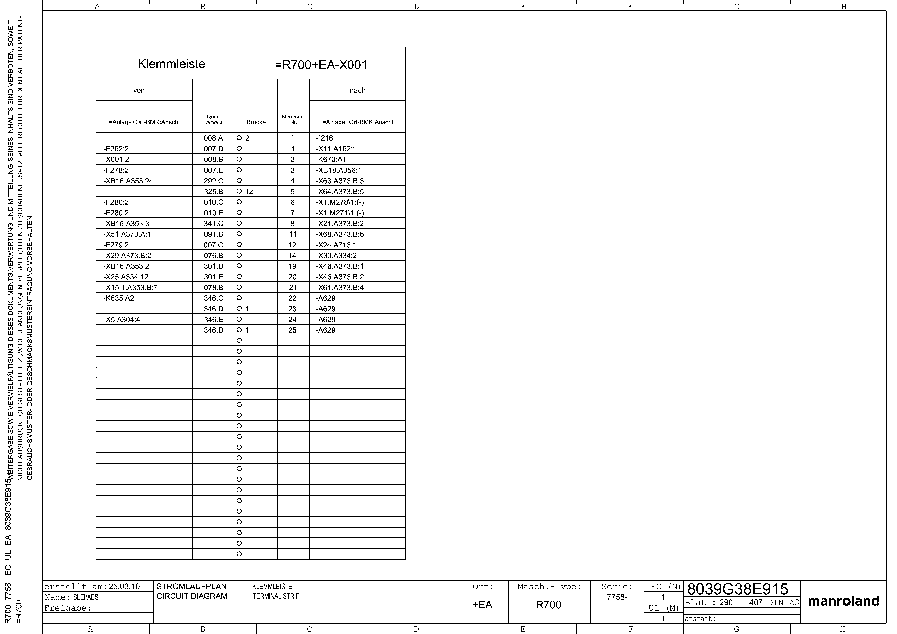

# +EA — Sheet 290 of 407 — KLEMMLEISTE

**TERMINAL STRIP**

> Part of the manroland **R700** printing press IEC/UL circuit diagrams.
> Drawing class: **Stromlaufplan / Circuit diagram** (DIN A3).
> Document `+EA` covers the **Printing unit** machine section.

## At a glance

| Field | Value |
|---|---|
| Document | `+EA`  (8039G38E915) |
| Sheet | **290** of 407 |
| Section (DE) | KLEMMLEISTE |
| Section (EN) | TERMINAL STRIP |
| Section type | TERMINALS — Terminal strip |
| Machine type | `R700` |
| Series | `7758` |
| Created | 25.03.10 |
| Replaces | — |
| Columns used | A, B, C |
| Path numbers | — |
| Labels on sheet | 87 |
| Cross-refs out | 0 |
| Cross-refs in | 0 |

**Previous:** [+EA sheet 289](SHEET_0289.md) · **Next:** [+EA sheet 291](SHEET_0291.md) · **Document TOC:** [_TOC.md](_TOC.md)  (+EA) · **Master TOC:** [all sheets](../_MASTER_TOC.md)

## Sheet image (300 DPI, exact vector render)



_Rendered directly from the PDF vector layer at 300 DPI (1-bit), no OCR and no resampling. Use it to confirm anything ambiguous in the text below._

## Cross-references on this sheet

Each entry is a wire leaving this sheet. The printed token is `/sheet.column`; the link resolves to that sheet inside the same document.

_No outgoing cross-references on this sheet._

## Devices on this sheet

| Tag | Class | Class meaning (IEC) | Col | Sub | Terminal | Sign |
|---|---|---|---|---|---|---|
| `F262:2` | F | Schutz / protection device (fuse, circuit breaker) | A | — | 2 | — |
| `X001:2` | X | Klemme / terminal, plug connector | A | — | 2 | — |
| `K673:A1` | K | Relais / relay, contactor | C | — | A1 | — |
| `F278:2` | F | Schutz / protection device (fuse, circuit breaker) | A | — | 2 | — |
| `F280:2` | F | Schutz / protection device (fuse, circuit breaker) | A | — | 2 | — |
| `F280:2` | F | Schutz / protection device (fuse, circuit breaker) | A | — | 2 | — |
| `F279:2` | F | Schutz / protection device (fuse, circuit breaker) | A | — | 2 | — |
| `K635:A2` | K | Relais / relay, contactor | A | — | A2 | — |
| `A629` | A | Baugruppe / assembly, module, PC board | C | — | — | — |
| `A629` | A | Baugruppe / assembly, module, PC board | C | — | — | — |
| `A629` | A | Baugruppe / assembly, module, PC board | C | — | — | — |
| `A629` | A | Baugruppe / assembly, module, PC board | C | — | — | — |
| `Nr.` | — | cross-device reference | C | — | — | — |
| `008.A` | — | cross-device reference | B | — | — | — |
| `007.D` | — | cross-device reference | B | — | — | — |
| `X11.A162:1` | — | cross-device reference | C | — | 1 | — |
| `008.B` | — | cross-device reference | B | — | — | — |
| `007.E` | — | cross-device reference | B | — | — | — |
| `XB18.A356:1` | — | cross-device reference | C | — | 1 | — |
| `292.C` | — | cross-device reference | B | — | — | — |
| `XB16.A353:24` | — | cross-device reference | A | — | 24 | — |
| `X63.A373.B:3` | — | cross-device reference | C | — | 3 | — |
| `325.B` | — | cross-device reference | B | — | — | — |
| `X64.A373.B:5` | — | cross-device reference | C | — | 5 | — |
| `010.C` | — | cross-device reference | B | — | — | — |
| `X1.M278\1:( )` | — | cross-device reference | C | — | — | — |
| `010.E` | — | cross-device reference | B | — | — | — |
| `X1.M271\1:( )` | — | cross-device reference | C | — | — | — |
| `341.C` | — | cross-device reference | B | — | — | — |
| `XB16.A353:3` | — | cross-device reference | A | — | 3 | — |
| `X21.A373.B:2` | — | cross-device reference | C | — | 2 | — |
| `091.B` | — | cross-device reference | B | — | — | — |
| `X51.A373.A:1` | — | cross-device reference | A | — | 1 | — |
| `X68.A373.B:6` | — | cross-device reference | C | — | 6 | — |
| `007.G` | — | cross-device reference | B | — | — | — |
| `X24.A713:1` | — | cross-device reference | C | — | 1 | — |
| `076.B` | — | cross-device reference | B | — | — | — |
| `X29.A373.B:2` | — | cross-device reference | A | — | 2 | — |
| `X30.A334:2` | — | cross-device reference | C | — | 2 | — |
| `301.D` | — | cross-device reference | B | — | — | — |
| `XB16.A353:2` | — | cross-device reference | A | — | 2 | — |
| `X46.A373.B:1` | — | cross-device reference | C | — | 1 | — |
| `301.E` | — | cross-device reference | B | — | — | — |
| `X25.A334:12` | — | cross-device reference | A | — | 12 | — |
| `X46.A373.B:2` | — | cross-device reference | C | — | 2 | — |
| `078.B` | — | cross-device reference | B | — | — | — |
| `X15.1.A353.B:7` | — | cross-device reference | A | — | 7 | — |
| `X61.A373.B:4` | — | cross-device reference | C | — | 4 | — |
| `346.C` | — | cross-device reference | B | — | — | — |
| `346.D` | — | cross-device reference | B | — | — | — |
| `346.E` | — | cross-device reference | B | — | — | — |
| `X5.A304:4` | — | cross-device reference | A | — | 4 | — |
| `346.D` | — | cross-device reference | B | — | — | — |

## Potentials / nets

_No named potentials on this sheet._

## Wire-end annotations (grouped as printed)

A wire that continues elsewhere is annotated with a small cluster: the destination description, the path/line number `#NN`, and the `/sheet.column` cross reference. Each row below is one such cluster exactly as it is grouped on the drawing.

| Col | Y | Path | Cross-ref | Text on the wire |
|---|---|---|---|---|
| B | 77.5 | — | — | `Klemmleiste` |
| C | 79.0 | — | — | `=R700+EA X001` |
| A | 115.5 | — | — | `von` |
| C | 115.5 | — | — | `nach` |
| B | 151.9 | — | — | `Quer` |
| C | 151.9 | — | — | `Klemmen =Anlage+Ort BMK:Anschl` |
| A | 158.5 | — | — | `=Anlage+Ort BMK:Anschl` |
| C | 158.5 | — | — | `Brücke Nr.` |
| B | 159.1 | — | — | `verweis` |
| B | 179.0 | — | — | `F262:2 X001:2 F278:2 XB16.A353:24 F280:2 F280:2 XB16.A353:3 X51.A373.A:1 F279:2 X29.A373.B:2 XB16.A353:2 X25.A334:12 X15.1.A353.B:7 K635:A2 X5.A304:4 007.G 008.A 007.D 292.C 010.C 341.C 301.D 346.C 346.D 346.D 008.B 007.E 325.B 010.E 091.B 076.B 301.E 078.B 346.E 12 1 1 2 12 14 19 20 22 23 24 25 11 21 2 3 4 5 6 7 8 1 ' '216 X11.A162:1 K673:A1 XB18.A356:1 X63.A373.B:3 X64.A373.B:5 X1.M278\1:( ) X1.M271\1:( ) X21.A373.B:2 X68.A373.B:6 X24.A713:1 X30.A334:2 X46.A373.B:1 X46.A373.B:2 X61.A373.B:4 A629 A629 A629 A629` |


## Reconstructed tables

This sheet carries tabular content (pin map / terminal assignment / index). The grid below was rebuilt from the drawing's own rule lines, so each row is exactly one physical row of the table.

### Table 1 — 19 data rows × 3 columns (at x=255.1, y=62.4)

| Quer verweis | Brücke | Klemmen Nr. |
|---|---|---|
| `008.A` | `2` | `'` |
| `007.D` |  | `1` |
| `008.B` |  | `2` |
| `007.E` |  | `3` |
| `292.C` |  | `4` |
| `325.B` | `12` | `5` |
| `010.C` |  | `6` |
| `010.E` |  | `7` |
| `341.C` |  | `8` |
| `091.B` |  | `11` |
| `007.G` |  | `12` |
| `076.B` |  | `14` |
| `301.D` |  | `19` |
| `301.E` |  | `20` |
| `078.B` |  | `21` |
| `346.C` |  | `22` |
| `346.D` | `1` | `23` |
| `346.E` |  | `24` |
| `346.D` | `1` | `25` |


## Notes and free text on this sheet

| Text | Col | Y (pt) |
|---|---|---|
| `von` | A | 115.53 |
| `=Anlage+Ort BMK:Anschl` | A | 158.52 |
| `Quer` | B | 151.93 |
| `Klemmleiste` | B | 77.49 |
| `verweis` | B | 159.12 |
| `nach` | C | 115.46 |
| `=Anlage+Ort BMK:Anschl` | C | 158.52 |
| `Klemmen` | C | 151.94 |
| `Brücke` | B | 158.53 |
| `=R700+EA X001` | C | 78.96 |

## Complete label inventory (exact text from the drawing)

Every text object inside the drawing area of this sheet, in DIN reading order (column A→H, then top→bottom). This is the authoritative list: if a string is not here it is not printed on this sheet.

| Col | Y | X | Dir | Type | Text |
|---|---|---|---|---|---|
| A | 115.5 | 176.9 | → | text | `von` |
| A | 158.5 | 144.4 | → | text | `=Anlage+Ort BMK:Anschl` |
| A | 193.4 | 137.2 | → | device tag | `F262:2` |
| A | 207.5 | 137.2 | → | device tag | `X001:2` |
| A | 221.7 | 137.2 | → | device tag | `F278:2` |
| A | 235.9 | 137.2 | → | device ref | `XB16.A353:24` |
| A | 264.2 | 137.2 | → | device tag | `F280:2` |
| A | 278.4 | 137.2 | → | device tag | `F280:2` |
| A | 292.6 | 137.2 | → | device ref | `XB16.A353:3` |
| A | 306.8 | 137.2 | → | device ref | `X51.A373.A:1` |
| A | 320.9 | 137.2 | → | device tag | `F279:2` |
| A | 335.1 | 137.2 | → | device ref | `X29.A373.B:2` |
| A | 349.3 | 137.2 | → | device ref | `XB16.A353:2` |
| A | 363.5 | 137.2 | → | device ref | `X25.A334:12` |
| A | 377.6 | 137.2 | → | device ref | `X15.1.A353.B:7` |
| A | 391.8 | 137.2 | → | device tag | `K635:A2` |
| A | 420.1 | 137.2 | → | device ref | `X5.A304:4` |
| B | 77.5 | 182.8 | → | text | `Klemmleiste` |
| B | 151.9 | 274.7 | → | text | `Quer` |
| B | 158.5 | 327.3 | → | text | `Brücke` |
| B | 159.1 | 272.6 | → | text | `verweis` |
| B | 179.2 | 270.4 | → | device ref | `008.A` |
| B | 179.2 | 325.7 | → | number | `2` |
| B | 193.4 | 270.6 | → | device ref | `007.D` |
| B | 207.6 | 270.9 | → | device ref | `008.B` |
| B | 221.7 | 270.9 | → | device ref | `007.E` |
| B | 235.9 | 270.6 | → | device ref | `292.C` |
| B | 250.1 | 270.9 | → | device ref | `325.B` |
| B | 250.1 | 325.1 | → | number | `12` |
| B | 264.2 | 270.6 | → | device ref | `010.C` |
| B | 278.4 | 270.9 | → | device ref | `010.E` |
| B | 292.6 | 270.6 | → | device ref | `341.C` |
| B | 306.8 | 270.9 | → | device ref | `091.B` |
| B | 320.9 | 270.3 | → | device ref | `007.G` |
| B | 335.1 | 270.9 | → | device ref | `076.B` |
| B | 349.3 | 270.6 | → | device ref | `301.D` |
| B | 363.5 | 270.9 | → | device ref | `301.E` |
| B | 377.6 | 270.9 | → | device ref | `078.B` |
| B | 391.8 | 270.6 | → | device ref | `346.C` |
| B | 406.0 | 270.6 | → | device ref | `346.D` |
| B | 406.0 | 325.1 | → | number | `1` |
| B | 420.2 | 270.9 | → | device ref | `346.E` |
| B | 434.3 | 270.6 | → | device ref | `346.D` |
| B | 434.4 | 325.1 | → | number | `1` |
| C | 79.0 | 364.8 | → | text | `=R700+EA X001` |
| C | 115.5 | 464.3 | → | text | `nach` |
| C | 151.9 | 374.0 | → | text | `Klemmen` |
| C | 158.5 | 427.9 | → | text | `=Anlage+Ort BMK:Anschl` |
| C | 159.0 | 385.4 | → | device ref | `Nr.` |
| C | 179.0 | 387.2 | → | other | `'` |
| C | 179.2 | 419.2 | → | other | `'216` |
| C | 193.4 | 386.2 | → | number | `1` |
| C | 193.4 | 419.2 | → | device ref | `X11.A162:1` |
| C | 207.5 | 419.2 | → | device tag | `K673:A1` |
| C | 207.6 | 385.7 | → | number | `2` |
| C | 221.7 | 419.2 | → | device ref | `XB18.A356:1` |
| C | 221.8 | 385.7 | → | number | `3` |
| C | 235.9 | 385.7 | → | number | `4` |
| C | 235.9 | 419.2 | → | device ref | `X63.A373.B:3` |
| C | 250.1 | 385.7 | → | number | `5` |
| C | 250.1 | 419.2 | → | device ref | `X64.A373.B:5` |
| C | 264.2 | 419.2 | → | device ref | `X1.M278\1:( )` |
| C | 264.3 | 385.7 | → | number | `6` |
| C | 278.4 | 419.2 | → | device ref | `X1.M271\1:( )` |
| C | 278.5 | 385.7 | → | number | `7` |
| C | 292.6 | 385.7 | → | number | `8` |
| C | 292.6 | 419.2 | → | device ref | `X21.A373.B:2` |
| C | 306.8 | 383.5 | → | number | `11` |
| C | 306.8 | 419.2 | → | device ref | `X68.A373.B:6` |
| C | 320.9 | 419.2 | → | device ref | `X24.A713:1` |
| C | 321.0 | 382.7 | → | number | `12` |
| C | 335.1 | 382.7 | → | number | `14` |
| C | 335.1 | 419.2 | → | device ref | `X30.A334:2` |
| C | 349.3 | 382.7 | → | number | `19` |
| C | 349.3 | 419.2 | → | device ref | `X46.A373.B:1` |
| C | 363.4 | 419.2 | → | device ref | `X46.A373.B:2` |
| C | 363.5 | 383.0 | → | number | `20` |
| C | 377.6 | 419.2 | → | device ref | `X61.A373.B:4` |
| C | 377.7 | 383.8 | → | number | `21` |
| C | 391.8 | 383.0 | → | number | `22` |
| C | 391.8 | 419.2 | → | device tag | `A629` |
| C | 406.0 | 383.0 | → | number | `23` |
| C | 406.0 | 419.2 | → | device tag | `A629` |
| C | 420.1 | 419.2 | → | device tag | `A629` |
| C | 420.2 | 383.0 | → | number | `24` |
| C | 434.3 | 419.2 | → | device tag | `A629` |
| C | 434.4 | 383.0 | → | number | `25` |

## Reading-order text block

The same content as a plain block, grouped by DIN column — convenient to paste or to match against a visual description.

```text
=== Column A ===
 115.5  176.9  text         von
 158.5  144.4  text         =Anlage+Ort BMK:Anschl
 193.4  137.2  devtag       F262:2
 207.5  137.2  devtag       X001:2
 221.7  137.2  devtag       F278:2
 235.9  137.2  devref       XB16.A353:24
 264.2  137.2  devtag       F280:2
 278.4  137.2  devtag       F280:2
 292.6  137.2  devref       XB16.A353:3
 306.8  137.2  devref       X51.A373.A:1
 320.9  137.2  devtag       F279:2
 335.1  137.2  devref       X29.A373.B:2
 349.3  137.2  devref       XB16.A353:2
 363.5  137.2  devref       X25.A334:12
 377.6  137.2  devref       X15.1.A353.B:7
 391.8  137.2  devtag       K635:A2
 420.1  137.2  devref       X5.A304:4
=== Column B ===
  77.5  182.8  text         Klemmleiste
 151.9  274.7  text         Quer
 158.5  327.3  text         Brücke
 159.1  272.6  text         verweis
 179.2  270.4  devref       008.A
 179.2  325.7  numeric      2
 193.4  270.6  devref       007.D
 207.6  270.9  devref       008.B
 221.7  270.9  devref       007.E
 235.9  270.6  devref       292.C
 250.1  270.9  devref       325.B
 250.1  325.1  numeric      12
 264.2  270.6  devref       010.C
 278.4  270.9  devref       010.E
 292.6  270.6  devref       341.C
 306.8  270.9  devref       091.B
 320.9  270.3  devref       007.G
 335.1  270.9  devref       076.B
 349.3  270.6  devref       301.D
 363.5  270.9  devref       301.E
 377.6  270.9  devref       078.B
 391.8  270.6  devref       346.C
 406.0  270.6  devref       346.D
 406.0  325.1  numeric      1
 420.2  270.9  devref       346.E
 434.3  270.6  devref       346.D
 434.4  325.1  numeric      1
=== Column C ===
  79.0  364.8  text         =R700+EA X001
 115.5  464.3  text         nach
 151.9  374.0  text         Klemmen
 158.5  427.9  text         =Anlage+Ort BMK:Anschl
 159.0  385.4  devref       Nr.
 179.0  387.2  other        `
 179.2  419.2  other        `216
 193.4  386.2  numeric      1
 193.4  419.2  devref       X11.A162:1
 207.5  419.2  devtag       K673:A1
 207.6  385.7  numeric      2
 221.7  419.2  devref       XB18.A356:1
 221.8  385.7  numeric      3
 235.9  385.7  numeric      4
 235.9  419.2  devref       X63.A373.B:3
 250.1  385.7  numeric      5
 250.1  419.2  devref       X64.A373.B:5
 264.2  419.2  devref       X1.M278\1:( )
 264.3  385.7  numeric      6
 278.4  419.2  devref       X1.M271\1:( )
 278.5  385.7  numeric      7
 292.6  385.7  numeric      8
 292.6  419.2  devref       X21.A373.B:2
 306.8  383.5  numeric      11
 306.8  419.2  devref       X68.A373.B:6
 320.9  419.2  devref       X24.A713:1
 321.0  382.7  numeric      12
 335.1  382.7  numeric      14
 335.1  419.2  devref       X30.A334:2
 349.3  382.7  numeric      19
 349.3  419.2  devref       X46.A373.B:1
 363.4  419.2  devref       X46.A373.B:2
 363.5  383.0  numeric      20
 377.6  419.2  devref       X61.A373.B:4
 377.7  383.8  numeric      21
 391.8  383.0  numeric      22
 391.8  419.2  devtag       A629
 406.0  383.0  numeric      23
 406.0  419.2  devtag       A629
 420.1  419.2  devtag       A629
 420.2  383.0  numeric      24
 434.3  419.2  devtag       A629
 434.4  383.0  numeric      25
```

---
_Generated from the PDF vector text layer; no OCR. Source: `R700_7758_IEC_UL_EA_8039G38E915_p`, sheet 290._
