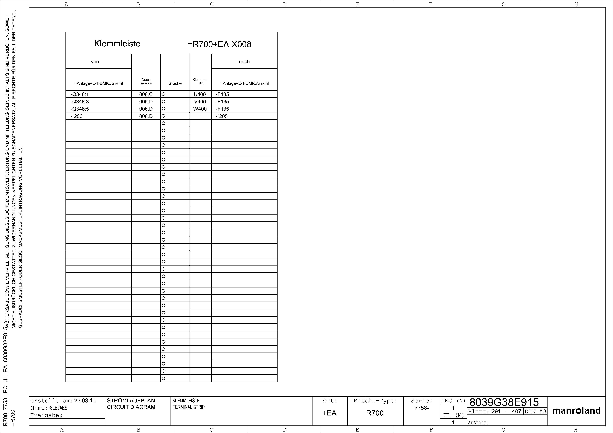

# +EA — Sheet 291 of 407 — KLEMMLEISTE

**TERMINAL STRIP**

> Part of the manroland **R700** printing press IEC/UL circuit diagrams.
> Drawing class: **Stromlaufplan / Circuit diagram** (DIN A3).
> Document `+EA` covers the **Printing unit** machine section.

## At a glance

| Field | Value |
|---|---|
| Document | `+EA`  (8039G38E915) |
| Sheet | **291** of 407 |
| Section (DE) | KLEMMLEISTE |
| Section (EN) | TERMINAL STRIP |
| Section type | TERMINALS — Terminal strip |
| Machine type | `R700` |
| Series | `7758` |
| Created | 25.03.10 |
| Replaces | — |
| Columns used | A, B, C |
| Path numbers | — |
| Labels on sheet | 27 |
| Cross-refs out | 0 |
| Cross-refs in | 0 |

**Previous:** [+EA sheet 290](SHEET_0290.md) · **Next:** [+EA sheet 292](SHEET_0292.md) · **Document TOC:** [_TOC.md](_TOC.md)  (+EA) · **Master TOC:** [all sheets](../_MASTER_TOC.md)

## Sheet image (300 DPI, exact vector render)



_Rendered directly from the PDF vector layer at 300 DPI (1-bit), no OCR and no resampling. Use it to confirm anything ambiguous in the text below._

## Cross-references on this sheet

Each entry is a wire leaving this sheet. The printed token is `/sheet.column`; the link resolves to that sheet inside the same document.

_No outgoing cross-references on this sheet._

## Devices on this sheet

| Tag | Class | Class meaning (IEC) | Col | Sub | Terminal | Sign |
|---|---|---|---|---|---|---|
| `U400` | U | Umrichter / frequency converter | C | — | — | — |
| `Q348:1` | Q | Leistungsschalter / power switching device | A | — | 1 | — |
| `F135` | F | Schutz / protection device (fuse, circuit breaker) | C | — | — | — |
| `V400` | V | Diode / semiconductor valve | C | — | — | — |
| `Q348:3` | Q | Leistungsschalter / power switching device | A | — | 3 | — |
| `F135` | F | Schutz / protection device (fuse, circuit breaker) | C | — | — | — |
| `W400` | W | Kabel / cable, line, bus | C | — | — | — |
| `Q348:5` | Q | Leistungsschalter / power switching device | A | — | 5 | — |
| `F135` | F | Schutz / protection device (fuse, circuit breaker) | C | — | — | — |
| `Nr.` | — | cross-device reference | C | — | — | — |
| `006.C` | — | cross-device reference | B | — | — | — |
| `006.D` | — | cross-device reference | B | — | — | — |
| `006.D` | — | cross-device reference | B | — | — | — |
| `006.D` | — | cross-device reference | B | — | — | — |

## Potentials / nets

_No named potentials on this sheet._

## Wire-end annotations (grouped as printed)

A wire that continues elsewhere is annotated with a small cluster: the destination description, the path/line number `#NN`, and the `/sheet.column` cross reference. Each row below is one such cluster exactly as it is grouped on the drawing.

| Col | Y | Path | Cross-ref | Text on the wire |
|---|---|---|---|---|
| B | 77.5 | — | — | `Klemmleiste` |
| C | 79.0 | — | — | `=R700+EA X008` |
| A | 115.5 | — | — | `von` |
| C | 115.5 | — | — | `nach` |
| B | 151.9 | — | — | `Quer` |
| C | 151.9 | — | — | `Klemmen =Anlage+Ort BMK:Anschl` |
| A | 158.5 | — | — | `=Anlage+Ort BMK:Anschl` |
| C | 158.5 | — | — | `Brücke Nr.` |
| B | 159.1 | — | — | `verweis` |
| B | 179.2 | — | — | `Q348:1 Q348:3 Q348:5 '206 006.C 006.D 006.D 006.D W400 U400 V400 ' F135 F135 F135 '205` |


## Reconstructed tables

This sheet carries tabular content (pin map / terminal assignment / index). The grid below was rebuilt from the drawing's own rule lines, so each row is exactly one physical row of the table.

### Table 1 — 4 data rows × 3 columns (at x=255.1, y=62.4)

| Quer verweis | Brücke | Klemmen Nr. |
|---|---|---|
| `006.C` |  | `U400` |
| `006.D` |  | `V400` |
| `006.D` |  | `W400` |
| `006.D` |  | `'` |


## Notes and free text on this sheet

| Text | Col | Y (pt) |
|---|---|---|
| `von` | A | 115.53 |
| `=Anlage+Ort BMK:Anschl` | A | 158.52 |
| `Quer` | B | 151.93 |
| `Klemmleiste` | B | 77.49 |
| `verweis` | B | 159.12 |
| `nach` | C | 115.46 |
| `=Anlage+Ort BMK:Anschl` | C | 158.52 |
| `Klemmen` | C | 151.94 |
| `Brücke` | B | 158.53 |
| `=R700+EA X008` | C | 78.96 |

## Complete label inventory (exact text from the drawing)

Every text object inside the drawing area of this sheet, in DIN reading order (column A→H, then top→bottom). This is the authoritative list: if a string is not here it is not printed on this sheet.

| Col | Y | X | Dir | Type | Text |
|---|---|---|---|---|---|
| A | 115.5 | 176.9 | → | text | `von` |
| A | 158.5 | 144.4 | → | text | `=Anlage+Ort BMK:Anschl` |
| A | 179.2 | 137.2 | → | device tag | `Q348:1` |
| A | 193.4 | 137.2 | → | device tag | `Q348:3` |
| A | 207.5 | 137.2 | → | device tag | `Q348:5` |
| A | 221.7 | 137.2 | → | other | `'206` |
| B | 77.5 | 182.8 | → | text | `Klemmleiste` |
| B | 151.9 | 274.7 | → | text | `Quer` |
| B | 158.5 | 327.3 | → | text | `Brücke` |
| B | 159.1 | 272.6 | → | text | `verweis` |
| B | 179.2 | 270.6 | → | device ref | `006.C` |
| B | 193.4 | 270.6 | → | device ref | `006.D` |
| B | 207.5 | 270.6 | → | device ref | `006.D` |
| B | 221.7 | 270.6 | → | device ref | `006.D` |
| C | 79.0 | 364.8 | → | text | `=R700+EA X008` |
| C | 115.5 | 464.3 | → | text | `nach` |
| C | 151.9 | 374.0 | → | text | `Klemmen` |
| C | 158.5 | 427.9 | → | text | `=Anlage+Ort BMK:Anschl` |
| C | 159.0 | 385.4 | → | device ref | `Nr.` |
| C | 179.2 | 376.4 | → | device tag | `U400` |
| C | 179.2 | 419.2 | → | device tag | `F135` |
| C | 193.4 | 377.3 | → | device tag | `V400` |
| C | 193.4 | 419.2 | → | device tag | `F135` |
| C | 207.4 | 375.3 | → | device tag | `W400` |
| C | 207.6 | 419.2 | → | device tag | `F135` |
| C | 221.6 | 387.2 | → | other | `'` |
| C | 221.7 | 419.2 | → | other | `'205` |

## Reading-order text block

The same content as a plain block, grouped by DIN column — convenient to paste or to match against a visual description.

```text
=== Column A ===
 115.5  176.9  text         von
 158.5  144.4  text         =Anlage+Ort BMK:Anschl
 179.2  137.2  devtag       Q348:1
 193.4  137.2  devtag       Q348:3
 207.5  137.2  devtag       Q348:5
 221.7  137.2  other        `206
=== Column B ===
  77.5  182.8  text         Klemmleiste
 151.9  274.7  text         Quer
 158.5  327.3  text         Brücke
 159.1  272.6  text         verweis
 179.2  270.6  devref       006.C
 193.4  270.6  devref       006.D
 207.5  270.6  devref       006.D
 221.7  270.6  devref       006.D
=== Column C ===
  79.0  364.8  text         =R700+EA X008
 115.5  464.3  text         nach
 151.9  374.0  text         Klemmen
 158.5  427.9  text         =Anlage+Ort BMK:Anschl
 159.0  385.4  devref       Nr.
 179.2  376.4  devtag       U400
 179.2  419.2  devtag       F135
 193.4  377.3  devtag       V400
 193.4  419.2  devtag       F135
 207.4  375.3  devtag       W400
 207.6  419.2  devtag       F135
 221.6  387.2  other        `
 221.7  419.2  other        `205
```

---
_Generated from the PDF vector text layer; no OCR. Source: `R700_7758_IEC_UL_EA_8039G38E915_p`, sheet 291._
