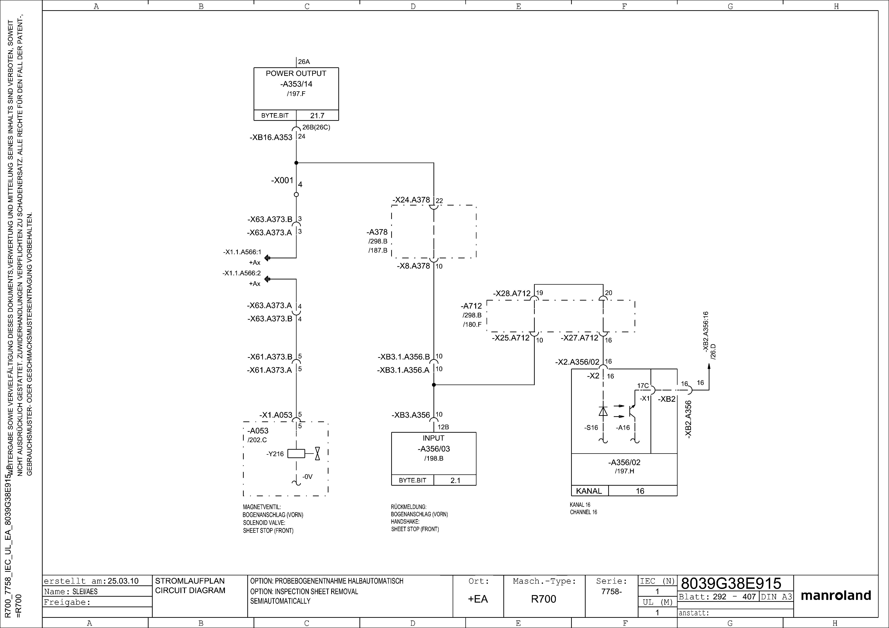

# +EA — Sheet 292 of 407 — OPTION: PROBEBOGENENTNAHME HALBAUTOMATISCH

**OPTION: INSPECTION SHEET REMOVAL**

> Part of the manroland **R700** printing press IEC/UL circuit diagrams.
> Drawing class: **Stromlaufplan / Circuit diagram** (DIN A3).
> Document `+EA` covers the **Printing unit** machine section.

## At a glance

| Field | Value |
|---|---|
| Document | `+EA`  (8039G38E915) |
| Sheet | **292** of 407 |
| Section (DE) | OPTION: PROBEBOGENENTNAHME HALBAUTOMATISCH |
| Section (EN) | OPTION: INSPECTION SHEET REMOVAL |
| Section type | CIRCUIT — Circuit diagram |
| Machine type | `R700` |
| Series | `7758` |
| Created | 25.03.10 |
| Replaces | — |
| Columns used | B, C, D, E, F, G |
| Path numbers | — |
| Labels on sheet | 91 |
| Cross-refs out | 9 |
| Cross-refs in | 28 |

**Previous:** [+EA sheet 291](SHEET_0291.md) · **Next:** [+EA sheet 293](SHEET_0293.md) · **Document TOC:** [_TOC.md](_TOC.md)  (+EA) · **Master TOC:** [all sheets](../_MASTER_TOC.md)

## Sheet image (300 DPI, exact vector render)



_Rendered directly from the PDF vector layer at 300 DPI (1-bit), no OCR and no resampling. Use it to confirm anything ambiguous in the text below._

## Cross-references on this sheet

Each entry is a wire leaving this sheet. The printed token is `/sheet.column`; the link resolves to that sheet inside the same document.

| Ref | Target sheet | Col | Path | Destination on target | Target section | From col |
|---|---|---|---|---|---|---|
| `/197.F` | [+EA sheet 197](SHEET_0197.md) | F | — | — | REFERENZMODUL | C |
| `/298.B` | [+EA sheet 298](SHEET_0298.md) | B | — | — | OPTION: ZWISCHENSTAPEL / | D |
| `/187.B` | [+EA sheet 187](SHEET_0187.md) | B | — | — | RESERVE | D |
| `/26.D` | [+EA sheet 26](SHEET_0026.md) | D | — | XB2.A356:16 | BUSVERBINDUNGEN: SICHERHEITSBUS | G |
| `/298.B` | [+EA sheet 298](SHEET_0298.md) | B | — | — | OPTION: ZWISCHENSTAPEL / | E |
| `/180.F` | [+EA sheet 180](SHEET_0180.md) | F | — | — | RESERVE | E |
| `/202.C` | [+EA sheet 202](SHEET_0202.md) | C | — | A053 | REFERENZMODUL | C |
| `/198.B` | [+EA sheet 198](SHEET_0198.md) | B | — | — | REFERENZMODUL | D |
| `/197.H` | [+EA sheet 197](SHEET_0197.md) | H | — | — | REFERENZMODUL | F |

### Incoming references (sheets that point here)

Every other sheet that sends a wire to this one. `Back-ref` is the token printed on *that* sheet; `Path` is its line number.

| From sheet | Cols | Back-ref | Path | Refs | What continues there |
|---|---|---|---|---|---|
| [+EA#26](SHEET_0026.md) | D | `/26.D` | — | 1 | XB2.A356:16 |
| [+EA#180](SHEET_0180.md) | F | `/180.F` | — | 1 | — |
| [+EA#187](SHEET_0187.md) | B | `/187.B` | — | 1 | — |
| [+EA#197](SHEET_0197.md) | F, H | `/197.F`, `/197.H` | — | 2 | — |
| [+EA#198](SHEET_0198.md) | B | `/198.B` | — | 1 | — |
| [+EA#202](SHEET_0202.md) | C | `/202.C` | — | 1 | — |
| [+EA#206](SHEET_0206.md) | D | `/206.D` | — | 1 | — |
| [+EA#225](SHEET_0225.md) | F | `/225.F` | — | 1 | — |
| [+EA#226](SHEET_0226.md) | E | `/226.E` | — | 1 | — |
| [+EA#234](SHEET_0234.md) | H | `/234.H` | — | 1 | — |
| [+EA#235](SHEET_0235.md) | A, B | `/235.A`, `/235.B` | — | 2 | — |
| [+EA#250](SHEET_0250.md) | D | `/250.D` | — | 1 | — |
| [+EA#261](SHEET_0261.md) | G | `/261.G` | — | 1 | — |
| [+EA#266](SHEET_0266.md) | F | `/266.F` | — | 1 | — |
| [+EA#268](SHEET_0268.md) | F | `/268.F` | — | 1 | — |
| [+EA#271](SHEET_0271.md) | G | `/271.G` | — | 1 | — |
| [+EA#273](SHEET_0273.md) | C | `/273.C` | — | 2 | — |
| [+EA#283](SHEET_0283.md) | G | `/283.G` | — | 2 | — |
| [+EA#284](SHEET_0284.md) | A, B | `/284.A`, `/284.B` | — | 4 | — |
| [+EA#298](SHEET_0298.md) | A, B | `/298.A`, `/298.B` | — | 2 | — |


## Devices on this sheet

| Tag | Class | Class meaning (IEC) | Col | Sub | Terminal | Sign |
|---|---|---|---|---|---|---|
| `A353/14` | A | Baugruppe / assembly, module, PC board | C | 14 | — | — |
| `X001` | X | Klemme / terminal, plug connector | C | — | — | — |
| `A378` | A | Baugruppe / assembly, module, PC board | D | — | — | — |
| `S16` | S | Schalter / switch | F | — | — | — |
| `A16` | A | Baugruppe / assembly, module, PC board | F | — | — | — |
| `X1` | X | Klemme / terminal, plug connector | F | — | — | — |
| `X2` | X | Klemme / terminal, plug connector | F | — | — | — |
| `XB2` | XB |  | F | — | — | — |
| `A356/02` | A | Baugruppe / assembly, module, PC board | F | 02 | — | — |
| `A712` | A | Baugruppe / assembly, module, PC board | E | — | — | — |
| `A356/03` | A | Baugruppe / assembly, module, PC board | D | 03 | — | — |
| `Y216` | Y | Magnetventil / solenoid valve, actuator | C | — | — | — |
| `A053` | A | Baugruppe / assembly, module, PC board | C | — | — | — |
| `21.7` | — | cross-device reference | C | — | — | — |
| `XB16.A353` | — | cross-device reference | C | — | — | — |
| `X63.A373.A` | — | cross-device reference | C | — | — | — |
| `X63.A373.B` | — | cross-device reference | C | — | — | — |
| `X1.1.A566:2` | — | cross-device reference | B | — | 2 | — |
| `X1.1.A566:1` | — | cross-device reference | B | — | 1 | — |
| `X63.A373.B` | — | cross-device reference | C | — | — | — |
| `X63.A373.A` | — | cross-device reference | C | — | — | — |
| `X61.A373.B` | — | cross-device reference | C | — | — | — |
| `X61.A373.A` | — | cross-device reference | C | — | — | — |
| `X8.A378` | — | cross-device reference | D | — | — | — |
| `X24.A378` | — | cross-device reference | D | — | — | — |
| `XB3.1.A356.B` | — | cross-device reference | D | — | — | — |
| `XB3.1.A356.A` | — | cross-device reference | D | — | — | — |
| `XB2.A356` | — | cross-device reference | G | — | — | — |
| `X28.A712` | — | cross-device reference | E | — | — | — |
| `X27.A712` | — | cross-device reference | F | — | — | — |
| `X25.A712` | — | cross-device reference | E | — | — | — |
| `2.1` | — | cross-device reference | D | — | — | — |
| `XB3.A356` | — | cross-device reference | D | — | — | — |
| `X1.A053` | — | cross-device reference | C | — | — | — |
| `XB2.A356:16` | — | cross-device reference | G | — | 16 | — |

## Potentials / nets

| Potential | Count | Columns | Attached devices | Terminals |
|---|---|---|---|---|
| `0V` | 1 | C | — | — |


A potential such as `L24+/4` or `M24+` is a named supply/return rail; every place it appears on this sheet is electrically common.

## Wire-end annotations (grouped as printed)

A wire that continues elsewhere is annotated with a small cluster: the destination description, the path/line number `#NN`, and the `/sheet.column` cross reference. Each row below is one such cluster exactly as it is grouped on the drawing.

| Col | Y | Path | Cross-ref | Text on the wire |
|---|---|---|---|---|
| C | 79.0 | — | — | `26A` |
| C | 94.1 | — | — | `POWER OUTPUT` |
| C | 108.0 | — | — | `A353/14` |
| C | 121.8 | — | `/197.F` | — |
| C | 150.9 | — | — | `BYTE.BIT 21.7` |
| C | 166.9 | — | — | `26B(26C)` |
| C | 178.9 | — | — | `XB16.A353 24` |
| C | 236.8 | — | — | `X001 4` |
| D | 263.2 | — | — | `X24.A378 22` |
| C | 289.4 | — | — | `X63.A373.B 3` |
| D | 306.4 | — | — | `A378` |
| C | 306.5 | — | — | `X63.A373.A 3` |
| D | 319.5 | — | `/298.B`, `/187.B` | — |
| B | 334.1 | — | — | `X1.1.A566:1` |
| C | 348.3 | — | — | `+Ax` |
| D | 351.8 | — | — | `X8.A378 10` |
| B | 362.4 | — | — | `X1.1.A566:2` |
| C | 376.7 | — | — | `+Ax` |
| E | 388.6 | — | — | `X28.A712 19 20` |
| C | 405.0 | — | — | `X63.A373.A 4` |
| E | 405.7 | — | — | `A712` |
| G | 417.5 | — | `/26.D` | `XB2.A356:16` |
| E | 418.7 | — | `/298.B` | — |
| C | 422.7 | — | — | `X63.A373.B 4` |
| E | 431.1 | — | `/180.F` | — |
| E | 448.2 | — | — | `X25.A712 10 X27.A712 16` |
| C | 473.7 | — | — | `X61.A373.B 5` |
| D | 473.7 | — | — | `XB3.1.A356.B 10` |
| F | 480.8 | — | — | `X2.A356/02 16` |
| C | 490.7 | — | — | `X61.A373.A 5` |
| D | 490.7 | — | — | `XB3.1.A356.A 10` |
| F | 499.2 | — | — | `X2` |
| F | 500.6 | — | — | `16 16` |
| G | 509.1 | — | — | `16` |
| F | 513.4 | — | — | `17C` |
| F | 530.4 | — | — | `X1` |
| F | 530.4 | — | — | `XB2` |
| G | 536.6 | — | — | `XB2.A356` |
| C | 551.6 | — | — | `X1.A053 5 XB3.A356 10` |
| C | 567.2 | — | — | `5` |
| D | 568.6 | — | — | `12B` |
| F | 569.4 | — | — | `S16 A16` |
| C | 572.9 | — | `/202.C` | `A053` |
| D | 583.2 | — | — | `INPUT` |
| D | 597.0 | — | — | `A356/03` |
| C | 604.8 | — | — | `Y216` |
| D | 610.8 | — | `/198.B` | — |
| F | 615.4 | — | — | `A356/02` |
| F | 627.8 | — | `/197.H` | — |
| C | 635.3 | — | — | `0V` |
| D | 639.8 | — | — | `BYTE.BIT 2.1` |
| F | 653.7 | — | — | `KANAL 16` |
| F | 674.0 | — | — | `KANAL 16 CHANNEL 16` |
| C | 676.7 | — | — | `BOGENANSCHLAG (VORN) MAGNETVENTIL:` |
| D | 676.8 | — | — | `RÜCKMELDUNG: BOGENANSCHLAG (VORN) HANDSHAKE: SHEET STOP (FRONT)` |
| C | 697.9 | — | — | `SOLENOID VALVE: SHEET STOP (FRONT)` |


## Reconstructed tables

This sheet carries tabular content (pin map / terminal assignment / index). The grid below was rebuilt from the drawing's own rule lines, so each row is exactly one physical row of the table.

### Table 1 — 10 data rows × 12 columns (at x=340.2, y=90.7)

| POWER | OUTPUT A353/14 /197.F |  |  |  |  |  |  |  |  |  |  |
|---|---|---|---|---|---|---|---|---|---|---|---|
| `BYTE.BIT` | `21.7` |  |  |  |  |  |  |  |  |  |  |
| `XB16.A353` | `26B(26C) 24` |  |  |  |  |  |  |  |  |  |  |
| `X001 X63.A373.B X63.A373.A +Ax +Ax` | `4 3 3` | `A378 /298.B /187.B` | `X24.A378 X8.A378` | `22 10` |  |  |  |  |  |  |  |
| `X63.A373.A X63.A373.B X61.A373.B` | `4 4 5` |  | `XB3.1.A356.B` | `A712 /298.B /180.F 10` | `X28.A712 X25.A712` | `19 10` | `X27.A712 X2.A356/02` | `20 16 16` |  |  | `XB2.A356:16` |
| `X61.A373.A` | `5` |  | `XB3.1.A356.A` | `10` |  |  | `X2` | `16` |  |  | `16 16` |
| `X1.A053 A053` | `5 5` |  | `XB3.A356` | `10 12B` |  |  | `S16` | `A16` | `17C X1` | `XB2` | `XB2.A356` |
| `/202.C` |  |  | `INPUT` | `A356/03` |  |  |  |  |  |  |  |
| `Y216` |  |  |  | `/198.B` |  |  |  | `A356/02 /197.H` |  |  |  |
|  | `0V` |  | `BYTE.BIT` | `2.1` |  |  |  |  |  |  |  |
|  |  |  |  |  |  |  | `KANAL` |  | `16` |  |  |


## Notes and free text on this sheet

| Text | Col | Y (pt) |
|---|---|---|
| `26A` | C | 78.95 |
| `26B(26C)` | C | 166.86 |
| `POWER OUTPUT` | C | 94.1 |
| `BYTE.BIT` | C | 151.43 |
| `+Ax` | C | 376.66 |
| `KANAL 16` | F | 674.01 |
| `CHANNEL 16` | F | 683.96 |
| `17C` | F | 513.4 |
| `KANAL` | F | 653.68 |
| `X2.A356/02` | F | 480.78 |
| `12B` | D | 568.63 |
| `INPUT` | D | 583.16 |
| `BYTE.BIT` | D | 640.41 |
| `RÜCKMELDUNG:` | D | 676.84 |
| `BOGENANSCHLAG (VORN)` | D | 686.77 |
| `HANDSHAKE:` | D | 696.74 |
| `SHEET STOP (FRONT)` | D | 706.64 |
| `MAGNETVENTIL:` | C | 676.68 |
| `BOGENANSCHLAG (VORN)` | C | 687.33 |
| `SOLENOID VALVE:` | C | 697.94 |
| `SHEET STOP (FRONT)` | C | 708.59 |

## Complete label inventory (exact text from the drawing)

Every text object inside the drawing area of this sheet, in DIN reading order (column A→H, then top→bottom). This is the authoritative list: if a string is not here it is not printed on this sheet.

| Col | Y | X | Dir | Type | Text |
|---|---|---|---|---|---|
| B | 334.1 | 299.1 | → | device ref | `X1.1.A566:1` |
| B | 362.4 | 297.9 | → | device ref | `X1.1.A566:2` |
| C | 78.9 | 399.4 | → | text | `26A` |
| C | 94.1 | 356.0 | → | text | `POWER OUTPUT` |
| C | 108.0 | 375.4 | → | device tag | `A353/14` |
| C | 121.8 | 384.5 | → | cross-reference | `/197.F` |
| C | 150.9 | 415.7 | → | device ref | `21.7` |
| C | 151.4 | 350.1 | → | text | `BYTE.BIT` |
| C | 166.9 | 405.1 | → | text | `26B(26C)` |
| C | 178.9 | 399.4 | → | number | `24` |
| C | 179.6 | 334.5 | → | device ref | `XB16.A353` |
| C | 236.8 | 363.4 | → | device tag | `X001` |
| C | 242.6 | 399.4 | → | number | `4` |
| C | 289.4 | 331.7 | → | device ref | `X63.A373.B` |
| C | 289.5 | 399.4 | → | number | `3` |
| C | 306.5 | 399.4 | → | number | `3` |
| C | 307.2 | 330.8 | → | device ref | `X63.A373.A` |
| C | 348.3 | 333.6 | → | text | `+Ax` |
| C | 376.7 | 333.6 | → | text | `+Ax` |
| C | 405.0 | 330.8 | → | device ref | `X63.A373.A` |
| C | 407.1 | 399.4 | → | number | `4` |
| C | 422.7 | 331.7 | → | device ref | `X63.A373.B` |
| C | 424.1 | 399.4 | → | number | `4` |
| C | 473.7 | 331.7 | → | device ref | `X61.A373.B` |
| C | 473.7 | 399.4 | → | number | `5` |
| C | 490.7 | 399.4 | → | number | `5` |
| C | 491.4 | 330.8 | → | device ref | `X61.A373.A` |
| C | 551.6 | 347.5 | → | device ref | `X1.A053` |
| C | 551.7 | 399.4 | → | number | `5` |
| C | 567.3 | 399.4 | → | number | `5` |
| C | 572.9 | 331.4 | → | device tag | `A053` |
| C | 586.0 | 331.7 | → | cross-reference | `/202.C` |
| C | 604.8 | 356.9 | → | device tag | `Y216` |
| C | 635.3 | 405.1 | → | potential | `0V` |
| C | 676.7 | 325.4 | → | text | `MAGNETVENTIL:` |
| C | 687.3 | 325.1 | → | text | `BOGENANSCHLAG (VORN)` |
| C | 697.9 | 325.7 | → | text | `SOLENOID VALVE:` |
| C | 708.6 | 325.7 | → | text | `SHEET STOP (FRONT)` |
| D | 263.2 | 525.8 | → | device ref | `X24.A378` |
| D | 265.4 | 583.7 | → | number | `22` |
| D | 306.4 | 491.0 | → | device tag | `A378` |
| D | 319.5 | 493.5 | → | cross-reference | `/298.B` |
| D | 331.9 | 493.5 | → | cross-reference | `/187.B` |
| D | 351.8 | 531.8 | → | device ref | `X8.A378` |
| D | 353.2 | 583.1 | → | number | `10` |
| D | 473.7 | 506.0 | → | device ref | `XB3.1.A356.B` |
| D | 473.7 | 583.1 | → | number | `10` |
| D | 490.7 | 583.1 | → | number | `10` |
| D | 491.4 | 505.1 | → | device ref | `XB3.1.A356.A` |
| D | 551.6 | 524.7 | → | device ref | `XB3.A356` |
| D | 551.7 | 583.1 | → | number | `10` |
| D | 568.6 | 585.9 | → | text | `12B` |
| D | 583.2 | 566.2 | → | text | `INPUT` |
| D | 597.0 | 559.7 | → | device tag | `A356/03` |
| D | 610.8 | 568.5 | → | cross-reference | `/198.B` |
| D | 639.8 | 603.5 | → | device ref | `2.1` |
| D | 640.4 | 534.3 | → | text | `BYTE.BIT` |
| D | 676.8 | 523.8 | → | text | `RÜCKMELDUNG:` |
| D | 686.8 | 523.8 | → | text | `BOGENANSCHLAG (VORN)` |
| D | 696.7 | 523.8 | → | text | `HANDSHAKE:` |
| D | 706.6 | 524.1 | → | text | `SHEET STOP (FRONT)` |
| E | 388.7 | 660.5 | → | device ref | `X28.A712` |
| E | 388.7 | 717.7 | → | number | `19` |
| E | 405.7 | 617.1 | → | device tag | `A712` |
| E | 418.7 | 619.7 | → | cross-reference | `/298.B` |
| E | 431.1 | 620.2 | → | cross-reference | `/180.F` |
| E | 448.2 | 659.1 | → | device ref | `X25.A712` |
| E | 452.5 | 717.7 | → | number | `10` |
| F | 388.7 | 810.4 | → | number | `20` |
| F | 448.2 | 751.2 | → | device ref | `X27.A712` |
| F | 452.5 | 809.9 | → | number | `16` |
| F | 480.8 | 743.8 | → | text | `X2.A356/02` |
| F | 480.8 | 809.9 | → | number | `16` |
| F | 499.2 | 786.3 | → | device tag | `X2` |
| F | 500.6 | 812.7 | → | number | `16` |
| F | 513.4 | 853.2 | → | text | `17C` |
| F | 530.4 | 856.9 | → | device tag | `X1` |
| F | 530.4 | 881.3 | → | device tag | `XB2` |
| F | 569.4 | 782.6 | → | device tag | `S16` |
| F | 569.4 | 825.2 | → | device tag | `A16` |
| F | 615.4 | 814.8 | → | device tag | `A356/02` |
| F | 627.8 | 823.7 | → | cross-reference | `/197.H` |
| F | 653.7 | 771.6 | → | text | `KANAL` |
| F | 653.7 | 851.2 | → | number | `16` |
| F | 674.0 | 763.4 | → | text | `KANAL 16` |
| F | 684.0 | 763.7 | → | text | `CHANNEL 16` |
| G | 417.5 | 941.4 | ↕ | device ref | `XB2.A356:16` |
| G | 460.9 | 951.3 | ↕ | cross-reference | `/26.D` |
| G | 509.1 | 933.2 | → | number | `16` |
| G | 510.6 | 911.9 | → | number | `16` |
| G | 536.6 | 917.3 | ↕ | device ref | `XB2.A356` |

## Reading-order text block

The same content as a plain block, grouped by DIN column — convenient to paste or to match against a visual description.

```text
=== Column B ===
 334.1  299.1  devref       X1.1.A566:1
 362.4  297.9  devref       X1.1.A566:2
=== Column C ===
  78.9  399.4  text         26A
  94.1  356.0  text         POWER OUTPUT
 108.0  375.4  devtag       A353/14
 121.8  384.5  xref         /197.F
 150.9  415.7  devref       21.7
 151.4  350.1  text         BYTE.BIT
 166.9  405.1  text         26B(26C)
 178.9  399.4  numeric      24
 179.6  334.5  devref       XB16.A353
 236.8  363.4  devtag       X001
 242.6  399.4  numeric      4
 289.4  331.7  devref       X63.A373.B
 289.5  399.4  numeric      3
 306.5  399.4  numeric      3
 307.2  330.8  devref       X63.A373.A
 348.3  333.6  text         +Ax
 376.7  333.6  text         +Ax
 405.0  330.8  devref       X63.A373.A
 407.1  399.4  numeric      4
 422.7  331.7  devref       X63.A373.B
 424.1  399.4  numeric      4
 473.7  331.7  devref       X61.A373.B
 473.7  399.4  numeric      5
 490.7  399.4  numeric      5
 491.4  330.8  devref       X61.A373.A
 551.6  347.5  devref       X1.A053
 551.7  399.4  numeric      5
 567.3  399.4  numeric      5
 572.9  331.4  devtag       A053
 586.0  331.7  xref         /202.C
 604.8  356.9  devtag       Y216
 635.3  405.1  net          0V
 676.7  325.4  text         MAGNETVENTIL:
 687.3  325.1  text         BOGENANSCHLAG (VORN)
 697.9  325.7  text         SOLENOID VALVE:
 708.6  325.7  text         SHEET STOP (FRONT)
=== Column D ===
 263.2  525.8  devref       X24.A378
 265.4  583.7  numeric      22
 306.4  491.0  devtag       A378
 319.5  493.5  xref         /298.B
 331.9  493.5  xref         /187.B
 351.8  531.8  devref       X8.A378
 353.2  583.1  numeric      10
 473.7  506.0  devref       XB3.1.A356.B
 473.7  583.1  numeric      10
 490.7  583.1  numeric      10
 491.4  505.1  devref       XB3.1.A356.A
 551.6  524.7  devref       XB3.A356
 551.7  583.1  numeric      10
 568.6  585.9  text         12B
 583.2  566.2  text         INPUT
 597.0  559.7  devtag       A356/03
 610.8  568.5  xref         /198.B
 639.8  603.5  devref       2.1
 640.4  534.3  text         BYTE.BIT
 676.8  523.8  text         RÜCKMELDUNG:
 686.8  523.8  text         BOGENANSCHLAG (VORN)
 696.7  523.8  text         HANDSHAKE:
 706.6  524.1  text         SHEET STOP (FRONT)
=== Column E ===
 388.7  660.5  devref       X28.A712
 388.7  717.7  numeric      19
 405.7  617.1  devtag       A712
 418.7  619.7  xref         /298.B
 431.1  620.2  xref         /180.F
 448.2  659.1  devref       X25.A712
 452.5  717.7  numeric      10
=== Column F ===
 388.7  810.4  numeric      20
 448.2  751.2  devref       X27.A712
 452.5  809.9  numeric      16
 480.8  743.8  text         X2.A356/02
 480.8  809.9  numeric      16
 499.2  786.3  devtag       X2
 500.6  812.7  numeric      16
 513.4  853.2  text         17C
 530.4  856.9  devtag       X1
 530.4  881.3  devtag       XB2
 569.4  782.6  devtag       S16
 569.4  825.2  devtag       A16
 615.4  814.8  devtag       A356/02
 627.8  823.7  xref         /197.H
 653.7  771.6  text         KANAL
 653.7  851.2  numeric      16
 674.0  763.4  text         KANAL 16
 684.0  763.7  text         CHANNEL 16
=== Column G ===
 417.5  941.4  devref       XB2.A356:16
 460.9  951.3  xref         /26.D
 509.1  933.2  numeric      16
 510.6  911.9  numeric      16
 536.6  917.3  devref       XB2.A356
```

---
_Generated from the PDF vector text layer; no OCR. Source: `R700_7758_IEC_UL_EA_8039G38E915_p`, sheet 292._
