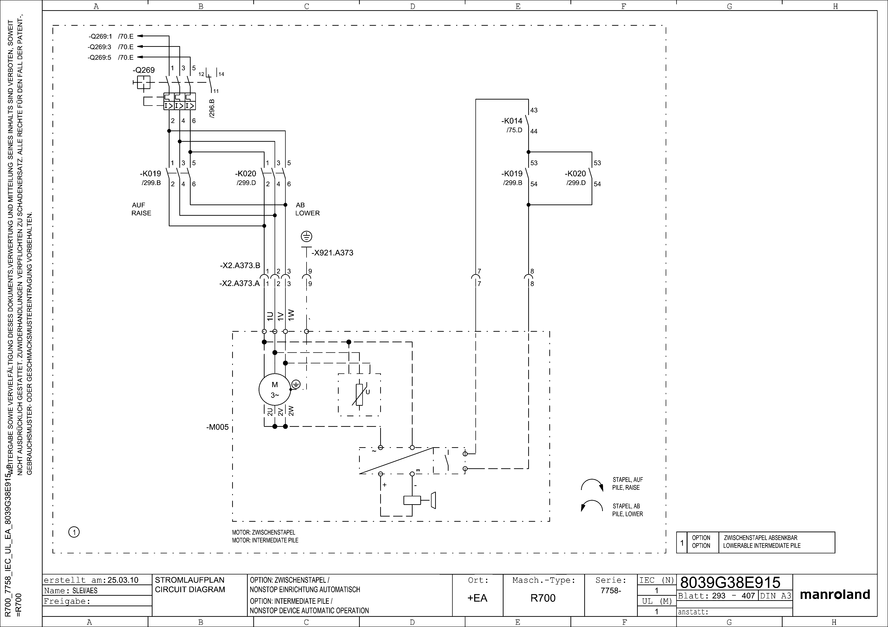

# +EA — Sheet 293 of 407 — OPTION: ZWISCHENSTAPEL /

**NONSTOP EINRICHTUNG AUTOMATISCH**

> Part of the manroland **R700** printing press IEC/UL circuit diagrams.
> Drawing class: **Stromlaufplan / Circuit diagram** (DIN A3).
> Document `+EA` covers the **Printing unit** machine section.

## At a glance

| Field | Value |
|---|---|
| Document | `+EA`  (8039G38E915) |
| Sheet | **293** of 407 |
| Section (DE) | OPTION: ZWISCHENSTAPEL / |
| Section (EN) | NONSTOP EINRICHTUNG AUTOMATISCH |
| Section type | CIRCUIT — Circuit diagram |
| Machine type | `R700` |
| Series | `7758` |
| Created | 25.03.10 |
| Replaces | — |
| Columns used | A, B, C, D, E, F, G |
| Path numbers | — |
| Labels on sheet | 89 |
| Cross-refs out | 9 |
| Cross-refs in | 21 |

**Previous:** [+EA sheet 292](SHEET_0292.md) · **Next:** [+EA sheet 294](SHEET_0294.md) · **Document TOC:** [_TOC.md](_TOC.md)  (+EA) · **Master TOC:** [all sheets](../_MASTER_TOC.md)

## Sheet image (300 DPI, exact vector render)



_Rendered directly from the PDF vector layer at 300 DPI (1-bit), no OCR and no resampling. Use it to confirm anything ambiguous in the text below._

## Cross-references on this sheet

Each entry is a wire leaving this sheet. The printed token is `/sheet.column`; the link resolves to that sheet inside the same document.

| Ref | Target sheet | Col | Path | Destination on target | Target section | From col |
|---|---|---|---|---|---|---|
| `/70.E` | [+EA sheet 70](SHEET_0070.md) | E | — | Q269:1 | AUSLEGERSTAPELMOTOR | A |
| `/70.E` | [+EA sheet 70](SHEET_0070.md) | E | — | Q269:3 | AUSLEGERSTAPELMOTOR | A |
| `/70.E` | [+EA sheet 70](SHEET_0070.md) | E | — | Q269:5 | AUSLEGERSTAPELMOTOR | A |
| `/296.B` | [+EA sheet 296](SHEET_0296.md) | B | — | — | OPTION: ZWISCHENSTAPEL / | B |
| `/75.D` | [+EA sheet 75](SHEET_0075.md) | D | — | — | AUSLEGERSTAPELSTEUERUNG | E |
| `/299.B` | [+EA sheet 299](SHEET_0299.md) | B | — | — | OPTION: ZWISCHENSTAPEL / | B |
| `/299.B` | [+EA sheet 299](SHEET_0299.md) | B | — | — | OPTION: ZWISCHENSTAPEL / | E |
| `/299.D` | [+EA sheet 299](SHEET_0299.md) | D | — | — | OPTION: ZWISCHENSTAPEL / | B |
| `/299.D` | [+EA sheet 299](SHEET_0299.md) | D | — | — | OPTION: ZWISCHENSTAPEL / | F |

### Incoming references (sheets that point here)

Every other sheet that sends a wire to this one. `Back-ref` is the token printed on *that* sheet; `Path` is its line number.

| From sheet | Cols | Back-ref | Path | Refs | What continues there |
|---|---|---|---|---|---|
| [+EA#70](SHEET_0070.md) | E | `/70.E` | — | 3 | Q269:1; Q269:3; Q269:5 |
| [+EA#75](SHEET_0075.md) | D | `/75.D` | — | 1 | — |
| [+EA#229](SHEET_0229.md) | F | `/229.F` | — | 12 | — |
| [+EA#296](SHEET_0296.md) | B | `/296.B` | — | 1 | — |
| [+EA#299](SHEET_0299.md) | B, D | `/299.B`, `/299.D` | — | 4 | — |


## Devices on this sheet

| Tag | Class | Class meaning (IEC) | Col | Sub | Terminal | Sign |
|---|---|---|---|---|---|---|
| `K014` | K | Relais / relay, contactor | E | — | — | — |
| `K020` | K | Relais / relay, contactor | B | — | — | — |
| `K019` | K | Relais / relay, contactor | E | — | — | — |
| `K020` | K | Relais / relay, contactor | F | — | — | — |
| `Q269` | Q | Leistungsschalter / power switching device | A | — | — | — |
| `K019` | K | Relais / relay, contactor | B | — | — | — |
| `Q269:5` | Q | Leistungsschalter / power switching device | A | — | 5 | — |
| `Q269:3` | Q | Leistungsschalter / power switching device | A | — | 3 | — |
| `Q269:1` | Q | Leistungsschalter / power switching device | A | — | 1 | — |
| `X2.A373.B` | — | cross-device reference | B | — | — | — |
| `X2.A373.A` | — | cross-device reference | B | — | — | — |
| `X921.A373` | — | cross-device reference | C | — | — | — |

## Potentials / nets

| Potential | Count | Columns | Attached devices | Terminals |
|---|---|---|---|---|
| `1V` | 1 | C | — | — |
| `2V` | 1 | C | — | — |
| `M005` | 1 | B | — | — |


A potential such as `L24+/4` or `M24+` is a named supply/return rail; every place it appears on this sheet is electrically common.

## Wire-end annotations (grouped as printed)

A wire that continues elsewhere is annotated with a small cluster: the destination description, the path/line number `#NN`, and the `/sheet.column` cross reference. Each row below is one such cluster exactly as it is grouped on the drawing.

| Col | Y | Path | Cross-ref | Text on the wire |
|---|---|---|---|---|
| A | 44.9 | — | `/70.E` | `Q269:1` |
| A | 59.1 | — | `/70.E` | `Q269:3` |
| A | 73.2 | — | `/70.E` | `Q269:5` |
| B | 87.5 | — | — | `1` |
| B | 87.5 | — | — | `3` |
| B | 87.5 | — | — | `5` |
| A | 89.6 | — | — | `Q269` |
| B | 96.6 | — | — | `12 14` |
| B | 119.2 | — | — | `11` |
| B | 132.9 | — | `/296.B` | — |
| E | 144.2 | — | — | `43` |
| E | 157.6 | — | — | `K014 44` |
| B | 158.4 | — | — | `2` |
| B | 158.4 | — | — | `4` |
| B | 158.4 | — | — | `6` |
| E | 170.7 | — | `/75.D` | — |
| B | 215.1 | — | — | `1` |
| B | 215.1 | — | — | `3` |
| B | 215.1 | — | — | `5` |
| C | 215.1 | — | — | `1` |
| C | 215.1 | — | — | `3` |
| C | 215.1 | — | — | `5` |
| E | 215.1 | — | — | `53` |
| F | 215.1 | — | — | `53` |
| B | 228.5 | — | — | `K019 6` |
| C | 228.5 | — | — | `K020 6` |
| E | 228.5 | — | — | `K019 54` |
| F | 228.5 | — | — | `K020 54` |
| B | 241.6 | — | `/299.B` | — |
| B | 241.6 | — | `/299.D` | — |
| E | 241.6 | — | `/299.B` | — |
| F | 241.6 | — | `/299.D` | — |
| B | 243.4 | — | — | `2` |
| B | 243.4 | — | — | `4` |
| C | 243.4 | — | — | `2` |
| C | 243.4 | — | — | `4` |
| B | 271.6 | — | — | `RAISE AUF LOWER AB` |
| C | 334.8 | — | — | `X921.A373` |
| B | 351.8 | — | — | `X2.A373.B 1` |
| C | 360.3 | — | — | `2 3 9` |
| E | 360.3 | — | — | `7` |
| E | 360.3 | — | — | `8` |
| C | 375.9 | — | — | `X2.A373.A 1 2 3 9` |
| E | 377.3 | — | — | `7` |
| E | 377.3 | — | — | `8` |
| C | 415.3 | — | — | `1U 1V 1W` |
| C | 427.1 | — | — | `'` |
| C | 512.2 | — | — | `3~ M U` |
| C | 544.8 | — | — | `2W` |
| C | 547.6 | — | — | `2U` |
| C | 547.9 | — | — | `2V` |
| B | 568.7 | — | — | `M005` |
| D | 601.2 | — | — | `~` |
| F | 641.2 | — | — | `PILE, RAISE STAPEL, AUF` |
| D | 646.6 | — | — | `+` |
| F | 676.6 | — | — | `PILE, LOWER STAPEL, AB` |
| A | 711.3 | — | — | `1` |
| C | 712.1 | — | — | `MOTOR: ZWISCHENSTAPEL MOTOR: INTERMEDIATE PILE` |
| G | 719.2 | — | — | `1 LOWERABLE INTERMEDIATE PILE ZWISCHENSTAPEL ABSENKBAR` |
| G | 719.2 | — | — | `OPTION OPTION` |


## Reconstructed tables

This sheet carries tabular content (pin map / terminal assignment / index). The grid below was rebuilt from the drawing's own rule lines, so each row is exactly one physical row of the table.

### Table 1 — 2 data rows × 1 columns (at x=184.3, y=62.4)

| C1 |
|---|
| `Q269` |
| `AUF RAISE` |


### Table 2 — 3 data rows × 1 columns (at x=226.8, y=62.4)

| C1 |
|---|
| `1` |
| `2` |
| `1 2` |


### Table 3 — 3 data rows × 1 columns (at x=240.9, y=62.4)

| C1 |
|---|
| `3` |
| `4` |
| `3 4` |


### Table 4 — 8 data rows × 6 columns (at x=255.1, y=62.4)

| 5 | 12 14 |  |  |  |  |
|---|---|---|---|---|---|
|  | `11` |  |  |  |  |
|  | `/296.B` |  |  |  |  |
| `6` |  |  |  |  |  |
| `5 6` | `K020 /299.D` | `1 2` | `3 4` | `5 6` |  |
|  |  |  |  | `AB` | `LOWER` |
|  | `X2.A373.B X2.A373.A` | `1 1 1U` | `2 2 1V` | `3 3 1W` | `X921.A373 9 9 '` |
|  |  | `2U` | `M 3~ 2V` | `2W` |  |
|  | `M005` |  |  |  |  |


### Table 5 — 3 data rows × 2 columns (at x=486.1, y=62.4)

| C1 | C2 |
|---|---|
| `U` |  |
| `~` |  |
|  | `+` |


### Table 6 — 3 data rows × 2 columns (at x=637.8, y=62.4)

| K014 /75.D | 43 |
|---|---|
|  | `44` |
| `K019 /299.B` | `53 K020 /299.D 54` |
| `7 7` | `8 8` |


## Notes and free text on this sheet

| Text | Col | Y (pt) |
|---|---|---|
| `1U` | C | 418.4 |
| `1W` | C | 415.28 |
| `MOTOR: ZWISCHENSTAPEL` | C | 712.11 |
| `MOTOR: INTERMEDIATE PILE` | C | 722.75 |
| `M` | C | 512.24 |
| `U` | D | 522.76 |
| `2U` | C | 547.65 |
| `2W` | C | 544.82 |
| `AB` | C | 271.64 |
| `LOWER` | C | 282.26 |
| `AUF` | A | 271.69 |
| `RAISE` | A | 282.29 |
| `STAPEL, AUF` | F | 641.23 |
| `PILE, RAISE` | F | 651.83 |
| `STAPEL, AB` | F | 676.65 |
| `PILE, LOWER` | F | 687.26 |
| `OPTION` | G | 719.18 |
| `ZWISCHENSTAPEL ABSENKBAR` | G | 719.19 |
| `LOWERABLE INTERMEDIATE PILE` | G | 729.82 |

## Complete label inventory (exact text from the drawing)

Every text object inside the drawing area of this sheet, in DIN reading order (column A→H, then top→bottom). This is the authoritative list: if a string is not here it is not printed on this sheet.

| Col | Y | X | Dir | Type | Text |
|---|---|---|---|---|---|
| A | 44.9 | 158.5 | → | cross-reference | `/70.E` |
| A | 45.0 | 119.1 | → | device tag | `Q269:1` |
| A | 59.1 | 117.6 | → | device tag | `Q269:3` |
| A | 59.1 | 158.5 | → | cross-reference | `/70.E` |
| A | 73.2 | 158.5 | → | cross-reference | `/70.E` |
| A | 73.3 | 117.6 | → | device tag | `Q269:5` |
| A | 89.6 | 178.0 | → | device tag | `Q269` |
| A | 271.7 | 177.2 | → | text | `AUF` |
| A | 282.3 | 176.3 | → | text | `RAISE` |
| A | 711.3 | 97.5 | → | number | `1` |
| B | 87.5 | 228.8 | → | number | `1` |
| B | 87.5 | 243.5 | → | number | `3` |
| B | 87.5 | 257.7 | → | number | `5` |
| B | 96.6 | 265.9 | → | number | `12` |
| B | 96.6 | 292.8 | → | number | `14` |
| B | 119.2 | 285.7 | → | number | `11` |
| B | 132.9 | 280.2 | ↕ | cross-reference | `/296.B` |
| B | 158.4 | 229.3 | → | number | `2` |
| B | 158.4 | 243.5 | → | number | `4` |
| B | 158.4 | 257.7 | → | number | `6` |
| B | 215.0 | 228.8 | → | number | `1` |
| B | 215.0 | 243.5 | → | number | `3` |
| B | 215.0 | 257.7 | → | number | `5` |
| B | 228.5 | 187.7 | → | device tag | `K019` |
| B | 228.5 | 315.2 | → | device tag | `K020` |
| B | 241.6 | 190.2 | → | cross-reference | `/299.B` |
| B | 241.6 | 317.5 | → | cross-reference | `/299.D` |
| B | 243.4 | 229.3 | → | number | `2` |
| B | 243.4 | 243.5 | → | number | `4` |
| B | 243.4 | 257.7 | → | number | `6` |
| B | 351.8 | 295.1 | → | device ref | `X2.A373.B` |
| B | 375.9 | 294.2 | → | device ref | `X2.A373.A` |
| B | 568.7 | 276.7 | → | potential | `M005` |
| C | 215.0 | 356.3 | → | number | `1` |
| C | 215.0 | 371.1 | → | number | `3` |
| C | 215.0 | 385.2 | → | number | `5` |
| C | 243.4 | 356.9 | → | number | `2` |
| C | 243.4 | 371.1 | → | number | `4` |
| C | 243.4 | 385.2 | → | number | `6` |
| C | 271.6 | 396.9 | → | text | `AB` |
| C | 282.3 | 396.0 | → | text | `LOWER` |
| C | 334.8 | 417.8 | → | device ref | `X921.A373` |
| C | 360.3 | 356.3 | → | number | `1` |
| C | 360.3 | 371.1 | → | number | `2` |
| C | 360.3 | 385.2 | → | number | `3` |
| C | 360.3 | 413.6 | → | number | `9` |
| C | 377.3 | 356.3 | → | number | `1` |
| C | 377.3 | 371.1 | → | number | `2` |
| C | 377.3 | 385.2 | → | number | `3` |
| C | 377.3 | 413.6 | → | number | `9` |
| C | 415.3 | 385.6 | ↕ | text | `1W` |
| C | 418.4 | 357.5 | ↕ | text | `1U` |
| C | 419.0 | 371.6 | ↕ | potential | `1V` |
| C | 427.1 | 413.6 | → | other | `'` |
| C | 512.2 | 364.4 | → | text | `M` |
| C | 526.5 | 363.1 | → | other | `3~` |
| C | 544.8 | 386.3 | ↕ | text | `2W` |
| C | 547.7 | 358.2 | ↕ | text | `2U` |
| C | 547.9 | 372.3 | ↕ | potential | `2V` |
| C | 712.1 | 311.2 | → | text | `MOTOR: ZWISCHENSTAPEL` |
| C | 722.8 | 311.2 | → | text | `MOTOR: INTERMEDIATE PILE` |
| D | 522.8 | 490.3 | → | text | `U` |
| D | 601.2 | 498.5 | → | other | `~` |
| D | 646.6 | 512.5 | → | number | `+` |
| E | 144.2 | 711.2 | → | number | `43` |
| E | 157.6 | 672.4 | → | device tag | `K014` |
| E | 170.7 | 679.5 | → | cross-reference | `/75.D` |
| E | 172.5 | 711.2 | → | number | `44` |
| E | 215.0 | 711.2 | → | number | `53` |
| E | 228.5 | 672.4 | → | device tag | `K019` |
| E | 241.6 | 674.9 | → | cross-reference | `/299.B` |
| E | 243.4 | 711.2 | → | number | `54` |
| E | 360.3 | 640.3 | → | number | `7` |
| E | 360.3 | 711.2 | → | number | `8` |
| E | 377.3 | 640.3 | → | number | `7` |
| E | 377.3 | 711.2 | → | number | `8` |
| F | 215.0 | 796.3 | → | number | `53` |
| F | 228.5 | 757.4 | → | device tag | `K020` |
| F | 241.6 | 759.7 | → | cross-reference | `/299.D` |
| F | 243.4 | 796.3 | → | number | `54` |
| F | 641.2 | 821.8 | → | text | `STAPEL, AUF` |
| F | 651.8 | 821.2 | → | text | `PILE, RAISE` |
| F | 676.6 | 821.8 | → | text | `STAPEL, AB` |
| F | 687.3 | 821.2 | → | text | `PILE, LOWER` |
| G | 719.2 | 928.1 | → | text | `OPTION` |
| G | 719.2 | 970.9 | → | text | `ZWISCHENSTAPEL ABSENKBAR` |
| G | 724.5 | 911.6 | → | number | `1` |
| G | 729.8 | 928.1 | → | text | `OPTION` |
| G | 729.8 | 970.0 | → | text | `LOWERABLE INTERMEDIATE PILE` |

## Reading-order text block

The same content as a plain block, grouped by DIN column — convenient to paste or to match against a visual description.

```text
=== Column A ===
  44.9  158.5  xref         /70.E
  45.0  119.1  devtag       Q269:1
  59.1  117.6  devtag       Q269:3
  59.1  158.5  xref         /70.E
  73.2  158.5  xref         /70.E
  73.3  117.6  devtag       Q269:5
  89.6  178.0  devtag       Q269
 271.7  177.2  text         AUF
 282.3  176.3  text         RAISE
 711.3   97.5  numeric      1
=== Column B ===
  87.5  228.8  numeric      1
  87.5  243.5  numeric      3
  87.5  257.7  numeric      5
  96.6  265.9  numeric      12
  96.6  292.8  numeric      14
 119.2  285.7  numeric      11
 132.9  280.2  xref         /296.B
 158.4  229.3  numeric      2
 158.4  243.5  numeric      4
 158.4  257.7  numeric      6
 215.0  228.8  numeric      1
 215.0  243.5  numeric      3
 215.0  257.7  numeric      5
 228.5  187.7  devtag       K019
 228.5  315.2  devtag       K020
 241.6  190.2  xref         /299.B
 241.6  317.5  xref         /299.D
 243.4  229.3  numeric      2
 243.4  243.5  numeric      4
 243.4  257.7  numeric      6
 351.8  295.1  devref       X2.A373.B
 375.9  294.2  devref       X2.A373.A
 568.7  276.7  net          M005
=== Column C ===
 215.0  356.3  numeric      1
 215.0  371.1  numeric      3
 215.0  385.2  numeric      5
 243.4  356.9  numeric      2
 243.4  371.1  numeric      4
 243.4  385.2  numeric      6
 271.6  396.9  text         AB
 282.3  396.0  text         LOWER
 334.8  417.8  devref       X921.A373
 360.3  356.3  numeric      1
 360.3  371.1  numeric      2
 360.3  385.2  numeric      3
 360.3  413.6  numeric      9
 377.3  356.3  numeric      1
 377.3  371.1  numeric      2
 377.3  385.2  numeric      3
 377.3  413.6  numeric      9
 415.3  385.6  text         1W
 418.4  357.5  text         1U
 419.0  371.6  net          1V
 427.1  413.6  other        `
 512.2  364.4  text         M
 526.5  363.1  other        3~
 544.8  386.3  text         2W
 547.7  358.2  text         2U
 547.9  372.3  net          2V
 712.1  311.2  text         MOTOR: ZWISCHENSTAPEL
 722.8  311.2  text         MOTOR: INTERMEDIATE PILE
=== Column D ===
 522.8  490.3  text         U
 601.2  498.5  other        ~
 646.6  512.5  numeric      +
=== Column E ===
 144.2  711.2  numeric      43
 157.6  672.4  devtag       K014
 170.7  679.5  xref         /75.D
 172.5  711.2  numeric      44
 215.0  711.2  numeric      53
 228.5  672.4  devtag       K019
 241.6  674.9  xref         /299.B
 243.4  711.2  numeric      54
 360.3  640.3  numeric      7
 360.3  711.2  numeric      8
 377.3  640.3  numeric      7
 377.3  711.2  numeric      8
=== Column F ===
 215.0  796.3  numeric      53
 228.5  757.4  devtag       K020
 241.6  759.7  xref         /299.D
 243.4  796.3  numeric      54
 641.2  821.8  text         STAPEL, AUF
 651.8  821.2  text         PILE, RAISE
 676.6  821.8  text         STAPEL, AB
 687.3  821.2  text         PILE, LOWER
=== Column G ===
 719.2  928.1  text         OPTION
 719.2  970.9  text         ZWISCHENSTAPEL ABSENKBAR
 724.5  911.6  numeric      1
 729.8  928.1  text         OPTION
 729.8  970.0  text         LOWERABLE INTERMEDIATE PILE
```

---
_Generated from the PDF vector text layer; no OCR. Source: `R700_7758_IEC_UL_EA_8039G38E915_p`, sheet 293._
