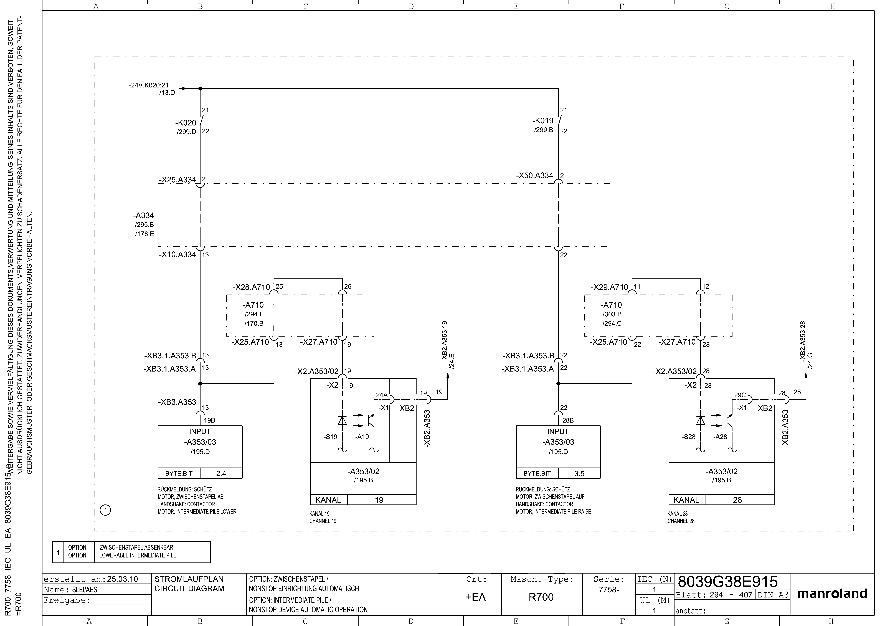

# +EA — Sheet 294 of 407 — OPTION: ZWISCHENSTAPEL /

**NONSTOP EINRICHTUNG AUTOMATISCH**

> Part of the manroland **R700** printing press IEC/UL circuit diagrams.
> Drawing class: **Stromlaufplan / Circuit diagram** (DIN A3).
> Document `+EA` covers the **Printing unit** machine section.

## At a glance

| Field | Value |
|---|---|
| Document | `+EA`  (8039G38E915) |
| Sheet | **294** of 407 |
| Section (DE) | OPTION: ZWISCHENSTAPEL / |
| Section (EN) | NONSTOP EINRICHTUNG AUTOMATISCH |
| Section type | CIRCUIT — Circuit diagram |
| Machine type | `R700` |
| Series | `7758` |
| Created | 25.03.10 |
| Replaces | — |
| Columns used | A, B, C, D, E, F, G, H |
| Path numbers | — |
| Labels on sheet | 117 |
| Cross-refs out | 15 |
| Cross-refs in | 37 |

**Previous:** [+EA sheet 293](SHEET_0293.md) · **Next:** [+EA sheet 295](SHEET_0295.md) · **Document TOC:** [_TOC.md](_TOC.md)  (+EA) · **Master TOC:** [all sheets](../_MASTER_TOC.md)

## Sheet image (300 DPI, exact vector render)



_Rendered directly from the PDF vector layer at 300 DPI (1-bit), no OCR and no resampling. Use it to confirm anything ambiguous in the text below._

## Cross-references on this sheet

Each entry is a wire leaving this sheet. The printed token is `/sheet.column`; the link resolves to that sheet inside the same document.

| Ref | Target sheet | Col | Path | Destination on target | Target section | From col |
|---|---|---|---|---|---|---|
| `/13.D` | [+EA sheet 13](SHEET_0013.md) | D | — | 24V.K020:21 | SPANNUNGSVERSORGUNG: 400V, 24V | B |
| `/299.B` | [+EA sheet 299](SHEET_0299.md) | B | — | — | OPTION: ZWISCHENSTAPEL / | E |
| `/299.D` | [+EA sheet 299](SHEET_0299.md) | D | — | — | OPTION: ZWISCHENSTAPEL / | B |
| `/295.B` | [+EA sheet 295](SHEET_0295.md) | B | — | — | OPTION: ZWISCHENSTAPEL / | A |
| `/176.E` | [+EA sheet 176](SHEET_0176.md) | E | — | — | RESERVE | A |
| `/303.B` | [+EA sheet 303](SHEET_0303.md) | B | — | — | OPTION: ZWISCHENSTAPEL / | F |
| `/294.C` | [+EA sheet 294](SHEET_0294.md) | C | — | — | OPTION: ZWISCHENSTAPEL / | F |
| `/294.F` | [+EA sheet 294](SHEET_0294.md) | F | — | — | OPTION: ZWISCHENSTAPEL / | C |
| `/170.B` | [+EA sheet 170](SHEET_0170.md) | B | — | — | RESERVE | C |
| `/24.E` | [+EA sheet 24](SHEET_0024.md) | E | — | XB2.A353:19 | BUSVERBINDUNGEN: SICHERHEITSBUS | D |
| `/24.G` | [+EA sheet 24](SHEET_0024.md) | G | — | XB2.A353:28 | BUSVERBINDUNGEN: SICHERHEITSBUS | H |
| `/195.D` | [+EA sheet 195](SHEET_0195.md) | D | — | — | REFERENZMODUL | B |
| `/195.D` | [+EA sheet 195](SHEET_0195.md) | D | — | — | REFERENZMODUL | E |
| `/195.B` | [+EA sheet 195](SHEET_0195.md) | B | — | — | REFERENZMODUL | D |
| `/195.B` | [+EA sheet 195](SHEET_0195.md) | B | — | — | REFERENZMODUL | G |

### Incoming references (sheets that point here)

Every other sheet that sends a wire to this one. `Back-ref` is the token printed on *that* sheet; `Path` is its line number.

| From sheet | Cols | Back-ref | Path | Refs | What continues there |
|---|---|---|---|---|---|
| [+EA#13](SHEET_0013.md) | C | `/13.C` | — | 1 | — |
| [+EA#24](SHEET_0024.md) | E, G | `/24.E`, `/24.G` | — | 2 | XB2.A353:19; XB2.A353:28 |
| [+EA#170](SHEET_0170.md) | B | `/170.B` | — | 1 | A710 |
| [+EA#176](SHEET_0176.md) | E | `/176.E` | — | 1 | — |
| [+EA#195](SHEET_0195.md) | B, D | `/195.B`, `/195.D` | — | 4 | — |
| [+EA#224](SHEET_0224.md) | H | `/224.H` | — | 2 | — |
| [+EA#225](SHEET_0225.md) | D | `/225.D` | — | 2 | — |
| [+EA#234](SHEET_0234.md) | C, D, F | `/234.C`, `/234.D`, `/234.F` | — | 6 | — |
| [+EA#253](SHEET_0253.md) | H | `/253.H` | — | 2 | — |
| [+EA#267](SHEET_0267.md) | B | `/267.B` | — | 1 | — |
| [+EA#268](SHEET_0268.md) | C | `/268.C` | — | 2 | — |
| [+EA#271](SHEET_0271.md) | C | `/271.C` | — | 2 | — |
| [+EA#272](SHEET_0272.md) | G, H | `/272.G`, `/272.H` | — | 2 | — |
| [+EA#274](SHEET_0274.md) | B | `/274.B` | — | 2 | — |
| [+EA#282](SHEET_0282.md) | E | `/282.E` | — | 1 | — |
| [+EA#294](SHEET_0294.md) | C, F | `/294.C`, `/294.F` | — | 2 | — |
| [+EA#295](SHEET_0295.md) | B | `/295.B` | — | 1 | — |
| [+EA#299](SHEET_0299.md) | B, D | `/299.B`, `/299.D` | — | 2 | — |
| [+EA#303](SHEET_0303.md) | B | `/303.B` | — | 1 | — |


## Devices on this sheet

| Tag | Class | Class meaning (IEC) | Col | Sub | Terminal | Sign |
|---|---|---|---|---|---|---|
| `A334` | A | Baugruppe / assembly, module, PC board | A | — | — | — |
| `K020` | K | Relais / relay, contactor | B | — | — | — |
| `K019` | K | Relais / relay, contactor | E | — | — | — |
| `A353/03` | A | Baugruppe / assembly, module, PC board | B | 03 | — | — |
| `A353/03` | A | Baugruppe / assembly, module, PC board | E | 03 | — | — |
| `A710` | A | Baugruppe / assembly, module, PC board | C | — | — | — |
| `S19` | S | Schalter / switch | C | — | — | — |
| `A19` | A | Baugruppe / assembly, module, PC board | D | — | — | — |
| `X1` | X | Klemme / terminal, plug connector | D | — | — | — |
| `X2` | X | Klemme / terminal, plug connector | C | — | — | — |
| `XB2` | XB |  | D | — | — | — |
| `A353/02` | A | Baugruppe / assembly, module, PC board | D | 02 | — | — |
| `A710` | A | Baugruppe / assembly, module, PC board | F | — | — | — |
| `S28` | S | Schalter / switch | G | — | — | — |
| `A28` | A | Baugruppe / assembly, module, PC board | G | — | — | — |
| `X1` | X | Klemme / terminal, plug connector | G | — | — | — |
| `X2` | X | Klemme / terminal, plug connector | G | — | — | — |
| `XB2` | XB |  | G | — | — | — |
| `A353/02` | A | Baugruppe / assembly, module, PC board | G | 02 | — | — |
| `X25.A334` | — | cross-device reference | B | — | — | — |
| `X10.A334` | — | cross-device reference | B | — | — | — |
| `X50.A334` | — | cross-device reference | E | — | — | — |
| `XB3.A353` | — | cross-device reference | B | — | — | — |
| `2.4` | — | cross-device reference | B | — | — | — |
| `3.5` | — | cross-device reference | F | — | — | — |
| `X28.A710` | — | cross-device reference | B | — | — | — |
| `X27.A710` | — | cross-device reference | C | — | — | — |
| `X25.A710` | — | cross-device reference | B | — | — | — |
| `XB2.A353` | — | cross-device reference | D | — | — | — |
| `XB3.1.A353.B` | — | cross-device reference | B | — | — | — |
| `XB3.1.A353.A` | — | cross-device reference | B | — | — | — |
| `X29.A710` | — | cross-device reference | F | — | — | — |
| `X27.A710` | — | cross-device reference | G | — | — | — |
| `X25.A710` | — | cross-device reference | F | — | — | — |
| `XB2.A353` | — | cross-device reference | H | — | — | — |
| `XB3.1.A353.B` | — | cross-device reference | E | — | — | — |
| `XB3.1.A353.A` | — | cross-device reference | E | — | — | — |
| `XB2.A353:19` | — | cross-device reference | D | — | 19 | — |
| `XB2.A353:28` | — | cross-device reference | H | — | 28 | — |

## Potentials / nets

| Potential | Count | Columns | Attached devices | Terminals |
|---|---|---|---|---|
| `24V` | 1 | B | `K020` | `21` |


A potential such as `L24+/4` or `M24+` is a named supply/return rail; every place it appears on this sheet is electrically common.

## Wire-end annotations (grouped as printed)

A wire that continues elsewhere is annotated with a small cluster: the destination description, the path/line number `#NN`, and the `/sheet.column` cross reference. Each row below is one such cluster exactly as it is grouped on the drawing.

| Col | Y | Path | Cross-ref | Text on the wire |
|---|---|---|---|---|
| B | 110.8 | — | `/13.D` | `24V.K020:21` |
| B | 144.2 | — | — | `21` |
| E | 144.2 | — | — | `21` |
| E | 157.6 | — | — | `K019 22` |
| B | 160.5 | — | — | `K020 22` |
| E | 170.7 | — | `/299.B` | — |
| B | 173.6 | — | `/299.D` | — |
| E | 231.3 | — | — | `X50.A334 2` |
| B | 237.0 | — | — | `X25.A334 2` |
| A | 285.2 | — | — | `A334` |
| A | 298.3 | — | `/295.B`, `/176.E` | — |
| B | 337.6 | — | — | `X10.A334 13` |
| E | 339.1 | — | — | `22` |
| C | 381.6 | — | — | `X28.A710 25 26` |
| F | 381.6 | — | — | `X29.A710 11 12` |
| C | 405.7 | — | — | `A710` |
| F | 405.7 | — | — | `A710` |
| C | 418.7 | — | `/294.F`, `/170.B` | — |
| F | 418.7 | — | `/303.B`, `/294.C` | — |
| D | 431.7 | — | `/24.E` | `XB2.A353:19` |
| H | 431.7 | — | `/24.G` | `XB2.A353:28` |
| C | 455.3 | — | — | `X25.A710 13 X27.A710 19` |
| F | 455.3 | — | — | `X25.A710 22 X27.A710 28` |
| B | 473.7 | — | — | `XB3.1.A353.B 13` |
| E | 473.7 | — | — | `XB3.1.A353.B 22` |
| B | 490.7 | — | — | `XB3.1.A353.A 13` |
| E | 490.7 | — | — | `XB3.1.A353.A 22` |
| C | 494.9 | — | — | `X2.A353/02 19` |
| G | 494.9 | — | — | `X2.A353/02 28` |
| C | 513.4 | — | — | `X2` |
| G | 513.4 | — | — | `X2` |
| D | 514.8 | — | — | `19 19` |
| G | 514.8 | — | — | `28 28` |
| D | 523.3 | — | — | `19` |
| H | 523.3 | — | — | `28` |
| D | 527.5 | — | — | `24A` |
| G | 527.6 | — | — | `29C` |
| B | 536.1 | — | — | `XB3.A353 13` |
| D | 544.5 | — | — | `X1` |
| G | 544.5 | — | — | `X1` |
| D | 544.6 | — | — | `XB2` |
| E | 544.6 | — | — | `22` |
| G | 544.6 | — | — | `XB2` |
| D | 550.8 | — | — | `XB2.A353` |
| H | 550.8 | — | — | `XB2.A353` |
| B | 561.5 | — | — | `19B` |
| E | 561.5 | — | — | `28B` |
| B | 576.1 | — | — | `INPUT` |
| E | 576.1 | — | — | `INPUT` |
| C | 583.5 | — | — | `S19 A19` |
| G | 583.5 | — | — | `S28 A28` |
| B | 589.9 | — | — | `A353/03` |
| E | 589.9 | — | — | `A353/03` |
| B | 603.7 | — | `/195.D` | — |
| E | 603.7 | — | `/195.D` | — |
| D | 629.6 | — | — | `A353/02` |
| G | 629.6 | — | — | `A353/02` |
| B | 632.7 | — | — | `BYTE.BIT 2.4` |
| E | 632.7 | — | — | `BYTE.BIT 3.5` |
| D | 642.0 | — | `/195.B` | — |
| G | 642.0 | — | `/195.B` | — |
| B | 655.6 | — | — | `RÜCKMELDUNG: SCHÜTZ HANDSHAKE: CONTACTOR MOTOR, ZWISCHENSTAPEL AB MOTOR, INTERMEDIATE PILE LOWER` |
| E | 655.6 | — | — | `RÜCKMELDUNG: SCHÜTZ HANDSHAKE: CONTACTOR MOTOR, ZWISCHENSTAPEL AUF MOTOR, INTERMEDIATE PILE RAISE` |
| C | 667.8 | — | — | `KANAL 19` |
| G | 667.8 | — | — | `KANAL 28` |
| A | 682.9 | — | — | `1` |
| C | 688.2 | — | — | `KANAL 19 CHANNEL 19` |
| G | 688.2 | — | — | `KANAL 28 CHANNEL 28` |
| A | 733.4 | — | — | `1 LOWERABLE INTERMEDIATE PILE ZWISCHENSTAPEL ABSENKBAR` |
| A | 733.4 | — | — | `OPTION OPTION` |


## Reconstructed tables

This sheet carries tabular content (pin map / terminal assignment / index). The grid below was rebuilt from the drawing's own rule lines, so each row is exactly one physical row of the table.

### Table 1 — 6 data rows × 19 columns (at x=212.6, y=119.1)

| /13.D K020 /299.D X25.A334 X10.A334 | 21 22 2 13 |  |  |  |  |  |  |  |  | K019 /299.B X50.A334 | 21 22 2 22 |  |  |  |  |  |  |  |
|---|---|---|---|---|---|---|---|---|---|---|---|---|---|---|---|---|---|---|
| `XB3.1.A353.B XB3.1.A353.A` | `13 13` | `X28.A710 A710 /294.F /170.B X25.A710` | `25 13` | `X27.A710 X2.A353/02` | `26 19 19` |  |  | `XB2.A353:19` | `/24.E` | `XB3.1.A353.B XB3.1.A353.A` | `22 22` | `X29.A710 A710 /303.B /294.C X25.A710` | `11 22` | `X27.A710 X2.A353/02` | `12 28 28` |  |  | `XB2.A353:28` |
| `XB3.A353` | `13 19B` |  |  | `X2` | `19` | `24A X1` | `XB2` | `19 19` |  |  | `22 28B` |  |  | `X2` | `28` | `29C X1` | `XB2` | `28 28` |
| `INPUT` | `A353/03 /195.D` |  |  | `S19` | `A19` |  |  | `XB2.A353` |  | `INPUT` | `A353/03 /195.D` |  |  | `S28` | `A28` |  |  | `XB2.A353` |
| `BYTE.BIT` | `2.4` |  |  |  | `A353/02` |  |  |  |  | `BYTE.BIT` | `3.5` |  |  |  | `A353/02` |  |  |  |
| `RÜCKMELDUNG:` | `SCHÜTZ` |  |  |  | `/195.B` |  |  |  |  | `RÜCKMELDUNG:` | `SCHÜTZ` |  |  |  | `/195.B` |  |  |  |
| `MOTOR, ZWISCHENSTAPEL` | `AB` |  |  | `KANAL` |  | `19` |  |  |  | `MOTOR, ZWISCHENSTAPEL` | `AUF` |  |  | `KANAL` |  | `28` |  |  |


## Notes and free text on this sheet

| Text | Col | Y (pt) |
|---|---|---|
| `19B` | B | 561.55 |
| `INPUT` | B | 576.07 |
| `BYTE.BIT` | B | 633.32 |
| `RÜCKMELDUNG: SCHÜTZ` | B | 655.57 |
| `MOTOR, ZWISCHENSTAPEL AB` | B | 665.52 |
| `HANDSHAKE: CONTACTOR` | B | 675.46 |
| `MOTOR, INTERMEDIATE PILE LOWER` | B | 685.42 |
| `28B` | E | 561.55 |
| `INPUT` | E | 576.07 |
| `BYTE.BIT` | E | 633.32 |
| `RÜCKMELDUNG: SCHÜTZ` | E | 655.57 |
| `MOTOR, ZWISCHENSTAPEL AUF` | E | 665.51 |
| `HANDSHAKE: CONTACTOR` | E | 675.46 |
| `MOTOR, INTERMEDIATE PILE RAISE` | E | 685.44 |
| `KANAL 19` | C | 688.19 |
| `CHANNEL 19` | C | 698.13 |
| `24A` | D | 527.53 |
| `KANAL` | C | 667.86 |
| `X2.A353/02` | C | 494.95 |
| `KANAL 28` | G | 688.19 |
| `CHANNEL 28` | G | 698.13 |
| `29C` | G | 527.57 |
| `KANAL` | G | 667.86 |
| `X2.A353/02` | G | 494.95 |
| `OPTION` | A | 733.35 |
| `ZWISCHENSTAPEL ABSENKBAR` | A | 733.36 |
| `LOWERABLE INTERMEDIATE PILE` | A | 743.99 |

## Complete label inventory (exact text from the drawing)

Every text object inside the drawing area of this sheet, in DIN reading order (column A→H, then top→bottom). This is the authoritative list: if a string is not here it is not printed on this sheet.

| Col | Y | X | Dir | Type | Text |
|---|---|---|---|---|---|
| A | 285.2 | 179.1 | → | device tag | `A334` |
| A | 298.3 | 181.7 | → | cross-reference | `/295.B` |
| A | 310.7 | 182.0 | → | cross-reference | `/176.E` |
| A | 682.9 | 140.0 | → | number | `1` |
| A | 733.4 | 91.8 | → | text | `OPTION` |
| A | 733.4 | 134.6 | → | text | `ZWISCHENSTAPEL ABSENKBAR` |
| A | 738.7 | 75.4 | → | number | `1` |
| A | 744.0 | 91.8 | → | text | `OPTION` |
| A | 744.0 | 133.8 | → | text | `LOWERABLE INTERMEDIATE PILE` |
| B | 110.8 | 173.5 | → | potential | `24V.K020:21` |
| B | 120.8 | 214.6 | → | cross-reference | `/13.D` |
| B | 144.2 | 271.8 | → | number | `21` |
| B | 160.5 | 235.8 | → | device tag | `K020` |
| B | 172.5 | 271.8 | → | number | `22` |
| B | 173.6 | 238.1 | → | cross-reference | `/299.D` |
| B | 237.0 | 214.0 | → | device ref | `X25.A334` |
| B | 237.0 | 271.8 | → | number | `2` |
| B | 337.6 | 214.0 | → | device ref | `X10.A334` |
| B | 339.1 | 271.3 | → | number | `13` |
| B | 381.6 | 313.2 | → | device ref | `X28.A710` |
| B | 455.3 | 311.8 | → | device ref | `X25.A710` |
| B | 473.7 | 194.2 | → | device ref | `XB3.1.A353.B` |
| B | 473.7 | 271.3 | → | number | `13` |
| B | 490.7 | 271.3 | → | number | `13` |
| B | 491.4 | 193.3 | → | device ref | `XB3.1.A353.A` |
| B | 536.1 | 212.9 | → | device ref | `XB3.A353` |
| B | 544.6 | 271.3 | → | number | `13` |
| B | 561.5 | 274.1 | → | text | `19B` |
| B | 576.1 | 254.4 | → | text | `INPUT` |
| B | 589.9 | 247.9 | → | device tag | `A353/03` |
| B | 603.7 | 256.5 | → | cross-reference | `/195.D` |
| B | 632.7 | 290.8 | → | device ref | `2.4` |
| B | 633.3 | 222.5 | → | text | `BYTE.BIT` |
| B | 655.6 | 212.0 | → | text | `RÜCKMELDUNG: SCHÜTZ` |
| B | 665.5 | 212.3 | → | text | `MOTOR, ZWISCHENSTAPEL AB` |
| B | 675.5 | 212.0 | → | text | `HANDSHAKE: CONTACTOR` |
| B | 685.4 | 212.3 | → | text | `MOTOR, INTERMEDIATE PILE LOWER` |
| C | 381.6 | 371.1 | → | number | `25` |
| C | 381.6 | 463.2 | → | number | `26` |
| C | 405.7 | 326.6 | → | device tag | `A710` |
| C | 418.7 | 329.7 | → | cross-reference | `/294.F` |
| C | 431.1 | 329.1 | → | cross-reference | `/170.B` |
| C | 455.3 | 403.9 | → | device ref | `X27.A710` |
| C | 459.5 | 370.5 | → | number | `13` |
| C | 459.5 | 462.6 | → | number | `19` |
| C | 495.0 | 396.6 | → | text | `X2.A353/02` |
| C | 495.0 | 462.6 | → | number | `19` |
| C | 513.4 | 439.1 | → | device tag | `X2` |
| C | 514.8 | 465.4 | → | number | `19` |
| C | 583.5 | 435.4 | → | device tag | `S19` |
| C | 667.9 | 424.3 | → | text | `KANAL` |
| C | 688.2 | 416.1 | → | text | `KANAL 19` |
| C | 698.1 | 416.4 | → | text | `CHANNEL 19` |
| D | 431.7 | 594.1 | ↕ | device ref | `XB2.A353:19` |
| D | 475.4 | 604.0 | ↕ | cross-reference | `/24.E` |
| D | 523.3 | 585.9 | → | number | `19` |
| D | 524.7 | 564.7 | → | number | `19` |
| D | 527.5 | 506.0 | → | text | `24A` |
| D | 544.5 | 509.7 | → | device tag | `X1` |
| D | 544.6 | 534.0 | → | device tag | `XB2` |
| D | 550.8 | 570.1 | ↕ | device ref | `XB2.A353` |
| D | 583.5 | 477.9 | → | device tag | `A19` |
| D | 629.6 | 467.6 | → | device tag | `A353/02` |
| D | 642.0 | 476.4 | → | cross-reference | `/195.B` |
| D | 667.8 | 504.0 | → | number | `19` |
| E | 144.2 | 753.7 | → | number | `21` |
| E | 157.6 | 716.3 | → | device tag | `K019` |
| E | 170.7 | 718.9 | → | cross-reference | `/299.B` |
| E | 172.5 | 753.7 | → | number | `22` |
| E | 231.3 | 694.5 | → | device ref | `X50.A334` |
| E | 232.8 | 753.7 | → | number | `2` |
| E | 339.1 | 753.7 | → | number | `22` |
| E | 473.7 | 676.1 | → | device ref | `XB3.1.A353.B` |
| E | 473.7 | 753.7 | → | number | `22` |
| E | 490.7 | 753.7 | → | number | `22` |
| E | 491.4 | 675.2 | → | device ref | `XB3.1.A353.A` |
| E | 544.6 | 753.7 | → | number | `22` |
| E | 561.5 | 756.6 | → | text | `28B` |
| E | 576.1 | 736.3 | → | text | `INPUT` |
| E | 589.9 | 729.8 | → | device tag | `A353/03` |
| E | 603.7 | 738.4 | → | cross-reference | `/195.D` |
| E | 633.3 | 704.4 | → | text | `BYTE.BIT` |
| E | 655.6 | 693.9 | → | text | `RÜCKMELDUNG: SCHÜTZ` |
| E | 665.5 | 694.2 | → | text | `MOTOR, ZWISCHENSTAPEL AUF` |
| E | 675.5 | 693.9 | → | text | `HANDSHAKE: CONTACTOR` |
| E | 685.4 | 694.2 | → | text | `MOTOR, INTERMEDIATE PILE RAISE` |
| F | 381.6 | 795.1 | → | device ref | `X29.A710` |
| F | 381.6 | 852.4 | → | number | `11` |
| F | 405.7 | 808.4 | → | device tag | `A710` |
| F | 418.7 | 811.0 | → | cross-reference | `/303.B` |
| F | 431.2 | 810.7 | → | cross-reference | `/294.C` |
| F | 455.3 | 793.7 | → | device ref | `X25.A710` |
| F | 459.5 | 852.9 | → | number | `22` |
| F | 632.7 | 772.7 | → | device ref | `3.5` |
| G | 381.6 | 944.5 | → | number | `12` |
| G | 455.3 | 885.8 | → | device ref | `X27.A710` |
| G | 459.5 | 945.1 | → | number | `28` |
| G | 495.0 | 878.5 | → | text | `X2.A353/02` |
| G | 495.0 | 945.1 | → | number | `28` |
| G | 513.4 | 921.0 | → | device tag | `X2` |
| G | 514.8 | 947.9 | → | number | `28` |
| G | 527.6 | 987.9 | → | text | `29C` |
| G | 544.5 | 991.6 | → | device tag | `X1` |
| G | 544.6 | 1015.9 | → | device tag | `XB2` |
| G | 583.5 | 917.3 | → | device tag | `S28` |
| G | 583.5 | 959.8 | → | device tag | `A28` |
| G | 629.6 | 949.5 | → | device tag | `A353/02` |
| G | 642.0 | 958.3 | → | cross-reference | `/195.B` |
| G | 667.8 | 986.3 | → | number | `28` |
| G | 667.9 | 906.2 | → | text | `KANAL` |
| G | 688.2 | 898.0 | → | text | `KANAL 28` |
| G | 698.1 | 898.3 | → | text | `CHANNEL 28` |
| H | 431.7 | 1076.0 | ↕ | device ref | `XB2.A353:28` |
| H | 474.5 | 1085.9 | ↕ | cross-reference | `/24.G` |
| H | 523.3 | 1067.8 | → | number | `28` |
| H | 524.7 | 1047.1 | → | number | `28` |
| H | 550.8 | 1052.0 | ↕ | device ref | `XB2.A353` |

## Reading-order text block

The same content as a plain block, grouped by DIN column — convenient to paste or to match against a visual description.

```text
=== Column A ===
 285.2  179.1  devtag       A334
 298.3  181.7  xref         /295.B
 310.7  182.0  xref         /176.E
 682.9  140.0  numeric      1
 733.4   91.8  text         OPTION
 733.4  134.6  text         ZWISCHENSTAPEL ABSENKBAR
 738.7   75.4  numeric      1
 744.0   91.8  text         OPTION
 744.0  133.8  text         LOWERABLE INTERMEDIATE PILE
=== Column B ===
 110.8  173.5  net          24V.K020:21
 120.8  214.6  xref         /13.D
 144.2  271.8  numeric      21
 160.5  235.8  devtag       K020
 172.5  271.8  numeric      22
 173.6  238.1  xref         /299.D
 237.0  214.0  devref       X25.A334
 237.0  271.8  numeric      2
 337.6  214.0  devref       X10.A334
 339.1  271.3  numeric      13
 381.6  313.2  devref       X28.A710
 455.3  311.8  devref       X25.A710
 473.7  194.2  devref       XB3.1.A353.B
 473.7  271.3  numeric      13
 490.7  271.3  numeric      13
 491.4  193.3  devref       XB3.1.A353.A
 536.1  212.9  devref       XB3.A353
 544.6  271.3  numeric      13
 561.5  274.1  text         19B
 576.1  254.4  text         INPUT
 589.9  247.9  devtag       A353/03
 603.7  256.5  xref         /195.D
 632.7  290.8  devref       2.4
 633.3  222.5  text         BYTE.BIT
 655.6  212.0  text         RÜCKMELDUNG: SCHÜTZ
 665.5  212.3  text         MOTOR, ZWISCHENSTAPEL AB
 675.5  212.0  text         HANDSHAKE: CONTACTOR
 685.4  212.3  text         MOTOR, INTERMEDIATE PILE LOWER
=== Column C ===
 381.6  371.1  numeric      25
 381.6  463.2  numeric      26
 405.7  326.6  devtag       A710
 418.7  329.7  xref         /294.F
 431.1  329.1  xref         /170.B
 455.3  403.9  devref       X27.A710
 459.5  370.5  numeric      13
 459.5  462.6  numeric      19
 495.0  396.6  text         X2.A353/02
 495.0  462.6  numeric      19
 513.4  439.1  devtag       X2
 514.8  465.4  numeric      19
 583.5  435.4  devtag       S19
 667.9  424.3  text         KANAL
 688.2  416.1  text         KANAL 19
 698.1  416.4  text         CHANNEL 19
=== Column D ===
 431.7  594.1  devref       XB2.A353:19
 475.4  604.0  xref         /24.E
 523.3  585.9  numeric      19
 524.7  564.7  numeric      19
 527.5  506.0  text         24A
 544.5  509.7  devtag       X1
 544.6  534.0  devtag       XB2
 550.8  570.1  devref       XB2.A353
 583.5  477.9  devtag       A19
 629.6  467.6  devtag       A353/02
 642.0  476.4  xref         /195.B
 667.8  504.0  numeric      19
=== Column E ===
 144.2  753.7  numeric      21
 157.6  716.3  devtag       K019
 170.7  718.9  xref         /299.B
 172.5  753.7  numeric      22
 231.3  694.5  devref       X50.A334
 232.8  753.7  numeric      2
 339.1  753.7  numeric      22
 473.7  676.1  devref       XB3.1.A353.B
 473.7  753.7  numeric      22
 490.7  753.7  numeric      22
 491.4  675.2  devref       XB3.1.A353.A
 544.6  753.7  numeric      22
 561.5  756.6  text         28B
 576.1  736.3  text         INPUT
 589.9  729.8  devtag       A353/03
 603.7  738.4  xref         /195.D
 633.3  704.4  text         BYTE.BIT
 655.6  693.9  text         RÜCKMELDUNG: SCHÜTZ
 665.5  694.2  text         MOTOR, ZWISCHENSTAPEL AUF
 675.5  693.9  text         HANDSHAKE: CONTACTOR
 685.4  694.2  text         MOTOR, INTERMEDIATE PILE RAISE
=== Column F ===
 381.6  795.1  devref       X29.A710
 381.6  852.4  numeric      11
 405.7  808.4  devtag       A710
 418.7  811.0  xref         /303.B
 431.2  810.7  xref         /294.C
 455.3  793.7  devref       X25.A710
 459.5  852.9  numeric      22
 632.7  772.7  devref       3.5
=== Column G ===
 381.6  944.5  numeric      12
 455.3  885.8  devref       X27.A710
 459.5  945.1  numeric      28
 495.0  878.5  text         X2.A353/02
 495.0  945.1  numeric      28
 513.4  921.0  devtag       X2
 514.8  947.9  numeric      28
 527.6  987.9  text         29C
 544.5  991.6  devtag       X1
 544.6 1015.9  devtag       XB2
 583.5  917.3  devtag       S28
 583.5  959.8  devtag       A28
 629.6  949.5  devtag       A353/02
 642.0  958.3  xref         /195.B
 667.8  986.3  numeric      28
 667.9  906.2  text         KANAL
 688.2  898.0  text         KANAL 28
 698.1  898.3  text         CHANNEL 28
=== Column H ===
 431.7 1076.0  devref       XB2.A353:28
 474.5 1085.9  xref         /24.G
 523.3 1067.8  numeric      28
 524.7 1047.1  numeric      28
 550.8 1052.0  devref       XB2.A353
```

---
_Generated from the PDF vector text layer; no OCR. Source: `R700_7758_IEC_UL_EA_8039G38E915_p`, sheet 294._
