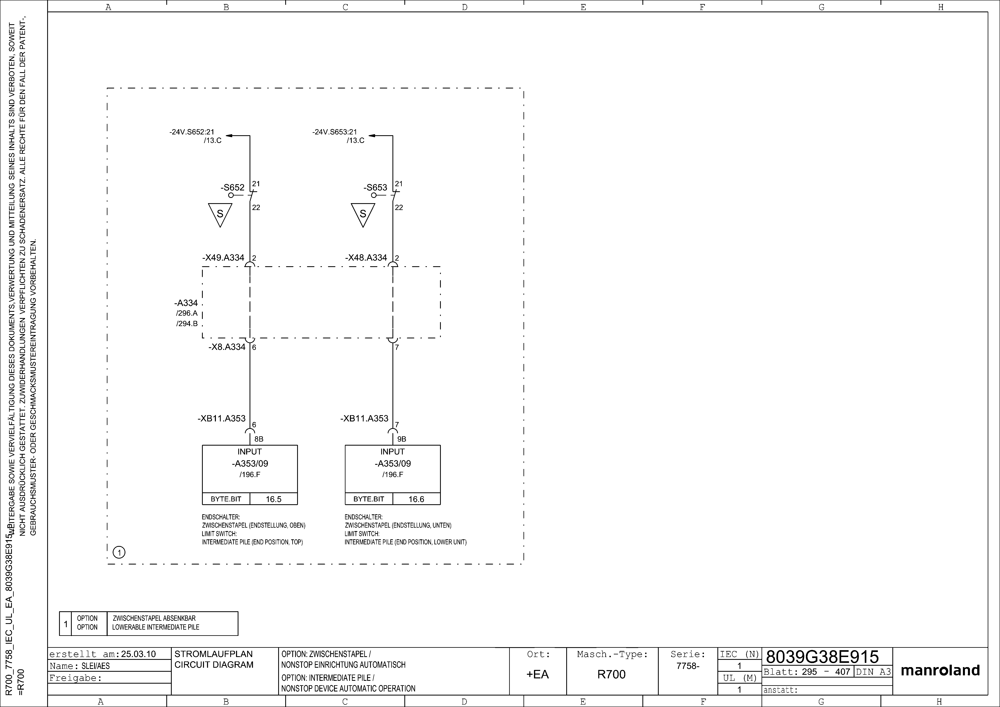

# +EA — Sheet 295 of 407 — OPTION: ZWISCHENSTAPEL /

**NONSTOP EINRICHTUNG AUTOMATISCH**

> Part of the manroland **R700** printing press IEC/UL circuit diagrams.
> Drawing class: **Stromlaufplan / Circuit diagram** (DIN A3).
> Document `+EA` covers the **Printing unit** machine section.

## At a glance

| Field | Value |
|---|---|
| Document | `+EA`  (8039G38E915) |
| Sheet | **295** of 407 |
| Section (DE) | OPTION: ZWISCHENSTAPEL / |
| Section (EN) | NONSTOP EINRICHTUNG AUTOMATISCH |
| Section type | CIRCUIT — Circuit diagram |
| Machine type | `R700` |
| Series | `7758` |
| Created | 25.03.10 |
| Replaces | — |
| Columns used | A, B, C, D |
| Path numbers | — |
| Labels on sheet | 52 |
| Cross-refs out | 6 |
| Cross-refs in | 12 |

**Previous:** [+EA sheet 294](SHEET_0294.md) · **Next:** [+EA sheet 296](SHEET_0296.md) · **Document TOC:** [_TOC.md](_TOC.md)  (+EA) · **Master TOC:** [all sheets](../_MASTER_TOC.md)

## Sheet image (300 DPI, exact vector render)



_Rendered directly from the PDF vector layer at 300 DPI (1-bit), no OCR and no resampling. Use it to confirm anything ambiguous in the text below._

## Cross-references on this sheet

Each entry is a wire leaving this sheet. The printed token is `/sheet.column`; the link resolves to that sheet inside the same document.

| Ref | Target sheet | Col | Path | Destination on target | Target section | From col |
|---|---|---|---|---|---|---|
| `/13.C` | [+EA sheet 13](SHEET_0013.md) | C | — | 24V.S652:21 24V.S653:21 | SPANNUNGSVERSORGUNG: 400V, 24V | B |
| `/13.C` | [+EA sheet 13](SHEET_0013.md) | C | — | 24V.S652:21 24V.S653:21 | SPANNUNGSVERSORGUNG: 400V, 24V | B |
| `/296.A` | [+EA sheet 296](SHEET_0296.md) | A | — | — | OPTION: ZWISCHENSTAPEL / | B |
| `/294.B` | [+EA sheet 294](SHEET_0294.md) | B | — | — | OPTION: ZWISCHENSTAPEL / | B |
| `/196.F` | [+EA sheet 196](SHEET_0196.md) | F | — | — | REFERENZMODUL | B |
| `/196.F` | [+EA sheet 196](SHEET_0196.md) | F | — | — | REFERENZMODUL | C |

### Incoming references (sheets that point here)

Every other sheet that sends a wire to this one. `Back-ref` is the token printed on *that* sheet; `Path` is its line number.

| From sheet | Cols | Back-ref | Path | Refs | What continues there |
|---|---|---|---|---|---|
| [+EA#13](SHEET_0013.md) | C | `/13.C` | — | 2 | — |
| [+EA#196](SHEET_0196.md) | F | `/196.F` | — | 2 | — |
| [+EA#249](SHEET_0249.md) | D | `/249.D` | — | 2 | — |
| [+EA#256](SHEET_0256.md) | A | `/256.A` | — | 2 | — |
| [+EA#282](SHEET_0282.md) | B, C | `/282.B`, `/282.C` | — | 2 | — |
| [+EA#294](SHEET_0294.md) | A | `/294.A` | — | 1 | — |
| [+EA#296](SHEET_0296.md) | A | `/296.A` | — | 1 | — |


## Devices on this sheet

| Tag | Class | Class meaning (IEC) | Col | Sub | Terminal | Sign |
|---|---|---|---|---|---|---|
| `S652` | S | Schalter / switch | B | — | — | — |
| `S653` | S | Schalter / switch | C | — | — | — |
| `A353/09` | A | Baugruppe / assembly, module, PC board | B | 09 | — | — |
| `A353/09` | A | Baugruppe / assembly, module, PC board | C | 09 | — | — |
| `A334` | A | Baugruppe / assembly, module, PC board | B | — | — | — |
| `X49.A334` | — | cross-device reference | B | — | — | — |
| `X48.A334` | — | cross-device reference | C | — | — | — |
| `X8.A334` | — | cross-device reference | B | — | — | — |
| `16.5` | — | cross-device reference | B | — | — | — |
| `XB11.A353` | — | cross-device reference | B | — | — | — |
| `16.6` | — | cross-device reference | D | — | — | — |
| `XB11.A353` | — | cross-device reference | C | — | — | — |

## Potentials / nets

| Potential | Count | Columns | Attached devices | Terminals |
|---|---|---|---|---|
| `24V` | 2 | B, C | `S652`, `S653` | `21` |


A potential such as `L24+/4` or `M24+` is a named supply/return rail; every place it appears on this sheet is electrically common.

## Wire-end annotations (grouped as printed)

A wire that continues elsewhere is annotated with a small cluster: the destination description, the path/line number `#NN`, and the `/sheet.column` cross reference. Each row below is one such cluster exactly as it is grouped on the drawing.

| Col | Y | Path | Cross-ref | Text on the wire |
|---|---|---|---|---|
| B | 153.4 | — | `/13.C`, `/13.C` | `24V.S652:21 24V.S653:21` |
| B | 215.1 | — | — | `21` |
| C | 215.1 | — | — | `21` |
| B | 218.6 | — | — | `S652` |
| C | 218.6 | — | — | `S653` |
| B | 243.4 | — | — | `22` |
| C | 243.4 | — | — | `22` |
| C | 249.1 | — | — | `S S` |
| B | 302.2 | — | — | `X49.A334 2` |
| C | 302.2 | — | — | `X48.A334 2` |
| B | 356.1 | — | — | `A334` |
| B | 369.1 | — | `/296.A`, `/294.B` | — |
| B | 408.5 | — | — | `X8.A334 6` |
| C | 409.9 | — | — | `7` |
| B | 493.5 | — | — | `XB11.A353 6` |
| C | 493.5 | — | — | `XB11.A353 7` |
| B | 519.0 | — | — | `8B` |
| C | 519.0 | — | — | `9B` |
| B | 533.5 | — | — | `INPUT` |
| C | 533.5 | — | — | `INPUT` |
| B | 547.4 | — | — | `A353/09` |
| C | 547.4 | — | — | `A353/09` |
| B | 561.2 | — | `/196.F` | — |
| C | 561.2 | — | `/196.F` | — |
| B | 590.2 | — | — | `BYTE.BIT 16.5` |
| C | 590.2 | — | — | `BYTE.BIT 16.6` |
| B | 613.0 | — | — | `ENDSCHALTER:` |
| C | 613.0 | — | — | `ENDSCHALTER:` |
| B | 623.0 | — | — | `LIMIT SWITCH: INTERMEDIATE PILE (END POSITION, TOP) ZWISCHENSTAPEL (ENDSTELLUNG, OBEN)` |
| D | 623.0 | — | — | `LIMIT SWITCH: INTERMEDIATE PILE (END POSITION, LOWER UNIT) ZWISCHENSTAPEL (ENDSTELLUNG, UNTEN)` |
| A | 654.6 | — | — | `1` |
| A | 733.4 | — | — | `1 LOWERABLE INTERMEDIATE PILE ZWISCHENSTAPEL ABSENKBAR` |
| A | 733.4 | — | — | `OPTION OPTION` |


## Reconstructed tables

This sheet carries tabular content (pin map / terminal assignment / index). The grid below was rebuilt from the drawing's own rule lines, so each row is exactly one physical row of the table.

### Table 1 — 1 data rows × 2 columns (at x=240.9, y=530.1)

| INPUT | A353/09 /196.F |
|---|---|
| `BYTE.BIT` | `16.5` |


### Table 2 — 1 data rows × 2 columns (at x=411.0, y=530.1)

| INPUT | A353/09 /196.F |
|---|---|
| `BYTE.BIT` | `16.6` |


## Notes and free text on this sheet

| Text | Col | Y (pt) |
|---|---|---|
| `8B` | B | 519.01 |
| `INPUT` | B | 533.55 |
| `BYTE.BIT` | B | 590.8 |
| `ENDSCHALTER:` | B | 613.04 |
| `ZWISCHENSTAPEL (ENDSTELLUNG, OBEN)` | B | 623 |
| `LIMIT SWITCH:` | B | 632.93 |
| `INTERMEDIATE PILE (END POSITION, TOP)` | B | 642.91 |
| `9B` | C | 519.01 |
| `INPUT` | C | 533.55 |
| `BYTE.BIT` | C | 590.8 |
| `ENDSCHALTER:` | C | 613.04 |
| `ZWISCHENSTAPEL (ENDSTELLUNG, UNTEN)` | C | 622.99 |
| `LIMIT SWITCH:` | C | 632.93 |
| `INTERMEDIATE PILE (END POSITION, LOWER UNIT)` | D | 642.9 |
| `OPTION` | A | 733.35 |
| `ZWISCHENSTAPEL ABSENKBAR` | A | 733.36 |
| `LOWERABLE INTERMEDIATE PILE` | A | 743.99 |
| `S` | B | 249.12 |
| `S` | C | 249.12 |

## Complete label inventory (exact text from the drawing)

Every text object inside the drawing area of this sheet, in DIN reading order (column A→H, then top→bottom). This is the authoritative list: if a string is not here it is not printed on this sheet.

| Col | Y | X | Dir | Type | Text |
|---|---|---|---|---|---|
| A | 654.6 | 140.0 | → | number | `1` |
| A | 733.4 | 91.8 | → | text | `OPTION` |
| A | 733.4 | 134.6 | → | text | `ZWISCHENSTAPEL ABSENKBAR` |
| A | 738.7 | 75.4 | → | number | `1` |
| A | 744.0 | 91.8 | → | text | `OPTION` |
| A | 744.0 | 133.8 | → | text | `LOWERABLE INTERMEDIATE PILE` |
| B | 153.4 | 201.8 | → | potential | `24V.S652:21` |
| B | 163.3 | 242.9 | → | cross-reference | `/13.C` |
| B | 215.0 | 300.2 | → | number | `21` |
| B | 218.6 | 262.8 | → | device tag | `S652` |
| B | 243.4 | 300.2 | → | number | `22` |
| B | 249.1 | 258.1 | → | text | `S` |
| B | 302.2 | 240.9 | → | device ref | `X49.A334` |
| B | 303.6 | 300.2 | → | number | `2` |
| B | 356.1 | 207.5 | → | device tag | `A334` |
| B | 369.1 | 209.8 | → | cross-reference | `/296.A` |
| B | 381.5 | 210.0 | → | cross-reference | `/294.B` |
| B | 408.5 | 248.3 | → | device ref | `X8.A334` |
| B | 409.9 | 300.2 | → | number | `6` |
| B | 493.5 | 235.3 | → | device ref | `XB11.A353` |
| B | 502.1 | 300.2 | → | number | `6` |
| B | 519.0 | 303.0 | → | text | `8B` |
| B | 533.6 | 282.8 | → | text | `INPUT` |
| B | 547.4 | 276.2 | → | device tag | `A353/09` |
| B | 561.2 | 285.3 | → | cross-reference | `/196.F` |
| B | 590.2 | 316.2 | → | device ref | `16.5` |
| B | 590.8 | 250.9 | → | text | `BYTE.BIT` |
| B | 613.0 | 240.4 | → | text | `ENDSCHALTER:` |
| B | 623.0 | 240.9 | → | text | `ZWISCHENSTAPEL (ENDSTELLUNG, OBEN)` |
| B | 632.9 | 240.4 | → | text | `LIMIT SWITCH:` |
| B | 642.9 | 240.4 | → | text | `INTERMEDIATE PILE (END POSITION, TOP)` |
| C | 153.4 | 371.9 | → | potential | `24V.S653:21` |
| C | 163.3 | 413.0 | → | cross-reference | `/13.C` |
| C | 215.0 | 470.3 | → | number | `21` |
| C | 218.6 | 432.9 | → | device tag | `S653` |
| C | 243.4 | 470.3 | → | number | `22` |
| C | 249.1 | 428.2 | → | text | `S` |
| C | 302.2 | 411.0 | → | device ref | `X48.A334` |
| C | 303.6 | 470.3 | → | number | `2` |
| C | 409.9 | 470.3 | → | number | `7` |
| C | 493.5 | 405.4 | → | device ref | `XB11.A353` |
| C | 502.1 | 470.3 | → | number | `7` |
| C | 519.0 | 473.1 | → | text | `9B` |
| C | 533.6 | 452.8 | → | text | `INPUT` |
| C | 547.4 | 446.3 | → | device tag | `A353/09` |
| C | 561.2 | 455.4 | → | cross-reference | `/196.F` |
| C | 590.8 | 420.9 | → | text | `BYTE.BIT` |
| C | 613.0 | 410.5 | → | text | `ENDSCHALTER:` |
| C | 623.0 | 411.0 | → | text | `ZWISCHENSTAPEL (ENDSTELLUNG, UNTEN)` |
| C | 632.9 | 410.5 | → | text | `LIMIT SWITCH:` |
| D | 590.2 | 486.3 | → | device ref | `16.6` |
| D | 642.9 | 410.5 | → | text | `INTERMEDIATE PILE (END POSITION, LOWER UNIT)` |

## Reading-order text block

The same content as a plain block, grouped by DIN column — convenient to paste or to match against a visual description.

```text
=== Column A ===
 654.6  140.0  numeric      1
 733.4   91.8  text         OPTION
 733.4  134.6  text         ZWISCHENSTAPEL ABSENKBAR
 738.7   75.4  numeric      1
 744.0   91.8  text         OPTION
 744.0  133.8  text         LOWERABLE INTERMEDIATE PILE
=== Column B ===
 153.4  201.8  net          24V.S652:21
 163.3  242.9  xref         /13.C
 215.0  300.2  numeric      21
 218.6  262.8  devtag       S652
 243.4  300.2  numeric      22
 249.1  258.1  text         S
 302.2  240.9  devref       X49.A334
 303.6  300.2  numeric      2
 356.1  207.5  devtag       A334
 369.1  209.8  xref         /296.A
 381.5  210.0  xref         /294.B
 408.5  248.3  devref       X8.A334
 409.9  300.2  numeric      6
 493.5  235.3  devref       XB11.A353
 502.1  300.2  numeric      6
 519.0  303.0  text         8B
 533.6  282.8  text         INPUT
 547.4  276.2  devtag       A353/09
 561.2  285.3  xref         /196.F
 590.2  316.2  devref       16.5
 590.8  250.9  text         BYTE.BIT
 613.0  240.4  text         ENDSCHALTER:
 623.0  240.9  text         ZWISCHENSTAPEL (ENDSTELLUNG, OBEN)
 632.9  240.4  text         LIMIT SWITCH:
 642.9  240.4  text         INTERMEDIATE PILE (END POSITION, TOP)
=== Column C ===
 153.4  371.9  net          24V.S653:21
 163.3  413.0  xref         /13.C
 215.0  470.3  numeric      21
 218.6  432.9  devtag       S653
 243.4  470.3  numeric      22
 249.1  428.2  text         S
 302.2  411.0  devref       X48.A334
 303.6  470.3  numeric      2
 409.9  470.3  numeric      7
 493.5  405.4  devref       XB11.A353
 502.1  470.3  numeric      7
 519.0  473.1  text         9B
 533.6  452.8  text         INPUT
 547.4  446.3  devtag       A353/09
 561.2  455.4  xref         /196.F
 590.8  420.9  text         BYTE.BIT
 613.0  410.5  text         ENDSCHALTER:
 623.0  411.0  text         ZWISCHENSTAPEL (ENDSTELLUNG, UNTEN)
 632.9  410.5  text         LIMIT SWITCH:
=== Column D ===
 590.2  486.3  devref       16.6
 642.9  410.5  text         INTERMEDIATE PILE (END POSITION, LOWER UNIT)
```

---
_Generated from the PDF vector text layer; no OCR. Source: `R700_7758_IEC_UL_EA_8039G38E915_p`, sheet 295._
