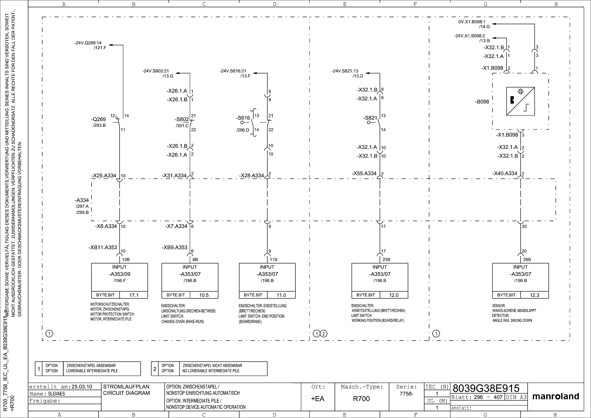

# +EA — Sheet 296 of 407 — OPTION: ZWISCHENSTAPEL /

**NONSTOP EINRICHTUNG AUTOMATISCH**

> Part of the manroland **R700** printing press IEC/UL circuit diagrams.
> Drawing class: **Stromlaufplan / Circuit diagram** (DIN A3).
> Document `+EA` covers the **Printing unit** machine section.

## At a glance

| Field | Value |
|---|---|
| Document | `+EA`  (8039G38E915) |
| Sheet | **296** of 407 |
| Section (DE) | OPTION: ZWISCHENSTAPEL / |
| Section (EN) | NONSTOP EINRICHTUNG AUTOMATISCH |
| Section type | CIRCUIT — Circuit diagram |
| Machine type | `R700` |
| Series | `7758` |
| Created | 25.03.10 |
| Replaces | — |
| Columns used | A, B, C, D, E, F, G, H |
| Path numbers | — |
| Labels on sheet | 157 |
| Cross-refs out | 16 |
| Cross-refs in | 52 |

**Previous:** [+EA sheet 295](SHEET_0295.md) · **Next:** [+EA sheet 297](SHEET_0297.md) · **Document TOC:** [_TOC.md](_TOC.md)  (+EA) · **Master TOC:** [all sheets](../_MASTER_TOC.md)

## Sheet image (300 DPI, exact vector render)



_Rendered directly from the PDF vector layer at 300 DPI (1-bit), no OCR and no resampling. Use it to confirm anything ambiguous in the text below._

## Cross-references on this sheet

Each entry is a wire leaving this sheet. The printed token is `/sheet.column`; the link resolves to that sheet inside the same document.

| Ref | Target sheet | Col | Path | Destination on target | Target section | From col |
|---|---|---|---|---|---|---|
| `/14.G` | [+EA sheet 14](SHEET_0014.md) | G | — | 0V.X1.B098:1 | SPANNUNGSVERSORGUNG: 400V, 24V | G |
| `/13.B` | [+EA sheet 13](SHEET_0013.md) | B | — | 24V.X1.B098:2 | SPANNUNGSVERSORGUNG: 400V, 24V | G |
| `/121.F` | [+EA sheet 121](SHEET_0121.md) | F | — | 24V.Q269:14 | TROCKENBESTÄUBER | A |
| `/13.G` | [+EA sheet 13](SHEET_0013.md) | G | — | 24V.S802:21 | SPANNUNGSVERSORGUNG: 400V, 24V | B |
| `/13.F` | [+EA sheet 13](SHEET_0013.md) | F | — | 24V.S616:21 | SPANNUNGSVERSORGUNG: 400V, 24V | C |
| `/13.D` | [+EA sheet 13](SHEET_0013.md) | D | — | 24V.S821:13 | SPANNUNGSVERSORGUNG: 400V, 24V | E |
| `/293.B` | [+EA sheet 293](SHEET_0293.md) | B | — | — | OPTION: ZWISCHENSTAPEL / | B |
| `/301.C` | [+EA sheet 301](SHEET_0301.md) | C | — | — | OPTION: ZWISCHENSTAPEL / | C |
| `/296.D` | [+EA sheet 296](SHEET_0296.md) | D | — | 22 | OPTION: ZWISCHENSTAPEL / | D |
| `/297.A` | [+EA sheet 297](SHEET_0297.md) | A | — | — | OPTION: ZWISCHENSTAPEL / | A |
| `/295.B` | [+EA sheet 295](SHEET_0295.md) | B | — | — | OPTION: ZWISCHENSTAPEL / | A |
| `/196.B` | [+EA sheet 196](SHEET_0196.md) | B | — | — | REFERENZMODUL | C |
| `/196.B` | [+EA sheet 196](SHEET_0196.md) | B | — | — | REFERENZMODUL | D |
| `/196.B` | [+EA sheet 196](SHEET_0196.md) | B | — | — | REFERENZMODUL | F |
| `/196.B` | [+EA sheet 196](SHEET_0196.md) | B | — | — | REFERENZMODUL | G |
| `/196.F` | [+EA sheet 196](SHEET_0196.md) | F | — | — | REFERENZMODUL | B |

### Incoming references (sheets that point here)

Every other sheet that sends a wire to this one. `Back-ref` is the token printed on *that* sheet; `Path` is its line number.

| From sheet | Cols | Back-ref | Path | Refs | What continues there |
|---|---|---|---|---|---|
| [+EA#13](SHEET_0013.md) | B, D, F, G | `/13.B`, `/13.D`, `/13.F`, `/13.G` | — | 4 | 24V.A600\2:1; 24V.S616:21; 24V.S802:21 |
| [+EA#14](SHEET_0014.md) | G | `/14.G` | — | 1 | 0V.X1.B098:1 |
| [+EA#121](SHEET_0121.md) | F | `/121.F` | — | 1 | — |
| [+EA#196](SHEET_0196.md) | B, F | `/196.B`, `/196.F` | — | 5 | — |
| [+EA#214](SHEET_0214.md) | F | `/214.F` | — | 3 | — |
| [+EA#246](SHEET_0246.md) | F | `/246.F` | — | 4 | — |
| [+EA#249](SHEET_0249.md) | D | `/249.D` | — | 1 | — |
| [+EA#252](SHEET_0252.md) | C | `/252.C` | — | 4 | — |
| [+EA#256](SHEET_0256.md) | A | `/256.A` | — | 1 | — |
| [+EA#267](SHEET_0267.md) | B | `/267.B` | — | 1 | — |
| [+EA#270](SHEET_0270.md) | A, B | `/270.A`, `/270.B` | — | 8 | — |
| [+EA#272](SHEET_0272.md) | D | `/272.D` | — | 1 | — |
| [+EA#275](SHEET_0275.md) | H | `/275.H` | — | 1 | — |
| [+EA#276](SHEET_0276.md) | C | `/276.C` | — | 10 | — |
| [+EA#280](SHEET_0280.md) | G | `/280.G` | — | 1 | — |
| [+EA#283](SHEET_0283.md) | B | `/283.B` | — | 1 | — |
| [+EA#293](SHEET_0293.md) | B | `/293.B` | — | 1 | — |
| [+EA#295](SHEET_0295.md) | B | `/295.B` | — | 1 | — |
| [+EA#296](SHEET_0296.md) | D | `/296.D` | — | 1 | 22 |
| [+EA#297](SHEET_0297.md) | A | `/297.A` | — | 1 | — |
| [+EA#301](SHEET_0301.md) | C | `/301.C` | — | 1 | — |


## Devices on this sheet

| Tag | Class | Class meaning (IEC) | Col | Sub | Terminal | Sign |
|---|---|---|---|---|---|---|
| `A353/07` | A | Baugruppe / assembly, module, PC board | D | 07 | — | — |
| `A353/07` | A | Baugruppe / assembly, module, PC board | C | 07 | — | — |
| `A353/07` | A | Baugruppe / assembly, module, PC board | F | 07 | — | — |
| `A353/07` | A | Baugruppe / assembly, module, PC board | G | 07 | — | — |
| `A353/09` | A | Baugruppe / assembly, module, PC board | B | 09 | — | — |
| `A334` | A | Baugruppe / assembly, module, PC board | A | — | — | — |
| `S616` | S | Schalter / switch | D | — | — | — |
| `S802` | S | Schalter / switch | C | — | — | — |
| `S821` | S | Schalter / switch | E | — | — | — |
| `Q269` | Q | Leistungsschalter / power switching device | A | — | — | — |
| `B098` | B | Umformer / transducer, sensor | G | — | — | — |
| `11.0` | — | cross-device reference | D | — | — | — |
| `10.5` | — | cross-device reference | C | — | — | — |
| `XB9.A353` | — | cross-device reference | C | — | — | — |
| `X7.A334` | — | cross-device reference | C | — | — | — |
| `X28.A334` | — | cross-device reference | D | — | — | — |
| `X31.A334` | — | cross-device reference | C | — | — | — |
| `12.0` | — | cross-device reference | F | — | — | — |
| `X55.A334` | — | cross-device reference | E | — | — | — |
| `12.3` | — | cross-device reference | H | — | — | — |
| `X40.A334` | — | cross-device reference | G | — | — | — |
| `17.1` | — | cross-device reference | B | — | — | — |
| `XB11.A353` | — | cross-device reference | B | — | — | — |
| `X8.A334` | — | cross-device reference | B | — | — | — |
| `X25.A334` | — | cross-device reference | B | — | — | — |
| `X26.1.B` | — | cross-device reference | C | — | — | — |
| `X26.1.A` | — | cross-device reference | C | — | — | — |
| `X32.1.A` | — | cross-device reference | E | — | — | — |
| `X32.1.B` | — | cross-device reference | E | — | — | — |
| `X32.1.A` | — | cross-device reference | E | — | — | — |
| `X32.1.B` | — | cross-device reference | E | — | — | — |
| `X26.1.B` | — | cross-device reference | C | — | — | — |
| `X26.1.A` | — | cross-device reference | C | — | — | — |
| `X1.B098` | — | cross-device reference | G | — | — | — |
| `X1.B098` | — | cross-device reference | G | — | — | — |
| `X32.1.B` | — | cross-device reference | G | — | — | — |
| `X32.1.A` | — | cross-device reference | G | — | — | — |
| `X32.1.A` | — | cross-device reference | G | — | — | — |
| `X32.1.B` | — | cross-device reference | G | — | — | — |

## Potentials / nets

| Potential | Count | Columns | Attached devices | Terminals |
|---|---|---|---|---|
| `0V` | 1 | G | `B098`, `X1` | `1` |
| `24V` | 5 | A, B, C, E, G | `B098`, `Q269`, `S616`, `S802`, `S821`, `X1` | `13`, `14`, `2`, `21` |


A potential such as `L24+/4` or `M24+` is a named supply/return rail; every place it appears on this sheet is electrically common.

## Wire-end annotations (grouped as printed)

A wire that continues elsewhere is annotated with a small cluster: the destination description, the path/line number `#NN`, and the `/sheet.column` cross reference. Each row below is one such cluster exactly as it is grouped on the drawing.

| Col | Y | Path | Cross-ref | Text on the wire |
|---|---|---|---|---|
| G | 40.0 | — | `/14.G` | `0V.X1.B098:1` |
| G | 68.3 | — | `/13.B` | `24V.X1.B098:2` |
| A | 82.5 | — | `/121.F` | `24V.Q269:14` |
| G | 91.0 | — | — | `X32.1.B 1 3` |
| G | 108.0 | — | — | `X32.1.A 1 3` |
| G | 132.1 | — | — | `X1.B098 2` |
| H | 133.6 | — | — | `1` |
| B | 139.2 | — | `/13.G` | `24V.S802:21` |
| C | 139.2 | — | `/13.F` | `24V.S616:21` |
| E | 139.2 | — | `/13.D` | `24V.S821:13` |
| E | 176.1 | — | — | `X32.1.B 9` |
| C | 178.2 | — | — | `X26.1.A 1` |
| E | 180.3 | — | — | `9 X32.1.A 9` |
| C | 195.9 | — | — | `X26.1.B 1` |
| D | 197.3 | — | — | `9` |
| G | 200.1 | — | — | `B098` |
| B | 229.2 | — | — | `Q269 14` |
| D | 229.2 | — | — | `12 S821` |
| C | 229.2 | — | — | `21 S616` |
| D | 229.2 | — | — | `13` |
| D | 229.2 | — | — | `21` |
| F | 229.2 | — | — | `13` |
| C | 235.6 | — | — | `S802` |
| B | 248.7 | — | `/293.B` | — |
| C | 249.4 | — | `/301.C` | — |
| B | 257.6 | — | — | `11` |
| C | 257.6 | — | — | `22` |
| D | 257.6 | — | `/296.D` | `22` |
| D | 257.6 | — | — | `14` |
| F | 257.6 | — | — | `14` |
| G | 266.8 | — | — | `X1.B098 3` |
| C | 289.5 | — | — | `X26.1.B 2` |
| D | 289.5 | — | — | `10` |
| E | 291.6 | — | — | `X32.1.A 10` |
| G | 291.6 | — | — | `X32.1.A 2` |
| C | 306.5 | — | — | `X26.1.A 2` |
| D | 306.5 | — | — | `10` |
| E | 309.3 | — | — | `X32.1.B 10` |
| G | 309.3 | — | — | `X32.1.B 2` |
| E | 344.7 | — | — | `X55.A334 2` |
| G | 344.7 | — | — | `X40.A334 2` |
| C | 346.1 | — | — | `X31.A334 2 X28.A334 2` |
| B | 349.0 | — | — | `X25.A334 10` |
| A | 398.6 | — | — | `A334` |
| A | 411.6 | — | `/297.A`, `/295.B` | — |
| B | 451.0 | — | — | `X8.A334 10` |
| C | 451.0 | — | — | `X7.A334 6` |
| D | 452.4 | — | — | `9` |
| F | 452.4 | — | — | `17` |
| H | 452.4 | — | — | `20` |
| B | 493.5 | — | — | `XB11.A353 10` |
| C | 493.5 | — | — | `XB9.A353 6` |
| D | 502.1 | — | — | `9` |
| F | 502.1 | — | — | `17` |
| H | 502.1 | — | — | `20` |
| B | 519.0 | — | — | `12B` |
| C | 519.0 | — | — | `8B` |
| D | 519.0 | — | — | `11B` |
| F | 519.0 | — | — | `23B` |
| H | 519.0 | — | — | `26B` |
| B | 533.5 | — | — | `INPUT` |
| C | 533.5 | — | — | `INPUT` |
| D | 533.5 | — | — | `INPUT` |
| E | 533.5 | — | — | `INPUT` |
| G | 533.5 | — | — | `INPUT` |
| B | 547.4 | — | — | `A353/09` |
| C | 547.4 | — | — | `A353/07` |
| D | 547.4 | — | — | `A353/07` |
| F | 547.4 | — | — | `A353/07` |
| G | 547.4 | — | — | `A353/07` |
| B | 561.2 | — | `/196.F` | — |
| C | 561.2 | — | `/196.B` | — |
| D | 561.2 | — | `/196.B` | — |
| F | 561.2 | — | `/196.B` | — |
| G | 561.2 | — | `/196.B` | — |
| B | 590.2 | — | — | `BYTE.BIT 17.1` |
| C | 590.2 | — | — | `BYTE.BIT 10.5` |
| D | 590.2 | — | — | `BYTE.BIT 11.0` |
| E | 590.2 | — | — | `BYTE.BIT 12.0` |
| G | 590.2 | — | — | `BYTE.BIT 12.3` |
| B | 610.2 | — | — | `MOTORSCHUTZSCHALTER: MOTOR, ZWISCHENSTAPEL MOTOR PROTECTION SWITCH: MOTOR, INTERMEDIATE PILE` |
| C | 612.9 | — | — | `ENDSCHALTER: UMSCHALTUNG (RECHEN BETRIEB) LIMIT SWITCH:` |
| D | 612.9 | — | — | `ENDSCHALTER: ENDSTELLUNG LIMIT SWITCH: END POSITION (BRETT/RECHEN) (BOARD/RAKE)` |
| E | 613.0 | — | — | `ENDSCHALTER:` |
| G | 613.0 | — | — | `DETECTOR: SENSOR: WINKELSCHIENE ABGEKLAPPT` |
| E | 623.0 | — | — | `LIMIT SWITCH: ARBEITSSTELLUNG (BRETT/RECHEN)` |
| E | 642.9 | — | — | `WORKING POSITION (BOARD/RELAY)` |
| G | 642.9 | — | — | `ANGLE RAIL SWUNG DOWN` |
| C | 644.8 | — | — | `CHANGE OVER (RAKE RUN)` |
| D | 668.8 | — | — | `1 1 2 1` |
| A | 733.4 | — | — | `1 OPTION OPTION` |
| B | 733.4 | — | — | `LOWERABLE INTERMEDIATE PILE ZWISCHENSTAPEL ABSENKBAR 2 OPTION OPTION` |
| C | 733.4 | — | — | `NO LOWERABLE INTERMEDIATE PILE ZWISCHENSTAPEL NICHT ABSENKBAR` |


## Reconstructed tables

This sheet carries tabular content (pin map / terminal assignment / index). The grid below was rebuilt from the drawing's own rule lines, so each row is exactly one physical row of the table.

### Table 1 — 1 data rows × 3 columns (at x=184.3, y=530.1)

| INPUT | A353/09 /196.F |  |
|---|---|---|
| `BYTE.BIT` |  | `17.1` |


### Table 2 — 1 data rows × 2 columns (at x=326.0, y=530.1)

| INPUT | A353/07 /196.B |
|---|---|
| `BYTE.BIT` | `10.5` |


### Table 3 — 1 data rows × 2 columns (at x=481.9, y=530.1)

| INPUT | A353/07 /196.B |
|---|---|
| `BYTE.BIT` | `11.0` |


### Table 4 — 1 data rows × 2 columns (at x=708.7, y=530.1)

| INPUT | A353/07 /196.B |
|---|---|
| `BYTE.BIT` | `12.0` |


### Table 5 — 3 data rows × 4 columns (at x=992.1, y=48.2)

| X32.1.B X32.1.A | 1 1 2 |  | 3 3 1 |
|---|---|---|---|
| `X40.A334` | `X1.B098 X32.1.A X32.1.B` | `3 2 2 2 20 20 26B` |  |
|  | `INPUT` | `A353/07 /196.B` |  |
| `BYTE.BIT` |  | `12.3` |  |


## Notes and free text on this sheet

| Text | Col | Y (pt) |
|---|---|---|
| `11B` | D | 519.03 |
| `INPUT` | D | 533.55 |
| `BYTE.BIT` | D | 590.8 |
| `ENDSCHALTER: ENDSTELLUNG` | D | 612.92 |
| `(BRETT/RECHEN)` | D | 623.55 |
| `LIMIT SWITCH: END POSITION` | D | 634.15 |
| `(BOARD/RAKE)` | D | 644.8 |
| `8B` | C | 519.01 |
| `INPUT` | C | 533.55 |
| `BYTE.BIT` | C | 590.8 |
| `ENDSCHALTER:` | C | 612.9 |
| `UMSCHALTUNG (RECHEN BETRIEB)` | C | 623.56 |
| `LIMIT SWITCH:` | C | 634.12 |
| `CHANGE OVER (RAKE RUN)` | C | 644.83 |
| `23B` | F | 519.03 |
| `INPUT` | E | 533.55 |
| `BYTE.BIT` | E | 590.8 |
| `ENDSCHALTER:` | E | 613.04 |
| `ARBEITSSTELLUNG (BRETT/RECHEN)` | E | 623 |
| `LIMIT SWITCH:` | E | 632.93 |
| `WORKING POSITION (BOARD/RELAY)` | E | 642.9 |
| `26B` | H | 519.03 |
| `INPUT` | G | 533.55 |
| `BYTE.BIT` | G | 590.8 |
| `SENSOR:` | G | 613.05 |
| `WINKELSCHIENE ABGEKLAPPT` | G | 623.02 |
| `DETECTOR:` | G | 632.89 |
| `ANGLE RAIL SWUNG DOWN` | G | 642.87 |
| `12B` | B | 519.03 |
| `INPUT` | B | 533.55 |
| `BYTE.BIT` | B | 590.8 |
| `MOTORSCHUTZSCHALTER:` | B | 610.2 |
| `MOTOR, ZWISCHENSTAPEL` | B | 620.16 |
| `MOTOR PROTECTION SWITCH:` | B | 630.08 |
| `MOTOR, INTERMEDIATE PILE` | B | 640.08 |
| `OPTION` | A | 733.35 |
| `ZWISCHENSTAPEL ABSENKBAR` | A | 733.36 |
| `LOWERABLE INTERMEDIATE PILE` | A | 743.99 |
| `OPTION` | B | 733.35 |
| `ZWISCHENSTAPEL NICHT ABSENKBAR` | C | 733.37 |
| `NO LOWERABLE INTERMEDIATE PILE` | C | 743.99 |

## Complete label inventory (exact text from the drawing)

Every text object inside the drawing area of this sheet, in DIN reading order (column A→H, then top→bottom). This is the authoritative list: if a string is not here it is not printed on this sheet.

| Col | Y | X | Dir | Type | Text |
|---|---|---|---|---|---|
| A | 82.5 | 150.0 | → | potential | `24V.Q269:14` |
| A | 235.6 | 183.7 | → | device tag | `Q269` |
| A | 398.6 | 150.8 | → | device tag | `A334` |
| A | 411.6 | 153.1 | → | cross-reference | `/297.A` |
| A | 424.0 | 153.4 | → | cross-reference | `/295.B` |
| A | 668.8 | 97.5 | → | number | `1` |
| A | 733.4 | 91.8 | → | text | `OPTION` |
| A | 733.4 | 134.6 | → | text | `ZWISCHENSTAPEL ABSENKBAR` |
| A | 738.7 | 75.4 | → | number | `1` |
| A | 744.0 | 91.8 | → | text | `OPTION` |
| A | 744.0 | 133.8 | → | text | `LOWERABLE INTERMEDIATE PILE` |
| B | 92.4 | 189.4 | → | cross-reference | `/121.F` |
| B | 139.2 | 286.9 | → | potential | `24V.S802:21` |
| B | 149.1 | 327.7 | → | cross-reference | `/13.G` |
| B | 229.2 | 222.0 | → | number | `12` |
| B | 229.2 | 250.0 | → | number | `14` |
| B | 248.6 | 187.4 | → | cross-reference | `/293.B` |
| B | 257.6 | 242.9 | → | number | `11` |
| B | 349.0 | 184.3 | → | device ref | `X25.A334` |
| B | 350.4 | 242.9 | → | number | `10` |
| B | 451.0 | 191.6 | → | device ref | `X8.A334` |
| B | 452.5 | 242.9 | → | number | `10` |
| B | 493.5 | 178.6 | → | device ref | `XB11.A353` |
| B | 502.1 | 242.9 | → | number | `10` |
| B | 519.0 | 245.8 | → | text | `12B` |
| B | 533.6 | 226.1 | → | text | `INPUT` |
| B | 547.4 | 219.5 | → | device tag | `A353/09` |
| B | 561.2 | 228.6 | → | cross-reference | `/196.F` |
| B | 590.2 | 260.4 | → | device ref | `17.1` |
| B | 590.8 | 194.2 | → | text | `BYTE.BIT` |
| B | 610.2 | 182.6 | → | text | `MOTORSCHUTZSCHALTER:` |
| B | 620.2 | 182.6 | → | text | `MOTOR, ZWISCHENSTAPEL` |
| B | 630.1 | 182.6 | → | text | `MOTOR PROTECTION SWITCH:` |
| B | 640.1 | 182.6 | → | text | `MOTOR, INTERMEDIATE PILE` |
| B | 733.4 | 325.7 | → | text | `OPTION` |
| B | 738.7 | 309.0 | → | number | `2` |
| B | 744.0 | 325.7 | → | text | `OPTION` |
| C | 139.2 | 442.8 | → | potential | `24V.S616:21` |
| C | 178.2 | 335.6 | → | device ref | `X26.1.A` |
| C | 180.3 | 384.7 | → | number | `1` |
| C | 195.9 | 336.5 | → | device ref | `X26.1.B` |
| C | 197.3 | 384.7 | → | number | `1` |
| C | 229.2 | 385.2 | → | number | `21` |
| C | 235.6 | 352.1 | → | device tag | `S802` |
| C | 249.4 | 354.3 | → | cross-reference | `/301.C` |
| C | 257.6 | 385.2 | → | number | `22` |
| C | 289.5 | 336.5 | → | device ref | `X26.1.B` |
| C | 289.5 | 385.2 | → | number | `2` |
| C | 306.5 | 385.2 | → | number | `2` |
| C | 307.2 | 335.6 | → | device ref | `X26.1.A` |
| C | 346.2 | 385.2 | → | number | `2` |
| C | 349.0 | 326.0 | → | device ref | `X31.A334` |
| C | 451.0 | 333.4 | → | device ref | `X7.A334` |
| C | 452.5 | 385.2 | → | number | `6` |
| C | 493.5 | 326.3 | → | device ref | `XB9.A353` |
| C | 502.1 | 385.2 | → | number | `6` |
| C | 519.0 | 388.1 | → | text | `8B` |
| C | 533.6 | 367.8 | → | text | `INPUT` |
| C | 547.4 | 361.3 | → | device tag | `A353/07` |
| C | 561.2 | 370.1 | → | cross-reference | `/196.B` |
| C | 590.2 | 401.2 | → | device ref | `10.5` |
| C | 590.8 | 335.9 | → | text | `BYTE.BIT` |
| C | 612.9 | 325.1 | → | text | `ENDSCHALTER:` |
| C | 623.6 | 325.1 | → | text | `UMSCHALTUNG (RECHEN BETRIEB)` |
| C | 634.1 | 325.1 | → | text | `LIMIT SWITCH:` |
| C | 644.8 | 325.7 | → | text | `CHANGE OVER (RAKE RUN)` |
| C | 733.4 | 368.5 | → | text | `ZWISCHENSTAPEL NICHT ABSENKBAR` |
| C | 744.0 | 367.7 | → | text | `NO LOWERABLE INTERMEDIATE PILE` |
| D | 149.1 | 484.7 | → | cross-reference | `/13.F` |
| D | 180.3 | 541.1 | → | number | `9` |
| D | 197.3 | 541.1 | → | number | `9` |
| D | 229.2 | 512.2 | → | number | `13` |
| D | 229.2 | 541.1 | → | number | `21` |
| D | 232.7 | 475.4 | → | device tag | `S616` |
| D | 257.6 | 512.2 | → | number | `14` |
| D | 257.6 | 541.1 | → | number | `22` |
| D | 258.2 | 476.2 | → | cross-reference | `/296.D` |
| D | 289.5 | 540.6 | → | number | `10` |
| D | 306.5 | 540.6 | → | number | `10` |
| D | 346.2 | 541.1 | → | number | `2` |
| D | 349.0 | 481.9 | → | device ref | `X28.A334` |
| D | 452.5 | 541.1 | → | number | `9` |
| D | 502.1 | 541.1 | → | number | `9` |
| D | 519.0 | 543.4 | → | text | `11B` |
| D | 533.6 | 523.7 | → | text | `INPUT` |
| D | 547.4 | 517.2 | → | device tag | `A353/07` |
| D | 561.2 | 526.0 | → | cross-reference | `/196.B` |
| D | 590.2 | 557.1 | → | device ref | `11.0` |
| D | 590.8 | 491.8 | → | text | `BYTE.BIT` |
| D | 612.9 | 481.0 | → | text | `ENDSCHALTER: ENDSTELLUNG` |
| D | 623.5 | 481.3 | → | text | `(BRETT/RECHEN)` |
| D | 634.1 | 481.0 | → | text | `LIMIT SWITCH: END POSITION` |
| D | 644.8 | 481.3 | → | text | `(BOARD/RAKE)` |
| E | 139.2 | 668.1 | → | potential | `24V.S821:13` |
| E | 149.1 | 710.6 | → | cross-reference | `/13.D` |
| E | 176.1 | 719.1 | → | device ref | `X32.1.B` |
| E | 193.8 | 718.3 | → | device ref | `X32.1.A` |
| E | 232.7 | 731.9 | → | device tag | `S821` |
| E | 291.6 | 718.3 | → | device ref | `X32.1.A` |
| E | 309.3 | 719.1 | → | device ref | `X32.1.B` |
| E | 344.7 | 708.7 | → | device ref | `X55.A334` |
| E | 533.6 | 750.5 | → | text | `INPUT` |
| E | 590.8 | 718.6 | → | text | `BYTE.BIT` |
| E | 613.0 | 708.1 | → | text | `ENDSCHALTER:` |
| E | 623.0 | 708.9 | → | text | `ARBEITSSTELLUNG (BRETT/RECHEN)` |
| E | 632.9 | 708.1 | → | text | `LIMIT SWITCH:` |
| E | 642.9 | 708.7 | → | text | `WORKING POSITION (BOARD/RELAY)` |
| E | 668.8 | 636.0 | → | number | `1` |
| E | 669.3 | 650.0 | → | number | `2` |
| F | 176.1 | 767.9 | → | number | `9` |
| F | 193.1 | 767.9 | → | number | `9` |
| F | 229.2 | 767.3 | → | number | `13` |
| F | 257.6 | 767.3 | → | number | `14` |
| F | 293.7 | 767.3 | → | number | `10` |
| F | 310.7 | 767.3 | → | number | `10` |
| F | 346.2 | 767.9 | → | number | `2` |
| F | 452.5 | 767.3 | → | number | `17` |
| F | 502.1 | 767.3 | → | number | `17` |
| F | 519.0 | 770.7 | → | text | `23B` |
| F | 547.4 | 744.0 | → | device tag | `A353/07` |
| F | 561.2 | 752.7 | → | cross-reference | `/196.B` |
| F | 590.2 | 783.9 | → | device ref | `12.0` |
| F | 668.8 | 877.0 | → | number | `1` |
| G | 40.0 | 923.8 | → | potential | `0V.X1.B098:1` |
| G | 49.9 | 965.5 | → | cross-reference | `/14.G` |
| G | 68.3 | 915.0 | → | potential | `24V.X1.B098:2` |
| G | 78.2 | 966.0 | → | cross-reference | `/13.B` |
| G | 91.0 | 974.3 | → | device ref | `X32.1.B` |
| G | 91.0 | 1022.5 | → | number | `1` |
| G | 108.0 | 1022.5 | → | number | `1` |
| G | 108.8 | 973.4 | → | device ref | `X32.1.A` |
| G | 132.1 | 969.7 | → | device ref | `X1.B098` |
| G | 133.6 | 1023.0 | → | number | `2` |
| G | 200.1 | 957.3 | → | device tag | `B098` |
| G | 266.8 | 999.5 | → | device ref | `X1.B098` |
| G | 291.6 | 1001.8 | → | device ref | `X32.1.A` |
| G | 309.3 | 1002.6 | → | device ref | `X32.1.B` |
| G | 344.7 | 992.1 | → | device ref | `X40.A334` |
| G | 533.6 | 1033.9 | → | text | `INPUT` |
| G | 547.4 | 1027.4 | → | device tag | `A353/07` |
| G | 561.2 | 1036.2 | → | cross-reference | `/196.B` |
| G | 590.8 | 1002.0 | → | text | `BYTE.BIT` |
| G | 613.0 | 991.8 | → | text | `SENSOR:` |
| G | 623.0 | 992.1 | → | text | `WINKELSCHIENE ABGEKLAPPT` |
| G | 632.9 | 991.6 | → | text | `DETECTOR:` |
| G | 642.9 | 992.4 | → | text | `ANGLE RAIL SWUNG DOWN` |
| H | 91.0 | 1079.7 | → | number | `3` |
| H | 108.0 | 1079.7 | → | number | `3` |
| H | 133.6 | 1079.1 | → | number | `1` |
| H | 268.2 | 1051.4 | → | number | `3` |
| H | 293.7 | 1051.4 | → | number | `2` |
| H | 310.7 | 1051.4 | → | number | `2` |
| H | 346.2 | 1051.4 | → | number | `2` |
| H | 452.5 | 1051.4 | → | number | `20` |
| H | 502.1 | 1051.4 | → | number | `20` |
| H | 519.0 | 1054.2 | → | text | `26B` |
| H | 590.2 | 1067.4 | → | device ref | `12.3` |

## Reading-order text block

The same content as a plain block, grouped by DIN column — convenient to paste or to match against a visual description.

```text
=== Column A ===
  82.5  150.0  net          24V.Q269:14
 235.6  183.7  devtag       Q269
 398.6  150.8  devtag       A334
 411.6  153.1  xref         /297.A
 424.0  153.4  xref         /295.B
 668.8   97.5  numeric      1
 733.4   91.8  text         OPTION
 733.4  134.6  text         ZWISCHENSTAPEL ABSENKBAR
 738.7   75.4  numeric      1
 744.0   91.8  text         OPTION
 744.0  133.8  text         LOWERABLE INTERMEDIATE PILE
=== Column B ===
  92.4  189.4  xref         /121.F
 139.2  286.9  net          24V.S802:21
 149.1  327.7  xref         /13.G
 229.2  222.0  numeric      12
 229.2  250.0  numeric      14
 248.6  187.4  xref         /293.B
 257.6  242.9  numeric      11
 349.0  184.3  devref       X25.A334
 350.4  242.9  numeric      10
 451.0  191.6  devref       X8.A334
 452.5  242.9  numeric      10
 493.5  178.6  devref       XB11.A353
 502.1  242.9  numeric      10
 519.0  245.8  text         12B
 533.6  226.1  text         INPUT
 547.4  219.5  devtag       A353/09
 561.2  228.6  xref         /196.F
 590.2  260.4  devref       17.1
 590.8  194.2  text         BYTE.BIT
 610.2  182.6  text         MOTORSCHUTZSCHALTER:
 620.2  182.6  text         MOTOR, ZWISCHENSTAPEL
 630.1  182.6  text         MOTOR PROTECTION SWITCH:
 640.1  182.6  text         MOTOR, INTERMEDIATE PILE
 733.4  325.7  text         OPTION
 738.7  309.0  numeric      2
 744.0  325.7  text         OPTION
=== Column C ===
 139.2  442.8  net          24V.S616:21
 178.2  335.6  devref       X26.1.A
 180.3  384.7  numeric      1
 195.9  336.5  devref       X26.1.B
 197.3  384.7  numeric      1
 229.2  385.2  numeric      21
 235.6  352.1  devtag       S802
 249.4  354.3  xref         /301.C
 257.6  385.2  numeric      22
 289.5  336.5  devref       X26.1.B
 289.5  385.2  numeric      2
 306.5  385.2  numeric      2
 307.2  335.6  devref       X26.1.A
 346.2  385.2  numeric      2
 349.0  326.0  devref       X31.A334
 451.0  333.4  devref       X7.A334
 452.5  385.2  numeric      6
 493.5  326.3  devref       XB9.A353
 502.1  385.2  numeric      6
 519.0  388.1  text         8B
 533.6  367.8  text         INPUT
 547.4  361.3  devtag       A353/07
 561.2  370.1  xref         /196.B
 590.2  401.2  devref       10.5
 590.8  335.9  text         BYTE.BIT
 612.9  325.1  text         ENDSCHALTER:
 623.6  325.1  text         UMSCHALTUNG (RECHEN BETRIEB)
 634.1  325.1  text         LIMIT SWITCH:
 644.8  325.7  text         CHANGE OVER (RAKE RUN)
 733.4  368.5  text         ZWISCHENSTAPEL NICHT ABSENKBAR
 744.0  367.7  text         NO LOWERABLE INTERMEDIATE PILE
=== Column D ===
 149.1  484.7  xref         /13.F
 180.3  541.1  numeric      9
 197.3  541.1  numeric      9
 229.2  512.2  numeric      13
 229.2  541.1  numeric      21
 232.7  475.4  devtag       S616
 257.6  512.2  numeric      14
 257.6  541.1  numeric      22
 258.2  476.2  xref         /296.D
 289.5  540.6  numeric      10
 306.5  540.6  numeric      10
 346.2  541.1  numeric      2
 349.0  481.9  devref       X28.A334
 452.5  541.1  numeric      9
 502.1  541.1  numeric      9
 519.0  543.4  text         11B
 533.6  523.7  text         INPUT
 547.4  517.2  devtag       A353/07
 561.2  526.0  xref         /196.B
 590.2  557.1  devref       11.0
 590.8  491.8  text         BYTE.BIT
 612.9  481.0  text         ENDSCHALTER: ENDSTELLUNG
 623.5  481.3  text         (BRETT/RECHEN)
 634.1  481.0  text         LIMIT SWITCH: END POSITION
 644.8  481.3  text         (BOARD/RAKE)
=== Column E ===
 139.2  668.1  net          24V.S821:13
 149.1  710.6  xref         /13.D
 176.1  719.1  devref       X32.1.B
 193.8  718.3  devref       X32.1.A
 232.7  731.9  devtag       S821
 291.6  718.3  devref       X32.1.A
 309.3  719.1  devref       X32.1.B
 344.7  708.7  devref       X55.A334
 533.6  750.5  text         INPUT
 590.8  718.6  text         BYTE.BIT
 613.0  708.1  text         ENDSCHALTER:
 623.0  708.9  text         ARBEITSSTELLUNG (BRETT/RECHEN)
 632.9  708.1  text         LIMIT SWITCH:
 642.9  708.7  text         WORKING POSITION (BOARD/RELAY)
 668.8  636.0  numeric      1
 669.3  650.0  numeric      2
=== Column F ===
 176.1  767.9  numeric      9
 193.1  767.9  numeric      9
 229.2  767.3  numeric      13
 257.6  767.3  numeric      14
 293.7  767.3  numeric      10
 310.7  767.3  numeric      10
 346.2  767.9  numeric      2
 452.5  767.3  numeric      17
 502.1  767.3  numeric      17
 519.0  770.7  text         23B
 547.4  744.0  devtag       A353/07
 561.2  752.7  xref         /196.B
 590.2  783.9  devref       12.0
 668.8  877.0  numeric      1
=== Column G ===
  40.0  923.8  net          0V.X1.B098:1
  49.9  965.5  xref         /14.G
  68.3  915.0  net          24V.X1.B098:2
  78.2  966.0  xref         /13.B
  91.0  974.3  devref       X32.1.B
  91.0 1022.5  numeric      1
 108.0 1022.5  numeric      1
 108.8  973.4  devref       X32.1.A
 132.1  969.7  devref       X1.B098
 133.6 1023.0  numeric      2
 200.1  957.3  devtag       B098
 266.8  999.5  devref       X1.B098
 291.6 1001.8  devref       X32.1.A
 309.3 1002.6  devref       X32.1.B
 344.7  992.1  devref       X40.A334
 533.6 1033.9  text         INPUT
 547.4 1027.4  devtag       A353/07
 561.2 1036.2  xref         /196.B
 590.8 1002.0  text         BYTE.BIT
 613.0  991.8  text         SENSOR:
 623.0  992.1  text         WINKELSCHIENE ABGEKLAPPT
 632.9  991.6  text         DETECTOR:
 642.9  992.4  text         ANGLE RAIL SWUNG DOWN
=== Column H ===
  91.0 1079.7  numeric      3
 108.0 1079.7  numeric      3
 133.6 1079.1  numeric      1
 268.2 1051.4  numeric      3
 293.7 1051.4  numeric      2
 310.7 1051.4  numeric      2
 346.2 1051.4  numeric      2
 452.5 1051.4  numeric      20
 502.1 1051.4  numeric      20
 519.0 1054.2  text         26B
 590.2 1067.4  devref       12.3
```

---
_Generated from the PDF vector text layer; no OCR. Source: `R700_7758_IEC_UL_EA_8039G38E915_p`, sheet 296._
