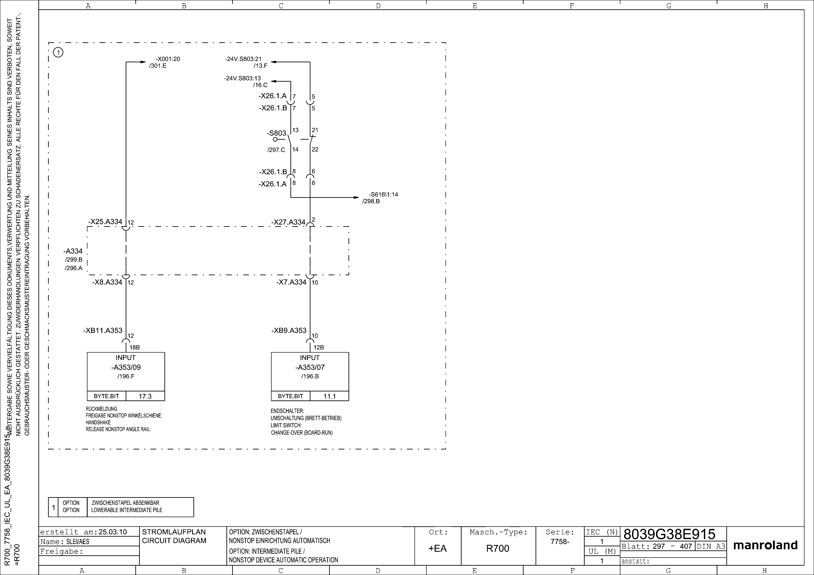

# +EA — Sheet 297 of 407 — OPTION: ZWISCHENSTAPEL /

**NONSTOP EINRICHTUNG AUTOMATISCH**

> Part of the manroland **R700** printing press IEC/UL circuit diagrams.
> Drawing class: **Stromlaufplan / Circuit diagram** (DIN A3).
> Document `+EA` covers the **Printing unit** machine section.

## At a glance

| Field | Value |
|---|---|
| Document | `+EA`  (8039G38E915) |
| Sheet | **297** of 407 |
| Section (DE) | OPTION: ZWISCHENSTAPEL / |
| Section (EN) | NONSTOP EINRICHTUNG AUTOMATISCH |
| Section type | CIRCUIT — Circuit diagram |
| Machine type | `R700` |
| Series | `7758` |
| Created | 25.03.10 |
| Replaces | — |
| Columns used | A, B, C, D |
| Path numbers | — |
| Labels on sheet | 67 |
| Cross-refs out | 9 |
| Cross-refs in | 23 |

**Previous:** [+EA sheet 296](SHEET_0296.md) · **Next:** [+EA sheet 298](SHEET_0298.md) · **Document TOC:** [_TOC.md](_TOC.md)  (+EA) · **Master TOC:** [all sheets](../_MASTER_TOC.md)

## Sheet image (300 DPI, exact vector render)



_Rendered directly from the PDF vector layer at 300 DPI (1-bit), no OCR and no resampling. Use it to confirm anything ambiguous in the text below._

## Cross-references on this sheet

Each entry is a wire leaving this sheet. The printed token is `/sheet.column`; the link resolves to that sheet inside the same document.

| Ref | Target sheet | Col | Path | Destination on target | Target section | From col |
|---|---|---|---|---|---|---|
| `/13.F` | [+EA sheet 13](SHEET_0013.md) | F | — | 24V.S803:21 | SPANNUNGSVERSORGUNG: 400V, 24V | C |
| `/301.E` | [+EA sheet 301](SHEET_0301.md) | E | — | — | OPTION: ZWISCHENSTAPEL / | B |
| `/16.C` | [+EA sheet 16](SHEET_0016.md) | C | — | 24V.S803:13 | SPANNUNGSVERSORGUNG: 400V, 24V | C |
| `/297.C` | [+EA sheet 297](SHEET_0297.md) | C | — | 22 | OPTION: ZWISCHENSTAPEL / | C |
| `/298.B` | [+EA sheet 298](SHEET_0298.md) | B | — | — | OPTION: ZWISCHENSTAPEL / | D |
| `/299.B` | [+EA sheet 299](SHEET_0299.md) | B | — | — | OPTION: ZWISCHENSTAPEL / | A |
| `/296.A` | [+EA sheet 296](SHEET_0296.md) | A | — | — | OPTION: ZWISCHENSTAPEL / | A |
| `/196.B` | [+EA sheet 196](SHEET_0196.md) | B | — | — | REFERENZMODUL | C |
| `/196.F` | [+EA sheet 196](SHEET_0196.md) | F | — | — | REFERENZMODUL | A |

### Incoming references (sheets that point here)

Every other sheet that sends a wire to this one. `Back-ref` is the token printed on *that* sheet; `Path` is its line number.

| From sheet | Cols | Back-ref | Path | Refs | What continues there |
|---|---|---|---|---|---|
| [+EA#13](SHEET_0013.md) | F | `/13.F` | — | 1 | 24V.S803:21 |
| [+EA#16](SHEET_0016.md) | C | `/16.C` | — | 1 | 24V.S803:13 |
| [+EA#196](SHEET_0196.md) | B, F | `/196.B`, `/196.F` | — | 2 | — |
| [+EA#246](SHEET_0246.md) | F | `/246.F` | — | 1 | — |
| [+EA#249](SHEET_0249.md) | D | `/249.D` | — | 1 | — |
| [+EA#252](SHEET_0252.md) | C | `/252.C` | — | 1 | — |
| [+EA#256](SHEET_0256.md) | A | `/256.A` | — | 1 | — |
| [+EA#267](SHEET_0267.md) | B | `/267.B` | — | 1 | — |
| [+EA#270](SHEET_0270.md) | A, B, F | `/270.A`, `/270.B`, `/270.F` | — | 9 | — |
| [+EA#296](SHEET_0296.md) | A | `/296.A` | — | 1 | — |
| [+EA#297](SHEET_0297.md) | C | `/297.C` | — | 1 | 22 |
| [+EA#298](SHEET_0298.md) | A | `/298.A` | — | 1 | S616\1:14 |
| [+EA#299](SHEET_0299.md) | A | `/299.A` | — | 1 | — |
| [+EA#301](SHEET_0301.md) | D | `/301.D` | — | 1 | X001:20 |


## Devices on this sheet

| Tag | Class | Class meaning (IEC) | Col | Sub | Terminal | Sign |
|---|---|---|---|---|---|---|
| `A334` | A | Baugruppe / assembly, module, PC board | A | — | — | — |
| `A353/09` | A | Baugruppe / assembly, module, PC board | A | 09 | — | — |
| `A353/07` | A | Baugruppe / assembly, module, PC board | C | 07 | — | — |
| `S803` | S | Schalter / switch | C | — | — | — |
| `X001:20` | X | Klemme / terminal, plug connector | B | — | 20 | — |
| `X8.A334` | — | cross-device reference | A | — | — | — |
| `X25.A334` | — | cross-device reference | A | — | — | — |
| `X7.A334` | — | cross-device reference | C | — | — | — |
| `X27.A334` | — | cross-device reference | C | — | — | — |
| `17.3` | — | cross-device reference | B | — | — | — |
| `XB11.A353` | — | cross-device reference | A | — | — | — |
| `11.1` | — | cross-device reference | D | — | — | — |
| `XB9.A353` | — | cross-device reference | C | — | — | — |
| `X26.1.B` | — | cross-device reference | C | — | — | — |
| `X26.1.A` | — | cross-device reference | C | — | — | — |
| `X26.1.B` | — | cross-device reference | C | — | — | — |
| `X26.1.A` | — | cross-device reference | C | — | — | — |

## Potentials / nets

| Potential | Count | Columns | Attached devices | Terminals |
|---|---|---|---|---|
| `24V` | 2 | C | `S803` | `13`, `21` |


A potential such as `L24+/4` or `M24+` is a named supply/return rail; every place it appears on this sheet is electrically common.

## Wire-end annotations (grouped as printed)

A wire that continues elsewhere is annotated with a small cluster: the destination description, the path/line number `#NN`, and the `/sheet.column` cross reference. Each row below is one such cluster exactly as it is grouped on the drawing.

| Col | Y | Path | Cross-ref | Text on the wire |
|---|---|---|---|---|
| A | 73.5 | — | — | `1` |
| B | 82.5 | — | — | `X001:20` |
| C | 82.5 | — | `/13.F` | `24V.S803:21` |
| B | 92.4 | — | `/301.E` | — |
| C | 110.8 | — | `/16.C` | `24V.S803:13` |
| C | 135.7 | — | — | `X26.1.A 7` |
| C | 137.8 | — | — | `5` |
| C | 153.4 | — | — | `X26.1.B 7` |
| C | 154.8 | — | — | `5` |
| C | 186.7 | — | — | `13` |
| C | 186.7 | — | — | `21` |
| C | 190.2 | — | — | `S803` |
| C | 215.1 | — | `/297.C` | `22` |
| C | 215.1 | — | — | `14` |
| C | 246.9 | — | — | `X26.1.B 8` |
| C | 246.9 | — | — | `6` |
| C | 263.9 | — | — | `X26.1.A 8` |
| C | 263.9 | — | — | `6` |
| D | 280.9 | — | — | `S616\1:14` |
| D | 290.8 | — | `/298.B` | — |
| C | 317.8 | — | — | `X27.A334 2` |
| A | 319.9 | — | — | `X25.A334 12` |
| A | 363.1 | — | — | `A334` |
| A | 376.2 | — | `/299.B`, `/296.A` | — |
| A | 408.5 | — | — | `X8.A334 12` |
| C | 408.5 | — | — | `X7.A334 10` |
| A | 479.4 | — | — | `XB11.A353 12` |
| C | 479.4 | — | — | `XB9.A353 10` |
| A | 504.9 | — | — | `18B` |
| C | 504.9 | — | — | `12B` |
| A | 519.4 | — | — | `INPUT` |
| C | 519.4 | — | — | `INPUT` |
| A | 533.2 | — | — | `A353/09` |
| C | 533.2 | — | — | `A353/07` |
| A | 547.0 | — | `/196.F` | — |
| C | 547.0 | — | `/196.B` | — |
| A | 576.1 | — | — | `BYTE.BIT 17.3` |
| C | 576.1 | — | — | `BYTE.BIT 11.1` |
| A | 596.0 | — | — | `RÜCKMELDUNG FREIGABE NONSTOP WINKELSCHIENE: HANDSHAKE RELEASE NONSTOP ANGLE RAIL:` |
| C | 598.7 | — | — | `ENDSCHALTER: UMSCHALTUNG (BRETT BETRIEB) LIMIT SWITCH:` |
| C | 630.7 | — | — | `CHANGE OVER (BOARD RUN)` |
| A | 733.4 | — | — | `1 OPTION OPTION` |
| A | 733.4 | — | — | `LOWERABLE INTERMEDIATE PILE ZWISCHENSTAPEL ABSENKBAR` |


## Reconstructed tables

This sheet carries tabular content (pin map / terminal assignment / index). The grid below was rebuilt from the drawing's own rule lines, so each row is exactly one physical row of the table.

### Table 1 — 1 data rows × 2 columns (at x=127.6, y=515.9)

| INPUT | A353/09 /196.F |
|---|---|
| `BYTE.BIT` | `17.3` |


### Table 2 — 3 data rows × 3 columns (at x=396.9, y=90.7)

| X26.1.A X26.1.B S803 /297.C X26.1.B X26.1.A | 7 7 13 14 8 8 | 5 5 21 22 6 6 |
|---|---|---|
| `X27.A334 XB9.A353` | `X7.A334` | `2 10 10 12B` |
|  | `INPUT` | `A353/07 /196.B` |
| `BYTE.BIT` |  | `11.1` |


## Notes and free text on this sheet

| Text | Col | Y (pt) |
|---|---|---|
| `18B` | A | 504.85 |
| `INPUT` | A | 519.38 |
| `BYTE.BIT` | A | 576.63 |
| `RÜCKMELDUNG` | A | 596.05 |
| `FREIGABE NONSTOP WINKELSCHIENE:` | A | 606 |
| `HANDSHAKE` | A | 615.95 |
| `RELEASE NONSTOP ANGLE RAIL:` | A | 625.9 |
| `12B` | C | 504.85 |
| `INPUT` | C | 519.38 |
| `BYTE.BIT` | C | 576.63 |
| `ENDSCHALTER:` | C | 598.73 |
| `UMSCHALTUNG (BRETT BETRIEB)` | C | 609.38 |
| `LIMIT SWITCH:` | C | 619.94 |
| `CHANGE OVER (BOARD RUN)` | C | 630.66 |
| `S616\1:14` | D | 280.92 |
| `OPTION` | A | 733.35 |
| `ZWISCHENSTAPEL ABSENKBAR` | A | 733.36 |
| `LOWERABLE INTERMEDIATE PILE` | A | 743.99 |

## Complete label inventory (exact text from the drawing)

Every text object inside the drawing area of this sheet, in DIN reading order (column A→H, then top→bottom). This is the authoritative list: if a string is not here it is not printed on this sheet.

| Col | Y | X | Dir | Type | Text |
|---|---|---|---|---|---|
| A | 73.5 | 83.3 | → | number | `1` |
| A | 319.9 | 129.0 | → | device ref | `X25.A334` |
| A | 322.1 | 186.2 | → | number | `12` |
| A | 363.1 | 92.7 | → | device tag | `A334` |
| A | 376.2 | 95.2 | → | cross-reference | `/299.B` |
| A | 388.6 | 95.0 | → | cross-reference | `/296.A` |
| A | 408.5 | 134.9 | → | device ref | `X8.A334` |
| A | 409.9 | 186.2 | → | number | `12` |
| A | 479.4 | 121.9 | → | device ref | `XB11.A353` |
| A | 487.9 | 186.2 | → | number | `12` |
| A | 504.9 | 189.1 | → | text | `18B` |
| A | 519.4 | 169.4 | → | text | `INPUT` |
| A | 533.2 | 162.9 | → | device tag | `A353/09` |
| A | 547.0 | 171.9 | → | cross-reference | `/196.F` |
| A | 576.6 | 137.5 | → | text | `BYTE.BIT` |
| A | 596.1 | 125.6 | → | text | `RÜCKMELDUNG` |
| A | 606.0 | 125.6 | → | text | `FREIGABE NONSTOP WINKELSCHIENE:` |
| A | 615.9 | 125.6 | → | text | `HANDSHAKE` |
| A | 625.9 | 125.6 | → | text | `RELEASE NONSTOP ANGLE RAIL:` |
| A | 733.4 | 91.8 | → | text | `OPTION` |
| A | 733.4 | 134.6 | → | text | `ZWISCHENSTAPEL ABSENKBAR` |
| A | 738.7 | 75.4 | → | number | `1` |
| A | 744.0 | 91.8 | → | text | `OPTION` |
| A | 744.0 | 133.8 | → | text | `LOWERABLE INTERMEDIATE PILE` |
| B | 82.5 | 227.9 | → | device tag | `X001:20` |
| B | 92.4 | 218.3 | → | cross-reference | `/301.E` |
| B | 576.1 | 202.8 | → | device ref | `17.3` |
| C | 82.5 | 329.4 | → | potential | `24V.S803:21` |
| C | 92.4 | 371.3 | → | cross-reference | `/13.F` |
| C | 110.8 | 328.0 | → | potential | `24V.S803:13` |
| C | 120.8 | 370.5 | → | cross-reference | `/16.C` |
| C | 135.7 | 378.1 | → | device ref | `X26.1.A` |
| C | 137.8 | 427.7 | → | number | `7` |
| C | 137.8 | 456.1 | → | number | `5` |
| C | 153.4 | 379.0 | → | device ref | `X26.1.B` |
| C | 154.8 | 427.7 | → | number | `7` |
| C | 154.8 | 456.1 | → | number | `5` |
| C | 186.7 | 427.2 | → | number | `13` |
| C | 186.7 | 456.1 | → | number | `21` |
| C | 190.2 | 390.3 | → | device tag | `S803` |
| C | 215.0 | 427.2 | → | number | `14` |
| C | 215.0 | 456.1 | → | number | `22` |
| C | 215.7 | 391.2 | → | cross-reference | `/297.C` |
| C | 246.9 | 379.0 | → | device ref | `X26.1.B` |
| C | 246.9 | 427.7 | → | number | `8` |
| C | 246.9 | 456.1 | → | number | `6` |
| C | 263.9 | 427.7 | → | number | `8` |
| C | 263.9 | 456.1 | → | number | `6` |
| C | 264.7 | 378.1 | → | device ref | `X26.1.A` |
| C | 317.8 | 456.1 | → | number | `2` |
| C | 320.6 | 396.9 | → | device ref | `X27.A334` |
| C | 408.5 | 404.2 | → | device ref | `X7.A334` |
| C | 409.9 | 455.5 | → | number | `10` |
| C | 479.4 | 397.1 | → | device ref | `XB9.A353` |
| C | 487.9 | 455.5 | → | number | `10` |
| C | 504.9 | 458.4 | → | text | `12B` |
| C | 519.4 | 438.7 | → | text | `INPUT` |
| C | 533.2 | 432.1 | → | device tag | `A353/07` |
| C | 547.0 | 440.9 | → | cross-reference | `/196.B` |
| C | 576.6 | 406.8 | → | text | `BYTE.BIT` |
| C | 598.7 | 396.0 | → | text | `ENDSCHALTER:` |
| C | 609.4 | 396.0 | → | text | `UMSCHALTUNG (BRETT BETRIEB)` |
| C | 619.9 | 396.0 | → | text | `LIMIT SWITCH:` |
| C | 630.7 | 396.6 | → | text | `CHANGE OVER (BOARD RUN)` |
| D | 280.9 | 539.7 | → | text | `S616\1:14` |
| D | 290.8 | 530.1 | → | cross-reference | `/298.B` |
| D | 576.1 | 473.0 | → | device ref | `11.1` |

## Reading-order text block

The same content as a plain block, grouped by DIN column — convenient to paste or to match against a visual description.

```text
=== Column A ===
  73.5   83.3  numeric      1
 319.9  129.0  devref       X25.A334
 322.1  186.2  numeric      12
 363.1   92.7  devtag       A334
 376.2   95.2  xref         /299.B
 388.6   95.0  xref         /296.A
 408.5  134.9  devref       X8.A334
 409.9  186.2  numeric      12
 479.4  121.9  devref       XB11.A353
 487.9  186.2  numeric      12
 504.9  189.1  text         18B
 519.4  169.4  text         INPUT
 533.2  162.9  devtag       A353/09
 547.0  171.9  xref         /196.F
 576.6  137.5  text         BYTE.BIT
 596.1  125.6  text         RÜCKMELDUNG
 606.0  125.6  text         FREIGABE NONSTOP WINKELSCHIENE:
 615.9  125.6  text         HANDSHAKE
 625.9  125.6  text         RELEASE NONSTOP ANGLE RAIL:
 733.4   91.8  text         OPTION
 733.4  134.6  text         ZWISCHENSTAPEL ABSENKBAR
 738.7   75.4  numeric      1
 744.0   91.8  text         OPTION
 744.0  133.8  text         LOWERABLE INTERMEDIATE PILE
=== Column B ===
  82.5  227.9  devtag       X001:20
  92.4  218.3  xref         /301.E
 576.1  202.8  devref       17.3
=== Column C ===
  82.5  329.4  net          24V.S803:21
  92.4  371.3  xref         /13.F
 110.8  328.0  net          24V.S803:13
 120.8  370.5  xref         /16.C
 135.7  378.1  devref       X26.1.A
 137.8  427.7  numeric      7
 137.8  456.1  numeric      5
 153.4  379.0  devref       X26.1.B
 154.8  427.7  numeric      7
 154.8  456.1  numeric      5
 186.7  427.2  numeric      13
 186.7  456.1  numeric      21
 190.2  390.3  devtag       S803
 215.0  427.2  numeric      14
 215.0  456.1  numeric      22
 215.7  391.2  xref         /297.C
 246.9  379.0  devref       X26.1.B
 246.9  427.7  numeric      8
 246.9  456.1  numeric      6
 263.9  427.7  numeric      8
 263.9  456.1  numeric      6
 264.7  378.1  devref       X26.1.A
 317.8  456.1  numeric      2
 320.6  396.9  devref       X27.A334
 408.5  404.2  devref       X7.A334
 409.9  455.5  numeric      10
 479.4  397.1  devref       XB9.A353
 487.9  455.5  numeric      10
 504.9  458.4  text         12B
 519.4  438.7  text         INPUT
 533.2  432.1  devtag       A353/07
 547.0  440.9  xref         /196.B
 576.6  406.8  text         BYTE.BIT
 598.7  396.0  text         ENDSCHALTER:
 609.4  396.0  text         UMSCHALTUNG (BRETT BETRIEB)
 619.9  396.0  text         LIMIT SWITCH:
 630.7  396.6  text         CHANGE OVER (BOARD RUN)
=== Column D ===
 280.9  539.7  text         S616\1:14
 290.8  530.1  xref         /298.B
 576.1  473.0  devref       11.1
```

---
_Generated from the PDF vector text layer; no OCR. Source: `R700_7758_IEC_UL_EA_8039G38E915_p`, sheet 297._
