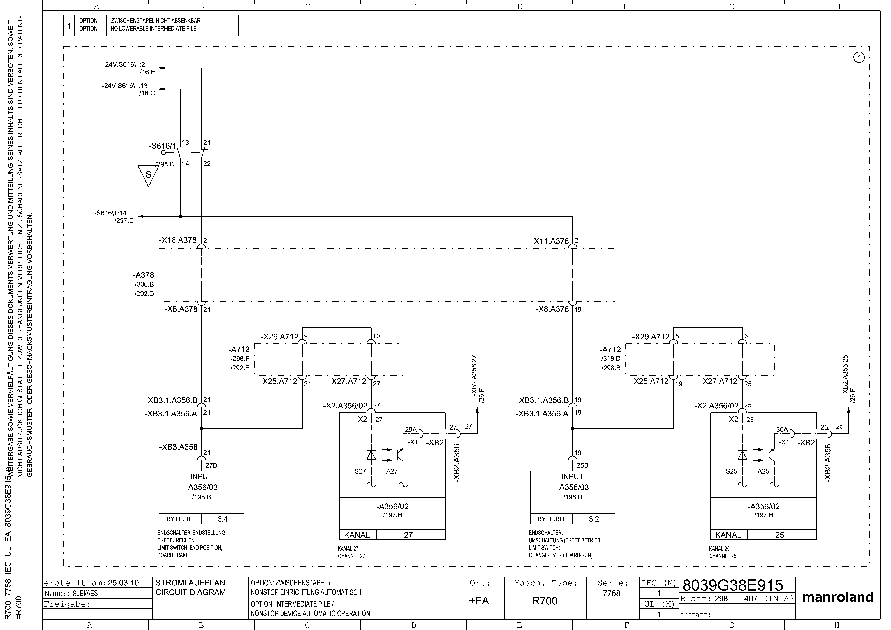

# +EA — Sheet 298 of 407 — OPTION: ZWISCHENSTAPEL /

**NONSTOP EINRICHTUNG AUTOMATISCH**

> Part of the manroland **R700** printing press IEC/UL circuit diagrams.
> Drawing class: **Stromlaufplan / Circuit diagram** (DIN A3).
> Document `+EA` covers the **Printing unit** machine section.

## At a glance

| Field | Value |
|---|---|
| Document | `+EA`  (8039G38E915) |
| Sheet | **298** of 407 |
| Section (DE) | OPTION: ZWISCHENSTAPEL / |
| Section (EN) | NONSTOP EINRICHTUNG AUTOMATISCH |
| Section type | CIRCUIT — Circuit diagram |
| Machine type | `R700` |
| Series | `7758` |
| Created | 25.03.10 |
| Replaces | — |
| Columns used | A, B, C, D, E, F, G, H |
| Path numbers | — |
| Labels on sheet | 121 |
| Cross-refs out | 16 |
| Cross-refs in | 38 |

**Previous:** [+EA sheet 297](SHEET_0297.md) · **Next:** [+EA sheet 299](SHEET_0299.md) · **Document TOC:** [_TOC.md](_TOC.md)  (+EA) · **Master TOC:** [all sheets](../_MASTER_TOC.md)

## Sheet image (300 DPI, exact vector render)



_Rendered directly from the PDF vector layer at 300 DPI (1-bit), no OCR and no resampling. Use it to confirm anything ambiguous in the text below._

## Cross-references on this sheet

Each entry is a wire leaving this sheet. The printed token is `/sheet.column`; the link resolves to that sheet inside the same document.

| Ref | Target sheet | Col | Path | Destination on target | Target section | From col |
|---|---|---|---|---|---|---|
| `/16.E` | [+EA sheet 16](SHEET_0016.md) | E | — | 24V.S616\1:21 | SPANNUNGSVERSORGUNG: 400V, 24V | A |
| `/16.C` | [+EA sheet 16](SHEET_0016.md) | C | — | 24V.S616\1:13 | SPANNUNGSVERSORGUNG: 400V, 24V | A |
| `/298.B` | [+EA sheet 298](SHEET_0298.md) | B | — | 22 | OPTION: ZWISCHENSTAPEL / | B |
| `/297.D` | [+EA sheet 297](SHEET_0297.md) | D | — | S616\1:14 | OPTION: ZWISCHENSTAPEL / | A |
| `/306.B` | [+EA sheet 306](SHEET_0306.md) | B | — | — | OPTION: ZWISCHENSTAPEL / | A |
| `/292.D` | [+EA sheet 292](SHEET_0292.md) | D | — | — | OPTION: PROBEBOGENENTNAHME HALBAUTOMATISCH | A |
| `/26.F` | [+EA sheet 26](SHEET_0026.md) | F | — | XB2.A356:27 | BUSVERBINDUNGEN: SICHERHEITSBUS | E |
| `/26.F` | [+EA sheet 26](SHEET_0026.md) | F | — | XB2.A356:25 | BUSVERBINDUNGEN: SICHERHEITSBUS | H |
| `/298.F` | [+EA sheet 298](SHEET_0298.md) | F | — | — | OPTION: ZWISCHENSTAPEL / | B |
| `/292.E` | [+EA sheet 292](SHEET_0292.md) | E | — | — | OPTION: PROBEBOGENENTNAHME HALBAUTOMATISCH | B |
| `/318.D` | [+EA sheet 318](SHEET_0318.md) | D | — | — | OPTION: LOGISTIK, AUSLEGER | F |
| `/298.B` | [+EA sheet 298](SHEET_0298.md) | B | — | — | OPTION: ZWISCHENSTAPEL / | F |
| `/198.B` | [+EA sheet 198](SHEET_0198.md) | B | — | — | REFERENZMODUL | B |
| `/198.B` | [+EA sheet 198](SHEET_0198.md) | B | — | — | REFERENZMODUL | F |
| `/197.H` | [+EA sheet 197](SHEET_0197.md) | H | — | — | REFERENZMODUL | D |
| `/197.H` | [+EA sheet 197](SHEET_0197.md) | H | — | — | REFERENZMODUL | G |

### Incoming references (sheets that point here)

Every other sheet that sends a wire to this one. `Back-ref` is the token printed on *that* sheet; `Path` is its line number.

| From sheet | Cols | Back-ref | Path | Refs | What continues there |
|---|---|---|---|---|---|
| [+EA#16](SHEET_0016.md) | C, E | `/16.C`, `/16.E` | — | 2 | 24V.S616\1:13; 24V.S616\1:21 |
| [+EA#26](SHEET_0026.md) | F | `/26.F` | — | 2 | XB2.A356:25; XB2.A356:27 |
| [+EA#197](SHEET_0197.md) | H | `/197.H` | — | 2 | — |
| [+EA#198](SHEET_0198.md) | B | `/198.B` | — | 2 | — |
| [+EA#225](SHEET_0225.md) | G | `/225.G` | — | 2 | — |
| [+EA#226](SHEET_0226.md) | F | `/226.F` | — | 2 | — |
| [+EA#234](SHEET_0234.md) | H | `/234.H` | — | 2 | — |
| [+EA#235](SHEET_0235.md) | A, B | `/235.A`, `/235.B` | — | 4 | — |
| [+EA#250](SHEET_0250.md) | D | `/250.D` | — | 2 | — |
| [+EA#256](SHEET_0256.md) | E | `/256.E` | — | 1 | — |
| [+EA#262](SHEET_0262.md) | G | `/262.G` | — | 1 | — |
| [+EA#268](SHEET_0268.md) | F | `/268.F` | — | 2 | — |
| [+EA#271](SHEET_0271.md) | H | `/271.H` | — | 2 | — |
| [+EA#274](SHEET_0274.md) | G | `/274.G` | — | 4 | — |
| [+EA#292](SHEET_0292.md) | D, E | `/292.D`, `/292.E` | — | 2 | — |
| [+EA#297](SHEET_0297.md) | D | `/297.D` | — | 1 | — |
| [+EA#298](SHEET_0298.md) | B, F | `/298.B`, `/298.F` | — | 3 | 22 |
| [+EA#306](SHEET_0306.md) | B | `/306.B` | — | 1 | — |
| [+EA#318](SHEET_0318.md) | D | `/318.D` | — | 1 | — |


## Devices on this sheet

| Tag | Class | Class meaning (IEC) | Col | Sub | Terminal | Sign |
|---|---|---|---|---|---|---|
| `A378` | A | Baugruppe / assembly, module, PC board | A | — | — | — |
| `S616/1` | S | Schalter / switch | B | 1 | — | — |
| `A356/03` | A | Baugruppe / assembly, module, PC board | B | 03 | — | — |
| `S27` | S | Schalter / switch | C | — | — | — |
| `A27` | A | Baugruppe / assembly, module, PC board | D | — | — | — |
| `X1` | X | Klemme / terminal, plug connector | D | — | — | — |
| `X2` | X | Klemme / terminal, plug connector | D | — | — | — |
| `XB2` | XB |  | D | — | — | — |
| `A356/02` | A | Baugruppe / assembly, module, PC board | D | 02 | — | — |
| `A712` | A | Baugruppe / assembly, module, PC board | B | — | — | — |
| `A356/03` | A | Baugruppe / assembly, module, PC board | F | 03 | — | — |
| `S25` | S | Schalter / switch | G | — | — | — |
| `A25` | A | Baugruppe / assembly, module, PC board | G | — | — | — |
| `X1` | X | Klemme / terminal, plug connector | G | — | — | — |
| `X2` | X | Klemme / terminal, plug connector | G | — | — | — |
| `XB2` | XB |  | H | — | — | — |
| `A356/02` | A | Baugruppe / assembly, module, PC board | G | 02 | — | — |
| `A712` | A | Baugruppe / assembly, module, PC board | F | — | — | — |
| `X16.A378` | — | cross-device reference | B | — | — | — |
| `X8.A378` | — | cross-device reference | B | — | — | — |
| `3.4` | — | cross-device reference | B | — | — | — |
| `XB3.A356` | — | cross-device reference | B | — | — | — |
| `XB3.1.A356.B` | — | cross-device reference | B | — | — | — |
| `XB3.1.A356.A` | — | cross-device reference | B | — | — | — |
| `XB2.A356` | — | cross-device reference | D | — | — | — |
| `X29.A712` | — | cross-device reference | C | — | — | — |
| `X27.A712` | — | cross-device reference | C | — | — | — |
| `X25.A712` | — | cross-device reference | C | — | — | — |
| `X8.A378` | — | cross-device reference | E | — | — | — |
| `X11.A378` | — | cross-device reference | E | — | — | — |
| `3.2` | — | cross-device reference | F | — | — | — |
| `XB3.1.A356.B` | — | cross-device reference | E | — | — | — |
| `XB3.1.A356.A` | — | cross-device reference | E | — | — | — |
| `XB2.A356` | — | cross-device reference | H | — | — | — |
| `X29.A712` | — | cross-device reference | F | — | — | — |
| `X27.A712` | — | cross-device reference | G | — | — | — |
| `X25.A712` | — | cross-device reference | F | — | — | — |
| `XB2.A356:27` | — | cross-device reference | E | — | 27 | — |
| `XB2.A356:25` | — | cross-device reference | H | — | 25 | — |

## Potentials / nets

| Potential | Count | Columns | Attached devices | Terminals |
|---|---|---|---|---|
| `24V` | 2 | A | `S616\1` | `13`, `21` |


A potential such as `L24+/4` or `M24+` is a named supply/return rail; every place it appears on this sheet is electrically common.

## Wire-end annotations (grouped as printed)

A wire that continues elsewhere is annotated with a small cluster: the destination description, the path/line number `#NN`, and the `/sheet.column` cross reference. Each row below is one such cluster exactly as it is grouped on the drawing.

| Col | Y | Path | Cross-ref | Text on the wire |
|---|---|---|---|---|
| A | 24.7 | — | — | `1 OPTION OPTION` |
| B | 24.7 | — | — | `NO LOWERABLE INTERMEDIATE PILE ZWISCHENSTAPEL NICHT ABSENKBAR` |
| H | 73.5 | — | — | `1` |
| A | 82.5 | — | `/16.E` | `24V.S616\1:21` |
| A | 110.8 | — | `/16.C` | `24V.S616\1:13` |
| B | 186.7 | — | — | `13` |
| B | 186.7 | — | — | `21` |
| B | 190.2 | — | — | `S616/1` |
| B | 215.1 | — | `/298.B` | `22` |
| B | 215.1 | — | — | `14` |
| A | 227.9 | — | — | `S` |
| A | 280.9 | — | `/297.D` | `S616\1:14` |
| B | 316.4 | — | — | `X16.A378 2` |
| E | 317.8 | — | — | `X11.A378 2` |
| A | 363.1 | — | — | `A378` |
| A | 376.2 | — | `/306.B`, `/292.D` | — |
| B | 408.5 | — | — | `X8.A378 21` |
| E | 408.5 | — | — | `X8.A378 19` |
| C | 445.3 | — | — | `X29.A712 9 10` |
| G | 445.3 | — | — | `X29.A712 5 6` |
| B | 462.4 | — | — | `A712` |
| F | 462.4 | — | — | `A712` |
| E | 474.2 | — | `/26.F` | `XB2.A356:27` |
| H | 474.2 | — | `/26.F` | `XB2.A356:25` |
| B | 475.4 | — | `/298.F`, `/292.E` | — |
| F | 475.4 | — | `/318.D`, `/298.B` | — |
| C | 504.9 | — | — | `X25.A712 21 X27.A712 27` |
| G | 504.9 | — | — | `X25.A712 19 X27.A712 25` |
| B | 530.4 | — | — | `XB3.1.A356.B 21` |
| E | 530.4 | — | — | `XB3.1.A356.B 19` |
| C | 537.5 | — | — | `X2.A356/02 27` |
| G | 537.5 | — | — | `X2.A356/02 25` |
| B | 547.4 | — | — | `XB3.1.A356.A 21` |
| E | 547.4 | — | — | `XB3.1.A356.A 19` |
| D | 555.9 | — | — | `X2` |
| G | 555.9 | — | — | `X2` |
| D | 557.3 | — | — | `27 27` |
| H | 557.3 | — | — | `25 25` |
| E | 565.8 | — | — | `27` |
| H | 565.8 | — | — | `25` |
| D | 570.0 | — | — | `29A` |
| G | 570.0 | — | — | `30A` |
| D | 587.1 | — | — | `X1` |
| D | 587.1 | — | — | `XB2` |
| G | 587.1 | — | — | `X1` |
| H | 587.1 | — | — | `XB2` |
| B | 592.8 | — | — | `XB3.A356 21` |
| D | 593.3 | — | — | `XB2.A356` |
| H | 593.3 | — | — | `XB2.A356` |
| F | 601.3 | — | — | `19` |
| B | 618.2 | — | — | `27B` |
| F | 618.2 | — | — | `25B` |
| D | 626.0 | — | — | `S27 A27` |
| G | 626.0 | — | — | `S25 A25` |
| B | 632.8 | — | — | `INPUT` |
| E | 632.8 | — | — | `INPUT` |
| B | 646.6 | — | — | `A356/03` |
| F | 646.6 | — | — | `A356/03` |
| B | 660.4 | — | `/198.B` | — |
| F | 660.4 | — | `/198.B` | — |
| D | 672.1 | — | — | `A356/02` |
| G | 672.1 | — | — | `A356/02` |
| D | 684.5 | — | `/197.H` | — |
| G | 684.5 | — | `/197.H` | — |
| B | 689.4 | — | — | `BYTE.BIT 3.4` |
| E | 689.4 | — | — | `BYTE.BIT 3.2` |
| B | 709.4 | — | — | `ENDSCHALTER: ENDSTELLUNG, BRETT / RECHEN LIMIT SWITCH: END POSITION, BOARD / RAKE` |
| E | 709.4 | — | — | `ENDSCHALTER: UMSCHALTUNG (BRETT BETRIEB) LIMIT SWITCH: CHANGE OVER (BOARD RUN)` |
| D | 710.4 | — | — | `KANAL 27` |
| G | 710.4 | — | — | `KANAL 25` |
| C | 730.7 | — | — | `KANAL 27 CHANNEL 27` |
| G | 730.7 | — | — | `KANAL 25 CHANNEL 25` |


## Reconstructed tables

This sheet carries tabular content (pin map / terminal assignment / index). The grid below was rebuilt from the drawing's own rule lines, so each row is exactly one physical row of the table.

### Table 1 — 8 data rows × 20 columns (at x=212.6, y=90.7)

| S616/1 /298.B | 13 14 | 21 22 |  |  |  |  |  |  |  |  |  |  |  |  |  |  |  |  |  |
|---|---|---|---|---|---|---|---|---|---|---|---|---|---|---|---|---|---|---|---|
| `X16.A378` | `X8.A378` | `2 21` |  |  |  |  |  |  |  |  | `X11.A378 X8.A378` | `2 19` |  |  |  |  |  |  |  |
| `XB3.1.A356.B` |  | `A712 /298.F /292.E 21` | `X29.A712 X25.A712` | `9 21` | `X27.A712 X2.A356/02` | `10 27 27` |  |  | `XB2.A356:27` | `/26.F` | `XB3.1.A356.B` | `A712 /318.D /298.B 19` | `X29.A712 X25.A712` | `5 19` | `X27.A712 X2.A356/02` | `6 25 25` |  |  | `XB2.A356:25` |
| `XB3.1.A356.A` |  | `21` |  |  | `X2` | `27` |  |  | `27 27` |  | `XB3.1.A356.A` | `19` |  |  | `X2` | `25` |  |  | `25 25` |
| `XB3.A356` |  | `21 27B` |  |  |  |  | `29A X1` | `XB2` | `XB2.A356` |  |  | `19 25B` |  |  |  |  | `30A X1` | `XB2` | `XB2.A356` |
|  | `INPUT` | `A356/03` |  |  | `S27` | `A27` |  |  |  |  | `INPUT` | `A356/03` |  |  | `S25` | `A25` |  |  |  |
|  |  | `/198.B` |  |  |  | `A356/02` |  |  |  |  |  | `/198.B` |  |  |  | `A356/02` |  |  |  |
| `BYTE.BIT` |  | `3.4` |  |  |  | `/197.H` |  |  |  |  | `BYTE.BIT` | `3.2` |  |  |  | `/197.H` |  |  |  |
| `ENDSCHALTER:` |  | `ENDSTELLUNG,` |  |  | `KANAL` |  | `27` |  |  |  | `ENDSCHALTER:` |  |  |  | `KANAL` |  | `25` |  |  |


## Notes and free text on this sheet

| Text | Col | Y (pt) |
|---|---|---|
| `27B` | B | 618.24 |
| `INPUT` | B | 632.76 |
| `BYTE.BIT` | B | 690.01 |
| `ENDSCHALTER: ENDSTELLUNG,` | B | 709.43 |
| `BRETT / RECHEN` | B | 719.36 |
| `LIMIT SWITCH: END POSITION,` | B | 729.33 |
| `BOARD / RAKE` | B | 739.28 |
| `KANAL 27` | C | 730.71 |
| `CHANNEL 27` | C | 740.65 |
| `29A` | D | 570.05 |
| `KANAL` | C | 710.38 |
| `X2.A356/02` | C | 537.47 |
| `25B` | F | 618.24 |
| `INPUT` | E | 632.76 |
| `BYTE.BIT` | E | 690.01 |
| `ENDSCHALTER:` | E | 709.42 |
| `UMSCHALTUNG (BRETT BETRIEB)` | E | 719.37 |
| `LIMIT SWITCH:` | E | 729.31 |
| `CHANGE OVER (BOARD RUN)` | E | 739.27 |
| `KANAL 25` | G | 730.71 |
| `CHANNEL 25` | G | 740.65 |
| `30A` | G | 570.05 |
| `KANAL` | G | 710.38 |
| `X2.A356/02` | G | 537.47 |
| `S616\1:14` | A | 280.92 |
| `S` | A | 227.86 |
| `OPTION` | A | 24.69 |
| `ZWISCHENSTAPEL NICHT ABSENKBAR` | B | 24.71 |
| `NO LOWERABLE INTERMEDIATE PILE` | B | 35.33 |

## Complete label inventory (exact text from the drawing)

Every text object inside the drawing area of this sheet, in DIN reading order (column A→H, then top→bottom). This is the authoritative list: if a string is not here it is not printed on this sheet.

| Col | Y | X | Dir | Type | Text |
|---|---|---|---|---|---|
| A | 24.7 | 106.0 | → | text | `OPTION` |
| A | 30.0 | 89.6 | → | number | `1` |
| A | 35.3 | 106.0 | → | text | `OPTION` |
| A | 82.5 | 137.8 | → | potential | `24V.S616\1:21` |
| A | 92.4 | 186.8 | → | cross-reference | `/16.E` |
| A | 110.8 | 136.3 | → | potential | `24V.S616\1:13` |
| A | 120.8 | 186.2 | → | cross-reference | `/16.C` |
| A | 227.9 | 194.3 | → | text | `S` |
| A | 280.9 | 126.1 | → | text | `S616\1:14` |
| A | 290.8 | 153.1 | → | cross-reference | `/297.D` |
| A | 363.1 | 177.7 | → | device tag | `A378` |
| A | 376.2 | 180.3 | → | cross-reference | `/306.B` |
| A | 388.6 | 180.0 | → | cross-reference | `/292.D` |
| B | 24.7 | 148.8 | → | text | `ZWISCHENSTAPEL NICHT ABSENKBAR` |
| B | 35.3 | 148.0 | → | text | `NO LOWERABLE INTERMEDIATE PILE` |
| B | 186.7 | 242.9 | → | number | `13` |
| B | 186.7 | 271.8 | → | number | `21` |
| B | 190.2 | 198.7 | → | device tag | `S616/1` |
| B | 215.0 | 242.9 | → | number | `14` |
| B | 215.0 | 271.8 | → | number | `22` |
| B | 215.7 | 207.2 | → | cross-reference | `/298.B` |
| B | 316.4 | 212.6 | → | device ref | `X16.A378` |
| B | 317.8 | 271.8 | → | number | `2` |
| B | 408.5 | 220.0 | → | device ref | `X8.A378` |
| B | 409.9 | 271.8 | → | number | `21` |
| B | 462.3 | 305.3 | → | device tag | `A712` |
| B | 475.4 | 308.4 | → | cross-reference | `/298.F` |
| B | 487.8 | 308.1 | → | cross-reference | `/292.E` |
| B | 530.4 | 194.2 | → | device ref | `XB3.1.A356.B` |
| B | 530.4 | 271.8 | → | number | `21` |
| B | 547.4 | 271.8 | → | number | `21` |
| B | 548.1 | 193.3 | → | device ref | `XB3.1.A356.A` |
| B | 592.7 | 212.9 | → | device ref | `XB3.A356` |
| B | 601.3 | 271.8 | → | number | `21` |
| B | 618.2 | 274.7 | → | text | `27B` |
| B | 632.8 | 254.4 | → | text | `INPUT` |
| B | 646.6 | 247.9 | → | device tag | `A356/03` |
| B | 660.4 | 256.7 | → | cross-reference | `/198.B` |
| B | 689.4 | 290.8 | → | device ref | `3.4` |
| B | 690.0 | 222.5 | → | text | `BYTE.BIT` |
| B | 709.4 | 210.6 | → | text | `ENDSCHALTER: ENDSTELLUNG,` |
| B | 719.4 | 210.6 | → | text | `BRETT / RECHEN` |
| B | 729.3 | 210.6 | → | text | `LIMIT SWITCH: END POSITION,` |
| B | 739.3 | 210.6 | → | text | `BOARD / RAKE` |
| C | 445.3 | 348.7 | → | device ref | `X29.A712` |
| C | 445.4 | 406.5 | → | number | `9` |
| C | 504.9 | 347.2 | → | device ref | `X25.A712` |
| C | 504.9 | 439.4 | → | device ref | `X27.A712` |
| C | 509.1 | 406.5 | → | number | `21` |
| C | 537.5 | 432.0 | → | text | `X2.A356/02` |
| C | 626.1 | 470.8 | → | device tag | `S27` |
| C | 710.4 | 459.8 | → | text | `KANAL` |
| C | 730.7 | 451.6 | → | text | `KANAL 27` |
| C | 740.6 | 451.8 | → | text | `CHANNEL 27` |
| D | 445.4 | 498.0 | → | number | `10` |
| D | 509.1 | 498.6 | → | number | `27` |
| D | 537.5 | 498.6 | → | number | `27` |
| D | 555.9 | 474.5 | → | device tag | `X2` |
| D | 557.3 | 501.4 | → | number | `27` |
| D | 567.3 | 600.7 | → | number | `27` |
| D | 570.1 | 541.4 | → | text | `29A` |
| D | 587.1 | 545.1 | → | device tag | `X1` |
| D | 587.1 | 569.5 | → | device tag | `XB2` |
| D | 593.3 | 605.5 | ↕ | device ref | `XB2.A356` |
| D | 626.1 | 513.4 | → | device tag | `A27` |
| D | 672.1 | 503.0 | → | device tag | `A356/02` |
| D | 684.5 | 511.9 | → | cross-reference | `/197.H` |
| D | 710.3 | 539.9 | → | number | `27` |
| E | 317.8 | 710.1 | → | device ref | `X11.A378` |
| E | 408.5 | 716.0 | → | device ref | `X8.A378` |
| E | 474.2 | 629.6 | ↕ | device ref | `XB2.A356:27` |
| E | 518.5 | 639.5 | ↕ | cross-reference | `/26.F` |
| E | 530.4 | 690.2 | → | device ref | `XB3.1.A356.B` |
| E | 548.1 | 689.4 | → | device ref | `XB3.1.A356.A` |
| E | 565.8 | 621.4 | → | number | `27` |
| E | 632.8 | 750.5 | → | text | `INPUT` |
| E | 690.0 | 718.6 | → | text | `BYTE.BIT` |
| E | 709.4 | 706.7 | → | text | `ENDSCHALTER:` |
| E | 719.4 | 706.7 | → | text | `UMSCHALTUNG (BRETT BETRIEB)` |
| E | 729.3 | 706.7 | → | text | `LIMIT SWITCH:` |
| E | 739.3 | 707.0 | → | text | `CHANGE OVER (BOARD RUN)` |
| F | 317.8 | 767.9 | → | number | `2` |
| F | 409.9 | 767.3 | → | number | `19` |
| F | 445.3 | 844.7 | → | device ref | `X29.A712` |
| F | 445.4 | 902.6 | → | number | `5` |
| F | 462.3 | 801.4 | → | device tag | `A712` |
| F | 475.4 | 803.6 | → | cross-reference | `/318.D` |
| F | 487.8 | 803.9 | → | cross-reference | `/298.B` |
| F | 504.9 | 843.3 | → | device ref | `X25.A712` |
| F | 509.1 | 902.0 | → | number | `19` |
| F | 530.4 | 767.3 | → | number | `19` |
| F | 547.4 | 767.3 | → | number | `19` |
| F | 601.3 | 767.3 | → | number | `19` |
| F | 618.2 | 770.7 | → | text | `25B` |
| F | 646.6 | 744.0 | → | device tag | `A356/03` |
| F | 660.4 | 752.7 | → | cross-reference | `/198.B` |
| F | 689.4 | 786.9 | → | device ref | `3.2` |
| G | 445.4 | 994.7 | → | number | `6` |
| G | 504.9 | 935.4 | → | device ref | `X27.A712` |
| G | 509.1 | 994.7 | → | number | `25` |
| G | 537.5 | 928.1 | → | text | `X2.A356/02` |
| G | 537.5 | 994.7 | → | number | `25` |
| G | 555.9 | 970.6 | → | device tag | `X2` |
| G | 557.3 | 997.5 | → | number | `25` |
| G | 570.1 | 1037.5 | → | text | `30A` |
| G | 587.1 | 1041.2 | → | device tag | `X1` |
| G | 626.1 | 966.9 | → | device tag | `S25` |
| G | 626.1 | 1009.4 | → | device tag | `A25` |
| G | 672.1 | 999.1 | → | device tag | `A356/02` |
| G | 684.5 | 1008.0 | → | cross-reference | `/197.H` |
| G | 710.3 | 1035.9 | → | number | `25` |
| G | 710.4 | 955.8 | → | text | `KANAL` |
| G | 730.7 | 947.6 | → | text | `KANAL 25` |
| G | 740.6 | 947.9 | → | text | `CHANNEL 25` |
| H | 73.5 | 1146.3 | → | number | `1` |
| H | 474.2 | 1125.6 | ↕ | device ref | `XB2.A356:25` |
| H | 518.5 | 1135.5 | ↕ | cross-reference | `/26.F` |
| H | 565.8 | 1117.4 | → | number | `25` |
| H | 567.3 | 1096.7 | → | number | `25` |
| H | 587.1 | 1065.5 | → | device tag | `XB2` |
| H | 593.3 | 1101.6 | ↕ | device ref | `XB2.A356` |

## Reading-order text block

The same content as a plain block, grouped by DIN column — convenient to paste or to match against a visual description.

```text
=== Column A ===
  24.7  106.0  text         OPTION
  30.0   89.6  numeric      1
  35.3  106.0  text         OPTION
  82.5  137.8  net          24V.S616\1:21
  92.4  186.8  xref         /16.E
 110.8  136.3  net          24V.S616\1:13
 120.8  186.2  xref         /16.C
 227.9  194.3  text         S
 280.9  126.1  text         S616\1:14
 290.8  153.1  xref         /297.D
 363.1  177.7  devtag       A378
 376.2  180.3  xref         /306.B
 388.6  180.0  xref         /292.D
=== Column B ===
  24.7  148.8  text         ZWISCHENSTAPEL NICHT ABSENKBAR
  35.3  148.0  text         NO LOWERABLE INTERMEDIATE PILE
 186.7  242.9  numeric      13
 186.7  271.8  numeric      21
 190.2  198.7  devtag       S616/1
 215.0  242.9  numeric      14
 215.0  271.8  numeric      22
 215.7  207.2  xref         /298.B
 316.4  212.6  devref       X16.A378
 317.8  271.8  numeric      2
 408.5  220.0  devref       X8.A378
 409.9  271.8  numeric      21
 462.3  305.3  devtag       A712
 475.4  308.4  xref         /298.F
 487.8  308.1  xref         /292.E
 530.4  194.2  devref       XB3.1.A356.B
 530.4  271.8  numeric      21
 547.4  271.8  numeric      21
 548.1  193.3  devref       XB3.1.A356.A
 592.7  212.9  devref       XB3.A356
 601.3  271.8  numeric      21
 618.2  274.7  text         27B
 632.8  254.4  text         INPUT
 646.6  247.9  devtag       A356/03
 660.4  256.7  xref         /198.B
 689.4  290.8  devref       3.4
 690.0  222.5  text         BYTE.BIT
 709.4  210.6  text         ENDSCHALTER: ENDSTELLUNG,
 719.4  210.6  text         BRETT / RECHEN
 729.3  210.6  text         LIMIT SWITCH: END POSITION,
 739.3  210.6  text         BOARD / RAKE
=== Column C ===
 445.3  348.7  devref       X29.A712
 445.4  406.5  numeric      9
 504.9  347.2  devref       X25.A712
 504.9  439.4  devref       X27.A712
 509.1  406.5  numeric      21
 537.5  432.0  text         X2.A356/02
 626.1  470.8  devtag       S27
 710.4  459.8  text         KANAL
 730.7  451.6  text         KANAL 27
 740.6  451.8  text         CHANNEL 27
=== Column D ===
 445.4  498.0  numeric      10
 509.1  498.6  numeric      27
 537.5  498.6  numeric      27
 555.9  474.5  devtag       X2
 557.3  501.4  numeric      27
 567.3  600.7  numeric      27
 570.1  541.4  text         29A
 587.1  545.1  devtag       X1
 587.1  569.5  devtag       XB2
 593.3  605.5  devref       XB2.A356
 626.1  513.4  devtag       A27
 672.1  503.0  devtag       A356/02
 684.5  511.9  xref         /197.H
 710.3  539.9  numeric      27
=== Column E ===
 317.8  710.1  devref       X11.A378
 408.5  716.0  devref       X8.A378
 474.2  629.6  devref       XB2.A356:27
 518.5  639.5  xref         /26.F
 530.4  690.2  devref       XB3.1.A356.B
 548.1  689.4  devref       XB3.1.A356.A
 565.8  621.4  numeric      27
 632.8  750.5  text         INPUT
 690.0  718.6  text         BYTE.BIT
 709.4  706.7  text         ENDSCHALTER:
 719.4  706.7  text         UMSCHALTUNG (BRETT BETRIEB)
 729.3  706.7  text         LIMIT SWITCH:
 739.3  707.0  text         CHANGE OVER (BOARD RUN)
=== Column F ===
 317.8  767.9  numeric      2
 409.9  767.3  numeric      19
 445.3  844.7  devref       X29.A712
 445.4  902.6  numeric      5
 462.3  801.4  devtag       A712
 475.4  803.6  xref         /318.D
 487.8  803.9  xref         /298.B
 504.9  843.3  devref       X25.A712
 509.1  902.0  numeric      19
 530.4  767.3  numeric      19
 547.4  767.3  numeric      19
 601.3  767.3  numeric      19
 618.2  770.7  text         25B
 646.6  744.0  devtag       A356/03
 660.4  752.7  xref         /198.B
 689.4  786.9  devref       3.2
=== Column G ===
 445.4  994.7  numeric      6
 504.9  935.4  devref       X27.A712
 509.1  994.7  numeric      25
 537.5  928.1  text         X2.A356/02
 537.5  994.7  numeric      25
 555.9  970.6  devtag       X2
 557.3  997.5  numeric      25
 570.1 1037.5  text         30A
 587.1 1041.2  devtag       X1
 626.1  966.9  devtag       S25
 626.1 1009.4  devtag       A25
 672.1  999.1  devtag       A356/02
 684.5 1008.0  xref         /197.H
 710.3 1035.9  numeric      25
 710.4  955.8  text         KANAL
 730.7  947.6  text         KANAL 25
 740.6  947.9  text         CHANNEL 25
=== Column H ===
  73.5 1146.3  numeric      1
 474.2 1125.6  devref       XB2.A356:25
 518.5 1135.5  xref         /26.F
 565.8 1117.4  numeric      25
 567.3 1096.7  numeric      25
 587.1 1065.5  devtag       XB2
 593.3 1101.6  devref       XB2.A356
```

---
_Generated from the PDF vector text layer; no OCR. Source: `R700_7758_IEC_UL_EA_8039G38E915_p`, sheet 298._
