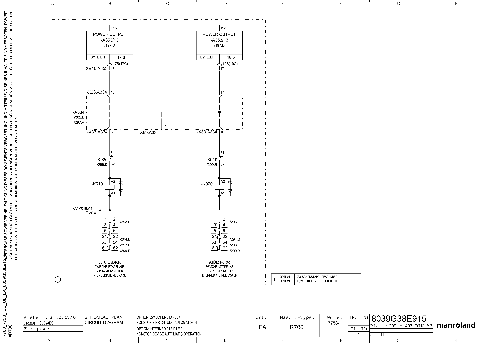

# +EA — Sheet 299 of 407 — OPTION: ZWISCHENSTAPEL /

**NONSTOP EINRICHTUNG AUTOMATISCH**

> Part of the manroland **R700** printing press IEC/UL circuit diagrams.
> Drawing class: **Stromlaufplan / Circuit diagram** (DIN A3).
> Document `+EA` covers the **Printing unit** machine section.

## At a glance

| Field | Value |
|---|---|
| Document | `+EA`  (8039G38E915) |
| Sheet | **299** of 407 |
| Section (DE) | OPTION: ZWISCHENSTAPEL / |
| Section (EN) | NONSTOP EINRICHTUNG AUTOMATISCH |
| Section type | CIRCUIT — Circuit diagram |
| Machine type | `R700` |
| Series | `7758` |
| Created | 25.03.10 |
| Replaces | — |
| Columns used | A, B, C, D, E, F |
| Path numbers | — |
| Labels on sheet | 91 |
| Cross-refs out | 15 |
| Cross-refs in | 22 |

**Previous:** [+EA sheet 298](SHEET_0298.md) · **Next:** [+EA sheet 300](SHEET_0300.md) · **Document TOC:** [_TOC.md](_TOC.md)  (+EA) · **Master TOC:** [all sheets](../_MASTER_TOC.md)

## Sheet image (300 DPI, exact vector render)



_Rendered directly from the PDF vector layer at 300 DPI (1-bit), no OCR and no resampling. Use it to confirm anything ambiguous in the text below._

## Cross-references on this sheet

Each entry is a wire leaving this sheet. The printed token is `/sheet.column`; the link resolves to that sheet inside the same document.

| Ref | Target sheet | Col | Path | Destination on target | Target section | From col |
|---|---|---|---|---|---|---|
| `/197.D` | [+EA sheet 197](SHEET_0197.md) | D | — | — | REFERENZMODUL | B |
| `/197.D` | [+EA sheet 197](SHEET_0197.md) | D | — | — | REFERENZMODUL | D |
| `/302.E` | [+EA sheet 302](SHEET_0302.md) | E | — | — | OPTION: ZWISCHENSTAPEL / | A |
| `/297.A` | [+EA sheet 297](SHEET_0297.md) | A | — | — | OPTION: ZWISCHENSTAPEL / | A |
| `/299.B` | [+EA sheet 299](SHEET_0299.md) | B | — | — | OPTION: ZWISCHENSTAPEL / | D |
| `/299.D` | [+EA sheet 299](SHEET_0299.md) | D | — | — | OPTION: ZWISCHENSTAPEL / | B |
| `/107.E` | [+EA sheet 107](SHEET_0107.md) | E | — | 0V.K019:A1 | BOGENGLÄTTER | B |
| `/293.B` | [+EA sheet 293](SHEET_0293.md) | B | — | — | OPTION: ZWISCHENSTAPEL / | B |
| `/293.C` | [+EA sheet 293](SHEET_0293.md) | C | — | — | OPTION: ZWISCHENSTAPEL / | D |
| `/294.E` | [+EA sheet 294](SHEET_0294.md) | E | — | — | OPTION: ZWISCHENSTAPEL / | B |
| `/294.B` | [+EA sheet 294](SHEET_0294.md) | B | — | — | OPTION: ZWISCHENSTAPEL / | D |
| `/293.E` | [+EA sheet 293](SHEET_0293.md) | E | — | — | OPTION: ZWISCHENSTAPEL / | B |
| `/293.F` | [+EA sheet 293](SHEET_0293.md) | F | — | — | OPTION: ZWISCHENSTAPEL / | D |
| `/299.B` | [+EA sheet 299](SHEET_0299.md) | B | — | — | OPTION: ZWISCHENSTAPEL / | D |
| `/299.D` | [+EA sheet 299](SHEET_0299.md) | D | — | — | OPTION: ZWISCHENSTAPEL / | B |

### Incoming references (sheets that point here)

Every other sheet that sends a wire to this one. `Back-ref` is the token printed on *that* sheet; `Path` is its line number.

| From sheet | Cols | Back-ref | Path | Refs | What continues there |
|---|---|---|---|---|---|
| [+EA#107](SHEET_0107.md) | E | `/107.E` | — | 1 | 0V.K012:A1 0V.K668:A1 |
| [+EA#197](SHEET_0197.md) | D | `/197.D` | — | 2 | — |
| [+EA#260](SHEET_0260.md) | F | `/260.F` | — | 2 | — |
| [+EA#265](SHEET_0265.md) | A | `/265.A` | — | 2 | — |
| [+EA#277](SHEET_0277.md) | B | `/277.B` | — | 2 | — |
| [+EA#285](SHEET_0285.md) | E | `/285.E` | — | 1 | — |
| [+EA#293](SHEET_0293.md) | B, E, F | `/293.B`, `/293.E`, `/293.F` | — | 4 | — |
| [+EA#294](SHEET_0294.md) | B, E | `/294.B`, `/294.E` | — | 2 | — |
| [+EA#297](SHEET_0297.md) | A | `/297.A` | — | 1 | — |
| [+EA#299](SHEET_0299.md) | B, D | `/299.B`, `/299.D` | — | 4 | — |
| [+EA#302](SHEET_0302.md) | D | `/302.D` | — | 1 | — |


## Devices on this sheet

| Tag | Class | Class meaning (IEC) | Col | Sub | Terminal | Sign |
|---|---|---|---|---|---|---|
| `A353/13` | A | Baugruppe / assembly, module, PC board | D | 13 | — | — |
| `A334` | A | Baugruppe / assembly, module, PC board | A | — | — | — |
| `A353/13` | A | Baugruppe / assembly, module, PC board | B | 13 | — | — |
| `A2` | A | Baugruppe / assembly, module, PC board | B | — | — | — |
| `A1` | A | Baugruppe / assembly, module, PC board | B | — | — | — |
| `K019` | K | Relais / relay, contactor | B | — | — | — |
| `A2` | A | Baugruppe / assembly, module, PC board | D | — | — | — |
| `A1` | A | Baugruppe / assembly, module, PC board | D | — | — | — |
| `K020` | K | Relais / relay, contactor | D | — | — | — |
| `K020` | K | Relais / relay, contactor | B | — | — | — |
| `K019` | K | Relais / relay, contactor | D | — | — | — |
| `18.0` | — | cross-device reference | D | — | — | — |
| `XB15.A353` | — | cross-device reference | B | — | — | — |
| `X23.A334` | — | cross-device reference | B | — | — | — |
| `X33.A334` | — | cross-device reference | B | — | — | — |
| `X33.A334` | — | cross-device reference | D | — | — | — |
| `17.6` | — | cross-device reference | B | — | — | — |
| `X69.A334` | — | cross-device reference | C | — | — | — |

## Potentials / nets

| Potential | Count | Columns | Attached devices | Terminals |
|---|---|---|---|---|
| `0V` | 1 | B | `K019` | `A1` |


A potential such as `L24+/4` or `M24+` is a named supply/return rail; every place it appears on this sheet is electrically common.

## Wire-end annotations (grouped as printed)

A wire that continues elsewhere is annotated with a small cluster: the destination description, the path/line number `#NN`, and the `/sheet.column` cross reference. Each row below is one such cluster exactly as it is grouped on the drawing.

| Col | Y | Path | Cross-ref | Text on the wire |
|---|---|---|---|---|
| B | 64.8 | — | — | `17A` |
| D | 64.8 | — | — | `19A` |
| B | 79.9 | — | — | `POWER OUTPUT` |
| D | 79.9 | — | — | `POWER OUTPUT` |
| B | 93.8 | — | — | `A353/13` |
| D | 93.8 | — | — | `A353/13` |
| B | 107.7 | — | `/197.D` | — |
| D | 107.7 | — | `/197.D` | — |
| B | 136.7 | — | — | `BYTE.BIT 17.6` |
| D | 136.7 | — | — | `BYTE.BIT 18.0` |
| B | 152.7 | — | — | `17B(17C)` |
| D | 152.7 | — | — | `19B(19C)` |
| C | 163.3 | — | — | `XB15.A353 15 17` |
| C | 221.4 | — | — | `X23.A334 15 17` |
| A | 271.0 | — | — | `A334` |
| A | 284.1 | — | `/302.E`, `/297.A` | — |
| C | 307.2 | — | — | `2` |
| C | 319.2 | — | — | `X33.A334 8 X33.A334 10` |
| C | 320.6 | — | — | `X69.A334` |
| B | 370.9 | — | — | `61` |
| D | 370.9 | — | — | `61` |
| B | 387.2 | — | — | `K020 62` |
| D | 387.2 | — | — | `K019 62` |
| B | 400.3 | — | `/299.D` | — |
| D | 400.3 | — | `/299.B` | — |
| B | 441.8 | — | — | `A2` |
| D | 441.8 | — | — | `A2` |
| B | 446.8 | — | — | `K019` |
| D | 446.8 | — | — | `K020` |
| B | 470.1 | — | — | `A1` |
| D | 470.1 | — | — | `A1` |
| B | 507.7 | — | `/107.E` | `0V.K019:A1` |
| B | 533.2 | — | — | `53 21 61 3 5 1` |
| B | 533.2 | — | — | `54 2 4 6 22 62` |
| D | 533.2 | — | — | `53 21 61 3 5 1` |
| D | 533.2 | — | — | `54 2 4 6 22 62` |
| B | 541.0 | — | `/293.B` | — |
| D | 541.0 | — | `/293.C` | — |
| B | 583.5 | — | `/294.E` | — |
| D | 583.5 | — | `/294.B` | — |
| B | 597.7 | — | `/293.E` | — |
| D | 597.7 | — | `/293.F` | — |
| D | 611.8 | — | `/299.B` | — |
| B | 611.9 | — | `/299.D` | — |
| B | 641.3 | — | — | `ZWISCHENSTAPEL AUF SCHÜTZ: MOTOR,` |
| D | 641.3 | — | — | `INTERMEDIATE PILE LOWER ZWISCHENSTAPEL AB CONTACTOR: MOTOR, SCHÜTZ: MOTOR,` |
| B | 662.5 | — | — | `INTERMEDIATE PILE RAISE CONTACTOR: MOTOR,` |
| C | 676.7 | — | — | `1 OPTION OPTION` |
| E | 676.7 | — | — | `1 LOWERABLE INTERMEDIATE PILE ZWISCHENSTAPEL ABSENKBAR` |


## Reconstructed tables

This sheet carries tabular content (pin map / terminal assignment / index). The grid below was rebuilt from the drawing's own rule lines, so each row is exactly one physical row of the table.

### Table 1 — 3 data rows × 8 columns (at x=212.6, y=76.5)

| POWER | OUTPUT A353/13 /197.D |  |  |  | POWER | OUTPUT A353/13 /197.D |  |
|---|---|---|---|---|---|---|---|
| `BYTE.BIT` |  | `17.6` |  |  | `BYTE.BIT` |  | `18.0` |
| `XB15.A353 X23.A334` | `17B(17C) 15 15` |  |  |  |  | `19B(19C) 17 17` |  |
| `X33.A334 K020 /299.D K019` | `8 61 62 A2 A1` |  | `X69.A334` | `2` | `X33.A334 K019 /299.B K020` | `10 61 62 A2 A1` |  |


## Notes and free text on this sheet

| Text | Col | Y (pt) |
|---|---|---|
| `19A` | D | 64.77 |
| `19B(19C)` | D | 152.68 |
| `POWER OUTPUT` | D | 79.93 |
| `BYTE.BIT` | D | 137.26 |
| `17A` | B | 64.77 |
| `17B(17C)` | B | 152.68 |
| `POWER OUTPUT` | B | 79.93 |
| `BYTE.BIT` | B | 137.26 |
| `SCHÜTZ: MOTOR,` | B | 641.26 |
| `ZWISCHENSTAPEL AUF` | B | 651.87 |
| `CONTACTOR: MOTOR,` | B | 662.54 |
| `INTERMEDIATE PILE RAISE` | B | 673.14 |
| `SCHÜTZ: MOTOR,` | D | 641.26 |
| `ZWISCHENSTAPEL AB` | D | 651.86 |
| `CONTACTOR: MOTOR,` | D | 662.54 |
| `INTERMEDIATE PILE LOWER` | D | 673.13 |
| `OPTION` | E | 676.66 |
| `ZWISCHENSTAPEL ABSENKBAR` | F | 676.67 |
| `LOWERABLE INTERMEDIATE PILE` | F | 687.3 |

## Complete label inventory (exact text from the drawing)

Every text object inside the drawing area of this sheet, in DIN reading order (column A→H, then top→bottom). This is the authoritative list: if a string is not here it is not printed on this sheet.

| Col | Y | X | Dir | Type | Text |
|---|---|---|---|---|---|
| A | 271.0 | 179.1 | → | device tag | `A334` |
| A | 284.1 | 182.0 | → | cross-reference | `/302.E` |
| A | 296.5 | 181.4 | → | cross-reference | `/297.A` |
| A | 682.9 | 140.0 | → | number | `1` |
| B | 64.8 | 271.3 | → | text | `17A` |
| B | 79.9 | 228.5 | → | text | `POWER OUTPUT` |
| B | 93.8 | 247.9 | → | device tag | `A353/13` |
| B | 107.7 | 256.5 | → | cross-reference | `/197.D` |
| B | 136.7 | 287.9 | → | device ref | `17.6` |
| B | 137.3 | 222.5 | → | text | `BYTE.BIT` |
| B | 152.7 | 276.9 | → | text | `17B(17C)` |
| B | 163.3 | 206.9 | → | device ref | `XB15.A353` |
| B | 164.7 | 271.3 | → | number | `15` |
| B | 221.4 | 212.6 | → | device ref | `X23.A334` |
| B | 222.8 | 271.3 | → | number | `15` |
| B | 319.2 | 214.0 | → | device ref | `X33.A334` |
| B | 320.6 | 271.8 | → | number | `8` |
| B | 371.0 | 271.8 | → | number | `61` |
| B | 387.2 | 235.8 | → | device tag | `K020` |
| B | 399.3 | 271.8 | → | number | `62` |
| B | 400.3 | 238.1 | → | cross-reference | `/299.D` |
| B | 441.8 | 272.1 | → | device tag | `A2` |
| B | 446.8 | 224.5 | → | device tag | `K019` |
| B | 470.1 | 272.1 | → | device tag | `A1` |
| B | 507.7 | 180.0 | → | potential | `0V.K019:A1` |
| B | 517.6 | 210.3 | → | cross-reference | `/107.E` |
| B | 533.2 | 256.8 | → | number | `1` |
| B | 533.2 | 277.5 | → | number | `2` |
| B | 541.0 | 294.8 | → | cross-reference | `/293.B` |
| B | 547.4 | 255.4 | → | number | `3` |
| B | 547.4 | 277.5 | → | number | `4` |
| B | 561.5 | 255.4 | → | number | `5` |
| B | 561.5 | 277.5 | → | number | `6` |
| B | 575.7 | 250.9 | → | number | `21` |
| B | 575.7 | 277.5 | → | number | `22` |
| B | 583.5 | 294.8 | → | cross-reference | `/294.E` |
| B | 589.9 | 249.4 | → | number | `53` |
| B | 589.9 | 277.2 | → | number | `54` |
| B | 597.7 | 294.8 | → | cross-reference | `/293.E` |
| B | 604.1 | 250.9 | → | number | `61` |
| B | 604.1 | 277.5 | → | number | `62` |
| B | 611.9 | 294.8 | → | cross-reference | `/299.D` |
| B | 641.3 | 242.6 | → | text | `SCHÜTZ: MOTOR,` |
| B | 651.9 | 233.3 | → | text | `ZWISCHENSTAPEL AUF` |
| B | 662.5 | 235.6 | → | text | `CONTACTOR: MOTOR,` |
| B | 673.1 | 227.6 | → | text | `INTERMEDIATE PILE RAISE` |
| C | 307.2 | 403.7 | → | number | `2` |
| C | 320.6 | 340.2 | → | device ref | `X69.A334` |
| D | 64.8 | 540.6 | → | text | `19A` |
| D | 79.9 | 497.8 | → | text | `POWER OUTPUT` |
| D | 93.8 | 517.2 | → | device tag | `A353/13` |
| D | 107.7 | 525.8 | → | cross-reference | `/197.D` |
| D | 136.7 | 557.1 | → | device ref | `18.0` |
| D | 137.3 | 491.8 | → | text | `BYTE.BIT` |
| D | 152.7 | 546.2 | → | text | `19B(19C)` |
| D | 164.7 | 540.6 | → | number | `17` |
| D | 222.8 | 540.6 | → | number | `17` |
| D | 319.2 | 483.3 | → | device ref | `X33.A334` |
| D | 320.6 | 540.6 | → | number | `10` |
| D | 371.0 | 541.1 | → | number | `61` |
| D | 387.2 | 505.1 | → | device tag | `K019` |
| D | 399.3 | 541.1 | → | number | `62` |
| D | 400.3 | 507.7 | → | cross-reference | `/299.B` |
| D | 441.8 | 541.4 | → | device tag | `A2` |
| D | 446.8 | 493.8 | → | device tag | `K020` |
| D | 470.1 | 541.4 | → | device tag | `A1` |
| D | 533.2 | 526.1 | → | number | `1` |
| D | 533.2 | 546.8 | → | number | `2` |
| D | 541.0 | 564.1 | → | cross-reference | `/293.C` |
| D | 547.4 | 524.7 | → | number | `3` |
| D | 547.4 | 546.8 | → | number | `4` |
| D | 561.5 | 524.7 | → | number | `5` |
| D | 561.5 | 546.8 | → | number | `6` |
| D | 575.7 | 520.2 | → | number | `21` |
| D | 575.7 | 546.8 | → | number | `22` |
| D | 583.5 | 564.1 | → | cross-reference | `/294.B` |
| D | 589.9 | 518.7 | → | number | `53` |
| D | 589.9 | 546.5 | → | number | `54` |
| D | 597.7 | 564.1 | → | cross-reference | `/293.F` |
| D | 604.1 | 520.2 | → | number | `61` |
| D | 604.1 | 546.8 | → | number | `62` |
| D | 611.8 | 564.1 | → | cross-reference | `/299.B` |
| D | 641.3 | 511.9 | → | text | `SCHÜTZ: MOTOR,` |
| D | 651.9 | 504.6 | → | text | `ZWISCHENSTAPEL AB` |
| D | 662.5 | 504.9 | → | text | `CONTACTOR: MOTOR,` |
| D | 673.1 | 494.6 | → | text | `INTERMEDIATE PILE LOWER` |
| E | 676.7 | 687.1 | → | text | `OPTION` |
| E | 682.0 | 670.7 | → | number | `1` |
| E | 687.3 | 687.1 | → | text | `OPTION` |
| F | 676.7 | 729.9 | → | text | `ZWISCHENSTAPEL ABSENKBAR` |
| F | 687.3 | 729.1 | → | text | `LOWERABLE INTERMEDIATE PILE` |

## Reading-order text block

The same content as a plain block, grouped by DIN column — convenient to paste or to match against a visual description.

```text
=== Column A ===
 271.0  179.1  devtag       A334
 284.1  182.0  xref         /302.E
 296.5  181.4  xref         /297.A
 682.9  140.0  numeric      1
=== Column B ===
  64.8  271.3  text         17A
  79.9  228.5  text         POWER OUTPUT
  93.8  247.9  devtag       A353/13
 107.7  256.5  xref         /197.D
 136.7  287.9  devref       17.6
 137.3  222.5  text         BYTE.BIT
 152.7  276.9  text         17B(17C)
 163.3  206.9  devref       XB15.A353
 164.7  271.3  numeric      15
 221.4  212.6  devref       X23.A334
 222.8  271.3  numeric      15
 319.2  214.0  devref       X33.A334
 320.6  271.8  numeric      8
 371.0  271.8  numeric      61
 387.2  235.8  devtag       K020
 399.3  271.8  numeric      62
 400.3  238.1  xref         /299.D
 441.8  272.1  devtag       A2
 446.8  224.5  devtag       K019
 470.1  272.1  devtag       A1
 507.7  180.0  net          0V.K019:A1
 517.6  210.3  xref         /107.E
 533.2  256.8  numeric      1
 533.2  277.5  numeric      2
 541.0  294.8  xref         /293.B
 547.4  255.4  numeric      3
 547.4  277.5  numeric      4
 561.5  255.4  numeric      5
 561.5  277.5  numeric      6
 575.7  250.9  numeric      21
 575.7  277.5  numeric      22
 583.5  294.8  xref         /294.E
 589.9  249.4  numeric      53
 589.9  277.2  numeric      54
 597.7  294.8  xref         /293.E
 604.1  250.9  numeric      61
 604.1  277.5  numeric      62
 611.9  294.8  xref         /299.D
 641.3  242.6  text         SCHÜTZ: MOTOR,
 651.9  233.3  text         ZWISCHENSTAPEL AUF
 662.5  235.6  text         CONTACTOR: MOTOR,
 673.1  227.6  text         INTERMEDIATE PILE RAISE
=== Column C ===
 307.2  403.7  numeric      2
 320.6  340.2  devref       X69.A334
=== Column D ===
  64.8  540.6  text         19A
  79.9  497.8  text         POWER OUTPUT
  93.8  517.2  devtag       A353/13
 107.7  525.8  xref         /197.D
 136.7  557.1  devref       18.0
 137.3  491.8  text         BYTE.BIT
 152.7  546.2  text         19B(19C)
 164.7  540.6  numeric      17
 222.8  540.6  numeric      17
 319.2  483.3  devref       X33.A334
 320.6  540.6  numeric      10
 371.0  541.1  numeric      61
 387.2  505.1  devtag       K019
 399.3  541.1  numeric      62
 400.3  507.7  xref         /299.B
 441.8  541.4  devtag       A2
 446.8  493.8  devtag       K020
 470.1  541.4  devtag       A1
 533.2  526.1  numeric      1
 533.2  546.8  numeric      2
 541.0  564.1  xref         /293.C
 547.4  524.7  numeric      3
 547.4  546.8  numeric      4
 561.5  524.7  numeric      5
 561.5  546.8  numeric      6
 575.7  520.2  numeric      21
 575.7  546.8  numeric      22
 583.5  564.1  xref         /294.B
 589.9  518.7  numeric      53
 589.9  546.5  numeric      54
 597.7  564.1  xref         /293.F
 604.1  520.2  numeric      61
 604.1  546.8  numeric      62
 611.8  564.1  xref         /299.B
 641.3  511.9  text         SCHÜTZ: MOTOR,
 651.9  504.6  text         ZWISCHENSTAPEL AB
 662.5  504.9  text         CONTACTOR: MOTOR,
 673.1  494.6  text         INTERMEDIATE PILE LOWER
=== Column E ===
 676.7  687.1  text         OPTION
 682.0  670.7  numeric      1
 687.3  687.1  text         OPTION
=== Column F ===
 676.7  729.9  text         ZWISCHENSTAPEL ABSENKBAR
 687.3  729.1  text         LOWERABLE INTERMEDIATE PILE
```

---
_Generated from the PDF vector text layer; no OCR. Source: `R700_7758_IEC_UL_EA_8039G38E915_p`, sheet 299._
