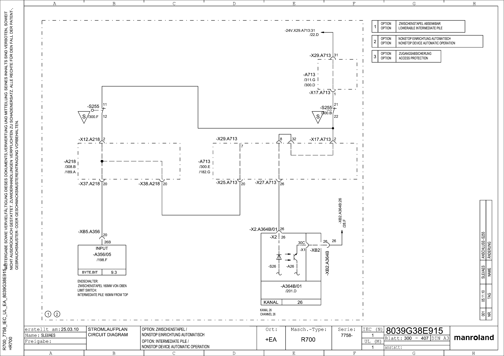

# +EA — Sheet 300 of 407 — OPTION: ZWISCHENSTAPEL /

**NONSTOP EINRICHTUNG AUTOMATISCH**

> Part of the manroland **R700** printing press IEC/UL circuit diagrams.
> Drawing class: **Stromlaufplan / Circuit diagram** (DIN A3).
> Document `+EA` covers the **Printing unit** machine section.

## At a glance

| Field | Value |
|---|---|
| Document | `+EA`  (8039G38E915) |
| Sheet | **300** of 407 |
| Section (DE) | OPTION: ZWISCHENSTAPEL / |
| Section (EN) | NONSTOP EINRICHTUNG AUTOMATISCH |
| Section type | CIRCUIT — Circuit diagram |
| Machine type | `R700` |
| Series | `7758` |
| Created | 25.03.10 |
| Replaces | — |
| Columns used | A, B, C, D, E, F, G, H |
| Path numbers | — |
| Labels on sheet | 98 |
| Cross-refs out | 12 |
| Cross-refs in | 26 |

**Previous:** [+EA sheet 299](SHEET_0299.md) · **Next:** [+EA sheet 301](SHEET_0301.md) · **Document TOC:** [_TOC.md](_TOC.md)  (+EA) · **Master TOC:** [all sheets](../_MASTER_TOC.md)

## Sheet image (300 DPI, exact vector render)



_Rendered directly from the PDF vector layer at 300 DPI (1-bit), no OCR and no resampling. Use it to confirm anything ambiguous in the text below._

## Cross-references on this sheet

Each entry is a wire leaving this sheet. The printed token is `/sheet.column`; the link resolves to that sheet inside the same document.

| Ref | Target sheet | Col | Path | Destination on target | Target section | From col |
|---|---|---|---|---|---|---|
| `/22.D` | [+EA sheet 22](SHEET_0022.md) | D | — | 24V.X29.A713:31 | SPANNUNGSVERSORGUNG: 400V, 24V | E |
| `/311.G` | [+EA sheet 311](SHEET_0311.md) | G | — | — | OPTION: AUTOMATISCHE STAPELAUFFAHRT STOP / | E |
| `/300.D` | [+EA sheet 300](SHEET_0300.md) | D | — | — | OPTION: ZWISCHENSTAPEL / | E |
| `/300.B` | [+EA sheet 300](SHEET_0300.md) | B | — | — | OPTION: ZWISCHENSTAPEL / | F |
| `/300.F` | [+EA sheet 300](SHEET_0300.md) | F | — | — | OPTION: ZWISCHENSTAPEL / | B |
| `/308.B` | [+EA sheet 308](SHEET_0308.md) | B | — | — | OPTION: KLAPPPODEST B SEITE | A |
| `/189.A` | [+EA sheet 189](SHEET_0189.md) | A | — | — | RESERVE | A |
| `/300.E` | [+EA sheet 300](SHEET_0300.md) | E | — | — | OPTION: ZWISCHENSTAPEL / | D |
| `/182.G` | [+EA sheet 182](SHEET_0182.md) | G | — | — | RESERVE | D |
| `/28.F` | [+EA sheet 28](SHEET_0028.md) | F | — | XB2.A364B:26 | BUSVERBINDUNGEN: SICHERHEITSBUS | F |
| `/198.F` | [+EA sheet 198](SHEET_0198.md) | F | — | — | REFERENZMODUL | B |
| `/201.D` | [+EA sheet 201](SHEET_0201.md) | D | — | — | REFERENZMODUL | E |

### Incoming references (sheets that point here)

Every other sheet that sends a wire to this one. `Back-ref` is the token printed on *that* sheet; `Path` is its line number.

| From sheet | Cols | Back-ref | Path | Refs | What continues there |
|---|---|---|---|---|---|
| [+EA#22](SHEET_0022.md) | D | `/22.D` | — | 1 | — |
| [+EA#28](SHEET_0028.md) | F | `/28.F` | — | 1 | — |
| [+EA#182](SHEET_0182.md) | F | `/182.F` | — | 1 | — |
| [+EA#189](SHEET_0189.md) | A | `/189.A` | — | 1 | — |
| [+EA#198](SHEET_0198.md) | F | `/198.F` | — | 1 | — |
| [+EA#201](SHEET_0201.md) | D | `/201.D` | — | 1 | — |
| [+EA#227](SHEET_0227.md) | C, E | `/227.C`, `/227.E` | — | 2 | — |
| [+EA#241](SHEET_0241.md) | H | `/241.H` | — | 1 | — |
| [+EA#257](SHEET_0257.md) | A | `/257.A` | — | 1 | — |
| [+EA#263](SHEET_0263.md) | C | `/263.C` | — | 2 | — |
| [+EA#268](SHEET_0268.md) | G | `/268.G` | — | 1 | — |
| [+EA#272](SHEET_0272.md) | B | `/272.B` | — | 1 | — |
| [+EA#275](SHEET_0275.md) | A, B | `/275.A`, `/275.B` | — | 4 | — |
| [+EA#279](SHEET_0279.md) | E | `/279.E` | — | 1 | — |
| [+EA#280](SHEET_0280.md) | A | `/280.A` | — | 1 | — |
| [+EA#300](SHEET_0300.md) | B, D, E, F | `/300.B`, `/300.D`, `/300.E`, `/300.F` | — | 4 | — |
| [+EA#308](SHEET_0308.md) | B | `/308.B` | — | 1 | — |
| [+EA#311](SHEET_0311.md) | F | `/311.F` | — | 1 | — |


## Devices on this sheet

| Tag | Class | Class meaning (IEC) | Col | Sub | Terminal | Sign |
|---|---|---|---|---|---|---|
| `A218` | A | Baugruppe / assembly, module, PC board | A | — | — | — |
| `S255` | S | Schalter / switch | B | — | — | — |
| `A713` | A | Baugruppe / assembly, module, PC board | D | — | — | — |
| `S255` | S | Schalter / switch | F | — | — | — |
| `A356/05` | A | Baugruppe / assembly, module, PC board | B | 05 | — | — |
| `A713` | A | Baugruppe / assembly, module, PC board | E | — | — | — |
| `S26` | S | Schalter / switch | E | — | — | — |
| `A26` | A | Baugruppe / assembly, module, PC board | E | — | — | — |
| `X1` | X | Klemme / terminal, plug connector | E | — | — | — |
| `X2` | X | Klemme / terminal, plug connector | E | — | — | — |
| `XB2` | XB |  | E | — | — | — |
| `X12.A218` | — | cross-device reference | B | — | — | — |
| `X37.A218` | — | cross-device reference | B | — | — | — |
| `X38.A218` | — | cross-device reference | C | — | — | — |
| `X17.A713` | — | cross-device reference | E | — | — | — |
| `X27.A713` | — | cross-device reference | E | — | — | — |
| `X25.A713` | — | cross-device reference | D | — | — | — |
| `9.3` | — | cross-device reference | B | — | — | — |
| `XB5.A356` | — | cross-device reference | B | — | — | — |
| `X17.A713` | — | cross-device reference | E | — | — | — |
| `X29.A713` | — | cross-device reference | E | — | — | — |
| `XB2.A364B` | — | cross-device reference | F | — | — | — |
| `NR.` | — | cross-device reference | H | — | — | — |
| `05.11.10` | — | cross-device reference | H | — | — | — |
| `XB2.A364B:26` | — | cross-device reference | F | — | 26 | — |
| `X29.A713` | — | cross-device reference | D | — | — | — |

## Potentials / nets

| Potential | Count | Columns | Attached devices | Terminals |
|---|---|---|---|---|
| `24V` | 1 | E | `A713`, `X29` | `31` |


A potential such as `L24+/4` or `M24+` is a named supply/return rail; every place it appears on this sheet is electrically common.

## Wire-end annotations (grouped as printed)

A wire that continues elsewhere is annotated with a small cluster: the destination description, the path/line number `#NN`, and the `/sheet.column` cross reference. Each row below is one such cluster exactly as it is grouped on the drawing.

| Col | Y | Path | Cross-ref | Text on the wire |
|---|---|---|---|---|
| G | 53.0 | — | — | `1 LOWERABLE INTERMEDIATE PILE ZWISCHENSTAPEL ABSENKBAR` |
| G | 53.0 | — | — | `OPTION OPTION` |
| E | 68.3 | — | `/22.D` | `24V.X29.A713:31` |
| G | 88.5 | — | — | `2 NONSTOP EINRICHTUNG AUTOMATISCH NONSTOP DEVICE AUTOMATIC OPERATION` |
| G | 88.5 | — | — | `OPTION OPTION` |
| G | 123.9 | — | — | `OPTION OPTION` |
| G | 124.0 | — | — | `3 ZUGANGSABSICHERUNG ACCESS PROTECTION` |
| E | 126.5 | — | — | `X29.A713 31` |
| E | 171.8 | — | — | `A713` |
| E | 184.9 | — | `/311.G`, `/300.D` | — |
| E | 214.3 | — | — | `X17.A713 1` |
| B | 243.4 | — | — | `11` |
| F | 243.4 | — | — | `21` |
| B | 246.9 | — | — | `S255` |
| F | 249.8 | — | — | `S255` |
| F | 263.5 | — | `/300.B` | — |
| C | 270.4 | — | — | `S S` |
| B | 271.7 | — | — | `12` |
| F | 271.7 | — | — | `22` |
| B | 272.4 | — | `/300.F` | — |
| D | 323.4 | — | — | `X29.A713` |
| B | 324.9 | — | — | `X12.A218 2` |
| E | 324.9 | — | — | `8` |
| E | 324.9 | — | — | `32` |
| E | 324.9 | — | — | `X17.A713 2` |
| D | 341.9 | — | — | `7` |
| A | 377.3 | — | — | `A218` |
| D | 377.3 | — | — | `A713` |
| A | 390.4 | — | `/308.B`, `/189.A` | — |
| D | 390.4 | — | `/300.E`, `/182.G` | — |
| D | 426.9 | — | — | `X25.A713 20 X27.A713 26` |
| B | 429.8 | — | — | `X37.A218 20 X38.A218 20` |
| F | 468.3 | — | `/28.F` | `XB2.A364B:26` |
| E | 537.5 | — | — | `X2.A364B/01 26` |
| B | 543.1 | — | — | `XB5.A356 20` |
| H | 548.3 | — | — | `001 SLEI/AES 05.11.10 ANSCHLUSS S255` |
| E | 555.9 | — | — | `X2` |
| E | 557.3 | — | — | `26 26` |
| F | 565.8 | — | — | `26` |
| B | 568.6 | — | — | `26B` |
| E | 570.1 | — | — | `30C` |
| H | 571.4 | — | — | `NR. NAME TAG ÄNDERUNG` |
| B | 583.2 | — | — | `INPUT` |
| E | 587.1 | — | — | `X1` |
| E | 587.1 | — | — | `XB2` |
| F | 593.3 | — | — | `XB2.A364B` |
| B | 597.0 | — | — | `A356/05` |
| B | 610.8 | — | `/198.F` | — |
| E | 626.0 | — | — | `S26 A26` |
| B | 639.8 | — | — | `BYTE.BIT 9.3` |
| B | 662.5 | — | — | `ENDSCHALTER:` |
| E | 672.1 | — | — | `A364B/01` |
| B | 673.1 | — | — | `LIMIT SWITCH: INTERMEDIATE PILE 160MM FROM TOP ZWISCHENSTAPEL 160MM VON OBEN` |
| E | 684.5 | — | `/201.D` | — |
| E | 710.4 | — | — | `KANAL 26` |
| E | 730.7 | — | — | `KANAL 26 CHANNEL 26` |
| A | 739.6 | — | — | `1 2` |


## Reconstructed tables

This sheet carries tabular content (pin map / terminal assignment / index). The grid below was rebuilt from the drawing's own rule lines, so each row is exactly one physical row of the table.

### Table 1 — 8 data rows × 12 columns (at x=184.3, y=204.1)

| S255 S /300.F | 11 12 |  |  |  |  |  |  |  | X17.A713 S | S255 /300.B | 1 21 22 |
|---|---|---|---|---|---|---|---|---|---|---|---|
| `X12.A218` | `2` |  |  | `X29.A713` | `7` |  | `8 32` |  | `X17.A713` |  | `2` |
| `X37.A218` | `20` | `X38.A218` | `20` | `A713 /300.E /182.G X25.A713` | `20` | `X27.A713` | `26` |  |  |  | `XB2.A364B:26` |
| `XB5.A356` |  |  |  |  |  | `X2.A364B/01` | `26` |  |  |  |  |
|  | `20 26B` |  |  |  |  | `X2` | `26` | `30C` |  | `26` | `26` |
| `INPUT` | `A356/05 /198.F` |  |  |  |  | `S26` | `A26` | `X1` | `XB2` | `XB2.A364B` |  |
| `BYTE.BIT` | `9.3` |  |  |  |  |  |  |  |  |  |  |
| `ENDSCHALTER: ZWISCHENSTAPEL LIMIT SWITCH: INTERMEDIATE PILE` | `160MM VON OBEN 160MM FROM TOP` |  |  |  |  |  | `A364B/01 /201.D` |  |  |  |  |
|  |  |  |  |  |  | `KANAL` |  | `26` |  |  |  |


## Notes and free text on this sheet

| Text | Col | Y (pt) |
|---|---|---|
| `26B` | B | 568.63 |
| `INPUT` | B | 583.16 |
| `BYTE.BIT` | B | 640.41 |
| `ENDSCHALTER:` | B | 662.51 |
| `ZWISCHENSTAPEL 160MM VON OBEN` | B | 673.14 |
| `LIMIT SWITCH:` | B | 683.72 |
| `INTERMEDIATE PILE 160MM FROM TOP` | B | 694.42 |
| `KANAL 26` | E | 730.71 |
| `CHANNEL 26` | E | 740.65 |
| `30C` | E | 570.09 |
| `KANAL` | E | 710.38 |
| `A364B/01` | E | 672.12 |
| `X2.A364B/01` | D | 537.47 |
| `TAG` | H | 692.75 |
| `NAME` | H | 633.34 |
| `ÄNDERUNG` | H | 571.36 |
| `SLEI/AES` | H | 627.9 |
| `ANSCHLUSS S255` | H | 548.3 |
| `OPTION` | G | 53.04 |
| `ZWISCHENSTAPEL ABSENKBAR` | G | 53.05 |
| `LOWERABLE INTERMEDIATE PILE` | G | 63.68 |
| `NONSTOP EINRICHTUNG AUTOMATISCH` | G | 88.51 |
| `NONSTOP DEVICE AUTOMATIC OPERATION` | G | 99.13 |
| `ZUGANGSABSICHERUNG` | G | 123.95 |
| `ACCESS PROTECTION` | G | 134.56 |
| `S` | A | 270.38 |
| `S` | E | 270.38 |

## Complete label inventory (exact text from the drawing)

Every text object inside the drawing area of this sheet, in DIN reading order (column A→H, then top→bottom). This is the authoritative list: if a string is not here it is not printed on this sheet.

| Col | Y | X | Dir | Type | Text |
|---|---|---|---|---|---|
| A | 270.4 | 194.3 | → | text | `S` |
| A | 377.3 | 150.8 | → | device tag | `A218` |
| A | 390.4 | 153.4 | → | cross-reference | `/308.B` |
| A | 402.8 | 153.1 | → | cross-reference | `/189.A` |
| A | 739.6 | 111.6 | → | number | `1` |
| A | 740.1 | 132.7 | → | number | `2` |
| B | 243.4 | 242.9 | → | number | `11` |
| B | 246.9 | 206.1 | → | device tag | `S255` |
| B | 271.7 | 242.9 | → | number | `12` |
| B | 272.4 | 207.8 | → | cross-reference | `/300.F` |
| B | 324.9 | 185.7 | → | device ref | `X12.A218` |
| B | 324.9 | 243.5 | → | number | `2` |
| B | 429.8 | 185.7 | → | device ref | `X37.A218` |
| B | 431.2 | 243.5 | → | number | `20` |
| B | 543.1 | 184.5 | → | device ref | `XB5.A356` |
| B | 551.7 | 243.5 | → | number | `20` |
| B | 568.6 | 246.3 | → | text | `26B` |
| B | 583.2 | 226.1 | → | text | `INPUT` |
| B | 597.0 | 219.5 | → | device tag | `A356/05` |
| B | 610.8 | 228.6 | → | cross-reference | `/198.F` |
| B | 639.8 | 262.5 | → | device ref | `9.3` |
| B | 640.4 | 194.2 | → | text | `BYTE.BIT` |
| B | 662.5 | 183.4 | → | text | `ENDSCHALTER:` |
| B | 673.1 | 184.3 | → | text | `ZWISCHENSTAPEL 160MM VON OBEN` |
| B | 683.7 | 183.4 | → | text | `LIMIT SWITCH:` |
| B | 694.4 | 183.4 | → | text | `INTERMEDIATE PILE 160MM FROM TOP` |
| C | 429.8 | 327.4 | → | device ref | `X38.A218` |
| C | 431.2 | 385.2 | → | number | `20` |
| D | 323.5 | 510.2 | → | device ref | `X29.A713` |
| D | 341.9 | 569.5 | → | number | `7` |
| D | 377.3 | 468.3 | → | device tag | `A713` |
| D | 390.4 | 471.1 | → | cross-reference | `/300.E` |
| D | 402.8 | 470.3 | → | cross-reference | `/182.G` |
| D | 426.9 | 510.2 | → | device ref | `X25.A713` |
| D | 431.2 | 569.5 | → | number | `20` |
| D | 537.5 | 589.3 | → | text | `X2.A364B/01` |
| E | 68.3 | 672.7 | → | potential | `24V.X29.A713:31` |
| E | 78.2 | 731.9 | → | cross-reference | `/22.D` |
| E | 126.4 | 731.3 | → | device ref | `X29.A713` |
| E | 171.8 | 716.3 | → | device tag | `A713` |
| E | 184.9 | 718.3 | → | cross-reference | `/311.G` |
| E | 197.3 | 718.6 | → | cross-reference | `/300.D` |
| E | 214.3 | 729.9 | → | device ref | `X17.A713` |
| E | 270.4 | 747.1 | → | text | `S` |
| E | 324.9 | 661.6 | → | number | `8` |
| E | 324.9 | 690.0 | → | number | `32` |
| E | 324.9 | 731.3 | → | device ref | `X17.A713` |
| E | 426.9 | 602.4 | → | device ref | `X27.A713` |
| E | 431.2 | 661.6 | → | number | `26` |
| E | 537.5 | 661.6 | → | number | `26` |
| E | 555.9 | 637.5 | → | device tag | `X2` |
| E | 557.3 | 664.4 | → | number | `26` |
| E | 570.1 | 704.4 | → | text | `30C` |
| E | 587.1 | 708.1 | → | device tag | `X1` |
| E | 587.1 | 732.5 | → | device tag | `XB2` |
| E | 626.1 | 633.8 | → | device tag | `S26` |
| E | 626.1 | 676.3 | → | device tag | `A26` |
| E | 672.1 | 663.2 | → | text | `A364B/01` |
| E | 684.5 | 674.6 | → | cross-reference | `/201.D` |
| E | 710.3 | 702.9 | → | number | `26` |
| E | 710.4 | 622.8 | → | text | `KANAL` |
| E | 730.7 | 614.6 | → | text | `KANAL 26` |
| E | 740.6 | 614.8 | → | text | `CHANNEL 26` |
| F | 58.4 | 883.3 | → | number | `1` |
| F | 93.8 | 883.0 | → | number | `2` |
| F | 126.5 | 789.2 | → | number | `31` |
| F | 129.2 | 882.9 | → | number | `3` |
| F | 218.6 | 788.6 | → | number | `1` |
| F | 243.4 | 789.2 | → | number | `21` |
| F | 249.8 | 756.0 | → | device tag | `S255` |
| F | 263.5 | 758.6 | → | cross-reference | `/300.B` |
| F | 271.7 | 789.2 | → | number | `22` |
| F | 324.9 | 789.2 | → | number | `2` |
| F | 468.3 | 799.6 | ↕ | device ref | `XB2.A364B:26` |
| F | 518.5 | 809.6 | ↕ | cross-reference | `/28.F` |
| F | 565.8 | 784.3 | → | number | `26` |
| F | 567.3 | 763.7 | → | number | `26` |
| F | 593.3 | 768.5 | ↕ | device ref | `XB2.A364B` |
| G | 53.0 | 899.7 | → | text | `OPTION` |
| G | 53.0 | 942.5 | → | text | `ZWISCHENSTAPEL ABSENKBAR` |
| G | 63.7 | 899.7 | → | text | `OPTION` |
| G | 63.7 | 941.7 | → | text | `LOWERABLE INTERMEDIATE PILE` |
| G | 88.5 | 899.7 | → | text | `OPTION` |
| G | 88.5 | 941.7 | → | text | `NONSTOP EINRICHTUNG AUTOMATISCH` |
| G | 99.1 | 899.7 | → | text | `OPTION` |
| G | 99.1 | 941.7 | → | text | `NONSTOP DEVICE AUTOMATIC OPERATION` |
| G | 123.9 | 899.7 | → | text | `OPTION` |
| G | 123.9 | 942.5 | → | text | `ZUGANGSABSICHERUNG` |
| G | 134.5 | 899.7 | → | text | `OPTION` |
| G | 134.6 | 942.5 | → | text | `ACCESS PROTECTION` |
| H | 548.3 | 1138.5 | ↕ | text | `ANSCHLUSS S255` |
| H | 571.4 | 1152.7 | ↕ | text | `ÄNDERUNG` |
| H | 627.9 | 1138.5 | ↕ | text | `SLEI/AES` |
| H | 633.3 | 1152.6 | ↕ | text | `NAME` |
| H | 686.6 | 1138.5 | ↕ | device ref | `05.11.10` |
| H | 692.7 | 1152.6 | ↕ | text | `TAG` |
| H | 735.8 | 1138.4 | ↕ | number | `001` |
| H | 736.2 | 1152.5 | ↕ | device ref | `NR.` |

## Reading-order text block

The same content as a plain block, grouped by DIN column — convenient to paste or to match against a visual description.

```text
=== Column A ===
 270.4  194.3  text         S
 377.3  150.8  devtag       A218
 390.4  153.4  xref         /308.B
 402.8  153.1  xref         /189.A
 739.6  111.6  numeric      1
 740.1  132.7  numeric      2
=== Column B ===
 243.4  242.9  numeric      11
 246.9  206.1  devtag       S255
 271.7  242.9  numeric      12
 272.4  207.8  xref         /300.F
 324.9  185.7  devref       X12.A218
 324.9  243.5  numeric      2
 429.8  185.7  devref       X37.A218
 431.2  243.5  numeric      20
 543.1  184.5  devref       XB5.A356
 551.7  243.5  numeric      20
 568.6  246.3  text         26B
 583.2  226.1  text         INPUT
 597.0  219.5  devtag       A356/05
 610.8  228.6  xref         /198.F
 639.8  262.5  devref       9.3
 640.4  194.2  text         BYTE.BIT
 662.5  183.4  text         ENDSCHALTER:
 673.1  184.3  text         ZWISCHENSTAPEL 160MM VON OBEN
 683.7  183.4  text         LIMIT SWITCH:
 694.4  183.4  text         INTERMEDIATE PILE 160MM FROM TOP
=== Column C ===
 429.8  327.4  devref       X38.A218
 431.2  385.2  numeric      20
=== Column D ===
 323.5  510.2  devref       X29.A713
 341.9  569.5  numeric      7
 377.3  468.3  devtag       A713
 390.4  471.1  xref         /300.E
 402.8  470.3  xref         /182.G
 426.9  510.2  devref       X25.A713
 431.2  569.5  numeric      20
 537.5  589.3  text         X2.A364B/01
=== Column E ===
  68.3  672.7  net          24V.X29.A713:31
  78.2  731.9  xref         /22.D
 126.4  731.3  devref       X29.A713
 171.8  716.3  devtag       A713
 184.9  718.3  xref         /311.G
 197.3  718.6  xref         /300.D
 214.3  729.9  devref       X17.A713
 270.4  747.1  text         S
 324.9  661.6  numeric      8
 324.9  690.0  numeric      32
 324.9  731.3  devref       X17.A713
 426.9  602.4  devref       X27.A713
 431.2  661.6  numeric      26
 537.5  661.6  numeric      26
 555.9  637.5  devtag       X2
 557.3  664.4  numeric      26
 570.1  704.4  text         30C
 587.1  708.1  devtag       X1
 587.1  732.5  devtag       XB2
 626.1  633.8  devtag       S26
 626.1  676.3  devtag       A26
 672.1  663.2  text         A364B/01
 684.5  674.6  xref         /201.D
 710.3  702.9  numeric      26
 710.4  622.8  text         KANAL
 730.7  614.6  text         KANAL 26
 740.6  614.8  text         CHANNEL 26
=== Column F ===
  58.4  883.3  numeric      1
  93.8  883.0  numeric      2
 126.5  789.2  numeric      31
 129.2  882.9  numeric      3
 218.6  788.6  numeric      1
 243.4  789.2  numeric      21
 249.8  756.0  devtag       S255
 263.5  758.6  xref         /300.B
 271.7  789.2  numeric      22
 324.9  789.2  numeric      2
 468.3  799.6  devref       XB2.A364B:26
 518.5  809.6  xref         /28.F
 565.8  784.3  numeric      26
 567.3  763.7  numeric      26
 593.3  768.5  devref       XB2.A364B
=== Column G ===
  53.0  899.7  text         OPTION
  53.0  942.5  text         ZWISCHENSTAPEL ABSENKBAR
  63.7  899.7  text         OPTION
  63.7  941.7  text         LOWERABLE INTERMEDIATE PILE
  88.5  899.7  text         OPTION
  88.5  941.7  text         NONSTOP EINRICHTUNG AUTOMATISCH
  99.1  899.7  text         OPTION
  99.1  941.7  text         NONSTOP DEVICE AUTOMATIC OPERATION
 123.9  899.7  text         OPTION
 123.9  942.5  text         ZUGANGSABSICHERUNG
 134.5  899.7  text         OPTION
 134.6  942.5  text         ACCESS PROTECTION
=== Column H ===
 548.3 1138.5  text         ANSCHLUSS S255
 571.4 1152.7  text         ÄNDERUNG
 627.9 1138.5  text         SLEI/AES
 633.3 1152.6  text         NAME
 686.6 1138.5  devref       05.11.10
 692.7 1152.6  text         TAG
 735.8 1138.4  numeric      001
 736.2 1152.5  devref       NR.
```

---
_Generated from the PDF vector text layer; no OCR. Source: `R700_7758_IEC_UL_EA_8039G38E915_p`, sheet 300._
