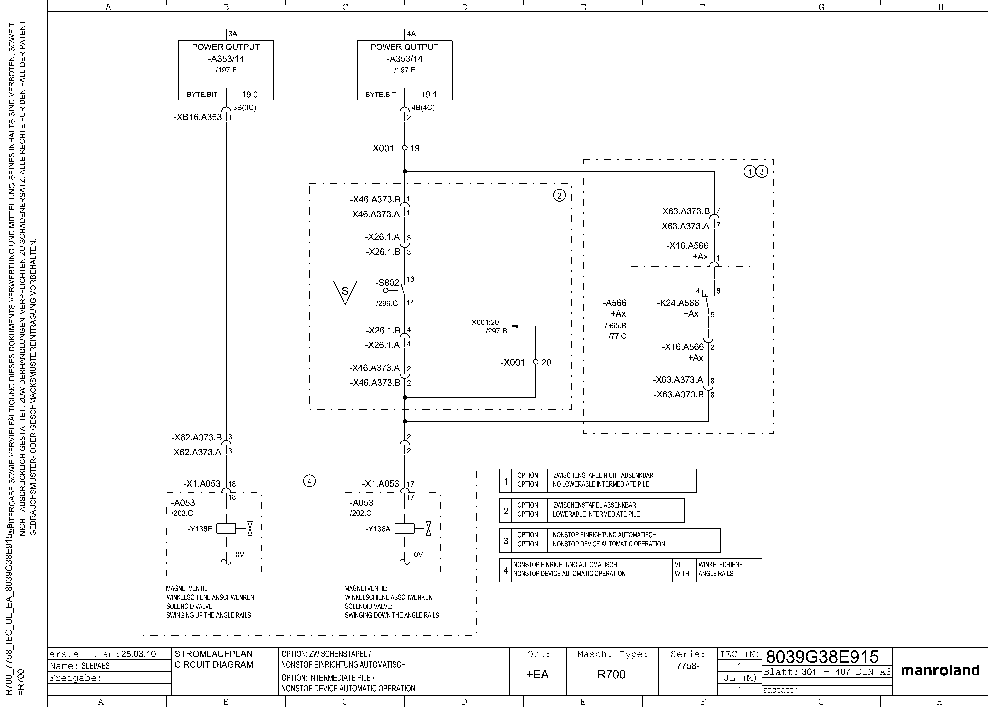

# +EA — Sheet 301 of 407 — OPTION: ZWISCHENSTAPEL /

**NONSTOP EINRICHTUNG AUTOMATISCH**

> Part of the manroland **R700** printing press IEC/UL circuit diagrams.
> Drawing class: **Stromlaufplan / Circuit diagram** (DIN A3).
> Document `+EA` covers the **Printing unit** machine section.

## At a glance

| Field | Value |
|---|---|
| Document | `+EA`  (8039G38E915) |
| Sheet | **301** of 407 |
| Section (DE) | OPTION: ZWISCHENSTAPEL / |
| Section (EN) | NONSTOP EINRICHTUNG AUTOMATISCH |
| Section type | CIRCUIT — Circuit diagram |
| Machine type | `R700` |
| Series | `7758` |
| Created | 25.03.10 |
| Replaces | — |
| Columns used | B, C, D, E, F |
| Path numbers | — |
| Labels on sheet | 121 |
| Cross-refs out | 8 |
| Cross-refs in | 30 |

**Previous:** [+EA sheet 300](SHEET_0300.md) · **Next:** [+EA sheet 302](SHEET_0302.md) · **Document TOC:** [_TOC.md](_TOC.md)  (+EA) · **Master TOC:** [all sheets](../_MASTER_TOC.md)

## Sheet image (300 DPI, exact vector render)



_Rendered directly from the PDF vector layer at 300 DPI (1-bit), no OCR and no resampling. Use it to confirm anything ambiguous in the text below._

## Cross-references on this sheet

Each entry is a wire leaving this sheet. The printed token is `/sheet.column`; the link resolves to that sheet inside the same document.

| Ref | Target sheet | Col | Path | Destination on target | Target section | From col |
|---|---|---|---|---|---|---|
| `/197.F` | [+EA sheet 197](SHEET_0197.md) | F | — | — | REFERENZMODUL | B |
| `/197.F` | [+EA sheet 197](SHEET_0197.md) | F | — | — | REFERENZMODUL | C |
| `/296.C` | [+EA sheet 296](SHEET_0296.md) | C | — | — | OPTION: ZWISCHENSTAPEL / | C |
| `/297.B` | [+EA sheet 297](SHEET_0297.md) | B | — | X001:20 | OPTION: ZWISCHENSTAPEL / | D |
| `/365.B` | [+EA sheet 365](SHEET_0365.md) | B | — | — | OPTION: TROCKNER VORBEREITUNG; | E |
| `/77.C` | [+EA sheet 77](SHEET_0077.md) | C | — | — | AUSLEGERSTAPELSTEUERUNG | E |
| `/202.C` | [+EA sheet 202](SHEET_0202.md) | C | — | A053 | REFERENZMODUL | B |
| `/202.C` | [+EA sheet 202](SHEET_0202.md) | C | — | A053 | REFERENZMODUL | C |

### Incoming references (sheets that point here)

Every other sheet that sends a wire to this one. `Back-ref` is the token printed on *that* sheet; `Path` is its line number.

| From sheet | Cols | Back-ref | Path | Refs | What continues there |
|---|---|---|---|---|---|
| [+EA#77](SHEET_0077.md) | C | `/77.C` | — | 1 | — |
| [+EA#197](SHEET_0197.md) | F | `/197.F` | — | 2 | — |
| [+EA#202](SHEET_0202.md) | C | `/202.C` | — | 2 | — |
| [+EA#206](SHEET_0206.md) | D | `/206.D` | — | 2 | — |
| [+EA#261](SHEET_0261.md) | G | `/261.G` | — | 2 | — |
| [+EA#262](SHEET_0262.md) | H | `/262.H` | — | 2 | — |
| [+EA#270](SHEET_0270.md) | A, B | `/270.A`, `/270.B` | — | 4 | — |
| [+EA#281](SHEET_0281.md) | H | `/281.H` | — | 4 | — |
| [+EA#283](SHEET_0283.md) | H | `/283.H` | — | 4 | — |
| [+EA#284](SHEET_0284.md) | A, B | `/284.A`, `/284.B` | — | 4 | — |
| [+EA#296](SHEET_0296.md) | C | `/296.C` | — | 1 | — |
| [+EA#297](SHEET_0297.md) | B | `/297.B` | — | 1 | — |
| [+EA#365](SHEET_0365.md) | B | `/365.B` | — | 1 | — |


## Devices on this sheet

| Tag | Class | Class meaning (IEC) | Col | Sub | Terminal | Sign |
|---|---|---|---|---|---|---|
| `A566` | A | Baugruppe / assembly, module, PC board | E | — | — | — |
| `A053` | A | Baugruppe / assembly, module, PC board | B | — | — | — |
| `A053` | A | Baugruppe / assembly, module, PC board | C | — | — | — |
| `S802` | S | Schalter / switch | C | — | — | — |
| `A353/14` | A | Baugruppe / assembly, module, PC board | B | 14 | — | — |
| `A353/14` | A | Baugruppe / assembly, module, PC board | C | 14 | — | — |
| `X001` | X | Klemme / terminal, plug connector | C | — | — | — |
| `X001` | X | Klemme / terminal, plug connector | D | — | — | — |
| `X001:20` | X | Klemme / terminal, plug connector | D | — | 20 | — |
| `X63.A373.B` | — | cross-device reference | F | — | — | — |
| `X63.A373.A` | — | cross-device reference | F | — | — | — |
| `X63.A373.B` | — | cross-device reference | F | — | — | — |
| `X63.A373.A` | — | cross-device reference | F | — | — | — |
| `X16.A566` | — | cross-device reference | F | — | — | — |
| `K24.A566` | — | cross-device reference | F | — | — | — |
| `X16.A566` | — | cross-device reference | F | — | — | — |
| `X46.A373.B` | — | cross-device reference | C | — | — | — |
| `X46.A373.A` | — | cross-device reference | C | — | — | — |
| `X26.1.B` | — | cross-device reference | C | — | — | — |
| `X26.1.A` | — | cross-device reference | C | — | — | — |
| `X62.A373.B` | — | cross-device reference | B | — | — | — |
| `X62.A373.A` | — | cross-device reference | B | — | — | — |
| `X1.A053` | — | cross-device reference | B | — | — | — |
| `X1.A053` | — | cross-device reference | C | — | — | — |
| `X46.A373.B` | — | cross-device reference | C | — | — | — |
| `X46.A373.A` | — | cross-device reference | C | — | — | — |
| `X26.1.B` | — | cross-device reference | C | — | — | — |
| `X26.1.A` | — | cross-device reference | C | — | — | — |
| `19.0` | — | cross-device reference | B | — | — | — |
| `XB16.A353` | — | cross-device reference | B | — | — | — |
| `19.1` | — | cross-device reference | D | — | — | — |

## Potentials / nets

| Potential | Count | Columns | Attached devices | Terminals |
|---|---|---|---|---|
| `0V` | 2 | B, D | — | — |


A potential such as `L24+/4` or `M24+` is a named supply/return rail; every place it appears on this sheet is electrically common.

## Wire-end annotations (grouped as printed)

A wire that continues elsewhere is annotated with a small cluster: the destination description, the path/line number `#NN`, and the `/sheet.column` cross reference. Each row below is one such cluster exactly as it is grouped on the drawing.

| Col | Y | Path | Cross-ref | Text on the wire |
|---|---|---|---|---|
| B | 36.4 | — | — | `3A` |
| D | 36.4 | — | — | `4A` |
| B | 51.6 | — | — | `POWER QUTPUT` |
| C | 51.6 | — | — | `POWER QUTPUT` |
| B | 65.5 | — | — | `A353/14` |
| C | 65.5 | — | — | `A353/14` |
| B | 79.3 | — | `/197.F` | — |
| C | 79.3 | — | `/197.F` | — |
| B | 108.3 | — | — | `BYTE.BIT 19.0` |
| C | 108.3 | — | — | `BYTE.BIT 19.1` |
| B | 124.3 | — | — | `3B(3C)` |
| D | 124.3 | — | — | `4B(4C)` |
| B | 134.9 | — | — | `XB16.A353 1` |
| D | 136.4 | — | — | `2` |
| C | 171.6 | — | — | `X001 19` |
| F | 201.0 | — | — | `1 3` |
| E | 229.9 | — | — | `2` |
| C | 232.8 | — | — | `X46.A373.B 1` |
| F | 246.9 | — | — | `X63.A373.B 7` |
| C | 249.8 | — | — | `X46.A373.A 1` |
| F | 263.9 | — | — | `X63.A373.A 7` |
| C | 277.4 | — | — | `X26.1.A 3` |
| F | 288.0 | — | — | `X16.A566 1` |
| C | 295.1 | — | — | `X26.1.B 3` |
| F | 300.8 | — | — | `+Ax` |
| D | 328.4 | — | — | `13` |
| C | 332.0 | — | — | `S802` |
| C | 341.2 | — | — | `S` |
| F | 342.6 | — | — | `K24.A566 6` |
| F | 342.6 | — | — | `4` |
| E | 356.1 | — | — | `A566` |
| D | 356.8 | — | — | `14` |
| C | 357.5 | — | `/296.C` | — |
| E | 368.8 | — | — | `+Ax` |
| F | 368.8 | — | — | `+Ax` |
| F | 370.9 | — | — | `5` |
| D | 380.1 | — | `/297.B` | `X001:20` |
| E | 384.0 | — | `/365.B` | — |
| C | 388.7 | — | — | `X26.1.B 4` |
| E | 396.4 | — | `/77.C` | — |
| C | 405.7 | — | — | `X26.1.A 4` |
| F | 408.5 | — | — | `X16.A566 2` |
| F | 421.3 | — | — | `+Ax` |
| E | 426.7 | — | — | `X001 20` |
| C | 433.3 | — | — | `X46.A373.A 2` |
| F | 447.5 | — | — | `X63.A373.A 8` |
| C | 451.0 | — | — | `X46.A373.B 2` |
| F | 465.2 | — | — | `X63.A373.B 8` |
| B | 516.2 | — | — | `X62.A373.B 3` |
| D | 516.2 | — | — | `2` |
| B | 533.2 | — | — | `X62.A373.A 3` |
| D | 533.2 | — | — | `2` |
| D | 563.3 | — | — | `1 OPTION OPTION` |
| E | 563.3 | — | — | `NO LOWERABLE INTERMEDIATE PILE ZWISCHENSTAPEL NICHT ABSENKBAR` |
| C | 570.1 | — | — | `4` |
| B | 571.5 | — | — | `X1.A053 18` |
| C | 571.5 | — | — | `X1.A053 17` |
| B | 588.5 | — | — | `18` |
| D | 588.5 | — | — | `17` |
| B | 594.2 | — | `/202.C` | `A053` |
| C | 594.2 | — | `/202.C` | `A053` |
| D | 598.7 | — | — | `2 OPTION OPTION` |
| E | 598.7 | — | — | `LOWERABLE INTERMEDIATE PILE ZWISCHENSTAPEL ABSENKBAR` |
| B | 626.0 | — | — | `Y136E` |
| C | 626.0 | — | — | `Y136A` |
| D | 634.1 | — | — | `3 OPTION OPTION` |
| E | 634.2 | — | — | `NONSTOP EINRICHTUNG AUTOMATISCH NONSTOP DEVICE AUTOMATIC OPERATION` |
| B | 656.5 | — | — | `0V` |
| D | 656.5 | — | — | `0V` |
| E | 669.6 | — | — | `4 NONSTOP EINRICHTUNG AUTOMATISCH NONSTOP DEVICE AUTOMATIC OPERATION` |
| F | 669.6 | — | — | `MIT` |
| F | 669.6 | — | — | `WINKELSCHIENE ANGLE RAILS` |
| F | 680.1 | — | — | `WITH` |
| B | 697.9 | — | — | `MAGNETVENTIL:` |
| C | 697.9 | — | — | `MAGNETVENTIL:` |
| B | 708.5 | — | — | `SOLENOID VALVE: SWINGING UP THE ANGLE RAILS WINKELSCHIENE ANSCHWENKEN` |
| C | 708.5 | — | — | `SOLENOID VALVE: SWINGING DOWN THE ANGLE RAILS WINKELSCHIENE ABSCHWENKEN` |


## Reconstructed tables

This sheet carries tabular content (pin map / terminal assignment / index). The grid below was rebuilt from the drawing's own rule lines, so each row is exactly one physical row of the table.

### Table 1 — 3 data rows × 6 columns (at x=212.6, y=48.2)

| POWER | QUTPUT A353/14 /197.F |  | POWER | QUTPUT A353/14 /197.F |  |
|---|---|---|---|---|---|
| `BYTE.BIT` | `19.0` |  | `BYTE.BIT` | `19.1` |  |
| `XB16.A353` | `3B(3C) 1` |  | `X001` | `4B(4C) 2 19` |  |
|  |  | `S` | `X46.A373.B X46.A373.A X26.1.A X26.1.B S802 /296.C X26.1.B X26.1.A X46.A373.A X46.A373.B` | `1 1 3 3 13 14 4 4 2 2` | `X001:20 /297.B X001` |


## Notes and free text on this sheet

| Text | Col | Y (pt) |
|---|---|---|
| `+Ax` | F | 300.81 |
| `+Ax` | E | 368.84 |
| `MAGNETVENTIL:` | B | 697.94 |
| `WINKELSCHIENE ANSCHWENKEN` | B | 708.55 |
| `SOLENOID VALVE:` | B | 719.2 |
| `SWINGING UP THE ANGLE RAILS` | B | 729.83 |
| `Y136E` | B | 626.04 |
| `MAGNETVENTIL:` | C | 697.94 |
| `WINKELSCHIENE ABSCHWENKEN` | C | 708.55 |
| `SOLENOID VALVE:` | C | 719.2 |
| `SWINGING DOWN THE ANGLE RAILS` | C | 729.82 |
| `Y136A` | C | 626.04 |
| `3A` | B | 36.41 |
| `3B(3C)` | B | 124.33 |
| `POWER QUTPUT` | B | 51.59 |
| `BYTE.BIT` | B | 108.91 |
| `4A` | D | 36.41 |
| `4B(4C)` | D | 124.33 |
| `POWER QUTPUT` | C | 51.59 |
| `BYTE.BIT` | C | 108.91 |
| `MIT` | F | 669.57 |
| `WITH` | F | 680.11 |
| `WINKELSCHIENE` | F | 669.57 |
| `ANGLE RAILS` | F | 680.23 |
| `S` | C | 341.25 |
| `OPTION` | E | 598.71 |
| `ZWISCHENSTAPEL ABSENKBAR` | E | 598.71 |
| `LOWERABLE INTERMEDIATE PILE` | E | 609.34 |
| `NONSTOP EINRICHTUNG AUTOMATISCH` | E | 634.18 |
| `NONSTOP DEVICE AUTOMATIC OPERATION` | E | 644.8 |
| `ZWISCHENSTAPEL NICHT ABSENKBAR` | E | 563.29 |
| `NO LOWERABLE INTERMEDIATE PILE` | E | 573.92 |

## Complete label inventory (exact text from the drawing)

Every text object inside the drawing area of this sheet, in DIN reading order (column A→H, then top→bottom). This is the authoritative list: if a string is not here it is not printed on this sheet.

| Col | Y | X | Dir | Type | Text |
|---|---|---|---|---|---|
| B | 36.4 | 271.8 | → | text | `3A` |
| B | 51.6 | 228.5 | → | text | `POWER QUTPUT` |
| B | 65.5 | 247.9 | → | device tag | `A353/14` |
| B | 79.3 | 257.0 | → | cross-reference | `/197.F` |
| B | 108.3 | 287.9 | → | device ref | `19.0` |
| B | 108.9 | 222.5 | → | text | `BYTE.BIT` |
| B | 124.3 | 277.5 | → | text | `3B(3C)` |
| B | 134.9 | 206.9 | → | device ref | `XB16.A353` |
| B | 136.4 | 271.3 | → | number | `1` |
| B | 516.2 | 204.1 | → | device ref | `X62.A373.B` |
| B | 516.2 | 271.8 | → | number | `3` |
| B | 533.2 | 271.8 | → | number | `3` |
| B | 533.9 | 203.2 | → | device ref | `X62.A373.A` |
| B | 571.5 | 218.6 | → | device ref | `X1.A053` |
| B | 572.9 | 271.3 | → | number | `18` |
| B | 588.5 | 271.3 | → | number | `18` |
| B | 594.2 | 203.8 | → | device tag | `A053` |
| B | 607.3 | 204.1 | → | cross-reference | `/202.C` |
| B | 626.0 | 223.7 | → | text | `Y136E` |
| B | 656.5 | 277.5 | → | potential | `0V` |
| B | 697.9 | 197.9 | → | text | `MAGNETVENTIL:` |
| B | 708.6 | 198.4 | → | text | `WINKELSCHIENE ANSCHWENKEN` |
| B | 719.2 | 198.1 | → | text | `SOLENOID VALVE:` |
| B | 729.8 | 198.1 | → | text | `SWINGING UP THE ANGLE RAILS` |
| C | 51.6 | 441.1 | → | text | `POWER QUTPUT` |
| C | 65.5 | 460.5 | → | device tag | `A353/14` |
| C | 79.3 | 469.6 | → | cross-reference | `/197.F` |
| C | 108.9 | 435.1 | → | text | `BYTE.BIT` |
| C | 171.6 | 439.9 | → | device tag | `X001` |
| C | 232.8 | 416.7 | → | device ref | `X46.A373.B` |
| C | 250.5 | 415.8 | → | device ref | `X46.A373.A` |
| C | 277.4 | 434.8 | → | device ref | `X26.1.A` |
| C | 295.1 | 435.7 | → | device ref | `X26.1.B` |
| C | 332.0 | 447.0 | → | device tag | `S802` |
| C | 341.2 | 406.9 | → | text | `S` |
| C | 357.5 | 447.9 | → | cross-reference | `/296.C` |
| C | 388.7 | 435.7 | → | device ref | `X26.1.B` |
| C | 406.4 | 434.8 | → | device ref | `X26.1.A` |
| C | 433.3 | 415.8 | → | device ref | `X46.A373.A` |
| C | 451.0 | 416.7 | → | device ref | `X46.A373.B` |
| C | 570.1 | 366.5 | → | number | `4` |
| C | 571.5 | 431.1 | → | device ref | `X1.A053` |
| C | 594.2 | 416.4 | → | device tag | `A053` |
| C | 607.3 | 416.7 | → | cross-reference | `/202.C` |
| C | 626.0 | 435.7 | → | text | `Y136A` |
| C | 697.9 | 410.5 | → | text | `MAGNETVENTIL:` |
| C | 708.6 | 411.0 | → | text | `WINKELSCHIENE ABSCHWENKEN` |
| C | 719.2 | 410.7 | → | text | `SOLENOID VALVE:` |
| C | 729.8 | 410.7 | → | text | `SWINGING DOWN THE ANGLE RAILS` |
| D | 36.4 | 484.4 | → | text | `4A` |
| D | 108.3 | 501.3 | → | device ref | `19.1` |
| D | 124.3 | 490.1 | → | text | `4B(4C)` |
| D | 136.4 | 484.4 | → | number | `2` |
| D | 171.8 | 487.8 | → | number | `19` |
| D | 232.8 | 483.9 | → | number | `1` |
| D | 249.8 | 483.9 | → | number | `1` |
| D | 279.5 | 484.4 | → | number | `3` |
| D | 296.5 | 484.4 | → | number | `3` |
| D | 328.4 | 483.9 | → | number | `13` |
| D | 356.8 | 483.9 | → | number | `14` |
| D | 380.1 | 558.7 | → | device tag | `X001:20` |
| D | 388.7 | 484.4 | → | number | `4` |
| D | 390.0 | 578.6 | → | cross-reference | `/297.B` |
| D | 405.7 | 484.4 | → | number | `4` |
| D | 426.7 | 595.8 | → | device tag | `X001` |
| D | 435.4 | 484.4 | → | number | `2` |
| D | 452.5 | 484.4 | → | number | `2` |
| D | 516.2 | 484.4 | → | number | `2` |
| D | 533.2 | 484.4 | → | number | `2` |
| D | 568.6 | 599.8 | → | number | `1` |
| D | 572.9 | 483.9 | → | number | `17` |
| D | 588.5 | 483.9 | → | number | `17` |
| D | 604.1 | 599.5 | → | number | `2` |
| D | 639.5 | 599.4 | → | number | `3` |
| D | 656.5 | 490.1 | → | potential | `0V` |
| D | 674.9 | 599.5 | → | number | `4` |
| E | 229.9 | 664.1 | → | number | `2` |
| E | 356.1 | 717.7 | → | device tag | `A566` |
| E | 368.8 | 727.1 | → | text | `+Ax` |
| E | 384.0 | 720.3 | → | cross-reference | `/365.B` |
| E | 396.4 | 724.8 | → | cross-reference | `/77.C` |
| E | 426.9 | 644.6 | → | number | `20` |
| E | 563.3 | 616.3 | → | text | `OPTION` |
| E | 563.3 | 659.1 | → | text | `ZWISCHENSTAPEL NICHT ABSENKBAR` |
| E | 573.9 | 616.3 | → | text | `OPTION` |
| E | 573.9 | 658.2 | → | text | `NO LOWERABLE INTERMEDIATE PILE` |
| E | 598.7 | 616.3 | → | text | `OPTION` |
| E | 598.7 | 659.1 | → | text | `ZWISCHENSTAPEL ABSENKBAR` |
| E | 609.3 | 616.3 | → | text | `OPTION` |
| E | 609.3 | 658.2 | → | text | `LOWERABLE INTERMEDIATE PILE` |
| E | 634.1 | 616.3 | → | text | `OPTION` |
| E | 634.2 | 658.2 | → | text | `NONSTOP EINRICHTUNG AUTOMATISCH` |
| E | 644.8 | 616.3 | → | text | `OPTION` |
| E | 644.8 | 658.2 | → | text | `NONSTOP DEVICE AUTOMATIC OPERATION` |
| E | 669.6 | 611.4 | → | text | `NONSTOP EINRICHTUNG AUTOMATISCH` |
| E | 680.2 | 611.4 | → | text | `NONSTOP DEVICE AUTOMATIC OPERATION` |
| F | 201.0 | 891.2 | → | number | `1` |
| F | 201.6 | 905.1 | → | number | `3` |
| F | 246.9 | 785.2 | → | device ref | `X63.A373.B` |
| F | 246.9 | 852.9 | → | number | `7` |
| F | 263.9 | 852.9 | → | number | `7` |
| F | 264.6 | 784.3 | → | device ref | `X63.A373.A` |
| F | 288.0 | 793.7 | → | device ref | `X16.A566` |
| F | 300.8 | 824.9 | → | text | `+Ax` |
| F | 303.6 | 852.4 | → | number | `1` |
| F | 342.6 | 828.9 | → | number | `4` |
| F | 342.6 | 852.9 | → | number | `6` |
| F | 356.1 | 782.4 | → | device ref | `K24.A566` |
| F | 368.8 | 813.5 | → | text | `+Ax` |
| F | 371.0 | 845.9 | → | number | `5` |
| F | 408.5 | 788.0 | → | device ref | `X16.A566` |
| F | 409.9 | 845.9 | → | number | `2` |
| F | 421.3 | 819.2 | → | text | `+Ax` |
| F | 447.5 | 777.3 | → | device ref | `X63.A373.A` |
| F | 449.6 | 845.9 | → | number | `8` |
| F | 465.2 | 778.1 | → | device ref | `X63.A373.B` |
| F | 466.6 | 845.9 | → | number | `8` |
| F | 669.6 | 803.1 | → | text | `MIT` |
| F | 669.6 | 832.0 | → | text | `WINKELSCHIENE` |
| F | 680.1 | 803.6 | → | text | `WITH` |
| F | 680.2 | 832.0 | → | text | `ANGLE RAILS` |

## Reading-order text block

The same content as a plain block, grouped by DIN column — convenient to paste or to match against a visual description.

```text
=== Column B ===
  36.4  271.8  text         3A
  51.6  228.5  text         POWER QUTPUT
  65.5  247.9  devtag       A353/14
  79.3  257.0  xref         /197.F
 108.3  287.9  devref       19.0
 108.9  222.5  text         BYTE.BIT
 124.3  277.5  text         3B(3C)
 134.9  206.9  devref       XB16.A353
 136.4  271.3  numeric      1
 516.2  204.1  devref       X62.A373.B
 516.2  271.8  numeric      3
 533.2  271.8  numeric      3
 533.9  203.2  devref       X62.A373.A
 571.5  218.6  devref       X1.A053
 572.9  271.3  numeric      18
 588.5  271.3  numeric      18
 594.2  203.8  devtag       A053
 607.3  204.1  xref         /202.C
 626.0  223.7  text         Y136E
 656.5  277.5  net          0V
 697.9  197.9  text         MAGNETVENTIL:
 708.6  198.4  text         WINKELSCHIENE ANSCHWENKEN
 719.2  198.1  text         SOLENOID VALVE:
 729.8  198.1  text         SWINGING UP THE ANGLE RAILS
=== Column C ===
  51.6  441.1  text         POWER QUTPUT
  65.5  460.5  devtag       A353/14
  79.3  469.6  xref         /197.F
 108.9  435.1  text         BYTE.BIT
 171.6  439.9  devtag       X001
 232.8  416.7  devref       X46.A373.B
 250.5  415.8  devref       X46.A373.A
 277.4  434.8  devref       X26.1.A
 295.1  435.7  devref       X26.1.B
 332.0  447.0  devtag       S802
 341.2  406.9  text         S
 357.5  447.9  xref         /296.C
 388.7  435.7  devref       X26.1.B
 406.4  434.8  devref       X26.1.A
 433.3  415.8  devref       X46.A373.A
 451.0  416.7  devref       X46.A373.B
 570.1  366.5  numeric      4
 571.5  431.1  devref       X1.A053
 594.2  416.4  devtag       A053
 607.3  416.7  xref         /202.C
 626.0  435.7  text         Y136A
 697.9  410.5  text         MAGNETVENTIL:
 708.6  411.0  text         WINKELSCHIENE ABSCHWENKEN
 719.2  410.7  text         SOLENOID VALVE:
 729.8  410.7  text         SWINGING DOWN THE ANGLE RAILS
=== Column D ===
  36.4  484.4  text         4A
 108.3  501.3  devref       19.1
 124.3  490.1  text         4B(4C)
 136.4  484.4  numeric      2
 171.8  487.8  numeric      19
 232.8  483.9  numeric      1
 249.8  483.9  numeric      1
 279.5  484.4  numeric      3
 296.5  484.4  numeric      3
 328.4  483.9  numeric      13
 356.8  483.9  numeric      14
 380.1  558.7  devtag       X001:20
 388.7  484.4  numeric      4
 390.0  578.6  xref         /297.B
 405.7  484.4  numeric      4
 426.7  595.8  devtag       X001
 435.4  484.4  numeric      2
 452.5  484.4  numeric      2
 516.2  484.4  numeric      2
 533.2  484.4  numeric      2
 568.6  599.8  numeric      1
 572.9  483.9  numeric      17
 588.5  483.9  numeric      17
 604.1  599.5  numeric      2
 639.5  599.4  numeric      3
 656.5  490.1  net          0V
 674.9  599.5  numeric      4
=== Column E ===
 229.9  664.1  numeric      2
 356.1  717.7  devtag       A566
 368.8  727.1  text         +Ax
 384.0  720.3  xref         /365.B
 396.4  724.8  xref         /77.C
 426.9  644.6  numeric      20
 563.3  616.3  text         OPTION
 563.3  659.1  text         ZWISCHENSTAPEL NICHT ABSENKBAR
 573.9  616.3  text         OPTION
 573.9  658.2  text         NO LOWERABLE INTERMEDIATE PILE
 598.7  616.3  text         OPTION
 598.7  659.1  text         ZWISCHENSTAPEL ABSENKBAR
 609.3  616.3  text         OPTION
 609.3  658.2  text         LOWERABLE INTERMEDIATE PILE
 634.1  616.3  text         OPTION
 634.2  658.2  text         NONSTOP EINRICHTUNG AUTOMATISCH
 644.8  616.3  text         OPTION
 644.8  658.2  text         NONSTOP DEVICE AUTOMATIC OPERATION
 669.6  611.4  text         NONSTOP EINRICHTUNG AUTOMATISCH
 680.2  611.4  text         NONSTOP DEVICE AUTOMATIC OPERATION
=== Column F ===
 201.0  891.2  numeric      1
 201.6  905.1  numeric      3
 246.9  785.2  devref       X63.A373.B
 246.9  852.9  numeric      7
 263.9  852.9  numeric      7
 264.6  784.3  devref       X63.A373.A
 288.0  793.7  devref       X16.A566
 300.8  824.9  text         +Ax
 303.6  852.4  numeric      1
 342.6  828.9  numeric      4
 342.6  852.9  numeric      6
 356.1  782.4  devref       K24.A566
 368.8  813.5  text         +Ax
 371.0  845.9  numeric      5
 408.5  788.0  devref       X16.A566
 409.9  845.9  numeric      2
 421.3  819.2  text         +Ax
 447.5  777.3  devref       X63.A373.A
 449.6  845.9  numeric      8
 465.2  778.1  devref       X63.A373.B
 466.6  845.9  numeric      8
 669.6  803.1  text         MIT
 669.6  832.0  text         WINKELSCHIENE
 680.1  803.6  text         WITH
 680.2  832.0  text         ANGLE RAILS
```

---
_Generated from the PDF vector text layer; no OCR. Source: `R700_7758_IEC_UL_EA_8039G38E915_p`, sheet 301._
