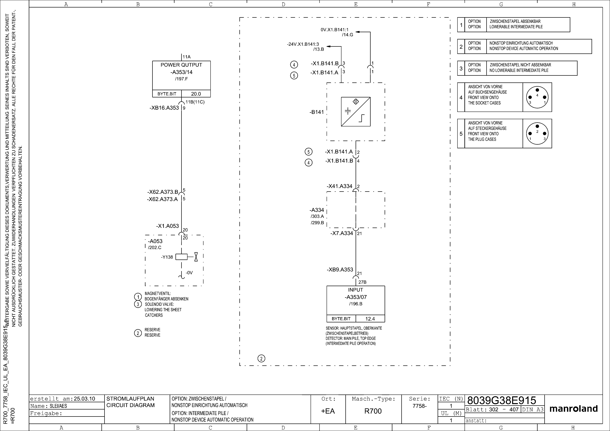

# +EA — Sheet 302 of 407 — OPTION: ZWISCHENSTAPEL /

**NONSTOP EINRICHTUNG AUTOMATISCH**

> Part of the manroland **R700** printing press IEC/UL circuit diagrams.
> Drawing class: **Stromlaufplan / Circuit diagram** (DIN A3).
> Document `+EA` covers the **Printing unit** machine section.

## At a glance

| Field | Value |
|---|---|
| Document | `+EA`  (8039G38E915) |
| Sheet | **302** of 407 |
| Section (DE) | OPTION: ZWISCHENSTAPEL / |
| Section (EN) | NONSTOP EINRICHTUNG AUTOMATISCH |
| Section type | CIRCUIT — Circuit diagram |
| Machine type | `R700` |
| Series | `7758` |
| Created | 25.03.10 |
| Replaces | — |
| Columns used | B, C, D, E, F, G, H |
| Path numbers | — |
| Labels on sheet | 100 |
| Cross-refs out | 7 |
| Cross-refs in | 20 |

**Previous:** [+EA sheet 301](SHEET_0301.md) · **Next:** [+EA sheet 303](SHEET_0303.md) · **Document TOC:** [_TOC.md](_TOC.md)  (+EA) · **Master TOC:** [all sheets](../_MASTER_TOC.md)

## Sheet image (300 DPI, exact vector render)



_Rendered directly from the PDF vector layer at 300 DPI (1-bit), no OCR and no resampling. Use it to confirm anything ambiguous in the text below._

## Cross-references on this sheet

Each entry is a wire leaving this sheet. The printed token is `/sheet.column`; the link resolves to that sheet inside the same document.

| Ref | Target sheet | Col | Path | Destination on target | Target section | From col |
|---|---|---|---|---|---|---|
| `/14.G` | [+EA sheet 14](SHEET_0014.md) | G | — | 0V.X1.B141:1 | SPANNUNGSVERSORGUNG: 400V, 24V | E |
| `/13.B` | [+EA sheet 13](SHEET_0013.md) | B | — | 24V.X1.B141:3 | SPANNUNGSVERSORGUNG: 400V, 24V | D |
| `/197.F` | [+EA sheet 197](SHEET_0197.md) | F | — | — | REFERENZMODUL | C |
| `/303.A` | [+EA sheet 303](SHEET_0303.md) | A | — | — | OPTION: ZWISCHENSTAPEL / | D |
| `/299.B` | [+EA sheet 299](SHEET_0299.md) | B | — | — | OPTION: ZWISCHENSTAPEL / | D |
| `/202.C` | [+EA sheet 202](SHEET_0202.md) | C | — | A053 | REFERENZMODUL | B |
| `/196.B` | [+EA sheet 196](SHEET_0196.md) | B | — | — | REFERENZMODUL | E |

### Incoming references (sheets that point here)

Every other sheet that sends a wire to this one. `Back-ref` is the token printed on *that* sheet; `Path` is its line number.

| From sheet | Cols | Back-ref | Path | Refs | What continues there |
|---|---|---|---|---|---|
| [+EA#13](SHEET_0013.md) | B | `/13.B` | — | 1 | — |
| [+EA#14](SHEET_0014.md) | G | `/14.G` | — | 1 | 0V.X1.B141:1 |
| [+EA#196](SHEET_0196.md) | B | `/196.B` | — | 1 | — |
| [+EA#197](SHEET_0197.md) | F | `/197.F` | — | 1 | — |
| [+EA#202](SHEET_0202.md) | C | `/202.C` | — | 1 | — |
| [+EA#206](SHEET_0206.md) | D | `/206.D` | — | 1 | — |
| [+EA#216](SHEET_0216.md) | C | `/216.C` | — | 6 | — |
| [+EA#246](SHEET_0246.md) | F | `/246.F` | — | 1 | — |
| [+EA#252](SHEET_0252.md) | C | `/252.C` | — | 1 | — |
| [+EA#261](SHEET_0261.md) | G | `/261.G` | — | 1 | — |
| [+EA#281](SHEET_0281.md) | A | `/281.A` | — | 1 | — |
| [+EA#283](SHEET_0283.md) | H | `/283.H` | — | 2 | — |
| [+EA#299](SHEET_0299.md) | A | `/299.A` | — | 1 | — |
| [+EA#303](SHEET_0303.md) | A | `/303.A` | — | 1 | — |


## Devices on this sheet

| Tag | Class | Class meaning (IEC) | Col | Sub | Terminal | Sign |
|---|---|---|---|---|---|---|
| `A353/14` | A | Baugruppe / assembly, module, PC board | C | 14 | — | — |
| `Y138` | Y | Magnetventil / solenoid valve, actuator | B | — | — | — |
| `A053` | A | Baugruppe / assembly, module, PC board | B | — | — | — |
| `B141` | B | Umformer / transducer, sensor | D | — | — | — |
| `A353/07` | A | Baugruppe / assembly, module, PC board | E | 07 | — | — |
| `A334` | A | Baugruppe / assembly, module, PC board | D | — | — | — |
| `20.0` | — | cross-device reference | C | — | — | — |
| `XB16.A353` | — | cross-device reference | B | — | — | — |
| `X1.A053` | — | cross-device reference | B | — | — | — |
| `X62.A373.B` | — | cross-device reference | B | — | — | — |
| `X62.A373.A` | — | cross-device reference | B | — | — | — |
| `X1.B141.B` | — | cross-device reference | E | — | — | — |
| `X1.B141.A` | — | cross-device reference | E | — | — | — |
| `X1.B141.B` | — | cross-device reference | E | — | — | — |
| `X1.B141.A` | — | cross-device reference | E | — | — | — |
| `X7.A334` | — | cross-device reference | E | — | — | — |
| `12.4` | — | cross-device reference | E | — | — | — |
| `XB9.A353` | — | cross-device reference | E | — | — | — |
| `X41.A334` | — | cross-device reference | E | — | — | — |

## Potentials / nets

| Potential | Count | Columns | Attached devices | Terminals |
|---|---|---|---|---|
| `0V` | 2 | C, E | `B141`, `X1` | `1` |
| `24V` | 1 | D | `B141`, `X1` | `3` |


A potential such as `L24+/4` or `M24+` is a named supply/return rail; every place it appears on this sheet is electrically common.

## Wire-end annotations (grouped as printed)

A wire that continues elsewhere is annotated with a small cluster: the destination description, the path/line number `#NN`, and the `/sheet.column` cross reference. Each row below is one such cluster exactly as it is grouped on the drawing.

| Col | Y | Path | Cross-ref | Text on the wire |
|---|---|---|---|---|
| G | 38.9 | — | — | `1 LOWERABLE INTERMEDIATE PILE ZWISCHENSTAPEL ABSENKBAR` |
| G | 38.9 | — | — | `OPTION OPTION` |
| E | 54.1 | — | `/14.G` | `0V.X1.B141:1` |
| G | 81.4 | — | — | `2 NONSTOP EINRICHTUNG AUTOMATISCH NONSTOP DEVICE AUTOMATIC OPERATION` |
| G | 81.4 | — | — | `OPTION OPTION` |
| D | 82.5 | — | `/13.B` | `24V.X1.B141:3` |
| C | 107.3 | — | — | `11A` |
| E | 119.4 | — | — | `X1.B141.B 3` |
| E | 119.4 | — | — | `1` |
| C | 122.5 | — | — | `POWER QUTPUT` |
| D | 123.6 | — | — | `4` |
| G | 123.9 | — | — | `3 NO LOWERABLE INTERMEDIATE PILE ZWISCHENSTAPEL NICHT ABSENKBAR` |
| G | 123.9 | — | — | `OPTION OPTION` |
| C | 136.4 | — | — | `A353/14` |
| E | 136.4 | — | — | `X1.B141.A 3` |
| E | 136.4 | — | — | `1` |
| D | 144.9 | — | — | `5` |
| C | 150.2 | — | `/197.F` | — |
| G | 166.5 | — | — | `FRONT VIEW ONTO ANSICHT VON VORNE AUF BUCHSENGEHÄUSE` |
| C | 179.2 | — | — | `BYTE.BIT 20.0` |
| G | 183.0 | — | — | `4` |
| F | 185.9 | — | — | `4` |
| C | 195.2 | — | — | `11B(11C)` |
| G | 197.2 | — | — | `3 1` |
| G | 198.3 | — | — | `THE SOCKET CASES` |
| B | 205.8 | — | — | `XB16.A353 9` |
| D | 214.3 | — | — | `B141` |
| G | 237.3 | — | — | `FRONT VIEW ONTO ANSICHT VON VORNE AUF STECKERGEHÄUSE` |
| G | 253.9 | — | — | `2` |
| F | 256.8 | — | — | `5` |
| G | 268.1 | — | — | `1 3` |
| G | 269.2 | — | — | `THE PLUG CASES` |
| E | 291.6 | — | — | `X1.B141.A 2` |
| D | 293.7 | — | — | `5` |
| E | 309.3 | — | — | `X1.B141.B 4` |
| D | 314.9 | — | — | `4` |
| E | 358.9 | — | — | `X41.A334 2` |
| B | 367.4 | — | — | `X62.A373.B 5` |
| B | 384.4 | — | — | `X62.A373.A 5` |
| D | 405.7 | — | — | `A334` |
| D | 418.7 | — | `/303.A`, `/299.B` | — |
| B | 436.8 | — | — | `X1.A053 20` |
| E | 451.0 | — | — | `X7.A334 21` |
| C | 460.9 | — | — | `20` |
| B | 466.6 | — | `/202.C` | `A053` |
| B | 498.5 | — | — | `Y138` |
| E | 521.9 | — | — | `XB9.A353 21` |
| C | 529.0 | — | — | `0V` |
| E | 547.4 | — | — | `27B` |
| E | 561.9 | — | — | `INPUT` |
| B | 570.4 | — | — | `BOGENFÄNGER ABSENKEN MAGNETVENTIL:` |
| E | 575.7 | — | — | `A353/07` |
| B | 576.6 | — | — | `1` |
| E | 589.5 | — | `/196.B` | — |
| B | 591.3 | — | — | `3` |
| B | 591.6 | — | — | `LOWERING THE SHEET SOLENOID VALVE:` |
| B | 612.9 | — | — | `CATCHERS` |
| E | 618.6 | — | — | `BYTE.BIT 12.4` |
| E | 638.6 | — | — | `(ZWISCHENSTAPELBETRIEB) DETECTOR: MAIN PILE, TOP EDGE (INTERMEDIATE PILE OPERATION) SENSOR: HAUPTSTAPEL, OBERKANTE` |
| B | 641.2 | — | — | `2 RESERVE RESERVE` |
| D | 697.6 | — | — | `2` |


## Reconstructed tables

This sheet carries tabular content (pin map / terminal assignment / index). The grid below was rebuilt from the drawing's own rule lines, so each row is exactly one physical row of the table.

### Table 1 — 1 data rows × 2 columns (at x=297.6, y=119.1)

| POWER | QUTPUT A353/14 /197.F |
|---|---|
| `BYTE.BIT` | `20.0` |


### Table 2 — 2 data rows × 3 columns (at x=637.8, y=189.9)

| X1.B141.A X1.B141.B X41.A334 XB9.A353 | X7.A334 | 2 4 2 21 21 27B |
|---|---|---|
|  | `INPUT` | `A353/07 /196.B` |
| `BYTE.BIT` |  | `12.4` |


## Notes and free text on this sheet

| Text | Col | Y (pt) |
|---|---|---|
| `11A` | C | 107.29 |
| `11B(11C)` | C | 195.2 |
| `POWER QUTPUT` | C | 122.45 |
| `BYTE.BIT` | B | 179.78 |
| `MAGNETVENTIL:` | B | 570.38 |
| `BOGENFÄNGER ABSENKEN` | B | 581.01 |
| `SOLENOID VALVE:` | B | 591.64 |
| `LOWERING THE SHEET` | B | 602.26 |
| `CATCHERS` | B | 612.92 |
| `27B` | E | 547.37 |
| `INPUT` | E | 561.9 |
| `BYTE.BIT` | E | 619.15 |
| `SENSOR: HAUPTSTAPEL, OBERKANTE` | E | 638.57 |
| `(ZWISCHENSTAPELBETRIEB)` | E | 648.51 |
| `DETECTOR: MAIN PILE, TOP EDGE` | E | 658.47 |
| `(INTERMEDIATE PILE OPERATION)` | E | 668.42 |
| `RESERVE` | B | 641.21 |
| `OPTION` | G | 38.87 |
| `ZWISCHENSTAPEL ABSENKBAR` | G | 38.87 |
| `LOWERABLE INTERMEDIATE PILE` | G | 49.5 |
| `NONSTOP EINRICHTUNG AUTOMATISCH` | G | 81.42 |
| `NONSTOP DEVICE AUTOMATIC OPERATION` | G | 92.04 |
| `ZWISCHENSTAPEL NICHT ABSENKBAR` | G | 123.92 |
| `NO LOWERABLE INTERMEDIATE PILE` | G | 134.55 |
| `ANSICHT VON VORNE` | G | 166.46 |
| `AUF BUCHSENGEHÄUSE` | G | 177.09 |
| `FRONT VIEW ONTO` | G | 187.69 |
| `THE SOCKET CASES` | G | 198.33 |
| `AUF STECKERGEHÄUSE` | G | 247.95 |
| `THE PLUG CASES` | G | 269.21 |

## Complete label inventory (exact text from the drawing)

Every text object inside the drawing area of this sheet, in DIN reading order (column A→H, then top→bottom). This is the authoritative list: if a string is not here it is not printed on this sheet.

| Col | Y | X | Dir | Type | Text |
|---|---|---|---|---|---|
| B | 179.8 | 307.6 | → | text | `BYTE.BIT` |
| B | 205.8 | 292.0 | → | device ref | `XB16.A353` |
| B | 370.2 | 287.7 | → | device ref | `X62.A373.B` |
| B | 384.4 | 286.9 | → | device ref | `X62.A373.A` |
| B | 436.8 | 305.0 | → | device ref | `X1.A053` |
| B | 466.6 | 288.9 | → | device tag | `A053` |
| B | 479.7 | 289.1 | → | cross-reference | `/202.C` |
| B | 498.5 | 314.4 | → | device tag | `Y138` |
| B | 570.4 | 282.9 | → | text | `MAGNETVENTIL:` |
| B | 576.6 | 267.5 | → | number | `1` |
| B | 581.0 | 282.6 | → | text | `BOGENFÄNGER ABSENKEN` |
| B | 591.3 | 267.3 | → | number | `3` |
| B | 591.6 | 283.2 | → | text | `SOLENOID VALVE:` |
| B | 602.3 | 282.6 | → | text | `LOWERING THE SHEET` |
| B | 612.9 | 283.2 | → | text | `CATCHERS` |
| B | 641.2 | 282.6 | → | text | `RESERVE` |
| B | 648.0 | 267.3 | → | number | `2` |
| B | 651.8 | 282.6 | → | text | `RESERVE` |
| C | 107.3 | 356.3 | → | text | `11A` |
| C | 122.5 | 313.5 | → | text | `POWER QUTPUT` |
| C | 136.4 | 332.9 | → | device tag | `A353/14` |
| C | 150.2 | 342.0 | → | cross-reference | `/197.F` |
| C | 179.2 | 373.2 | → | device ref | `20.0` |
| C | 195.2 | 362.0 | → | text | `11B(11C)` |
| C | 207.3 | 356.9 | → | number | `9` |
| C | 367.4 | 356.9 | → | number | `5` |
| C | 384.4 | 356.9 | → | number | `5` |
| C | 445.4 | 356.9 | → | number | `20` |
| C | 461.0 | 356.9 | → | number | `20` |
| C | 529.0 | 362.6 | → | potential | `0V` |
| D | 82.5 | 560.4 | → | potential | `24V.X1.B141:3` |
| D | 92.4 | 611.7 | → | cross-reference | `/13.B` |
| D | 123.6 | 572.0 | → | number | `4` |
| D | 144.9 | 572.0 | → | number | `5` |
| D | 214.3 | 604.3 | → | device tag | `B141` |
| D | 293.7 | 600.4 | → | number | `5` |
| D | 314.9 | 600.4 | → | number | `4` |
| D | 405.7 | 604.3 | → | device tag | `A334` |
| D | 418.7 | 606.6 | → | cross-reference | `/303.A` |
| D | 431.1 | 606.9 | → | cross-reference | `/299.B` |
| D | 697.6 | 508.2 | → | number | `2` |
| E | 54.1 | 626.2 | → | potential | `0V.X1.B141:1` |
| E | 64.0 | 667.8 | → | cross-reference | `/14.G` |
| E | 119.4 | 606.9 | → | device ref | `X1.B141.B` |
| E | 119.4 | 668.7 | → | number | `3` |
| E | 119.4 | 724.8 | → | number | `1` |
| E | 136.4 | 668.7 | → | number | `3` |
| E | 136.4 | 724.8 | → | number | `1` |
| E | 137.1 | 606.0 | → | device ref | `X1.B141.A` |
| E | 291.6 | 634.4 | → | device ref | `X1.B141.A` |
| E | 293.7 | 697.0 | → | number | `2` |
| E | 309.3 | 635.2 | → | device ref | `X1.B141.B` |
| E | 310.7 | 697.0 | → | number | `4` |
| E | 358.9 | 637.8 | → | device ref | `X41.A334` |
| E | 360.3 | 697.0 | → | number | `2` |
| E | 451.0 | 645.2 | → | device ref | `X7.A334` |
| E | 452.5 | 697.0 | → | number | `21` |
| E | 521.9 | 638.1 | → | device ref | `XB9.A353` |
| E | 530.4 | 697.0 | → | number | `21` |
| E | 547.4 | 699.9 | → | text | `27B` |
| E | 561.9 | 679.6 | → | text | `INPUT` |
| E | 575.7 | 673.1 | → | device tag | `A353/07` |
| E | 589.5 | 681.9 | → | cross-reference | `/196.B` |
| E | 618.6 | 713.1 | → | device ref | `12.4` |
| E | 619.1 | 647.7 | → | text | `BYTE.BIT` |
| E | 638.6 | 636.1 | → | text | `SENSOR: HAUPTSTAPEL, OBERKANTE` |
| E | 648.5 | 635.8 | → | text | `(ZWISCHENSTAPELBETRIEB)` |
| E | 658.5 | 635.8 | → | text | `DETECTOR: MAIN PILE, TOP EDGE` |
| E | 668.4 | 635.8 | → | text | `(INTERMEDIATE PILE OPERATION)` |
| F | 44.2 | 897.4 | → | number | `1` |
| F | 86.7 | 897.2 | → | number | `2` |
| F | 129.2 | 897.0 | → | number | `3` |
| F | 185.9 | 897.2 | → | number | `4` |
| F | 256.8 | 897.0 | → | number | `5` |
| G | 38.9 | 913.9 | → | text | `OPTION` |
| G | 38.9 | 956.7 | → | text | `ZWISCHENSTAPEL ABSENKBAR` |
| G | 49.5 | 913.9 | → | text | `OPTION` |
| G | 49.5 | 955.8 | → | text | `LOWERABLE INTERMEDIATE PILE` |
| G | 81.4 | 913.9 | → | text | `OPTION` |
| G | 81.4 | 955.8 | → | text | `NONSTOP EINRICHTUNG AUTOMATISCH` |
| G | 92.0 | 913.9 | → | text | `OPTION` |
| G | 92.0 | 955.8 | → | text | `NONSTOP DEVICE AUTOMATIC OPERATION` |
| G | 123.9 | 913.9 | → | text | `OPTION` |
| G | 123.9 | 956.7 | → | text | `ZWISCHENSTAPEL NICHT ABSENKBAR` |
| G | 134.5 | 913.9 | → | text | `OPTION` |
| G | 134.5 | 955.8 | → | text | `NO LOWERABLE INTERMEDIATE PILE` |
| G | 166.5 | 914.2 | → | text | `ANSICHT VON VORNE` |
| G | 177.1 | 914.2 | → | text | `AUF BUCHSENGEHÄUSE` |
| G | 183.0 | 1046.8 | → | number | `4` |
| G | 187.7 | 913.3 | → | text | `FRONT VIEW ONTO` |
| G | 197.2 | 1032.7 | → | number | `3` |
| G | 198.3 | 913.9 | → | text | `THE SOCKET CASES` |
| G | 237.3 | 914.2 | → | text | `ANSICHT VON VORNE` |
| G | 247.9 | 914.2 | → | text | `AUF STECKERGEHÄUSE` |
| G | 253.9 | 1046.8 | → | number | `2` |
| G | 258.6 | 913.3 | → | text | `FRONT VIEW ONTO` |
| G | 268.1 | 1033.1 | → | number | `1` |
| G | 269.2 | 913.9 | → | text | `THE PLUG CASES` |
| H | 197.2 | 1061.4 | → | number | `1` |
| H | 268.1 | 1061.0 | → | number | `3` |

## Reading-order text block

The same content as a plain block, grouped by DIN column — convenient to paste or to match against a visual description.

```text
=== Column B ===
 179.8  307.6  text         BYTE.BIT
 205.8  292.0  devref       XB16.A353
 370.2  287.7  devref       X62.A373.B
 384.4  286.9  devref       X62.A373.A
 436.8  305.0  devref       X1.A053
 466.6  288.9  devtag       A053
 479.7  289.1  xref         /202.C
 498.5  314.4  devtag       Y138
 570.4  282.9  text         MAGNETVENTIL:
 576.6  267.5  numeric      1
 581.0  282.6  text         BOGENFÄNGER ABSENKEN
 591.3  267.3  numeric      3
 591.6  283.2  text         SOLENOID VALVE:
 602.3  282.6  text         LOWERING THE SHEET
 612.9  283.2  text         CATCHERS
 641.2  282.6  text         RESERVE
 648.0  267.3  numeric      2
 651.8  282.6  text         RESERVE
=== Column C ===
 107.3  356.3  text         11A
 122.5  313.5  text         POWER QUTPUT
 136.4  332.9  devtag       A353/14
 150.2  342.0  xref         /197.F
 179.2  373.2  devref       20.0
 195.2  362.0  text         11B(11C)
 207.3  356.9  numeric      9
 367.4  356.9  numeric      5
 384.4  356.9  numeric      5
 445.4  356.9  numeric      20
 461.0  356.9  numeric      20
 529.0  362.6  net          0V
=== Column D ===
  82.5  560.4  net          24V.X1.B141:3
  92.4  611.7  xref         /13.B
 123.6  572.0  numeric      4
 144.9  572.0  numeric      5
 214.3  604.3  devtag       B141
 293.7  600.4  numeric      5
 314.9  600.4  numeric      4
 405.7  604.3  devtag       A334
 418.7  606.6  xref         /303.A
 431.1  606.9  xref         /299.B
 697.6  508.2  numeric      2
=== Column E ===
  54.1  626.2  net          0V.X1.B141:1
  64.0  667.8  xref         /14.G
 119.4  606.9  devref       X1.B141.B
 119.4  668.7  numeric      3
 119.4  724.8  numeric      1
 136.4  668.7  numeric      3
 136.4  724.8  numeric      1
 137.1  606.0  devref       X1.B141.A
 291.6  634.4  devref       X1.B141.A
 293.7  697.0  numeric      2
 309.3  635.2  devref       X1.B141.B
 310.7  697.0  numeric      4
 358.9  637.8  devref       X41.A334
 360.3  697.0  numeric      2
 451.0  645.2  devref       X7.A334
 452.5  697.0  numeric      21
 521.9  638.1  devref       XB9.A353
 530.4  697.0  numeric      21
 547.4  699.9  text         27B
 561.9  679.6  text         INPUT
 575.7  673.1  devtag       A353/07
 589.5  681.9  xref         /196.B
 618.6  713.1  devref       12.4
 619.1  647.7  text         BYTE.BIT
 638.6  636.1  text         SENSOR: HAUPTSTAPEL, OBERKANTE
 648.5  635.8  text         (ZWISCHENSTAPELBETRIEB)
 658.5  635.8  text         DETECTOR: MAIN PILE, TOP EDGE
 668.4  635.8  text         (INTERMEDIATE PILE OPERATION)
=== Column F ===
  44.2  897.4  numeric      1
  86.7  897.2  numeric      2
 129.2  897.0  numeric      3
 185.9  897.2  numeric      4
 256.8  897.0  numeric      5
=== Column G ===
  38.9  913.9  text         OPTION
  38.9  956.7  text         ZWISCHENSTAPEL ABSENKBAR
  49.5  913.9  text         OPTION
  49.5  955.8  text         LOWERABLE INTERMEDIATE PILE
  81.4  913.9  text         OPTION
  81.4  955.8  text         NONSTOP EINRICHTUNG AUTOMATISCH
  92.0  913.9  text         OPTION
  92.0  955.8  text         NONSTOP DEVICE AUTOMATIC OPERATION
 123.9  913.9  text         OPTION
 123.9  956.7  text         ZWISCHENSTAPEL NICHT ABSENKBAR
 134.5  913.9  text         OPTION
 134.5  955.8  text         NO LOWERABLE INTERMEDIATE PILE
 166.5  914.2  text         ANSICHT VON VORNE
 177.1  914.2  text         AUF BUCHSENGEHÄUSE
 183.0 1046.8  numeric      4
 187.7  913.3  text         FRONT VIEW ONTO
 197.2 1032.7  numeric      3
 198.3  913.9  text         THE SOCKET CASES
 237.3  914.2  text         ANSICHT VON VORNE
 247.9  914.2  text         AUF STECKERGEHÄUSE
 253.9 1046.8  numeric      2
 258.6  913.3  text         FRONT VIEW ONTO
 268.1 1033.1  numeric      1
 269.2  913.9  text         THE PLUG CASES
=== Column H ===
 197.2 1061.4  numeric      1
 268.1 1061.0  numeric      3
```

---
_Generated from the PDF vector text layer; no OCR. Source: `R700_7758_IEC_UL_EA_8039G38E915_p`, sheet 302._
