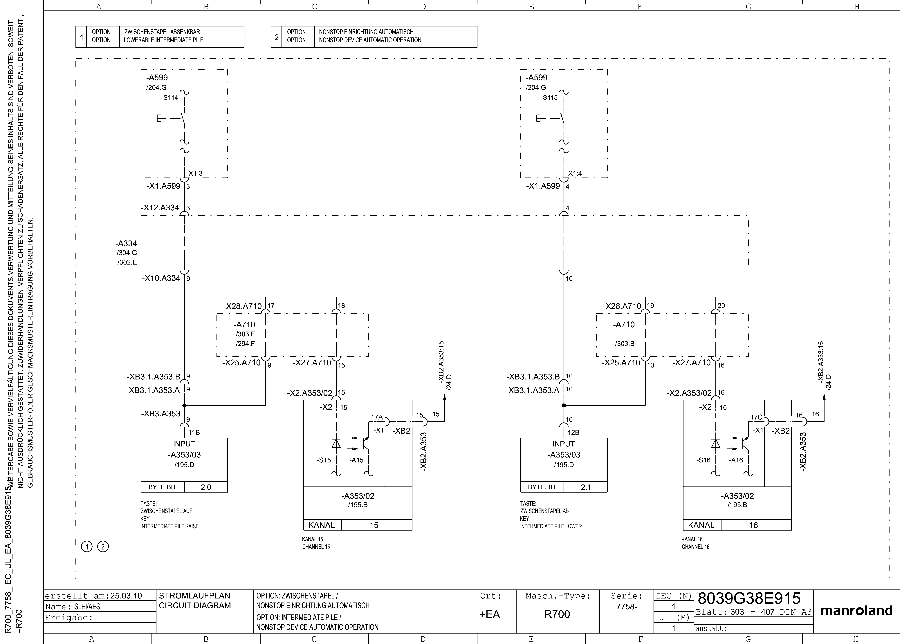

# +EA — Sheet 303 of 407 — OPTION: ZWISCHENSTAPEL /

**NONSTOP EINRICHTUNG AUTOMATISCH**

> Part of the manroland **R700** printing press IEC/UL circuit diagrams.
> Drawing class: **Stromlaufplan / Circuit diagram** (DIN A3).
> Document `+EA` covers the **Printing unit** machine section.

## At a glance

| Field | Value |
|---|---|
| Document | `+EA`  (8039G38E915) |
| Sheet | **303** of 407 |
| Section (DE) | OPTION: ZWISCHENSTAPEL / |
| Section (EN) | NONSTOP EINRICHTUNG AUTOMATISCH |
| Section type | CIRCUIT — Circuit diagram |
| Machine type | `R700` |
| Series | `7758` |
| Created | 25.03.10 |
| Replaces | — |
| Columns used | A, B, C, D, E, F, G, H |
| Path numbers | — |
| Labels on sheet | 123 |
| Cross-refs out | 13 |
| Cross-refs in | 37 |

**Previous:** [+EA sheet 302](SHEET_0302.md) · **Next:** [+EA sheet 304](SHEET_0304.md) · **Document TOC:** [_TOC.md](_TOC.md)  (+EA) · **Master TOC:** [all sheets](../_MASTER_TOC.md)

## Sheet image (300 DPI, exact vector render)



_Rendered directly from the PDF vector layer at 300 DPI (1-bit), no OCR and no resampling. Use it to confirm anything ambiguous in the text below._

## Cross-references on this sheet

Each entry is a wire leaving this sheet. The printed token is `/sheet.column`; the link resolves to that sheet inside the same document.

| Ref | Target sheet | Col | Path | Destination on target | Target section | From col |
|---|---|---|---|---|---|---|
| `/204.G` | [+EA sheet 204](SHEET_0204.md) | G | — | A599 | REFERENZMODUL | B |
| `/204.G` | [+EA sheet 204](SHEET_0204.md) | G | — | A599 | REFERENZMODUL | E |
| `/304.G` | [+EA sheet 304](SHEET_0304.md) | G | — | — | OPTION: ZWISCHENSTAPEL / | A |
| `/302.E` | [+EA sheet 302](SHEET_0302.md) | E | — | — | OPTION: ZWISCHENSTAPEL / | A |
| `/303.F` | [+EA sheet 303](SHEET_0303.md) | F | — | — | OPTION: ZWISCHENSTAPEL / | B |
| `/294.F` | [+EA sheet 294](SHEET_0294.md) | F | — | — | OPTION: ZWISCHENSTAPEL / | B |
| `/303.B` | [+EA sheet 303](SHEET_0303.md) | B | — | — | OPTION: ZWISCHENSTAPEL / | F |
| `/24.D` | [+EA sheet 24](SHEET_0024.md) | D | — | XB2.A353:15 | BUSVERBINDUNGEN: SICHERHEITSBUS | D |
| `/24.D` | [+EA sheet 24](SHEET_0024.md) | D | — | XB2.A353:16 | BUSVERBINDUNGEN: SICHERHEITSBUS | H |
| `/195.D` | [+EA sheet 195](SHEET_0195.md) | D | — | — | REFERENZMODUL | B |
| `/195.D` | [+EA sheet 195](SHEET_0195.md) | D | — | — | REFERENZMODUL | E |
| `/195.B` | [+EA sheet 195](SHEET_0195.md) | B | — | — | REFERENZMODUL | C |
| `/195.B` | [+EA sheet 195](SHEET_0195.md) | B | — | — | REFERENZMODUL | G |

### Incoming references (sheets that point here)

Every other sheet that sends a wire to this one. `Back-ref` is the token printed on *that* sheet; `Path` is its line number.

| From sheet | Cols | Back-ref | Path | Refs | What continues there |
|---|---|---|---|---|---|
| [+EA#24](SHEET_0024.md) | D | `/24.D` | — | 2 | XB2.A353:15; XB2.A353:16 |
| [+EA#195](SHEET_0195.md) | B, D | `/195.B`, `/195.D` | — | 4 | — |
| [+EA#204](SHEET_0204.md) | G | `/204.G` | — | 2 | — |
| [+EA#212](SHEET_0212.md) | B | `/212.B` | — | 2 | — |
| [+EA#224](SHEET_0224.md) | G | `/224.G` | — | 2 | — |
| [+EA#225](SHEET_0225.md) | C | `/225.C` | — | 2 | — |
| [+EA#234](SHEET_0234.md) | C, D, F | `/234.C`, `/234.D`, `/234.F` | — | 6 | — |
| [+EA#253](SHEET_0253.md) | H | `/253.H` | — | 2 | — |
| [+EA#257](SHEET_0257.md) | A | `/257.A` | — | 2 | — |
| [+EA#268](SHEET_0268.md) | C | `/268.C` | — | 2 | — |
| [+EA#271](SHEET_0271.md) | B | `/271.B` | — | 2 | — |
| [+EA#272](SHEET_0272.md) | G | `/272.G` | — | 4 | — |
| [+EA#294](SHEET_0294.md) | F | `/294.F` | — | 1 | — |
| [+EA#302](SHEET_0302.md) | D | `/302.D` | — | 1 | — |
| [+EA#303](SHEET_0303.md) | B, F | `/303.B`, `/303.F` | — | 2 | — |
| [+EA#304](SHEET_0304.md) | G | `/304.G` | — | 1 | — |


## Devices on this sheet

| Tag | Class | Class meaning (IEC) | Col | Sub | Terminal | Sign |
|---|---|---|---|---|---|---|
| `X1:3` | X | Klemme / terminal, plug connector | B | — | 3 | — |
| `S114` | S | Schalter / switch | B | — | — | — |
| `A599` | A | Baugruppe / assembly, module, PC board | B | — | — | — |
| `A353/03` | A | Baugruppe / assembly, module, PC board | B | 03 | — | — |
| `A710` | A | Baugruppe / assembly, module, PC board | B | — | — | — |
| `S15` | S | Schalter / switch | C | — | — | — |
| `A15` | A | Baugruppe / assembly, module, PC board | C | — | — | — |
| `X1` | X | Klemme / terminal, plug connector | D | — | — | — |
| `X2` | X | Klemme / terminal, plug connector | C | — | — | — |
| `XB2` | XB |  | D | — | — | — |
| `A353/02` | A | Baugruppe / assembly, module, PC board | C | 02 | — | — |
| `X1:4` | X | Klemme / terminal, plug connector | E | — | 4 | — |
| `S115` | S | Schalter / switch | E | — | — | — |
| `A599` | A | Baugruppe / assembly, module, PC board | E | — | — | — |
| `A353/03` | A | Baugruppe / assembly, module, PC board | E | 03 | — | — |
| `A710` | A | Baugruppe / assembly, module, PC board | F | — | — | — |
| `S16` | S | Schalter / switch | G | — | — | — |
| `A16` | A | Baugruppe / assembly, module, PC board | G | — | — | — |
| `X1` | X | Klemme / terminal, plug connector | G | — | — | — |
| `X2` | X | Klemme / terminal, plug connector | G | — | — | — |
| `XB2` | XB |  | G | — | — | — |
| `A353/02` | A | Baugruppe / assembly, module, PC board | G | 02 | — | — |
| `A334` | A | Baugruppe / assembly, module, PC board | A | — | — | — |
| `X1.A599` | — | cross-device reference | B | — | — | — |
| `2.0` | — | cross-device reference | B | — | — | — |
| `XB3.A353` | — | cross-device reference | B | — | — | — |
| `X28.A710` | — | cross-device reference | B | — | — | — |
| `X27.A710` | — | cross-device reference | C | — | — | — |
| `X25.A710` | — | cross-device reference | B | — | — | — |
| `XB2.A353` | — | cross-device reference | D | — | — | — |
| `XB3.1.A353.B` | — | cross-device reference | B | — | — | — |
| `XB3.1.A353.A` | — | cross-device reference | B | — | — | — |
| `X1.A599` | — | cross-device reference | E | — | — | — |
| `2.1` | — | cross-device reference | F | — | — | — |
| `X28.A710` | — | cross-device reference | F | — | — | — |
| `X27.A710` | — | cross-device reference | F | — | — | — |
| `X25.A710` | — | cross-device reference | F | — | — | — |
| `XB2.A353` | — | cross-device reference | H | — | — | — |
| `XB3.1.A353.B` | — | cross-device reference | E | — | — | — |
| `XB3.1.A353.A` | — | cross-device reference | E | — | — | — |
| `X10.A334` | — | cross-device reference | B | — | — | — |
| `X12.A334` | — | cross-device reference | B | — | — | — |
| `XB2.A353:16` | — | cross-device reference | H | — | 16 | — |
| `XB2.A353:15` | — | cross-device reference | D | — | 15 | — |

## Potentials / nets

_No named potentials on this sheet._

## Wire-end annotations (grouped as printed)

A wire that continues elsewhere is annotated with a small cluster: the destination description, the path/line number `#NN`, and the `/sheet.column` cross reference. Each row below is one such cluster exactly as it is grouped on the drawing.

| Col | Y | Path | Cross-ref | Text on the wire |
|---|---|---|---|---|
| B | 38.9 | — | — | `1 LOWERABLE INTERMEDIATE PILE ZWISCHENSTAPEL ABSENKBAR OPTION OPTION` |
| A | 38.9 | — | — | `OPTION OPTION` |
| C | 38.9 | — | — | `2 NONSTOP EINRICHTUNG AUTOMATISCH NONSTOP DEVICE AUTOMATIC OPERATION` |
| B | 96.7 | — | `/204.G` | `A599` |
| E | 96.7 | — | `/204.G` | `A599` |
| B | 124.0 | — | — | `S114` |
| E | 124.0 | — | — | `S115` |
| B | 222.8 | — | — | `X1:3` |
| E | 222.8 | — | — | `X1:4` |
| B | 238.4 | — | — | `X1.A599 3` |
| E | 238.4 | — | — | `X1.A599 4` |
| B | 266.8 | — | — | `X12.A334 3` |
| E | 268.2 | — | — | `4` |
| A | 313.5 | — | — | `A334` |
| A | 326.6 | — | `/304.G` | — |
| A | 339.0 | — | `/302.E` | — |
| B | 358.9 | — | — | `X10.A334 9` |
| E | 360.3 | — | — | `10` |
| C | 395.7 | — | — | `X28.A710 17 18` |
| F | 395.7 | — | — | `X28.A710 19 20` |
| B | 419.8 | — | — | `A710` |
| F | 419.8 | — | — | `A710` |
| B | 432.9 | — | `/303.F`, `/294.F` | — |
| F | 445.3 | — | `/303.B` | — |
| D | 445.9 | — | `/24.D` | `XB2.A353:15` |
| H | 445.9 | — | `/24.D` | `XB2.A353:16` |
| C | 469.4 | — | — | `X25.A710 9 X27.A710 15` |
| F | 469.4 | — | — | `X25.A710 10 X27.A710 16` |
| B | 487.9 | — | — | `XB3.1.A353.B 9` |
| E | 487.9 | — | — | `XB3.1.A353.B 10` |
| B | 504.9 | — | — | `XB3.1.A353.A 9` |
| E | 504.9 | — | — | `XB3.1.A353.A 10` |
| C | 509.1 | — | — | `X2.A353/02 15` |
| G | 509.1 | — | — | `X2.A353/02 16` |
| C | 527.6 | — | — | `X2` |
| G | 527.6 | — | — | `X2` |
| D | 529.0 | — | — | `15 15` |
| G | 529.0 | — | — | `16 16` |
| B | 536.1 | — | — | `XB3.A353 9` |
| D | 537.5 | — | — | `15` |
| H | 537.5 | — | — | `16` |
| D | 541.7 | — | — | `17A` |
| G | 541.8 | — | — | `17C` |
| E | 544.6 | — | — | `10` |
| D | 558.7 | — | — | `X1` |
| D | 558.7 | — | — | `XB2` |
| G | 558.7 | — | — | `X1` |
| G | 558.7 | — | — | `XB2` |
| B | 561.5 | — | — | `11B` |
| E | 561.5 | — | — | `12B` |
| D | 565.0 | — | — | `XB2.A353` |
| H | 565.0 | — | — | `XB2.A353` |
| B | 576.1 | — | — | `INPUT` |
| E | 576.1 | — | — | `INPUT` |
| B | 589.9 | — | — | `A353/03` |
| E | 589.9 | — | — | `A353/03` |
| C | 597.7 | — | — | `S15 A15` |
| G | 597.7 | — | — | `S16 A16` |
| B | 603.7 | — | `/195.D` | — |
| E | 603.7 | — | `/195.D` | — |
| B | 632.7 | — | — | `BYTE.BIT 2.0` |
| E | 632.7 | — | — | `BYTE.BIT 2.1` |
| C | 643.8 | — | — | `A353/02` |
| G | 643.8 | — | — | `A353/02` |
| B | 655.5 | — | — | `KEY: INTERMEDIATE PILE RAISE TASTE: ZWISCHENSTAPEL AUF` |
| E | 655.5 | — | — | `KEY: INTERMEDIATE PILE LOWER TASTE: ZWISCHENSTAPEL AB` |
| C | 656.1 | — | `/195.B` | — |
| G | 656.1 | — | `/195.B` | — |
| C | 682.0 | — | — | `KANAL 15` |
| G | 682.0 | — | — | `KANAL 16` |
| C | 702.4 | — | — | `KANAL 15 CHANNEL 15` |
| G | 702.4 | — | — | `KANAL 16 CHANNEL 16` |
| A | 711.3 | — | — | `1 2` |


## Reconstructed tables

This sheet carries tabular content (pin map / terminal assignment / index). The grid below was rebuilt from the drawing's own rule lines, so each row is exactly one physical row of the table.

### Table 1 — 7 data rows × 19 columns (at x=184.3, y=90.7)

| A599 /204.G S114 | X1:3 |  |  |  |  |  |  |  |  | A599 /204.G S115 | X1:4 |  |  |  |  |  |  |  |
|---|---|---|---|---|---|---|---|---|---|---|---|---|---|---|---|---|---|---|
| `X1.A599 X12.A334 X10.A334` | `3 3 9` |  |  |  |  |  |  |  |  | `X1.A599` | `4 4 10` |  |  |  |  |  |  |  |
| `XB3.1.A353.B XB3.1.A353.A` | `9 9` | `X28.A710 A710 /303.F /294.F X25.A710` | `17 9` | `X27.A710 X2.A353/02` | `18 15 15` |  |  | `XB2.A353:15` | `/24.D` | `XB3.1.A353.B XB3.1.A353.A` | `10 10` | `X28.A710 A710 /303.B X25.A710` | `19 10` | `X27.A710 X2.A353/02` | `20 16 16` |  |  | `XB2.A353:16` |
| `XB3.A353` | `9 11B` |  |  | `X2` | `15` | `17A X1` | `XB2` | `15 15` |  |  | `10 12B` |  |  | `X2` | `16` | `17C X1` | `XB2` | `16 16` |
| `INPUT` | `A353/03 /195.D` |  |  | `S15` | `A15` |  |  | `XB2.A353` |  | `INPUT` | `A353/03 /195.D` |  |  | `S16` | `A16` |  |  | `XB2.A353` |
| `BYTE.BIT` | `2.0` |  |  |  |  |  |  |  |  | `BYTE.BIT` | `2.1` |  |  |  |  |  |  |  |
| `TASTE: ZWISCHENSTAPEL` | `AUF` |  |  |  | `A353/02 /195.B` |  |  |  |  | `TASTE: ZWISCHENSTAPEL` | `AB` |  |  |  | `A353/02 /195.B` |  |  |  |
| `KEY: INTERMEDIATE PILE` | `RAISE` |  |  | `KANAL` |  | `15` |  |  |  | `KEY: INTERMEDIATE PILE` | `LOWER` |  |  | `KANAL` |  | `16` |  |  |


## Notes and free text on this sheet

| Text | Col | Y (pt) |
|---|---|---|
| `11B` | B | 561.55 |
| `INPUT` | B | 576.07 |
| `BYTE.BIT` | B | 633.32 |
| `TASTE:` | A | 655.51 |
| `ZWISCHENSTAPEL AUF` | B | 665.52 |
| `KEY:` | A | 675.46 |
| `INTERMEDIATE PILE RAISE` | B | 685.45 |
| `KANAL 15` | C | 702.36 |
| `CHANNEL 15` | C | 712.3 |
| `17A` | D | 541.7 |
| `KANAL` | C | 682.03 |
| `X2.A353/02` | C | 509.13 |
| `12B` | E | 561.55 |
| `INPUT` | E | 576.07 |
| `BYTE.BIT` | E | 633.32 |
| `TASTE:` | E | 655.51 |
| `ZWISCHENSTAPEL AB` | E | 665.52 |
| `KEY:` | E | 675.46 |
| `INTERMEDIATE PILE LOWER` | E | 685.43 |
| `KANAL 16` | F | 702.36 |
| `CHANNEL 16` | G | 712.3 |
| `17C` | G | 541.75 |
| `KANAL` | G | 682.03 |
| `X2.A353/02` | F | 509.13 |
| `OPTION` | A | 38.87 |
| `ZWISCHENSTAPEL ABSENKBAR` | B | 38.87 |
| `LOWERABLE INTERMEDIATE PILE` | B | 49.5 |
| `OPTION` | C | 38.87 |
| `NONSTOP EINRICHTUNG AUTOMATISCH` | C | 38.9 |
| `NONSTOP DEVICE AUTOMATIC OPERATION` | D | 49.52 |

## Complete label inventory (exact text from the drawing)

Every text object inside the drawing area of this sheet, in DIN reading order (column A→H, then top→bottom). This is the authoritative list: if a string is not here it is not printed on this sheet.

| Col | Y | X | Dir | Type | Text |
|---|---|---|---|---|---|
| A | 38.9 | 120.2 | → | text | `OPTION` |
| A | 44.2 | 103.7 | → | number | `1` |
| A | 49.5 | 120.2 | → | text | `OPTION` |
| A | 313.5 | 150.8 | → | device tag | `A334` |
| A | 326.6 | 152.8 | → | cross-reference | `/304.G` |
| A | 339.0 | 153.6 | → | cross-reference | `/302.E` |
| A | 655.5 | 184.0 | → | text | `TASTE:` |
| A | 675.5 | 183.7 | → | text | `KEY:` |
| A | 711.3 | 111.6 | → | number | `1` |
| A | 711.8 | 132.7 | → | number | `2` |
| B | 38.9 | 163.0 | → | text | `ZWISCHENSTAPEL ABSENKBAR` |
| B | 49.5 | 162.1 | → | text | `LOWERABLE INTERMEDIATE PILE` |
| B | 96.7 | 191.1 | → | device tag | `A599` |
| B | 110.5 | 191.3 | → | cross-reference | `/204.G` |
| B | 124.0 | 210.9 | → | device tag | `S114` |
| B | 222.8 | 246.6 | → | device tag | `X1:3` |
| B | 238.4 | 191.6 | → | device ref | `X1.A599` |
| B | 239.9 | 243.5 | → | number | `3` |
| B | 266.8 | 184.3 | → | device ref | `X12.A334` |
| B | 268.2 | 243.5 | → | number | `3` |
| B | 358.9 | 185.7 | → | device ref | `X10.A334` |
| B | 360.3 | 243.5 | → | number | `9` |
| B | 395.7 | 292.0 | → | device ref | `X28.A710` |
| B | 419.8 | 305.3 | → | device tag | `A710` |
| B | 432.9 | 308.4 | → | cross-reference | `/303.F` |
| B | 445.3 | 308.4 | → | cross-reference | `/294.F` |
| B | 469.4 | 290.6 | → | device ref | `X25.A710` |
| B | 487.9 | 165.8 | → | device ref | `XB3.1.A353.B` |
| B | 487.9 | 243.5 | → | number | `9` |
| B | 504.9 | 243.5 | → | number | `9` |
| B | 505.6 | 165.0 | → | device ref | `XB3.1.A353.A` |
| B | 536.1 | 184.5 | → | device ref | `XB3.A353` |
| B | 544.6 | 243.5 | → | number | `9` |
| B | 561.5 | 245.8 | → | text | `11B` |
| B | 576.1 | 226.1 | → | text | `INPUT` |
| B | 589.9 | 219.5 | → | device tag | `A353/03` |
| B | 603.7 | 228.2 | → | cross-reference | `/195.D` |
| B | 632.7 | 262.5 | → | device ref | `2.0` |
| B | 633.3 | 194.2 | → | text | `BYTE.BIT` |
| B | 665.5 | 184.3 | → | text | `ZWISCHENSTAPEL AUF` |
| B | 685.5 | 183.7 | → | text | `INTERMEDIATE PILE RAISE` |
| C | 38.9 | 375.3 | → | text | `OPTION` |
| C | 38.9 | 417.3 | → | text | `NONSTOP EINRICHTUNG AUTOMATISCH` |
| C | 44.2 | 358.6 | → | number | `2` |
| C | 49.5 | 375.3 | → | text | `OPTION` |
| C | 395.8 | 349.2 | → | number | `17` |
| C | 395.8 | 441.4 | → | number | `18` |
| C | 469.4 | 382.7 | → | device ref | `X27.A710` |
| C | 473.7 | 349.8 | → | number | `9` |
| C | 473.7 | 441.4 | → | number | `15` |
| C | 509.1 | 375.3 | → | text | `X2.A353/02` |
| C | 509.1 | 441.4 | → | number | `15` |
| C | 527.6 | 417.8 | → | device tag | `X2` |
| C | 529.0 | 444.2 | → | number | `15` |
| C | 597.7 | 414.1 | → | device tag | `S15` |
| C | 597.7 | 456.7 | → | device tag | `A15` |
| C | 643.8 | 446.3 | → | device tag | `A353/02` |
| C | 656.1 | 455.1 | → | cross-reference | `/195.B` |
| C | 682.0 | 403.1 | → | text | `KANAL` |
| C | 702.4 | 394.9 | → | text | `KANAL 15` |
| C | 712.3 | 395.1 | → | text | `CHANNEL 15` |
| D | 49.5 | 417.3 | → | text | `NONSTOP DEVICE AUTOMATIC OPERATION` |
| D | 445.9 | 572.9 | ↕ | device ref | `XB2.A353:15` |
| D | 489.3 | 582.8 | ↕ | cross-reference | `/24.D` |
| D | 537.5 | 564.7 | → | number | `15` |
| D | 538.9 | 543.4 | → | number | `15` |
| D | 541.7 | 484.7 | → | text | `17A` |
| D | 558.7 | 488.4 | → | device tag | `X1` |
| D | 558.7 | 512.8 | → | device tag | `XB2` |
| D | 564.9 | 548.8 | ↕ | device ref | `XB2.A353` |
| D | 682.0 | 482.7 | → | number | `15` |
| E | 96.7 | 687.1 | → | device tag | `A599` |
| E | 110.5 | 687.4 | → | cross-reference | `/204.G` |
| E | 124.0 | 707.0 | → | device tag | `S115` |
| E | 222.8 | 742.7 | → | device tag | `X1:4` |
| E | 238.4 | 687.7 | → | device ref | `X1.A599` |
| E | 239.9 | 739.6 | → | number | `4` |
| E | 268.2 | 739.6 | → | number | `4` |
| E | 360.3 | 739.0 | → | number | `10` |
| E | 487.9 | 661.9 | → | device ref | `XB3.1.A353.B` |
| E | 487.9 | 739.0 | → | number | `10` |
| E | 504.9 | 739.0 | → | number | `10` |
| E | 505.6 | 661.0 | → | device ref | `XB3.1.A353.A` |
| E | 544.6 | 739.0 | → | number | `10` |
| E | 561.5 | 741.8 | → | text | `12B` |
| E | 576.1 | 722.1 | → | text | `INPUT` |
| E | 589.9 | 715.6 | → | device tag | `A353/03` |
| E | 603.7 | 724.3 | → | cross-reference | `/195.D` |
| E | 633.3 | 690.2 | → | text | `BYTE.BIT` |
| E | 655.5 | 680.0 | → | text | `TASTE:` |
| E | 665.5 | 680.3 | → | text | `ZWISCHENSTAPEL AB` |
| E | 675.5 | 679.7 | → | text | `KEY:` |
| E | 685.4 | 679.7 | → | text | `INTERMEDIATE PILE LOWER` |
| F | 395.7 | 788.0 | → | device ref | `X28.A710` |
| F | 395.8 | 845.3 | → | number | `19` |
| F | 419.8 | 801.4 | → | device tag | `A710` |
| F | 445.3 | 803.9 | → | cross-reference | `/303.B` |
| F | 469.4 | 786.6 | → | device ref | `X25.A710` |
| F | 469.4 | 878.7 | → | device ref | `X27.A710` |
| F | 473.7 | 845.3 | → | number | `10` |
| F | 509.1 | 871.4 | → | text | `X2.A353/02` |
| F | 632.7 | 759.4 | → | device ref | `2.1` |
| F | 702.4 | 890.9 | → | text | `KANAL 16` |
| G | 395.8 | 938.0 | → | number | `20` |
| G | 473.7 | 937.4 | → | number | `16` |
| G | 509.1 | 937.4 | → | number | `16` |
| G | 527.6 | 913.9 | → | device tag | `X2` |
| G | 529.0 | 940.3 | → | number | `16` |
| G | 538.9 | 1039.5 | → | number | `16` |
| G | 541.7 | 980.8 | → | text | `17C` |
| G | 558.7 | 984.5 | → | device tag | `X1` |
| G | 558.7 | 1008.9 | → | device tag | `XB2` |
| G | 597.7 | 910.2 | → | device tag | `S16` |
| G | 597.7 | 952.7 | → | device tag | `A16` |
| G | 643.8 | 942.4 | → | device tag | `A353/02` |
| G | 656.1 | 951.2 | → | cross-reference | `/195.B` |
| G | 682.0 | 899.1 | → | text | `KANAL` |
| G | 682.0 | 978.8 | → | number | `16` |
| G | 712.3 | 891.2 | → | text | `CHANNEL 16` |
| H | 445.9 | 1068.9 | ↕ | device ref | `XB2.A353:16` |
| H | 489.3 | 1078.9 | ↕ | cross-reference | `/24.D` |
| H | 537.5 | 1060.7 | → | number | `16` |
| H | 564.9 | 1044.9 | ↕ | device ref | `XB2.A353` |

## Reading-order text block

The same content as a plain block, grouped by DIN column — convenient to paste or to match against a visual description.

```text
=== Column A ===
  38.9  120.2  text         OPTION
  44.2  103.7  numeric      1
  49.5  120.2  text         OPTION
 313.5  150.8  devtag       A334
 326.6  152.8  xref         /304.G
 339.0  153.6  xref         /302.E
 655.5  184.0  text         TASTE:
 675.5  183.7  text         KEY:
 711.3  111.6  numeric      1
 711.8  132.7  numeric      2
=== Column B ===
  38.9  163.0  text         ZWISCHENSTAPEL ABSENKBAR
  49.5  162.1  text         LOWERABLE INTERMEDIATE PILE
  96.7  191.1  devtag       A599
 110.5  191.3  xref         /204.G
 124.0  210.9  devtag       S114
 222.8  246.6  devtag       X1:3
 238.4  191.6  devref       X1.A599
 239.9  243.5  numeric      3
 266.8  184.3  devref       X12.A334
 268.2  243.5  numeric      3
 358.9  185.7  devref       X10.A334
 360.3  243.5  numeric      9
 395.7  292.0  devref       X28.A710
 419.8  305.3  devtag       A710
 432.9  308.4  xref         /303.F
 445.3  308.4  xref         /294.F
 469.4  290.6  devref       X25.A710
 487.9  165.8  devref       XB3.1.A353.B
 487.9  243.5  numeric      9
 504.9  243.5  numeric      9
 505.6  165.0  devref       XB3.1.A353.A
 536.1  184.5  devref       XB3.A353
 544.6  243.5  numeric      9
 561.5  245.8  text         11B
 576.1  226.1  text         INPUT
 589.9  219.5  devtag       A353/03
 603.7  228.2  xref         /195.D
 632.7  262.5  devref       2.0
 633.3  194.2  text         BYTE.BIT
 665.5  184.3  text         ZWISCHENSTAPEL AUF
 685.5  183.7  text         INTERMEDIATE PILE RAISE
=== Column C ===
  38.9  375.3  text         OPTION
  38.9  417.3  text         NONSTOP EINRICHTUNG AUTOMATISCH
  44.2  358.6  numeric      2
  49.5  375.3  text         OPTION
 395.8  349.2  numeric      17
 395.8  441.4  numeric      18
 469.4  382.7  devref       X27.A710
 473.7  349.8  numeric      9
 473.7  441.4  numeric      15
 509.1  375.3  text         X2.A353/02
 509.1  441.4  numeric      15
 527.6  417.8  devtag       X2
 529.0  444.2  numeric      15
 597.7  414.1  devtag       S15
 597.7  456.7  devtag       A15
 643.8  446.3  devtag       A353/02
 656.1  455.1  xref         /195.B
 682.0  403.1  text         KANAL
 702.4  394.9  text         KANAL 15
 712.3  395.1  text         CHANNEL 15
=== Column D ===
  49.5  417.3  text         NONSTOP DEVICE AUTOMATIC OPERATION
 445.9  572.9  devref       XB2.A353:15
 489.3  582.8  xref         /24.D
 537.5  564.7  numeric      15
 538.9  543.4  numeric      15
 541.7  484.7  text         17A
 558.7  488.4  devtag       X1
 558.7  512.8  devtag       XB2
 564.9  548.8  devref       XB2.A353
 682.0  482.7  numeric      15
=== Column E ===
  96.7  687.1  devtag       A599
 110.5  687.4  xref         /204.G
 124.0  707.0  devtag       S115
 222.8  742.7  devtag       X1:4
 238.4  687.7  devref       X1.A599
 239.9  739.6  numeric      4
 268.2  739.6  numeric      4
 360.3  739.0  numeric      10
 487.9  661.9  devref       XB3.1.A353.B
 487.9  739.0  numeric      10
 504.9  739.0  numeric      10
 505.6  661.0  devref       XB3.1.A353.A
 544.6  739.0  numeric      10
 561.5  741.8  text         12B
 576.1  722.1  text         INPUT
 589.9  715.6  devtag       A353/03
 603.7  724.3  xref         /195.D
 633.3  690.2  text         BYTE.BIT
 655.5  680.0  text         TASTE:
 665.5  680.3  text         ZWISCHENSTAPEL AB
 675.5  679.7  text         KEY:
 685.4  679.7  text         INTERMEDIATE PILE LOWER
=== Column F ===
 395.7  788.0  devref       X28.A710
 395.8  845.3  numeric      19
 419.8  801.4  devtag       A710
 445.3  803.9  xref         /303.B
 469.4  786.6  devref       X25.A710
 469.4  878.7  devref       X27.A710
 473.7  845.3  numeric      10
 509.1  871.4  text         X2.A353/02
 632.7  759.4  devref       2.1
 702.4  890.9  text         KANAL 16
=== Column G ===
 395.8  938.0  numeric      20
 473.7  937.4  numeric      16
 509.1  937.4  numeric      16
 527.6  913.9  devtag       X2
 529.0  940.3  numeric      16
 538.9 1039.5  numeric      16
 541.7  980.8  text         17C
 558.7  984.5  devtag       X1
 558.7 1008.9  devtag       XB2
 597.7  910.2  devtag       S16
 597.7  952.7  devtag       A16
 643.8  942.4  devtag       A353/02
 656.1  951.2  xref         /195.B
 682.0  899.1  text         KANAL
 682.0  978.8  numeric      16
 712.3  891.2  text         CHANNEL 16
=== Column H ===
 445.9 1068.9  devref       XB2.A353:16
 489.3 1078.9  xref         /24.D
 537.5 1060.7  numeric      16
 564.9 1044.9  devref       XB2.A353
```

---
_Generated from the PDF vector text layer; no OCR. Source: `R700_7758_IEC_UL_EA_8039G38E915_p`, sheet 303._
